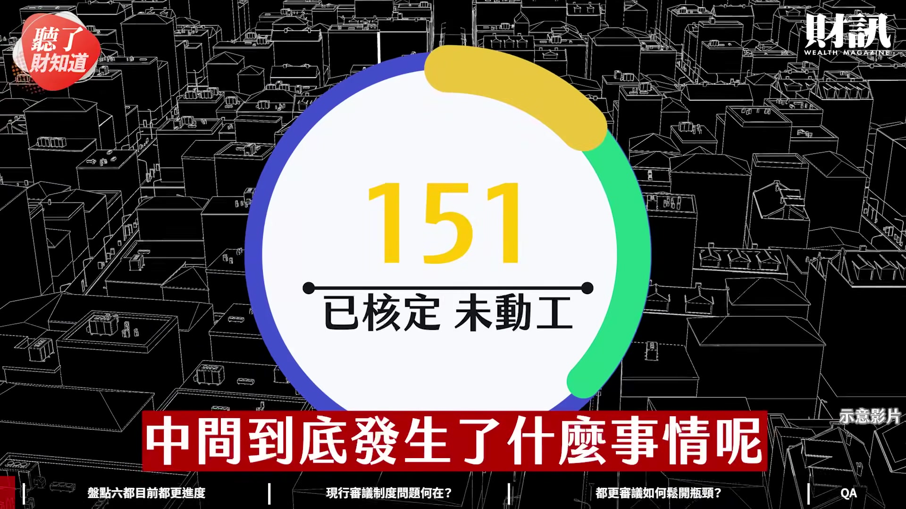
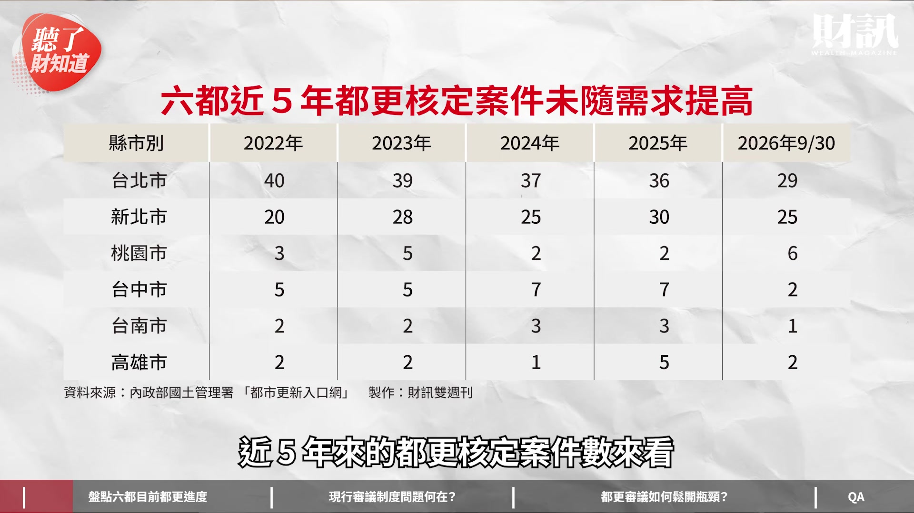
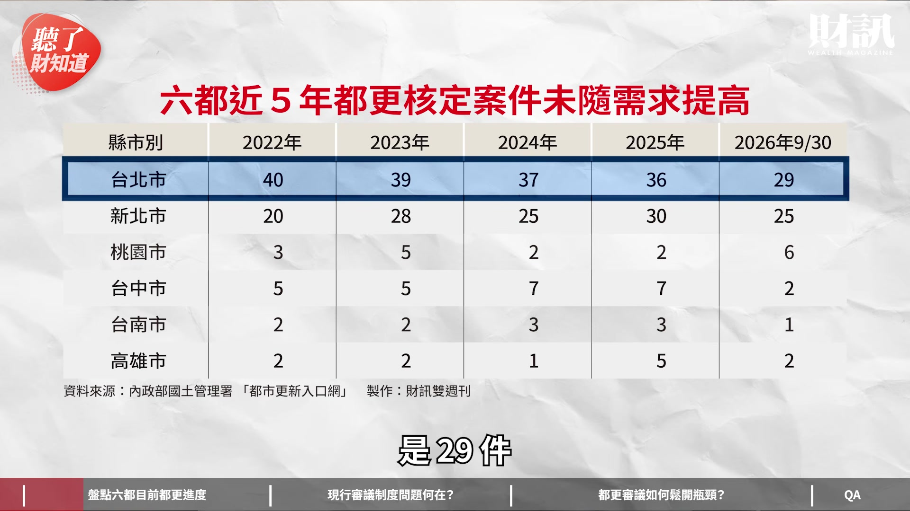
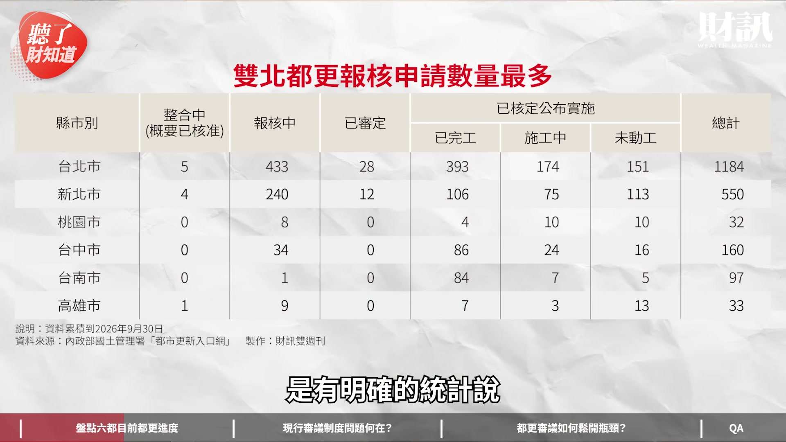
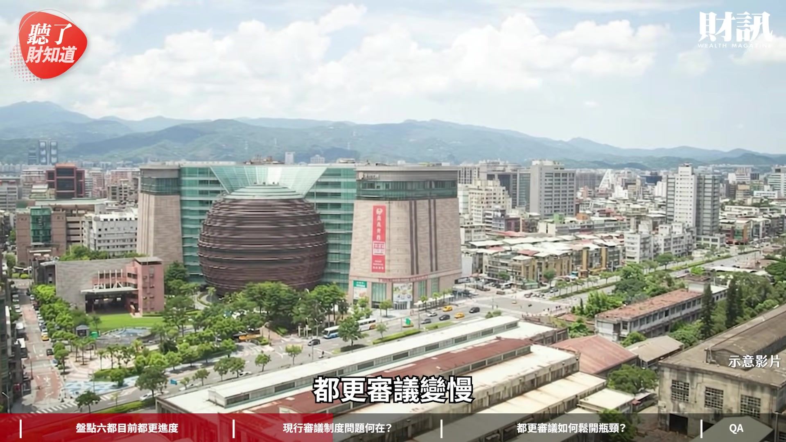

# wealth1974_3qWLXsuoAFo — 關鍵畫面索引

- 來源逐字稿：[wealth1974_3qWLXsuoAFo_GT.srt](wealth1974_3qWLXsuoAFo_GT.srt)
- 影片：https://www.youtube.com/watch?v=3qWLXsuoAFo
- 截圖數：18

## 00:00:06

**逐字稿片段：** 以台北市為例 累積 1184 個都更案例中 還有 443 個正在審議中 151 個案子過了卻沒有動工 中間到底發生了什麼事情呢

**話題推測：** 畫面可能顯示台北市都更案例統計圖表。

---

## 00:00:17

**逐字稿片段：** 今天這一集我們讓數字先說話

**話題推測：** 畫面切換到節目段落標題或數據總覽。

---

## 00:00:19

**逐字稿片段：** 先分享六都目前的都更進度

**話題推測：** 畫面顯示六都都更進度總覽。

---

## 00:00:21

**逐字稿片段：** 再來分享現行的審議制度 到底有什麼問題 最後我們匯集了專家跟學者的建議 跟大家談一下說 都更審議可以如何打開瓶頸 大家好 我是今天主持人陳彥淳 今天來賓是 財訊雙週刊的主編游筱燕 歡迎筱燕 總編好 觀眾朋友們大家好 我是筱燕 都更議題是最近非常熱的話題 剛好現在適逢選舉 所有的縣市首長 尤其是 因為雙北的屋子最多又最老 所以是一個重要的話題 其實財訊長年都 聚焦在都更的議題上面 我們都更危老博覽會 已經今年是進入第 8 年了 所以這個議題 當然我們就要再深入的探討 到底快還是慢 這件事情 政府有政府的說法 民間有民間的感受 所以我們第一件事情 就是讓數字說話 那是不是先請筱燕幫我們分享一下

**話題推測：** 畫面顯示審議制度問題相關圖表。

---

## 00:01:08

**逐字稿片段：** 近 5 年來 六都在推動都更的 數據的情況是怎麼樣 是 內政部國土管理署 上面的一些數字 來跟大家分享 我直接先抓了這個六都 近 5 年來的都更核定案件數來看

**話題推測：** 畫面顯示近五年六都都更核定案件數表格或圖表。

---

## 00:01:21

**逐字稿片段：** 以台北市來說 2022 年的時候是 一年是核定 40 件 2023 年是 39 件 2024 年是 37 件 2025 年是 36 件 那截至 2026 年的 9 月 30 日 是 29 件

**話題推測：** 畫面特寫或高亮台北市的年度核定案件數。

---

## 00:01:33

**逐字稿片段：** 再來看新北市 我們看從 2022 年開始 陸續是 20 件 28 件 25 件 30 件 25 件 對 我跟大家稍微解釋一下 就是因為其實各地方政府 是負責都更的審核 就是說 今天如果我有房子要都更 送進市政府 審核通過之後 我才可以開始動工對不對 所以市政府通過的案子 大概可以代表說 都更推動的速度大概是怎麼樣 對 大家可以發現說 這幾年雙北市 然後甚至是六都 每一年核定的這個案件數 其實都差不多是這樣子 滿穩定的 就是以台北市來講 就是在 36 件到 40 件中間 那新北市是從 20 件到 30 件這中間 我們現在都知道 都更的需求愈來愈龐大 各地方政府也在鼓勵大家 如果有危險的建築物 或是你覺得結構有疑慮 都可以來都更 可是並沒有因為門檻降低 或是政府鼓勵 然後讓這個核定的數字 有明顯大幅的增加 所以這就是為什麼 大家可能會覺得慢的原因之一 其實這次筱燕滿用心 我們進一步再來看說

**話題推測：** 畫面特寫或高亮新北市的年度核定案件數。

---

## 00:02:36

**逐字稿片段：** 到底是卡在哪一關 事實上整個內政部 是有明確的統計說

**話題推測：** 畫面切換到都更流程中瓶頸點的分析圖。

---

## 00:02:40

**逐字稿片段：** 都更的流程裡面 在整合中 報核中 就是所謂的審議中 還有已核定 以及核定之後的進度 有滿明確的數字可以跟大家分享 對 一樣是在這個國土署上面 找到的數據 台北市來說 目前有 1184 件 就是在這個（都更）過程當中 以台北市為例 對 那在報核中的有 433 件 然後在已核定公布實施的 就是已完工的有 393 件 在施工中有 174 件 然後未動工的有 151 件 那在以新北市來看 在走都更流程的案子 總計是有 550 件 報核中的是有 240 件 在已核定公布實施的裡面 完工的有 106 件 施工的 75 件 未動工的是 113 件 核定公布實施的也是有一定的量 可是未動工的 在台北市就有 151 件 然後在新北市有 113 件 都有破百件 你可以動工但是還沒有動工的 瞭解 從這個數字這個表格來看 我覺得有兩件事情可以跟大家分享 就是說第一件事情就是 雙北的確量能很大 第二個就是報核中 跟已經核定公布但未動工 這數字特別的高 看起來是一個讓大家覺得 都更速度慢的兩個關卡 這些是已經送進來的 在還沒有送進來之前那個整合 這次我們在這個都更的博覽會 裡面就有講 很多人覺得都更很難是因為 都更不是只有整合土地 其實整合人心 是 大概分享一下說

**話題推測：** 畫面可能顯示都更流程各階段的統計數據。

---

## 00:04:05

**逐字稿片段：** 目前都更遇到的五大瓶頸 大概有一些地主心理 就是總編講的整合人心的部分 再來是造價資金 還有行政制度 跟基地的規畫 還有高齡安置的問題 還有比較大的問題 就是近年來大家都知道 第七波信用管制之後 其實房市是非常低迷的 還有這幾年來缺工缺料 還有營造成本的上漲 那房市低迷之後也會影響說 我是不是要都更 未來的房價會不會如我預期 以台北市來講 就是已核定的總共是 718 件 然後其實有 151 件沒有動工 占比是 21% 那以新北市來講 是已經核定的有 219 件 有 113 件沒有動工 這是占 51% 占比都滿驚人的 對 其實量滿大的 如果以總計的數量來說 未動工包括台北跟新北的數量 都有上百件 其實一個都更案 它攸關到非常多的住戶 都已經通過了 他可能已經搬出去了 結果還未動工 這一拖 其實我們聽到滿多 這種辛酸血淚史的 這就是很亟待克服的地方 那這次我們也想要聊到 有關於政府審議這件事情 就有關於報核中的案件 其實也偏多這件事情 這次我們想特別提出來稍微聊一下 包括雙北市政府 都推出非常多的政策 希望可以簡化這個流程 但從數字上來看 跟以及從業者的實際體感來看 還是覺得滿慢的 到底發生什麼事情 剛剛提到的這個 都更的五大瓶頸裡面 其實有一個 就是叫做行政制度這一塊 是大家過去比較少人探討的 所以這次才想說 把數字整個呈現出來 讓大家看說 到底實際第一線 發生的情況是怎麼樣 台北市來講 就是蔣萬安蔣市長 他推這個都更八箭 公辦都更的整個門檻降低 從這個 7599 變成 5099 要讓大家更容易 就是參與都更這件事情 但是呢 就會落到一個大家比較常講的就是說 我可以放寬我的門檻 我現在入口就是變得很寬 可是我出口窄 就是我出去的案件數呢 其實不如預期的這麼多 很多第一線的 譬如說建築師 建商 甚至是地主 都來跟我們分享說 自己在第一線上面 遇到什麼困難

**話題推測：** 畫面顯示都更遭遇的五大瓶頸列表或圖解。

---

## 00:06:12

**逐字稿片段：** 一個房市專家 他有跟我說 他自己參與一個案子 然後這個案子呢 其實是 50 年的屋齡 兩層樓的老建物 道路也很寬廣 就是大概 20 米的道路 他最近準備要都更 卻在送件審查的時候被說 要檢討這棟 50 年老屋的削線 什麼是削線 幫大家解釋科普一下 對 削線問題 其實削線就是退縮的問題 就是建築物蓋到的高度 然後它不可以擋到通風跟採光 所以會規定說 蓋到多少的樓高 那你必須要退縮 這就是削線 可是他比較 concern 的問題是說 這個建築物其實就很低 它只有兩層樓 然後在 50 年前 也是政府的建管處 核定這個房子才能蓋的 那他為什麼要去檢討 舊建築物的削線 應該要去檢討 它新的房子的其他設計的問題 他就覺得一頭霧水 我送進去 我又被退回來 那當中又過了兩個月 然後每一次 都是因為很多這種小事情 累積兩個月 兩個月 兩個月 他自己的感受 因為他是第一線業者 他就說 都更審議變慢

**話題推測：** 畫面可能呈現房市專家分享的個案故事。

---

## 00:07:09

**逐字稿片段：** 跟這個京華城有很大的關係 想要蓋章意願比較低 那他大大小小事情就直接送審議會 塞車在那裡 我覺得可以幫筱燕做一個總結 就是說 事實上因為都更涉及的範圍 非常非常廣 跨局處的問題也滿多的 可能對於都更不熟悉 或者是如果你的規範不是非常明確 如果你當時沒有講清楚 可能就造成來回的公務往返的時間 一線的公務員也非常非常辛苦 那他們又擔心出錯 又擔心一弄不好 被人家說是圖利廠商 老實說 這進退維谷之間 一線公務員也非常為難 而且老實說 我們在接觸到很多雙北的 這個都更處的相關人等 他們其實是非常優秀 非常專業的 可是他們都普遍面臨到 人力不足的問題 這也是現實 今天人力就這麼多 那你就要審那麼多的案子 尤其是雙北 這是爆案 送進來之後 我要怎麼樣快速處理 但又要承擔責任 這件事情老實說 我覺得對一線公務員來說考驗很大 所以大家有說最近 都更相關的局處離職率很高 內心壓力很大 那一離職之後呢 就是這個案件所有的瞭解度 熟悉度 又要重新開始 因為新的這個承辦人員又不太瞭解 那因為都更是真的是 一個非常複雜的事情 沒錯 每個案子都不一樣 對 它沒辦法套版 然後再來是說 整個計畫書其實非常複雜 動輒一個案子的計畫書 就有上千頁 他一個承辦人員 手上就累積幾十件 其實負荷也是滿大的 對 而且一個案子可能這個金額 也是數十億元到上百億元 真的 對 所以這樣叫一個公務員 就要自己決定這些事情 我覺得的確是 除非有很完整的流程 讓大家知道說 這樣做我是有靠山 或者是有依據的 不然的話 因為真的都更那是百百種 不是標準品 所以它很多變通 權宜 今天你說要一個一線公務員 就立刻畫押 說好 我來承擔 這件事情我覺得需要滿大的勇氣 所以我覺得這件事情是要靠制度 但我覺得透過這樣子的爬梳 我們大概也是知道說 為什麼審議的過程會慢 並不是因為地方政府要刻意拖延 實在是因為審議很多眉眉角角 需要被調整 需要被改進 對不對 不然的話其實老實說 從中央到地方政府的政策出台 是非常非常多的 大家都很希望可以把都市更新 這次筱燕也訪了非常多的專家

**話題推測：** 畫面可能顯示京華城相關新聞畫面或爭議圖示。

---

## 00:09:21

**逐字稿片段：** 到底我們要怎麼樣解開 審議這個結 這次有去訪問一些建築師 然後當然還有實施者 一些建商 就問說 到底第一線的問題 現在要怎麼解 他們就給我們一些建議 我是覺得也滿好可以給大家參考 就是說 目前一個案子

**話題推測：** 畫面切換到解決審議瓶頸的專家建議環節。

---

## 00:09:40

**逐字稿片段：** 通常我們會經過四道審議 都設 都更 環評 交評 每一個的主責單位都不太一樣 所以就是常常會 A 說可以 然後 B 又說這樣不行 然後又重新翻案 然後就等於說整個往返 加起來 大概就 一年又過去了 所以就是說 第一線的業者都建議說

**話題推測：** 畫面列出都更案需要經過的四道審議關卡。

---

## 00:09:58

**逐字稿片段：** 有一個聯合審查的一個委員會 就是說 可以一起審查 然後不要說過這麼多關之後 然後 後來又被翻盤 那還有就是第二點就是說 審檢要分立 都更審議會裡面 就可以聚焦說 外部的環境的影響 這種比較宏觀的 公共利益的維護 跟權變的公平性 然後把建蔽率跟容積計算 還有法規的退縮 交由建築師跟技師來簽證負責 比較專業的問題 用委外的方式來處理 委外當然還是要慎選夥伴 比如說它是專業的機構 就是廣納比較多的專家意見進來 是 而且這些他們會有資格 可以來做這些審查 他們一定都是經過政府認證的 就是建築師 或是建築師公會這種的 所以其實可信度是非常高的 對 這樣子也可以減輕 一線公務員的壓力 是 沒錯 那還有就是說 因為我們現在知道說 AI 很先進 就是說其實我們可以用 AI 來 比如說輔助比對 知道說實施者到底補正了哪裡 然後修改圖資的差異 減少說第一線的公務人員 就是要逐頁 一頁一頁 去人工校對這個負擔 因為我們剛剛有講到說 上千頁的計畫書真的是 好難 光是想就覺得難 那更何況要用人工比對 的確要善用工具 今天如果可以用 AI 的方式 來處理的話 我相信會提高不少的效率 是 還有一點覺得可以建議 地方政府是說 我們可以推動整個標準化 跟爭議點的裁決的部分 這個地區的房價值多少 這個地區的造價是多少 然後換算回來的可以分到多少 這個應該會是有一個範圍區間 是可以參考的 建議說政府應該可以定期 會同這個估價師公會 跟不動產同業公會 發布說各個行政區的 營建單價的標準 跟規畫的成本的這個區間範圍 大家就不要再為這個數字吵不停 那就拖慢這個時間的進度 對 這東西大概邏輯上是讓 資訊更透明 那訊息愈透明 大家會覺得愈放心 這件事情滿重要的 那還有就是 要嚴格執行這個 限期補正跟停損退件 應該要明定都市計畫書 因為變更內容重新公展的上限 避免讓實施者 一直反覆的調整這個時段 或是追加條件 譬如說 假設實施者 沒有在法定的期間內補正 那你就不要再展延 就是說 你不要一個無效的案子 然後一直掛在那邊 然後浪費大家審核的一個名額 都更這件事情真的是環環相扣 你過完第一關之後還有第二關 所以老實說 我每次寫都更的故事 都動輒十年 那當然其實政府或者是民間 因為畢竟我們面臨到一個是 人老屋老以及異常氣候的影響 對於居住安全的這個需求 其實是應該要加速進行 大家都有這個共識的情況下 我覺得從政府到民間到各專家配套 都應該要一起調整跟一起進步 都更不是只有一個人的責任 不是只有政府要做 民間也要配合 那當然我覺得對於都更戶來說 他的心態更是要調整 我覺得最常碰到的狀況 就是說都更戶對於分配的想法 可能這個不太一樣 他可能覺得應該 一坪換一坪 或者是更多 這種刻板印象 都更裡面真的是屢見不鮮 筱燕看這麼多都更 妳覺得在政府審議的部分 我們還可以做哪些調整跟努力 因為都更真的很複雜 我是覺得可以把這個都更的事情 就是危老化 很多很繁瑣的事情 就是把它表格或具體化 那大家就直接 就像危老一樣 就是用打勾打勾 我都可以了 所以危老的速度可以快一點 我覺得都更可以朝這方面去進行 其實後來因為我們對於 核定的速度 覺得有一些改進的空間 我們就跑去問了這個 台北市政府說 那他們會不會有一些 改善的一些方法 台北市都更處的主秘 謝明同 謝主秘有跟我們說 他其實現在也正在做這個 雙軌的防延宕 第一軌就是說 他會明定補正的次數跟時間 針對長期停滯的案件 就是限期改善 就直接退件了 那第二軌呢 他會說 會在核定後列管追蹤 每半年就是重新稽查 就是這個實施者的進度 目前就已經有這個 因為延宕被撤銷的個案 所以他意思是說 台北市政府都有在進行當中 那我覺得比較大的 激勵人心的的事 是他有說 人力是真的不足 這件事情是確定的 那它現在會把這個 非核心的業務 就是委託民間來協審 那它也預計明年會擴編 就是成立這個專責的科室 大都更時代就是沒辦法避免的事情 也是一個趨勢 所以他也說 就會增加人力 一起來做 因為都更的環節非常多 審議只是其中之一 更不用講說其實 現在很多是缺乏資金的問題 所以其實 這次我們的都更博覽會 談到很多 有關於金融機構加入 一起進來解決這個問題 未來甚至 我們有沒有可能結合 REITs 一起來做 我覺得很多想像的空間 如何導入資金 甚至壽險的資金 到公共建設裡面 一起來做這些事情 每個環節 它可能有點卡住 但是每個環節 我們都要一一來面對 然後一一來解決 希望有一個更美好的台灣的未來 好 今天非常感謝筱燕的分享 看完今天的影片 你覺得雙北最應該解決的點 是哪一個呢 整合門檻 還是審查效率 歡迎留言分享你們的觀點 如果不想錯過我們的節目 歡迎訂閱財訊頻道 或是加入頻道會員 解鎖所有的會員影片

**話題推測：** 畫面呈現聯合審查機制示意圖。

---

## 00:15:02

**逐字稿片段：** 接下來我們回覆一下

**話題推測：** 畫面切換到「觀眾留言回覆」的標題頁。

---

## 00:15:03

**逐字稿片段：** 財團在《聽了財知道》第 378 集 養生宅一戶難求 高年級要聚在哪裡 裡面的留言 請筱燕幫我們唸一下 好 我們的財團黃建祥先生說 我覺得政府應該在沒招生的學校 改成公立的養生村 老人共餐 護理之家 白天長照中心 公立收費比私立便宜 現在已經有了

**話題推測：** 畫面顯示《聽了財知道》第378集封面或標題。

---

## 00:15:25

**逐字稿片段：** 台灣人壽 就是在台南 有要實施在學校裡面 改成校園養生村 預計在明年第一季就會開幕 大家也可以去關注 這樣的商業模式 是不是大家都喜歡的 對 我覺得滿好的 其實後面留言都是 看起來滿喜歡這樣的模式 是 我們的財團啄木鳥 他說 全台有很多空學校 用來當養生村是最適合的 沒錯 如果讀不喜歡還可以轉校 然後我們的財團零零柒他也說 我也希望我老了 沒事幹時 可以去學校上課 現在有空時也會自己看書 但我覺得能有系統性的學習很棒 我離新市很近 希望這所學校撐住 未來我就可以去上課了 真的 所以大家真的很需要 滿期待的 對 尤其這個案子就是他有 我去採訪的時候有分享說 他希望收費 就每一個月不要超過 4 萬元 親民一點 當然是不包括三餐 但這個價格以這個 因為我們全台灣都有看過 滿多的這個養生村 這個價格其實 感覺上算是滿公道的 但也不便宜 老實說 對一個退休族 已經沒有收入的人來說 的確是滿挑戰的 所以其實真的是退休的收入規畫 真的要提前準備 其實財訊第 776 期 我們做的是高年級派對 做《幸福經濟學》 講的就是 50 歲以上的人口 現在已經占台灣 4 成了 很多消費的需求會因此的改變 更不用說現在大家愈活愈長壽 對不對 所以很多消費習慣 跟消費機會衍生出來 也歡迎大家來參閱 好 如果你想瞭解更多的內容 歡迎點擊資訊欄裡面的文章連結

**話題推測：** 畫面顯示台灣人壽在台南的「校園養生村」專案照片或資訊。

---
