# wealth1974_51_0RVrSMOc — 關鍵畫面索引

- 來源逐字稿：[wealth1974_51_0RVrSMOc_GT.srt](wealth1974_51_0RVrSMOc_GT.srt)
- 影片：https://www.youtube.com/watch?v=51_0RVrSMOc
- 截圖數：27

## 00:00:00

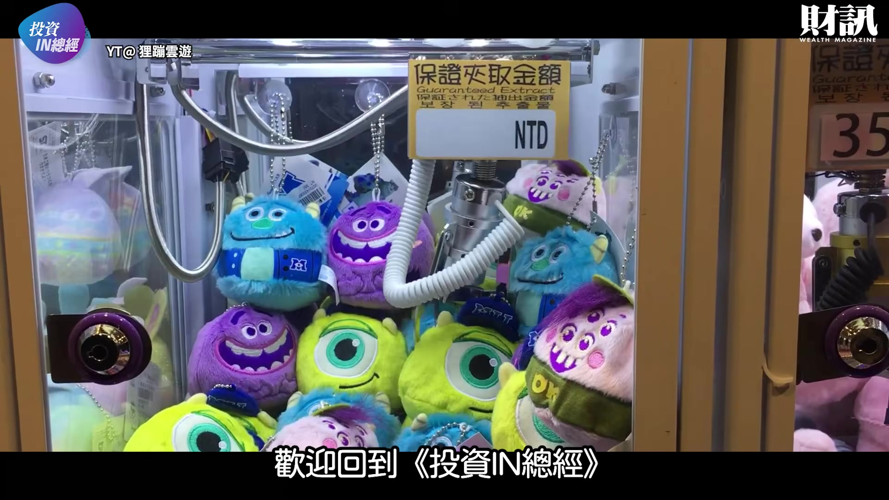

**逐字稿片段：** 歡迎回到《投資IN總經》 幾年前夾娃娃機 曾在台灣掀起旋風 而在日本同樣也有不少人 喜歡玩夾娃娃機

**話題推測：** 節目開場，通常會搭配片頭或節目名稱畫面。

---

## 00:00:08

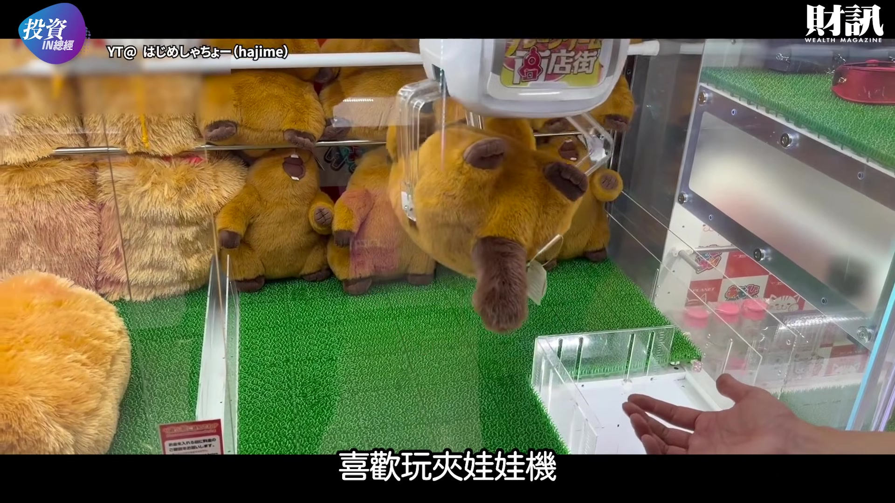

**逐字稿片段：** 甚至連蔬菜 雞蛋 飲料 還有日用品 都成為機台獎品 過去被視為只有高手 才能滿載而歸的遊戲 如今透過獎品與玩法的創新 吸引了許多家庭客 以及主婦加入遊玩

**話題推測：** 講者提到夾娃娃機獎品多樣化，可能顯示蔬菜、雞蛋、日用品等非傳統獎品畫面。

---

## 00:00:23

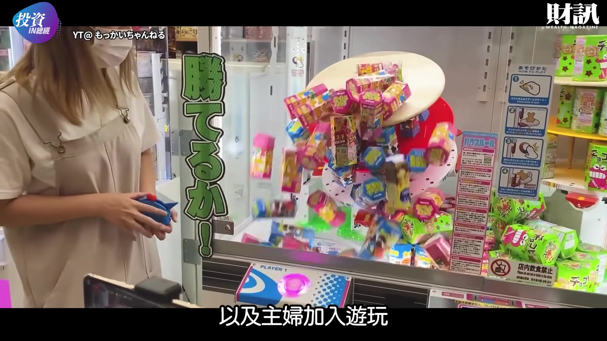

**逐字稿片段：** 今天這集我們就來聊聊 日本夾娃娃機超市化 小確幸變成大生意

**話題推測：** 提出本集主題「日本夾娃娃機超市化」，可能出現主題標題頁面。

---

## 00:00:36

**逐字稿片段：** 根據《日經MJ》報導 日本郊區的大型夾娃娃機店 正在快速增加

**話題推測：** 引用《日經MJ》報導，可能搭配新聞來源的文字標示或圖表。

---

## 00:00:42

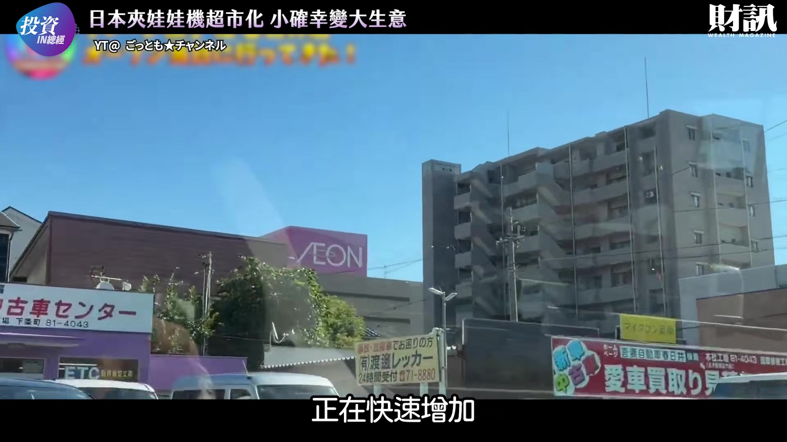

**逐字稿片段：** 光是今年 8 月 就有超過 10 家新店開幕 這些店的獎品 都不再侷限於玩偶和公仔 還包括了生鮮食品 日用品等等 讓夾娃娃從單純的娛樂 進一步具備購物的實用性

**話題推測：** 提到今年8月新店開幕數量，可能顯示相關統計圖表或新店照片。

---

## 00:00:56

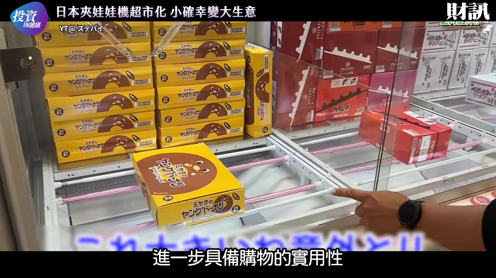

**逐字稿片段：** TISCO 公司經營的 夾娃娃機專門店 Benex 就標榜不讓客人空手而歸 店員會主動向一直失敗的玩家 提供建議 店內還設有免費的練習機台 該公司認為 如果玩家夾不到獎品 就會放棄 讓客人感受到有機會成功 反而會提高再次挑戰 以及回訪的意願

**話題推測：** 介紹TISCO公司及其Benex夾娃娃機專門店，可能顯示公司標誌或店面照片。

---

## 00:01:18

**逐字稿片段：** 經營 Everyday 夾娃娃機店的 東洋公司 早在 2019 年便陸續導入 產地直送蔬菜 以及接近賞味期限食品的機台 堪稱夾娃娃機超市化的先驅 之後各家業者也跟進

**話題推測：** 介紹經營Everyday夾娃娃機店的東洋公司，可能顯示公司標誌或店面照片。

---

## 00:01:32

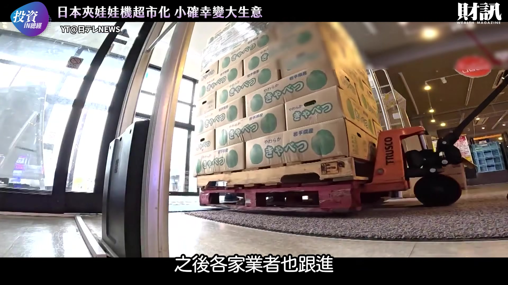

**逐字稿片段：** 像是日本零售巨擘 AEON 永旺也加入戰局 旗下的親子娛樂企業 永旺幻想公司 2025 年 10 月將櫪木縣下野市的 遊戲中心 改裝為夾娃娃機專門店

**話題推測：** 介紹日本零售巨擘AEON永旺集團加入戰局，可能顯示AEON的企業標誌。

---

## 00:01:46

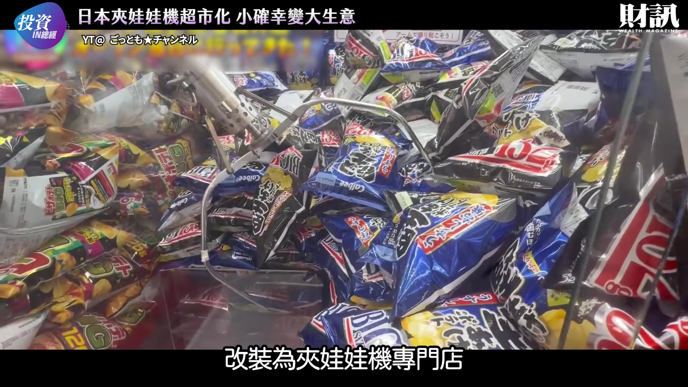

**逐字稿片段：** Crane 橫丁極石橋店 這家店發揮了永旺集團的採購 以及商品陳列能力 提供多元的獎品 顧客可以像逛超市一樣 把夾到的戰利品 通通堆進購物車 這項改裝帶來驚人的集客效果 永旺幻想社長藤原德也 今年 4 月說明業績時指出

**話題推測：** 提到永旺集團改裝的Crane橫丁極石橋店，可能顯示該店面的照片或特色。

---

## 00:02:06

**逐字稿片段：** 石橋店的年營收 原本大約 8 千萬日圓 改裝後預估可以增加到 5 億日圓 成長超過了 5 倍 目前永旺幻想正在加速展店 預料夾娃娃機店 將成為新的獲利支柱

**話題推測：** 提出石橋店改裝前後的營收數據，可能以圖表形式呈現營收增長對比。

---

## 00:02:21

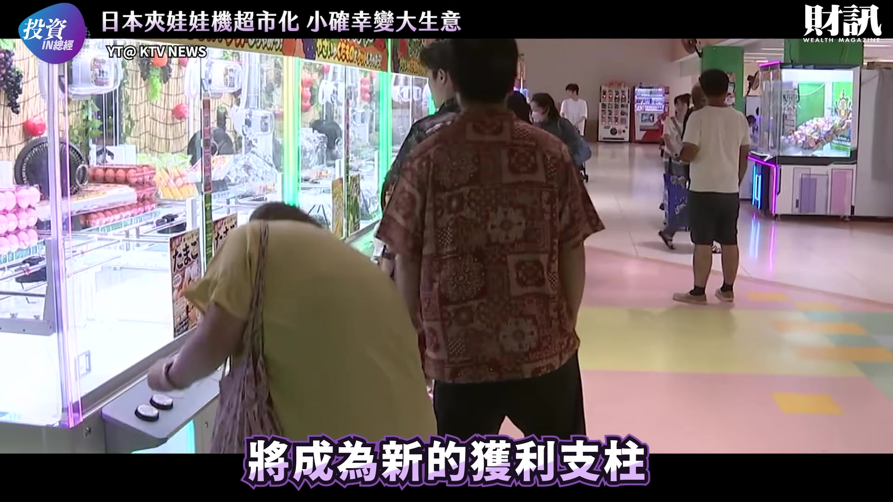

**逐字稿片段：** 這股熱潮也反映在市場數據上

**話題推測：** 話題轉向市場數據，可能顯示總體市場趨勢圖表。

---

## 00:02:24

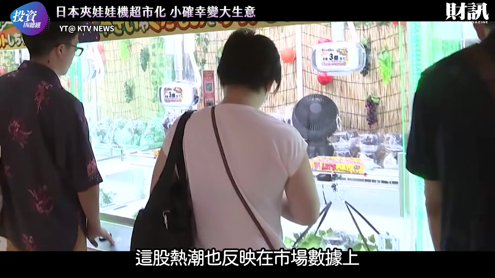

**逐字稿片段：** 根據日本娛樂產業協會調查

**話題推測：** 引用日本娛樂產業協會的調查數據，可能顯示資料來源標示。

---

## 00:02:26

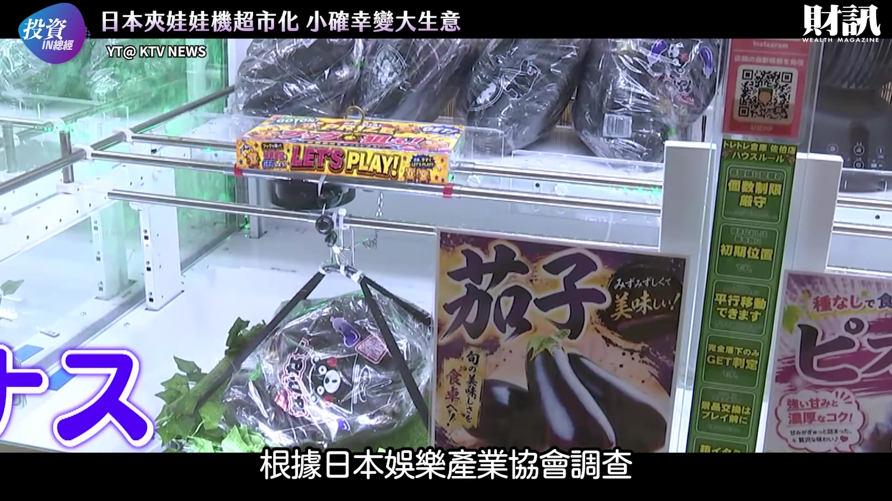

**逐字稿片段：** 2024 年度日本夾娃娃機營業額 達到 3918 億日圓 較前一年度成長了 17.7%

**話題推測：** 公布2024年度日本夾娃娃機營業額，可能顯示詳細的營業額數據圖表。

---

## 00:02:34

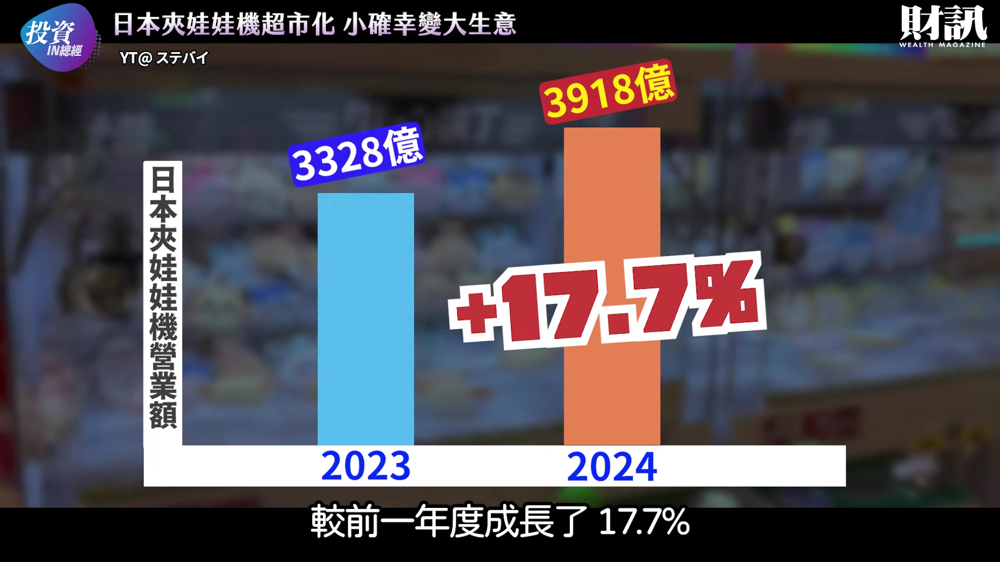

**逐字稿片段：** 若將範圍擴大到整體獎品遊戲 市場規模則會從 2015 年度的 1896 億日圓 增加到 2024 年度的 4177 億日圓 10 年之間成長超過 1 倍

**話題推測：** 擴大範圍至整體獎品遊戲市場規模，可能顯示該市場的歷年增長圖表。

---

## 00:02:49

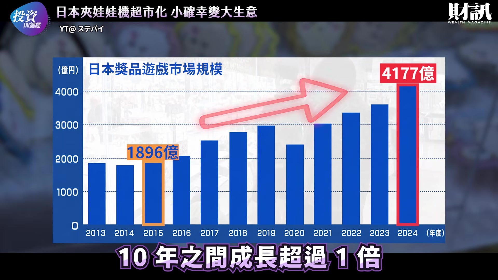

**逐字稿片段：** 像是夾娃娃機這種會有獎品的 獎品遊戲 占日本整體遊戲中心營收的比率 也從 2015 年度的 44% 攀升到 2024 年度的 68% 在傳統大型電玩 以及遊戲設施逐漸式微的時候 夾娃娃機已成為 支撐日本遊戲中心成長的新引擎

**話題推測：** 討論夾娃娃機在遊戲中心營收佔比，可能顯示圓餅圖或柱狀圖。

---

## 00:03:09

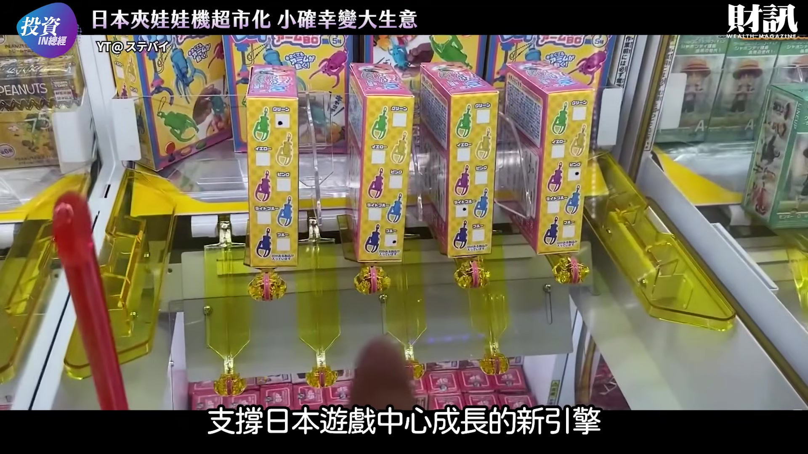

**逐字稿片段：** 不只如此 夾娃娃機的成長空間 還從實體店面延伸到網路

**話題推測：** 話題轉向線上夾娃娃機，可能顯示手機App或網路介面畫面。

---

## 00:03:14

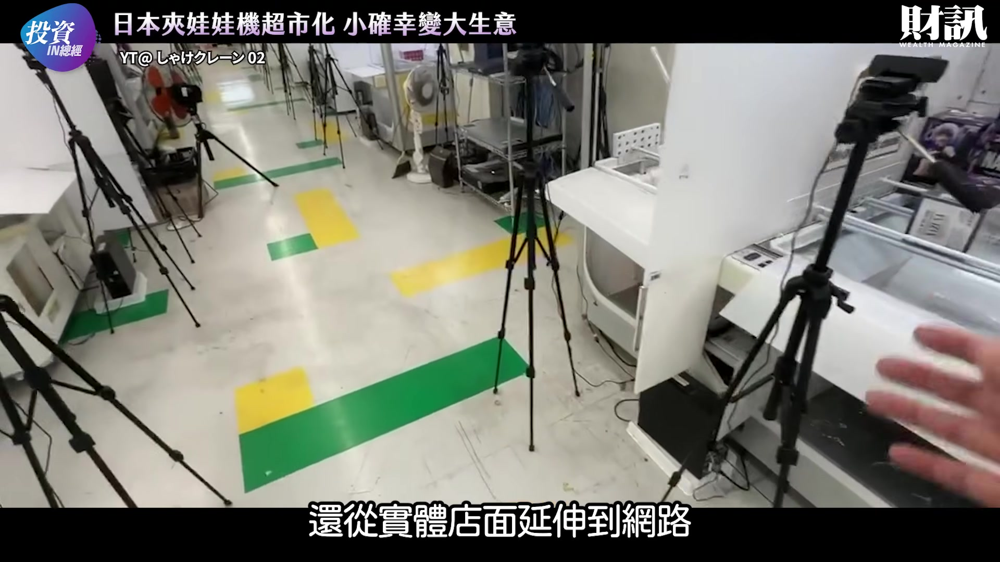

**逐字稿片段：** 玩家可以透過手機 App 或電腦 就能觀看實體機台的即時影像 並且遠端操作 夾中的獎品則會依各平台規定 宅配到府

**話題推測：** 說明線上夾娃娃機的操作方式，可能顯示App或電腦操作介面截圖。

---

## 00:03:24

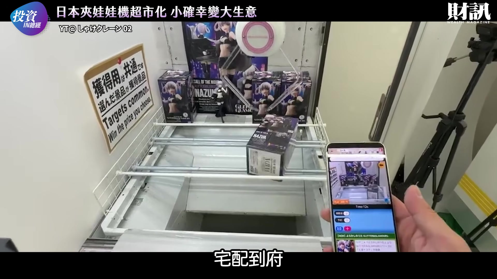

**逐字稿片段：** 目前日本線上夾娃娃機市場規模 估計已經達到 200 億日圓左右

**話題推測：** 公布日本線上夾娃娃機市場規模，可能顯示相關市場數據圖表。

---

## 00:03:30

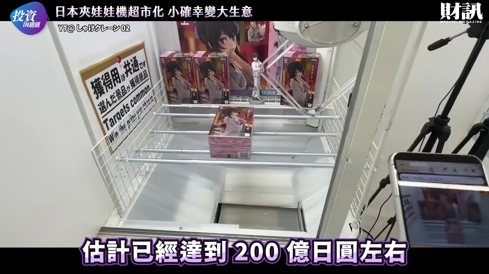

**逐字稿片段：** 以大型遊戲業者太東經營的 線上夾娃娃服務為例 2018年 推出以來

**話題推測：** 介紹大型遊戲業者太東的線上夾娃娃服務，可能顯示其App介面或公司標誌。

---

## 00:03:35

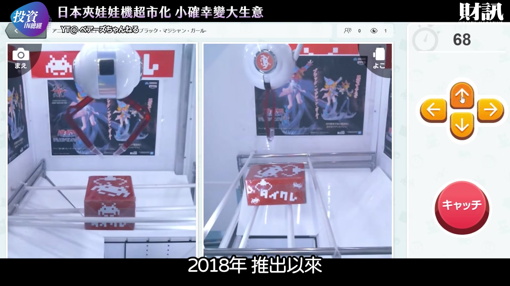

**逐字稿片段：** 註冊人數已經突破了 500 萬人 平台提供超過 3000 種獎品 如果玩家多次嘗試仍然失敗 遠端工作人員還會從後台 協助調整獎品位置 避免玩家拒絕再玩 而台灣在這波風潮中 也沒有缺席

**話題推測：** 提及註冊人數突破500萬人，可能以圖示強調此數字。

---

## 00:03:52

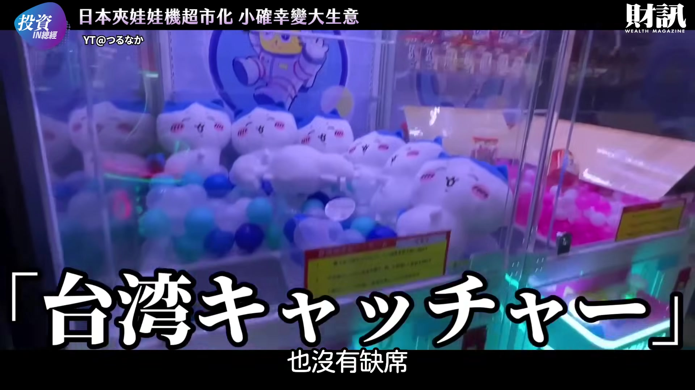

**逐字稿片段：** 日本傳統夾娃娃機 高度依賴玩家細微調整位置與角度 操作的門檻較高 為了降低挫折感

**話題推測：** 比較日本與台灣傳統夾娃娃機的玩法差異，可能顯示兩種機台的對比畫面。

---

## 00:04:00

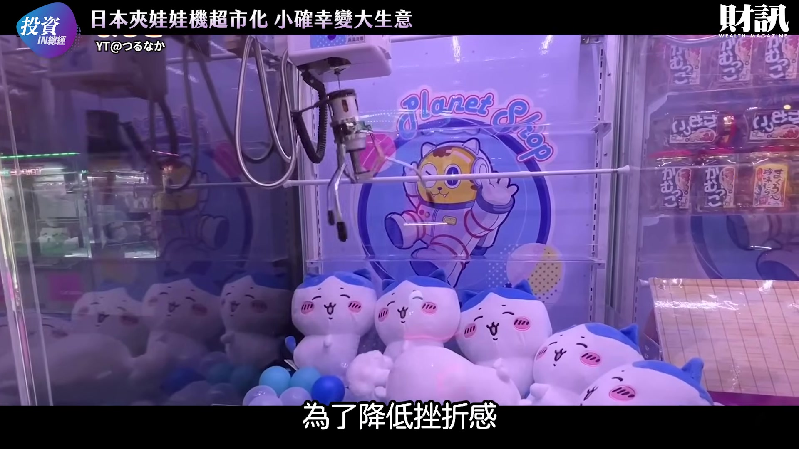

**逐字稿片段：** 日本連鎖遊樂場營運商朗玩 (ROUND1) 2024 年起導入約 700 台 台灣式夾娃娃機 引起業界的關注

**話題推測：** 介紹日本連鎖遊樂場朗玩(ROUND1)導入台灣式夾娃娃機，可能顯示ROUND1標誌或店內畫面。

---

## 00:04:08

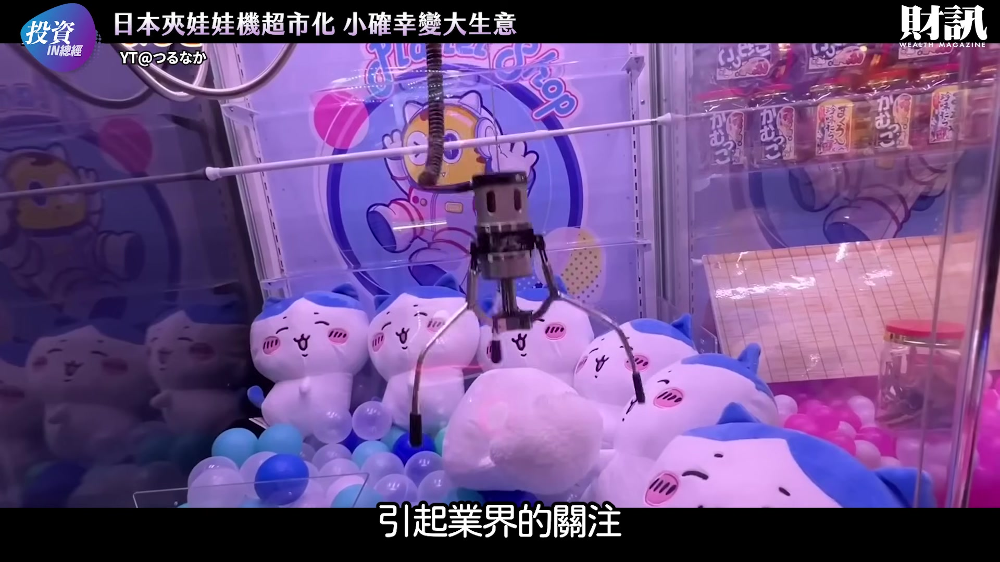

**逐字稿片段：** 更有台灣業者直接進軍日本開店

**話題推測：** 提到台灣業者進軍日本開店，可能顯示相關新聞畫面或企業介紹。

---

## 00:04:11

**逐字稿片段：** 像熊嗨星樂園今年 5 月 在宮城縣富谷市開設門市 從空間設計到機台玩法 都充滿了台灣特色

**話題推測：** 介紹熊嗨星樂園在日本開設門市，可能顯示該樂園的標誌或店面照片。

---

## 00:04:20

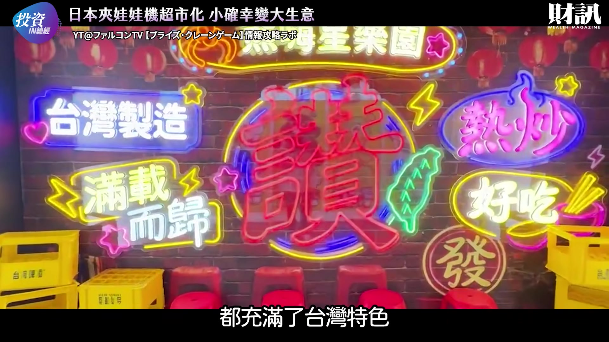

**逐字稿片段：** 例如採用台灣常見的 山崩式獎品堆疊方式 讓玩家更容易獲得戰利品 吸引了不少消費者專程前往體驗

**話題推測：** 說明台灣常見的「山崩式」獎品堆疊方式，可能透過示意圖或影片解釋玩法。

---

## 00:04:30

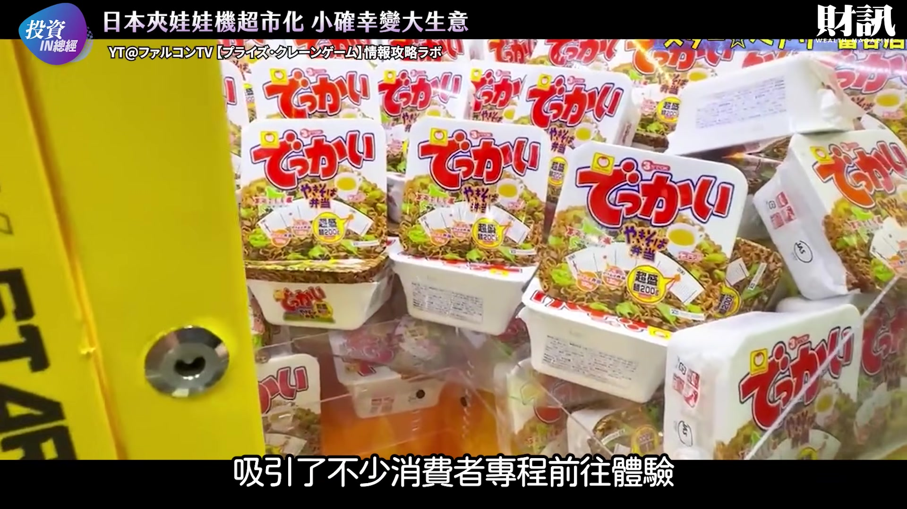

**逐字稿片段：** 從玩偶到蔬菜 從實體門市到手機遠端操作 再到台灣玩法輸出日本 夾娃娃機已經不只是 講究技巧的娛樂設備 業者透過提高成功體驗 和擴充實用獎品 把原本容易令人受挫的遊戲 改造成全家人都願意反覆消費的 新型態零售娛樂

**話題推測：** 總結夾娃娃機的演變與創新，可能顯示資訊圖表或重點摘要頁面。

---

## 00:04:51

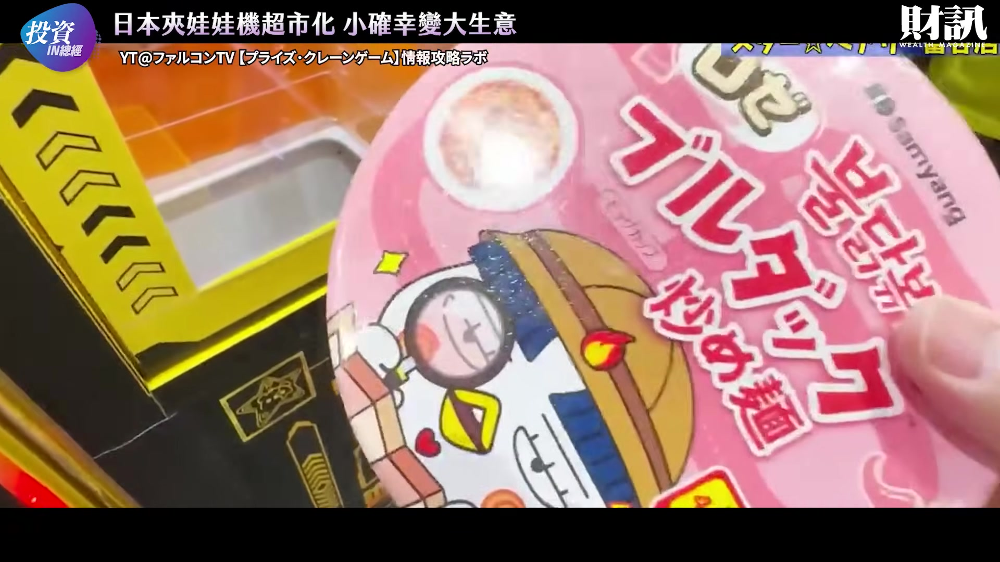

**逐字稿片段：** 財團粉絲們 您認為日本夾娃娃機超市化 能夠更幫助營收嗎 A 可以 獎品實用能夠擴大客群 抓住家庭主婦的心 B 不行 熱潮過了就沒有了 C 不知道 還需要多觀察 留言告訴我們吧 今天的《投資IN總經》到這邊告一段落 喜歡這個節目的觀眾 記得幫我們按讚與分享喔 我們下次見

**話題推測：** 影片結尾提出互動問題，可能顯示投票選項或留言區提示。

---
