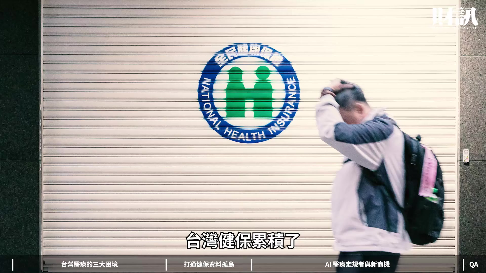
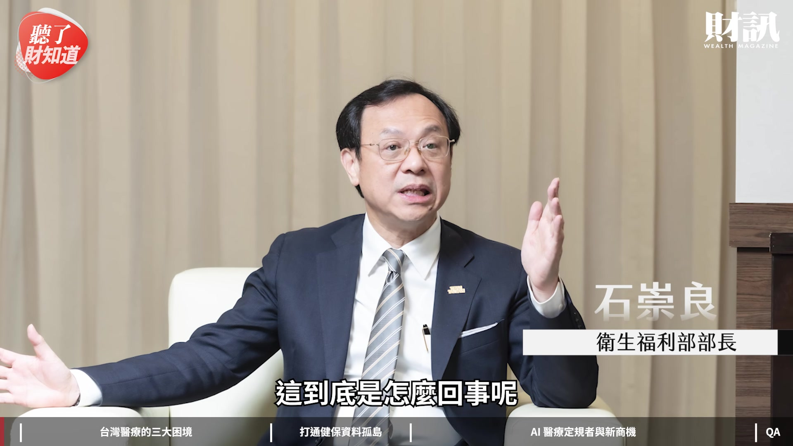
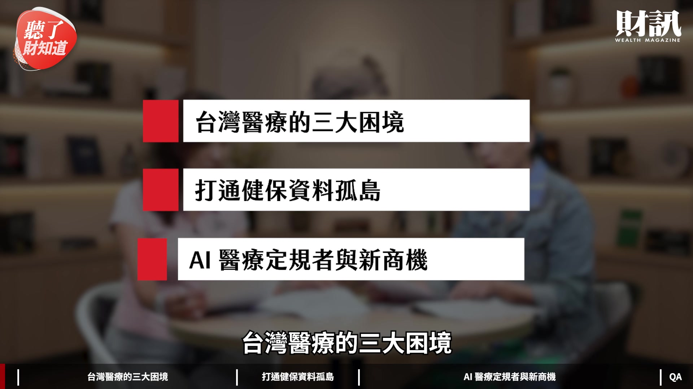
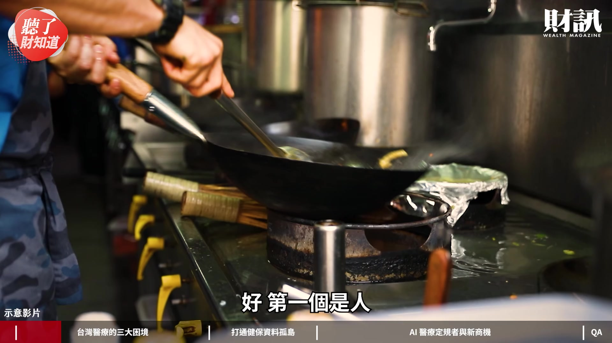
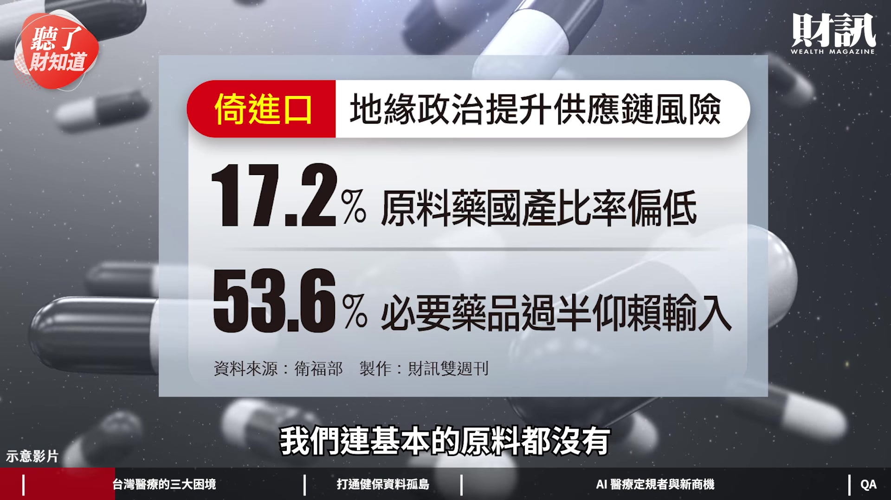
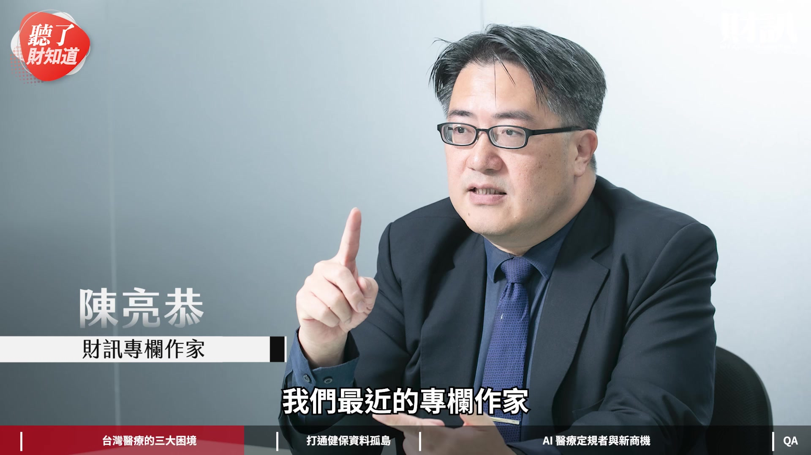
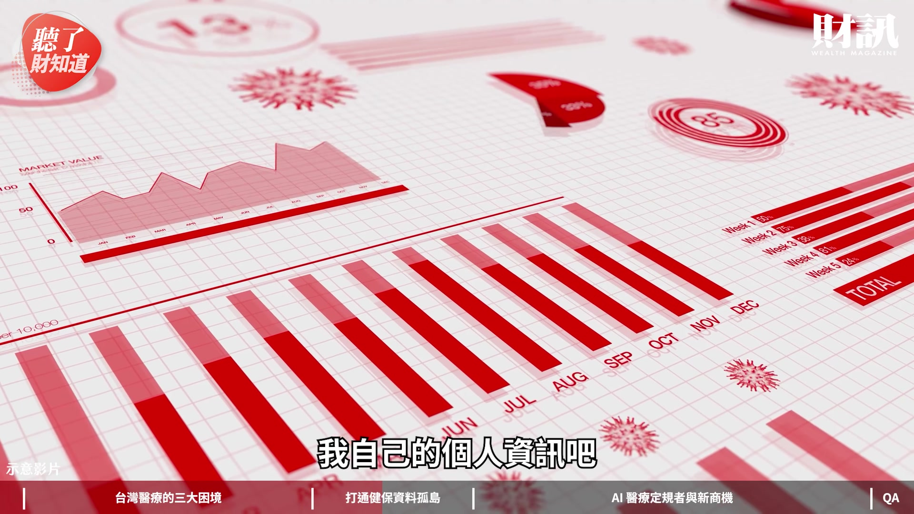
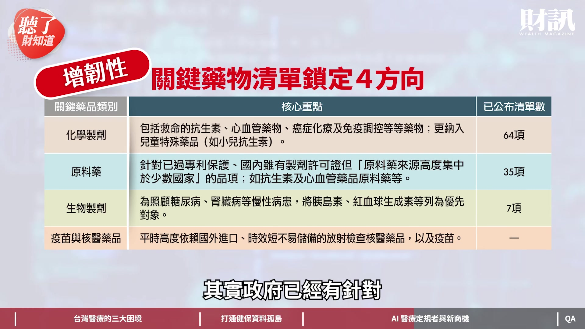
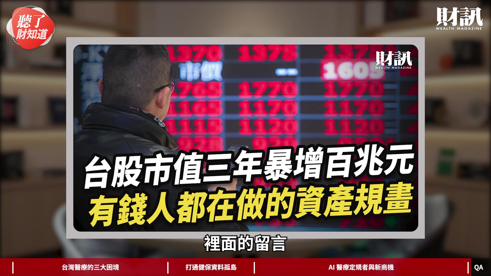

# wealth1974_6AEwuHsuNWo — 關鍵畫面索引

- 來源逐字稿：[wealth1974_6AEwuHsuNWo_GT.srt](wealth1974_6AEwuHsuNWo_GT.srt)
- 影片：https://www.youtube.com/watch?v=6AEwuHsuNWo
- 截圖數：25

## 00:00:00

**逐字稿片段：** 台灣健保累積了 700 億筆醫療紀錄 全世界都沒有這種資料

**話題推測：** 台灣健保累積了700億筆醫療紀錄的數據

---

## 00:00:04

**逐字稿片段：** 但衛福部長石崇良卻直言 不好用 這到底是怎麼回事呢

**話題推測：** 衛福部長石崇良直言健保資料「不好用」

---

## 00:00:08

**逐字稿片段：** 今天這一集我們先來聊聊 台灣醫療的三大困境

**話題推測：** 介紹本集主題：台灣醫療的三大困境

---

## 00:00:11

**逐字稿片段：** 再來分享一下 如何打通健保資料孤島 最後我們要聊一下 AI 醫療定規者與新商機 大家好 我是今天主持人陳彥淳 今天來賓是 財訊雙週刊的總主筆劉軒彤 歡迎軒彤 各位觀眾大家好 我是軒彤

**話題推測：** 介紹本集主題：如何打通健保資料孤島

---

## 00:00:24

**逐字稿片段：** 前陣子我們去採訪了 衛福部長石崇良 那妳也知道他上任一年多以來 安排的專訪非常的多 終於換到我們了 我們等了滿久的 但他一開口 我覺得他就 拋出一個非常有趣的話題 他就說 今天我們先不管三七二十一 先面對一件事情 今天如果又突然發生了疫情 或者是異常的氣候的變化的時候 請問台灣的醫療撐得住嗎 拋出這樣的話題 讓我們重新思考一下說 碰到異常狀況的時候 那個韌性夠不夠 台灣醫療 大家雖然都覺得非常棒 但還是有一些問題跟挑戰在前面 我們就要面對它們 因為我們要愈來愈好 這是大前提 所以我們是不是先請軒彤 幫我們講一下說 到底現在台灣的醫療 面臨到哪些挑戰 那我們接下來 要怎麼樣克服它們 對 我覺得妳剛剛講的那個 真的很重要 就是說 我們都已經忘記 2022 年 12 月解封 到現在快要四年了 我們已經忘記 那段時間我們多辛苦 然後多封閉 對不對 對 那時候以為世界末日要來了 覺得疫情不會結束 但是我們現在一直在享受 那個 AI 紅利 我們覺得台灣經濟很棒 可是如果當時我們沒有守住 不知道現在是什麼樣子 所以剛才妳講那個 石崇良部長講那句話很重要 就是說我們已經忘記那段時間 但是 這件事情確實有可能再發生 尤其妳看那種天氣變化很多 像最近有什麼鼠疫什麼 妳不知道哪一天又來一個這樣 那我們能不能守得住 以前可以 下次不見得 為什麼 因為妳剛剛說 面臨一些困境 第一個 我們的少子化 真的好嚴重 我覺得那已經是災難級了 一年 10 萬個孩子不到 搞不好 9 萬 8 萬 一直往下降 國發會的中推估 大概在 2061 年 我們用 15 歲到 64 歲 叫做工作人口 跟 65 歲以上是 1 比 1 還不管小孩 1 到 14 歲不管 就是說 這個可以工作的人口 他就要照顧一個老人 妳看這個生育率就知道 人力流失是災難級 所以我們沒有人 對 其實現在各行各業都碰到 人力不足的問題 包括現在最夯的科技業 AI 也都是在討論人力的問題 現在妳看我們去外面吃飯 很多老店都沒有辦法經營下去 就是沒有人 好 第一個是人

**話題推測：** 提及採訪衛福部長石崇良的背景

---

## 00:02:42

**逐字稿片段：** 第二個是 雖然我們健保支出已經破兆了 但是我們跟國際上比起來 我們用 2024 年來算好了 因為國際間目前最新只到 2024 年

**話題推測：** 指出台灣醫療困境的第二點：健保支出破兆

---

## 00:02:50

**逐字稿片段：** 那個時候我們的健保支出 是占 GDP 的 7.3% 左右 OECD 國家平均已經 9.3％ 了 就是我們差很多 那隨著我們人愈來愈老 繳保費的人愈來愈少 那表示你年輕人要負擔這麼多人 可是年紀愈大 醫療需求愈高 對 沒錯 對 所以我們也面臨 財務壓力的隱憂 那第三個就是 我們剛剛講 如果哪一天又鎖起來的時候 請問我們的供應鏈怎麼辦 其實不只台灣 所有全世界的原料 原料藥大部分都在印度跟中國 那台灣國產的原料藥 我們只有 17% 是自製 發生了什麼事情 我們連基本的原料都沒有

**話題推測：** 比較台灣健保支出佔GDP (7.3%) 與OECD平均 (9.3%)

---

## 00:03:25

**逐字稿片段：** 再來就是我們的必要藥品 我們是有 53.6% 是靠輸入 所以我們是一個靠輸入進口的 如果我們自己沒有 把必要藥品那個固定起來的話 我們如果一旦供應鏈出問題 妳看人力 財務壓力 跟這個供應鏈 這是我們目前的三大困境 滿大的挑戰 但這次我們在訪石崇良的過程中 他也跟我們直球對決

**話題推測：** 指出台灣必要藥品有53.6%依賴輸入

---

## 00:03:45

**逐字稿片段：** 就三個挑戰 政府要用什麼方式 來迎戰這些事情 大家聽到政策 我們常常覺得說 我們在做政策題 政策好像是又高又遠 可是事實上 衛福部是從我們出生到我們死亡 這全部都是它們在管轄的 它的政策 我覺得大家 真的很有必要去理解一下 好好理解 對 那剛才講 第一個我們講說 先講財務好了 剛剛不是講說愈來愈貴嗎 高齡者生病的醫療費用 是愈來愈貴 對 就是他們繳比較少的錢 但他們的需求跟支出 是愈來愈多的 對 那怎麼辦 我們現在能夠讓自己 少花醫療費用 就是你健康一點 第一個我們醫療費用會少一點 第二個我們需要人家 照顧的人力也少一點 我們社會成本就會下降 比如說你生病了 失智 失能要人家照顧 想辦法健康促進 他現在已經把 成人健康補助 大概 30 歲就開始了 健檢的部分 健檢 30 歲 當然那個是很基礎的 然後癌症篩檢 妳會發現像我這種年紀的人 就會一直有那種 對不起 妳的乳癌該檢查了吧 它提醒妳 對 我都覺得像在追殺一樣 剛開始覺得很煩 可是後來發覺 真的是對我們好 會發現說 現在又有什麼幽門桿菌的檢查 其實我們慢慢都發現 它的癌症的篩檢的這個 癌種或者是工具愈來愈多了

**話題推測：** 政府將如何迎戰這三大挑戰

---

## 00:04:57

**逐字稿片段：** 對 其實那個癌篩的預算 是從原本的 28 億元 提高到 68 億元 等於是資源放在這個地方 希望可以提前做預防 因為畢竟早期治療 效果是比較好的 包括那個

**話題推測：** 癌症篩檢預算從28億提高到68億的數字

---

## 00:05:08

**逐字稿片段：** 10 月 1 日開辦的健康幣 這都是屬於健康促進 那剛才講健康促進 是希望降低財務壓力 那第二個就是

**話題推測：** 提及10月1日開辦的「健康幣」計畫

---

## 00:05:16

**逐字稿片段：** 我們講的人力 人力怎麼辦 因為人力愈來愈少的話 你就必須在服務上做一些創新 應該是說 以前我們都是跑到醫院去 那現在人力愈來愈少 護理師愈來愈少了 那我們怎麼辦 它就希望把它分散 去中心化 舒緩這個醫院 醫院去照顧這些急重難罕的 但是你分散 你會想說 那你把我放在家裡 我不是家裡的人也要來照顧 所以它要有智慧化 不管是 AI 什麼等等 遠距都是

**話題推測：** 討論解決人力問題的方法：服務創新與去中心化

---

## 00:05:43

**逐字稿片段：** 還有什麼在宅急症照護 我想 2024 年我們就做過專題 就是現在已經有一些 輕微的肺炎 或者是像蜂窩性組織什麼那些 你要打抗生素的 他已經可以在家打了 那就是在宅急症照護 或者遠距醫療 其實我們聽到衛福部長講說 2018 年的時候 台灣就已經有 遠距醫療相關的法令出來 可是沒有人要用 我們根本都不知道 我們一直到 COVID 的時候 你要透過視訊去領藥什麼 拿那個快篩什麼那些 大家才發現說 這個東西很重要 原來其實法規也在了 對 那你說分散人力 除了智慧化 還有

**話題推測：** 提及在宅急症照護與遠距醫療政策

---

## 00:06:17

**逐字稿片段：** 住院整合照護計畫 也許有觀眾知道 每個醫院不一樣 醫院會訓練一批這個 就是我們俗稱叫看護 護佐 那這些看護 以前我們都是一對一 很貴 一天我記得是 2700 元 2800 元跑不掉 甚至有更貴 不是所有人付得起 那現在就共聘 就可能我這一個看護 他照顧四或六床 只要你符合這個資格 政府每天給你 750 點 大概就是 750 元 那所以有的醫院的話 你只要付一點點 有的醫院不用付 有的醫院最多 聽說只要付 1000 元 就是你同時照顧幾床 他知道怎麼去照顧 醫院也訓練出來 這也是目前的政府的這個計畫 基本上 這是資源共享的概念 我覺得用較少的人力 來涵蓋更多的有需要的病人這樣子 但我覺得最重要的還是 希望可以不要住院 這是第一件事 所以我覺得提前預防跟篩檢 這件事情才是最重要的 我這邊有一個數據可以跟大家分享 現在台灣發現攝護腺癌 3 到 4 期的比率將近 50% 意思是什麼 代表說他可能之前都沒有在做檢查 對 尤其像什麼大腸癌那些 你除非發現你出血 或者是排便的習慣改變 尤其像攝護腺癌 很多男生都不願意檢查 到發現的時候 已經是末期 那末期就是你的品質也不好 預後就是你治療之後的效果 也沒有那麼好 造成旁邊很多人的負擔 其實上次軒彤就有寫過 攝護腺癌的報導 我覺得這個相關的資訊 也可以參酌一下 健檢這件事情的重要性 我們最近的專欄作家

**話題推測：** 提及住院整合照護計畫

---

## 00:07:42

**逐字稿片段：** 陳亮恭先生 他也提到說 你不要把它變成是 好像政府叫你做 你才要做 它應該變成 企業的社會責任的一部分 企業應該要求員工做這件事情 如果做不到的話 搞不好政府還要罰責企業 因為這是 ESG 的一環 就是如果有健康的員工 才有健康好發展的公司 這種環環相扣的概念 所以我覺得 現在政府也就是 健檢 把它更往前推 讓健康的人變得更多 需要照顧的人變得更少 對 像慢性病的管理 其實如果有慢性病的人都會知道 你不是只去看病 他會要求你 還要做 譬如說糖尿病 他會定期做你的抽血檢查以外 還有眼睛 他怕你有什麼 視網膜病變什麼等等 併發症 都做得還不錯 對 所以其實我覺得 我們在採訪過程中會發現 其實政府提供滿多的資源 但可能很多的消費者 不知道 該怎麼使用 所以這件事情我覺得真的 為自己的健康跟權益著想 應該真的勇於去發問 以及勇於去看說 我現在這個年紀到了 是不是可以做什麼樣的檢查 來保障我們自己的健康 或是提前預防 那我覺得接下來 我們想要討論的就是 重要的基礎建設

**話題推測：** 陳亮恭先生提出健檢應是企業社會責任的觀點

---

## 00:08:43

**逐字稿片段：** 就有關於資料庫這件事情 因為其實台灣是很早期 就開始推動健保的國家 我們其實有非常完整的資料 700 億筆資料 對 健保資料庫有 700 多億筆 按理說這是一個 發展 AI 醫療 非常重要的基礎建設 但這次我們在採訪的過程中

**話題推測：** 轉向討論資料庫基礎建設以解決資料孤島問題

---

## 00:09:00

**逐字稿片段：** 部長告訴我們說 以前的這樣的資料 不好用 為什麼會這樣 妳先幫我們解釋一下 所謂的不好用 這樣講好了 他們講說以前 數位化之前 石崇良 石部長以前是急診室醫師 他就講說 飯前血糖跟空腹血糖 我們都知道是什麼意思 可是人會讀 機器不會讀 它以為這是兩個東西 就是說每家公司的格式不一樣 還有就是檢驗 比如說妳抽血 妳會把日期寫在前面 或者我寫的單位 是每秒 或每分 大概 cc 數多少 每個人寫的方式不一樣 那我們要想到說 數位化時代機器要會讀 你看得懂跟機器讀是兩碼子事 沒錯 對 所以他們說 不管是檢驗這個規則 或者診斷碼 或者是藥品 這幾個非常重要的 如果說你規格沒有統一 700 億筆資料 再多也沒有用 因為沒辦法串聯 對 沒有辦法串聯 就沒有辦法做基本的數位 就沒有辦法往 AI 那邊發揮

**話題推測：** 部長解釋舊有資料「不好用」的原因

---

## 00:09:52

**逐字稿片段：** 所以第一件事情 它是先把醫療語言做個統一 要讓機器也讀懂 這是同一件事情 第二件事情就是把 國際編碼導入到裡面去 因為我們要跟國際接軌 畢竟是個全球的市場 對 所以他們現在 就已經在做這件事情了 資訊處的那個李建璋 我們常常在任何場合 都可以看到李建璋處長在講 就是他就在做這些 基本上醫院都已經在做了 就是大家統一 我們都用國際編碼 我一看到這個疾病 就知道是屬於哪一個 你這樣做以後 資料就可以串聯 但我很好奇 因為其實之前我們採訪過 非常多的醫學中心 跟大型的醫療機構 重點是 每家都有每家的系統 政府要怎麼樣打破各家系統 把這些資源都串在一起 因為目標應該是說 這個資料屬於我個人 我去任何的醫療機構 都可以享有這些 我自己的個人資訊吧

**話題推測：** 解決資料問題的第一步：醫療語言統一

---

## 00:10:37

**逐字稿片段：** 好 這就是部長講的 書同文 車同軌 書同文就是寫一樣的 剛才我們講的那幾種編碼一樣 車同軌 就是軌道是一樣 你才可以車一起過 其實政府已經開始在做很久了 那這些醫院已經開始編碼 內部都已經改了 那現在就問題是我怎麼樣串聯 他講了一個很典型 就是說以前我會講說 我就要到台大去看 我大病小病 因為我的病歷在那裡 其實我小時候也是這樣講 我們就說 我的病歷在哪裡 所以我就一直跟著這個醫院 我不想換醫院 對 因為怕到別的醫院 沒有資料 對 然後又跟你講說 你要重照一次什麼 就沒有辦法同樣的 所以每一個醫院 都有它獨特的系統 那現在你說要全部的醫院改 它們已經在慢慢努力 但是我們不可能要大家 全部打掉重練 怎麼辦 那政府就想了一個辦法 其實我們衛福部 真的也還做了滿多事

**話題推測：** 部長提出的「書同文 車同軌」的比喻

---

## 00:11:24

**逐字稿片段：** 它們就跟工研院 共同開發一個叫 FHIR FHIR 它其實就是一個 國際的標準的那個協定 它做了一個叫 BOX FHIR Box 它有點像轉換器 你把你的資料放進這裡面 它轉出來就可能是國際標準 那台灣的資料就統一了 台灣的醫院 就可以慢慢的串聯起來 目前他講的是說 只有長庚 馬偕 還有中部的 中山醫學院的附設醫院有在用 但是他今年底預計 醫學中心全部要導入 這個 FHIR Box 那就表示說 大家全部的資料就可以 大部分都互通了 就可以做 AI 很多的應用 他說這個癌症的用藥的事前審查 原本是 30-40 天 透過這樣的機制 它可以縮短約 25 天 這效率也提升很大 這長庚的案例 對 因為長庚其實在這一方面 是做得真的滿早的 它是怎麼樣的情況下 就像我剛剛講的 當你沒有資料的時候 譬如說你別的醫院過來的資料 它到底是哪一種癌 第幾期 然後他做了什麼檢驗 因為以前沒有互通的時候 我沒有辦法完全確認說 你那個一定是對的 你講的跟我認知的 不見得是完全正確 如果你給我的資料 是錯的怎麼辦 當你沒有統一的時候 它沒有辦法確認 你這些是正確 那他就要一個一個去對 一個一個去檢查 一個去回溯 它等於要重做一次的概念了 對 基本上就是類似這樣 那等它全部確認 可能就已經 35 到 40 天 那它現在 如果說你對接的話 這些東西是經過確認的 所以政府在這一方面 也會做很多的所謂 AI 的三大中心 就讓你知道說 從這個 FHIR 轉換出來的東西 我可以相信它 那怎麼相信 其實這就是政府後面要做的事情 瞭解 所以基本上 它先搭建一個平台 至少可以讓資訊先互相共通 病人可以在不同的醫療機構 都可以調到我自己的個人資料 接下來就是說 數據的清洗 最重要就是 AI 的應用 未來的 AI 的醫療 規則 因為台灣有經驗 或台灣有這個資源 它有 700 億筆的健保資料庫 所以我們甚至未來 有沒有可能會成為 AI 醫療的規則制定者 或者是先行者 為什麼我們有這個資格 第一個我們有 700 億筆資料 我剛講那個三大中心 其實我再講細一點 第一個 你要負責任的 AI 什麼叫負責任 就是政府在做這個中心的時候 所有東西要能夠回溯 回溯過去 是正確的 第二個它要有驗證 不是只有一家公司 你做了一個臨床 你覺得是這樣子 OK 的 可是我要 5-6 家醫院 可能一個醫學中心 一起來驗證 這個東西是對的 第三個可能就是影響性 AI 聽起來很官僚的一句話 影響性 AI 但事實上 它是關於你的健保核價 他舉了一個例子 比如說你今天做了一個 AI 生成式 AI 的工具 你想申請一個領證 但是那個可能 它只是影響你的人力成本 就是你的護理師跟醫生 他可能因為這個工具 效率增加了 可是這是你們自己醫院成本 跟一般的民眾沒有關係 就是它的醫院自己的效率提升了 但它並沒有提升病人的效率 像他之前當健保署長的時候 他就核可過一個 AI 手術房就有生理監測 後來就發現這個東西 可以讓你後面的住院的天數 可以縮短 那這樣子 就會縮減你醫療的成本 健保就會省錢 那這個東西他就會給它 核健保價 對 所以他就說 你這幾個出來以後 什麼負責任的 或者影響性 或者驗證的 你就可以讓產業界在投資的時候 它知道規則在那邊 大概可以判斷 我這個東西可不可以拿到健保價 你的商業模式是完全不同 所以他覺得說 包括臨床驗證這些 你在國際上 你也可以就是有一個規則 那大家覺得 這個是可信任的 你有這樣的規則 你就敢發藥證 應該說醫材證 我們就可以變領導者 我們以前都是 FDA 美國的核可 我們才敢 現在不是 我們倒過來 我們有這麼多的 AI 技術 在那邊的時候 我們就敢先核可 那別人就會來看我們 對 我這個幫軒彤再做一下解釋 因為我們有那麼多筆的健保資料庫 變成一個很好的基礎建設之後 在上面長出的 AI 到底要對誰有用 這件事非常重要 那當然 AI 的應用有很多個面向 它可能是降低了 醫療院所的成本 提高它們的效率 另外就是針對病人的效率 跟治療的效果 那當然因為衛福部的立場 就是針對病人 所以我覺得這個邏輯滿清楚的 透過這樣子的反覆驗證 所以或許大家以後會 看著台灣的經驗 來告訴全球說 什麼樣的 AI 醫療 是政府可以給付的 因為我們有夠多的 健保資料庫跟經驗 這是我們的基底跟底蘊 對 我覺得他還講到一個重點 當然現在還正在發生中 就是我們現在 在做的健康幣 其實他就是希望做一個健康 促進一個生態系 我們會想 我們有醫療數據 疾病的數據 接下來搞不好有 健康的數據 那這些東西整個串聯起來以後 我們就會有 從健康到醫療疾病的這些數據 那可以運用的空間就很大了 就生態圈變很大 這等於是打通任督二脈的感覺 這樣看起來是不是覺得 台灣很有機會 是 有硬體也要有軟體 沒錯 接下來我覺得談論一個 比較嚴肅的話題 就是有關於剛剛提到的 供應鏈 藥物韌性這件事情 因為現在什麼東西都要談到 韌性這件事情 那其實剛剛軒彤也提到了 很多核心藥物 其實我們是依賴進口 可能是因為沒有效益 可能是因為太便宜 可能是因為沒有規模 好 但是我們現在要面對韌性的時候 不是成本問題而已 那請問我們該怎麼做呢 怎麼做呢 就是 國藥國造 必要的藥品 我們當然不可能講 全世界所有藥品 就是我們覺得 一旦哪一天我們被封鎖起來的時候 我們的抗生素夠不夠 或者有一些 很短效的胰島素 還是有人需要胰島素 那這個台灣目前是沒有人生產的 它就會盤點出一些必要藥品 我們希望這些必要藥品 國藥國造 第二個就是 國藥國用 因為我們知道台灣真的太小了 林靜儀次長講了一個原料藥 比如說叫台灣的廠商 大概它做兩個禮拜 台灣一年的量就做完了 那你要它剩下時間做什麼 如果我們願意用 我們的學名藥 願意用國產藥 那這樣子我們比率拉高 至少我們這些台灣的藥廠產出 還可以把它打平 對 可以賣得掉 那當然你做得多的時候 你當然就希望能夠到國外 第三個就是智慧調度 就是你要知道哪裡缺藥 快要缺了 庫存沒了 那做好這三件事 一定要跟國外合作 因為我們不可能自己供應 我們一定要友好的 比如說 現在目前是以 日本跟歐盟最多 因為歐盟已經 不會自己製造學名藥什麼那些了 日本也是 日本也許也要我們代工或怎麼樣 我們互相調度一下 所以還是一個信任供應鏈的觀念 是 非紅 信任 非紅的信任供應鏈 其實政府已經有針對

**話題推測：** 衛福部與工研院共同開發FHIR Box轉換器

---

## 00:17:50

**逐字稿片段：** 關鍵藥物清單 有鎖定四大方向 分別是這個化學製劑 原料藥 生物製劑跟 疫苗與核醫藥品這幾類 大概 100 多項的項目 都是認為現在是過度依賴進口 可能要優先考量的項目

**話題推測：** 政府鎖定關鍵藥物清單的四大方向

---

## 00:18:05

**逐字稿片段：** 對 應該講說 藥物韌性計畫 它是四年大概 240 億元 它有分布在經濟部 衛福部等等 關鍵藥品清單 就是我們講說 我們台灣必要的 這個是滾動式的 最新的大概是 118 項 已經確認的 我只是講藥品 因為醫材它們也還在盤點中 盤點 對 剛剛講的 像比如化學製劑 就是我們一般吃的學名藥 救命的抗生素 心血管 還有一些癌症的基本的化療藥 這個他希望台灣能夠自製 那再來就是 剛剛講的一些原料藥 生物製劑的話就是 比如說像胰島素這一類的 那還有核醫 核醫 核能的核 有的是放射性治療 但有一些是 他們講說 你還是要注意到說 也許有一天 有這個核災 核能外洩 核災的問題的時候 我們到底有沒有這個 還有疫苗 就是我們經過 COVID-19 就知道 有一些疫苗 我們還是要自製 對 所以這些他盤點出來 他就分成輕重緩急 就是最重要 他就趕快去想辦法 跟國內的廠商協調 對 我覺得 過去大家會講說 台灣的規模太小什麼之類 覺得不想做 盤點出來之後 其實 很多技術或藥品 是台灣廠商能做 但過去可能考量到各種原因 而沒有做的 其實這次我們在財訊 第 774 期裡面 第 130 頁 我們也盤點了 國產藥廠 它有具備哪些 核心藥物的製造能力 我覺得也滿適合 大家來參考一下的 對 我們就是對比那個 118 項 它公布的 真正拿藥證的 很多都拿到藥證 像那些抗生素 甚至那個刷手液 就是手術室的那一些 其實我們都有能力做 可是 大家就覺得市場不夠 所以我拿了藥證 可是它不生產 因為它覺得它沒有規模經濟 對 那因為目前 大部分的醫學中心 都還是比較用那個 國外的原廠藥 或者是國外的學名藥 因為它們有一些歷史背景 現在就是希望能夠 國內的自製 國內的民眾也要多使用 因為像日本當初也是 17 年前 它們是只有逾 10% 是屬於國產的學名藥 民眾也是不願意 都要用原廠的 或者原廠做的學名藥 那結果到了 2024 年 它已經到逾 80% 它這個成長 17 年其實算非常快 那它可能就是要求說 你不用國產的學名藥 那就請你多付自付額 所以要有配套 對 但是他也有一種制度 就是說 你的這個學名藥的那個品質 它是一直評鑑 來決定你的健保價格 你要讓民眾信任 你這個品質 是對得起你的健保價格的 所以它們就有很多的制度 可以學習 對 而且台灣民眾對於 台灣的國產藥 反而會有迷思 會覺得好像不如原廠 所以這個部分就像軒彤講 它必須建立信任感 對 這也是政府要做的 對 但你可能不曉得說 原來台灣的血袋 原本台灣是沒有血袋 這件事情老實說 我非常驚訝 一直到最近 台灣才有自製血袋 對 因為我就是一個屬於 常年會捐血的人 我都不曉得 原來我每次在捐血的時候 旁邊在那邊搖那個血袋 原來那幾乎是靠日本的 都進口的 對 都是靠進口的 後來是到今年大概 9 月吧 南亞才開始投產 那南亞當然在 2024 年 2025 年的時候 我們講疫情之後 政府就發現了 開始盤點 對 它雖然政策是到去年才推出 可是它在之前 它就已經想這件事情 那它們就有一個專家就說 奇怪了 台灣捐血率是全世界第一 請問為什麼那個東西都是進口的 大家就想 對 我們難道不會做嗎 政府就去找南亞 南亞就說 OK 它們可以來試試看 後來做出來之後 還要看我們血液中心要不要用 那就拿到血液中心 去給它試試看 結果發覺 用起來是順的 所以它們就開始投產 其實很多東西我們是做得出來的 對 不要忘記 我們台灣是 AI 的科技之島 所以你說這個醫療的產品 難道我們會 很困難嗎 我覺得是因為缺乏 大家學習的過程 或是缺乏大家的信心跟加持 一起努力 那市場的話 可能政府也可以幫忙 因為這一些廠商 不管是南亞或者是學名藥廠 它們都說 你只要給我一個好的環境 你不能把我們當肉雞 我們還是要當放山雞 就是 給我們好環境 我們自己就會跑 把那個法規講清楚 那我們就可以這樣往前跑 其實這幾年來 我們都有發現 衛福部不斷的開放 很多的法規 建立很多的制度 都是希望搭這個舞台 自由的發展 那最後我想談一個就是說 其實今年的健保總額預算剛過 剛好破兆了 所以整體來說 這次我們訪完石崇良部長之後 妳對於整體台灣的健康的發展 是樂觀的嗎 有信心的嗎 其實我是滿有信心的 因為我本來就一個樂觀主義者 而且我覺得 大家常常在那批評政策 我當然知道這個東西 一定沒有完美的 可是政策是為了公共利益 它至少考慮到人力的短缺的問題 當然人力怎麼樣催生 那是整個國家大經濟的問題 我們之前有寫 健康台灣深耕計畫 就是那個是 489 億元更多 那大家會覺得說 那個什麼東西 其實它就是 比如說醫院 它的資訊系統要跟國際對接 它需要有經費 需要有動力 它就寫一個計畫 那政府就會 OK 你只要是對我們整個醫療體系 能夠有幫助 或者你讓護理師 可以用智慧的方式 讓他少抄少做 那這些就會留任這些醫護人員 所有的這些東西 都是在促成這整個生態系 所以我覺得 它幾個步驟 都是有脈絡可循 而且其實早就在做 只是我們都不知道 那現在就是希望民眾能夠知道說 哪裡有資源你可以用 我們要支持政策 當然也要監督它做得好不好 沒錯 其實石崇良被譽為 最接地氣的部長 我們的採訪過程中 我覺得他的確對於 整個政策的架構 脈絡是非常清楚的 那當然在執行細節上 還是有非常多的挑戰 需要被克服 這就是必須慢慢修正跟調整 所以這個部分滿樂觀的 對於一般民眾來講 我們就是知道它 認識它 我們才知道怎麼督促它 而不是一味的就是批評或什麼 好 今天非常感謝軒彤的分享 看完今天的影片 你認為台灣醫療的最大困境 是什麼呢 歡迎留言分享你們的觀點 如果不想錯過我們的節目 歡迎訂閱財訊的頻道 或是加入頻道會員 解鎖所有的會員影片

**話題推測：** 說明藥物韌性計畫四年預算約240億元

---

## 00:23:57

**逐字稿片段：** 接下來我們要回覆財團 在《聽了財知道》第 366 集 台股市值三年暴增百兆 有錢人都在做的資產規畫 裡面的留言

**話題推測：** 轉向回覆觀眾留言，提及《聽了財知道》第366集

---

## 00:24:06

**逐字稿片段：** 頻道會員蘇嘯天 他贊助了 7500 元 太感謝了 他說感謝全體同仁守護這片土地 這一片自由 非常感謝蘇大哥的支持

**話題推測：** 感謝頻道會員蘇嘯天贊助7500元

---

## 00:24:17

**逐字稿片段：** 好 第二個是頻道會員 Yuda Chen 永遠忘不了謝金河社長 大約在 2018 年說過 台灣會大好 30 年 讓我持續的投資 所以我的生活變得更好 感謝財訊 也謝謝你的支持 不過投資還是有風險 大家還是要量力而為 好嗎 對 資金控管最重要 再來是財團 Robert Tsao 這幾年沒有投資股市 或是投資的本金不夠多的 已經被遠遠拋在後頭了 台灣很幸運 踩在這一波 AI 紅利的風頭上 有投資很好 但是我覺得有工作 也是很重要 對吧 對 但是我覺得 這個 AI 紅利 也是我們全體國民這樣 一起建立起來 我們確實要很感恩 對 我覺得要感恩 對 但不要光投資 我覺得本業還是滿重要的 對 還是要去工作 我們真的人力太少了 大家一起投入工作 投入實業吧 好不好 如果你想瞭解更多的內容 歡迎點擊資訊欄裡面的文章連結 或者購買財訊第 774 期雜誌 跟我們一起追蹤政經趨勢 掌握投資脈動 《聽了財知道》我們下次再見 謝謝軒彤 謝謝大家 bye bye

**話題推測：** 感謝頻道會員Yuda Chen分享投資經驗

---
