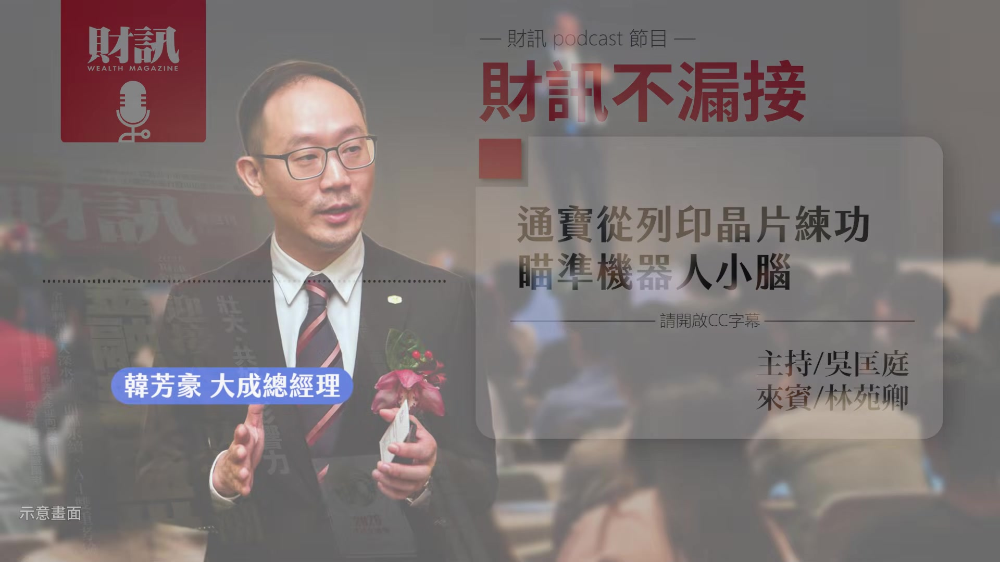
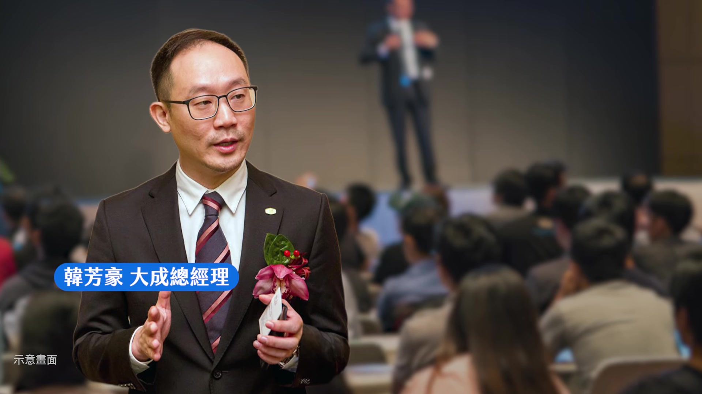
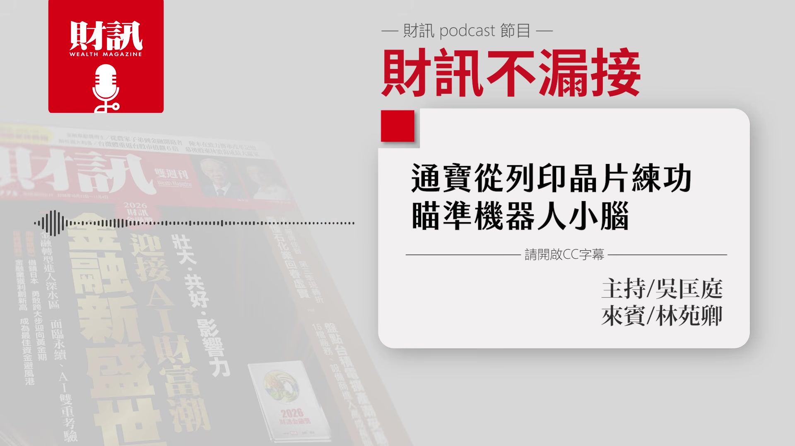
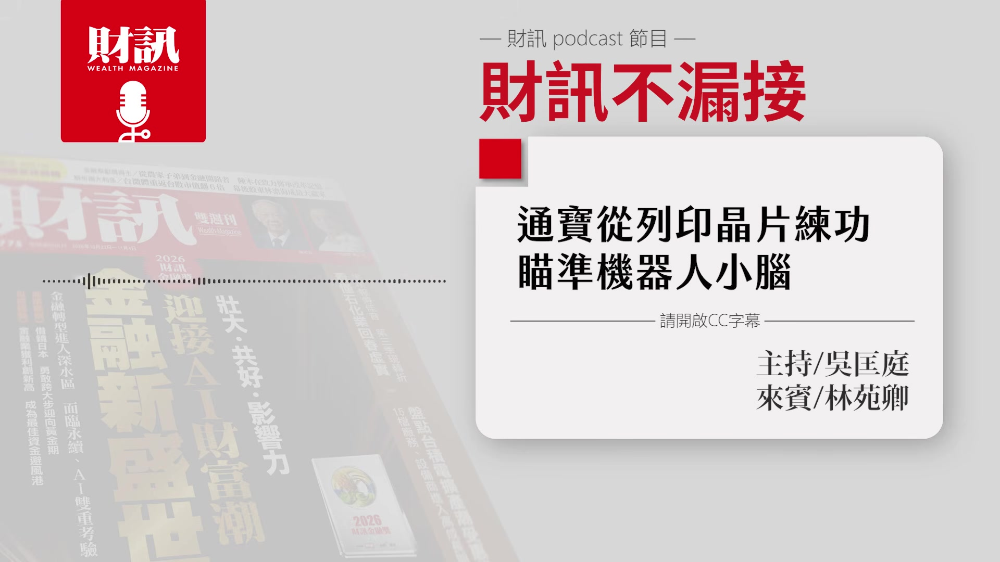
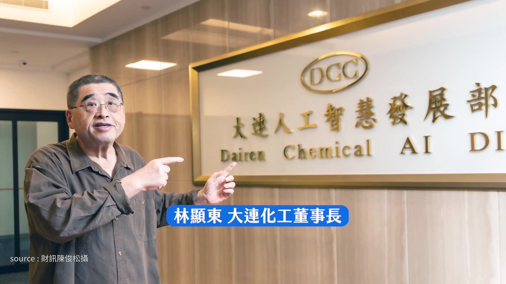
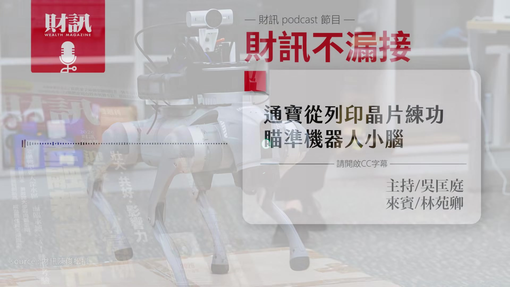
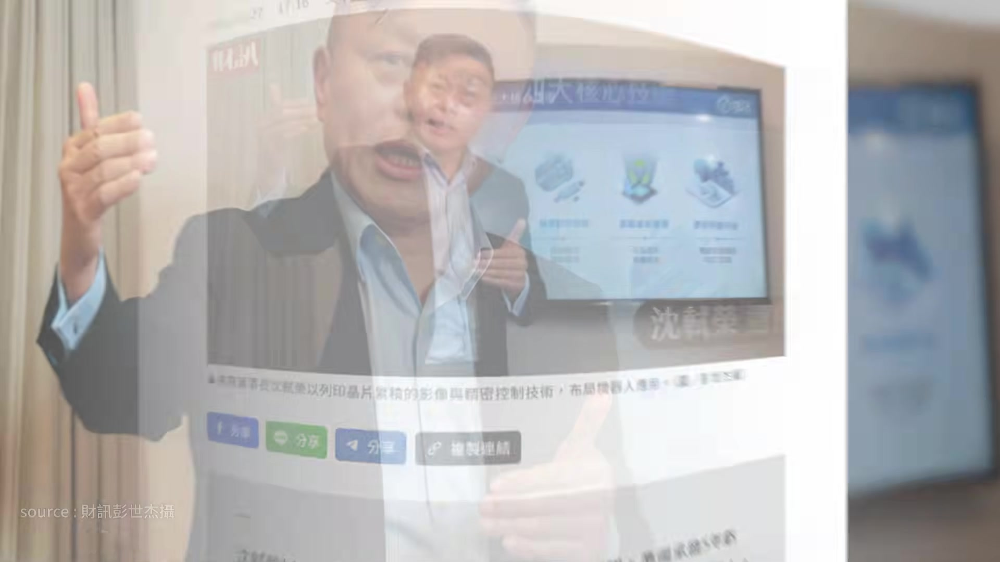
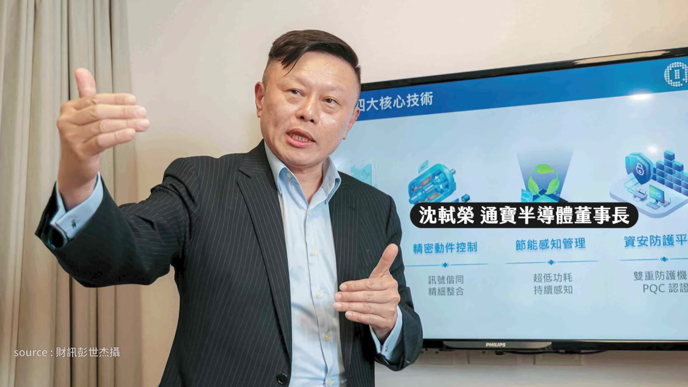
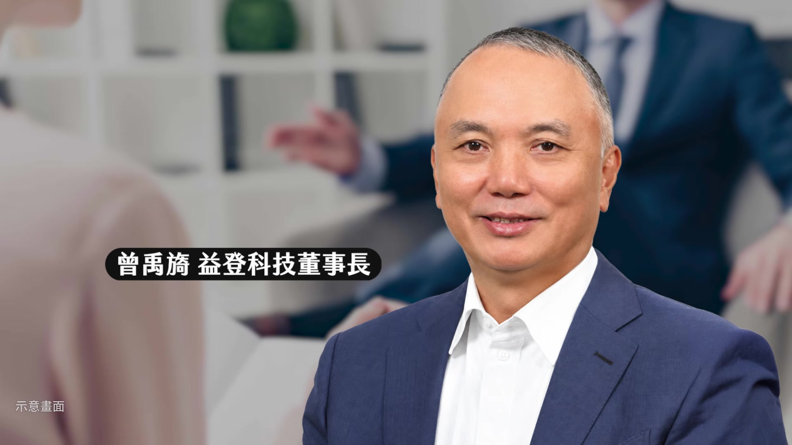
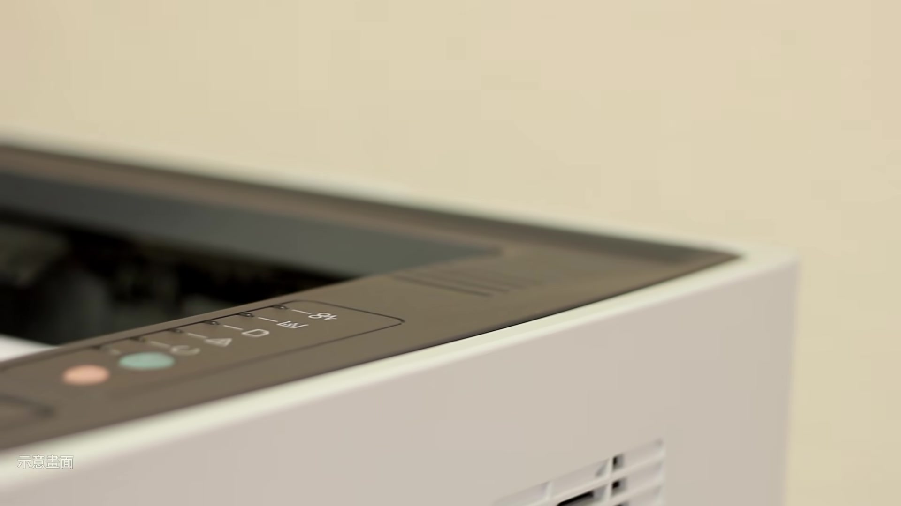

# wealth1974_6BL3Mw64Flc — 關鍵畫面索引

- 來源逐字稿：[wealth1974_6BL3Mw64Flc_GT.srt](wealth1974_6BL3Mw64Flc_GT.srt)
- 影片：https://www.youtube.com/watch?v=6BL3Mw64Flc
- 截圖數：18

## 00:00:03

**逐字稿片段：** 通寶從列印晶片練功 瞄準機器人的小腦 想要知道的聽眾朋友 記得聽到最後 今天的來賓是 財訊的撰述委員林苑卿 各位聽眾大家好 我是苑卿 好 那節目開始前也提醒大家 這是財訊 Podcast 的節目 如果是透過 YouTube 平台 來收聽的聽眾 可以打開右下角的 CC 字幕 那我們就開始吧 首先第一段 我們來聊一下最近的市場動態 有請苑卿分享一下妳之前在路線上 有沒有什麼比較有趣的事情和消息 之前去參加一個論壇

**話題推測：** 介紹節目主題：通寶半導體如何從列印晶片發展機器人小腦。

---

## 00:00:39

**逐字稿片段：** 就聽了大成的韓芳豪的演講 裡面有一段的內容 我覺得滿有趣的 大成集團總經理韓芳豪 他其實比較少出現在公眾場合 但是因為他最近的一個 公開演講的關係 所以他就提起了他的伯父

**話題推測：** 講者分享大成集團總經理韓芳豪的演講內容。

---

## 00:00:53

**逐字稿片段：** 也就是大成集團的董事長韓家宇 因為韓芳豪跟韓家宇 他們兩個剛好都是 電腦工程背景出身的 然後隨著這一波 AI 的熱潮 他們兩個也都是 AI 的愛用者 他就有分享說 其實他自己本身 曾經也是微軟的工程師 他在經營的理念上 偶爾也是會跟他的伯父 也就是韓家宇 會有一些意見不同的時候 他們兩個人在意見僵持不下的時候 他們就會說 好 那不然我們就來問 AI 然後他們就會把他們的討論丟給 AI 然後讓 AI 來幫他們評斷到底誰講的 會是比較有道理或正確 因為他們兩個人都是 AI 的愛用者 也非常的相信 AI 所以他們就比較可以 從這樣子的一個過程當中 就是去消弭他們的一些歧見 獲得一個共識 所以我覺得這段是真的還滿有趣的

**話題推測：** 介紹大成集團董事長韓家宇。

---

## 00:01:47

**逐字稿片段：** 避免有些聽眾比較陌生 可以簡單介紹一下 大成集團主要在做什麼 大成集團就是在做食品 如果有去超商或超市的話 就是你知道大成的雞塊或肉品 是相當有名的 那苑卿上一期有做主文 就是在講石化業 也有錄一集 《聽了財知道》 然後觀眾的反應也都很好 觀看數也滿多的 那苑卿也非常瞭解石化產業 它們在經歷這一波轉型的路上 也是滿辛苦的

**話題推測：** 簡要介紹大成集團的主要業務。

---

## 00:02:14

**逐字稿片段：** 其中妳還有採訪一家公司 是大連化工 那它們在 AI 的應用跟轉型上 有什麼著墨嗎 大連化工我們在很多年前 就已經有去專訪過 那個時候整個產業的結構 已經從景氣循環 變成結構性的改變 所以整個產業已經面臨 嚴重供過於求的時候 它們要怎麼樣去存活下來

**話題推測：** 介紹另一家公司：大連化工。

---

## 00:02:33

**逐字稿片段：** 那時候大連化工董事長林顯東 他就有分享說 很早之前他們就開始在研究 AI 要怎麼樣成為他們 在經營決策上面的判斷 然後那時候他們就有發現 石化業的某一個產品 供過於求的狀況非常的嚴重 所以他就當機立斷 決定要把它們在中國 生產這一個產品的工廠 就先減產 甚至後來是停工的一個狀態 因為他做了這個決策之後 也順利讓它們在那一波的衝擊之下 減少對它們整個營運的重大影響 這一次因為我們做石化的專題 然後又再去採訪了 大連化工董事長林顯東 之前我們去採訪他 他講到 AI 怎麼樣變成他的經營決策 這一次他講更多是它們已經把 AI 變成它們未來要發展非常重要的方向 那天去的時候 他帶我們參觀了一整層 它們新租的樓層 那一整層有一個扛棒（招牌的台語）

**話題推測：** 介紹大連化工董事長林顯東。

---

## 00:03:24

**逐字稿片段：** 上面就寫著 大連化工人工智慧發展部 專門一個部門 對 專門一個部門 而且他也讓我們現場去看到說 它們怎麼樣去訓練機械狗 讓這個機械狗它內建的 AI 去讀儀表板上面的數字 可以把這個數字 即時的回傳到後台 讓它們去做一些判斷 甚至它可以去聽一些異音 然後去判斷說 是不是有發生一些什麼故障之類的 所以這個部分來講的話 它就可以分擔人工的工作 因為他有提到大連化工 它們也有在中國會有些廠 是在那種冰天雪地的地方 如果你夜晚要用人力出去巡邏的話 其實會有滿多不方便 而且會有危險性 但現在如果透過機械狗的話 它第一個是節省人力 然後第二個也可以加重它的一個安全性 感覺應該是滿實際的應用層面

**話題推測：** 介紹大連化工新設立的「人工智慧發展部」。

---

## 00:04:10

**逐字稿片段：** 那另外一個近期大家關注的議題 就是美國期中選舉 在美國的週二要登場了

**話題推測：** 轉變話題至美國期中選舉。

---

## 00:04:17

**逐字稿片段：** 目前市場多數民調 是看好民主黨它可以拿下眾議院 參議院七個選區的差距也有在拉近 不過呢 就是大家都知道 川普很愛放話 他已經先說了 如果民主黨勝選的話呢 他會變成「否決先生」 就是它們議院提的法案 他可能都會一直不斷的否決掉 這就是他的風格啦 那我們也會持續的追蹤

**話題推測：** 說明美國期中選舉的最新民調預測。

---

## 00:04:41

**逐字稿片段：** 好 那我們就進入今天的主題 第三季剛剛結束 我們有發現 就是通寶半導體它的營收 前三季就已經超越了去年全年 目前看到前三季（營收）是 5.39 億元 年增大概 1.6 倍 那時候我看苑卿寫這篇文章 開場就寫說 董事長知道他做這一個事業 一開始就要賠 5 年 就讓人很好奇 明明知道要賠 那他為什麼還要跨進來 如果要回答這個問題的話

**話題推測：** 進入今天節目的主要討論主題：通寶半導體。

---

## 00:05:10

**逐字稿片段：** 我們可能要先從沈軾榮 他過去的一個背景開始說起 因為沈軾榮他的前一分工作

**話題推測：** 介紹通寶半導體董事長沈軾榮的背景。

---

## 00:05:16

**逐字稿片段：** 其實就是金寶集團的執行長 也是金仁寶集團許勝雄的前女婿 當初他在接金寶集團執行長的時候 金寶就長年替 HP 這種品牌廠商代工印表機 所以他在這個代工過程當中 非常的清楚關鍵的控制晶片 對於印表機的重要性 他有觀察到說這種控制晶片 它未來其實也會慢慢的 在機器人的使用上 它也會愈來愈重要 而且愈來愈多元這樣子 剛好有一個機會 在 2016 年的時候

**話題推測：** 提及沈軾榮曾任金寶集團執行長，並與金仁寶集團的關係。

---

## 00:05:49

**逐字稿片段：** 高通它們想要更專注的 在它們的處理器的事業上面 於是它們就把印表機影像處理技術 跟研發團隊釋出 在這個時候呢 剛好沈軾榮知道這個消息 於是他就主動去洽談這件事情 他就想說他要合併這個技術 跟這個研發的團隊 因為這樣他成立了通寶半導體 但因為那時候 他還沒有離開金寶 所以他就一直把通寶半導體 當作他集團旗下一個非常重要的 一個子公司 當他離開了金寶之後 他也主動的去跟金寶 買下通寶這家公司的經營權 因為他覺得說未來不管是機器人 或者是之後的量子電腦 他覺得這個研發團隊深具潛力 就像剛剛我們有講到說 他在做印表機的時候 他就有發現關鍵的控制晶片 它未來對於 比如說像機器人這些影像 或者是精密的動件控制技術 關聯性其實是相當高的 因為當紙張在前進的時候 那個噴墨頭的移動跟墨滴的落點 都要非常的精準 協調 還有就是說其實它是 牽涉到數位跟類比訊號的整合 是長期必須要累積像馬達或是感測器 還有機構的一個配合經驗 所以這些用在未來我們所知的 這些機器人相關的一些 前瞻性的應用來講的話 都是一個非常不可或缺的技術 真的是滿有眼光的 我們一般可能在看列印機或印表機 我們可能就看到它印東西出來而已 但他能看到印表機或列印機 其中裡面的技術是需要精密的對位 或者是需要精準的控制 他看到的是這個技術將來的應用 那他是怎麼樣把這個技術 開發到市場裡面讓客戶買單呢 沈軾榮接受我們的採訪的時候 他也不諱言它們第一顆晶片 就開發了超過兩年的時間 而且客戶導入因為需要驗證 然後又花了一年多 所以他覺得這個開發跟驗證的時間 其實是相當漫長的 客戶的信任在這個過程當中 他也理解說是需要一步一步的去做累積 一剛開始像日本的品牌商 它們是先從低階的機種去做試用 等到確定 OK 之後 它們才慢慢的擴大到中階 甚至到更高階的機種 所以在接手的過程當中 也讓他知道說跨入到 IC 設計 它的這個門檻其實也是相當高的 這就是我們剛剛所說的主題 他一開始就知道要賠五年 五年慢慢的累積跟磨出 跟客戶之間的信任關係 但讓它訂單這麼漂亮的成長原因 又是什麼呢 比較少人知道的是說 過去 Marvell 就是邁威爾這家公司 它就是全球主要供應 像印表機這樣的一個 關鍵控制晶片的 IC 設計業者 但是 AI 浪潮的關係 像 Marvell 它也是把重心 幾乎都放在 AI 的晶片上面 所以呢 它也開始要 慢慢的去做一些取捨 於是它就希望說 它可以盡量減少研發 或者是人力的成本 是在印表機的關鍵控制晶片的研發 甚至是生產上面 於是在這個時間點 就讓市場空出了一大塊 這次我們去側訪了

**話題推測：** 提及高通 (Qualcomm) 於2016年釋出印表機影像處理技術。

---

## 00:08:47

**逐字稿片段：** 像益登的董事長他提到說 其實這個市場它還是有需求的 如果說既有的 IC 晶片廠商 它們沒有辦法去供應這個市場需求 那自然就需要有後進者 去遞補這個市場需求 那剛好通寶半導體在這個時候 就成為了可以順利取而代之的一個對象 所以它也成為了這些客戶 它們一個新的選擇 所以就是那句老話啦 機會永遠是給準備好的人 通寶就是拿到這個的機會 它在這一塊市場站穩了

**話題推測：** 提及側訪益登董事長對市場需求的看法。

---

## 00:09:16

**逐字稿片段：** 剛有聽到苑卿說 它未來的目標是機器人 它想要怎麼做呢 我們平常在使用的那個印表機 它裡面其實有涵蓋像影像處理 還有馬達 還有感測器的一個技術 剛好呢 就是沈軾榮他們在 合併這個團隊的時候 這三種技術它們都同時的掌握 在這個掌握的同時 關於它們要怎麼樣去 協調控制的這件事情 它們也可以從中進一步的 去拿到相關的一些關鍵的技術 再加上它們在 6 月的時候 它們取得了新加坡的芯之寶 就是 SinChip 它的 6 成股權 補強了它們在客製化晶片 也就是所謂的 ASIC 它的一個設計的能力 那在這一次新思科技的全球副總裁李明哲 他接受我們的採訪的時候 他也有提到說 他覺得台灣要短期之內 去建立這種百人的團隊 其實是相當困難的 但是因為通寶它們在合併了 新加坡的芯之寶以及越南 總計加起來差不多 130 人的團隊 是有助於未來通寶 加快它們產品開發的一個腳步 所以在這次 9 月的半導體展的時候 通寶半導體就展示了 它們在機器人上面的這個小腦控制 跟無人機的晶片布局 但我們都知道就是機器人市場 大家已經講好幾年了 也已經有很多的參與者 很多大廠也都參與在裡面競爭 通寶進來這塊 它的角色跟定位是什麼 這個問題其實也是當初通寶 它們要 IPO 的時候 很多的分析師跟外界 都會很關注的議題 所以沈軾榮他就說 他想要跟大家強調的地方是說 它們其實沒有要跟那些大廠 去搶那些要花很多大錢 開發大腦的那種晶片 但它們就是從關節 還有馬達控制的部分去切入 再搭配上它們比較熟悉的 精密動作控制的這個部分 就目前的現金流來講的話 印表機的關鍵控制晶片這一塊 還是它們未來主要營收的來源 但是呢 未來的 5-7 年 像是安全晶片還有 ASIC 跟機器人產品線的部分 就會慢慢成為它們 接下來要成長的另外一隻腳 然後另外它們也有關注到 量子電腦未來的市場潛力 所以它們未來 在既有的技術跟產品線 結合量子的密碼學 也就是所謂的 PQC 還有物理不可複製功能 也就是 PUF 之後 它可以協助品牌廠商在提供保護耗材 那這個部分就可能會變成 它們的另外一塊收入 那還有提到說先進製程是很重要 但是他覺得產品的價值更重要 所以它們剛好在印表機這個市場 它們拿到了比較寡占的地位 對於它們之後維持穩定的現金流 其實是非常的有幫助 感覺就是它透過印表機的市場 有一個穩定的資金來源 那它用這個穩定的資金來源 來持續投入在機器人這一塊的 研發資金的消耗上 這些都是我們目前可以看得到的 那對於未來規畫的這些內容 什麼時候可以看到成果呢 以及接下來有哪些重點 是值得投資人可以觀察 新的布局 像我們剛提到的 那些機器人 無人機的部分 其實都還需要時間去醞釀 它們新一代的高階印表機的主控晶片

**話題推測：** 提問通寶半導體未來在機器人市場的策略。

---

## 00:12:26

**逐字稿片段：** 它們是預計在明年也就是 2027 年的 第四季的時候會量產

**話題推測：** 說明新一代高階印表機主控晶片預計量產時間 (2027年Q4)。

---

## 00:12:30

**逐字稿片段：** 至於我們前面提到的無人機的晶片 最快它們認為說 也要在明年的下半年 才有機會可以開始出貨 如果說它們在開發 跟客戶導入的時間有延後的話 那當然營收貢獻的時間點 也會順著遞延 但是眼前的部分 我們需要把它的營收 跟新應用來分開看 現在目前看起來

**話題推測：** 說明無人機晶片預計出貨時間 (明年下半年)。

---

## 00:12:52

**逐字稿片段：** 它 9 月的營收成長 主要還是來自於 它們的技術服務專案 跟晶片的銷售 現在目前的觀察重點就是 印表機的客戶是不是還是 可以持續擴大採用 接下來它們在無人機 還有機器人的晶片 是不是可以按計畫的來做量產 可能會是接下來 我們需要觀察這家公司的重點 好喔 非常感謝苑卿的分享 聽完今天的節目 你覺得通寶切入機器人 最大的機會在哪裡呢 歡迎大家留言分享你們的想法 如果還想瞭解更多的內容 歡迎點擊資訊欄中的文章連結 或是購買財訊第 775 期的雜誌 跟我們一起追蹤政經趨勢 掌握投資脈動 《財訊不漏接》 我們下次見

**話題推測：** 說明通寶9月營收成長的主要來源。

---
