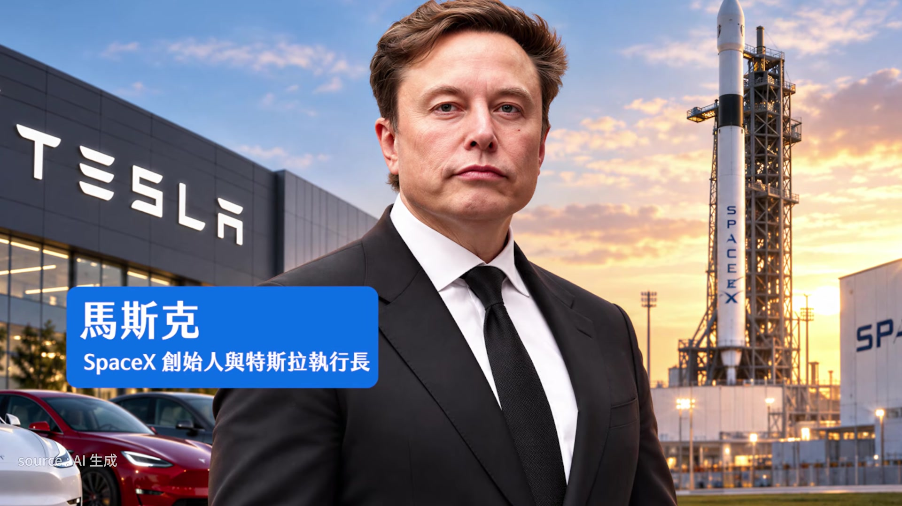
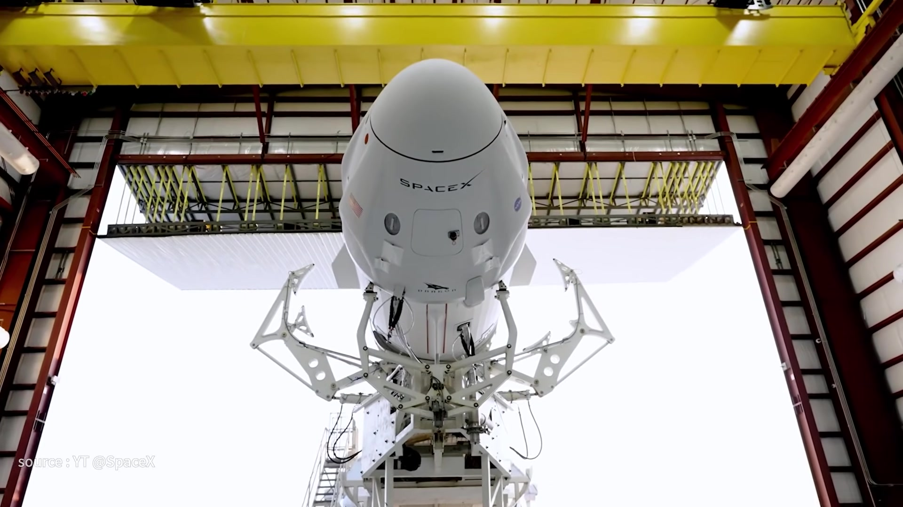
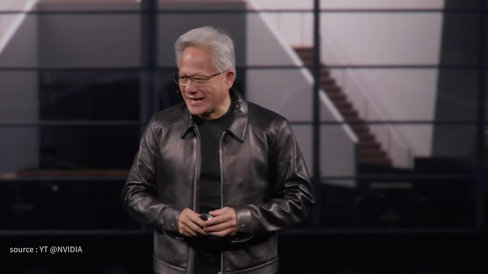
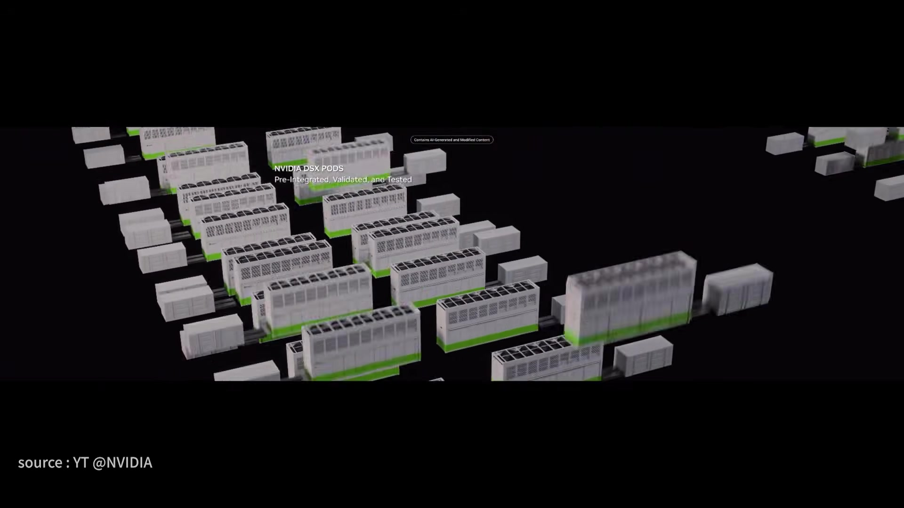
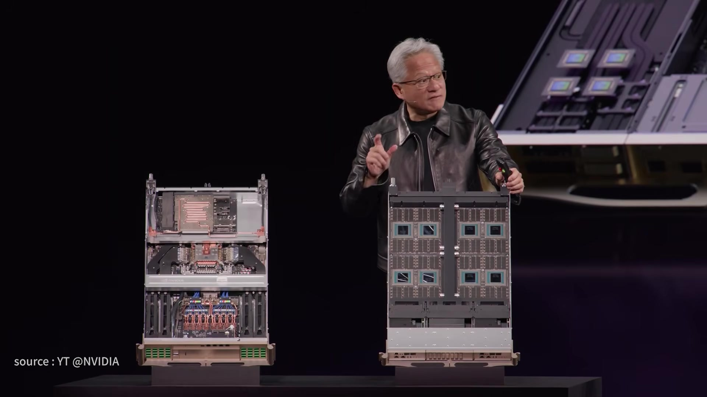
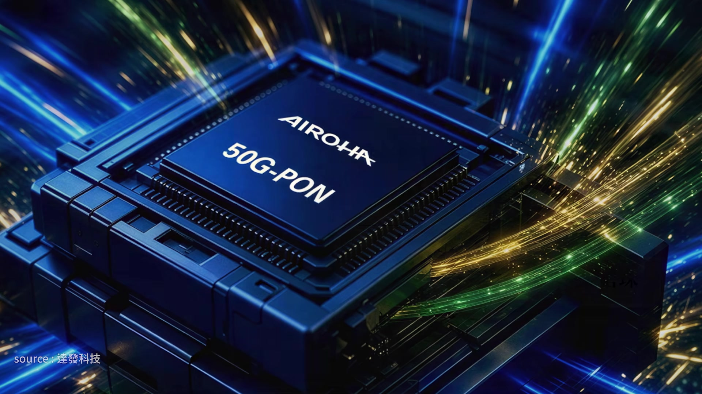
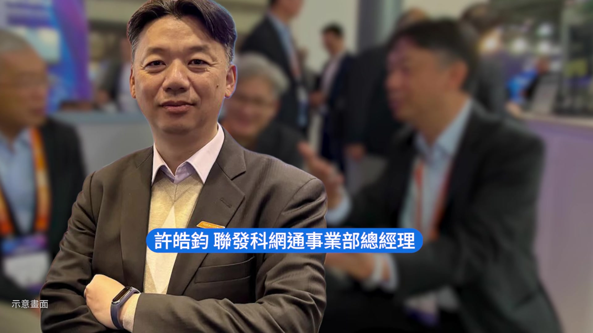
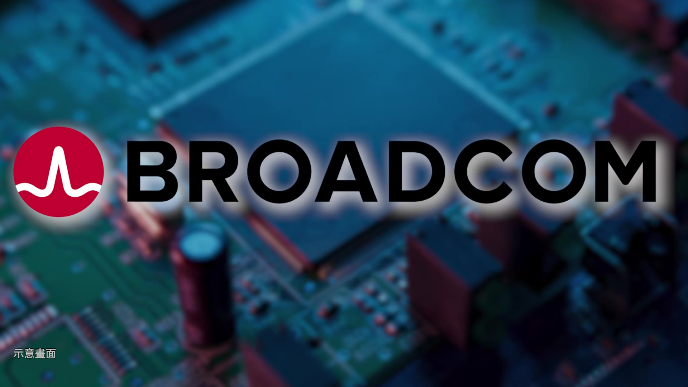
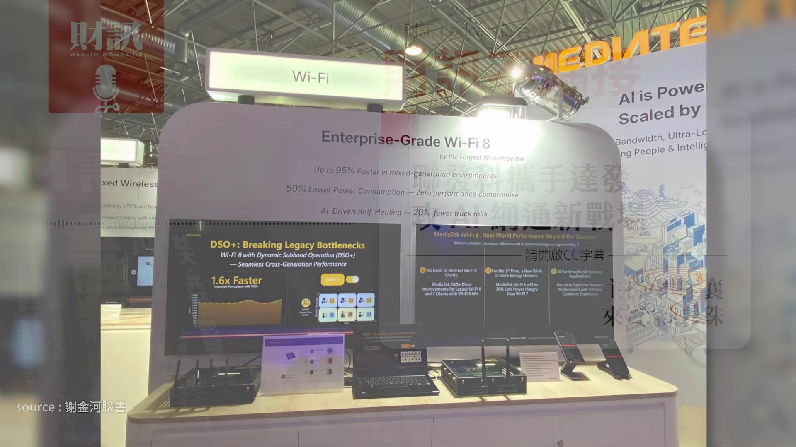

# wealth1974_E71ShaxggtM — 關鍵畫面索引

- 來源逐字稿：[wealth1974_E71ShaxggtM_GT.srt](wealth1974_E71ShaxggtM_GT.srt)
- 影片：https://www.youtube.com/watch?v=E71ShaxggtM
- 截圖數：19

## 00:00:03

**逐字稿片段：** 把家庭光纖技術 搬進資料中心 聯發科攜手達發 攻 AI 網通新戰場 想知道的聽眾朋友 記得要聽到最後 今天的來賓是 財訊的主編陳碧珠 各位聽眾大家好 我是小珠 這邊也提醒大家 這是財訊的 Podcast 節目 如果是透過 YouTube 平台 來收聽的聽眾朋友 可以打開右下角的 CC 字幕 那我們就開始吧 這一期 《財訊不漏接》 非常的科技 我們要請我們科技組的扛霸子小珠 來跟我們分享一下 最近路線或市場上 有沒有一些有趣的事情或者是消息 當然從股價上來說 是比較蕭條一點 當然 可是其實財報都滿亮眼的 但是好像市場都不買單 資金跟基本面有點脫鉤這樣 不過回到財報這個部分 大家比較關注的 當然就是馬斯克兩家公司 一個是特斯拉 一個是 SpaceX 都很不錯 先講一下 10 月 21 日特斯拉它的第三季財報 它的營收獲利還是優於預期 雖然它小減 大家都知道電動車都不太好 但還可以有這樣表現算是不錯 重點就是 其實馬斯克已經 不太去強調電動車 他比較 focus 在人形機器人 跟他未來的 AI 支出 這一塊也是可能會 拖累它獲利下降原因 不過大家都還滿能夠 正面認為說在獲利下降的同時 看到他有在投資人形機器人這件事 是覺得比較樂觀的 所以他有預期說明年的資本支出 還是會明顯增加

**話題推測：** 介紹本集主題：家庭光纖技術、聯發科與達發攻AI網通新戰場

---

## 00:01:29

**逐字稿片段：** 甚至 2028 年會上看數百億（美 ）元 那我們就看這家公司 從電動車慢慢轉到實體 AI 看它到底會怎麼樣 但是我還是對它那台車很有興趣 那台飛天車 最近他這個影片真的很有想像力 他就是一個很會做噱頭的人 真的就是噱頭十足 有他在就會很好玩 資本市場就是跟著他打轉 沒錯 沒錯

**話題推測：** 展示特斯拉資本支出預期圖表，預期2028年上看數百億美元

---

## 00:01:52

**逐字稿片段：** 那 SpaceX 呢 SpaceX 也不錯 SpaceX 已經掛牌了 所以大家更注意它的營運表現

**話題推測：** 轉換討論 SpaceX 的財務表現

---

## 00:01:58

**逐字稿片段：** 它第三季財報爆發性的成長 161% 轉虧為盈 很激勵 那主要的營收 就是它的星鏈網路 還有就是它的 SpaceX AI 比較有趣的是 因為這個財報真的不錯 結果沒想到馬斯克竟然說 我要把這兩家公司合併 但其實這背後 是很大的一個財務操作 因為他們都會被要求要分散股權 馬斯克他可能要為了維持投票權 藉此來鞏固他在董事會裡面的地位

**話題推測：** 展示SpaceX第三季財報數據，強調161%成長並轉虧為盈

---

## 00:02:24

**逐字稿片段：** 那再來就是黃仁勳 你看「仁來瘋」 以前也不覺得他在德國會發表什麼 GTC 演講 結果他竟然選擇在德國柏林 其實原因就是因為 他要在那邊做一個 AI 工廠 因為黃仁勳一直在講已經不是 GPU 而已 他在講 （ AI ） 基建 那他這一次的（演講 ）我覺得滿多亮點的

**話題推測：** 轉換討論黃仁勳與NVIDIA的新動態

---

## 00:02:43

**逐字稿片段：** 第一個就是他有一個模組化的 AI 工廠 新的機架模式叫做 「DSX POD」 因為現在做資料中心部署 都要好幾個月 我們就把它想成是蓋房子 那你光是內裝 你都要整合 你更何況是外面的 比如說要拉電線 那黃仁勳他就很聰明 他用貨櫃化的方式 把很多機架先放進來 然後封閉式的做液冷處理

**話題推測：** 介紹黃仁勳提出的模組化AI工廠與「DSX POD」新機架模式

---

## 00:03:06

**逐字稿片段：** 他說這個東西可以讓你部署時間 從 4-10 個月縮短到兩週 兩週就可以幫你建好 在資料中心的一個基本盤 而且他用一個封閉式的液冷概念 在外面拉液冷的 冰水機這些東西都可以減少 就可以讓你部署的成本大降 告訴大家說 你不用擔心 我會讓你趕快推動 你的資料中心 那他的 GPU也可以很容易就上市

**話題推測：** 比較AI工廠部署時間：從4-10個月縮短到2週

---

## 00:03:31

**逐字稿片段：** 他同時也宣布他下一個平台 就是 Vera Rubin 的 Ultra 他應該是明年下半年就會推出 他不斷在推動他的產品 甚至每個世代產品背後 他也幫客戶想好 我可以怎麼樣讓你 快速建立你需要的解決方案 那第二個就是 他也不斷在提到說現在的 AI 其實已經代理化了 歐洲也是一個很重視隱私安全

**話題推測：** 發布NVIDIA下一代平台Vera Rubin Ultra

---

## 00:03:52

**逐字稿片段：** 所以他在這時候也推出了一個 「OpenShell 」 的參考架構 提升 AI 的安全性 那再來就是實體 AI 實體 AI 其實他就 launch 兩個平台 一個是 Hyperion 這個平台 這個東西其實我今年初去 CES（美國消費電子展） 的時候 他就是在展示他結合 Alpamayo 自動駕駛平台 然後跟賓士合作 還有跟 Lucid 合作 這一次他講了這個平台 其實就是在繼續優化 Alpamayo 的東西

**話題推測：** 發布提升AI安全性的「OpenShell」參考架構

---

## 00:04:17

**逐字稿片段：** 他說已經有 2.5 萬輛 歐洲的一家類似我們 Uber 的公司 叫做 Bolt 未來就是用這個部分 來讓自動駕駛更聰明 那最後就是機器人 機器人我覺得稍微 soft 一點 但是他也是說 我會把人形機器人繼續再開發 那無論怎麼樣 你就可以看得出來說 整個 AI 資料中心的基礎建設跟落地 其實它是雙軌進行 所以看得出來就是 他加緊它的速度 謝謝小珠的分享 有關於政治經濟局勢的部分

**話題推測：** 說明Hyperion平台已與2.5萬輛Bolt車輛合作，提升自動駕駛功能

---

## 00:04:47

**逐字稿片段：** 台灣這邊的話是有關於用電 剛剛有講到資料中心 或者是 AI 中心 它們其實很重視用電 那其實台灣這邊有一些光電業者 它們被檢調搜索了 還有正崴它旗下的富威能源 和台電的一個糾紛 也在持續的進行中 這其實滿打擊台灣在發展再生能源的信心 那當然我們會繼續為大家觀察 接下來就進入我們今天的重點了 就是小珠這一期在 （財訊雙週刊 ） 775 期的雜誌裡面 有寫到有關於達發 它是聯發科的小金雞 它為什麼這次會被凸顯出來 就是因為它去了維也納 聯發科跟達發在維也納 一個很重要的電信寬頻的展 秀出它們新的一些產品 我覺得滿訝異的就是說 過去在家裡面用 Wi-Fi 然後你可以連到比如說你的冷氣 電冰箱 還有掃地機器人 你可以遙控它們煮飯或定時這些的 你可以遙控它們煮飯或定時這些的 而這樣的技術現在就是透過了一個 叫做被動光纖技術 從家用的把它擴張到資料中心 就是由聯發科和達發 一起來做這件事情 請小珠跟我們分享一下 達發和聯發科 它們兩個一起要做這件事情 有什麼樣的利基 你平常在家裡上網 你可能比較不會去注意 家裡其實有一個 電信業者在裝機的時候 俗稱的小烏龜 蛤 小烏龜 它在哪裡 我家有 那就是妳說的被動光纖網路 這麼多的網路 其實是從光纖拉出來的 所以你可能都不知道 背後那一條大動脈 那個就是 PON 光纖是傳大量的 網路訊息的東西 然後你再分流 最後我們上網的時候會有個 Wi-Fi 聯發科做的就是 Wi-Fi 達發它的強處是在 光纖家裡到戶這個的通訊技術 那這個其實是很穩定 很有利基的市場 而且它在歐美其實是不同的商業模式 達發它在歐洲是第一名 在市占率嗎 它這一塊是滿利基的 而且歐洲的電信是比較開放的 所以它們比較有採購權 剛剛我講那個上網背後那一套隱形模式 它每一段的產品 它幾乎都有 那我們今天要講的 當然不是它原來既有的故事 而是 PON 這個技術 這個東西其實很成熟 可是也會隨著不同世代在升級 可是我覺得最大升級是 把它用在資料中心的部署 達發跟聯發科這次在展上 它有一個 PON 的資料中心 它就有秀出說 這個東西我也可以在資料中心應用 重點是我不是要放在家庭 而且我也不是要瞄準 GPU 跟 GPU 之間的高速資料傳輸 因為 GPU 跟 GPU這種資料傳輸 其實它們的晶片巨頭 自己都會有自己的規格 比如說 NVLink 可是它要的是

**話題推測：** 探討台灣光電業者被搜索，正崴旗下富威能源與台電的用電糾紛

---

## 00:07:27

**逐字稿片段：** 原來在整個機櫃裡面 還有一個「帶外管理」 那個帶外管理以前是拉銅線的 然後是用乙太網路就好 就是我可能在做備援部署 比如說萬一這個傳輸過程當中 我可能還是要控管一些東西 看有沒有哪裡有 loss 以前它們是用銅線 串一串幫你架在旁邊 然後遠端有人監控就好 現在它們就想說不行 現在資料中心這麼貴 而且很耗電 如果我能夠少弄一點銅線 然後不要布這麼多乙太網路的設備 我用一個小烏龜 我就可以分流這麼多線 是不是省很多

**話題推測：** 說明PON在資料中心的新應用：機櫃「帶外管理」

---

## 00:08:06

**逐字稿片段：** 那對整個投資效益來說 我省了空間 是省了很多資本支出 你可能會說那以前怎麼不做 因為這個東西 如果以前用銅線跟乙太網路的時候 占整個成本其實是不高的 所以穩穩的用也沒關係 沒想到就是因為現在 每一個小空間都是黃金土地 我能夠塞更有用的東西 可是你說它重不重要 聯發科網通事業部 總經理許皓鈞就跟我說 你可以把 GPU 想成是正門 因為現在資料中心 就是要把這些算力給算出來 都需要網路連接 這個正門不是我們要管的 可是這個帶外管理 它就像是維修人員進出的側門 只要你伺服器當機或異常 你就可以透過這獨立管道遠端監控 我們就說那你這個東西 現在有人在用嗎 有 它的效益就是幫資料中心 省了那麼多空間

**話題推測：** 視覺化解釋PON技術如何為資料中心節省空間與資本支出

---

## 00:08:58

**逐字稿片段：** 重點是單價還高於 以前家庭寬頻三倍到數十倍 因為你用在資料中心 你本身的頻寬就是升級 然後你用的數量 也可能因為資料中心 每一個機櫃可能需要帶一個 價跟量都會上去 所以是被期待的 它們其實有說目前 有在接歐洲電信業者的案子 而且這個業者是 CSP 業者要的 那可以跟我們分享一下 它現在目前有哪些重要的客戶 然後它通常都幫它們做哪些事情

**話題推測：** 指出PON在資料中心的單價比家庭寬頻高3到數十倍

---

## 00:09:24

**逐字稿片段：** 現在有兩家公司 一個是 Ciena Ciena 它去年就講 它跟臉書合作 它們就是用 PON 就是剛剛講的像小烏龜 放在資料中心做這個管理 已經有一個實體的方案 那據我們打聽 這個合作就是它們用達發的 第二個就是 Nokia Nokia 它今年 3 月 它就說我也要做這東西 而且我做了這個東西 還可以節省超過一半電力 電就是一個重要的投資成本 所以我覺得光是這兩家公司 其實我覺得就有一定的代表性 然後甚至 Ciena 公司的執行長 Gary 他在今年第二季的財報就說 我們不只是 Meta 我們還有第二家 已經在初步拿到訂單 第三家已進入實驗階段 所以就表示說典範轉移 就是原來的家庭光纖技術 可以搬到資料中心 這是可行性高的 重點是市調機構也非常看好這樣的新應用 那新應用他就說 2026-2030 年 資料中心用 PON 的 帶外管理設備支出 5 年來可以累積 30 億美元 我覺得對達發來說 算是一個滿肥的市場 剛剛也提到說它是 Wi-Fi 或者是 PON 那個技術 其實已經是一個非常成熟的技術 難道它沒有其他的競爭對手嗎 它有什麼利基可以去跟 這些應該也是滿強大的競爭對手來抗衡 大家都知道網通大咖就是博通 博通現在就是像聯發科一樣 幫 CSP 做服務做得很強 因為它收購 AVGO 現在的博通其實就是 AVGO 可是事實上舊博通 它這一塊就是很厲害 博通其實它也是一直有在做 PON 的多代產品 而且甚至市場的地位也不容忽視

**話題推測：** 列出重要客戶：Ciena與臉書（Meta）合作案例

---

## 00:10:52

**逐字稿片段：** 這家公司現在已經是一個 全球第二大 IC 設計公司 那相對於達發來說 達發其實是小公司 博通它想不想進來 這時候我們就有去問業者 它有能力的 但是它想不想就是一回事 因為以資源分配來說 它志不在此 對它來說 30 億美元的市場規模 它寧願再去多一點的功夫 是放在跟 CSP 業者直接互惠的營收 可能爆發力更強 所以它也不是沒有能力 可是它可能不見得重點在這

**話題推測：** 指出博通是全球第二大IC設計公司

---

## 00:11:19

**逐字稿片段：** 反而是另外一家 MaxLinear 這家外商因為收購了 Intel 的家庭網通部門 正在積極進軍 所以你可以知道這塊市場 真正會去對標的 應該是這種也是老廠 可是它因為收購了 Intel （家庭網通部門 ）這個公司 有這個資源而積極進來 那講到博通 我們就會想到高通 高通發展相關的產品 它好像是跟別的台廠合作 這個部分的話 小珠可以幫我們補充一下嗎 高通的產品比較像是聯發科走消費端 所以高通的重點應該是會在 Wi-Fi 或者是家庭 home 部分會跟它對打 高通其實沒有 PON 可是因為整個連線系統 其實是從遠端光纖電信一直到家 這個也是達發為什麼要攜手聯發科 進軍寬頻到家這樣的一個市場 所以還是會打到 只是打到的方式不一樣 可是我們在這一次的展 你也可以發現 就是因為大家都知道 現在 AI 很重要 所以它們也在做加值服務 比方說達發它在原來的 消費性的光纖閘道器 它就說如果我要處理 Wi-Fi 訊號不佳 設備連線異常 我也可以導入 AI NPU 這個 NPU 就是大腦 我可以加點 AI 的功能 讓這個東西可以更快的被監測到 那聯發科也是 我在 5G-Advanced Edge AI 與 Wi-Fi 8 的無線寬頻平台 我也可以讓你加了 AI 之後 可以有效率的管理網路 高通也是

**話題推測：** 介紹另一家主要競爭對手MaxLinear

---

## 00:12:38

**逐字稿片段：** 它甚至跟 Google 已經讓出來的 Google Fiber 的電信業者合作 也要做這樣的功能 所以從雲端到消費端 其實達發是用聯發科 這樣的一個體系在進去 然後達發本身又把它的 PON 移到光纖這個市場 如果說既有的業者 剛剛講的博通 它不是沒有辦法打進去 可是它志不在此 所以看起來達發的競爭對手應該是 MaxLinear 這種公司 可是在消費端還是要注意 因為高通也是來勢洶洶 不管怎麼樣 我們都可以看得出來說 其實生命週期滿長的 你看你一年會換多少次家庭光纖 都快忘記了 對 而且根本平常也不會去關注它 只要它不會斷網就好了 對 可是問題是 這個是有點像標案 一旦穩定 它毛利很高

**話題推測：** 高通與Google Fiber電信業者合作，推出AI加值網路管理功能

---

## 00:13:21

**逐字稿片段：** 所以達發的毛利是 50 幾% 而且是長期的 那當然它也會迭代 現在已經走到 5G 了 然後 Wi-Fi 6 從應用來看 以後你要 run 代理 AI 的模型 這個連線能力還是很重要 你要 run 這麼多東西 你沒有辦法做好連線怎麼行 所以它們就有預期說 其實像達發跟聯發科 它們在做所謂的升級時 它們就預期說 Wi-Fi 6 之後 它們要攻的是從消費端 攻到更高端的企業端 為什麼 就是因為現在 run 這麼多模型 或是玩這麼多程式 code 這些東西連線能力 是它們最大的品質保證 所以其實像我們現在 已經很習慣認為 上網和連線就是一個 像呼吸一樣的存在 但是在背後其實有很多的大廠 在不斷的刺激和競爭 這樣一個商戰正在要展開 而且老廠 新廠都進來了 那其實是非常的有趣 真的非常謝謝小珠 讓我知道我家裡 原來是有一隻烏龜的 所以完整這一次的報導之後 小珠有什麼心得或想法 或是有沒有什麼要補充的東西 就是呼應妳剛剛講 我們現在很多的電子裝置 都會有一顆晶片 它每一個功能都不一樣 那些晶片其實都在 生活裡面幫你做很多事 所以每一個晶片後面的 player 好好的爬梳 也會發現它有趣的地方 真的 沒錯 謝謝碧珠的分享 聽完今天的節目 你覺得聯發科與達發 能在 AI 網通新戰場中 搶下一席之地嗎 歡迎留言分享你們的想法 如果你還想瞭解更多的內容 歡迎點擊資訊欄中的文章連結

**話題推測：** 顯示達發的毛利率高達50%以上

---
