# wealth1974_ES3kcScvMWA — 關鍵畫面索引

- 來源逐字稿：[wealth1974_ES3kcScvMWA_FIN.srt](wealth1974_ES3kcScvMWA_FIN.srt)
- 影片：https://www.youtube.com/watch?v=ES3kcScvMWA
- 截圖數：32

## 00:00:32

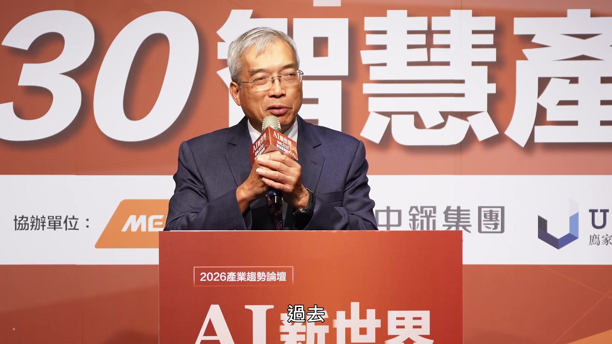

**逐字稿片段：** In the past, during the era of mobile phone chips, MediaTek was just Qualcomm's little brother. MediaTek's market value was far behind Qualcomm's. Now you can see that MediaTek has surged far ahead of Qualcomm. In the next round , MediaTek's competitor will likely be Broadcom. At this moment, everyone can imagine that NVIDIA recently bought up all of MediaTek's 3.5 billion USD in convertible bonds. This also tells everyone that MediaTek's current market value, calculated in USD, has already exceeded 250 billion, ranking it around 67th in the world. Taiwanese enterprises are gradually and steadily moving forward. TSMC is the sixth-largest enterprise in the world. Therefore, I believe that Taiwanese enterprises going international will be very helpful to Taiwan's future competitiveness. I believe this is a very important new starting point. In the AI era, Taiwan is the biggest beneficiary of AI on the planet, and AI will change everything about human ecology. On the other hand, AI has also caused the wealth of our citizens to rise significantly. Last week, Allianz conducted a survey, and in terms of net financial assets per capita , Taiwan's ranking is fifth in the world . The first place is the United States, followed by others in order, such as Switzerland and Denmark. Right down to Singapore, it is already quite remarkable for Taiwan to be ranked right after these countries. The wealth of the Taiwanese people is certainly beyond expectations. Last week, the Nihon Keizai Shimbun published a special report stating that Japan needs to learn from Taiwan. I took a look, and it was quite a shock. Why? In the past, Taiwanese people always felt inferior when meeting the Japanese. Later, you discover that regarding Taiwan's exports this year, they started by comparing Taiwan's first-half exports with Japan's . In the first half of the year, Taiwan's exports were 416.6 billion, while Japan's exports were 384 billion. Taiwan led Japan by 32.6 billion, and Taiwan's second half will be even stronger and more powerful. We might beat Japan by over 100 billion. Taiwan's stock market is now the fourth largest in the world at 5.3 trillion USD, so of course, you can imagine that our total economic output in Taiwan will also exceed one trillion USD this year. Taiwan's economic growth rate this year is three times the global average. Therefore, on the path of AI prosperity , I believe that this year Taiwan will see huge... Well. We all know that AI is bringing about a massive transformation. It impacts not only technical R&D but will also see large-scale applications, all of which will redefine the competitive landscape of entire industries. Facing these rapidly evolving trends, the

**話題推測：** 介紹聯發科與高通在手機晶片時代的歷史競爭。

---

## 00:03:26

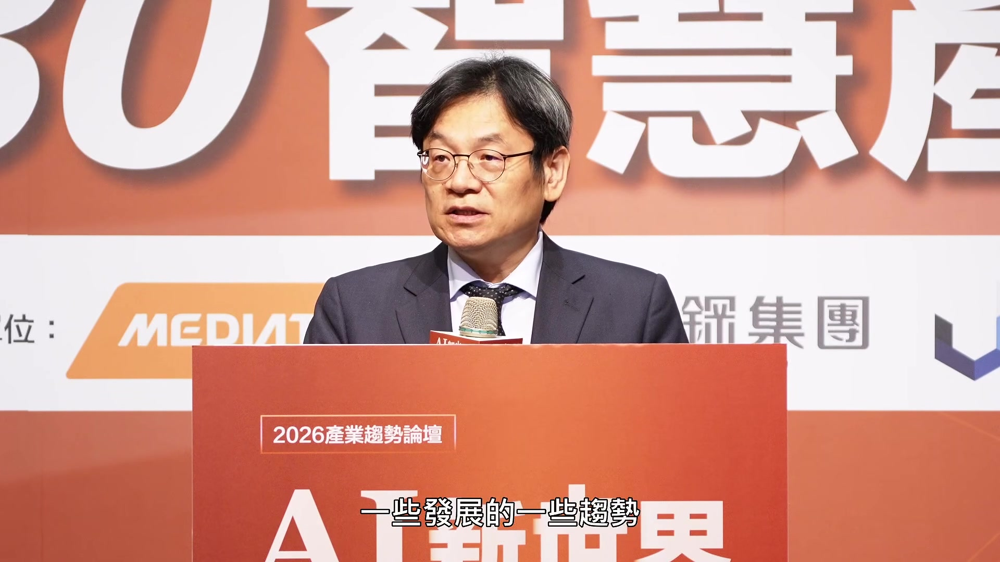

**逐字稿片段：** government continues to push forward with AI infrastructure policies, investing in next-generation critical technologies such as silicon photonics, quantum technology, and AI robotics. We will also continue to improve the conditions for development, including computing power, data, and talent, to accelerate the industrialization of AI and the AI-driven transformation of industries, integrating AI into industry and daily life, making life in Taiwan gradually AI-enabled, and of course, digitizing the government as well. Today , we are gradually seeing concrete results. Take AI robotics, for example; the government is utilizing R&D and testing sites such as Liujia in Tainan. This accelerates the deployment of technology in key areas like manufacturing, healthcare, and logistics . In the future, the government will further integrate production bases to actively promote the development of AI robotics industrial clusters. Beyond accelerating the deployment of AI technology and its applications, the government will also take a further strategic approach from a national perspective. The Executive Yuan recently established the National AI Strategy Committee, chaired by Premier Cho Jung-tai, to draft our nation's first national AI development outline and actively build sovereign AI, allowing Taiwan to evolve from a manufacturing-advantage nation into a model for AI-driven applications based on free and democratic values. To achieve this goal, we cannot rely solely on AI technology itself; we also need a complete and solid industrial foundation to support it. Building on the five trusted industry sectors promoted in the past, we will further advance thirteen strategic industries, hoping to leverage our advantages in semiconductors, AI, and ICT to drive the development of key sectors like defense , security, and next-generation communications. The forum today mentions low-Earth orbit satellites, high-quality transmission, and future 6G development , which are among the most critical components. By leveraging our existing expertise in cables, connectors, and high-frequency, high-speed transmission technologies, we have gradually entered the international supply chain for low-Earth orbit satellites and continue to expand next-generation communication applications. This not only helps enhance Taiwan's communication resilience but also strengthens our industrial competitiveness in the global supply chain, showcasing opportunities for the next stage of industrial development. In the future, the government will continue to connect technical R&D, infrastructure, and practical applications, allowing R&D results to reach the market faster and truly translate into

**話題推測：** 提及政府推動AI基礎設施政策，投資矽光子、量子技術、AI機器人等次世代關鍵技術。

---

## 00:06:19

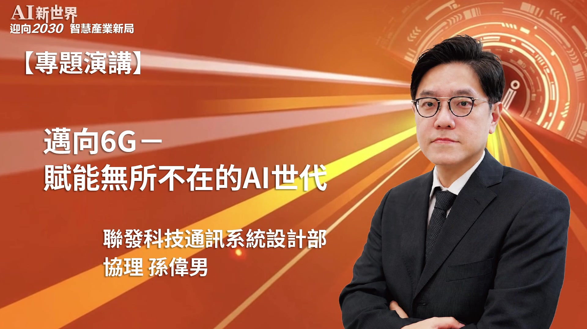

**逐字稿片段：** 6G networks. How can we provide a better transmission foundation for next-generation AI service applications ?

**話題推測：** 明確轉向探討6G網路及其如何為AI服務應用提供基礎。

---

## 00:06:29

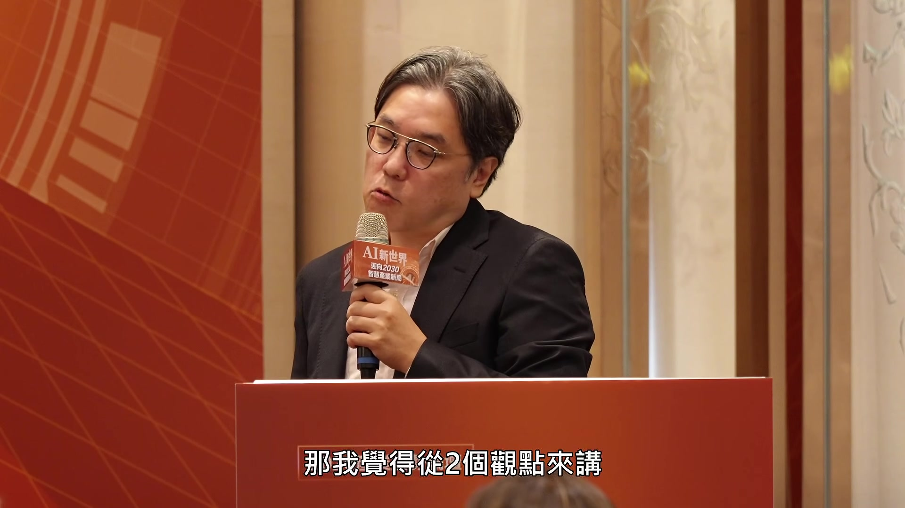

**逐字稿片段：** I believe we should look at this from two perspectives: first, the system architecture, and second, its functional requirements. You can imagine that a 6G network doesn't favor one end, but rather, we aim to build a more balanced and matched network across the device, the network, and the cloud. So what we are considering is that you can imagine there is an intelligent agent on the device side as well. There is an intelligent agent in the network, and there is also one in the cloud. When a task comes down, where exactly should the computing power for this task be placed? Traditionally, before 5G, the approach was always "just solve it in the cloud!" Because the cloud is extremely powerful. However, the 6G perspective is different: we consider which tasks are suitable for the device , which are suitable for the device with network assistance, and we only consider the cloud for specific needs. So, first : where should computing power be deployed? Where should computing tasks be completed? Second, differentiated QoS also relies on the collaboration of these three agents, rather than just reserving a dedicated resource. 5G talks about slicing—reserving a slice for a specific user or application—but when it's not fully utilized, it's a waste. When it’s not in use, this network resource should be released quickly and dynamically reallocated to other users who need it to achieve maximum capacity under this new traffic behavior of agents. This is our thinking regarding system architecture. The second

**話題推測：** 提出從系統架構和功能需求兩個角度來看待6G網路。

---

## 00:08:06

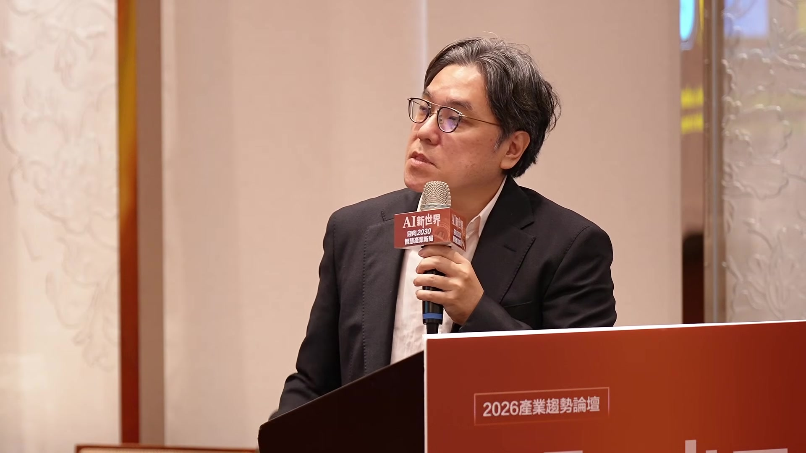

**逐字稿片段：** perspective is: what will the functional requirements of 6G be? We believe there are at least three key pillars. First, it must be an intent-driven network. You need to identify your service patterns and even predict your service requirements to schedule network resources and control QoS, rather than the relatively static, fixed allocations seen before 5G. Therefore, 6G must be an intent-driven network, and it must be ubiquitous, with contexts requiring seamless handshaking . Let me give you an example. Current AI agent applications act on your behalf in the cloud to schedule tools and gather information. But in the future, you can imagine agents needing to assist each other—for instance, your agent, your wife’s agent , your child’s agent, and your client’s agent. Interoperability between these agents currently lacks a well-established common standard. For these agents to interoperate, if your agent and your wife’s agent need to work together to complete a task, the 6G network must ensure the effective and secure transmission of the context between them. The third point is: must future networks always transmit data bit by bit? Some AI applications can actually be abstracted . For example, when sending an image, perhaps I don't need to transmit every pixel or every bit; maybe I can just transmit the most important features of the image, thereby reducing network consumption and increasing capacity. This is just one example of how 6G plus AI will impact your life, specifically a travel scenario. When planning a trip, we all know it’s easy to get into an argument with your spouse, right? So why not let your agents discuss it first? They might be able to reach a great solution quite quickly. You need to know everyone’s availability , budget, and so on, so your agents can help you with the trip planning. Then, while on the road, whether it’s autonomous driving enabled by 6G connectivity, traffic conditions, or entertainment, this also involves the offloading and configuration of computing power. Once at the destination , through your smart glasses, using hybrid AR/VR rendering, along with some AI-based recognition and recommendations , you can get a much better understanding of the environment you are traveling in. At night, service robots can assist you with various tasks, but since you are out in the wild, you need to be connected to provide a higher quality of service. At night, multi-point coordination, including the sensing capabilities of 6G , can help ensure your personal safety. If there’s no ground network while on the road, we switch to satellite networks. If your phone’s antenna is insufficient, we can utilize the car’s antenna or any other available antennas . These are all the new ways 6G can bring changes to our lives.

**話題推測：** 轉換到6G的第二個視角：功能需求，並指出至少有三大支柱。

---

## 00:11:26

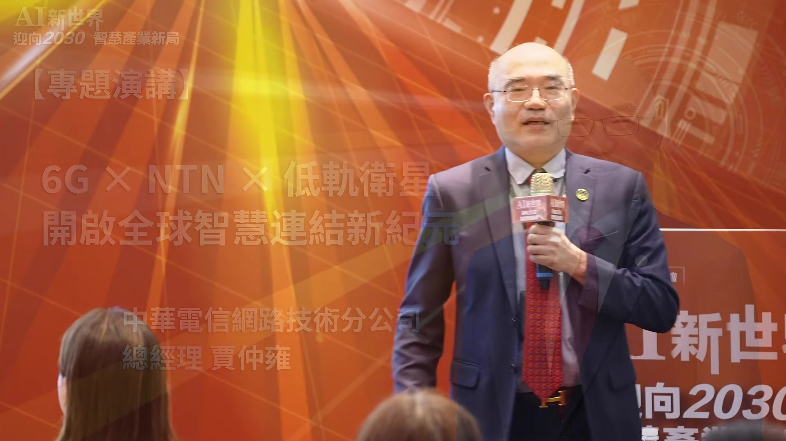

**逐字稿片段：** How exactly will 6G be introduced in the future? Thirty years ago when I was in college, we talked about artificial intelligence, right? I believe you have all heard of AI. After 30 years, it is only just beginning to develop now, because for AI to work today, it needs high speed, instant reaction, and minimal transmission latency. That time has officially arrived; five years ago, you would ask a question. And it would only answer now. Would you be able to accept that? You wouldn't. So, the time has come. Alright, everyone can try to see that speeds will be faster in the future. To talk about 6G, we must

**話題推測：** 提出新問題：6G未來將如何引入？

---

## 00:12:10

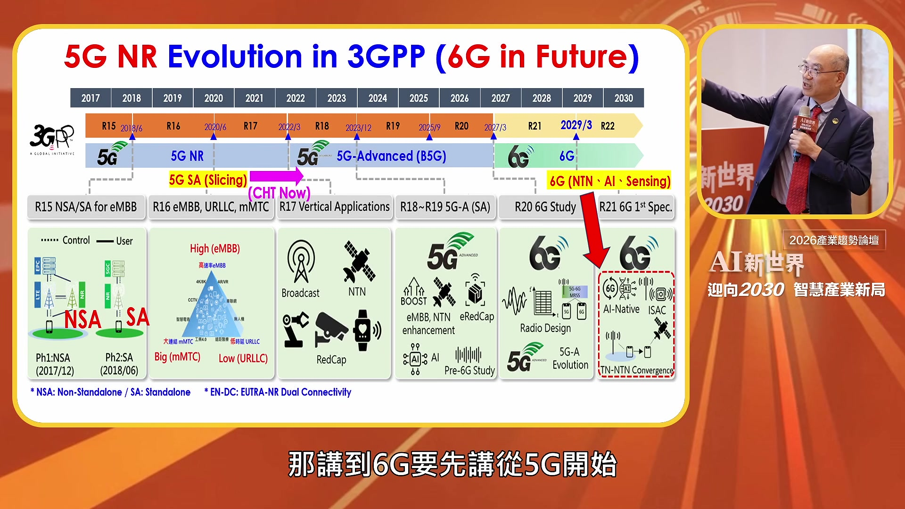

**逐字稿片段：** first start with 5G. 5G has two modes. The mode currently used in Taiwan is called NSA (Non-Standalone). When a phone turns on, even if it is a 5G phone , it must look for two base stations simultaneously: a 4G station as its anchor, and a 5G station for data transmission. So, looking at this architectural diagram, the dashed lines represent control. You must first register with 4G to confirm you are a user of this carrier, and then data transmission follows. With 5G SA (Standalone), it is finally independent and can operate on its own. Therefore, for future 5G SA, the three major operators plan to officially launch SA next year, and SA must have new features. It essentially opens up a dedicated lane. Have you ever heard of this? When we are in a fast lane and encounter an ambulance, doesn't everyone have to move aside? The future SA will be the same. For example, for military or police, I will open a dedicated lane for them. The current NSA cannot do this , but such technology will extend to 6G . 6G development starts with SA from the beginning. When a 6G phone turns on, the first thing it does is look for a 6G base station, right? If it can't find one, it will look for 5G. Only if it can't find that will it look for 5G. And only if it can't find that will it fall back to 4G. This SA is currently here; this is the specification for R17, Release 17, and by the time we reach 6G , it will likely be R21. Right, R21

**話題推測：** 轉向從5G開始介紹6G的發展。

---

## 00:13:50

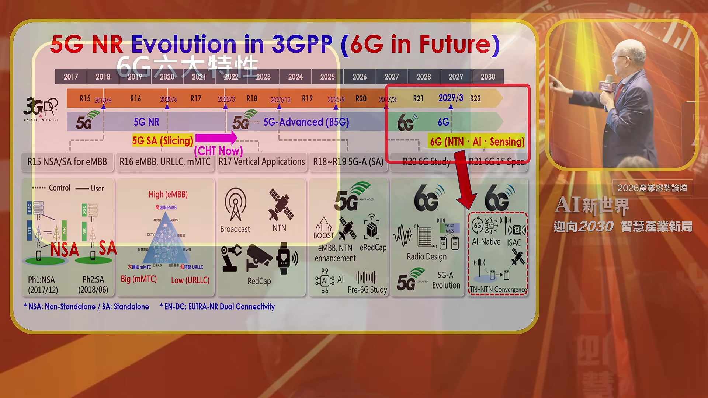

**逐字稿片段：** takes the three major functions of 5G that everyone knows: high speed. Low latency and high capacity, plus the three I’ve written here for 6G. One that everyone is very much looking forward to is direct satellite connectivity. Second is AI; this AI technology will be everywhere, from terminals and chips to phones, networks , and the cloud. Finally, there is Sensing. If you are riding a bicycle and a bus suddenly appears, it can already predict that you will collide with it if you don't slow down, so it will send a signal to tell you to be careful, and then you slow down. Of course, this is just our imagination, but how do we make this happen? The base station senses both you and B at the same time, and through AI processing, it realizes you might collide. May I ask how much time that calculation takes? You say it calculates in two seconds. You’d have already collided by then. This is why AI needs 6 G—because it can calculate and notify you in just a few nanoseconds. So , 6G is coming, and you can imagine its six characteristics: high, low, large, plus N plus. Well, we hope that one day we can achieve this kind of immersive interaction. Everyone will have glasses , but 5G isn't quite there yet; the speed is too slow, and people won't be able to stand it. Let me tell you, when 6G arrives, your watch, your glasses... Has anyone here ever worn those glasses ? You speak Chinese, and it turns into English—it's very impressive, but it's too slow. The translation lags behind, and I have to wait for the next sentence to appear. To achieve an immersive, second-level experience with 6G, this technology must include mobile phones. Doctors preparing for surgery can't afford to wait, so it needs to be extremely fast. Finally, we need many

**話題推測：** 列舉5G的三大功能與6G的三項新增特點。

---

## 00:15:51

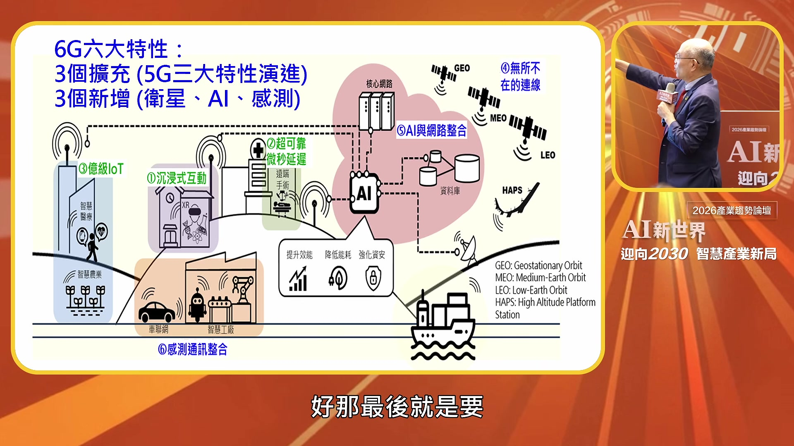

**逐字稿片段：** terminal devices to connect. Right now, it's the Internet of People, but the Internet of Things is massive. In the future, I believe you will be carrying many terminals with you on the road. How many mobile users does Chunghwa Telecom have now? About 12 million, based on our 40%market share. So, about 40%of the people here should be using Chunghwa Telecom. At most, you have dual SIMs now , but let me tell you, you will have triple, quadruple, or even quintuple SIMs in the future. Why? Your watch might have one, and you’ll have your glasses too. Your handheld terminal, maybe even your key chain. All of them will have a SIM card connecting to Chunghwa Telecom’s satellite constellation—that’s the end goal. I must introduce it to make everyone feel it's great. So, when will I introduce it ? In the world of martial arts, speed is the only way to stay invincible. Telecom operators must stay stable to go far. I must wait for the 3GPP specifications to finalize. Are there any finalized yet? Of course not, because 2030 is still several years away.

**話題推測：** 轉向討論大量的終端裝置連接，預示物聯網的巨大規模。

---

## 00:16:56

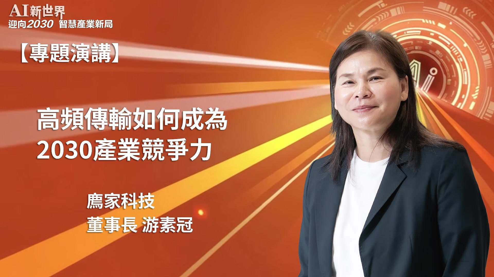

**逐字稿片段：** In the past, we talked about the simplest form of IoT. I remember my former company worked on many connected wired things, where IoT meant the linkage of ecosystems within the home, or perhaps the connection between our watches and phones; that's the simplest IoT. But now, IoT is gradually moving beyond that and will be deeply tied to this next-generation communication.

**話題推測：** 回顧過去最簡單形式的物聯網概念。

---

## 00:17:27

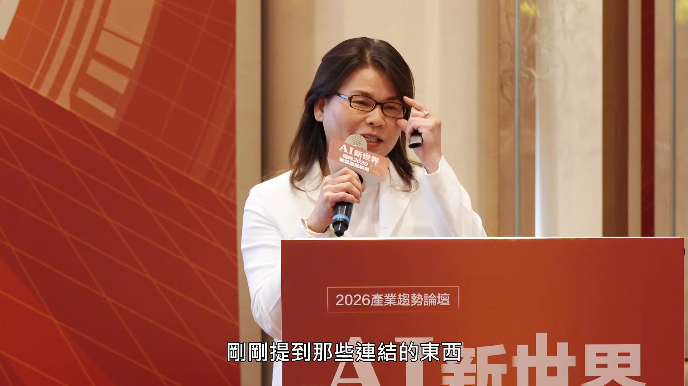

**逐字稿片段：** Regarding those connections mentioned earlier, for instance, in hospitals, there are now remote surgeries, including research-based procedures, where you certainly cannot risk any life-threatening delays.

**話題推測：** 以醫院的遠距手術為例，說明物聯網的實際應用。

---

## 00:17:42

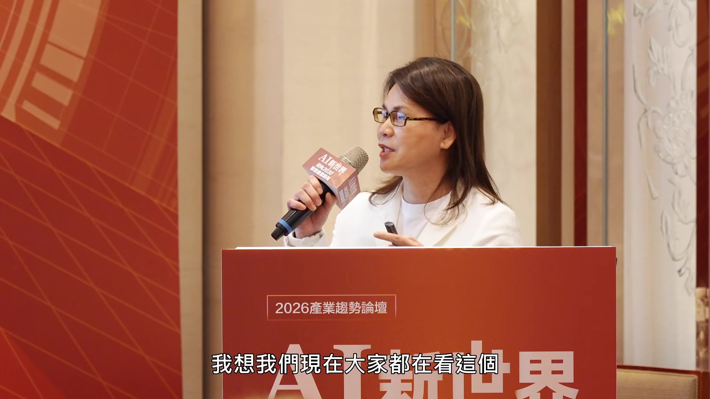

**逐字稿片段：** I think we are all looking at the various components inside the server rack. GPUs require extremely low latency, and we need to eliminate computational bottlenecks.

**話題推測：** 提及伺服器機櫃內部組件，可能呈現伺服器硬體結構圖。

---

## 00:17:58

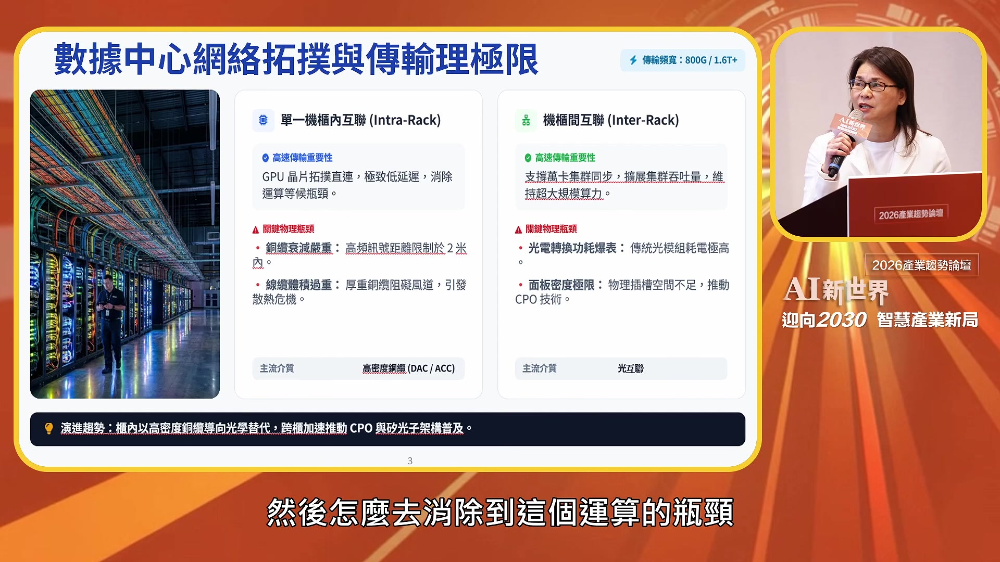

**逐字稿片段：** Currently, most connections are copper-based, but we are moving toward optical connections for the underlying infrastructure, as copper suffers from significant signal attenuation. Therefore, the signal distance for high-frequency transmissions is generally limited to within two meters. These cables are quite heavy, and since a server rack is already heavy enough, adding large bundles of cables creates significant weight, which in turn leads to heat dissipation issues that must be resolved. The critical point now is that if we move to the interconnect level, the power loss from optical-to-electrical conversion could be off the charts. Traditional optical modules also consume high power, and panel density has its limits. Since physical slot space is insufficient to push CPU technology further, we still have a long way to go in integrating high-frequency transmission, much like what we did with cables from 2G and 3G through to 4G. Things have evolved; it's not just about cables anymore. Connecting from front to end actually requires a lot more ICs involved in the process.

**話題推測：** 比較銅線與光纖連接的基礎設施，指出光學連接的重要性。

---

## 00:19:29

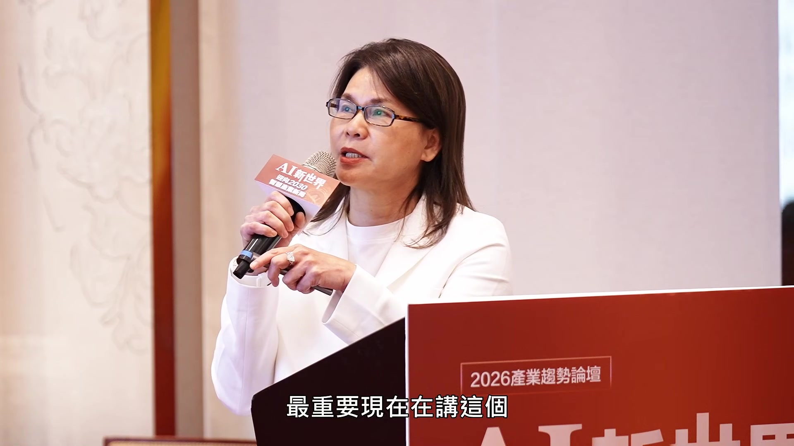

**逐字稿片段：** The most important focus in high-frequency transmission right now involves numerous semiconductor materials, new materials, and ways to reduce power loss.

**話題推測：** 聚焦高頻傳輸領域中半導體新材料與降低功耗的重要性。

---

## 00:19:42

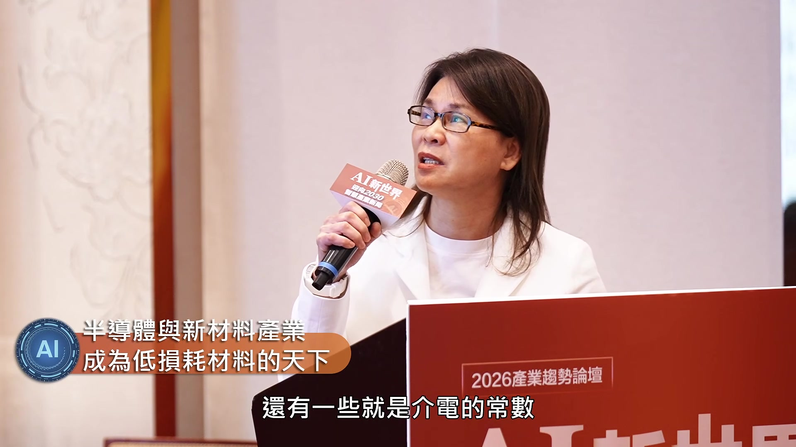

**逐字稿片段：** This includes dielectric constants and dielectric loss, utilizing new materials like LCP, MPI, or glass substrates. This is also currently part of the discussion regarding the limitations of optical-electrical conversion power consumption and light speed. As for how to achieve "optical all the way," the breakthrough in computing power might not rely on materials alone ; it will require co-designing from the chip level to make it a reality.

**話題推測：** 列舉LCP、MPI或玻璃基板等具體新材料的應用。

---

## 00:20:29

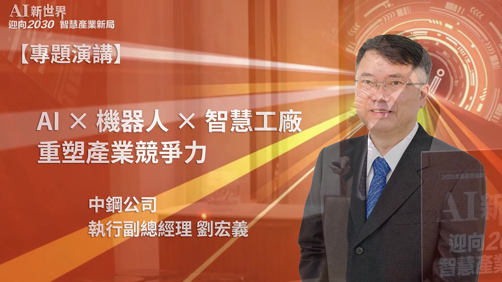

**逐字稿片段：** Our overall three major transformations . In fact, it revolves around digital transformation, low-carbon transformation, and green transformation to achieve the three main goals of cost reduction, carbon emission reduction, and mutual benefit. Our digital transformation has now entered the realm

**話題推測：** 介紹整體三大轉型：數位轉型、低碳轉型和綠色轉型。

---

## 00:20:44

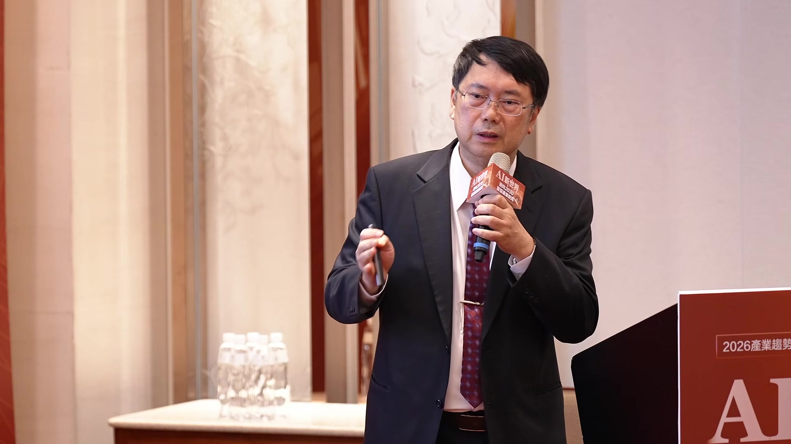

**逐字稿片段：** of physical AI. Our Chairman has a vision: that in the future, the first thing CSC employees do when they start their shift is to send out the dogs and release the eagles. The eagles are drones, and the dogs are robotic dogs. We hope that by using these, we can boost our work efficiency and minimize human exposure to "3K"(difficult, dirty , and dangerous) environments. So, how

**話題推測：** 提及中鋼公司（CSC）董事長關於未來機器狗和無人機應用的願景。

---

## 00:21:07

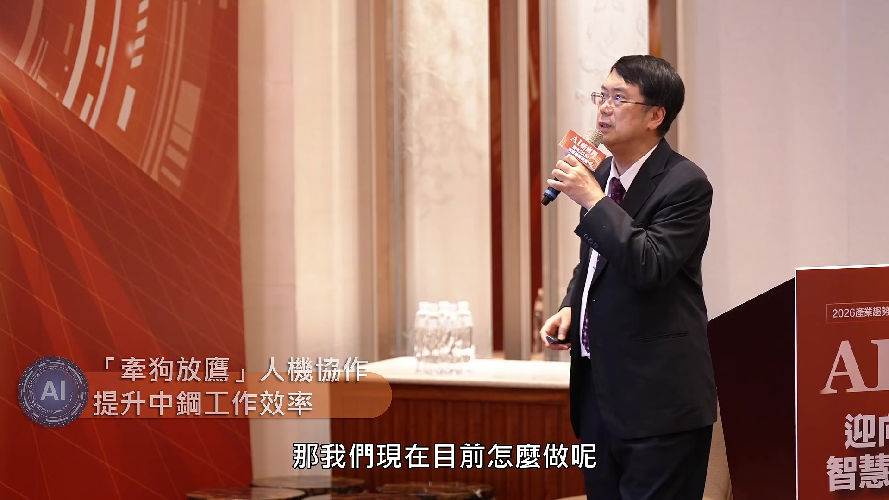

**逐字稿片段：** are we doing this? The one on the left is the robotic dog we have currently introduced from Switzerland. We are testing it in seven of our on-site areas . We have equipped them with cameras, infrared sensors, and microphones, allowing us to monitor changes in gauge readings through the cameras. Through infrared, we can identify areas experiencing abnormal temperature increases. Additionally, with AI, we can determine which pipelines have leaks based on changes in their audio frequencies. Once a change is detected, we know that the pipeline may require attention. The control center then dispatches personnel to confirm the specific issue and handle it immediately. Therefore, in environments with high temperatures, high dust levels, or CO presence, we have begun to deploy our robotic solutions. As for the drones,

**話題推測：** 展示中鋼引進瑞士機器狗的實例，並說明其監測功能。

---

## 00:22:01

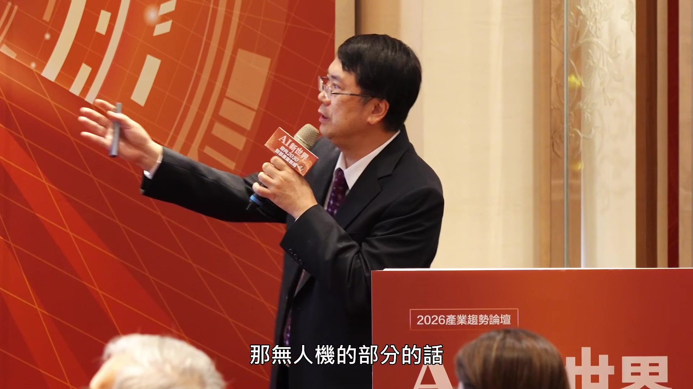

**逐字稿片段：** they have overcome the lack of GPS in indoor environments, allowing them to patrol automatically, return after 15 minutes, and self-charge. They use LiDAR to create point cloud maps of the entire indoor area, reducing the redundancies and inefficiencies caused by manual inspections.

**話題推測：** 介紹無人機在室內環境的巡檢應用，克服GPS限制。

---

## 00:22:22

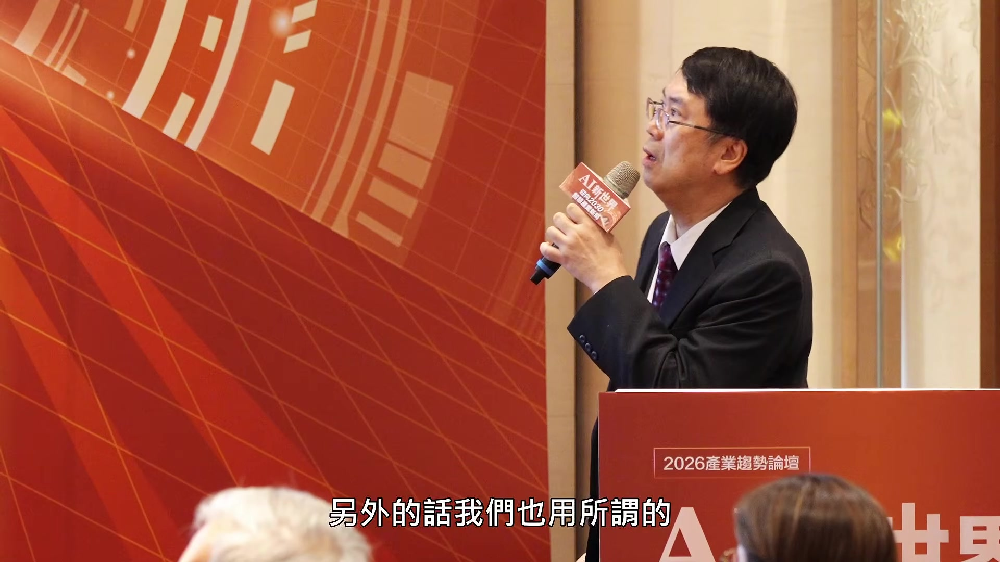

**逐字稿片段：** Furthermore, we use climbing robots for tank painting, which is necessary when they require repainting after a certain period. We can use robots for water jetting and cleaning, and once that is finished, we can proceed with the painting work. Each year, we can equip these climbing robots with ultrasonic probes to measure the steel plate thickness of these silos and storage tanks. This allows us to change our maintenance criteria from the early "Time-Based" approach—where we might have scheduled repainting every three years—to a system where we check the condition after three years and find it still in good shape. So, we can extend that to four or even five years. It becomes "Condition-Based" maintenance, where we decide when future maintenance is needed based on the actual status of the equipment. Next is unmanned overhead

**話題推測：** 介紹攀爬機器人用於儲槽噴漆與鋼板測厚。

---

## 00:23:08

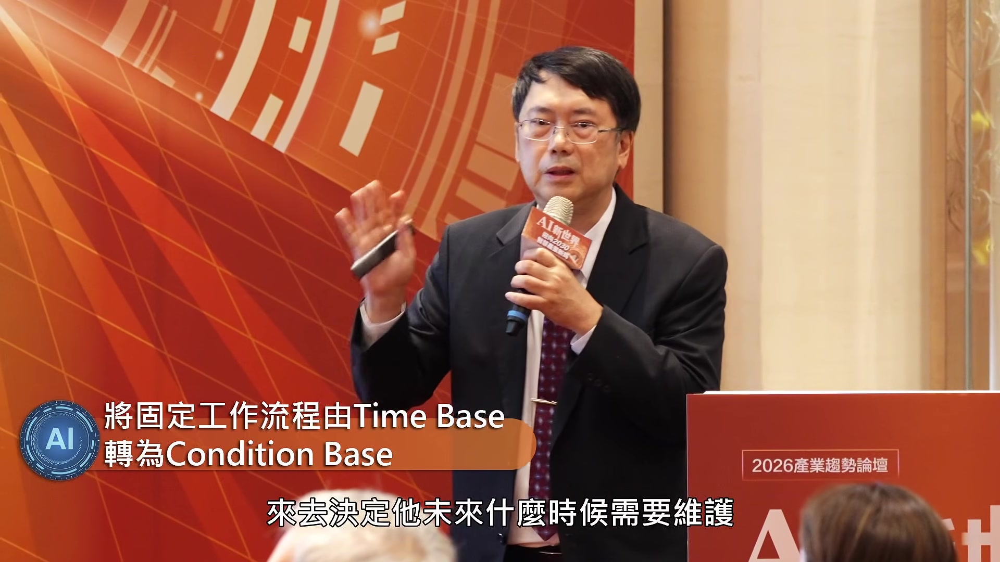

**逐字稿片段：** cranes and remote operation. On the left is our early overhead crane. Our cranes are different from the ones you usually see; they are very, very large. Once a person goes up, they stay for about four hours, so they eat, drink, and attend to all needs while up there. By moving the crane operator down to the ground, we can now enable them to simply manage the lift. For example, if they need to move a load 150 meters away and lower it, the AI handles the entire process. They only need to manage the lifting and lowering. Therefore, whereas one operator used to manage only one crane, they can now manage two or even three. Furthermore, these three cranes can communicate with each other, so they

**話題推測：** 介紹無人天車與遠端操作系統，提升效率與安全性。

---

## 00:23:59

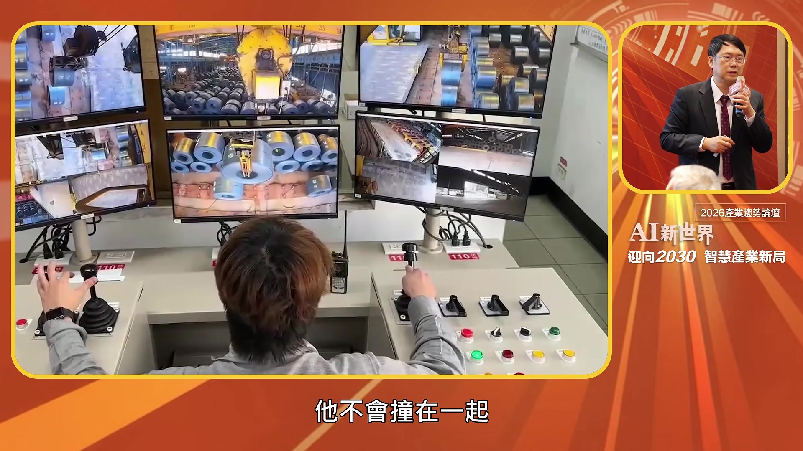

**逐字稿片段：** won't collide. Over the past seven years , we have actually completed 575 AI projects. And we have achieved cumulative annual cost-reduction benefits reaching 2.1 billion NTD. Across our entire production line, the current level of intelligent integration

**話題推測：** 公布中鋼過去七年完成575個AI專案，年度累計節省21億新台幣的成果。

---

## 00:24:16

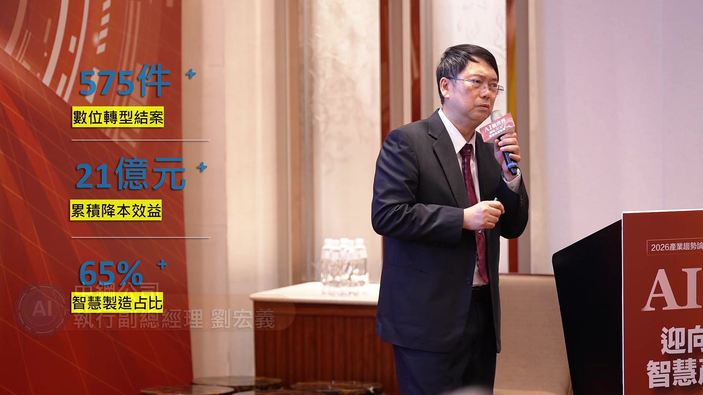

**逐字稿片段：** has reached 65%. Next, I will report to you on carbon reduction. The primary

**話題推測：** 明確轉向碳減排的報告主題。

---

## 00:24:21

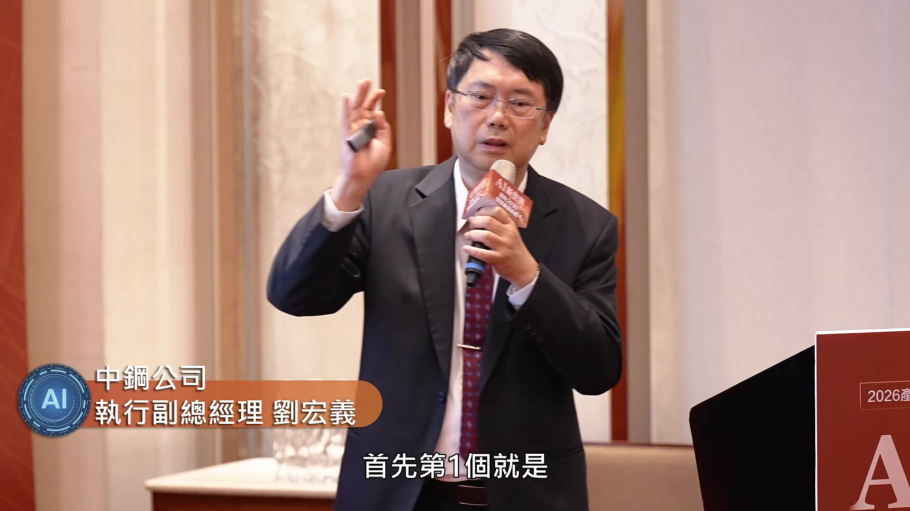

**逐字稿片段：** emission source in an integrated steel mill is the blast furnace, so we have focused on a few things on the left side . The first thing is that we will find ways to capture the CO2 from the top. Then we purify it. Regardless of whether it is CO, which can be used as fuel, or CO2, which can be used as a petrochemical feedstock; additionally, if we inject hydrogen from the bottom, it will react with the oxygen in the iron oxide, turning the CO2 output into water vapor. This achieves carbon reduction. Furthermore, through steel-chemical integration, we can also implement simple methods to lower emissions. Next, for the basic oxygen

**話題推測：** 討論高爐作為主要排放源，以及二氧化碳捕集與利用的方法。

---

## 00:25:00

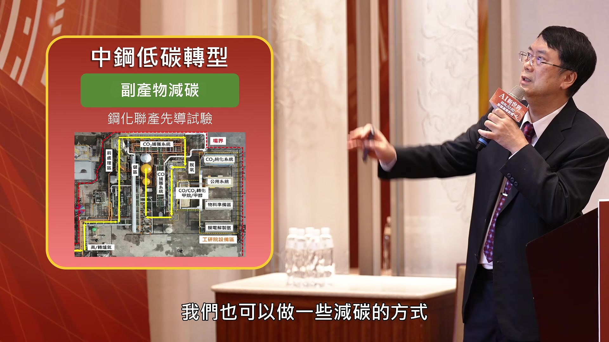

**逐字稿片段：** furnace, we can increase the amount of scrap steel used. Naturally, this allows me to reduce carbon emissions. This high ratio of recycled material is what we call green steel. Regarding the supply

**話題推測：** 提及轉爐製程中增加廢鋼使用量的碳減排措施。

---

## 00:25:11

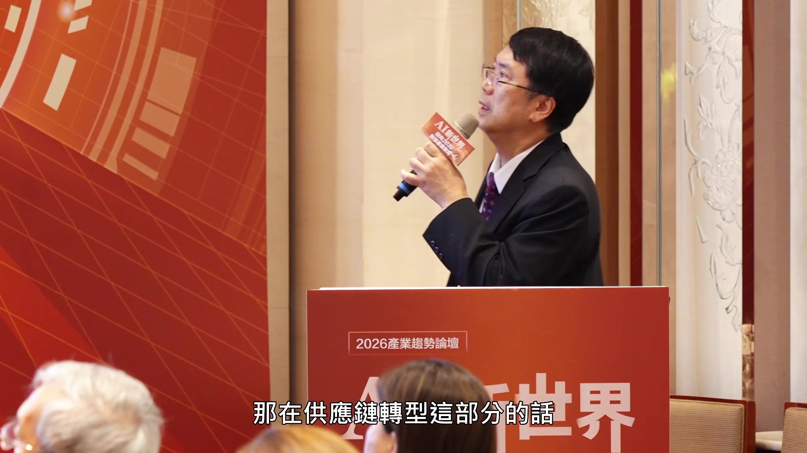

**逐字稿片段：** chain transformation, we emphasize what was just mentioned: "Only when the customer does well can the center do well." We have developed a series of high-competitiveness materials that feature high profit margins and advanced technology, which customers are willing to purchase. We hope to provide better materials to our customers, allowing our China Steel products to create more

**話題推測：** 轉向供應鏈轉型，強調提供高競爭力材料。

---

## 00:25:40

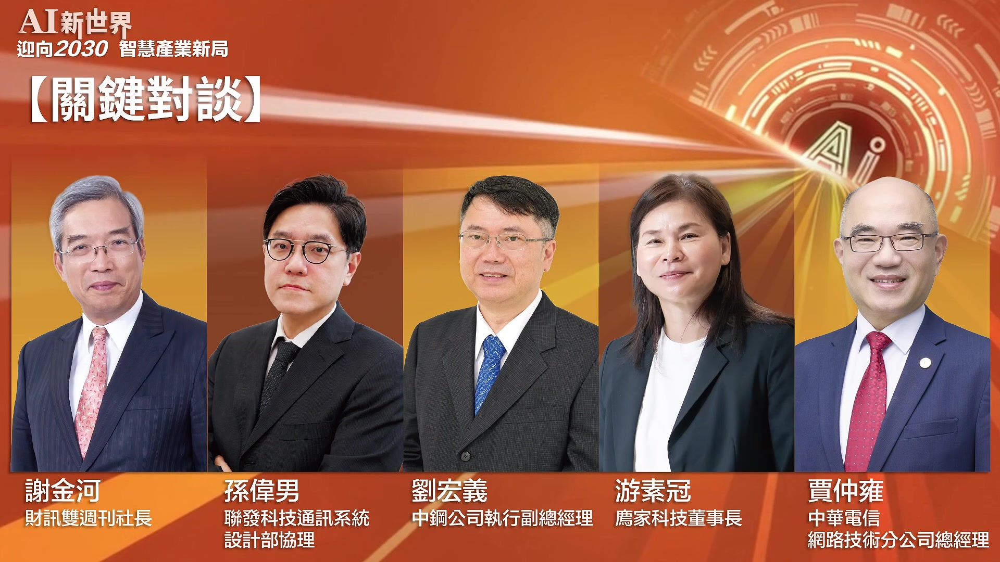

**逐字稿片段：** Our time today is very limited. I specifically asked him to speak about the development of silicon photonics first. Could you please add some context for everyone here? >> Regarding silicon photonics, I have taken a look at this product. In Taiwan , actually, I think the largest one in the world right now—it should be called SEC—has quite a lot of patents. Breaking through this is indeed difficult, but I believe Taiwan still has silent, hidden champions. He is very experienced in analyzing this and can help you understand the bottlenecks they are currently facing in this industry.

**話題推測：** 主持人提問，將話題轉向矽光子的發展。

---

## 00:26:16

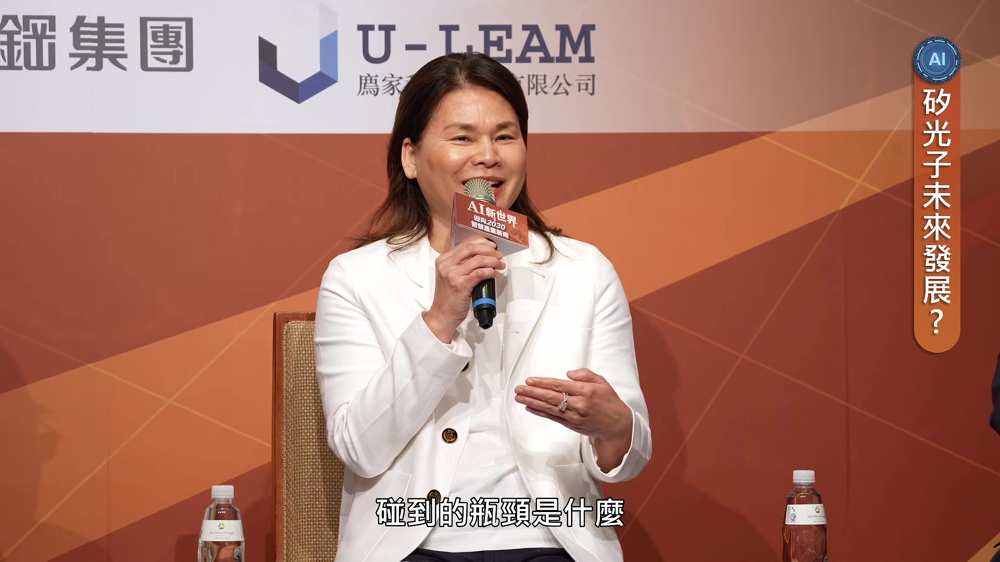

**逐字稿片段：** One day I mentioned that Largan was doing this and it was quite impressive. He said it seemed too early. So, silicon photonics is definitely the path forward ; it is just a matter of when it will mature. Whether it is materials, testing equipment, or validation—of course, the capital market is about dreams, but in reality, you have to return to how you actually grow the business. That is my personal view. >> When General Manager Jia was reporting, he mentioned what changes will occur once telecommunications move to low-orbit satellites and what kind of chemical reaction this industry will produce. Could you explain this to everyone? >> Sure.

**話題推測：** 提及大立光在矽光子領域的發展。

---

## 00:26:58

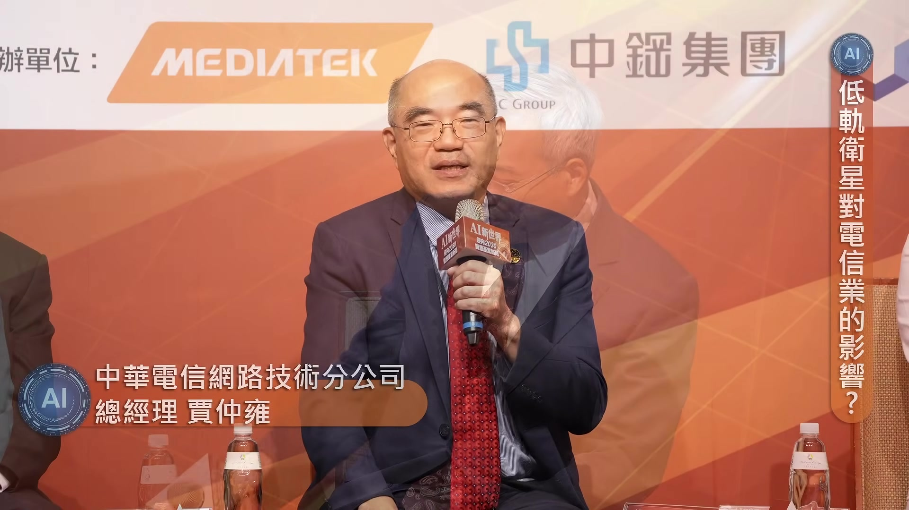

**逐字稿片段：** >> The one currently leading in satellite development is Starlink. His idea is that data centers will be located in various places. Musk's current thought is that these data centers could actually be on satellites or in the cloud. So, future computing won't just be about terrestrial communication; he wants to use satellites as a link between data centers. I believe the initial phase of satellite development starts with redundancy, but later it will truly function as a link. So, if you want to know what the next generation of 6G networks means, it's not just about the ground; space and the ground will be fully integrated. So, whether this will succeed in the future , I am not sure, and I don't know. But we still need to head in that direction . That is to say, data centers spanning across oceans. Even data centers connected via satellites, I believe these are major opportunities when 6G arrives.

**話題推測：** 提及星鏈（Starlink）在衛星發展與資料中心鏈結上的想法。

---

## 00:27:58

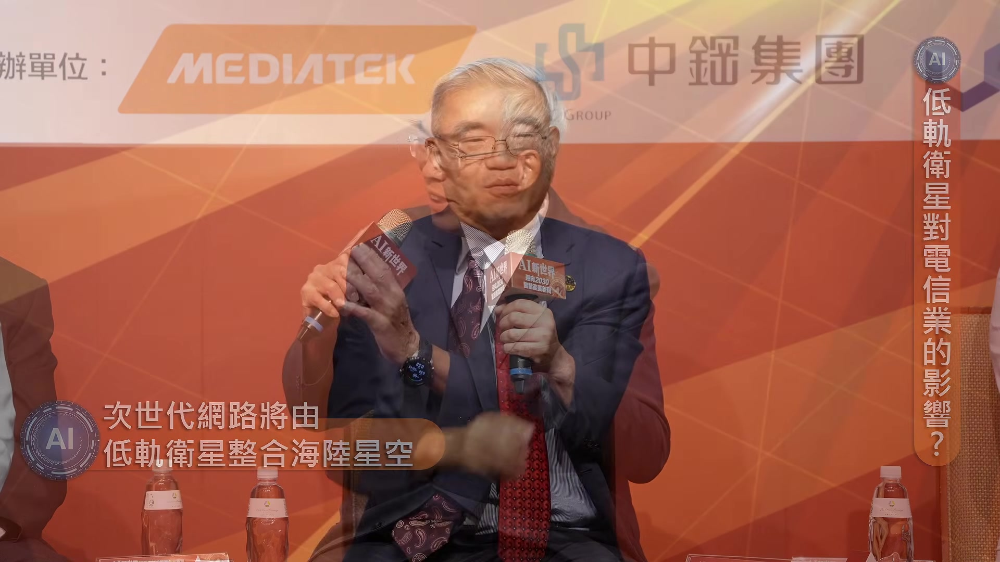

**逐字稿片段：** Could we ask Sun Xueli to look at MediaTek’s transformation over the past two or three years from an employee's perspective? >> I think MediaTek’s transformation over the past few years can be seen in a few areas. First, it is its influence on industry standards; it used to be more of a follower. Starting from 5G, we began to secure some key positions. We have excellent collaboration in Taiwan, helping some of Taiwan's key technologies advance into industry standards. As for 6G, because we invested even earlier, we have become core contributors and standard setters, which also helps strengthen the industrial cluster and upgrade the supply chain. The second point is the diversification of our product lines. In the early years, it was mobile phones, but in recent years, we have expanded into many other platforms, including data centers and automotive platforms, which could become great carriers for physical AI in the future. Having a more diverse product line aligns with the slide I just presented, which covers cross-domain integration use cases involving 6G, AI, and NTN. The goal is to increase MediaTek's 'T' and 'S'. From these perspectives, I believe this has been MediaTek's most significant role in recent years.

**話題推測：** 主持人提問，將話題轉向從員工角度看聯發科的轉型。

---

## 00:29:24

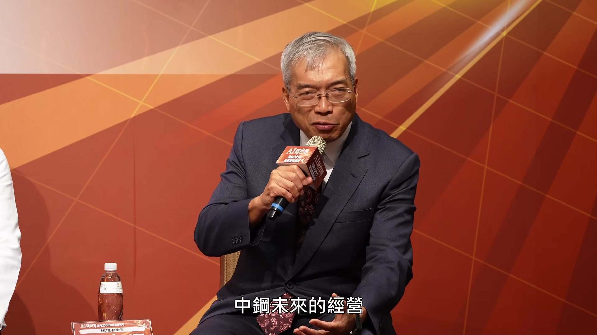

**逐字稿片段：** Regarding China Steel's future operations and product evolution, specifically for "killer" applications, could you enlighten us on whether there are any "killer" products? This brings us back to what our Chairman said: every year, we will provide products that will impress the general public.

**話題推測：** 主持人提問，將話題轉向中鋼未來的「殺手級」產品。

---

## 00:29:47

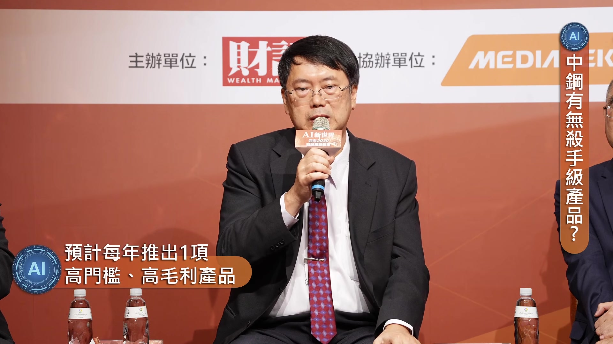

**逐字稿片段：** This year, I promoted 0.1 mm electrical steel sheets, and next year, we have another "killer" product. For this product, our positioning is that very, very few steel mills in the world can produce it. Furthermore, the technical threshold for our product is extremely high. More importantly, once this product is released, its profit margin must be sufficiently impressive. Only then can we truly call it a "killer" product. Why are the stock prices of Japanese steel mills higher than China Steel's? Actually, everyone, don't forget. Nippon Steel or JFE has a very strong automotive industry in Japan, and for South Korea, it has a very strong automotive and shipbuilding industry. Therefore, these industries support their high steel prices. If they can produce and sell more electric vehicles, our automotive steel sheets and electrical steel sheets will have better destinations, and if we sell them at better prices, naturally our stock...

**話題推測：** 提及今年推廣的0.1mm電磁鋼片，以及明年將推出的「殺手級」產品。

---
