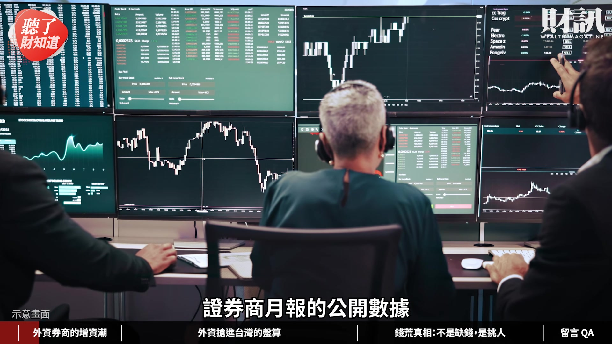
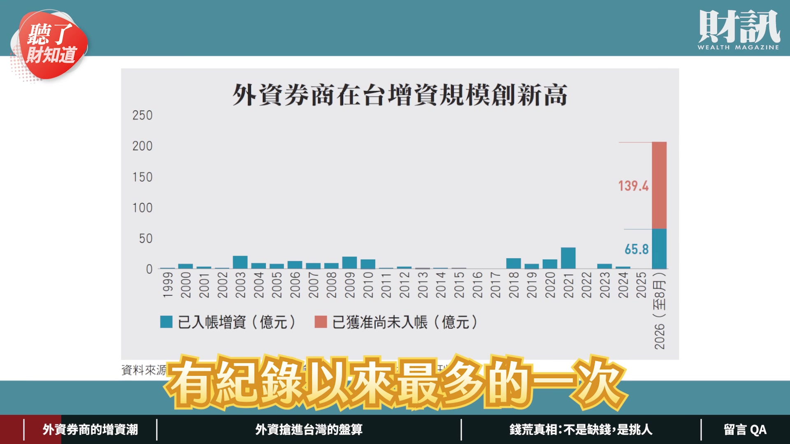
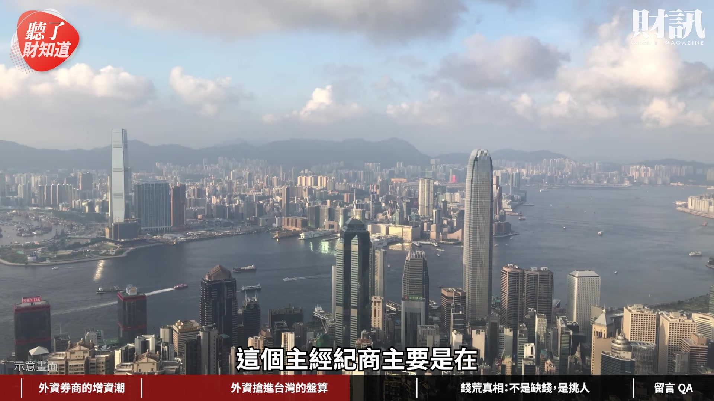
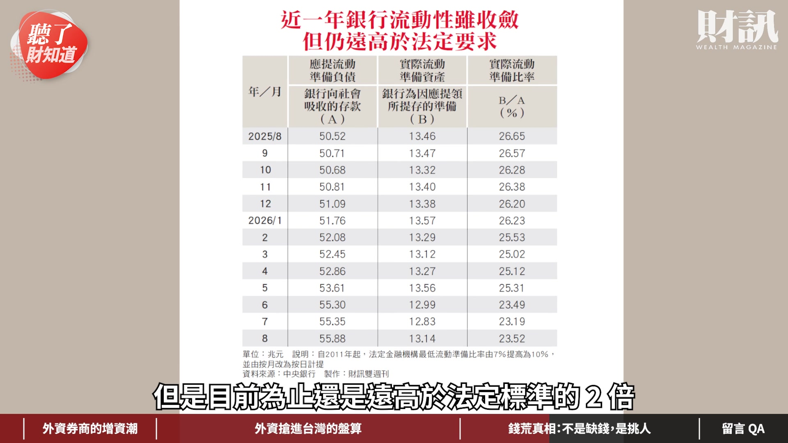
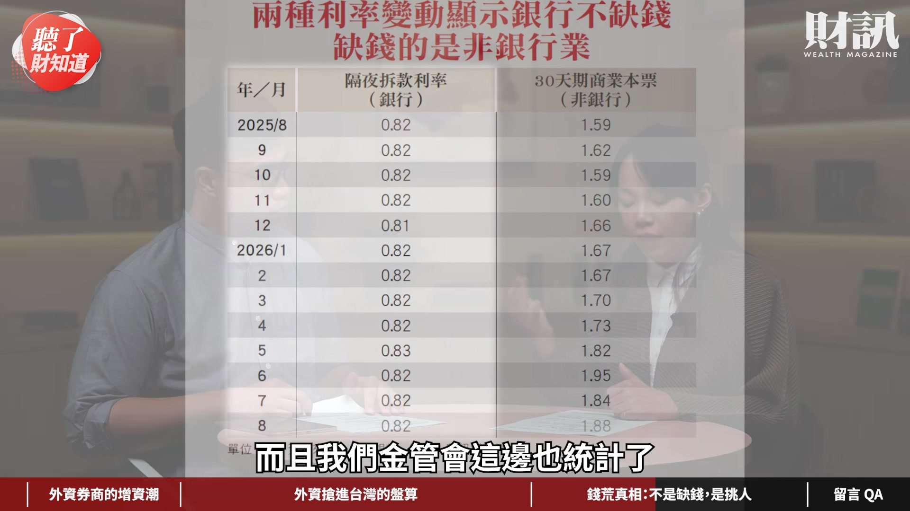
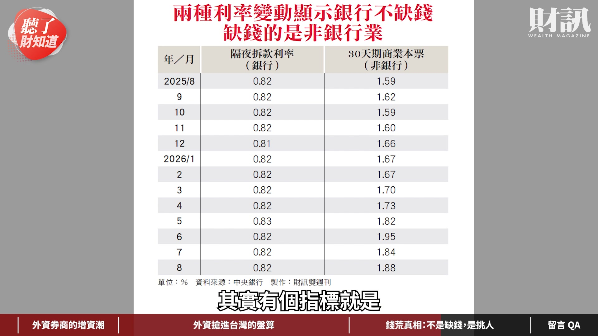
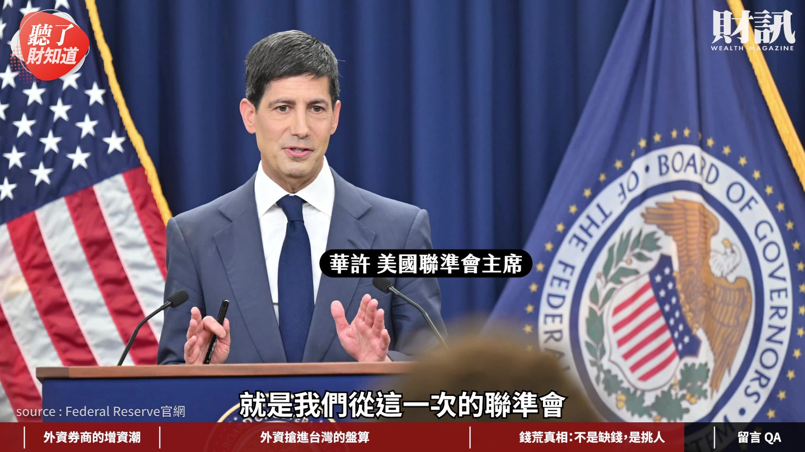

# wealth1974_F-lg5riGMs0 — 關鍵畫面索引

- 來源逐字稿：[wealth1974_F-lg5riGMs0_GT.srt](wealth1974_F-lg5riGMs0_GT.srt)
- 影片：https://www.youtube.com/watch?v=F-lg5riGMs0
- 截圖數：24

## 00:00:02

**逐字稿片段：** 增資超過 200 億元 是過去以來單年 最高紀錄的 6 倍 但同一時間市場卻喊 借錢愈來愈難 台灣到底是錢太多呢 還是錢不夠 今天這一集我們就來聊聊

**話題推測：** 外資券商今年在台灣增資金額，打破歷史紀錄的具體數字。

---

## 00:00:14

**逐字稿片段：** 外資券商的增資潮 再來分享外資券商 搶進台灣的盤算 最後再來談一談錢荒真相 不是缺錢而是開始挑人 我是今天的主持人洪綾襄 今天的來賓是財訊的 資深記者張道宜 綾襄好 各位觀眾朋友大家好 我是道宜 我們今天的討論

**話題推測：** 節目議程的第一個主題：外資券商的增資潮。

---

## 00:00:33

**逐字稿片段：** 就是有觀察到 9 月 29 日的時候 投審會一口氣核准了 3 家外資券商 對它們的台灣子公司增資 合計大概超過了 140 億元 今年截至 8 月底以來 外資券商對台灣 增資超過了 200 億元 這波增資潮

**話題推測：** 投審會核准三家外資券商增資的具體時間點及金額。

---

## 00:00:50

**逐字稿片段：** 到底是有多麼的罕見 這邊請道宜幫我們來說明一下 大家會覺得 200 億元 好像要多不多 要少不少 其實就台股今年市值蓬勃發展以來 這個其實坦白講 在市場上並不是大錢 但是從外資券商 自己跟自己比 我們根據證交所的 證券商月報的公開數據

**話題推測：** 轉向說明這波增資潮的罕見程度，可能搭配歷史圖表。

---

## 00:01:08

**逐字稿片段：** 去拉了 1999 年 到現在的數字爬出來的 從過去一直以來 就是 2021 年 34 億元最多 但今年光是 9 月底 投審會通過了這一次 就 140 億元了 所以今年如果沒有什麼大意外的話 今年大概就會是史上 有紀錄以來最多的一次

**話題推測：** 說明數據來源與追溯時間點（1999年至今），暗示歷史數據圖表。

---

## 00:01:23

**逐字稿片段：** 9 月底投審會它宣布的 3 家 大家都耳熟能詳 就是 Morgan Stanley 然後 JP Morgan 然後就是 Merrill Lynch 那再加上 8 月的時候 高盛它也是在台灣 增資了非常多的金額 這讓我們感覺到 好像是有大事要發生了 這到底代表什麼意思呢

**話題推測：** 列出九月底增資的三家外資券商名稱：Morgan Stanley, JP Morgan, Merrill Lynch。

---

## 00:01:39

**逐字稿片段：** 增資的目的 其實就是融資的需求 因為投資人會想要借更多的錢 來去市場上去做一些操作 那他可能就會跟券商借錢 那券商它本身就需要有錢去借出來 法規規定你必須要 有足夠的淨值 才能夠把錢借出來 融資有 3 項 不限用途等等 3 項加起來 上限是淨值的 4 倍 也就是說你淨值不夠高 你還借不了那麼多錢 對於外資券商來講 它不是錢不夠 它是我要符合法規的需求 所以我必須要提高我的淨值 那我要提高淨值 我就要提高我的資本 它就必須要去做增資的動作 補充一點 在前幾個月 其實券商公會也有討論到 是不是這個 4 倍 可以再拉寬一些些到 6 倍呢 後來看金管會它回覆是 這個 4 倍建議 它暫時並沒有要去調整的 建議券商說 那你就來做增資吧 所以過了幾個月 我們就看到這些外資券商 就做了增資的動作 因為金融業 它就是收受大家的存款 它有多少資本額 它才能做多少生意 但是券商的過去以來呢 資本額都很小 就是一般來說 不太會跟券商借款 有的話也是短期的用途 所以說其實券商 它們也不急於去做 這個資本額的增資這件事情 一直到去年開始呢 因為台股大熱 那許多投資人呢 就開始借錢做槓桿 就開始會去跟證券商這邊借錢 他們可能就是不限用途款項 或者是做一些槓桿操作 再去疊券 或者是他們再去買 其他的理財性商品 然後做那個套利交易 都有可能 所以它其實非常非常的多 滿意外就是說 外資券商竟然也 遇到這樣的困難 外資券商我們心裡面想說 它們的客戶應該都是機構法人 因為不像我們這些散戶 不限用途款項這些的借貸這樣 但是連外資券商的機構法人客戶 它們也需要融資和融券的需求 這個事情是不是有一些 滿大的趨勢上面的一個轉變 對 其實有很多人問說 是不是外資它們有在看好台股這件事情 我們看到有這麼多的錢進來台股 至少我們的第一印象就是說 是不是外資看好台股 所以它會想要去做增資這個動作 那當然我們剛剛解釋了法規的需求 另一方面 一個很確定的事情是 它們不一定是看好台股 它們其實是多空都可以賺錢的 所以你不能去直接跟 看好指數去畫上等號 但是我們這樣問完一輪市場人士 我們可以確定的一件事情是 它們對台股這個業務 確實會不斷的擴大 所以它們需要擴張在台灣 子公司或分公司的規模 來去經營更多台股的業務 那這樣的東西呢 基本上就是台幣計價 因為台股是台幣計價的 現在它必須要用台幣計價的時候 它就會反過來在台灣去做增資 所以第一個講的是這種 財富管理上面的規畫 第二個我們有問到 寬量國際的創辦人李鴻基先生 他也跟我們講說 其實像金像電最近被 國外的大公司投資 Amazon 對 那最近還有一個是聯發科 它其實也被輝達大量的注資 國外的科技的巨頭 它對台灣的 AI 供應鏈 有相當大的興趣 它就會透過這一種金融的方式 來去做參與 那這些都是大投行 或台灣金融機構的一些機會 所以當這種增資潮 愈來愈多的時候 這些外資投資銀行 外資的券商 在台灣的生意愈做愈大 它可能就會需要 更多的這些業務來去做擴充 我們套李鴻基先生講的 未來這種國外來台灣 參與資本的這些活動 以及在國內的外資券商的增資 未來可能會愈來愈多 第三個 新富階層 他可能是某間科技廠的工程師 他可能是所謂的少年股神 他們因為這一波台股的大熱 所以他資產可能有 非常大的規模的成長 他未來可能會想要進一步的 對他的資產去做規畫 他們也可能成為這一些外資券商 這些投資銀行它們所想要服務的對象 我們也有聽說一些大的投行 像 Morgan Stanley 它們最近也有增租辦公室的需求 它們想要擴大財富管理的部門 那我們就可以合理的猜測 它們確實想要瞄準這一些新富階層 其實就是證券商的財富管理業務上面 會有很大的一些改變 過去外資它們來投資台灣的話 可能都要把美元換成台幣 才能入資台股 但這一次呢 它們增資的目的 是對它們自己的業務擴充 這一次就是五大國際知名的券商龍頭 它來台灣做這件事情 首先就是它們業務變多元了 所以它們才需要資本額的擴充 另外就是說還有其他的機會 可能還會再繼續這樣子 這邊我們就要談到

**話題推測：** 開始解釋外資券商增資背後的主要目的：融資需求。

---

## 00:06:00

**逐字稿片段：** 亞洲資產管理中心了 那時候金管會彭主委 他在提亞洲資產管理中心的時候 他其實也有說 希望不只是台灣人管自己的錢 也可以期待國外的券商 或者是國外的金融機構 也能夠來台灣看到台灣的機會 利用台灣這個資本市場借力使力 做更多的一些國際化的操作 把我們台灣的金融業國際化 那這一波呢 在外商券商第一次來增資 固然是為了就是符合 我們當地法規要求之外呢 它們還有沒有一些建議 對於台灣發展亞資中心 它們有沒有一些想法 有些外資人士確實有跟我們提到說 當初它們有想過 是不是不要用增資的方式 因為它們手上有很多客戶的資產 可能股票等等的這些相關的資產 它可以拿這些證券去跟其他方 去做一些融資獲得更多的流動性 來去提供給它的客戶 這當然是客戶要允許的前提 它有非常多的前提 我們是比較簡化了這個說法

**話題推測：** 引入新的宏觀話題：亞洲資產管理中心。

---

## 00:06:52

**逐字稿片段：** 但是以目前台灣的法規 其實有一些相關規定 就是說即便經過客戶的同意 你只能用於證交所的借券系統 或是跟證金公司來借券 來轉融通 它不能拿去做其他的抵押借款 也就是說它是有一些條件在的 那其實這個就是我們有聽說 部分的外資公司有想要去跟 主管機關去做一些溝通 第二個是綾襄有提到 台灣的基本思維就是 你有多少的錢就做多大的生意 但其實在歐美它更偏重的是 流動性跟風險的管理 也就是說你槓桿可以做得更大了 亞洲國家相對在於槓桿這一塊 其實管理會是比較高一些的 這個就是監理思維上面的一個選擇 台灣因為現在真的要去接軌國際 去做亞洲資產管理中心了 所以當這種監理思維面臨到磨合的過程 那這個就是主管機關跟業者 要去做思考的一件事情 第二個就是說很多錢 它們現在匯來台灣 我們當然是希望把這些錢 都留在台灣去做交易 讓台灣的公司 不管它是外資或是本土 來去做一些交易 給台灣人才更多的發展的一些空間 但是現在還是有一些限制在的

**話題推測：** 點出台灣法規對證券借款用途的具體限制。

---

## 00:07:52

**逐字稿片段：** 外國的基金銀行 保險公司等法人 向證交所登記可以投資台股的身分 它匯入資金要經過央行外匯局的管理 由保管銀行保管 那它在台灣其實有一些業務上的限制 它只能買賣股票 做期貨避險 它不能做融資券 不能放空 不能借券等等這種操作 我找一個證券 我找一個投資銀行 幫我做這些整體的服務 卻很多事情不能做的時候 我可能就選擇 那我是不是找一個在境外的 能夠提供更完整的 所謂的一站式的證券百貨的 這種服務來去做選擇 它就會有一個比較了 以台灣目前的法規確實 像剛剛講的限制是稍微多了一些 所以說我們有問到 就是一些專家就跟我們提到說 也許可以去借鏡 現在在國外其實已經很常見的

**話題推測：** 列舉外國法人投資台股在業務上的具體限制。

---

## 00:08:33

**逐字稿片段：** prime brokerage 就是「主經紀商服務」 這樣的一個類型 它就是一站式的避險基金服務 它包括融資借券 保管交易 它都可以去幫你做 我們把這個服務做起來 讓台灣在這個地方 也可以去做相對應的服務 就可以把這些外資 匯進來的這些錢呢 然後它可能在台灣新興的 這些財富管理的需求 把它留在台灣去做相對應的服務 那我們覺得這也許是 對台灣資本市場在發展 接軌國際這個階段呢 可能需要去做的一些調整 好 我這邊跟大家也補充一下 這個主經紀商主要是在

**話題推測：** 提出可以借鏡的新服務模式：主經紀商服務（prime brokerage）。

---

## 00:09:04

**逐字稿片段：** 香港這邊進行的 這些主經紀商它們服務的客戶 一定都是機構法人等級的 就是上百億元的那一種 但是台灣即便是機構客戶 做融資借券 保管交易這些的話 你分別要去證券商 要去銀行開不同的戶 跟不同的主管機關 然後申報你要做的業務 所以其實這個是非常的繁瑣 那香港這邊呢 它主經紀商 只要取得了所有的牌照之後 就從投信投顧 銀行保管 借券交易這些全部都可以做 甚至提供建議 然後預測點位 然後幫你買進賣出這些都可以做 但是這個就是專門符合機構法人等級以上 才可以來使用的 台灣如果要做的話 那你就勢必要打通非常多的 監理的法規 因為台灣我們動不動就是希望 如果發生事情了要有人負責 而且這個人要能夠負擔 所有投資人的損失 我們台灣的監理思維 目前還是停留在這邊 那相較之下呢 香港或是歐美 它們的觀念就是只要我有 這一連串的生態圈建立起來之後 我的上手 下手 對家 交易對手 這些都確定了以後 責任出現在哪個環節上面 我風險就控管到哪個環節 它們就會有更好的一個責任釐清 和風險控管的一個 很多點來去做控管 但台灣目前就是還停留在 就是主管機關它是用清償的一個思維 去管理這些金融機構 所以這個部分都還是需要 很多的挑戰和釐清的 但我們相信這兩年來 台灣的亞洲資產管理中心 開始推動之後呢 其實法規真的做了 幾十項的鬆綁 然後我們也還在努力的做調整 和跨部門的溝通 那希望是未來會有更好的一個發展 沒錯 其實就是像我們最近聽到

**話題推測：** 舉例說明主經紀商服務在香港的實踐與台灣法規的對比。

---

## 00:10:35

**逐字稿片段：** 有什麼「不可能三角形」 就是你只能顧其二 不能顧其三 金融監理上可能就是 你要安全又要便利又要發展 那有時候你就可能 沒辦法三者都兼顧 我相信主管機關或者是業者 都面臨到這樣子的一個要考慮的點 那回到一開始我們為什麼會 討論到這麼多的一些相關的議題 就是回到外資券商 在台灣做增資這件事情 回過頭來我相信很多 觀眾朋友的體感好像是 新聞上好像都聽到「幾貸同堂」 好像券商缺錢 所以要趕快補錢進去 很多新聞都是這樣寫 錢荒這件事情 我們剛剛講了外資券商的部分 它並不是單純的缺錢補錢 它其實是有很多法規遵循的因素在 但是我們回到本土的

**話題推測：** 以「不可能三角形」比喻金融監理面臨的多重目標挑戰。

---

## 00:11:13

**逐字稿片段：** 我們國內的這個市場 央行其實並沒有跟著 日本 美國 歐洲要去做升息 那為什麼市場還是有感的緊縮 台灣真的缺錢嗎 我們請教綾襄 好 我這邊跟大家說明一下 不只是外資券商在增資 我們本國券商也在增資 之前我們保險業也 幾千億元的這樣子在增資 還有就是我們銀行也在做增資 因為要不斷的符合資本適足率 就是不斷的在增資 但是央行它其實連 10 季升息凍漲 我們只有選擇性的信用管制 但是即便說我們相對於 日本 美國 歐洲這些主要國家來說 我們的利率環境是 相對的比較寬鬆一點的 但是我們市場還是覺得很緊 台灣是不是真的缺錢呢 很多人都在那邊問 我們盤點了好幾個指標來看 其實錢不是不夠 而是開始挑人 我們看 9 月底投審會的報告 的確外資券商一直在注資 但其實台灣的科技業 也大舉的投資海外 不管是台積電或者是這些科技大廠 它們都不斷的把錢移到海外去 而這些錢很多是跟台灣的銀行借的 雖然我們要投資出去的是美元 但是在台灣取得美元的成本 絕對會比你去跟美銀 跟道富銀行 高盛 這些美國的銀行來去借還更便宜 而且我們本國銀行給了很多服務 所以台灣是有滿大一部分的錢 是跟著科技業去東進的 那銀行它本身到底會不會因為 就是借了很多錢給這些科技業 而缺錢呢 其實也沒有 因為我們來看央行每一季 它都會公布流動性的準備率 雖然今年就是台股大熱 很多人去跟銀行房貸增貸 或者是說借一些個人信貸這些 然後去投資股市 銀行的流動準備率它在 7-8 月的時候 的確開始一直往下降 但是目前為止還是遠高於法定標準的 2 倍

**話題推測：** 將焦點轉回台灣本土市場，討論央行利率政策與市場感受的差異。

---

## 00:12:56

**逐字稿片段：** 就是說現在的實際流動準備率大概是 23% 遠高於法定的 10% 左右 所以說其實我們的銀行流動性 應該是沒有問題的 我們再去看隔拆好了 隔拆也因為央行它不斷在 釋放一些定存單維持那個流動性 就是真的有比較緊了 比較下降了 然後央行就開始解它的那些定存單 釋放很多現金到市場上面去 所以銀行這邊呢其實也都還不錯 而且我們金管會這邊也統計了

**話題推測：** 提供銀行流動準備率的具體數字：實際23%遠高於法定10%。

---

## 00:13:22

**逐字稿片段：** 37 家國銀的平均流動性覆蓋比 有到 120.57% 遠高於法定標準的 100% 所以其實銀行體系是沒有問題的 真正緊俏是哪裡

**話題推測：** 提供國銀平均流動性覆蓋比的具體數字：120.57%高於法定100%。

---

## 00:13:33

**逐字稿片段：** 真正緊俏是非銀行體系 包括剛剛我們講到的券商 還有票券商 還有就是有關於租賃這一塊 其實有個指標就是

**話題推測：** 將焦點從銀行體系轉向非銀行體系流動性緊俏的問題。

---

## 00:13:41

**逐字稿片段：** 30 天期的商業本票利率 它從 1.59% 到了（今年） 6 月台股最熱的時候 就是上一次破紀錄的那一次 它已經升到了 1.95% 創新金融海嘯之後的新高 那當然衝擊非銀行體系這邊的 流動性比較吃緊 愈稀缺你就會愈貴 如果你要跟我借錢的話 我開始要挑人借錢了 你資格比較差的 我就給你比較高的利率去借你錢 所以說這個直接衝擊到

**話題推測：** 揭露30天期商業本票利率從1.59%升至1.95%的具體數字變化。

---

## 00:14:07

**逐字稿片段：** 租賃三雄中租 裕融和和潤 這 3 家租賃業者它們是跟銀行借錢 然後再來放款給信用評級比較低的廠商 那這樣的話 如果說銀行這邊 給它的利息本來就偏高了 那它自己放款給它的客戶 可以賺的那個利潤就愈來愈薄 雖然說我們之前年初的時候 還預期今年可能美元會降息 台灣也有可能會寬鬆 因為有選舉 所以租賃應該可以緩一口氣 可是目前看起來 它們的營運反而更辛苦了 就是看得出來它們要很努力 才能夠維持去年的水準

**話題推測：** 點名受到衝擊的具體租賃公司：中租、裕融、和潤（租賃三雄）。

---

## 00:14:38

**逐字稿片段：** 我們央行總裁楊金龍他也有提到說 資金是充裕的但是不均 這是個結構性的問題 央行理監事會它們就自己說 銀行要做生意當然也會優先把錢 放給信用好 體質好 未來營運會持續獲利的這些公司 像是 AI 產業 所以相較之下就是 中小傳產的借錢就會比較辛苦了 當然他也提出幾個方向 他是從政府的角度來看 包括財政部它應該要鼓勵 它的公股行庫來發揮它的影響力 就是要多多照顧我們的中小企業放款 金管會也應該要督導它民營機構 然後來照顧這個普惠金融 中小信保基金真的是政府的德政 就是只要銀行願意放款給這個中小企業 中小企業保證基金它就會再跟投一部分 中小企業保證基金它就會再跟投一部分 那這樣的話就是風險減半了 銀行就比較願意放款給它們

**話題推測：** 引用央行總裁楊金龍對資金充裕但不均的說法。

---

## 00:15:24

**逐字稿片段：** 然後另外呢 中華郵政也是一個綠巨人 它吸收了很多的存款 這時候如果市場的流動性 比較緊縮的時候 中華郵政也可以適時的 進場來調度這個資金 但總體來說這是政府的角度 它當然是希望能多做一點 但對於金融業來說 過去就是沒有什麼定價權 都是拜託人家借錢 然後才能夠賺一點點很微薄的利差 但現在不一樣了

**話題推測：** 提及中華郵政在市場流動性緊縮時可發揮的調度資金作用。

---

## 00:15:47

**逐字稿片段：** 就是我們從這一次的聯準會 華許所釋放出來的一個訊息 就可以感覺出來說全球的央行 它們開始認為高利率的時期 可能會維持的比我們想像的更久 資金不再便宜了 這個時候定價權掌握在誰身上 是金融業手上 我可以掌握定價權 我就有議價能力了 當然就是對我未來的發展 可能會更有機會 不過就是金融業它們也要兼顧一下 就是社會的觀感 因為金融業也是建立在 社會的信任上面 如果你這個時候雨天收傘 對你的客戶大小眼的話 其實民眾也會記恨一輩子的 就回到那個不可能三角形 都很難去兼顧啦 坦白說 所以就是這個時候 真的是金融業的機會 可能也是一個非常值得 關注的一個挑戰 好 感謝綾襄分享 看完今天的影片 你最近借貸或融資 確實是有感覺到變難 或是有些什麼改變嗎 歡迎留言來分享你的觀點 如果不想錯過我們的節目 歡迎訂閱財訊的頻道 或是加入頻道會員 解鎖所有的會員影片

**話題推測：** 引用聯準會華許的觀點，說明全球高利率時期可能延長的訊息。

---

## 00:16:43

**逐字稿片段：** 好 接下來我們就來回覆 財團在 《聽了財知道》 第 373 集 高利率時代的資產配置 靠一關鍵突破升息逆風的留言 財團粉絲 非常喜歡財團的頻道 清晰易懂又有理有據 太棒了 真是太棒了 感謝 真的太感謝了 這一集是道宜和軒彤錄的 所以就是非常感謝您的肯定 道宜和軒彤他們兩個都是 在這個資本市場圈觀察很久 有他們獨到的分享 好 接下來

**話題推測：** 節目進入觀眾留言回覆環節，準備切換到新畫面。

---

## 00:17:09

**逐字稿片段：** 再來 財團 Paul Wang 其實也可持有到期的債券 ETF 進可攻 降息時會有資本利得 退可守 持有到期 持續領高殖利率配息 且本金無損 對 其實就理論上來講 是這樣子沒錯 但我必須再講你不同的天期 它在市場上就會有不同的波動 那就回過來去考驗 你在這個市場上面的定性了 進可攻退可守其實是很多人 在持有債券 ETF 或債券本身的時候 的一個起心動念 但能不能夠堅持這個起心動念 就是考驗每個人的修養 或者是他自己的心法了 不過我這邊也補充一下 因為持有債券 ETF 其實看你什麼時候想走就可以走 它流動性比較大 持有到 到期的話滿多應該是指 直接投資的債券這樣子 對 這樣的話你才能夠 真正的鎖住利率 但是如果是債券 ETF 的話 其實經理人它會在 不同的券種之間流動 會轉換操作 當然就是它會定一個 它的存續期間是 7-10 年 或者是更長天期的不一定這樣子 就是 ETF 和直接投資的債券 還是有不太一樣的屬性 大家可以再多多研究 那最後一位財團粉絲 市場要升息 總統要降息 持平兩邊都得罪 哈哈 這個我想你在講美國吧 這個是又回到剛剛那 不可能三角形 就是很多事情確實對於執政者 或者是決策者來講 他都會要去考量的 所以我們就靜觀其變 為我們的投資決策 來做最彈性的運用 如果你還想瞭解更多的內容 歡迎點擊資訊欄中的文章連結 或購買財訊 774 期的雜誌

**話題推測：** 回覆觀眾Paul Wang關於債券ETF投資策略的留言。

---
