# wealth1974_F5VWsggGP80 — 關鍵畫面索引

- 來源逐字稿：[wealth1974_F5VWsggGP80_GT.srt](wealth1974_F5VWsggGP80_GT.srt)
- 影片：https://www.youtube.com/watch?v=F5VWsggGP80
- 截圖數：34

## 00:00:10

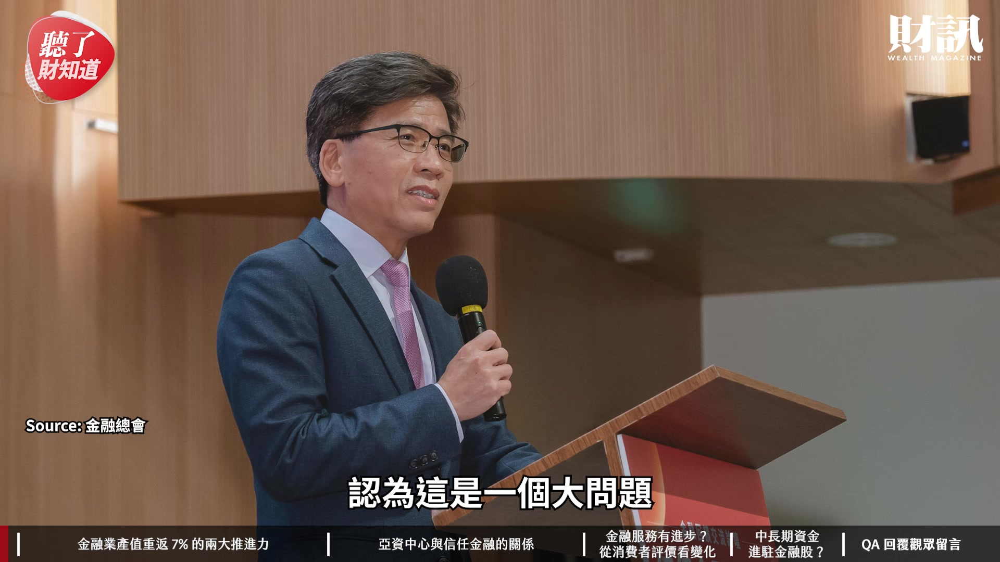

**逐字稿片段：** 今天這集我們會先聊一下 金融業產值重返 7% 的關鍵

**話題推測：** 討論金融業產值重返7%的關鍵

---

## 00:00:14

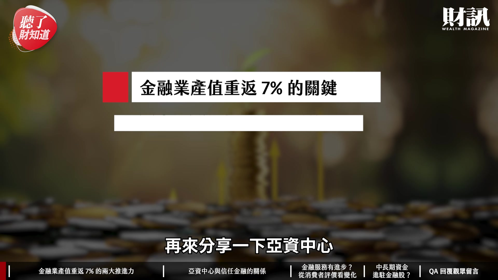

**逐字稿片段：** 再來分享一下亞資中心 與信任金融之間的關係 最後我們分享一下 中長期資金進駐金融股 的原因是什麼 大家好 我是今天主持人陳彥淳 今天來賓是 財訊雙週刊的副總編輯 洪綾襄 歡迎綾襄 各位觀眾朋友大家好 我是綾襄 綾襄是我們金融業的專家 我們任何金融業的問題 都要來請教綾襄

**話題推測：** 討論亞資中心與信任金融之間的關係

---

## 00:00:34

**逐字稿片段：** 上次我們去找了 金管會主委 彭主委 他就講到說 聊到台積電 聊到金融業的發展 這兩個產業 一樣都賺了非常多的錢 那一樣對社會其實都滿有貢獻的 但好像民眾對於支持台積電 好像遠遠超過支持金融業 或是金融機構 就是說 我們跟金融業的往來這麼密切 但為什麼是 好像 就只有財務上的往來 卻沒有情感上的交流 大概是這個概念 感謝頻道會員長期的支持 因為有您們的肯定 才能讓我們持續帶來精彩的內容 如果您也喜歡我們的節目 也歡迎大家幫我們 按讚訂閱還有分享

**話題推測：** 提及金管會主委彭金隆

---

## 00:01:11

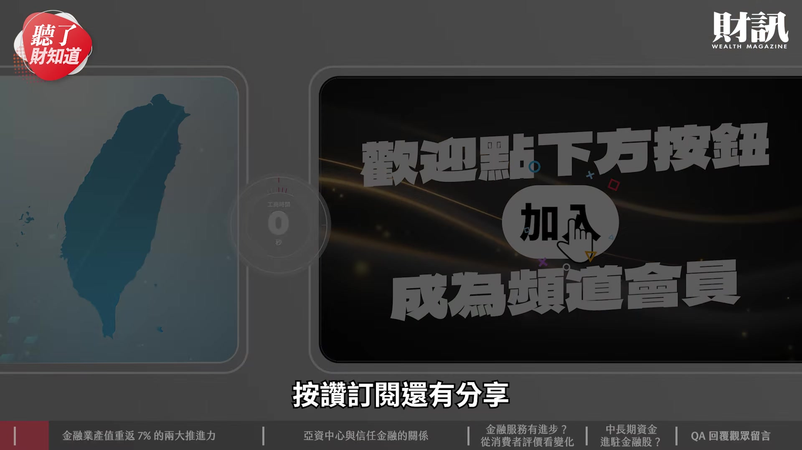

**逐字稿片段：** 那我們就重新來看說 現在的 台灣的金融業發展 到了一個什麼樣的情況 因為大家覺得金融業很不錯 對 其實這幾年金融業 真的是一直獲利創新高

**話題推測：** 探討台灣金融業的發展現況

---

## 00:01:21

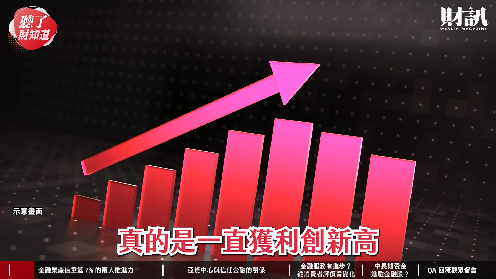

**逐字稿片段：** 財訊一直在舉辦一個 財訊金融獎 一直在關注這個金融產業 我們當然也是希望說 有不好的 我們當然要提醒 但是有好的 我們要也給予 值得的掌聲這樣子 所以我們其實舉辦財訊金融獎 其實已經十幾年了 我們長期觀察這個金融產業 在台灣 其實它都一直扮演一個 扶植產業發展的角色

**話題推測：** 提及財訊金融獎

---

## 00:01:39

**逐字稿片段：** 金融產業其實 從業人員有超過 60 萬人 但是 其實一般民眾 他們對於金融產業 都會覺得說 它們唯利是圖 或是很精明 很勥跤這樣子 好會算 對 然後 要借錢的時候 你很有錢很有實力 我就多借給你一些 利率也給你更好一些 可能我真的很需要的時候 你可能就會雨天收傘 民眾對於它 可能還是會有一點 抱持一個距離感 就是稍缺少一點連結 但事實上整個金融業 是台灣產業發展的重要後盾 其實我們盤點整個金融業的發展 會發現其實到了一個 關鍵轉折點 為什麼 其實數字會說話

**話題推測：** 金融業從業人員超過60萬人的數字顯示

---

## 00:02:11

**逐字稿片段：** 我想請綾襄幫我們分享一下 其實我們盤點出台灣 整個金融業的總實力 其實已經明顯提升了 是 我們最近這三年 金融產業有三個產業 銀行 保險和證券 這三個產業它們其實 產值都不斷地在提升 但是其實之前有一個隱憂 就是說金融業賺錢 但是我們金融業整體產值 占我們全國民的 GDP 國民生產毛額這個部分 好像一直 占比沒有很高 就是一直維持在一個 6% 但我們發現根據今年 主計處的統計 上半年 金融業產值占 GDP 的比重

**話題推測：** 預告即將討論數字與統計資料

---

## 00:02:41

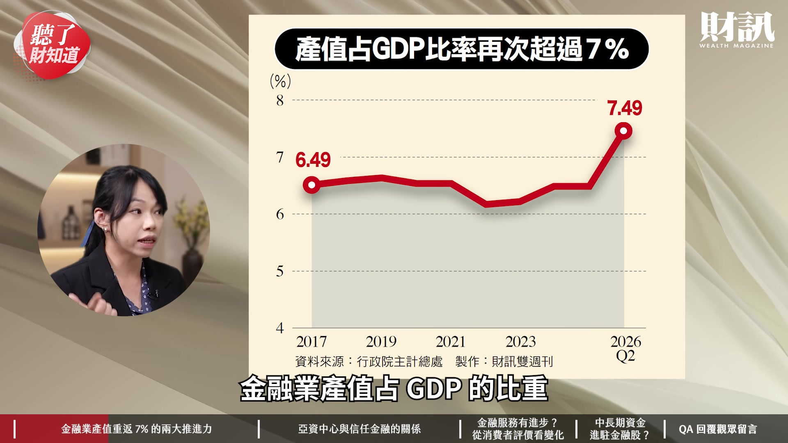

**逐字稿片段：** 不但超過了 7% 而且來到 7.5% 其實這是非常大的一個 長足的一個進步 因為我們其實 今年的 GDP 成長是 比起 10 年前來說 是翻倍的成長 那我們金融業不僅 貢獻 GDP 的比重一起成長 還超過了我們自己原來的比重 對 我幫綾襄 稍微補充一下關鍵數字

**話題推測：** 公布金融業產值占GDP超過7%，達到7.5%的數字

---

## 00:02:59

**逐字稿片段：** 就是說今年前 8 月的金融三業 就剛剛講了 證券 保險 銀行 前 8 月的獲利 已經超過去年全年

**話題推測：** 公布今年前8月金融三業的獲利情況

---

## 00:03:07

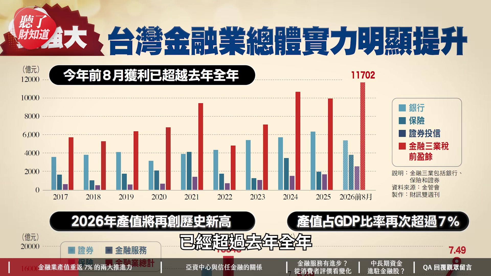

**逐字稿片段：** 是總共獲利了 1.17 兆元 那相信全年會再創歷史新高

**話題推測：** 金融三業總獲利達1.17兆元的數字

---

## 00:03:14

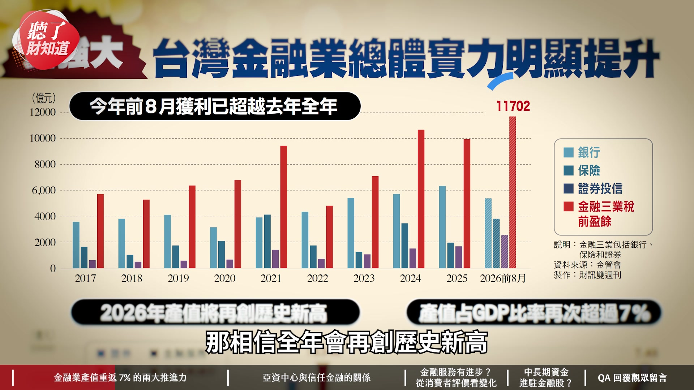

**逐字稿片段：** 第二個就是說金融業的產值呢 到今年上半年已經到 1.13 兆元 那相信今年也會創下歷史新高 因為其實去年 大概是 1.8 兆元左右 那更不用說剛剛綾襄 不斷強調的 GDP 占比 再次超過了 7% 那這件事情當然我覺得 還是很有指標性 就是說台灣其實 整體的經濟成長量是大的 它還能夠持續成長 代表它的成長力道是強的 這件事情非常 非常重要

**話題推測：** 公布今年上半年金融業產值達1.13兆元的數字

---

## 00:03:39

**逐字稿片段：** 那到底為什麼 為什麼金融業這麼強 第二個 在這樣的情況下 彭金隆卻說 金融業碰到大問題 先回答第一個問題好了 為什麼今年會有這麼大的改變 這個原因其實 歸納起來有 2 個 1 個就是對內我們金融業 過去這幾年 做了非常多的併購 那真的是要做併購 你才能夠有這個規模經濟 那以前其實台灣 長久以來就會被說 就 over banking 就是金融機構家數過多 像我們銀行有 30 幾家 保險業有 20-30 家 證券更不要說 就是上百家這樣子 百花齊放 對 那就是一直以來 就是過度競爭的一個狀況 規模經濟是沒有起來 但是就從 2021 年開始 富邦金控併購了日盛金控 它就刺激了整個業界 它們開始更積極地 在做一個併購

**話題推測：** 探討金融業表現強勁的原因

---

## 00:04:21

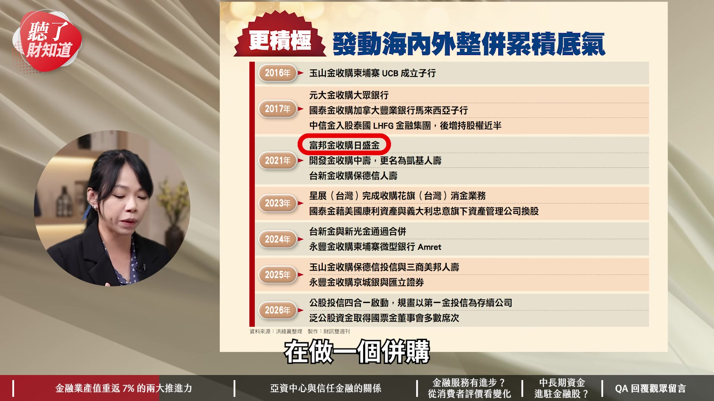

**逐字稿片段：** 那所以就是星展 它就收購了台灣的花旗 中信 台新 還有玉山 還有永豐 它們這幾年 都做了很多的併購 而且都是上兆元的併購 因為有一個刺激之後呢 所有的版圖都要重新去盤整 那如果我要贏的話呢 那當然就是一定要有足夠的底氣 那台新金控那時候 吳東亮董事長 他就有跟我們分享說 這個其實就像開麵店 如果我都只有小碗而已 客人如果胃口比較大一點 他用小碗一口就吃完了 他怎麼吃得夠呢 真的要好好招待客人的話 一定要準備大碗公 所以規模要夠大 對

**話題推測：** 提及星展銀行收購台灣花旗的案例

---

## 00:04:52

**逐字稿片段：** 第 1 個是併購 當然第 2 個就是法規的鬆綁 這幾年我們台灣的政府 做了很多努力 當然過去很多年 我們都會聽到一些聲音 就是台灣每年政府都說 要做亞洲金融中心 亞洲籌資中心 亞洲調度中心 這個口號已經 喊了 聽了好多年了 所以 2024 年的時候 賴清德總統上任的時候 跟彭金隆主委 他們就提出了 就是說

**話題推測：** 第二個原因是法規鬆綁

---

## 00:05:12

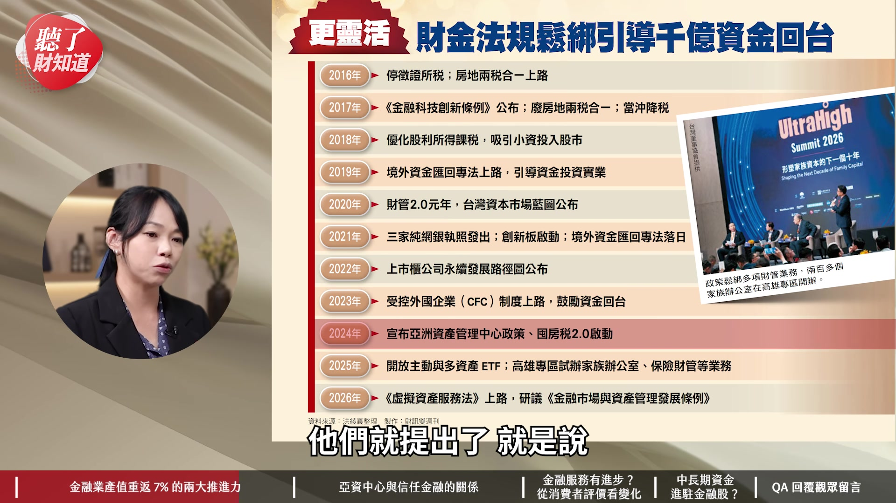

**逐字稿片段：** 要打造亞洲資產管理中心 打造亞洲的那斯達克 那這時候大家覺得 又來了 但是 沒想到就是才 2 年 真的是滿有感的 做了很多的法規調適和鬆綁 那過去呢 只要我們 講到金融業發展 都一定會提到就是說

**話題推測：** 提出打造亞洲資產管理中心與那斯達克的目標

---

## 00:05:28

**逐字稿片段：** 我們台灣就是低利率 就被央行綁住 然後我們公股行庫太多家 有 8 家左右 然後都不再增資 不再擴大業務 然後營運得非常保守 最常講就是稅制 比不過香港跟新加坡 然後不夠簡便 沒有生態系等 然後人才外流 然後又說我們台灣很危險 地緣政治 所以錢不要來這樣子 對 我錢都要放在海外 誰要進來這樣子 但是這幾年真的是 國際間的趨勢 國外它們在打反避稅 所以說其實你放在海外 其實也沒用 就是其實都會被查到 那當然就是我們政府這邊 也做了好幾波有關於 就是引導資金回台的一個專案 就相對應的就有 財管 2.0 然後就有亞洲資產管理中心的 一些很多的業務開放

**話題推測：** 討論過去對台灣金融業的常見批評與挑戰

---

## 00:06:07

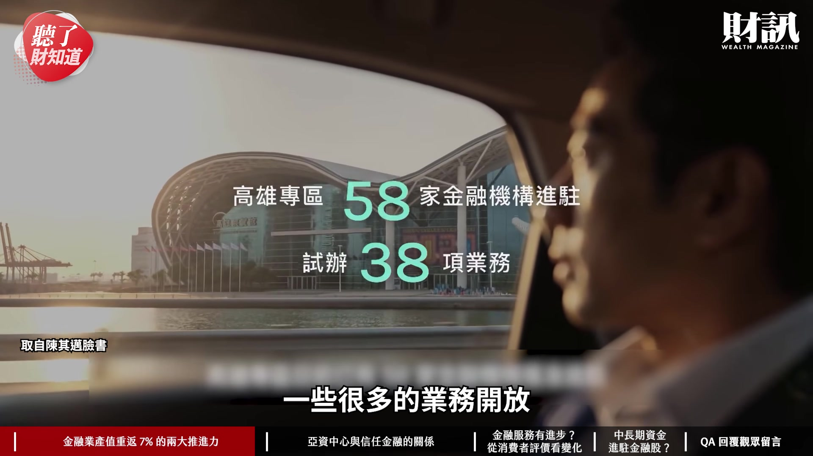

**逐字稿片段：** 包括家族辦公室 你真的很有錢的人 你把錢放進來 我可以讓你有個專區 在高雄 你去那邊 你就可以做很多 就是在國外就可以做到的業務 所以這 2 年就會 有很大的一個 就百花齊放的感覺 就讓人有感 這樣子很好 這樣子真的其實滿好的 其實我們當然樂見 金融產業的蓬勃發展

**話題推測：** 提及家族辦公室及高雄專區的措施

---

## 00:06:24

**逐字稿片段：** 但為什麼彭金隆會覺得 金融業的發展 雖然看起來這麼風光 但卻是面對到一個大問題 那他的關鍵的想法是什麼呢 剛剛我們有提到說 民眾對於金融業 一直處於一種 距離感的一個感覺 因為其實長期累積 就以前的觀念就是覺得說 你知道就是金融業的 都是大老闆 他不會真正幫我管錢這樣子 那因為我們中間 有經過很多次金改 現在呢 我們發現說 如果真的金融業有做得好的 有獲得民眾信任的話 其實是可以給予 適度的開放的 這次我們去訪問 跟彭主委有聊到 他就有提到說 如果它們想要做更多業務的話 需要民眾信任它 我愈相信你 我就愈願意 把更多的錢讓你去管 才會有一個正向的循環 那這個政策的鬆綁 它是需要更多的信任 所以這時候 彭金隆主委他就說 金融業既然賺了這麼多錢 規模也擴大了 如果它們還想要做更大的話呢 這個時候就要去投資 信任這件事情 對我覺得一個關鍵點在於 主委有講到一件事情 金融業是一個特許行業 今天金融業拿的資金 是眾人的資金 所以它被管理是有必要的 那今天如果你要做強做大 大家都可以理解 政策需要鬆綁 這個時候 彭主委提出這樣子的說法 我覺得其實是 金融業發展的底蘊跟底氣 今天如果民眾 信任這個產業的發展 民眾就願意相信 政府讓利給金融業 或讓它們有更開放 更完整的條件 可以經營市場 那我覺得這樣對民眾也是好的 所以他有特別提到說 所謂的信任金融是什麼 就是能夠真正解決 消費者或民眾問題的產品 其實我們也碰到過 滿多金融業者 它們有時候會覺得說 這個產品不會賺錢 這個產品很難賣 但明明消費者的需求是在的 為什麼我們沒有開發出 類似的產品來服務跟滿足他們 尤其是現在我們面臨到 新的人口結構的時候 其實很多原本產品已經不適用了 對 沒錯 但是我們還是在賣 對 所以說其實我們過去十幾年來

**話題推測：** 再次討論彭金隆主委對金融業大問題的看法

---

## 00:08:18

**逐字稿片段：** 財訊舉辦金融獎的過程中 我們其實一開始是 CSR 就是企業社會責任 那當然企業社會責任 大家就會說 我有做很多善事 我用我爸爸成立的基金會 然後捐了很多錢 修消防車 我還帶著員工去淨灘這一些的 滿多都是一次性的一個 社會的公益 它沒有一個系統性 或是一個真正解決 社會問題的一個策略

**話題推測：** 說明財訊金融獎從CSR轉變的過程

---

## 00:08:44

**逐字稿片段：** 所以說其實我們財訊金融獎 後來慢慢也變成從 CSR 然後到永續金融獎 用 ESG 的框架

**話題推測：** 說明財訊金融獎轉型為永續金融獎

---

## 00:08:51

**逐字稿片段：** 就是環境 社會 治理 這三個框架之下 然後做它們 永續金融的一個策略 去盤點今年做得怎麼樣 那這個時候就可以看得出來說 哪一些金融業 它們是真的有策略性地 在做社會回饋 然後真正解決了社會問題

**話題推測：** 解釋ESG框架：環境、社會、治理

---

## 00:09:06

**逐字稿片段：** 像譬如說好了 今年永續金融獎 凱基人壽 它們就 在去年的花蓮那個 馬太鞍堰塞湖 就是發生洪災的時候呢 它們適時地推出志工保險 因為它們其實就是看到 很多鏟子超人 就是民眾他們志工無償地去幫忙 就是挖淤泥這樣 但是他們其實還是需要保險的 因為可能還是會有很多意外 或是不管是受傷或什麼 如果有這個風險意識的話 他們可以去購買 這個不是一個賠錢的商品 也不是說是一個無償提供的商品 但是呢 確是可以 讓這個鏟子超人他們 得到他們應有的保障 對 這就是講到關鍵點 就是真的符合需求 而且產生影響力 所以這件事情是我們財訊金融獎 每年在推動永續獎的時候的 重要的核心 因為我們每年都做 金融業的大調查 從專家評鑑到消費者調查 消費者推薦獎 其實我們的這個取樣 base 我覺得應該是 全台灣最大 所以非常 非常有代表性 這幾年看下來會發現說 其實整個金融業的轉型 的確也進入深水區 面臨到永續的考驗 影響力的考驗 AI 的挑戰 很多挑戰在這個時候 如果更沒有信任當基礎的話 我覺得真的會愈來愈困難 現在有一個政策的影響力 現在有一個政策的影響力 就是說我們把信任 作為一個重要的發展方向 那財訊 就是每年在這個上面 一起來推動產業的進步 今年我們選出的 金融奉獻獎的人選是誰 今年就是我們選出的 就是當年推動台灣 開放新銀行的一個關鍵的 一個推手 就是陳木在董事長 他現在是上海銀行的獨立董事

**話題推測：** 以凱基人壽在花蓮洪災推出志工保險為例

---

## 00:10:31

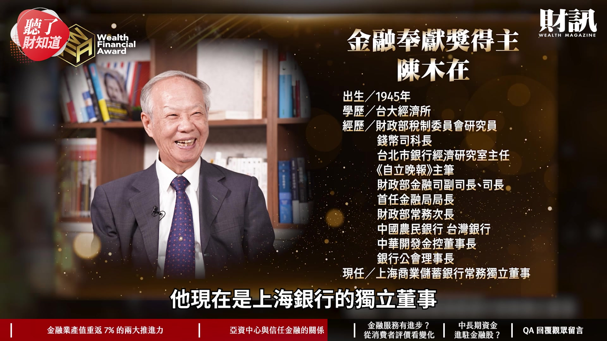

**逐字稿片段：** 就是他最早是在財政部的錢幣司 哇 果然很有資歷 40 年前這樣子 然後中間他就經歷了 就是財政部它錢幣司 改制成金融司 然後再從金融司變成金融局 也就是現在的金管會的前身 所以他就是其實 奠定在整個金融監督管理的 一個制度基礎的重要推手 重點是說他其實 他手下有很多很厲害的人物

**話題推測：** 介紹陳木在董事長早年在財政部的資歷

---

## 00:10:55

**逐字稿片段：** 包括我們之前的 奉獻獎得主 陳冲 當時在金融局的副局長

**話題推測：** 提及陳冲曾為陳木在手下

---

## 00:11:00

**逐字稿片段：** 然後我們去年的 張秀蓮董事長 她也是陳木在董事長 當時在金融局的副局長 郭婉容曾成為他的大長官 然後他也曾經跟王建煊這邊合作過 都是在財政部時期這樣子 後來他到了台灣銀行 他到了中華開發 其實都做了很多很重要的事情 財訊是每年都會選出 對金融業有貢獻的人選 今年我們選的陳木在 當然也是實至名歸 那我們透過專家評鑑 跟消費者的調查跟推薦 其實我們看到整個金融業的發展 真的每年都在進步當中 妳的 Overall 感覺是怎麼樣 跟大家分享一下

**話題推測：** 提及張秀蓮曾為陳木在手下

---

## 00:11:34

**逐字稿片段：** 我真的必須要說我們的 NPS 就是所謂的消費者淨推薦值調查 真的是金融業首屈一指 全台獨家 我真的不知道 要怎麼形容這個 對這個調查的敬意 我們大概從 5 年前 開始做這樣的調查 那過去 NPS 其實不是 一個新的調查方式 它其實由來已久 但是大部分都是只有一家公司 它會請一個民調公司 幫它們的消費者 問他們說 你在使用這個 金融品牌的服務的時候 你願不願意推薦給你的親友 如果願意的話是什麼原因呢 整個服務流程上面 有哪些痛點可以去改變 它變成是一種很專案式的 然後只給一家金融業 比較量身打造的概念 對 然後譬如說像是 我知道滿多保險公司 它們之前最早就是使用 NPS 來改善它們業務員服務 和從服務到核保這樣一個流程 但幾乎沒有任何一個調查公司 有像我們財訊 NPS 這個調查一樣 有這麼全面 而且 跨了六個行業的一個調查 而且是歷年度的分析 最早我記得我們那時候 第一次做 NPS 的時候 那個分數真的是慘不忍睹 就每個都負評耶 對 而且我記得當時 我們在做的時候 顧問群就在講說 因為消費者或台灣人比較保守 就可能不願意給過高的分數 對他們想給很模糊的分數 中間的分數 但是因為推薦就表示 你要積極認同 他才會推薦 但在這幾年做下來 慢慢發現說 其實 金融業在努力 消費者也感受到了 所以這個正分的情況 愈來愈明顯 對 沒錯 像過去可能還有 譬如說像是 基金公司這樣的一個業態 就是如果績效好的話 那個分數才會高 然後或者是說 像是行動支付相對業務單純 所以它要用得順 補貼多 它們的消費者才會認同它 但現在不是了 像我們今年的得主是 Apple Pay 行動支付 它其實幾乎都沒有回饋 沒有任何補貼 對但它就是真的很順 順到你就是沒有感覺到說 用它會出任何問題 無痛支付 真的 就是咻 錢就付出去了這樣子 這中間沒有任何資安問題 沒有任何什麼其他的 你會覺得有 concern 的問題 這就是讓消費者信任 安心 然後推薦給別人 而且你到國外也可以用 最開始它可能會輸給一些 就是比較常會打補貼的 一些本土的行動支付的品牌 但現在呢 就是很穩紮穩打地 站在金質獎這個部分 不過其實今年的行動支付 我們整個看起來 在產業裡面的推薦 其實是比較衰退的 可能大家覺得變化不是很大

**話題推測：** 介紹財訊獨家進行的NPS（消費者淨推薦值）調查

---

## 00:13:54

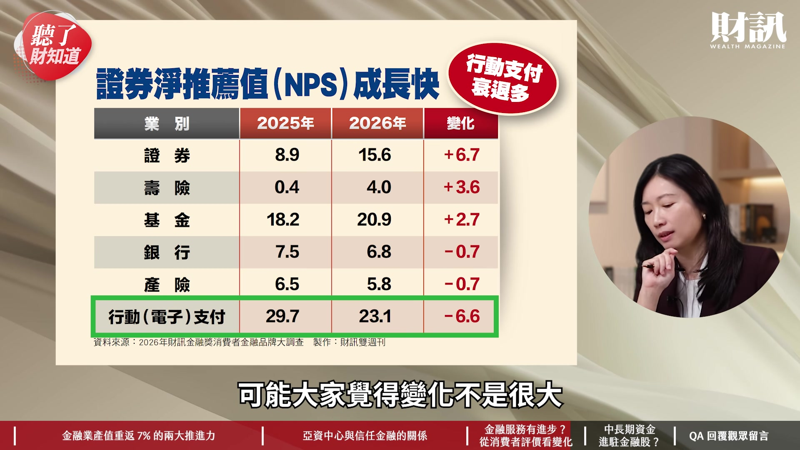

**逐字稿片段：** 今年淨推薦值 成長最多的第一名是證券 第二名是壽險 第三名是基金 那我覺得這都滿值得觀察 更詳細的內容

**話題推測：** 列出淨推薦值成長最多的前三名產業：證券、壽險、基金

---

## 00:14:04

**逐字稿片段：** 我覺得在財訊的 775 期 我們有詳載 那其實財訊 每年在做這件事情 頒發金融獎 鼓勵產業共同進步 當然還是回到說 這個產業是對台灣有貢獻 對投資人有投資價值 接下來我們就要來講 投資價值這個部分 其實很多人把金融股 當成存股的標的 然後在波動的時候 也成為資金避風港 對 這個是過去 今年以來 台灣的金融保險指數 漲了快 60% 很強 對 超強的 前面我們有提到說 其實做了很多併購 這個就像飛輪一樣 一開始可能摩擦力真的很大 但是慢慢地開始 就是整個就開始加速起來了 除了剛剛我們講到 有關於台新 新光 然後還有就是玉山併三商美邦 還有永豐併京城 其實未來我們聽說 產業還在積極地看案子 彰銀和國票金 可能也在研議這樣 最實質的就是 目前還是在一個偏緊 利率偏高的一個狀態 因為利率是金融業的奶水 那對於金融業 它們經營是有利的 那再加上它們未來 跟著我們的台灣產業 到海外去打國際杯 那海外收益的貢獻 又可以再回到我們的金融股身上 那所以說其實今年的金融股 是大家都滿看好的 那首先第一個就是財富管理業務 剛我們提到的亞資中心 銀行型金控愈做愈大 然後還有海外利基的市場的這些 我們是滿看好它們的這樣子

**話題推測：** 提及《財訊》775期雜誌刊載更詳細內容

---

## 00:15:22

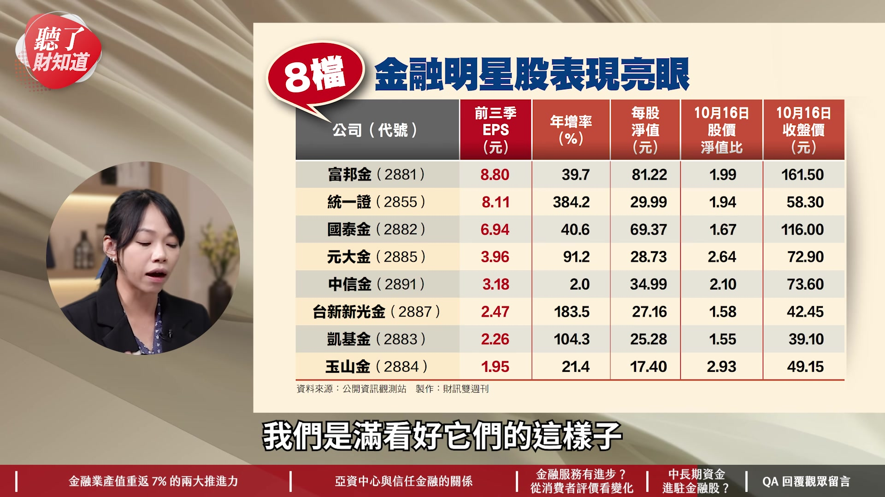

**逐字稿片段：** 像是中信這個部分 那另外就是壽險的部分 因為去年以前 它們都在很認真地在 接軌 對接軌兩個準則 但今年開帳以來 目前看起來 開出來的數字都還不錯 當然還要做一些 法規調適 監理的一些調整 其實壽險業 它們有很龐大的壽險資金 來去做投資 那我們看到一些 投資績效比較好的 一些壽險公司 表現非常亮眼 像是富邦金控 它就是我們 台灣金融股的獲利王 那另外像是證券

**話題推測：** 提及中信金控在財富管理業務的表現

---

## 00:15:49

**逐字稿片段：** 證券的話今年真的是 日成交量破兆元 相信明年也會是 雖然最近可能稍微有點量縮 但是我們預估就是未來 日成交量兆元 應該會變成一個常態 所以像是元大 或是凱基 統一證這些 就是證券類型別為主的 一些金融機構 我們也是滿看好的 沒錯 真的非常感謝綾襄的分析 我覺得 Overall 來說 信任真的是最好的投資 不論是 金融業要投資信任產業 信任金融 對於投資人來說 我挑一家公司 投資一家公司 也是信任這家公司的老闆 所以我覺得這件事情的共識 是非常 非常重要的 好 今天非常感謝綾襄的分享 看完今天的影片 你覺得台灣金融業 能成為下一座護國神山嗎 或者你會趁低檔布局金融類股嗎 歡迎留言分享你們的觀點 如果不想錯過我們的節目 歡迎訂閱財訊頻道 或是加入頻道會員 解鎖所有的會員影片

**話題推測：** 討論證券產業的投資機會

---

## 00:16:40

**逐字稿片段：** 接下來我們回覆一下 財團在《聽了財知道》第 376 集 外資今年增資 200 億元 但借錢卻愈來愈難裡面的留言

**話題推測：** 進入聽眾留言回覆環節，提及《聽了財知道》第376集

---

## 00:16:48

**逐字稿片段：** 請綾襄幫我們念一下 好 財團的 jackychang4768 他說 其實借錢愈來愈難 原因很簡單 就是包括銀行在內 大家都知道海嘯會來 只是不曉得什麼時候會來 對 會不會 100 年後 不會 開玩笑 就是不知道什麼時候 的確很難預判 是不是 真的 把利率調高也是一種 以價制量的方法 對 控管風險的概念 沒錯 好 下一個是

**話題推測：** 回覆第一位聽眾jackychang4768的留言

---

## 00:17:11

**逐字稿片段：** 財團的柯伯松 他說 這次的增資是因為 疫情到去年的貨幣寬鬆 所印出來的 到現在還沒有 實體資產或產業來支撐 本身就是個大泡沫 自然金融方要找 更好的客戶來融資 這是一個想法 但我覺得 2022 年的時候 我們就是資金已經 開始變得緊縮了 利率就是一個很高的狀況 外面的貨幣流通量還是很大 但是其實這波外資 來台灣的增資 它其實主要是因應 台灣這個市場 它們要業務擴大的一個需求 摩根大通 就五大券商 花旗這些 它們來台灣擴大投資 都是因為它們其實有很多 就是客戶他們需要發行 衍生金融商品的一些需求 然後為了符合台灣的法規 資本適足率的這樣一個需求 才去做增資 否則的話 200 億元對於外資來說 真的是很小 對 蛋糕一塊而已 但他提到這個 關於實體經濟的部分 我覺得可以補充 其實台灣 AI 產業的擴張 是實際存在 而且真的是 擴張潮一波接著一波 所以其實資金需求是強的 沒錯 沒錯 接下來是 財團的許文鈴 她說 借錢給外資炒作股票 老百姓不能借 外資想提款就提款 這合理嗎 台灣人 要去國外買房子 他國也不給貸款 想要投資回自己母國借吧 這個好像 也是一個不錯的觀念 但是這個其實有很多觀念很複雜 對 這些來增資的這些外資 它們是券商 不是提款的機構法人 所以說 這就是不同的外資 外資有買方和賣方這些 主要來這邊增資的話 就是外資證券商 那提款的部分 外資它們其實也是一直 在加碼投資台灣的 它們雖然賣掉台積電 但它們去買了很多 其他公司 對 台灣人要去國外買房子 他國不給貸款這個部分 就是 這是要看情況吧 我覺得每個人情況 可能不太一樣 對 如果你在國外有戶頭的話 應該還是可以借到錢 對 總之其實大戶或外資 有它們自己在操作金流的盤算 可能每個情況都不一樣 那我們就把現實的狀況 跟大家做分享 大家可以做參考 好 如果想瞭解更多的內容

**話題推測：** 回覆第二位聽眾柯伯松的留言

---

## 00:19:18

**逐字稿片段：** 歡迎點選資訊欄裡面的文章連結 或者購買財訊第 775 期雜誌 跟我們一起最新政經趨勢 掌握投資脈動 《聽了財知道》 我們下次再見 謝謝綾襄 謝謝大家 謝謝

**話題推測：** 呼籲讀者點選資訊欄文章連結或購買《財訊》775期雜誌

---
