# wealth1974_FWhr8H0f9hQ — 關鍵畫面索引

- 來源逐字稿：[wealth1974_FWhr8H0f9hQ_GT.srt](wealth1974_FWhr8H0f9hQ_GT.srt)
- 影片：https://www.youtube.com/watch?v=FWhr8H0f9hQ
- 截圖數：25

## 00:00:02

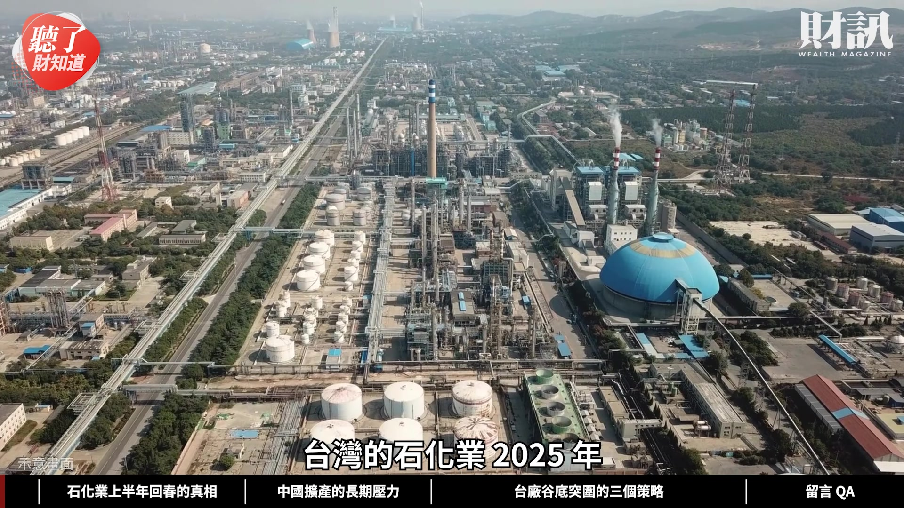

**逐字稿片段：** 全年只賺了 49 億元 但是今年上半年就賺了 896 億元 看起來好像是大復甦了

**話題推測：** 比較石化業2025年與今年上半年獲利數字

---

## 00:00:09

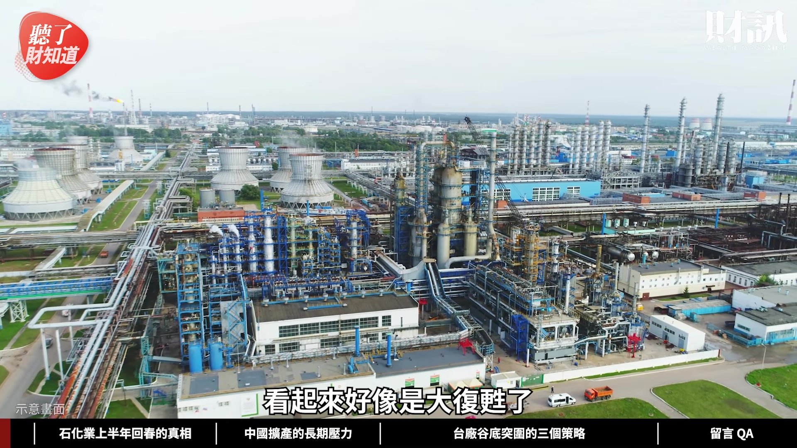

**逐字稿片段：** 可是第 3 季似乎又出現狀況了 這當中到底是怎麼一回事呢 今天這一集我們就要來跟大家聊一下

**話題推測：** 提及第三季獲利狀況轉變

---

## 00:00:17

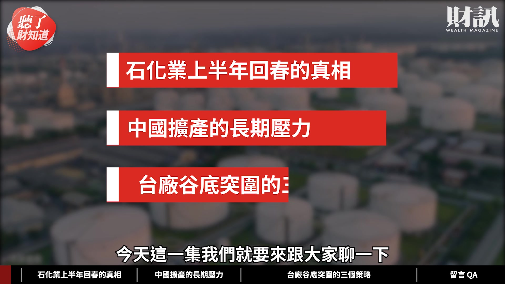

**逐字稿片段：** 石化業上半年回春的真相

**話題推測：** 影片主題介紹之一：石化業上半年回春的真相

---

## 00:00:19

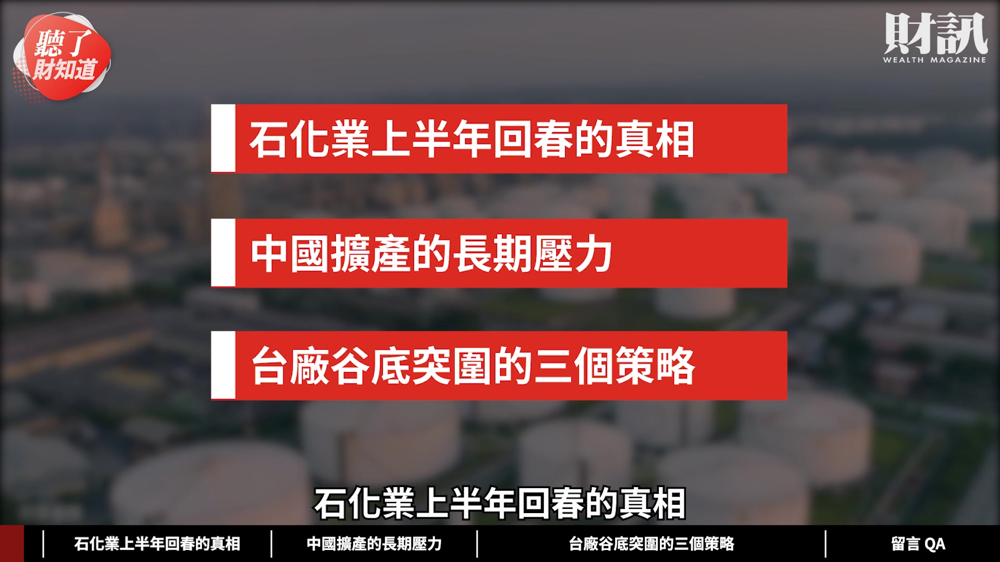

**逐字稿片段：** 再來分享中國擴產的長期壓力 接著我們也要告訴你

**話題推測：** 影片主題介紹之二：中國擴產的長期壓力

---

## 00:00:24

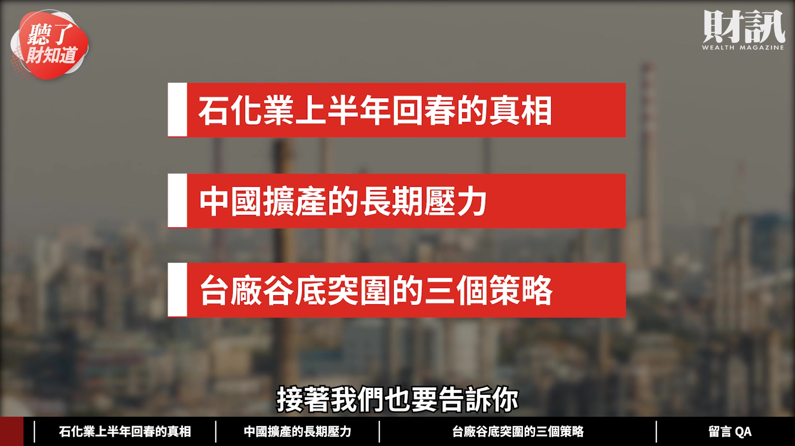

**逐字稿片段：** 台廠谷底突圍的三個策略 大家好我是主持人陳雅潔 歡迎今天的來賓是 我們財訊的撰述委員林苑卿 苑卿妳好 各位觀眾大家好 我是苑卿 台灣的石化業者非常的多 我們就是把上中下游 主要指標性的業者統整了一下

**話題推測：** 影片主題介紹之三：台廠谷底突圍的三個策略

---

## 00:00:45

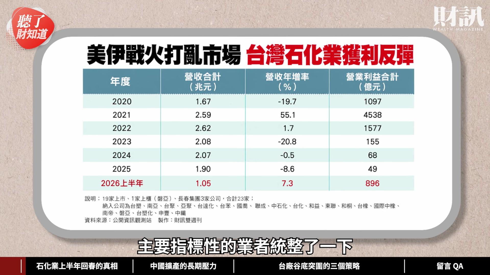

**逐字稿片段：** 發現就是整個營業利益 是高達 896 億元 因為營業利益就代表本業 表示說這個真的是實打實的工廠 做出來的東西賣出去 然後賺到的錢 所以看起來好像低迷很久的石化業 似乎有一點聞到春燕來了的味道 所以是這樣嗎

**話題推測：** 統整石化業上中下游主要指標業者營業利益數據

---

## 00:01:05

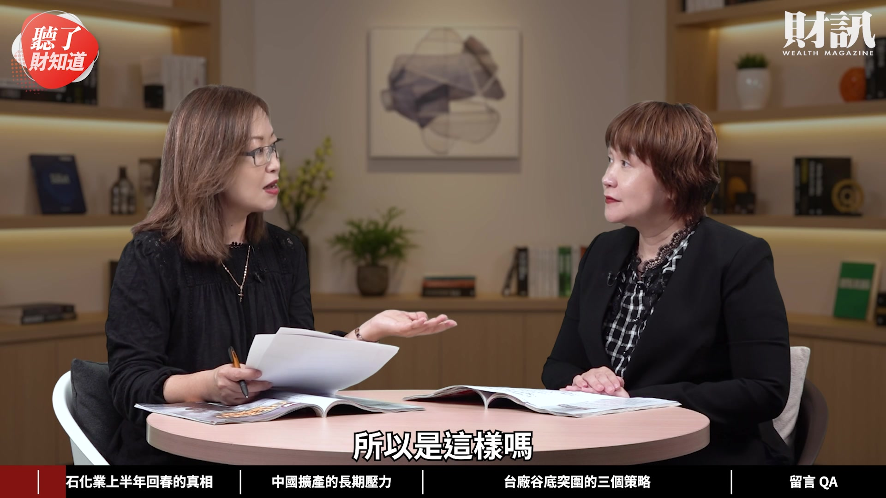

**逐字稿片段：** 這一次我們盤點了上半年 23 家上市櫃公司的財報 有很多的公司它財報的部分 看起來相較於去年來講的話 是有很明顯的一個成長的態勢 但是其實我們也有觀察到

**話題推測：** 提到盤點23家上市櫃公司上半年財報

---

## 00:01:19

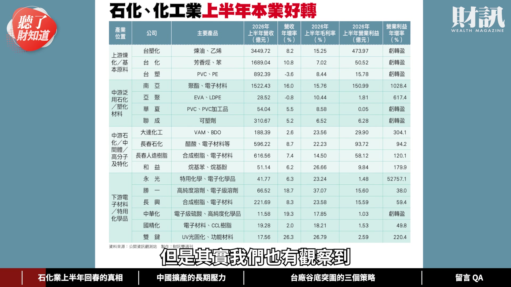

**逐字稿片段：** 三個不同的變化 其實有些公司是營收小幅增長的 可是它的獲利卻爆衝 就是看起來獲利一下子增加了很多 對 所以大家的獲利好轉 它其實並不是一個雨露均霑的情況

**話題推測：** 觀察到石化業的三個不同變化

---

## 00:01:33

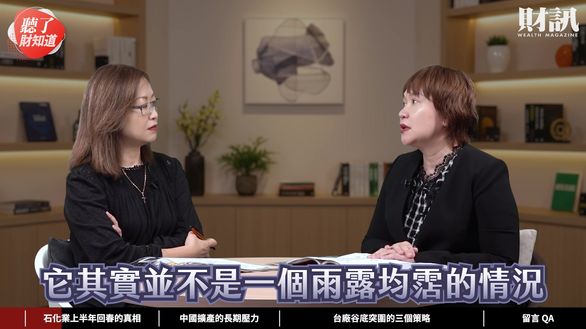

**逐字稿片段：** 那我想舉兩家公司的例子來看

**話題推測：** 準備舉例說明營收小幅增長但獲利爆衝的公司

---

## 00:01:36

**逐字稿片段：** 如果以大連化工來講的話 它上半年的營收 其實年增率只有 2.55% 但是它的營業利益 竟然大增了 304% 以上

**話題推測：** 介紹大連化工上半年營收與營業利益數據

---

## 00:01:47

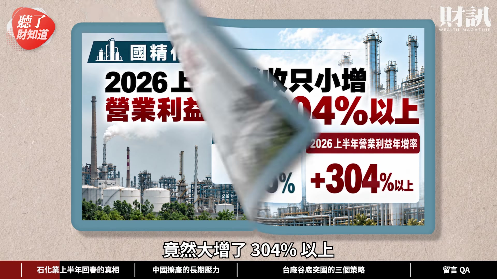

**逐字稿片段：** 那我們再來看國精化這家公司 它同樣也是營收年增大概只有 2% 但是它的營業利益 也是增加了 49.8% 所以就是看起來整體的營收 沒有增加很多 但是表示是利潤空間大了 是 沒錯 但是妳剛才說到一個問題 就是它不是雨露均霑的 意思就是說賺很多的 賺很多 但並不是大家都賺那麼多 對 沒錯 我再幫大家盤點上半年

**話題推測：** 介紹國精化上半年營收與營業利益數據

---

## 00:02:29

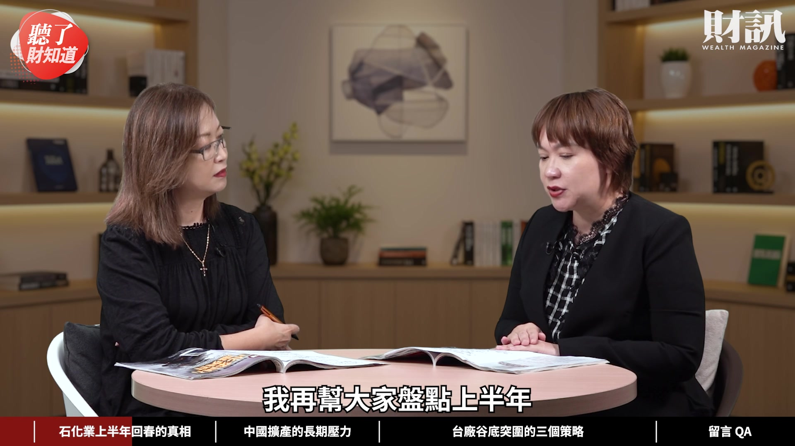

**逐字稿片段：** 這 23 家公司的營業利益 去年一整年的營業利益是 49 億元 但是今年光上半年就已經 896 億元 可是如果以單一公司來看的話 台塑化一家 就占 896 億元裡面的 53% 剩下的其他的 22 家去分 所以其實來講 並不是一個雨露均霑的狀況 所以落差很大 而且這樣看起來好像 泛台塑集團應該是賺得很不錯

**話題推測：** 再次盤點23家公司上半年營業利益，並準備揭露主要貢獻者

---

## 00:02:55

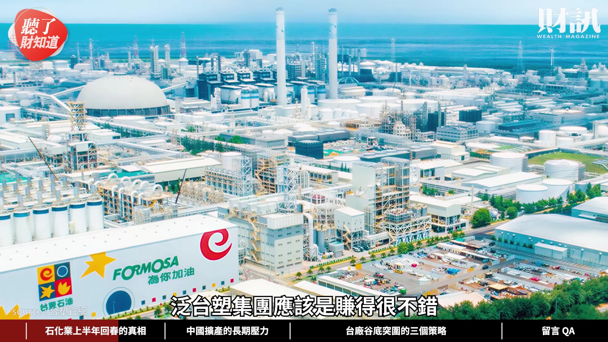

**逐字稿片段：** 但是偏偏第 3 季好像又不是這樣 10 月 12 日的時候台塑四寶它們 固定都會公布這每一季的財報 在它們公布的這個第 3 季的財報

**話題推測：** 引入第三季台塑集團的獲利情況轉變

---

## 00:03:05

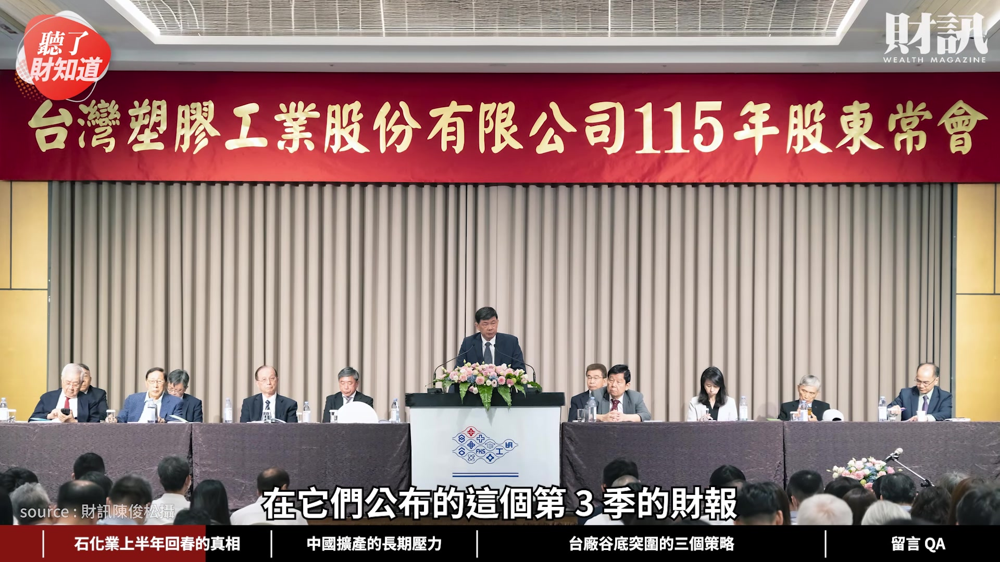

**逐字稿片段：** 像台塑跟台化它的本業又轉虧了 所以看起來好像上半年的好轉 到第 3 季開始又出現了一個轉折 也不只是台塑四寶有這樣的情況 因為這邊好像連那個

**話題推測：** 提及台塑與台化第三季本業轉虧

---

## 00:03:20

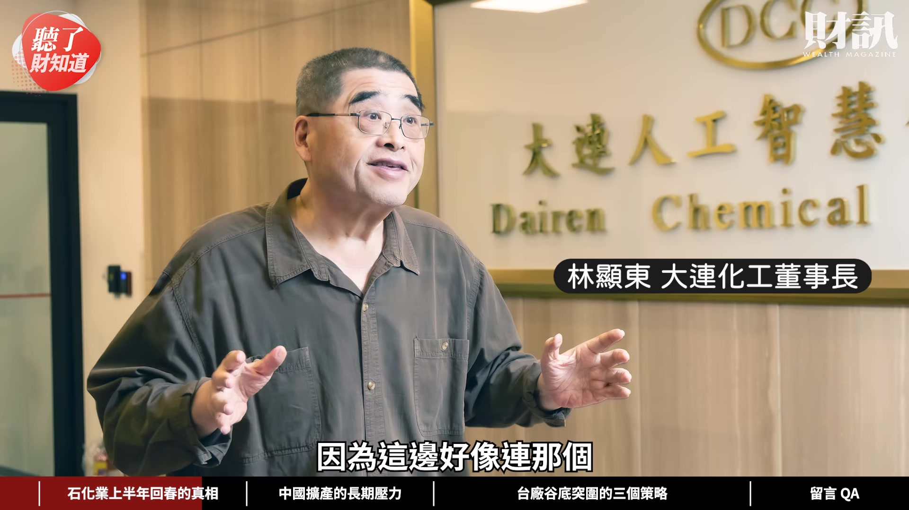

**逐字稿片段：** 大連化工的董事長他也是這麼說 他也是說今年上半年 獲利到第 3 季看起來 沒有辦法延續上半年的這個好光景 然後第 4 季他同樣也是覺得 就是會再往下 所以這到底是什麼原因呢 上半年到底在好什麼 上半年如果以大連化工 董事長林顯東他特別有提到說

**話題推測：** 引用大連化工董事長對第三季、第四季獲利展望的看法

---

## 00:03:41

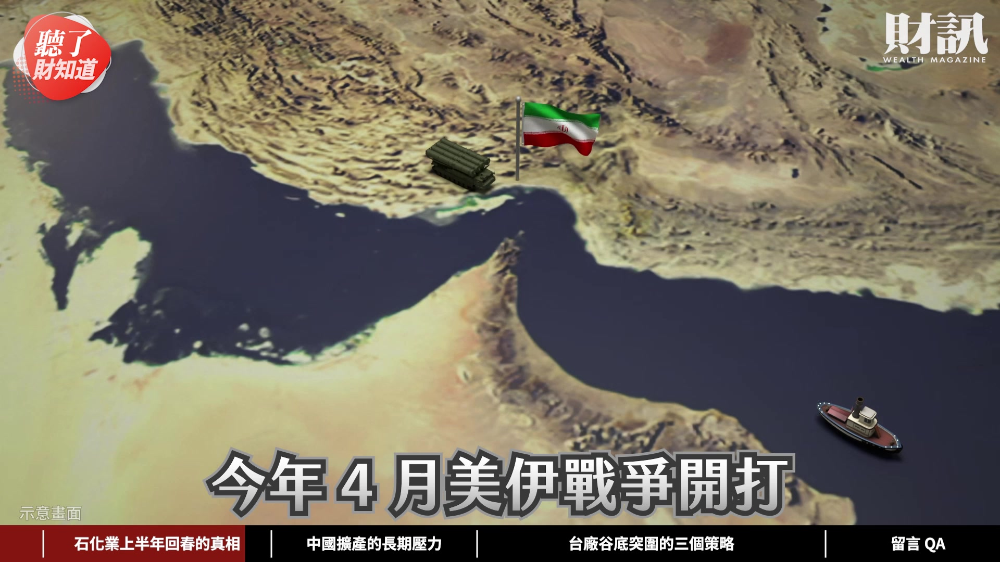

**逐字稿片段：** 今年 4 月美伊戰爭開打 荷姆茲海峽就因此而封鎖了 所以那時候很多的油輪 它是沒有辦法順利的進出 那個時候的油價就一度飆得非常高 那因為大連化工 它本來就已經有一些庫存 然後在這個時候 就可以獲得這樣一個利差 所以它上半年的表現 有很大一部分是因為 這樣一個油品的利差 就是低價庫存帶來的超額利潤 還有一件事情是說 當美伊戰爭開打的時候

**話題推測：** 解釋上半年獲利原因之一：美伊戰爭導致油價飆漲及庫存利差

---

## 00:04:09

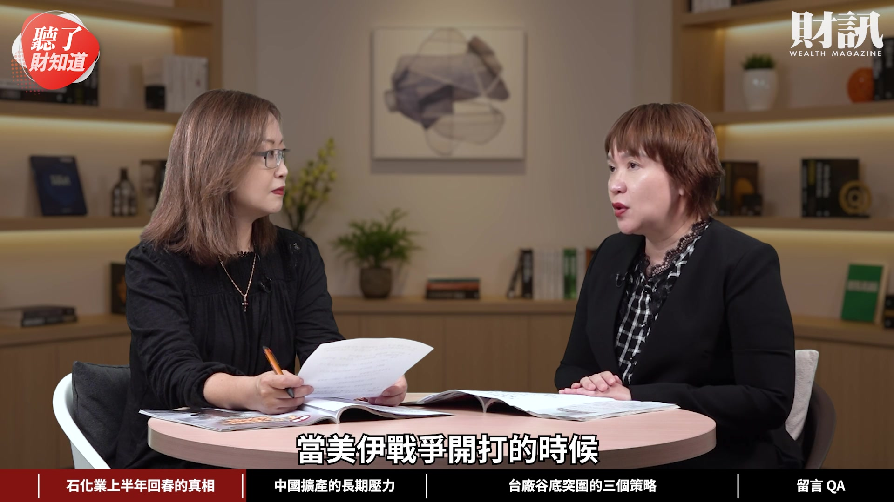

**逐字稿片段：** 剛好碰上中國同業 它們的工廠要進行歲修 在那個情況之下 全球的供給量就會一下的緊縮 那時候只要可以順利供應的廠商 其實都有辦法從中獲利 所以大連化工就是其中的一家 就是在那個供給突然中斷的時候 你只要有貨可賣 基本上就可以賺到了 但前提是你要有貨可賣 所以下半年的情況 還是可以就是有貨賣就會賺嗎 我們根據市調機構也就是棣邁 它們所提供的一個數據 可以看到說 2026 年全球乙烯的產能 是 2.42 億噸 那產量是約 1.93 億噸 它的產能利用率還是 8 成 產能利用（率）就可以反映供給的壓力 所以很明顯的看到目前 產能還是一樣是供過於求的狀況 還有就是過去我們 整個石化業是下肥上瘦 像特化這些跟半導體比較相關的廠商 如果它們是涉及在這個領域的話 其實它們的獲利表現 相較於上游的廠商來講的話 都會比較不錯 但是今年好像有一個反轉 就是剛剛我們前面有提到說 因為上游煉油的受惠成品油 吃緊的一個情況 所以它的中下游大宗化學品 它的成本就墊高了 所以它的售價很難跟漲 在這個部分來講的話就反轉了 過去下肥上瘦的一個產業現象 這當中有一個很關鍵的因素

**話題推測：** 解釋上半年獲利原因之二：中國同業工廠歲修導致全球供給緊縮

---

## 00:05:35

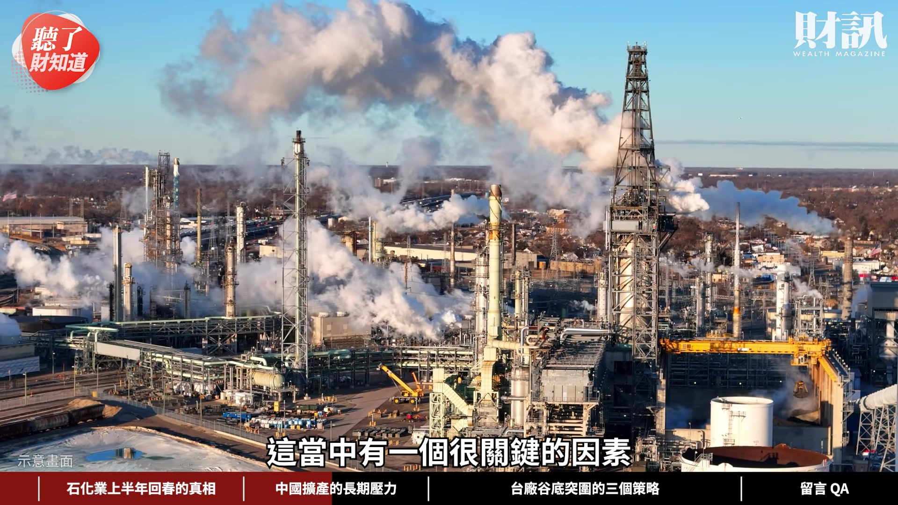

**逐字稿片段：** 就是因為中國產能持續的擴張 剛才我們講了上半年好的 一個很重要的因素 是因為中國在歲修停產 所以它只要歲修完成了之後 原來的產能開始生產 而且它們又要繼續開出很多新產能

**話題推測：** 點出中國產能持續擴張為關鍵影響因素

---

## 00:05:51

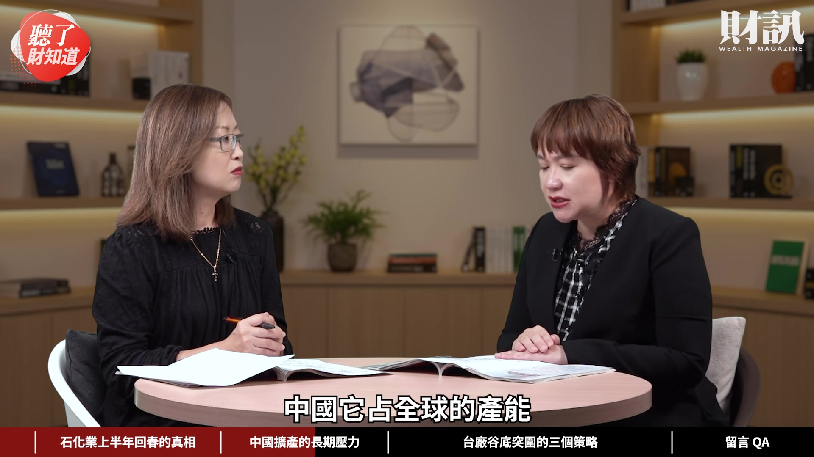

**逐字稿片段：** 中國它占全球的產能 在 2020 年的時候它只有 16.15% 但是它到 2026 年的時候 它已經上升到 26.15% 所以現在全球有 1/4 的產能 都在中國的手上 它這樣的一個毫不節制擴產的動作

**話題推測：** 揭示中國在全球產能佔比的變化數據（2020 vs 2026）

---

## 00:06:07

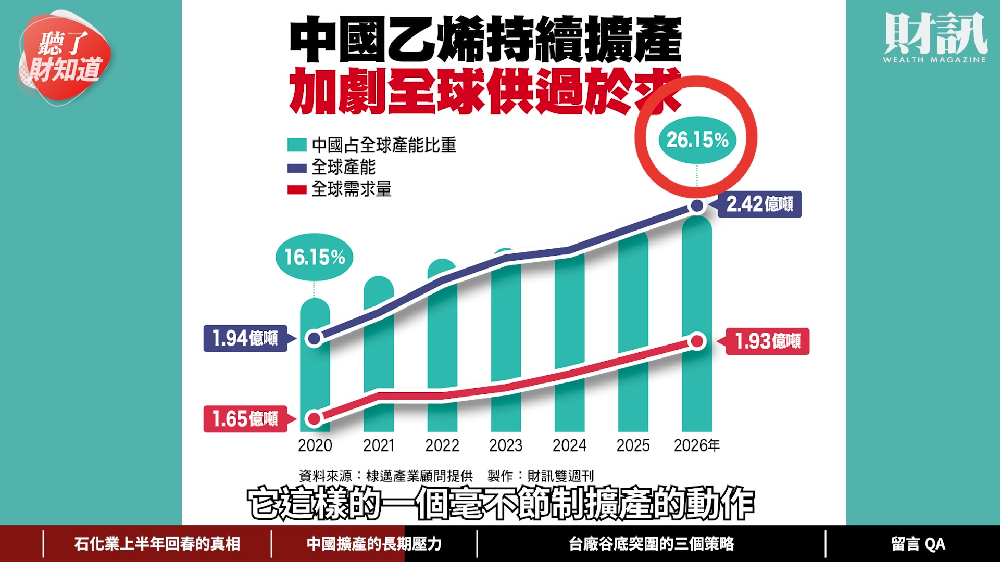

**逐字稿片段：** 已經威脅到像日韓它們 日韓現在已經開始去 減少它們的產能

**話題推測：** 討論中國擴產對日韓石化業的威脅

---

## 00:06:13

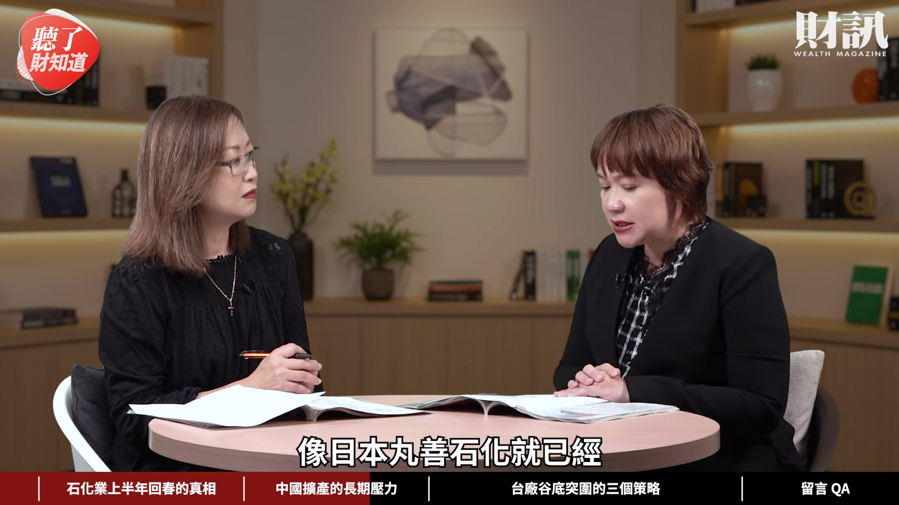

**逐字稿片段：** 像日本丸善石化就已經 停用它們自有的乙烯的設備 那像韓國它也削減了 270 萬-370 萬噸裂解的一個產能 剛才我們有講到 全球的產能利用率大概是 8 成 但是因為這當中很多是 中國（產能）增加了很高 然後其他國家在減產 才會造成這種情況 所以真正的癥結點還是在中國 因為中國看起來也 沒有繼續要什麼大規模減產 產能還是持續的上升 那表示說這種因為人為因素而形成的 一個市場讓它漲價的機會 其實是不能說它已經構成了 一個產業的景氣循環 而且特別是現在石化業 它已經不是再走過去的景氣循環 因為中國大力擴產的一個情況之下 現在整個產業已經出現了 結構性的變化 看起來這個供過於求的狀況 還會再持續好幾年 結論就是其實那個 谷底還沒有過完 大家還是繼續在谷底中 可是問題是有人已經往上爬了 這一次苑卿有找到 谷底突圍的例子 然後妳也分析出了三個方向 可以幫我們分析一下 第一個就是轉骨 就是它的體質已經明顯的改善 可以再等到景氣回升

**話題推測：** 舉例日本丸善石化停用乙烯設備以減少產能

---

## 00:07:27

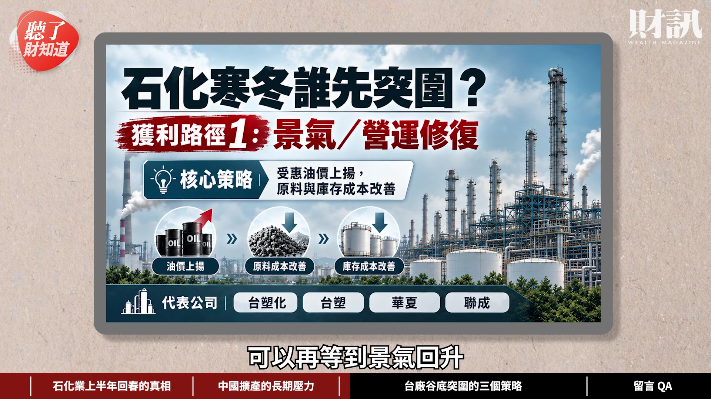

**逐字稿片段：** 台塑化董事長曹明他提到說 受損的煉油廠 它的修復可能要半年以上 所以它的煉油價差 其實是有機會可以 做這個部分的維持

**話題推測：** 引用台塑化董事長曹明說法，說明煉油價差可維持

---

## 00:07:37

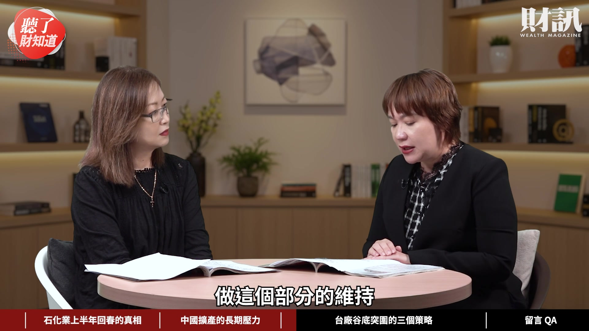

**逐字稿片段：** 第二個就是加值 目前台灣很多的特化 或者是電子材料的廠商 因為它們在下游跟半導體的連結比較深 那隨著這一波 AI 的算力 就是 AI 大基建潮 對 沒錯 所以帶動了這一波的這個成長潮 很明顯的例子當然就是像南亞 因為它有電子材料 而且它也有南電 更重要的就是南亞科記憶體的這個部分 今年都是大爆發 根據財報上面顯示

**話題推測：** 策略二：加值，發展特用化學品或電子材料

---

## 00:08:04

**逐字稿片段：** 就是它們每天一開門就是淨賺 10 億元 所以在這個部分來講的話 南亞是非常特殊 它的本業也好 然後它的業外收入也好 就是轉投資也大爆發

**話題推測：** 揭示南亞每日淨賺10億元的驚人獲利數據

---

## 00:08:15

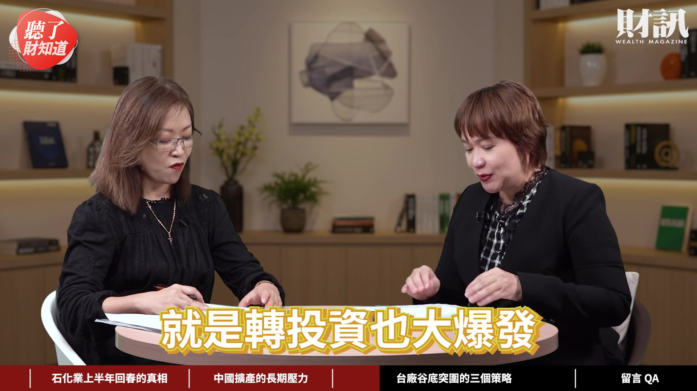

**逐字稿片段：** 另外呢 就是像台化來講的話 因為它有一些差異化的產品 還有一些節能跟低階能源的一個回收 所以董事長洪福源他提到說 他們第 4 季還可望持續的獲利 雖然第 3 季台化有一點下來 但是第 4 季可能又會再回去 那長春的部分的話 當然就是因為擴產的 AI 伺服器 它需要高階的銅箔 加工費是一般銅箔的 6 倍 它就是走高值化的路線 它是說其實是有一點 供不應求的一個情況 所以銅箔在這個部分來講的話 它的獲利率看起來是非常的好 另外這次我們有訪到國精化 它其實也是有點打掉重練 因為它本來是傳統樹脂的廠商 但是它最近這幾年開始積極的去做轉型 所以它也轉到了電子材料的部分 它們有提到說 光是電子材料營收占比 到今年年底的時候就可以攀升到 4 成 它們的 UV 光固化的部分 前期雖然有 4-5 年的虧損 但是目前看起來 也有機會就是成為 成長的另外一隻腳 好 還有第三條路 第三條就是產品組合的重組 很多廠商它們不會再盲目的擴產 它們會把比較低毛利的產品 優先的去汰換 就把跟中國短兵相接的那一塊 就去掉就對了 沒錯 沒錯 要舉一個例子的話像大連化工 它就不再新增傳統化學的產能 它們就只會保留 煉化一體的相關產線 像它們麥寮跟新加坡廠 就是緊鄰煉化一體的這個園區 就是原料來源

**話題推測：** 舉例台化以差異化產品及節能回收維持獲利

---
