# wealth1974_Hzpn4iVqcF8 — 關鍵畫面索引

- 來源逐字稿：[wealth1974_Hzpn4iVqcF8_FIN.srt](wealth1974_Hzpn4iVqcF8_FIN.srt)
- 影片：https://www.youtube.com/watch?v=Hzpn4iVqcF8
- 截圖數：27

## 00:00:28

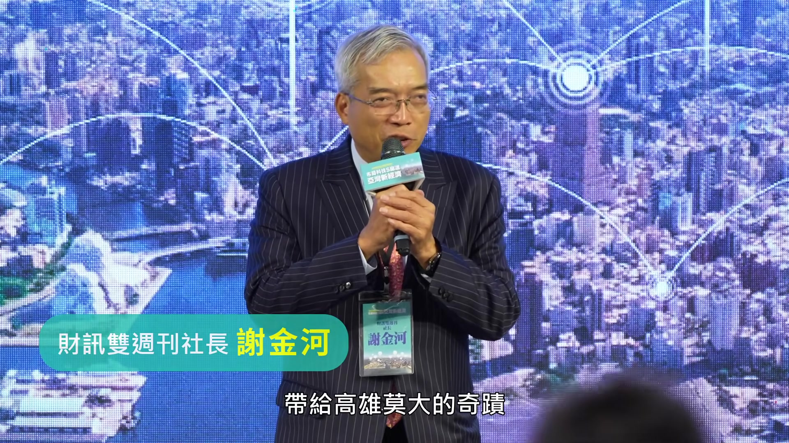

**逐字稿片段：** 臺積電落腳在高雄, 他用最短時間把土地重新洗過一遍。 他的效力全臺灣都撐到。 今天我們在這個地方, 大家共同見證高雄的躍升。 我的印象是高雄是一個石化鋼鐵港口的重工業的一個城市 但是這幾年在城市長還有事務團隊的帶領之下 已經變成半導體AI還有高科技的重鎮 那未來經濟部會直接的連結中央地方產業 要讓高雄跟國際來串聯 不僅讓高雄成為南部最重要的產業的重鎮 更成為臺灣連接國際的重要門戶 我們對於產業的轉型 我們又是有高度的決心 我常常跟同仁講 我們高雄現在的銅鋼這麼貴 碳都要現在AI的時代 半導體的時代 你若不做產業轉型 我們高雄就聰明瞭 所以我們要拚 所以我們跟在對外招商 大家也跟人家拼 我們就是要拼啊 拼條件啊 市長講尊聖啊 解決企業的困難啊 所以臺積電後來 來跟高雄市長說

**話題推測：** 提及台積電落腳高雄，可能出現相關地圖或公司Logo。

---

## 00:02:07

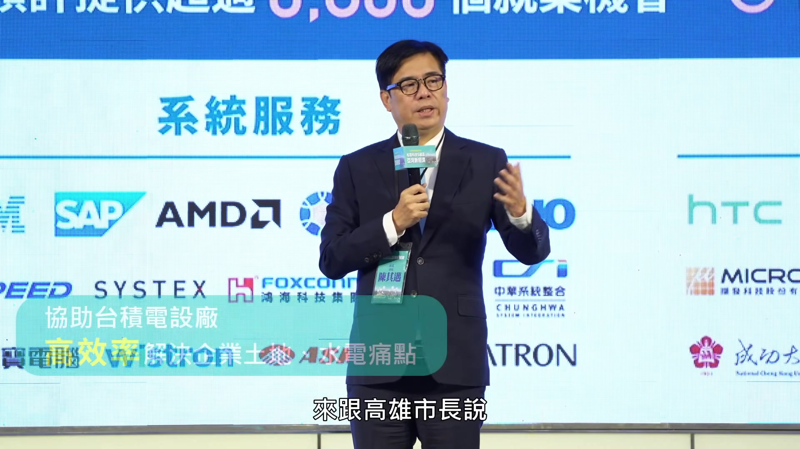

**逐字稿片段：** 欸 中油那一塊地可不可行 有沒有可能三年 我說沒問題啊 他說水呢 我說沒問題啊 電呢 沒問題啊

**話題推測：** 談到中油土地問題，可能出現相關土地照片或整治時間軸。

---

## 00:02:22

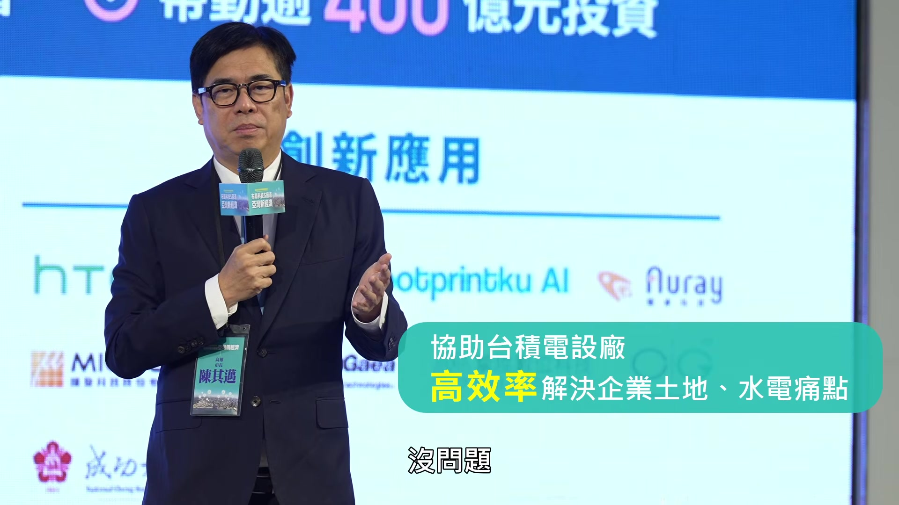

**逐字稿片段：** 如果按照中油數字 它大概是要需要25年的時間 才能夠整治嘛 但是我們花了三年的時間 規模是全球單一場址的整治 規模最大的一個 那當然一定是速度最快 緊緊緊的催促之下 準時提供給臺積電 而且還提早了半年的時間

**話題推測：** 提到中油預估與實際整治時間的數字對比，可能出現比較圖表。

---

## 00:02:49

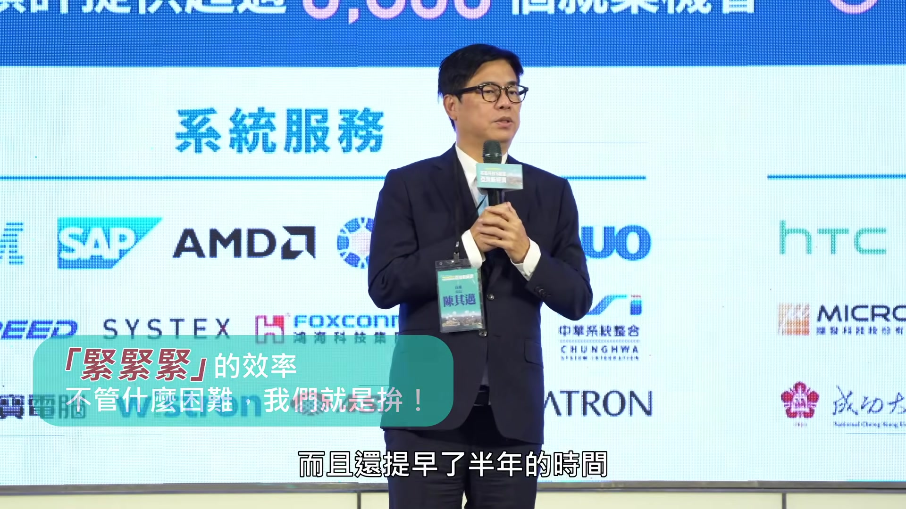

**逐字稿片段：** 那水呢 臺積電在談的時候 他馬上說 沒有我們要用再生水 我們不用一般的水 我上任市長 大概兩個月內 我就決定要蓋再生水廠 我們已經有兩座 那我上任之後再蓋兩座 所以我們一天有21萬噸的再生水 我記得我那個時候在跟內政部 爭取說要做再生水廠的時候 旁邊剛好有一個縣市所長 看我在跟經濟部講再生水 他還問我說 那豈定有什麼叫做再生水 但是高雄已經準備了21萬噸 所以為什麼臺積電來跟我講再生水的時候 我說沒問題 我們有21萬噸的再生水在等你 你們真有20萬噸 我說沒有錯 所以水田就把整個臺積電在設廠的這個過程 就很快的把它處理 大家以前都覺得說 什麼新加坡政府多有效率 我跟各位報告 高雄市政府的效率 是超過新加坡政府的效率 所以我第一點要跟大家報告說 這個是我們的決心

**話題推測：** 話題轉向台積電用水問題，可能出現再生水設施圖或水資源供應地圖。

---

## 00:04:05

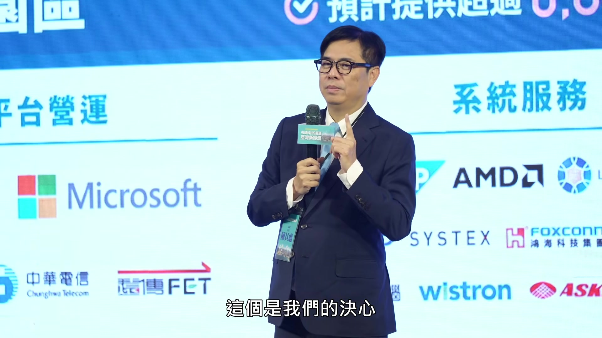

**逐字稿片段：** 第二個社會住宅 我在2020年上任到現在 我們社宅發包動工的

**話題推測：** 轉向討論社會住宅，可能出現社宅建案圖或發包戶數統計圖。

---

## 00:04:13

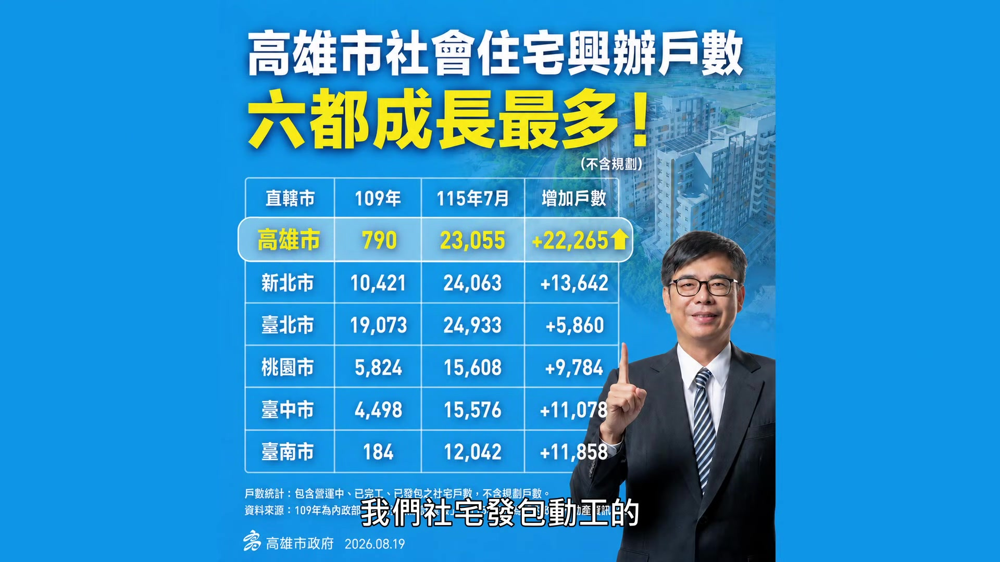

**逐字稿片段：** 到現在是兩萬三千戶在動工 那第三個例子我想跟大家分享的

**話題推測：** 提及社會住宅兩萬三千戶動工，可能出現具體數字或建案照片。

---

## 00:04:18

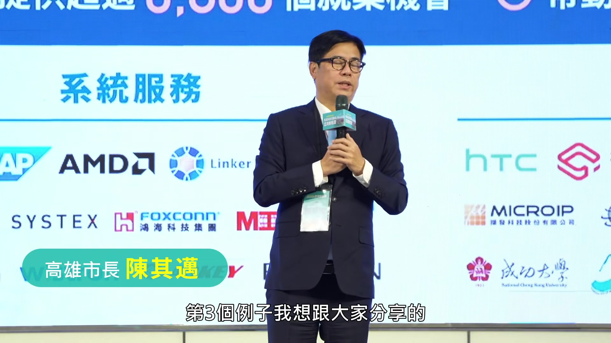

**逐字稿片段：** 就是國領是一個很困難 壓力很大的一個決定 18個洞走一圈大概兩個半小時 然後這個地形有高有低 有各種不同的 不管是生物多樣性 或者是整個這個綠地 那我們還串聯整個澄清湖 澄清湖本來是有圍牆 現在圍牆也打開 那裡面還藏了一個 夢裡森林公園 大概50公頃 就在澄清湖活動中心那裡 很多人還不知道 因為我們還沒有開放 那旁邊還有一個雙湖公園 也整理好 所以這樣加起來 總共超過470公頃的公園 這個是要留給 下一代的高雄市民來使用 高雄不止一次 這個其實最關鍵 還是在我們的居心 榜上排名能夠不斷的往前 有一個很重要的元素 他們都跟AI有關

**話題推測：** 轉向討論國領開發，可能指高爾夫球場轉型為大型公園，出現公園設計圖或空拍圖。

---

## 00:05:28

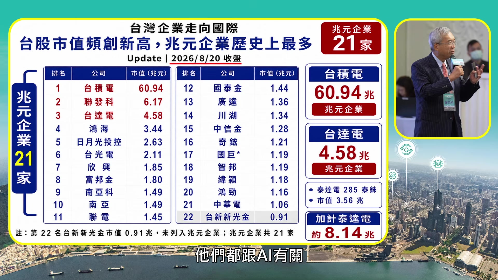

**逐字稿片段：** 你看到不管志邦 不管維營 宏慶 包括新興 臺光電 所以現在各位要看到 高雄誕生了非常多的傳奇的公司 這一些傳奇公司 現在萬年古年有兩檔

**話題推測：** 開始列舉高雄誕生的AI相關傳奇公司，可能出現公司Logo牆或列表。

---

## 00:05:46

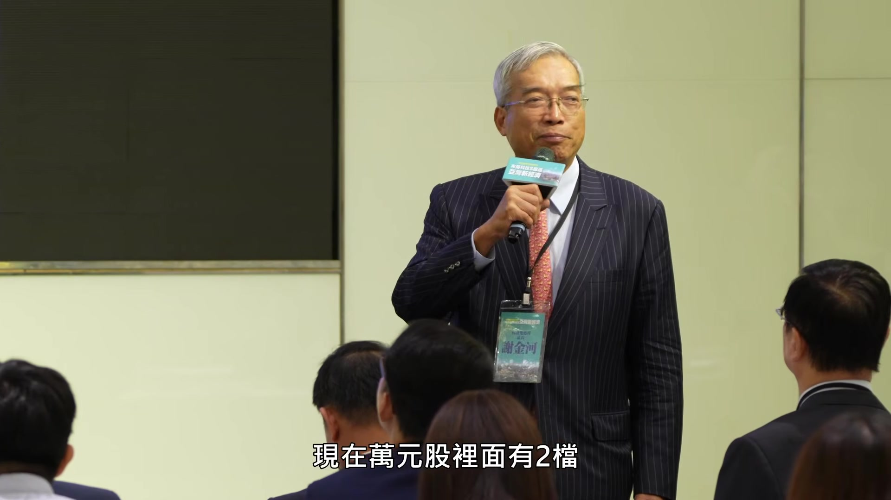

**逐字稿片段：** 所以尹威跟川福 是高雄的代表作 除了這個之外 萬潤

**話題推測：** 提及兩檔代表作尹威與川福，可能出現個股走勢圖或公司簡介。

---

## 00:05:53

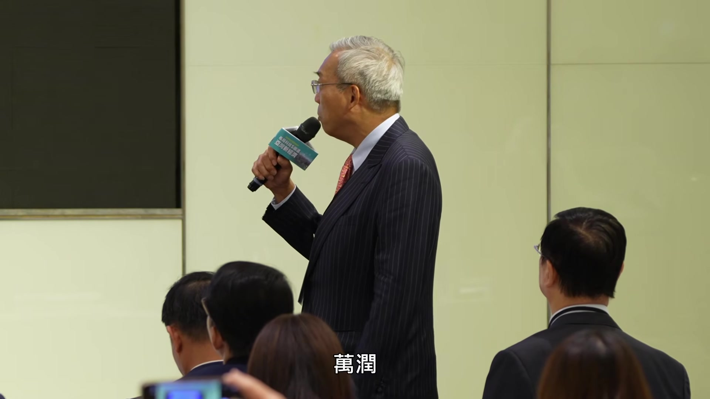

**逐字稿片段：** 我說萬潤原來七八十 現在來一千三一千四 這個也是因為在科瓦斯當中 他提供的基臺 所以你看到從日月光 長星聖衣等等 以前看到零年的石化廠 現在高雄有很多 透用化學品的工廠 坐落在高雄 這個是轉型當中 一個非常具有代表性的 一個佳作 所以過去的左營南子 這個地帶我們只知道日月光 現在隱微起來了 這一帶有非常多的 你看以前燃脂叫加工出口區 但是現在它已經變成一個 非常有名的科技園區 臺積電進駐高雄 改變高雄命運 非常重要的起點 大家都記得 這20年當中 每一個時間大家都認為高雄會再起 但是高雄每次都指紋樓梯 你想真正人沒有進來 所以這一次真正 臺積電移到高雄之後 這個高雄臺積電進駐以後 命運也跟著改變 所以慢慢你可以想見得到 高雄因為臺積電的移入 整個產業的風貌 也跟著蓬勃發展

**話題推測：** 提及萬潤股價從七八十漲到一千三一千四，可能出現股票走勢圖或數字對比。

---

## 00:07:18

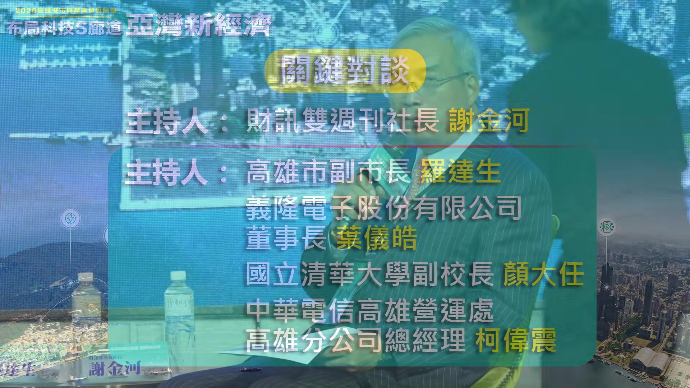

**逐字稿片段：** 高雄市政府如何打造一個 AI的新聚落 這個我們要先請 羅副市長先給大家 來勾畫未來的新藍圖

**話題推測：** 主持人介紹新話題：高雄市政府打造AI新聚落，預期切換簡報或主題畫面。

---

## 00:07:27

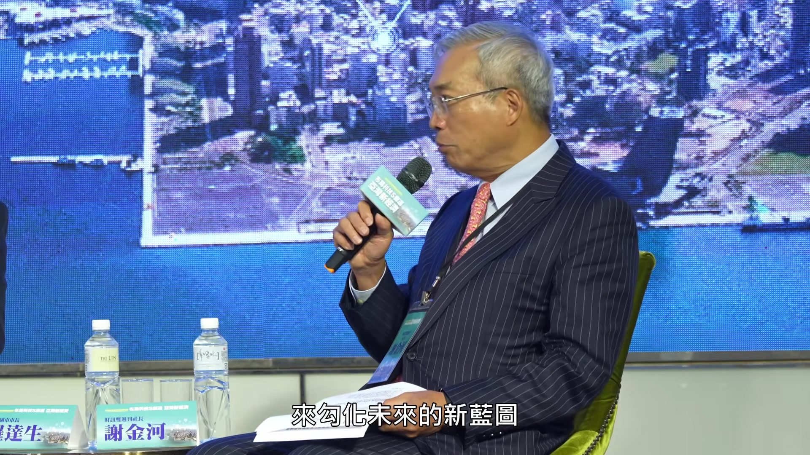

**逐字稿片段：** 我們未來簡單講做三件事情 第一個我們現在要把這個晶片的部分擴大 我們現在希望把這些的一個傳統產業 基礎工業都納入到我半導體產業 將我們的材料跟我們的設備 都能夠進到我們這個半導體的體系 造成一個高附加價值的一個部分

**話題推測：** 羅副市長開始說明未來三件事情，可能出現列表或重點整理簡報。

---

## 00:07:47

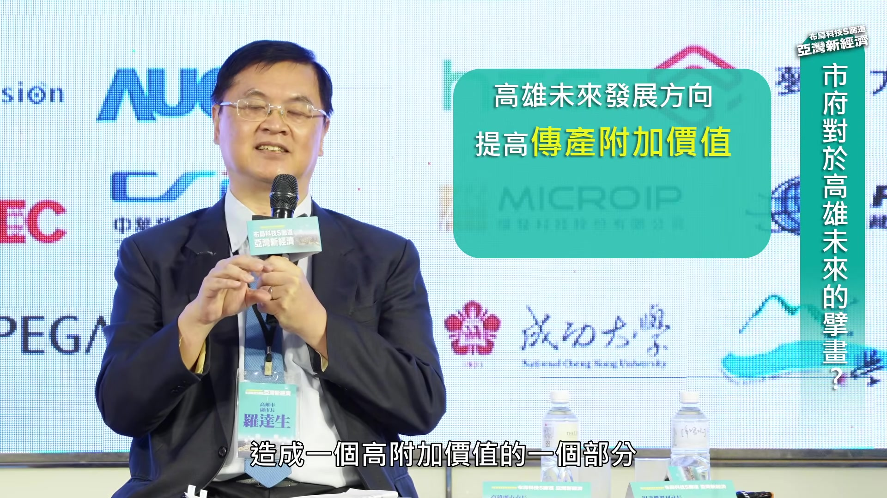

**逐字稿片段：** 第二件事情是算力的推動 我們現在高雄在推算力專區 先把算力專區的infra做好 包括電力包括電信等等 全部都做不好 一有算力的需求我就馬上建產 這樣的話算力的建設會非常非常的快 第三個最重要的部分就是說 我們現在延續我們現在燈塔計畫 我們現在推動一個叫做 亞灣Mega AI的創新園區 什麼叫Mega AI 我們希望把我們現在的程式級應用 擴展到各縣市 所有的苦功我都做好了 我把這個模型拿出來給各縣市用 他只要專注在程式自己的應用上 那我們也希望把Mega AI 作用在行業別的部分 我們希望利用PPP的合作方式 就Public-Private Partnership的方式 把公部門一些需求 能夠藉由環境的智慧化 帶動私部門的需求 所以我覺得未來的PPP合作 將是我從Mega AI上 從城市的AI 一直跨到企業跟產業的AI 這是一個非常重要的 一個銜接的做法 我們邀請一號董事長 來跟大家分享一下 他進到高雄之後 現在的發展 我們看一下一龍到底做什麼

**話題推測：** 羅副市長提到第二件事情是算力推動，可能切換至算力相關簡報或圖示。

---

## 00:08:57

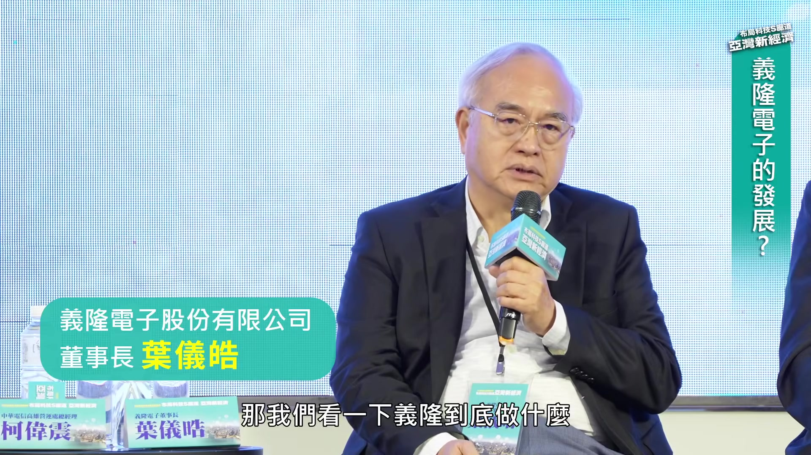

**逐字稿片段：** 我們是做AI的演算法 從智慧交通開始 On-device AI如果在智慧交通 老實講影像處理有三個東西 第一個就是我們叫object detection 抓到裝置 這很難喔 為什麼 它重疊的東西重疊50%還抓得到 第二個classification 就是說你要分類 這個是摩托車 這是人 這是什麼車 有不同的顏色框架 第三個叫tracking tracking你注意看 每一個框框上面是不是有一個號碼 下面畫很多條線 他就要做什麼 他就要看這一部摩托車跑到哪裡去 所以以後你的自衛交通 這個一個camera數得清清楚楚 有右邊 告訴右邊的camera說 我有幾部摩托車往你那邊走速度多少 有幾部什麼車子往你那邊多少 然後接下來用AI 我們叫Rain enforcement 下去做燈號的控制 我們將來大學 尤其在高雄 在人才的培育上 能夠扮演更積極的角色

**話題推測：** 一號董事長開始介紹公司AI演算法應用於智慧交通，可能出現相關情境動畫或示意圖。

---

## 00:09:58

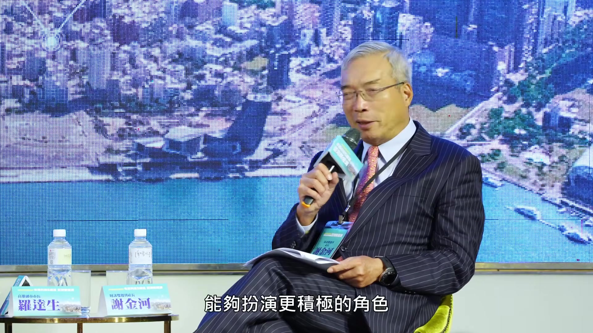

**逐字稿片段：** 這個要請顏副校長來跟大家分享一下 在我們高雄在地有規劃了一個 國家重點領域校際研究園區 那更具體來講

**話題推測：** 邀請顏副校長分享人才培育，預期畫面切換到新的講者與主題畫面。

---

## 00:10:09

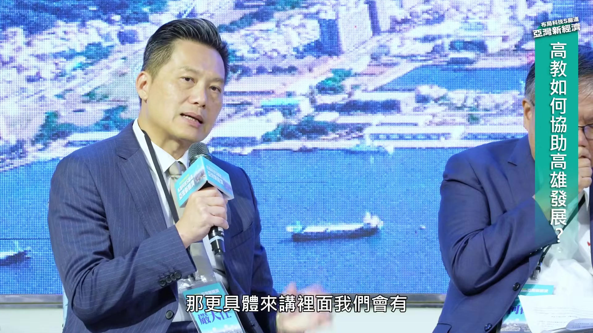

**逐字稿片段：** 裡面我們會有六個重點的領域 第一個當然最重要的就是Semiconductors 那第二個重要的領域就是AI了 第三個就是所謂的智慧製造 那第四跟第五呢 就是高雄特色了 所以我們會有永續科技 還有一個就是在館裡面 我們會有一個永續的領導 還有一個都市短行 這是第五個 那最後一個搭配 目前最新的 就是機器人 然後救人 我們會想要跟大家合作 包括我們就跟 我們的有效洋交 更重要跟當地的 我們的高校團 要有一個密切的集合 所以我們之前在過去 這一年也花很多時間 我們去到處去拜訪 尋覓我們理念相同 志同道合 願意一起為高雄 打拼的學校來一起合作 我們希望大家一起來 來創造一個共同的一些AI的人才

**話題推測：** 顏副校長提到六個重點領域，可能出現列表或領域圖示。

---

## 00:10:59

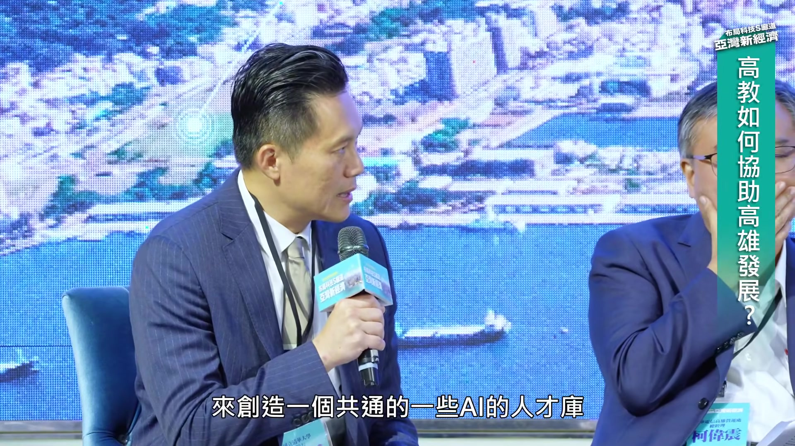

**逐字稿片段：** 我們要請我們中華電信的柯總經理來跟大家談談 中華電信在高雄雅灣區的5G AOT的 創新服務的實證發展計畫 現在推進的進程到底在哪裡

**話題推測：** 邀請中華電信柯總經理分享5G AOT計畫，預期畫面切換到新的講者與公司Logo。

---

## 00:11:14

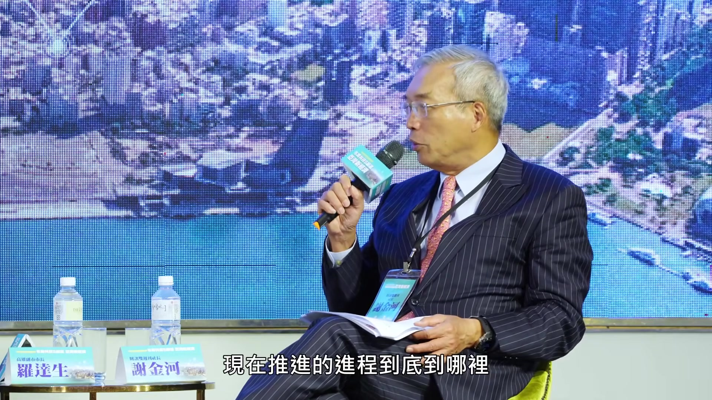

**逐字稿片段：** 2022 23年左右 雅灣2.0市政府正式啟動 那時候我們中華電信就在雅灣建置了 當時應該是全臺也是最大規模的一個5G專網 這個場域涵蓋從高阮高雄軟體研區 高雄展覽館旅運中心 還有高雄流行音樂中心

**話題推測：** 柯總經理提及亞灣2.0計畫啟動時間，可能出現相關計畫時程圖。

---

## 00:11:36

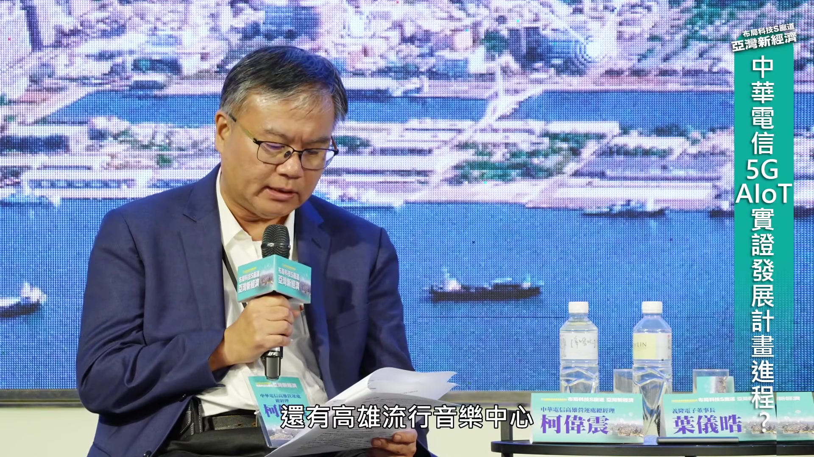

**逐字稿片段：** 以及博爾這等等的區域 中華電信那時候也聚集了人才 我們在雅灣成立了高雄研發中心 與高雄技術中心 我們在雅灣2.0裡面 我們有做在高流 我們有做5G異地公演 那高雄的輕軌 經過雅灣區 我們也做了輕軌列車網碰撞這種AI的應用 那另外還有我們也提了一個跟港務公司合作的智慧海港2.0的計畫 那裡面有無人船等等的應用 中華在亞灣的投入不僅僅是網路的建設 平臺的建設也包含人才跟應用的整合 那我們的目的就是支持市政府的理念 要把高雄亞灣成為一個5G ALT新技術實證場域 那未來能夠邁向商轉的重要基地 從高雄的城市跟區位發展的角度

**話題推測：** 柯總經理列舉5G專網涵蓋區域，可能出現亞灣區地圖標示這些地點。

---

## 00:12:37

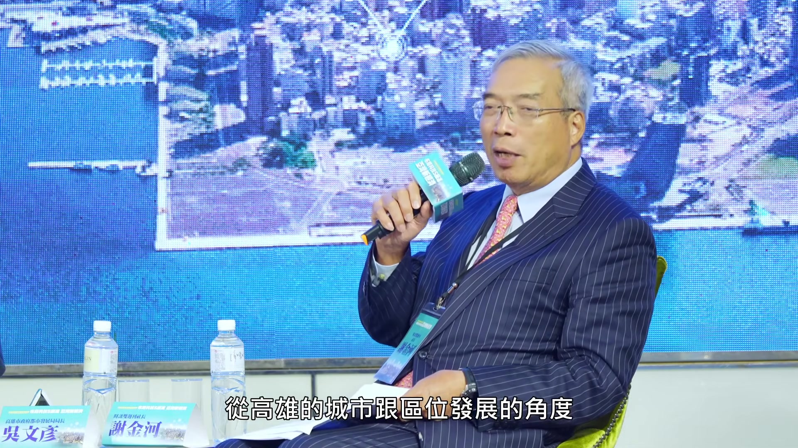

**逐字稿片段：** 我們如何來定位高雄好不好 這個是先讓局長來發揮好不好 這個中友 練友總廠 它轉型之後變成燃脂科學園區

**話題推測：** 主持人邀請局長談高雄區位發展，預期畫面切換到新的講者與主題畫面。

---

## 00:12:49

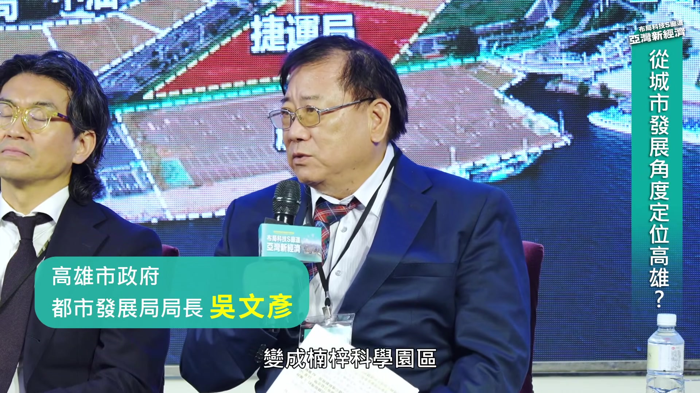

**逐字稿片段：** 周邊四個捷運站 一個臺鐵車站 還有一個高鐵車站 兩個系統交流道 那最近又從中山高又拉了一條快速道路 把它連接到我們的園區南路 接到高鐵站 那整個園區的這種轉型 在高雄是一個很大的一個里程碑 因此也帶動了整個高雄 在TOD的發展 捷運廠站 透過這一些廠站周邊的公有土地來推動 那我們總計也推動了

**話題推測：** 提及園區周邊交通建設數量（四捷運、一鐵、一高鐵、兩交流道），可能出現交通網絡圖。

---

## 00:13:28

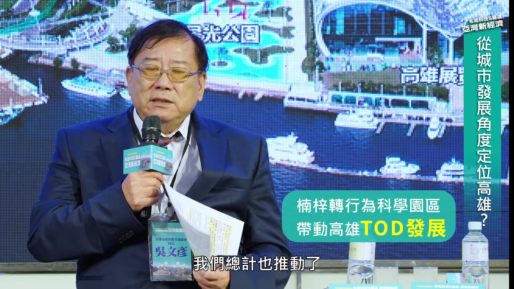

**逐字稿片段：** 將近有2800多億的一個投資 都是TOD的 都是都市更新 公辦都更新的 那總計呢 也有大概有 24個這種廠站的 這種據點的開發 我們要先請趙正義來給高雄 從高雄的這種 城市規劃 高雄的定位 你是一口房地產專家 如何來看高雄的發展

**話題推測：** 提及TOD開發總投資額2800多億，可能出現金額數字圖表。

---

## 00:13:56

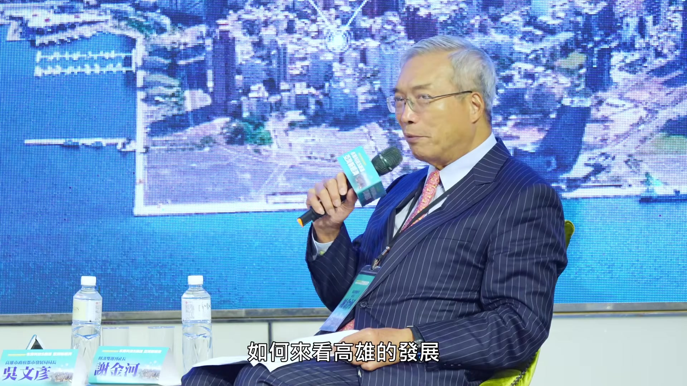

**逐字稿片段：** 我是覺得高雄的發展有三星 所謂三星就是北邊市 是左營的科技之心 它會是一個半導體 相關的這樣的一個 包括相關的產業 剛剛提到這麼多的產業 另外一個就是我們講的亞灣 我覺得它發展的可能的重點 會是金融服務業 亞灣它會是比較像是 高雄的信義計劃區 另外一個就是 高雄車站地區的這樣的一個 它會是一個地區性的一個商業核心 那在整個S狼帶的帶動之下 整個高雄會是發展成一個 非常棒的一個國際的智能的新都 那我自己持平在看 真的高雄的這個整個市府團隊 算是最有效率的 它的一個招商引資的一個成效 也展現了整個市府團隊的一個動能 我覺得這個是非常有機會

**話題推測：** 趙正義提出高雄發展的「三星」概念，可能出現概念圖或地圖標示三個核心區塊。

---

## 00:15:00

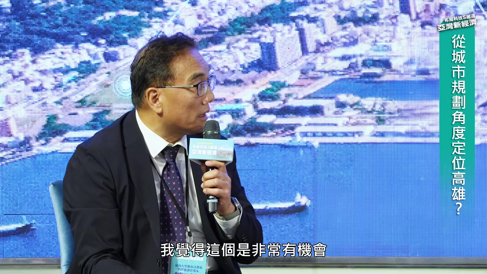

**逐字稿片段：** 要特別請教蘇野部長 這個日本在發展都市更新的路上 我們在高雄有沒有什麼可以舒緩的地方 這個你來給我們上一堂課好不好 就是要打造一個 就這樣子一個 推動一個都市更新的時候 我們都希望就是變成 就是整個開發區域變成一個 具有一些地表性的一個 這樣子一個開發項目 那這樣子的時候呢 就是我們認為是最重要的 不是決定要建什麼樣的建築 而是必須明確提出 能夠體現開發目標的核心理念 一種concept的部分

**話題推測：** 主持人邀請蘇野部長談日本都市更新經驗，預期畫面切換到新的講者與主題畫面。

---

## 00:15:42

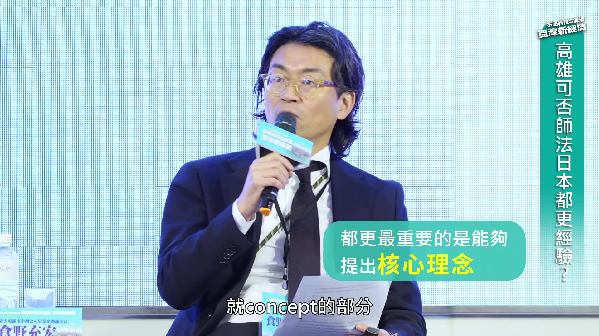

**逐字稿片段：** 六本木租出呢 這是2003年 準攻的一個我們的開發案 以前就是六本木 我們開發案之前呢 就是比較像是一個 街上都是酒吧 或者是住酒屋的 這樣子的一個區域 那我們希望就是 有了這個六本木租出之後 我們就是變成一個整個東西的一個文化的中心點 所以就是我們就是把 就是有提倡了一個這樣子一個文化 就是這樣子一個理念 我們就是如果說 透過一些開發案來改造整個區域 或是我們希望具有一些 普及性的一個這樣子影響力的時候 還是有很明確的打造一個這樣子一個開發理念 我覺得這個是非常非常重要的一個部分

**話題推測：** 蘇野部長提及六本木之丘案例，可能出現六本木之丘開發前後對比圖或照片。

---

## 00:16:29

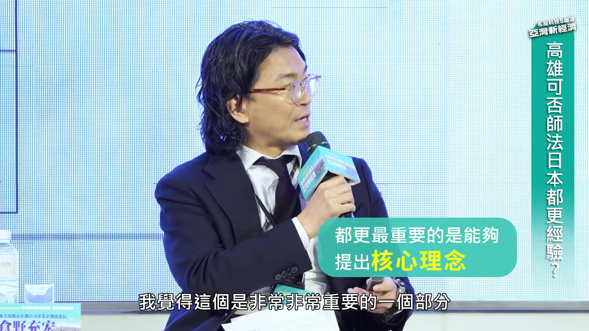

**逐字稿片段：** 最後一個問題要請教劉維廷 從亞洲資產管理中心落腳在高雄 他這次會對高雄帶來什麼樣巨大的改變跟影響 金融的部分我覺得特別重要是資本 資本的投入才能夠帶動這些升級建設 然後產業的落地 我想先從一個國際的一個角度來看 其實剛剛提到這些建設 大部分這些地方建設 中央的這些建設 大部分幾個來源 第一個就是主債 第二個就是變預算 其實現在國際還有更潮流的一個 就是透過PE放 PE放它現在是一個比較新的一個主流 透過一個蝨目的概念 來帶動科技或者是建設的轉型 所以資金的動能其實我覺得是很強 還有一個國際的現象就是 除了機構投資人 逐漸把現在的資金配置 從傳統的這些股跟債 過去的六十 四十 大家知道這個概念

**話題推測：** 主持人邀請劉維廷談亞洲資產管理中心，預期畫面切換到新的講者與主題畫面。

---

## 00:17:32

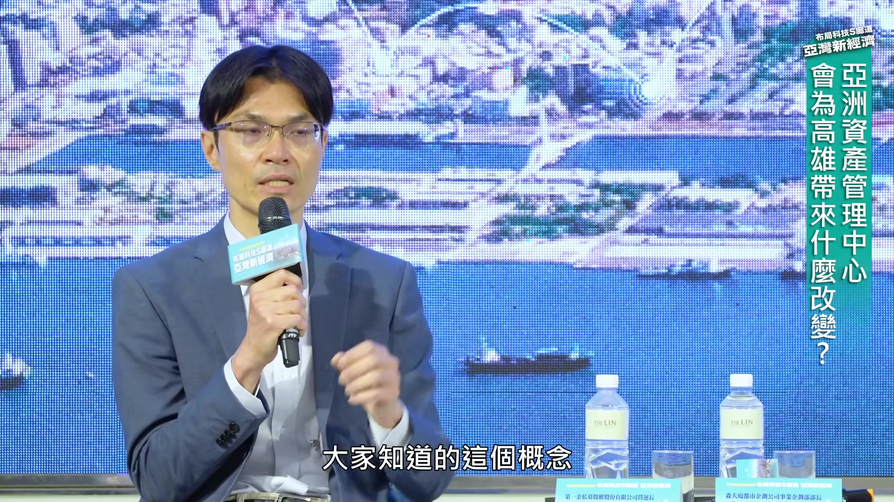

**逐字稿片段：** 已經慢慢轉向所謂的五十 三十 二十 股 債 另外一個就是另類資產 我剛才提到的批放 那這些批放 大部分現在在臺灣這些開賣的 都是一些人員轉型 還有一些基礎建設 那另外一個可能 大家可能也聽到一些Private Credit 那我們想法其實很簡單 其實臺灣真的有不少的一個建設 不少的案源 那我們想要把這些經驗 帶進來臺灣 就是用臺灣人自己的錢 然後來投資我們自己的建設 然後來創造自己的收益

**話題推測：** 劉維廷提及國際資金配置從60/40轉向50/30/20，可能出現資產配置圓餅圖或柱狀圖。

---
