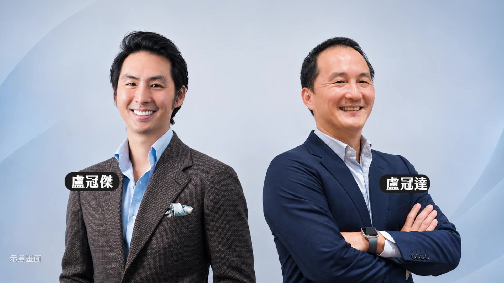
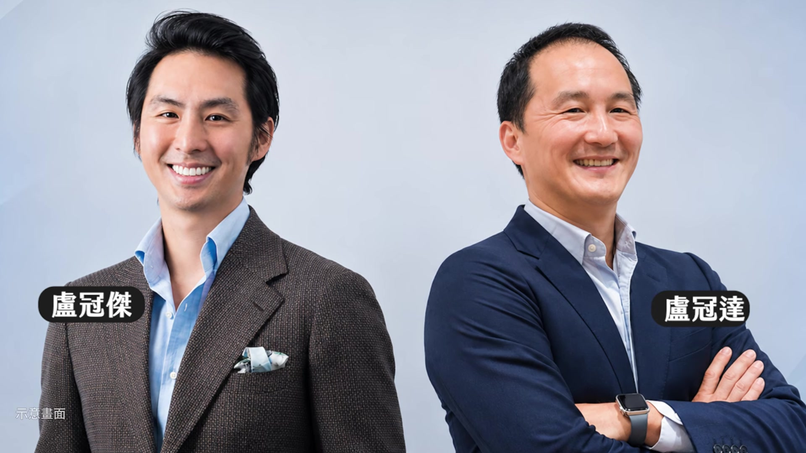
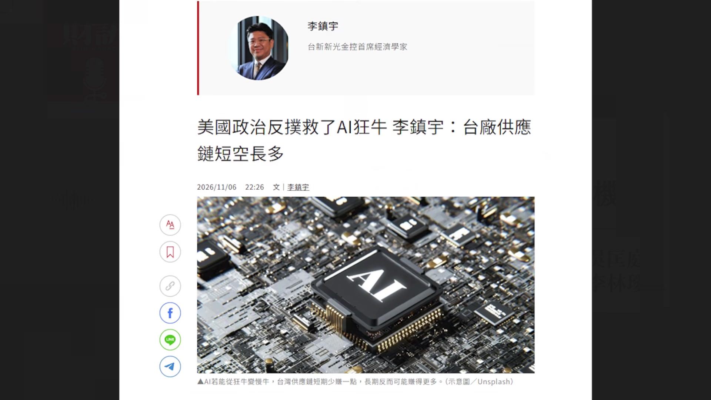
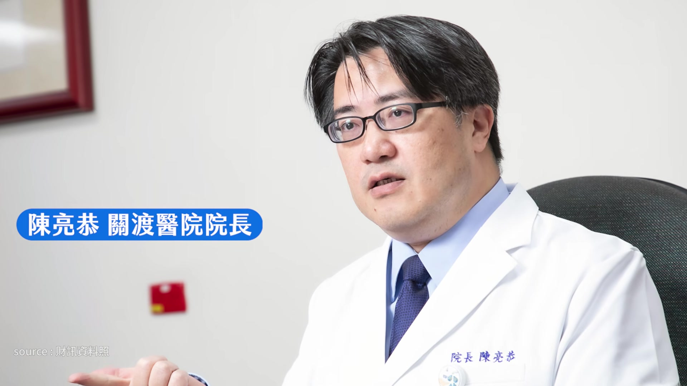
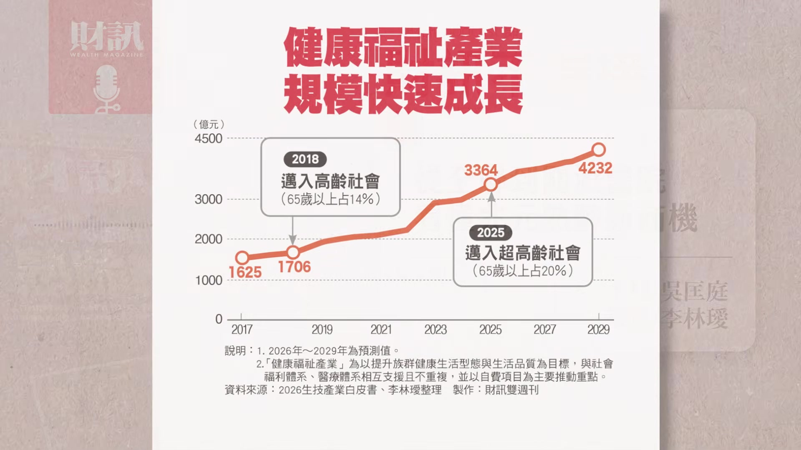
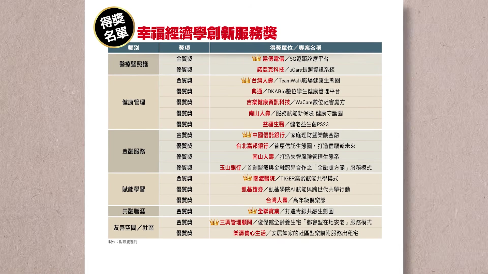
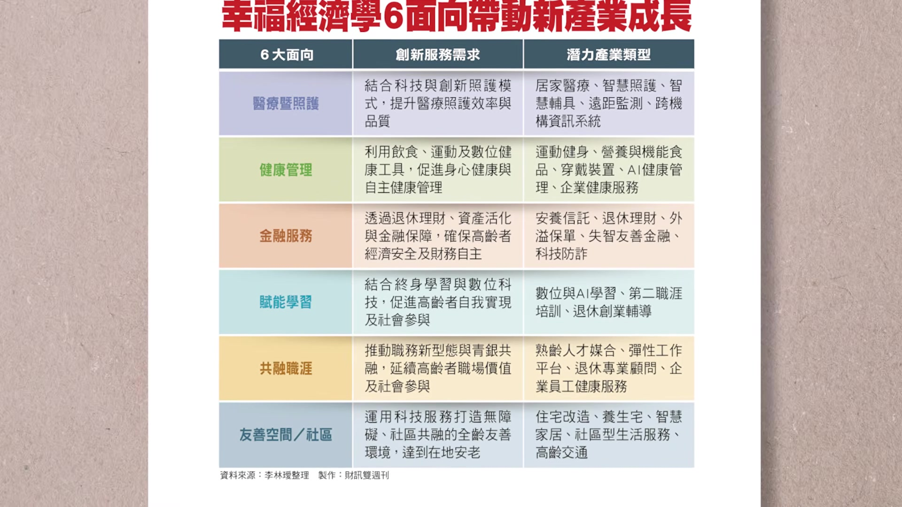
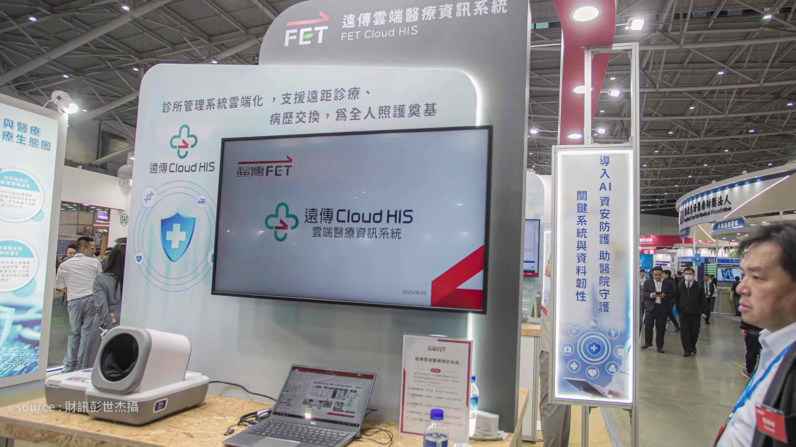
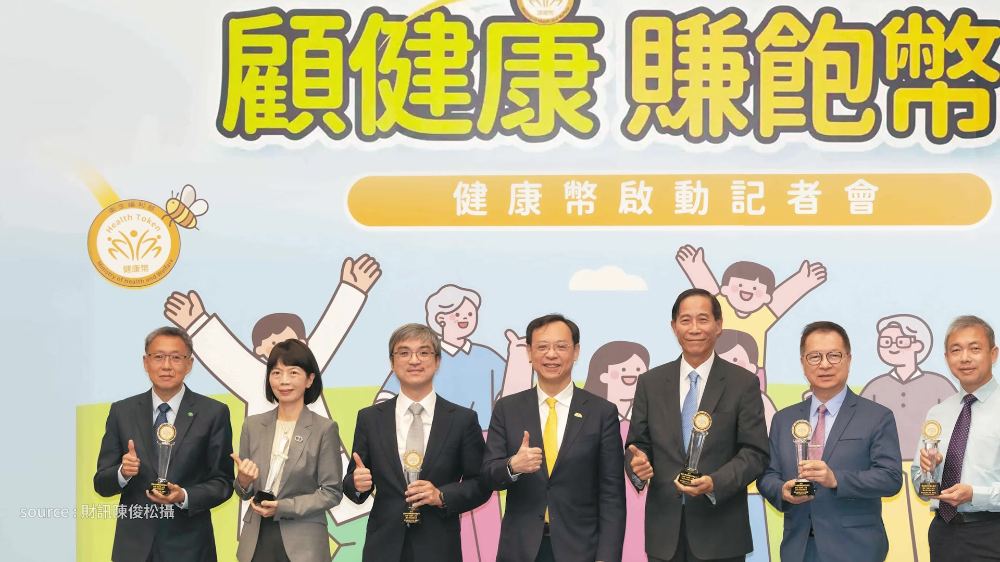

# wealth1974_IFZo0l1cTIc — 關鍵畫面索引

- 來源逐字稿：[wealth1974_IFZo0l1cTIc_GT.srt](wealth1974_IFZo0l1cTIc_GT.srt)
- 影片：https://www.youtube.com/watch?v=IFZo0l1cTIc
- 截圖數：27

## 00:00:03

**逐字稿片段：** 從全聯到關渡醫院 四個案例看懂兆元熟齡的新商機 想知道的聽眾朋友 記得聽到最後 今天的來賓是 財訊的資深記者李林璦 各位聽眾朋友大家好 我是林璦 好 節目開始前也提醒大家 這是財訊的 Podcast 節目 如果是透過 YouTube 平臺 來收聽的聽眾 可以開啟右下角 CC 字幕 那我們就開始吧 首先我們第一段 先來聊一下最近的市場動態 我有看到林璦最近 在我們新一期的雜誌 有寫滿有趣的事情 可以跟聽眾朋友分享一下嗎 台灣半導體有一對很知名的兄弟檔 就是鈺創董事長盧超群 跟他的哥哥盧志遠 那他們分別就是在 IC 設計 跟半導體製造都非常的厲害 大家可能不知道的是 盧超群他兩個兒子 在生技界是非常火紅的創業家 哥哥盧冠達他是非常有名的合成生物學家 連續創辦了好幾家生技公司

**話題推測：** 節目主題：從全聯到關渡醫院，看懂兆元熟齡新商機

---

## 00:01:06

**逐字稿片段：** 最知名的就是 Senti Bio 它就是專門做液體的 CAR-T 細胞療法來治療白血病 那它現在臨床一期已經完成了 目前正在跟 FDA 討論 未來關鍵試驗成功的話 就可以直接上市 盧冠達他有跟我們透露 他現在回台灣要來發展 他們在 2024 年成立了一個叫亞密諾生技的公司 主體雖然是建構在新加坡 但是它目前裡面的人員 都是從中研院裡面延攬過來的人員 它一開始成立的時候是很隱身的 一直到 2025 年的時候

**話題推測：** 提及盧冠達創辦的最知名生技公司：Senti Bio

---

## 00:01:39

**逐字稿片段：** 它才募了 950 萬美元的募資 正式走出隱形模式 預計 2027 年可能會申請首次的人體臨床試驗 它主要是針對代謝疾病 跟癌症精準治療來做研究 透過 AI 的方式來開發新藥 他的弟弟跟他一樣 就是做了很多生技業的投資 跟創辦生技公司

**話題推測：** 提及亞密諾生技於2025年募得950萬美元募資

---

## 00:02:01

**逐字稿片段：** 他跟弟弟有合辦了一個叫 Engine Biosciences 也是做 AI 新藥公司 主要是做基因編輯的技術 其實還滿有趣的 就是哥哥弟弟兩兄弟檔 都在生技布局很廣泛 那接下來還有一個近期滿火熱的事件

**話題推測：** 提及盧冠達與弟弟合辦的AI新藥公司：Engine Biosciences

---

## 00:02:17

**逐字稿片段：** 當然就是美國的期中選舉結束了 民主黨大勝 也因為這個樣子 市場開始擔憂 AI 資料中心的擴建速度 可能會有一些變數 看得比較悲觀的人 就會覺得可能會停擺 或者是放緩腳步 那也有一些人比較樂觀 他是覺得不管哪一個黨獲勝 其實 AI 的進展可能是不會停下腳步的 那我們也會持續觀察

**話題推測：** 新話題：美國期中選舉結果及其對AI產業的影響

---

## 00:02:42

**逐字稿片段：** 針對這件事 川普自己也有發表滿多感想的 他自己是說這是美國歷史上倒退一大步 就是川普很喜歡放話 財訊的專欄作家也有提出一個 我覺得滿好的觀點可以給聽眾參考

**話題推測：** 川普對美國期中選舉的評論

---

## 00:02:56

**逐字稿片段：** 李鎮宇他覺得這件事情 反而是讓 AI 稍微煞一點車 就是讓 AI 長期大牛的趨勢 變成一隻慢牛 他認為長期還是看多的 只是他認為民主黨大勝的這件事 可以有效的避免現在 AI 衝太快 造成泡沫化的現象 所以他覺得是踩了一點煞車 在這個長多的趨勢下 供應鏈應該是短空長多

**話題推測：** 財訊專欄作家李鎮宇對AI趨勢的觀點

---

## 00:03:23

**逐字稿片段：** 另外一個就是美伊戰爭 美伊的衝突在美國期中選舉之後 目前暫時沒有更多的進展 今天錄影時間是 11 月 9 日 川普是說他空襲伊朗的可能性極低 也因為這樣子 讓油價有稍微回穩了

**話題推測：** 新話題：美伊戰爭（衝突）的發展

---

## 00:03:41

**逐字稿片段：** 回到 100 美元左右 那接下來我們就進入今天的主題 台灣已經進入超高齡社會好一段時間了 目前 50 歲以上占總人口 已經占了 4 成左右 我們財訊的專欄作家 同時也是關渡醫院的院長陳亮恭 他有分享現在的社會結構 就是老人的那種型態跟刻板印象當中想的 可能已經不太一樣了 那我們可以從哪些資料來佐證 就是這個社會或者是這個人口結構 不一樣在哪裡

**話題推測：** 油價回穩至100美元左右的數字

---

## 00:04:13

**逐字稿片段：** 我們在 2025 年的時候 就進入了超高齡社會 首先大家可以想像得到 我們全球其實都已經 慢慢的進入超高齡社會了 但是台灣在亞洲國家裡面算是非常的快速

**話題推測：** 台灣將於2025年進入超高齡社會

---

## 00:04:27

**逐字稿片段：** 我們只有花了 7 年的時間 就從高齡社會 65 歲以上人口占 14% 走到超高齡社會 65 歲以上的人口占 20% 我們比其他的日本 韓國是快非常多的 從人口的數量也可以看到我們

**話題推測：** 台灣從高齡社會到超高齡社會僅花7年的速度與日韓比較

---

## 00:04:42

**逐字稿片段：** 2025 年的高齡人口是 465 萬人 到今年 9 月就成長到 480 萬人 然後我們的人均壽命也一直在延長

**話題推測：** 高齡人口數量變化：從2025年的465萬到今年9月的480萬

---

## 00:04:52

**逐字稿片段：** 今年的話是公布我們已經延長到 81.2 歲 整體的熟齡人口是一個非常龐大的族群 那這些龐大的族群它食衣住行娛樂 處處都是一個商機 東方線上的統計它們觀察到 在 65 歲上的這些長輩們 他們大概有 93%都是沒有房貸的 因為他們就已經繳完了 所以他們就有多了一筆錢 可以拿來自由的支出 統計裡面就發現說在退休之後 他的休閒娛樂的支出是提高的 感覺以前老一輩會想要把錢留給下一代用 但現在觀念有點轉變了 花不掉了就會變遺產 在生前盡情的享樂把它花掉 感覺是讓自己過得快樂一點 對 所以他們現在的觀念 大部分也都轉變了 就是有 7 成的長輩會覺得 應該自己來享受一下 然後讓自己的生活更快樂 生活品質更好 而不是說只單純留給子女這樣子 那我們目前這塊的市場規模大概有多大呢 生技白皮書裡面提到健康福祉產業

**話題推測：** 台灣人均壽命延長至81.2歲的數字

---

## 00:05:56

**逐字稿片段：** 2025 年的營業額是 3364 億元 較 2024 年成長是 12% 其實它未來還會持續成長 這個福祉產業包含的內容非常廣泛 一直從穿戴裝置 輔具 然後一直到運動健康管理 甚至復健長照這些 都是囊括在健康福祉產業裡面的 上禮拜剛好辦完財訊首度第一屆的 《幸福經濟學》 它算什麼 論壇嗎 《幸福經濟學》創新服務獎頒獎典禮暨論壇 好 那可以簡單介紹一下 這個獎大概是什麼樣的概念嗎 我們觀察到台灣的熟齡人口逐漸龐大 那處處是商機 它一定是我們未來台灣 經濟成長的一個主要的動能 食衣住行育樂都會是商機之一 因此我們財訊呢 在《幸福經濟學》創新服務獎這邊 我們是觀察到說有很多的產業 它已經開始做跨域結合 不管是電信業者跨遠距醫療 或者是各式各樣的服務 跟健康促進的結合 都是一大塊未來的市場

**話題推測：** 生技白皮書：2025年健康福祉產業營業額3364億元，成長12%

---

## 00:07:03

**逐字稿片段：** 像我們就分六大面向 來觀察這些產業 包含醫療暨照護 健康管理 金融服務 賦能學習 共融職涯跟友善空間 囊括了熟齡市場六大面向的商機 我們今天就從這六大面向 選出來的得獎的得主

**話題推測：** 介紹獎項劃分的六大面向

---

## 00:07:24

**逐字稿片段：** 挑四家來聊一聊 它們到底做了哪些事情 首先第一家 我覺得大家應該都不陌生了

**話題推測：** 開始分享四家獲獎企業案例

---

## 00:07:30

**逐字稿片段：** 它就是全聯 我自己有觀察到 有時候去全聯買東西 不管是在收銀臺的服務人員 或者是在賣場裡面上架補貨的工作人員 他們的年齡層都比我再大一些 全聯真的是滿特別的一個零售業者 它們在所有零售業者裡面已經走得很前面了 它中高齡員工的比率大概有超過 32% 但是它有提到說 它們不是因為說現在超高齡 所以它們才去特別招募超高齡員工 而是說這些員工他進來之後 他們的離職率很低 他們的月均離職率大概低於 1% 左右 所以他們沒有離職 然後跟著企業一起成長 一起慢慢變老 所以它們就開始思考說 那我要怎麼樣讓我的這些員工 能夠更好的在超市裡面為大家服務

**話題推測：** 第一個案例：全聯的熟齡策略

---

## 00:08:21

**逐字稿片段：** 所以它們在 2014 年的時候 就導入了護理團隊 這些護理師他就會定期 到每個超市門市裡面去照顧這些員工 那它們的健檢也很特別 它們的健檢每一年都有不同的主題 今年特別著重心血管 明年可能特別著重甲狀腺等等的 然後來讓這些長輩在工作的期間被照顧到 像是職務再設計的部分 它們也會針對每一個高齡員工 他可能有些膝蓋不舒服 或者是腰痛什麼的 它們就會針對他們的身體狀況 去安排他們適合的工作內容 它們的護理師有透露說 他們剛開始在做這件事的時候還滿困難的 因為這些員工不想給你看到他的健檢報告 覺得是不是看到我哪裡有紅字 就會把我資遣掉 但其實他們就是透過慢慢的關心 來讓他們（員工 ）知道 其實我是真的關心你的身體健康 而不是說因為你的身體狀況就要讓你離職

**話題推測：** 全聯自2014年導入護理團隊照顧員工

---

## 00:09:19

**逐字稿片段：** 所以它們現在都已經有發展出一個健康關懷系統 全部都會上傳到雲端 但是資料是只有護理師跟員工本人看得到而已 這也是慢慢築起他們的信任 所以員工也都會主動找護理師討論身體狀況 甚至有一些長輩他是因為員工健檢 才發現他罹患肺癌等等之類的 所以他們都還滿慶幸說他們在全聯上班的 感覺真的滿早的 2014 年所以大概是 11-12 年前 就已經開始做這件事了 那他們護理師是內部正職的嗎 還是 是內部正職的 瞭解 那真的是滿早就開始做這件事情 那它們的職務再設計裡面 有沒有具體的一些案例可以分享呢 像是它們會有護腰 護腕 或者是省力手套來讓這些員工 他們在搬貨或是理貨的時候 可以更輕鬆一點 那當然它們其實僱用 這些中高齡員工對全聯有好處 就是它有提到說 有些年輕的員工他不好意思叫賣 或者是不好意思推銷 這些長輩他就會主動示範 甚至他跟客人建立起很良好的關係 相對也會帶動它們的銷售額 感覺就是一家公司好好把員工給照顧好後 那員工就會留下來跟著公司一起成長 另外一家我覺得大家也不陌生 那就是遠傳 它們有什麼樣具體的案例可以分享嗎 遠傳電信其實也滿早就投入了

**話題推測：** 全聯發展出雲端健康關懷系統

---

## 00:10:46

**逐字稿片段：** 大家可能最熟悉是 2025 年的時候 花蓮光復鄉有發生洪災 遠傳它因為做了遠距醫療做了很久 它們在那時候到現場跟花蓮慈濟醫院 在前面架了一個 5G 視訊門診醫療站 因為那時候交通不便 所以有很多長輩他有慢性病 他需要領藥 他需要看診 需要有醫療諮詢的時候 他沒有辦法到市中心的醫院 或者是到其他地方去看診 有這個醫療站 他就可以透過遠距醫療的方式 上傳一些血壓 血氧 心跳 然後去跟醫院裡面的醫生做連線 幫助這些患者拿藥 它其實一開始的時候是因為偏鄉的長輩 像是（ 居住在）很山裡面的長輩 他們有時候要看醫生的時候 大部分都要花 1-2 個小時才有可能到市中心 對他們來說是滿辛苦的 所以現在它發展的遠距醫療

**話題推測：** 遠傳電信於2025年花蓮洪災架設5G視訊門診醫療站

---

## 00:11:38

**逐字稿片段：** 它們可能會有一個像救護車一樣的醫療車 或是在衛生所裡面會有醫療站 那它就會直接透過串接的方式 可能會有超音波 然後會有眼底鏡 直接用數位的方式 讓它連線到市中心的醫學中心 跟醫院醫師做看診諮詢 那這樣的話它就可以不用讓這些長輩翻山越嶺 感覺也是滿好的一項服務 可以讓離島或偏鄉 或者是住在深山的一些長輩 能夠有更好的醫療照護 好 那談到醫療照護 難免大家就會想到 另外一個就是保險公司 但我們印象中 保險公司通常都是 保戶他生病了 住院了 它可能會有理賠 不過接下來我們要談這個案例就反過來

**話題推測：** 遠傳發展醫療車和衛生所醫療站

---

## 00:12:26

**逐字稿片段：** 就是台灣人壽 它做了什麼樣的事情 台灣人壽它們是開發了一個叫

**話題推測：** 第三個案例：台灣人壽的熟齡策略

---

## 00:12:32

**逐字稿片段：** 「TeamWalk 職場健康管理」的 App 那它裡面可以蒐集運動的步數 或者是心跳的心率跟睡眠這些數據 然後來做健康管理 那它的健康管理 不是說只是統計這些數據而已 它可能還進一步把它做一些遊戲化 然後有一些個人挑戰跟團隊競賽 甚至探險地圖 再更進一步的是你做完這些挑戰之後 他可以獲得一些點數 或者是它們所謂的龍珠 這些都可以去兌換它的商品優惠 它一開始的時候是導入到企業裡面 有點像是企業的 ESG 然後幫助企業去照顧員工的健康 那跟團險綁在一起 如果你達到一些條件的話 它就有可能可以把這些節省的理賠成本 回饋給企業跟員工 降低次年的團險的保費 它不僅是在 TeamWalk 裡面 有跟 ESG 做結合 它未來也會響應

**話題推測：** 台灣人壽開發「TeamWalk 職場健康管理」App

---

## 00:13:28

**逐字稿片段：** 衛福部有推出健康幣的政策 這個健康幣裡面 你拿到的打疫苗 健檢這些數據紀錄 就可以再串回到龍珠的獎勵活動 它這些獎勵活動也可以做保費的折抵 未來它進一步想要

**話題推測：** 台灣人壽響應衛福部「健康幣」政策

---

## 00:13:43

**逐字稿片段：** 推動一個叫做「健康樂活管家」 這個健康樂活管家它是覺得說 台灣如果邁向超高齡社會的話 要怎麼樣讓這些長輩維持在健康的狀態 而不要走向失能或者是需要長照 那前面 TeamWalk 是讓他運動 增加他的步數 透過步數來促進他的健康 當你需要長照或者是需要居家照護 醫療諮詢服務的時候 它們就會有健康樂活管家 來跟這些保戶做溝通 這些健康管家 他不是只是來賣保險的 他是專門來為你做這些健康有關的服務 保險公司就不是只是 在你要理賠的時候才出現 它甚至往前延伸到健康促進 或者是往後延伸到你已經生病了 失能了 然後已經理賠完了 後面你需要一些長照資源服務的時候 它也可以做協助 聽說它下一步好像要做養生村 對 其實它們已經做了 財訊其實也有報導過 它們做了中信校園養生村 它們買了一塊校地 把這個宿舍改建成房間 然後讓長輩進去入住之外 他還可以在裡面有上課學習的活動 活到老 學到老 對 它們是明年第一季就可以開放入住了 最近看到滿多新聞就是養生村 真的滿搶手的 一戶難求 好 除了企業以外 連醫院也跟著在做轉型 那我們有看到就是像 關渡醫院的院長陳亮恭 他就有說地區醫院的功能 可能要再多增加一點 帶領社區走向健康的長壽 那它們有做哪些事情呢 醫院 大家傳統以為就是覺得去看病 或者是開刀手術 但其實台灣對於醫院是有分級制度的 其實「急重難罕」的病症 才需要到醫學中心裡面去做照護 那地區醫院存在的意義呢 我覺得就是愈來愈會轉向 是社群的一個健康領頭羊 關渡醫院很特別的是 過去大家去診間看醫生的時候 醫生會跟你說要記得多運動 多喝水 多休息 每次都這一套 每次都是一樣的話 但是你回去真的會做嗎 應該是不一定會做 它現在就是走出醫院了 它把這些口號帶到民眾實際社區裡面 包含運動或者是終身學習 健康促進 智慧科技跟社會參與 然後去統整來上了一個 12 週的課程 裡面就是有很多包含人文藝術 或者是肌力運動跟營養教育 都是由醫生 護理師 營養師跟物理治療師這些專業人員 來依照長輩的狀況去規畫的課程 它們做了 3 年多

**話題推測：** 台灣人壽推動「健康樂活管家」服務

---

## 00:16:25

**逐字稿片段：** 到現在做了 3000 場課程 滿意度高達 98% 陳亮恭院長就說 來參加的長輩都非常開心 然後每一次開課都是搶破頭 超級難搶的 很多長輩直接會說我參加這個課之後 我跑醫院的頻率就真的降低了 因為他可能就是在裡面做運動 然後社會參與有人互動之後心情比較好 有外出跟朋友溝通這些 都會讓他們的身體心靈比較健康 更特別是它們除了教學課程之外

**話題推測：** 關渡醫院三年來舉辦3000場課程

---

## 00:16:57

**逐字稿片段：** 它們也把在地關渡地區的這些長輩們 都變成志工講師 其實長輩在退休之後 有很多長輩是有很多生活經驗跟職場經驗 他是可以傳承給下一代的 那他們也很樂意傳承 但是可能缺乏一些空間跟舞臺 所以關渡醫院除了推出課程讓長輩參與之外 它也訓練這些長輩 來跟新的其他的長輩來做分享 傳承他的經驗這樣子 可能我們以前覺得這些 比較熟齡的商機 離我們有點距離 比較遠 但透過這些案例的分享 我們可以看到不管是零售業 電信業 保險業甚至到醫院 就是熟齡商機已經滲透到各個領域了 就在我們生活的周遭 好 那今天感謝林璦的分享 聽完今天的節目 你覺得你在退休後 會想要把錢花在哪些服務上面呢 歡迎大家留言分享你們的想法 如果還想瞭解更多內容 歡迎點擊資訊欄中的文章連結 或是購買財訊第 776 期的雜誌 跟我們一起追蹤政經趨勢 掌握投資脈動 《財訊不漏接》 我們下次見 bye bye

**話題推測：** 關渡醫院培養長輩成為志工講師

---
