# wealth1974_KTvBPlTrd60 — 關鍵畫面索引

- 來源逐字稿：[wealth1974_KTvBPlTrd60_GT.srt](wealth1974_KTvBPlTrd60_GT.srt)
- 影片：https://www.youtube.com/watch?v=KTvBPlTrd60
- 截圖數：32

## 00:00:00

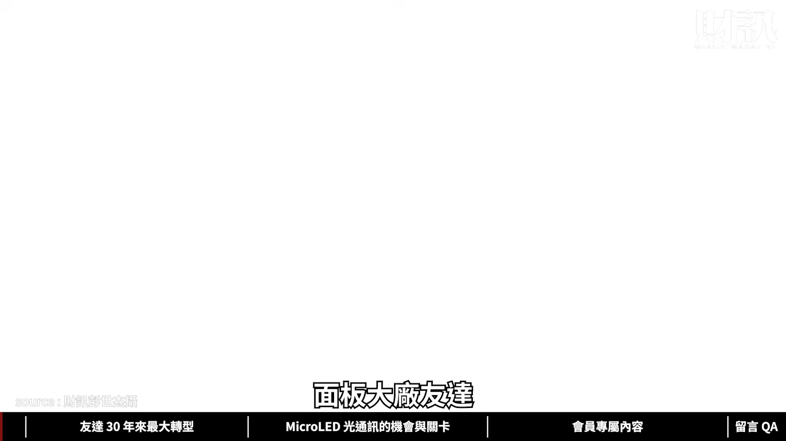

**逐字稿片段：** 面板大廠友達 剛剛才歡慶了 30 週年的活動

**話題推測：** 介紹面板大廠友達，預期顯示公司名稱或Logo。

---

## 00:00:04

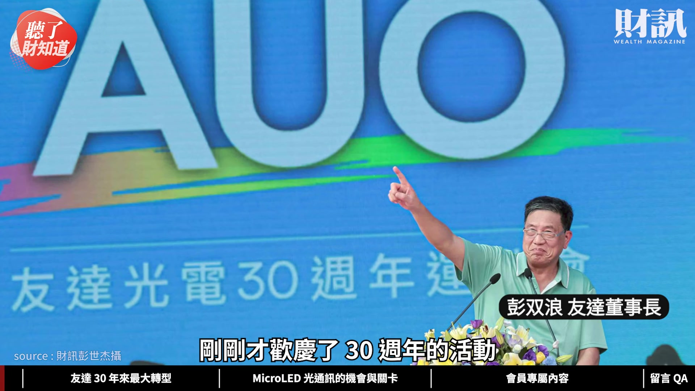

**逐字稿片段：** 總經理卻突然裸辭 同一年這家面板大廠

**話題推測：** 報導總經理突然裸辭的人事新聞。

---

## 00:00:08

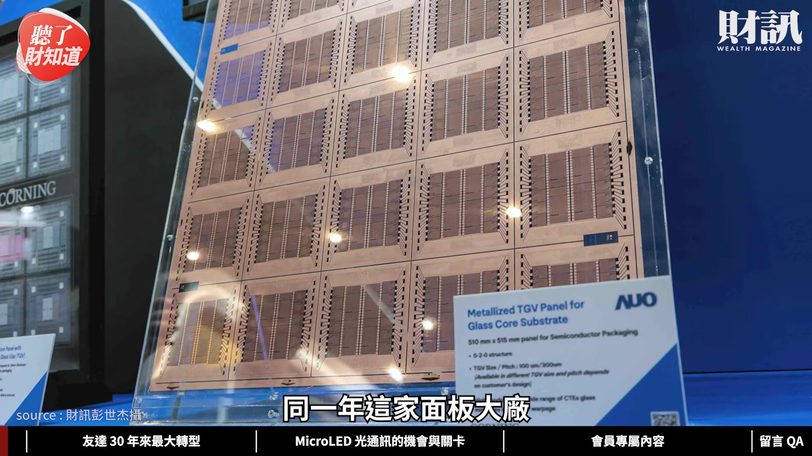

**逐字稿片段：** 又把醞釀多年的光通訊 跟玻璃基板技術端上檯面 喊出不再只是面板廠 這到底是怎麼回事呢

**話題推測：** 提及友達新推的光通訊與玻璃基板技術，預期顯示相關技術圖或產品圖。

---

## 00:00:16

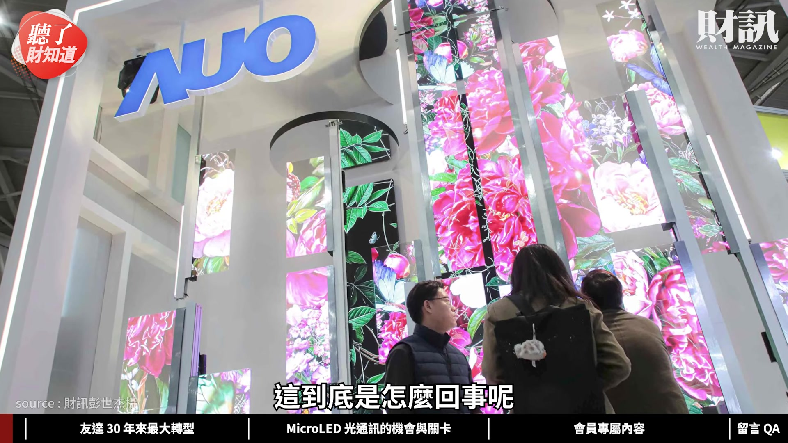

**逐字稿片段：** 今天這一集我們就來聊聊 友達 30 年來最大的轉型 我們再來分享

**話題推測：** 介紹本集主題，友達的重大轉型。

---

## 00:00:21

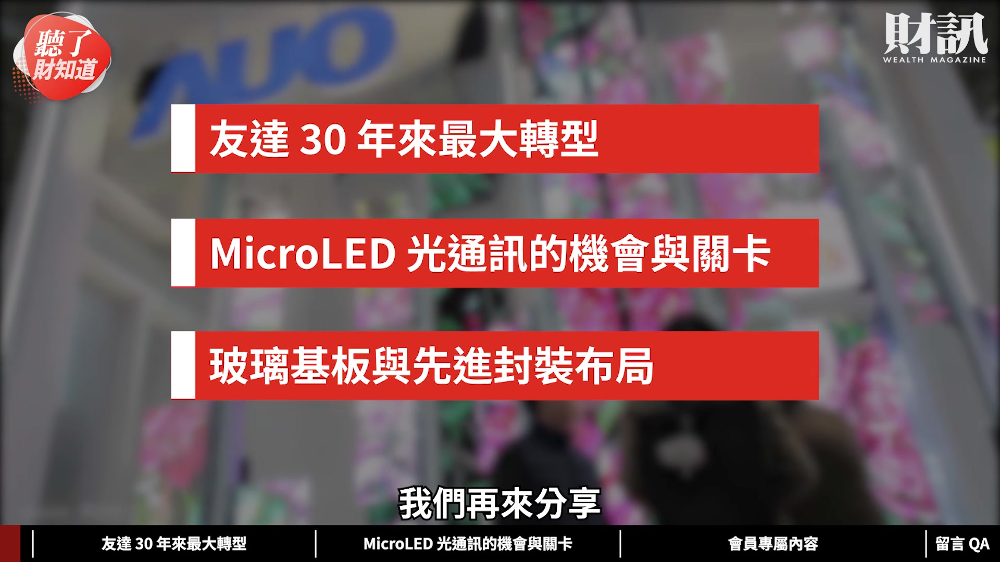

**逐字稿片段：** Micro LED 光通訊的機會跟關卡 最後談一談

**話題推測：** 介紹本集討論的第二個重點：Micro LED 光通訊。

---

## 00:00:25

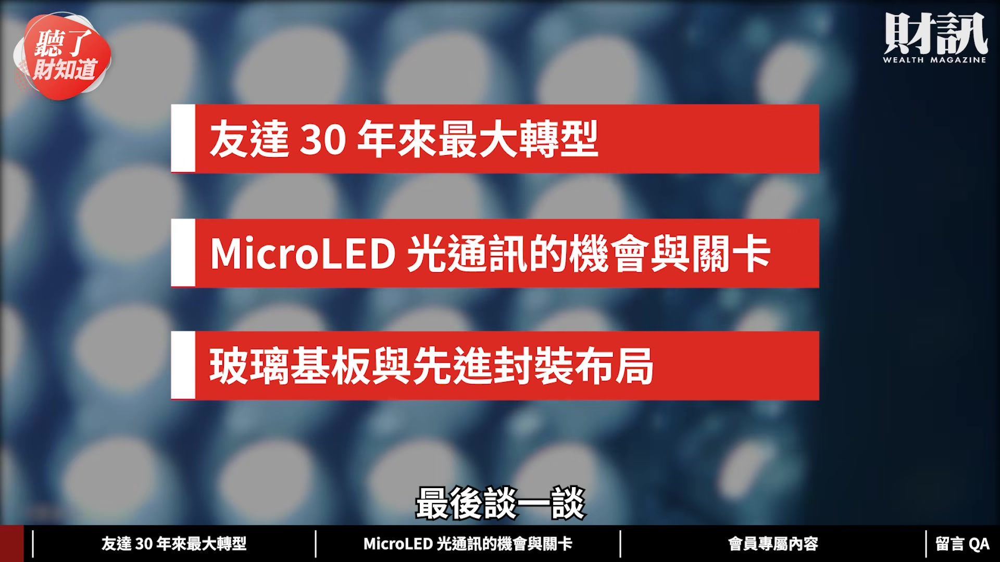

**逐字稿片段：** 玻璃基板跟先進封裝 這個集團的布局 我是主持人陳碧珠

**話題推測：** 介紹本集討論的第三個重點：玻璃基板與先進封裝。

---

## 00:00:30

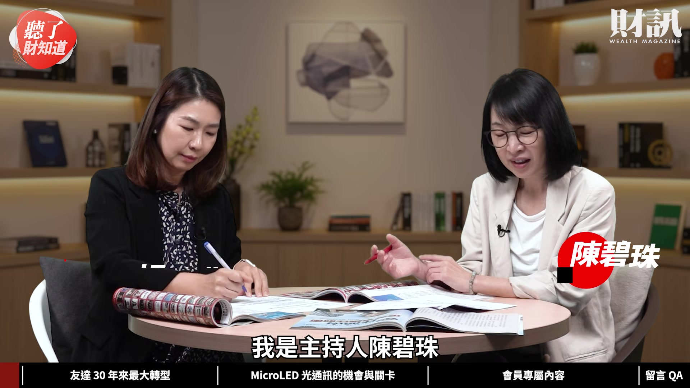

**逐字稿片段：** 今天的來賓 是財訊的撰述委員楊喻斐 各位觀眾大家好 我是喻斐 喻斐 我們知道您剛剛才參加完 友達的 30 週年運動會 那天的狀況怎麼樣 靈魂人物當然還是 友達董事長彭双浪 不過這一天因為是 30 週年的慶祝活動 他也把所有集團 他說小老虎們一起都帶來了 所以友達旗下的轉投資 還有關係企業都共襄盛舉 所以那天的人數規模還不少 大概有將近 9 千多人 快 1 萬人參加 所以友達成立 30 年來 不管是市值也好 或者是它的員工人數 營收 其實還是台灣科技業 很重要的一個指標 也很有趣的就是說 今年 7 月底 友達也宣布了 一個滿重要的人事案 就是總經理柯富仁他辭任 感覺也是一個滿震撼的事情 對照這次的熱鬧場面 對 因為我們知道 柯富仁回鍋友達 擔任總經理大概已經 有 7 年的時間了 所以他早期也擔任過友達 這次他是裸辭 就是不掛任何的職位了 就是完全離開整個友達集團

**話題推測：** 介紹本集來賓：楊喻斐。

---

## 00:01:41

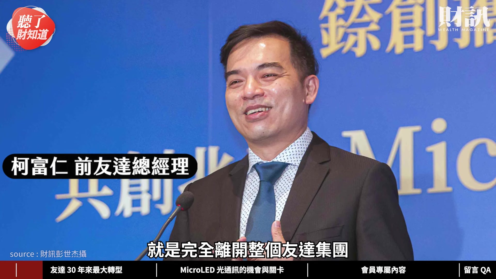

**逐字稿片段：** 然後由財務背景出身的張博儀 接任總經理 這也是第一次友達集團 由財務背景的人被拔擢上來 所以我們也可以看到 友達想要在這個時間點 尋求一些不一樣的轉型 跟一些策略的布局

**話題推測：** 提及新任總經理張博儀及其財務背景。

---

## 00:02:00

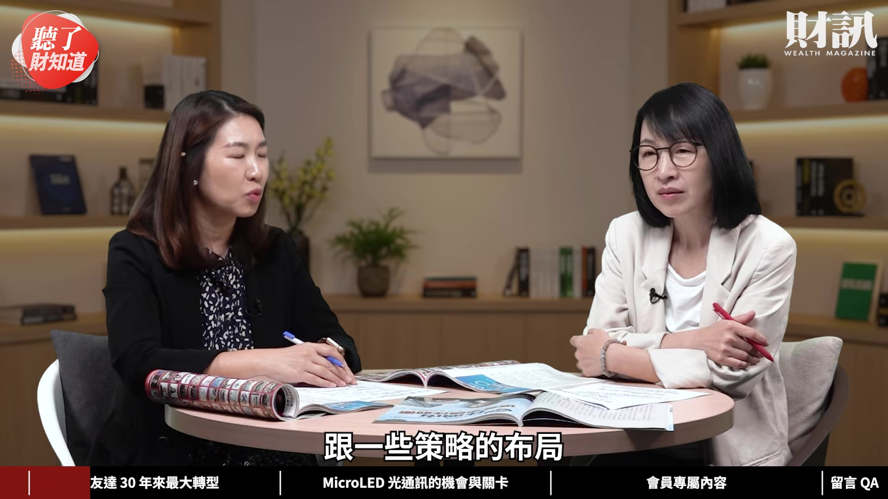

**逐字稿片段：** 確實 因為像群創現在的洪進揚 也是財務背景出身 就感覺出來說面板要翻身 或者是要轉一個不一樣的格局 有財務能力的來掌舵 好像是一個滿重要的意義這樣子 這 30 年來 其實友達過去也一直 都有在說它要轉型 這一次的組織再造有什麼不一樣 記得之前彭双浪最常講的 是所謂的 Go Premium Go vertical 就是它要往高附加價值 或是垂直整合的場域去做布局 那這次他是很明確的 做一些組織調整跟再造 他非常明確的講

**話題推測：** 提及群創總經理洪進揚，預期顯示群創公司名稱或洪進揚照片。

---

## 00:02:37

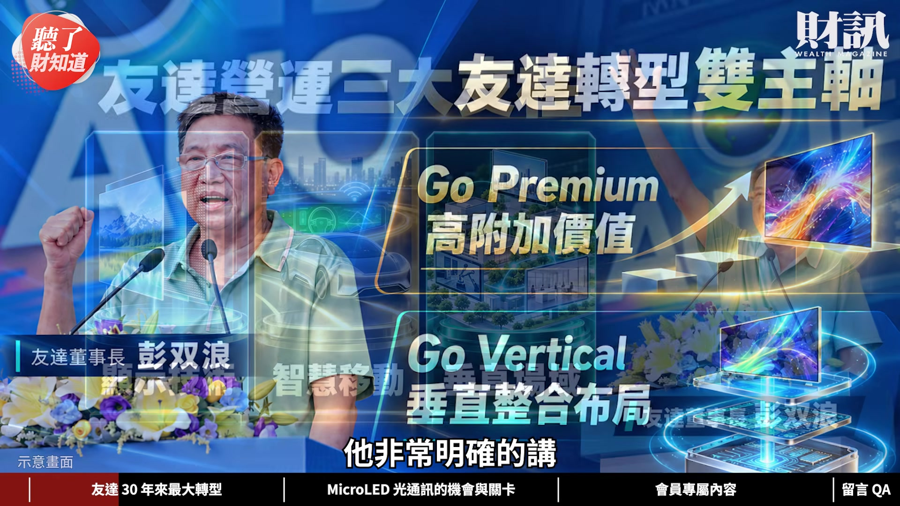

**逐字稿片段：** 他有營運的三大支柱 分別就是顯示技術 然後智慧移動 還有垂直場域 大家如果去上友達的官網 它有最新的一個組織架構圖

**話題推測：** 介紹友達營運的三大支柱：顯示技術、智慧移動、垂直場域。

---

## 00:02:50

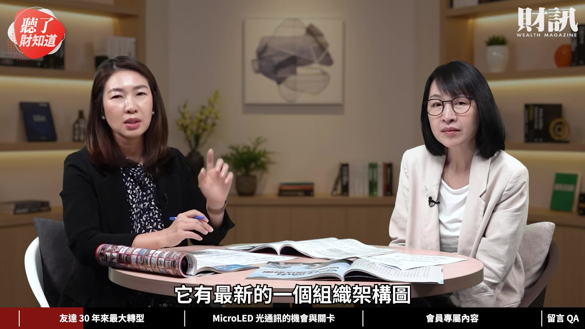

**逐字稿片段：** 除了這個三大支柱 它旁邊還會有平行的一個單位 叫做創新研究院 今年剛成立的 由它們技術長廖唯倫擔任院長 看它的組織架構圖可以發現

**話題推測：** 介紹友達新成立的創新研究院。

---

## 00:03:03

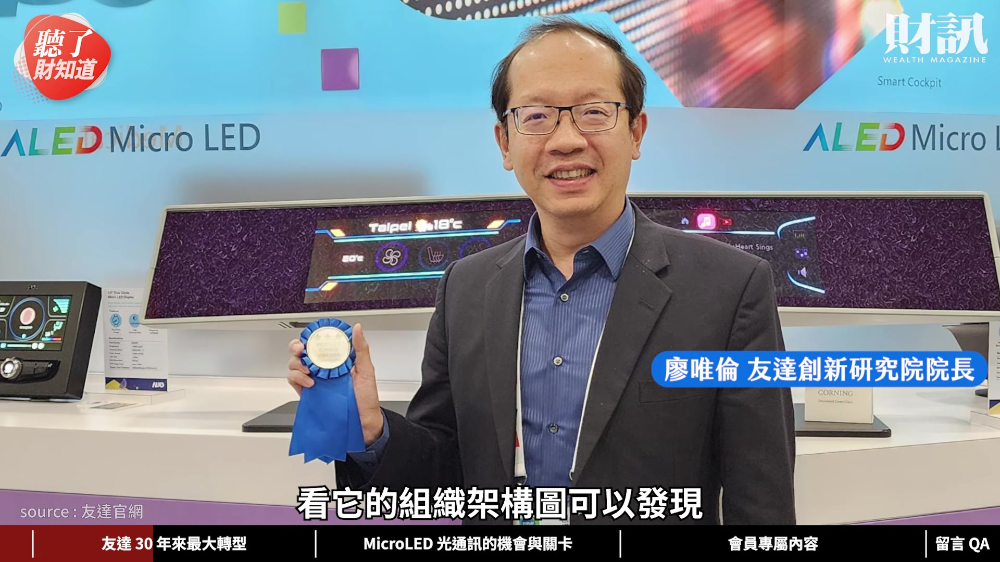

**逐字稿片段：** 像顯示技術我們就可以知道 發光相關的像富采 錼創 還有像材料 達興 還有達運 那本身友達就是做面板起家的 所以這是它最核心的業務

**話題推測：** 詳細說明顯示技術支柱下的子公司或相關公司，如富采、錼創、達興、達運。

---

## 00:03:17

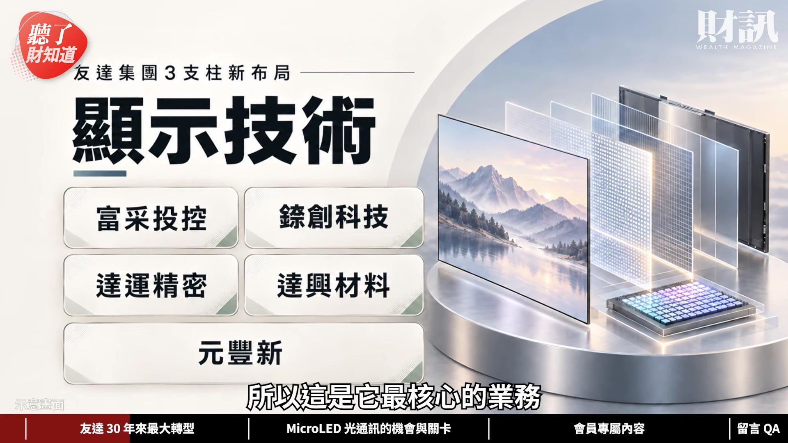

**逐字稿片段：** 那移動智慧我們知道 它之前併購了德國的 BHTC 改名字叫做友達智慧移動 還有達擎科技 這個部分就是都會以車用相關為主

**話題推測：** 詳細說明智慧移動支柱下的子公司或相關公司，如BHTC、達擎科技。

---

## 00:03:30

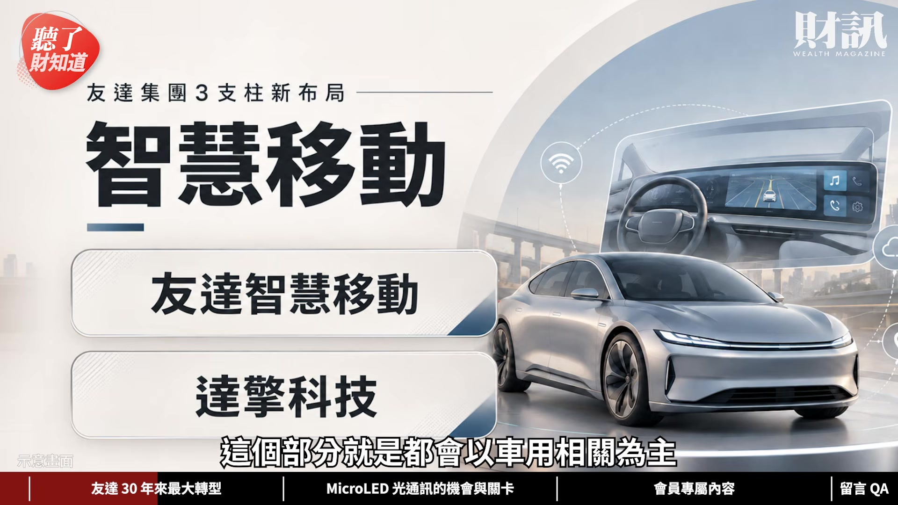

**逐字稿片段：** 再過來就是垂直場域 垂直場域的領域其實很廣泛 因為我們知道面板最近幾年 不管在教育 醫療 自動化 其實都有一些布局 所以我們可以看到它下面很多公司 像宇沛永續 就是它有跟回收 或是自動化相關 友達耘康就跟智慧醫療有關 凌華科技就是它新加入的工業自動化 或工業電腦相關領域

**話題推測：** 詳細說明垂直場域支柱下的子公司或相關公司，如宇沛永續、友達耘康、凌華科技。

---

## 00:03:59

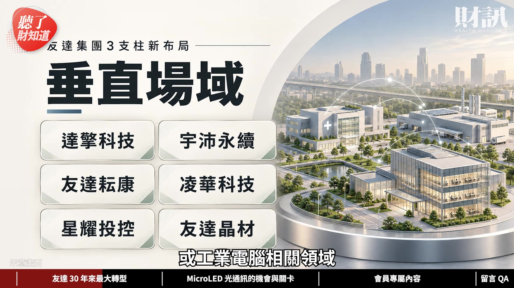

**逐字稿片段：** 再過來是星耀投控 它下面就有兩家公司 一個叫做星耀科技 一個叫達耀 達耀科技其實就是 之前的友達能源更名過來的 為什麼會找到星耀這家公司 因為本來友達也是星耀的大股東 它一直以來在做電廠的管理 就已經滿厲害 它算是台灣太陽能平台管理的 一個主要的玩家 這次它們希望透過 重新組織調整之後 專注鎖定能源管理平台 這樣的方向走 它不再鎖定製造 之前友達有所謂的友達晶材 它是做太陽能長晶 矽晶圓的 它也賣太陽能模組 這裡的生意全部都砍掉 收斂起來這樣子

**話題推測：** 提及星耀投控及其子公司星耀科技、達耀科技（友達能源）。

---

## 00:04:45

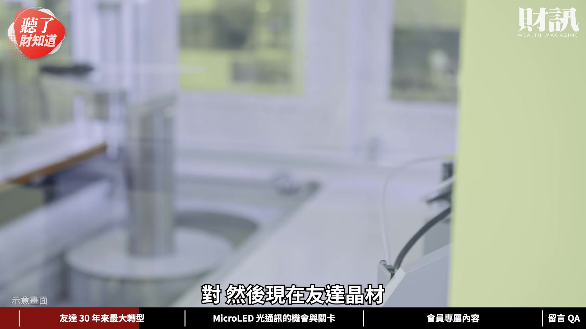

**逐字稿片段：** 對 然後現在友達晶材 就專注做半導體矽晶圓相關 希望可以轉型 但是長晶的磊晶參數 長晶的環境 事實上有很大的不一樣 因為半導體等級的矽晶圓 跟太陽能用的矽晶圓 其實純度差很多 所以轉型也需要時間 不過我們可以看到 一系列的組織調整 表示友達重新聚焦 真正具有潛力的一個場域去做布局 感謝頻道會員一直以來的支持 你們的鼓勵是我們深入報導 持續帶來精采內容最大的動能 歡迎加入頻道會員 或是贊助我們訂閱財訊頻道 和我們一起追蹤政經趨勢 掌握投資脈動 不過妳有提到成立創新研究院 找了廖唯倫擔任院長 感覺好像它也要 再把友達的技術再升級 似乎有一些新的方向鎖定 這個部分很特別 這些都不是很新的技術 其實都是醞釀很久的

**話題推測：** 說明友達晶材轉型專注半導體矽晶圓。

---

## 00:05:47

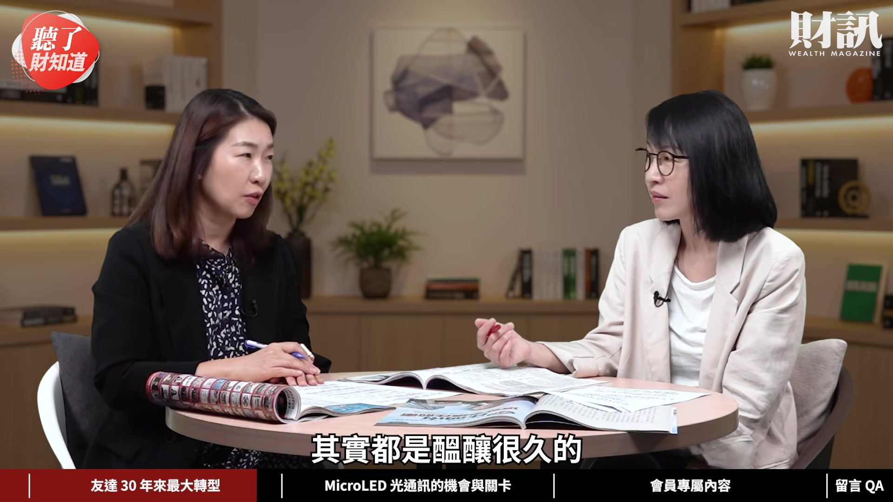

**逐字稿片段：** 譬如說光波導 AR 眼鏡相關的 這也放在這個創新研究院下面

**話題推測：** 介紹創新研究院關注的第一項新技術：光波導AR眼鏡。

---

## 00:05:54

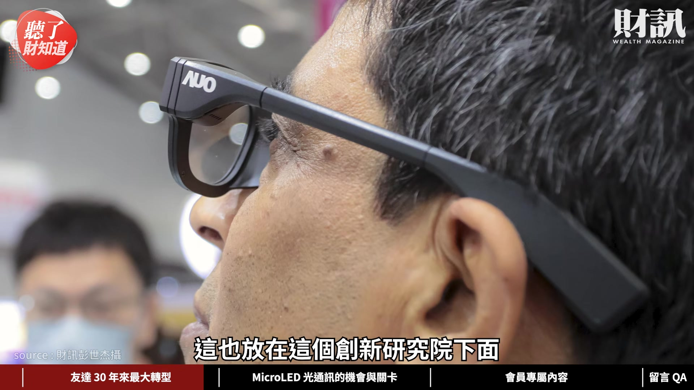

**逐字稿片段：** 還有像微型的 Micro LED 這也是另外一個 很夯的一個技術

**話題推測：** 介紹創新研究院關注的第二項新技術：微型Micro LED。

---

## 00:06:01

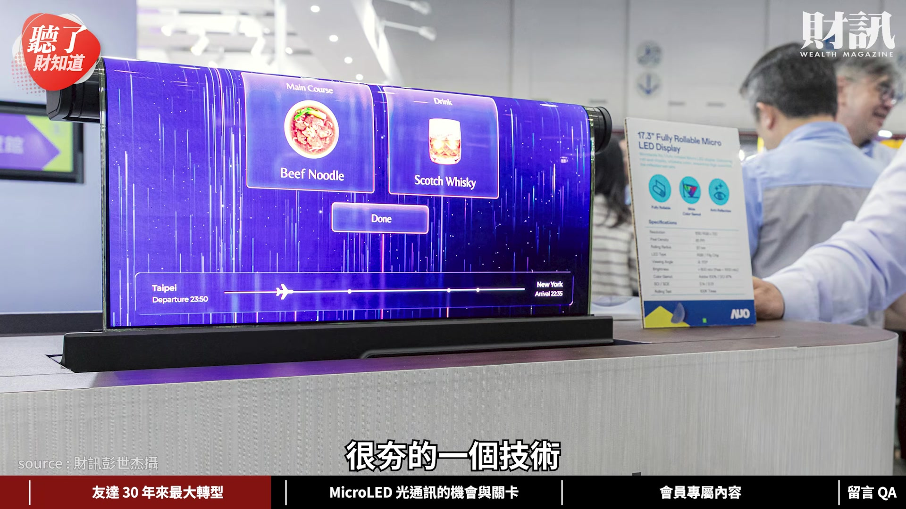

**逐字稿片段：** 然後它還有像低軌衛星的天線

**話題推測：** 介紹創新研究院關注的第三項新技術：低軌衛星天線。

---

## 00:06:04

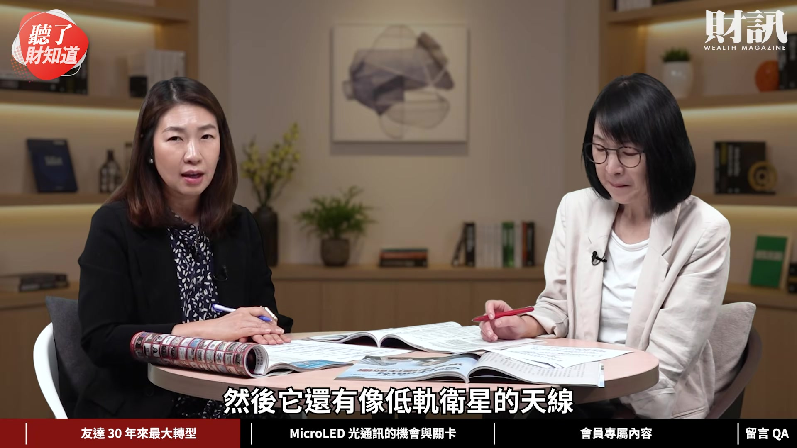

**逐字稿片段：** 當然最關注的就是光通訊 還有先進封裝 也都放在創新研究院下面 等於說它要宣示 我在既有的技術上面 我也要盡量的符合 現在未來可以做的布局 如果沒有搭上 AI 的話題 就是 （ BI ） 悲哀 所以的確就是友達的態度 在今年有很大的不一樣 從 Touch Taiwan 展 一直到半導體展 它都要跟大家說 我有 AI 相關的布局

**話題推測：** 介紹創新研究院關注的第四項新技術：光通訊。

---

## 00:06:34

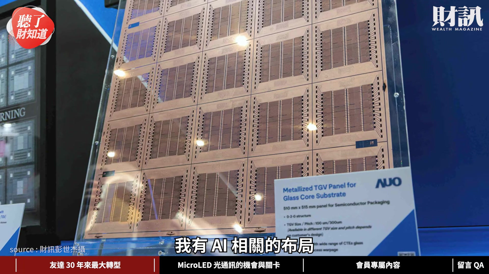

**逐字稿片段：** 今年的 Touch Taiwan 就是友達攜手富采 一起宣示我在光通訊 有一些解方出來 鎖定的就是 Micro LED 發光的技術能力 當然我們知道很多都還在實驗室 它展示的不見得是未來 真正可以大量生產的方案 但是有這樣的解方出來 有被討論 所以市場突然關注 原來友達集團 也有光通訊這個題材 那彭双浪怎麼說 因為 Micro LED 它有它的優勢 他想要攻的市場到底是什麼

**話題推測：** 提及友達在Touch Taiwan展上展出光通訊解決方案。

---

## 00:07:06

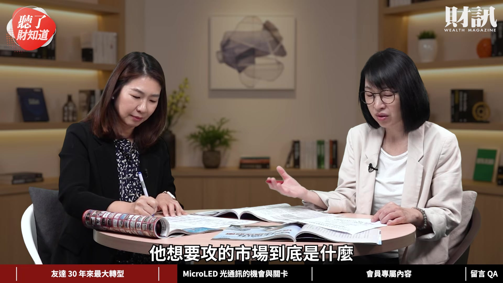

**逐字稿片段：** 光通訊主要是用傳輸的距離去做定義 當然每一家的定義不一樣 所以有所謂的 Scale Up 就是在機櫃內部的 然後 Scale Out 就是機櫃互聯的 甚至是到每個資料中心的互聯 這些都叫 Scale Out 然後還有所謂的 Across Across 就是可能更不一樣的 跨機台或跨資料中心的傳輸 那現在還有叫做 Scale In 的東西 Scale In 就是更在晶片裡面的東西 所以就是根據不同的距離 它有不一樣的定位跟定義 因為銅已經有物理極限 大家拚命的在不同的傳輸距離 找光的解方 那 Micro LED 是這樣來的嗎

**話題推測：** 解釋光通訊的定義，分為Scale Up、Scale Out、Across、Scale In等不同傳輸距離。

---

## 00:07:51

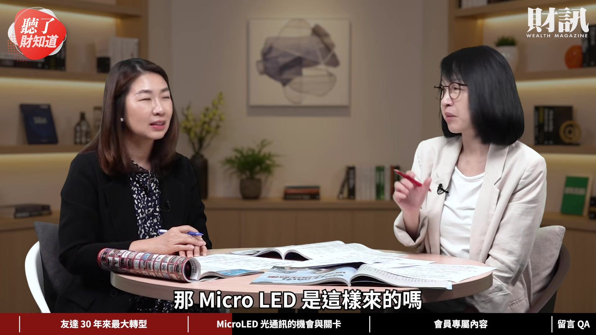

**逐字稿片段：** Micro LED 呢 它的優勢就是在極短的距離裡面 它的傳輸的效果是很不錯的 銅已經到了一個極限 或者是電氣方面 到了一些物理極限 所以它的頻寬 沒有辦法再放更大 然後再過來就是能耗的問題 能耗的問題也是大家關注的 為了解決這兩個瓶頸 Micro LED 的這個技術 才被討論出來 不過這個其實也不是個新技術 之前微軟在 2021 年的時候 就有探討過 Micro LED 做光通訊的這樣一個技術 2021 年微軟其實也有 找上友達投入這樣的技術 不過那時候友達 在開發 Micro LED 的時候 是專注顯示的應用 它那時候壓寶的就是蘋果的 Apple Watch 那時候蘋果 Apple Watch 大家說 Micro LED 顯示超亮的 對 所以那時候大家覺得 哇 它一旦導入不得了了 而且量又大 對 因為蘋果一旦導入 表示這個技術可行 而且它是未來 會被大量商用化的一個方向 結果沒想到蘋果就說歹勢（抱歉）

**話題推測：** 解釋Micro LED在極短距離傳輸的優勢。

---

## 00:09:01

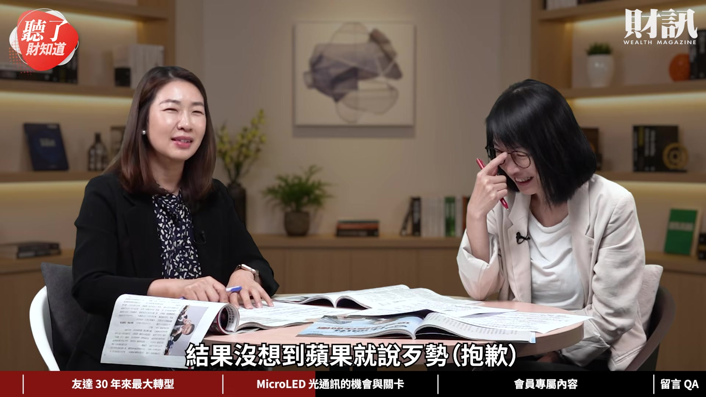

**逐字稿片段：** 我不要用 Micro LED 後來是用 OLED 是不是 對 它用 OLED 那當然也讓友達 就是開始調整 我覺得也是一個契機 讓它重新真正 好好再爬梳它的資源 然後去做一些調整 不過這樣子也可以反映出 就是友達其實有這個技術能量 但是就是看它的定向 怎麼去做配合這樣子 彭双浪在做這件事情的時候 其實他也找他的子公司 現在的 Micro LED 雖然也還沒有成為主流 可是它似乎在這個生態系 已經打造出來了 我們可以看到友達集團 它有轉投資像富采 錼創 它也有用富采做為一個母體 然後下面有投資 像環宇 亮訊 鼎元 這些也都是整個光通訊的生態系統之一 譬如說像鼎元 它有 PD 它有接收 像亮訊跟環宇 也都有不一樣的角色 有做 IC 設計的 也都是環繞在 Micro LED 這一塊的一些技術 本來友達就是一個面板廠 所以它當然跟玻璃 像康寧也是非常的緊密 所以它跟康寧也是有一些合作 它在兜它的生態系也非常的積極 看得出來 就是有資源裡面的整合 剛好最近大立光執行長 在法說的時候 也針對 Micro LED 作了他的一個看法 他認為沒那麼快 結果沒想到 把友達的法說會變成法會 我不曉得說這個東西 對於本身友達在執行面當中 妳怎麼看這件事情 Micro LED 它厲害的地方 就是它巨量 它的通道數會變得比較多 但它的缺點就是慢 這是一直以來 比較讓人家詬病的 雖然它的能耗比銅線來講 表現得更優異 所以我們就會回到 那你要怎麼讓它精準 通道數變多的時候

**話題推測：** 提及蘋果放棄Micro LED轉用OLED。

---

## 00:11:01

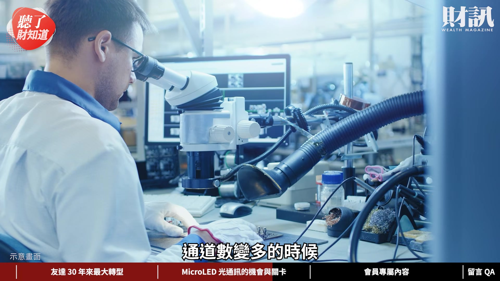

**逐字稿片段：** 耦合難度就變高 8 個 16 個通道 我都可以可控 讓每個通道就是達到 可能 90-100% 的一些傳輸效率 但如果你通道數變多 你怎麼去精準掌控 每個通道正確耦合的狀況 的確難度很高 因為晶片很小 你要在旁邊放一些 發射的相關元件 光引擎 它的陣列的方式 譬如說我們說平行陣列 它要怎麼去把每一個東西 放在晶片的旁邊 其實面積是非常有限的

**話題推測：** 解釋Micro LED通道數變多時耦合難度變高。

---

## 00:11:35

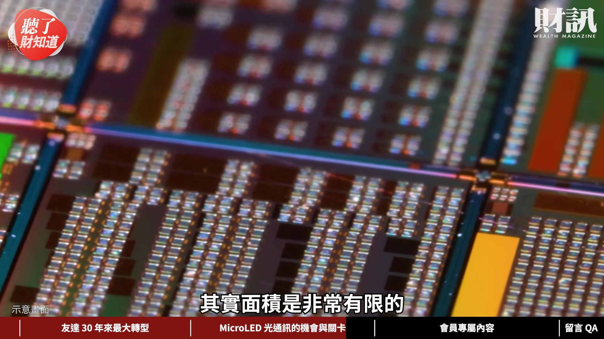

**逐字稿片段：** 所以才會有 GC 跟 EC 就是所謂的平行耦合跟邊端耦合 這兩種不同的技術路線 但是不管怎麼樣 就是現在做的難度 一定是比以前 可能一大顆更難 它是更接近 GPU 甚至是 CPU 旁邊 壞不得 所以當有概念 驗證 測試到 CSP 業者 甚至晶片業者願意採用 這個時間還滿漫長的 我覺得不是短期 1-2 年之內 就可以看到的 看起來喻斐妳已經有點出說 Micro LED 它的可行性 跟它的挑戰 這些東西我們也感覺出來 它不是那麼快

**話題推測：** 提及兩種不同的耦合技術路線：GC（平行耦合）跟EC（邊端耦合）。

---

## 00:12:16

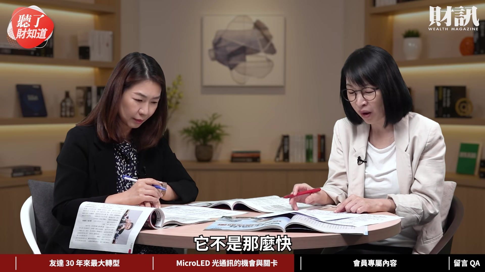

**逐字稿片段：** 好像妳也有採訪了分析師 談這一個觀點 以及彭双浪董事長自己有談到說 怎麼回應大立光它的視角 有關這一點以及友達 到底在先進封裝的進度又是如何 接下來是會員的內容 歡迎大家加入我們的頻道會員 觀看完整的影片 好 接下來我們要回覆財團 在 《聽了財知道》 第 374 集 掌握千億家產 宏泰集團掌門人的自白 掌門人就是林鴻南 第一個問題是財團 liao3949

**話題推測：** 提及分析師觀點及彭双浪董事長對大立光的回應，以及先進封裝的進度。

---

## 00:12:47

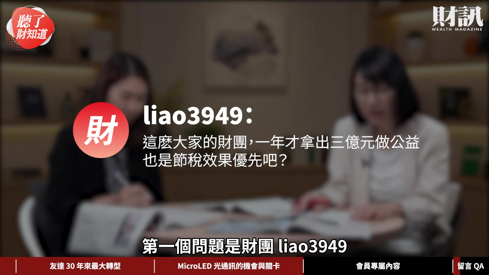

**逐字稿片段：** 他說這麼大家的一個集團 一年才拿出 3 億元做公益 也是節稅的效果優先吧 這個在內文裡面其實也有提到 林鴻南自己也有自白說 確實不是那麼夠 然後他也覺得這個公益的效益 還有待加強 看起來林鴻南 他是承襲他爸爸的心願 那我們就看看 到底他們能不能再做出 更優化的公益成績單

**話題推測：** 回覆第一個問題：宏泰集團做公益的金額與節稅效果。

---

## 00:13:11

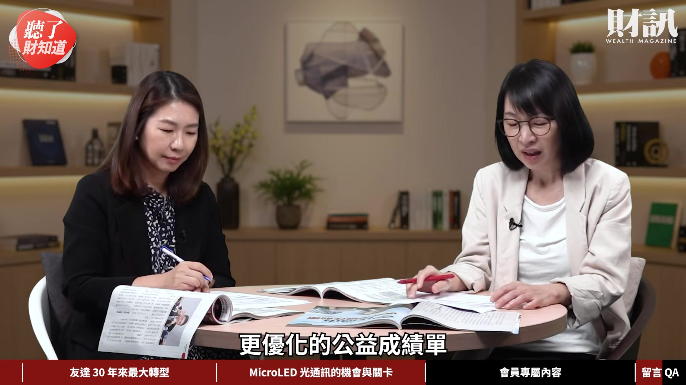

**逐字稿片段：** 好 財團 wadi5 他說 以前在營造業 聽過學長一個說法 宏泰好像是地下版的台灣首富 說整個台北市的房地產 背後的股東都是宏泰 有這麼誇張嗎 這次我們的雜誌有特別報導

**話題推測：** 回覆第二個問題：宏泰集團在房地產市場的影響力。

---

## 00:13:27

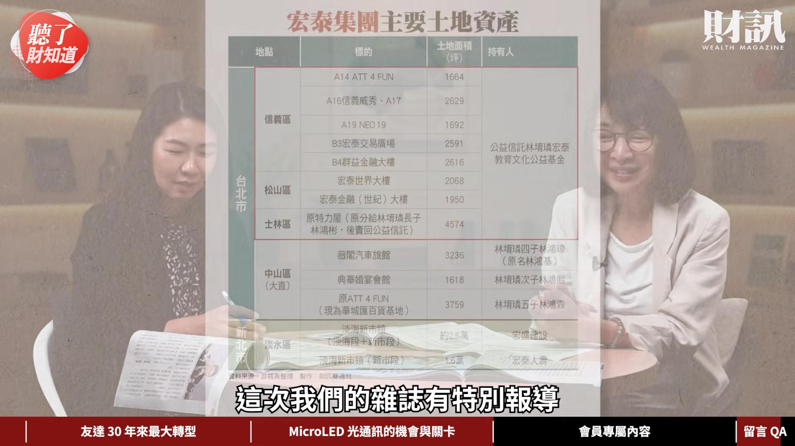

**逐字稿片段：** 它現在 在大台北地區 擁有的土地資產有上千億元

**話題推測：** 提及宏泰集團在大台北地區擁有的土地資產規模（上千億元）。

---

## 00:13:32

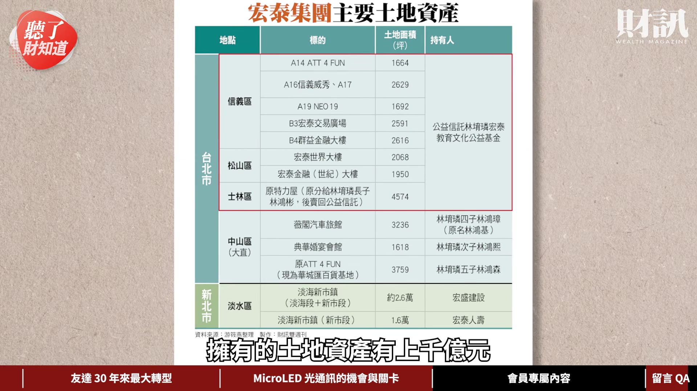

**逐字稿片段：** 而且它的資產規模 都在 300 多億元以上 其實這樣子的量看起來 確實它有它的能耐 看起來在整個營造市場的聲音 宏泰確實是一個 很重要的一家公司 好 如果你還想瞭解更多的內容 歡迎點選資訊欄下的文章連結

**話題推測：** 提及宏泰集團的資產規模（300多億元以上）。

---

## 00:13:49

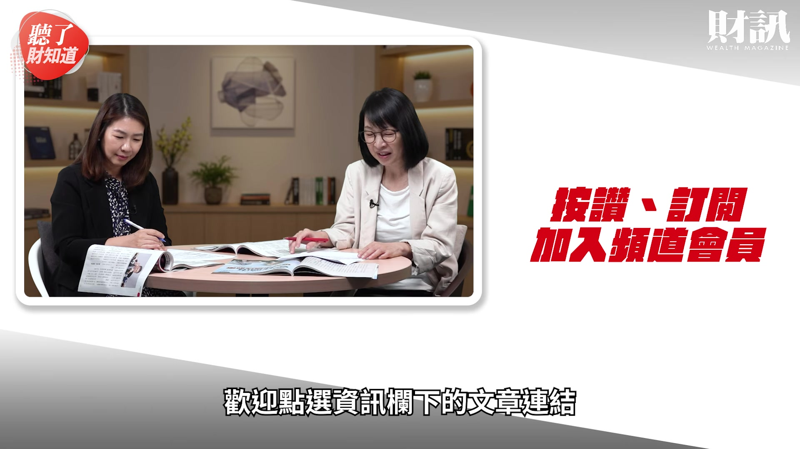

**逐字稿片段：** 或者是購買財訊 775 期雜誌 歡迎跟我們一起追蹤政經趨勢 掌握投資脈動 《聽了財知道》下次見

**話題推測：** 提及財訊775期雜誌作為進一步資訊來源。

---
