# wealth1974_NTGJEaUmNvw — 關鍵畫面索引

- 來源逐字稿：[wealth1974_NTGJEaUmNvw_FIN.srt](wealth1974_NTGJEaUmNvw_FIN.srt)
- 影片：https://www.youtube.com/watch?v=NTGJEaUmNvw
- 截圖數：22

## 00:00:02

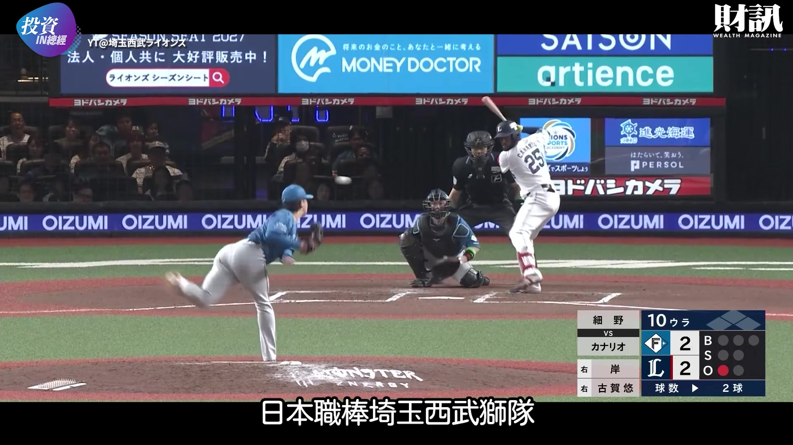

**逐字稿片段：** the 2026 NPB season, the Saitama Seibu Lions finished second in the Pacific League. While they didn't win the title , their overall performance clearly improved. Even more striking is that

**話題推測：** 介紹埼玉西武獅隊在2026年球季的表現與聯盟排名。

---

## 00:00:15

**逐字稿片段：** their home attendance keeps rising, reaching a record high this year and attracting many young fans to the stadium. How exactly did the Lions manage this? In today’s episode, we’ll

**話題推測：** 提及主場觀眾人數屢創新高，可搭配成長趨勢圖。

---

## 00:00:27

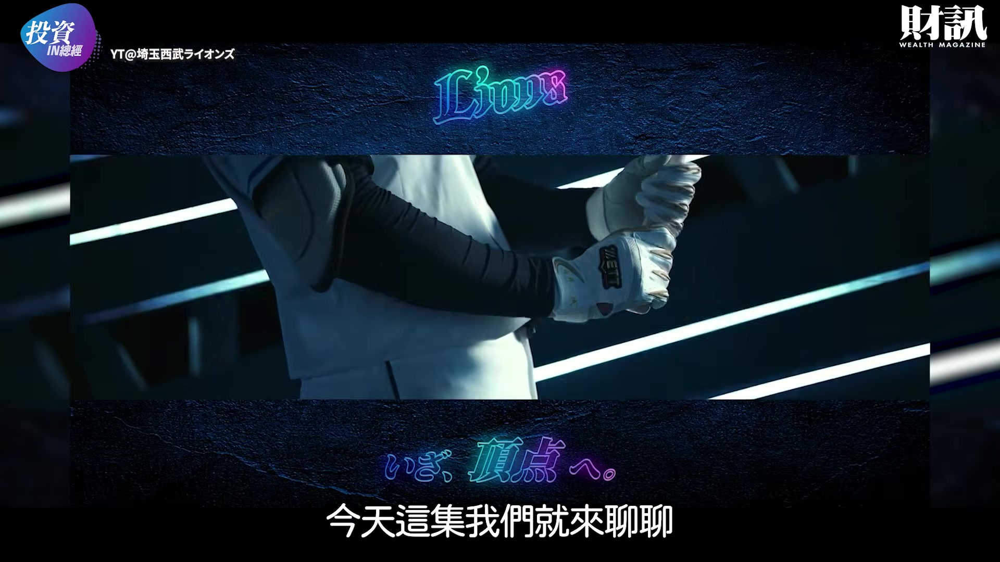

**逐字稿片段：** talk about the Lions '"up-close" management strategy. Let's dive in.

**話題推測：** 介紹本次影片主題：西武獅隊的「超近距離」經營策略。

---

## 00:00:37

**逐字稿片段：** This year, the Lions' 72 home games drew a total of 1.84 million fans, an increase of about 110,000 from the previous year—a 6%growth—surpassing the record they set during their back-to-back league titles in 2018 and 2019. Out of these 72 games, 39 were sold out, and fan club membership grew to 135,000, also hitting a new historical high. However, the Lions aren't just relying on their team's performance to attract

**話題推測：** 展示詳細的2026年主場票房數據，包含總入場人數、成長率、完售場次與會員數。

---

## 00:01:09

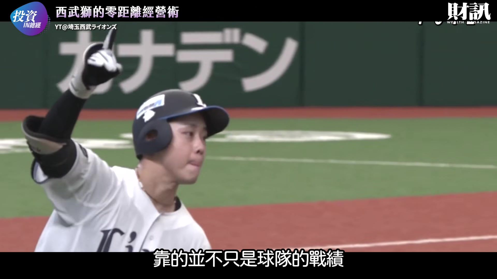

**逐字稿片段：** so many fans. The Lions 'home stadium, Belluna Dome in Tokorozawa, Saitama, actually has quite a few inherent limitations. Although it is called a " dome," it isn't a fully enclosed stadium ; there are gaps between the roof and the stands, and the air conditioning is inadequate, often leading fans to complain that it's too cold in winter and too hot in summer. Plus, it only

**話題推測：** 說明西武獅隊主場Belluna Dome的固有硬體限制與缺點。

---

## 00:01:33

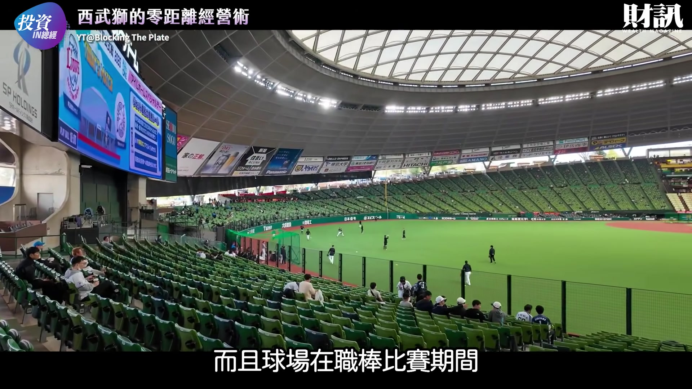

**逐字稿片段：** holds about 28,000 people for professional games, making it the smallest home stadium among the 12 NPB teams. But the Lions didn't just try to fix these flaws; they chose to turn their disadvantages into advantages. Because the stadium is smaller, fans are closer to the players on the field, so even from seats further back, they can still feel the intensity of the action.

**話題推測：** 比較Belluna Dome的容量在NPB球隊中是最小的，可搭配球場容量比較圖。

---

## 00:01:59

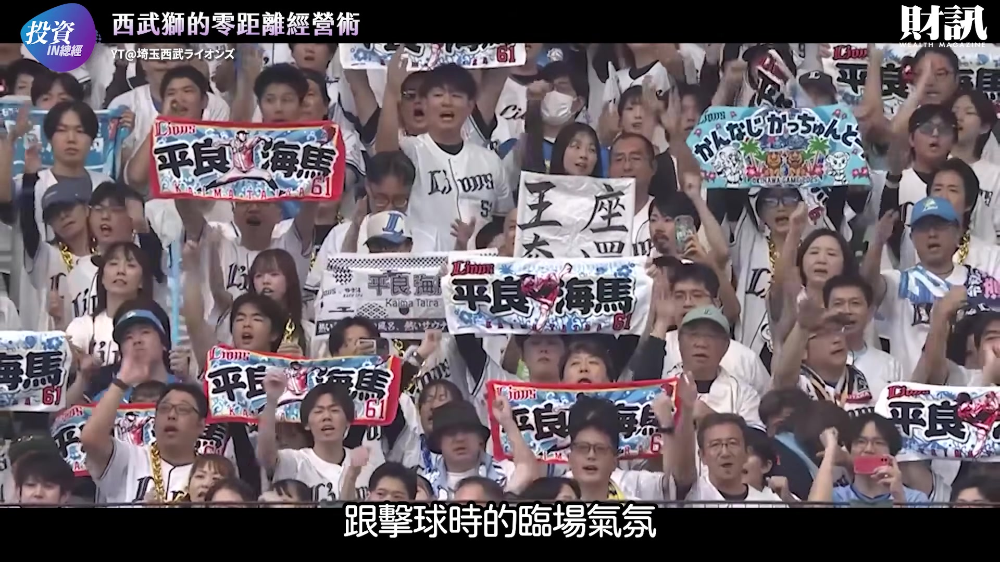

**逐字稿片段：** That’s why the club made "an ultra-close experience" their main marketing theme in 2025, hoping to attract more fans who want to watch the players up close.

**話題推測：** 提及「超近距離體驗」作為2025年的主要行銷主題。

---

## 00:02:09

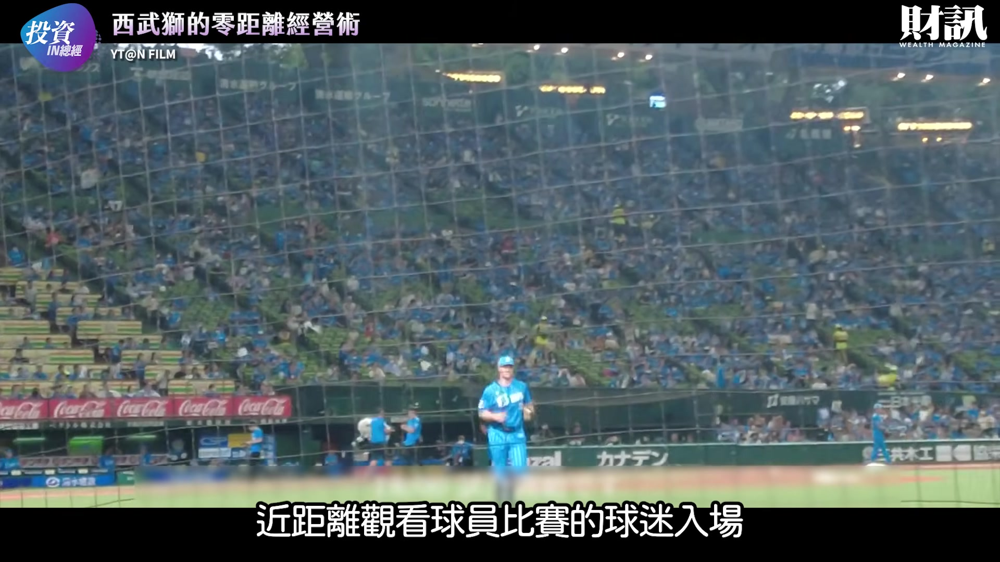

**逐字稿片段：** The most iconic practice is opening the field to fans after almost every game. As long as the game ends before 10 PM, spectators can step onto the artificial turf to run around, lie down and relax, or take photos with friends and family. For the average fan, being able to stand on the same field where the players compete is a rare and special experience in itself. In fact, this activity began

**話題推測：** 介紹第一項核心策略：賽後開放球迷進場體驗球場。

---

## 00:02:38

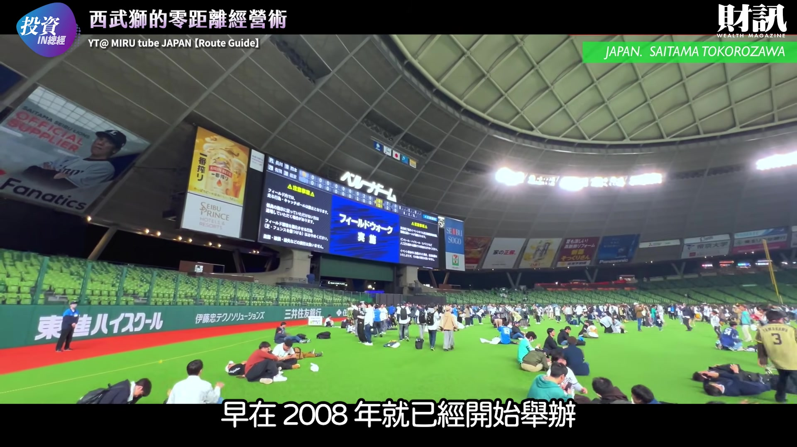

**逐字稿片段：** as early as 2008. At first, it was only held a few times a year, but after replacing the artificial turf in 2016, the club gradually increased the frequency, leading to today where fans can enter the field after nearly every game. While other teams may hold similar events, the Seibu Lions' unique feature is offering this almost every game for free. The ability to sustain this activity is also tied to the stadium's architectural design. This is because the Seibu Lions only need to remove a section of the safety netting in front of the stands along the first and third base lines to guide fans onto the field . After the event, they can open the outfield wall, allowing fans to head directly toward the train station to leave. Kon-J points out that such arrangements allow fans to leave the stadium with fond memories, even when the team they support loses the game.

**話題推測：** 說明賽後進場活動的歷史與頻率演變（2008年開始，2016年更換人工草皮後增加頻率）。

---

## 00:03:32

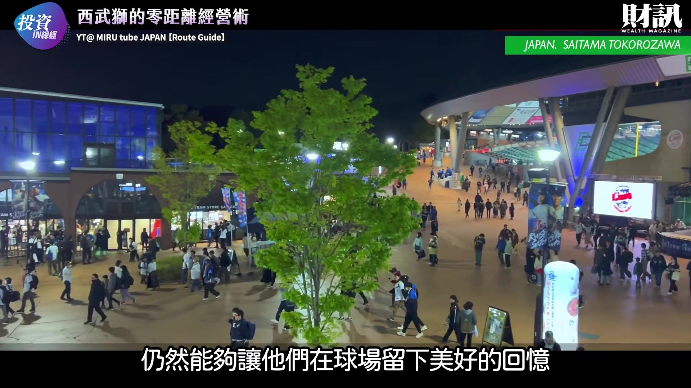

**逐字稿片段：** Beyond enriching the in-stadium experience, the Seibu Lions are also actively finding ways to attract people who do not typically watch baseball. Historically, the core audience for Japanese professional baseball has been middle-aged and older. However, the Seibu Lions hope to break this constraint by actively collaborating with fashion brands, idols, and the entertainment industry, aiming to turn the stadium into a leisure venue that young people are also willing to visit.

**話題推測：** 轉向新話題：如何吸引非傳統棒球觀眾（年輕族群）。

---

## 00:03:57

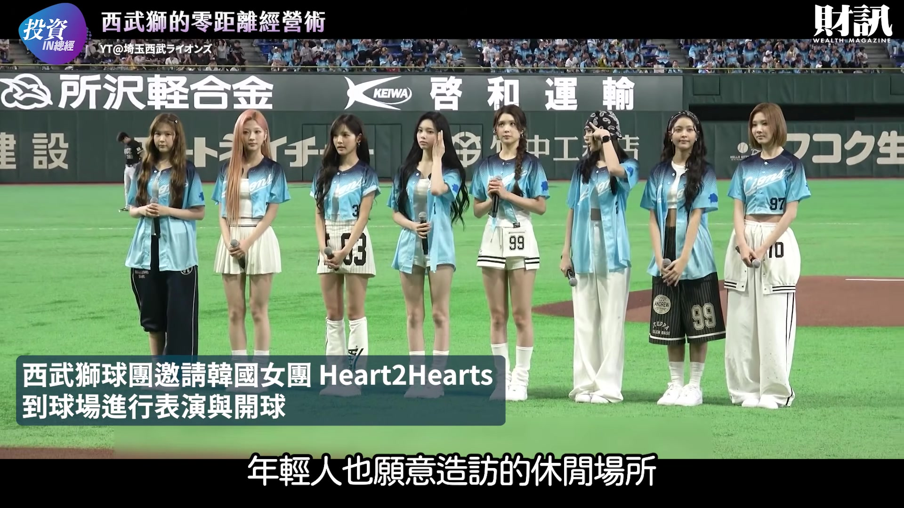

**逐字稿片段：** Starting in 2025, the team launched an official TikTok account. In addition to game highlights, they also post behind-the-scenes content, giving young people a chance to see another side of the players off the field. These changes have gradually shown results; in 2026,

**話題推測：** 介紹與時尚、偶像、娛樂產業合作，並於2025年開設TikTok官方帳號的行銷策略。

---

## 00:04:14

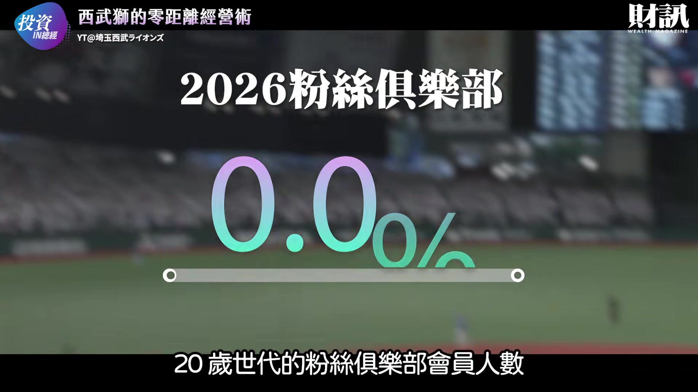

**逐字稿片段：** the number of fan club members in their 20s grew by 26%compared to the previous year, showing that the Lions have successfully attracted a new generation of fans. Beyond marketing and social media management, they have another

**話題推測：** 展示年輕族群（20多歲）球迷會成員數成長26%的數據。

---

## 00:04:29

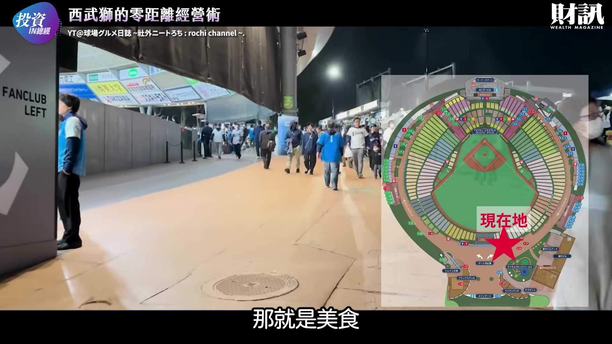

**逐字稿片段：** important weapon: food. Seibu Lions PR Manager Yota Yoshida points out that Belluna Dome houses about 70 food and beverage outlets, offering over 1,000 types of food, making it one of the largest in Japanese professional baseball. From special dishes developed with player input to fresh-baked pizza and even craft beer, there is an endless variety of options. This year, the team added a food street in front of the station, which can accommodate up to 14 food trucks. Even those without a game ticket can come to enjoy the food. In other words, even if people initially visit the stadium just for the food, a date, or an outing with their children, they may have the opportunity to become baseball fans in the future. To keep fans coming back to the stadium, reducing inconveniences during the viewing process is also crucial. Therefore, the Seibu Lions have

**話題推測：** 介紹另一項重要策略：球場內的餐飲服務，提供多達1,000種食物選擇。

---

## 00:05:16

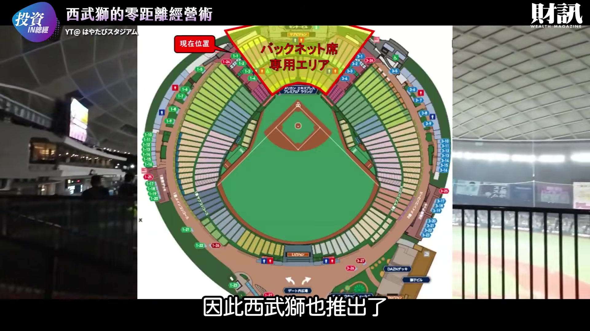

**逐字稿片段：** introduced more flexible ticketing services. For example, if fans cannot attend at the last minute, they can use the official resale service, and there are even options to change ticket types after purchase, lowering concerns for consumers when buying tickets. The

**話題推測：** 轉向新話題：降低觀賽不便，提供彈性票務服務（轉售與換票）。

---

## 00:05:29

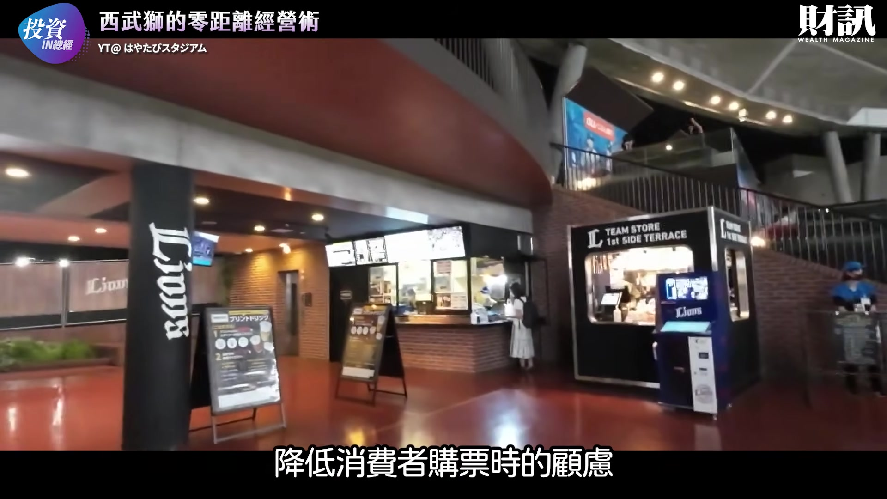

**逐字稿片段：** team's mobile app also provides many convenient features, including live video to check crowd levels inside the dome and real-time status of restroom usage, saving spectators from wasting time in line. On the other hand, the

**話題推測：** 說明球隊行動App提供的便利功能，如查看場內人潮與廁所使用狀況。

---

## 00:05:43

**逐字稿片段：** Seibu Lions are also very adept at leveraging their team history to attract fans. For instance, the club hosted its first-ever "Legends Game" in 2024, a match featuring former players, inviting stars who grew up alongside the fans to compete on the field once again. This reunion-like event saw

**話題推測：** 轉向新話題：利用球隊歷史吸引球迷，例如2024年舉辦的「傳奇賽」。

---

## 00:06:00

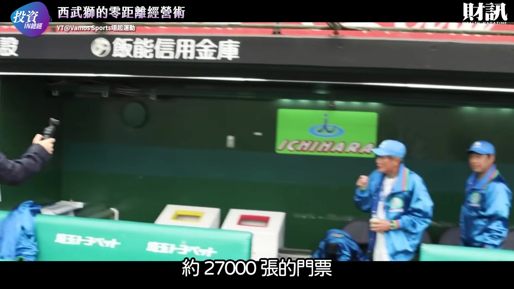

**逐字稿片段：** approximately 27,000 tickets sell out within two weeks, and the game highlights reached 980,000 views on YouTube, showing that fans don't just visit the stadium for the current game; sometimes, reliving past memories is equally compelling. The Lions 'management approach even

**話題推測：** 展示傳奇賽的成功數據（2.7萬張票兩週內售罄，YouTube精華98萬次觀看）。

---

## 00:06:20

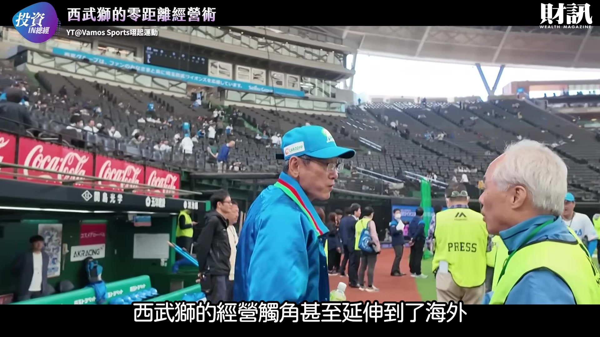

**逐字稿片段：** extends overseas, especially to Taiwan, where the club has deep roots. From the

**話題推測：** 轉向新話題：將經營模式拓展至海外，特別是台灣市場。

---

## 00:06:25

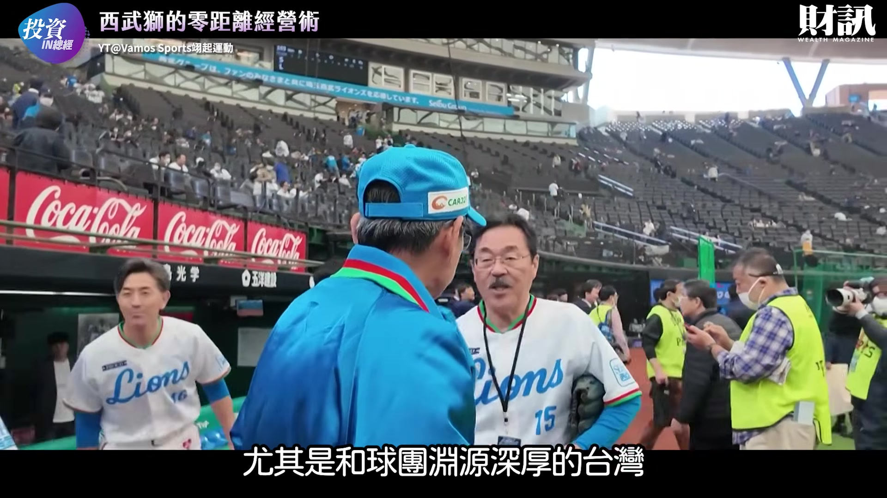

**逐字稿片段：** "Oriental Express" Kuo Tai-yuan, who joined in 1985 and played for 13 years, to later stars like Hsu Ming-chieh, Kuo Chun-lin, Wu Nien-ting, and this year's addition Lin An, the Seibu Lions have always been one of the most familiar NPB teams to Taiwanese baseball fans. Next

**話題推測：** 列舉曾在西武獅隊效力的台灣球星，如郭泰源、許銘傑、郭俊麟、吳念庭、林安等。

---

## 00:06:42

**逐字稿片段：** February, the Lions will also host a Taiwan-Japan exhibition game at the Taipei Dome, which is expected to further bridge the gap between the club

**話題推測：** 提及西武獅隊將在台北大巨蛋舉辦台日交流賽的未來規劃。

---

## 00:06:50

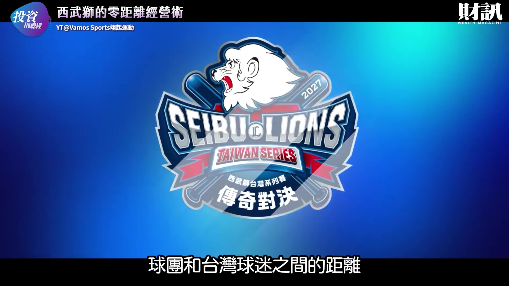

**逐字稿片段：** and its Taiwanese supporters. From opening the stadium after games for fans to experience the field, to offering over 1,000 types of food to attract diverse crowds, to youth-oriented marketing, digital services, and nostalgic events rooted in team history , the Seibu Lions' strategy revolves around a single core: ensuring fans gain more than just a game every time they enter the stadium. When a stadium is no longer just a place to watch a game, but a leisure space providing food, entertainment, socializing, and memories , the team has the opportunity to attract people who don't usually watch baseball, and keep existing fans coming

**話題推測：** 總結西武獅隊的多元經營策略核心：讓球迷每次進場都獲得超乎比賽的體驗。

---

## 00:07:32

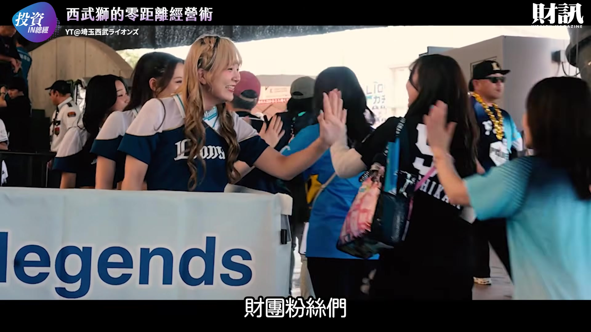

**逐字稿片段：** back. Fans, after watching today's show , would you also like to experience a Seibu Lions home game in person? A: Yes , I'd love to experience their Japanese-style team management. B: No, because most of the time the dome is as hot as an oven, or I need more information. Let us know in the comments. That’s all for today’s investment analysis, and if you enjoyed the show, please remember to...

**話題推測：** 提出互動問題，詢問觀眾是否願意親身體驗西武獅主場賽事。

---
