# wealth1974_Pq5ty1iiuec — 關鍵畫面索引

- 來源逐字稿：[wealth1974_Pq5ty1iiuec_GT.srt](wealth1974_Pq5ty1iiuec_GT.srt)
- 影片：https://www.youtube.com/watch?v=Pq5ty1iiuec
- 截圖數：27

## 00:00:03

**逐字稿片段：** 台灣健康幣上路 如何打造健康經濟圈呢 想要知道的聽眾朋友 記得要聽到最後喔 今天的來賓是財訊的新朋友 新同學 資深記者李林璦 各位聽眾大家好 我是林璦 好 那也提醒大家 這是財訊的 Podcast 節目 如果是透過 YouTube 平台收聽的聽眾 可以打開右下角 CC 字幕 那我們就開始吧 那首先第一段我們來聊一下市場動態 那最近林璦在市場上或路線上 有沒有聽到什麼 有趣的事情或新聞 可以跟聽眾朋友分享 其實最近台灣生技公司一直都有好消息喔 除了之前台微體日本的授權案之外

**話題推測：** 介紹主話題：台灣健康幣上路

---

## 00:00:41

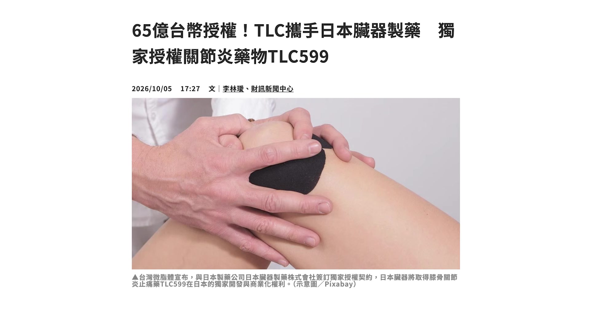

**逐字稿片段：** 其他像是安基生技 它也宣布它的那個罕見疾病的新藥 已經取得美國臨床三期的資格 所以它正式要展開臨床三期的試驗

**話題推測：** 提及安基生技新藥取得臨床三期資格

---

## 00:00:52

**逐字稿片段：** 另外呢 是漢康生技 它是做比較特別的 三特異性的腫瘤的抗體新藥 就是已經通過美國 FDA 準備要進入人體試驗 因為其實這個藥物 它製程是滿複雜跟困難的 然後它要進入人體試驗 是不容易的 不過當然因為它只是 臨床一期試驗而已 所以它距離真正驗證它的療效 還有一段很長的路要走 那再來就是再生醫療的向榮生技 那它們就是有拿到 細胞產品的外銷許可證 它是台灣第一家 拿到細胞產品外銷許可證的公司 所以也反映 台灣的再生醫療產品 除了在國內可以實際落地之外 未來也有機會能夠跨到 國際的細胞產品供應鏈裡面 不過它未來 因為它現在的臨床也還正在做 所以未來真的要外銷 還是有一段路要走 另外 最近大家可能有聽到 俄羅斯的疑似鼠疫的事件產生 目前還沒有真的證實它是鼠疫 不過就引起了市場上一些恐慌 擔心是不是新冠肺炎又要再來一次 所以大概 10 月初的時候 也滿有趣的 像是一些口罩的醫材的廠 恒大 康納香 跟南六 美德醫療 這些防疫股 它也有一波小小的漲幅 當然就是過了這個話題之後 它現在又比較下落一點 不過這個鼠疫 它其實跟新冠肺炎這樣 不明的病毒還是不太一樣 鼠疫它是鼠疫桿菌 所以它是細菌 治療方式以抗生素為主的話 其實都已經有藥可以做治療了 說不定之後 如果真的有什麼樣的狀況的話 台灣也有做 很多做這些抗生素的公司 像是永信這些藥廠 它們未來也是有一點機會的 好 最近我也在網路上 看到一些有趣的分享 就有一個迷因圖 它在說什麼 中國走向閉關鎖國 然後俄羅斯爆發鼠疫 然後法國在大革命 好像回到 17 世紀一樣 不過台灣其實最近 比較熱的新聞就是 財政部預估今年的出口 有機會破 9000 億美元 對比去年台灣的出口 大概是 6400 億美元 今年累計到前三季 6615 億美元 已經超過去年全年了 所以如果今年達到 9000 億

**話題推測：** 提及漢康生技腫瘤抗體新藥進入人體試驗

---

## 00:03:11

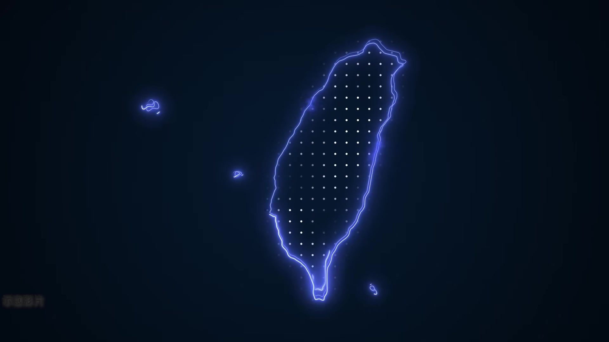

**逐字稿片段：** 台灣有機會成為 全球第五大的出口國 主要原因當然就是 受惠於 AI 的基礎建設 算力的需求的增長 那也因為台廠占據了供應鏈的優勢 所以有一些定價權 那以及另外一個滿重要的 就是我們具有非紅供應鏈的商機 那這也可以從出口結構改變 來看出其中的端倪

**話題推測：** 預測台灣有機會成為全球第五大出口國

---

## 00:03:31

**逐字稿片段：** 像是我們 9 月 對美出口達到 274.6 億美元 占整體比率大概是 31.5%

**話題推測：** 提出9月對美出口額及占比

---

## 00:03:40

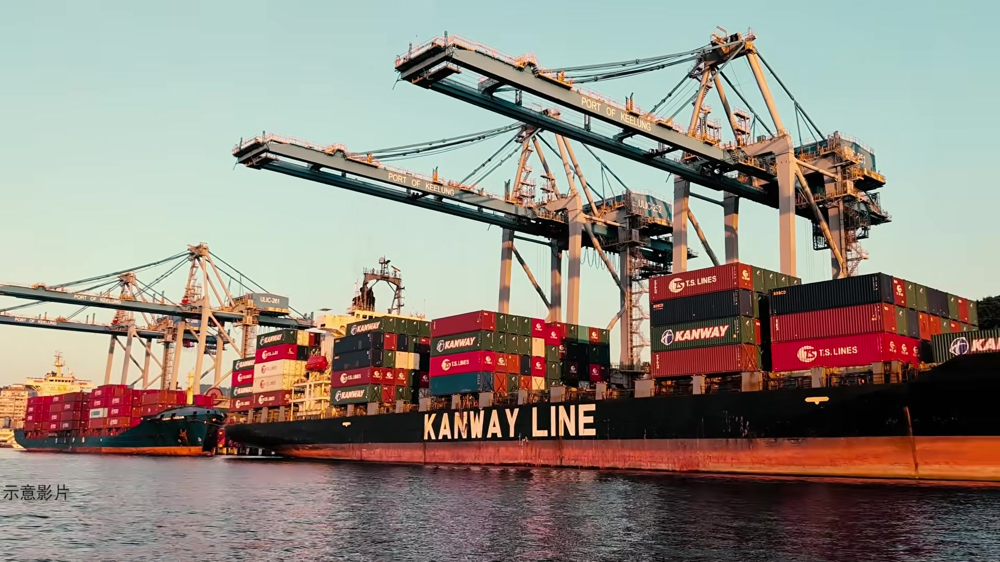

**逐字稿片段：** 對中國出口是 206.2 億美元 占比大概是 23.6% 這個是我們社長一直在講的 就是我們對美國的依賴 已經慢慢超過對中國的依賴 值得一提的是

**話題推測：** 提出9月對中國出口額及占比

---

## 00:03:51

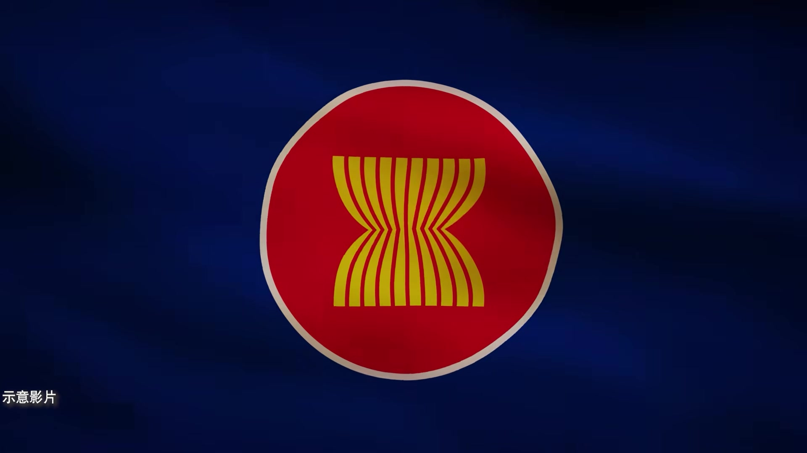

**逐字稿片段：** 對東協出口達到 188.8 億美元 創了新高 占比也達到 21.6% 可以看到東協市場也愈來愈高

**話題推測：** 提出9月對東協出口額及占比創歷史新高

---

## 00:04:00

**逐字稿片段：** 好 那另外一個就是 最近股市比較震盪一點 那很多利空的消息 也都不斷的在釋放 像是 OpenAI 公布 截至 9 月底的年化營收 數據是接近 500 億美元 遠遠低於原本市場預期的 700 億美元 所以也引發了一些 美股的一些震盪 原本計畫在今年會上市的 OpenAI 它也決定要延後上市 目前它會專心處理 AI 資訊安全疑慮 這方面的事情 不過 Anthrotpic 預計 今年秋季或是年底這段期間會上市 好 那接下來我們就進入到今天的主題 最近有看到就是 台灣健康幣

**話題推測：** 新話題：近期股市震盪與OpenAI消息

---

## 00:04:41

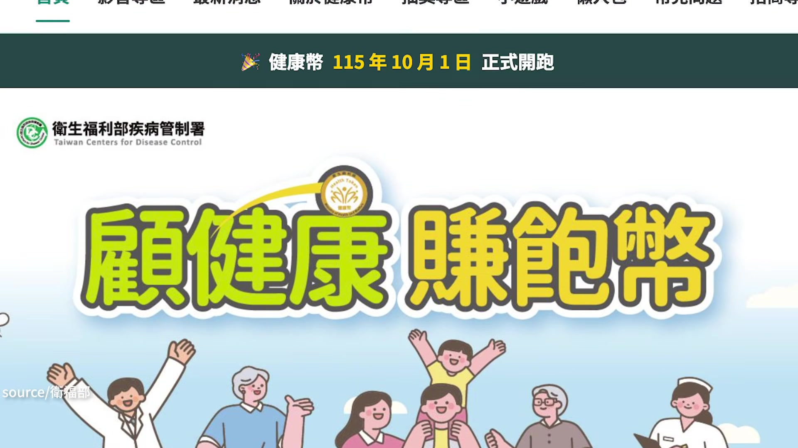

**逐字稿片段：** 大概是在 10 月正式登場 聽說就是 不管你要打疫苗或是做健檢 好像都可以累積這個所謂的健康幣 之後可能還會有更多的應用 可不可以先幫聽眾解釋一下 就是健康幣到底是什麼東西 然後它之後可以怎麼使用呢 不知道大家下載了嗎

**話題推測：** 說明健康幣於10月正式登場

---

## 00:05:00

**逐字稿片段：** 健康幣其實要下載兩個 APP 我沒有下載 它其實是要先下載健保快易通 然後從健保快易通裡面 它會有整合大家的 健保就醫的資料 健檢的資料 然後還有打疫苗的資料 然後去串接到另外一個是 國健署這邊推出的

**話題推測：** 說明健康幣需下載兩個APP

---

## 00:05:19

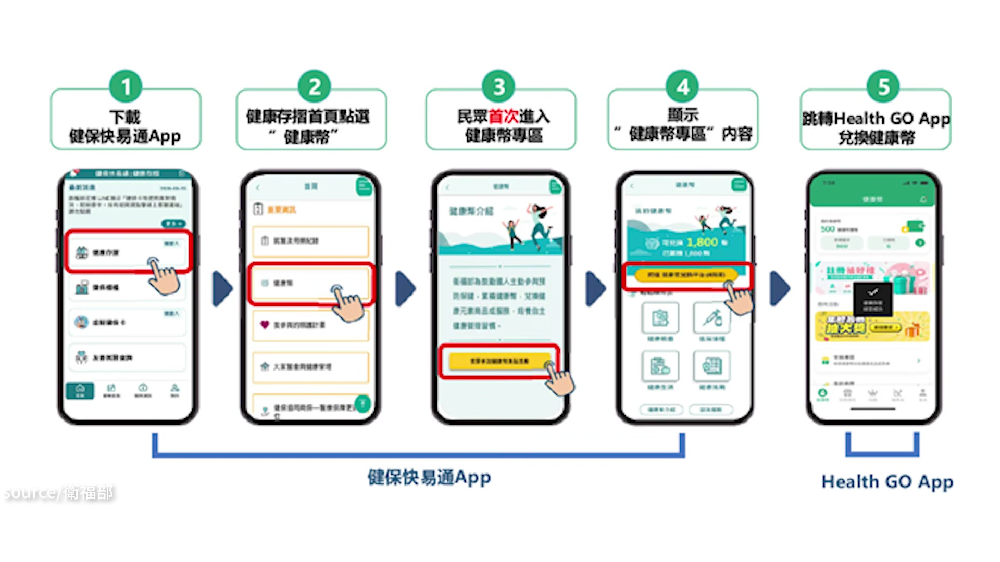

**逐字稿片段：** 叫 Health Go 的一個 APP 那主要兌換這些 超商跟藥局折抵 都是在 HealthGo 這個 APP 裡面做執行

**話題推測：** 提及國健署推出的Health Go APP

---

## 00:05:28

**逐字稿片段：** 其實運動幣大家很熟悉 就是運動 累積步數 有 50 元可以去超商折抵 然後健康幣的話 比較推崇的是打疫苗 健檢 或者是癌症篩檢這些 進行預防保健的行為 它就會發一個虛擬的幣 在你的帳戶裡面 然後你這個幣 就可以一樣到超商 藥局 可以做折抵 或者是未來醫療的時候 可以折抵醫療的費用這樣子 那它大概會發多少 我們之前有去訪衛福部長

**話題推測：** 將健康幣與運動幣進行比較

---

## 00:05:57

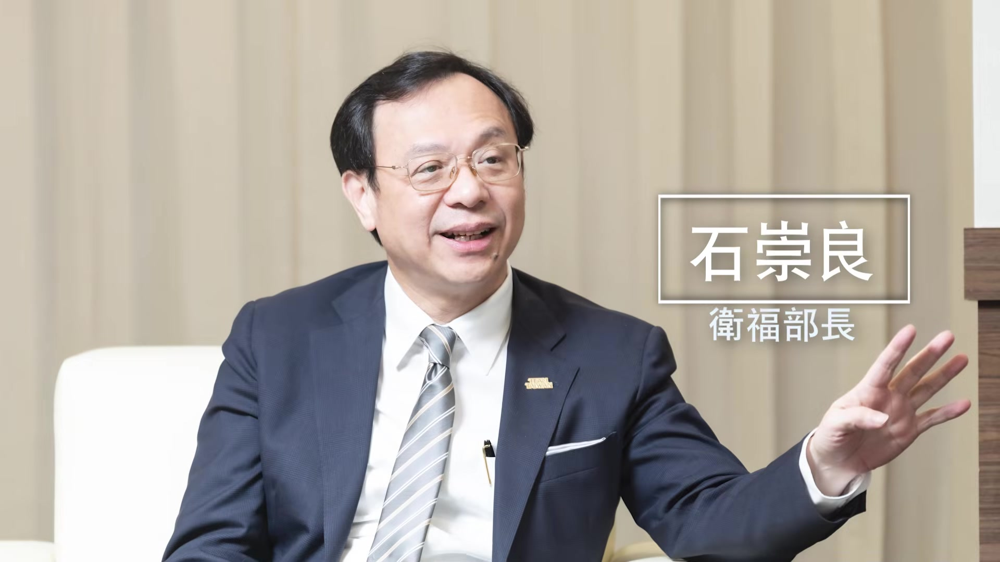

**逐字稿片段：** 石崇良部長 那他是有預估說 每年預計可以發出

**話題推測：** 提及衛福部長石崇良對健康幣的預估

---

## 00:06:02

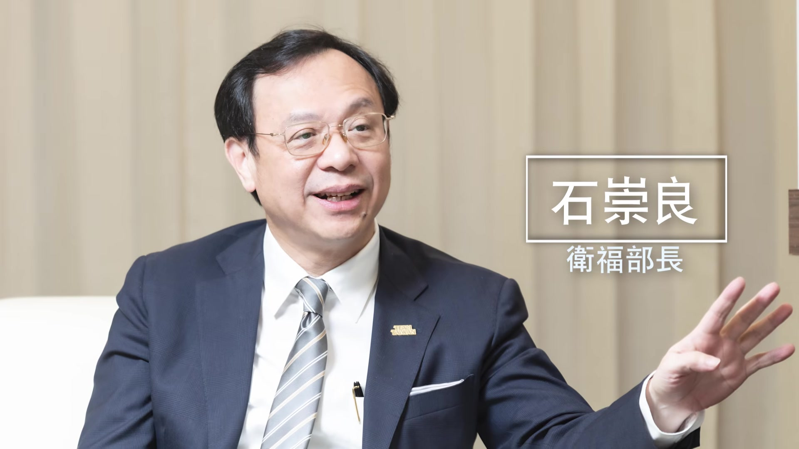

**逐字稿片段：** 100-130 億的健康幣 然後因為他不是想要讓大家說 50 元全部拿去用掉 像運動幣那樣 它是希望帶動整個經濟效益 所以它的折抵的方式就是

**話題推測：** 預估每年可發出100-130億的健康幣

---

## 00:06:15

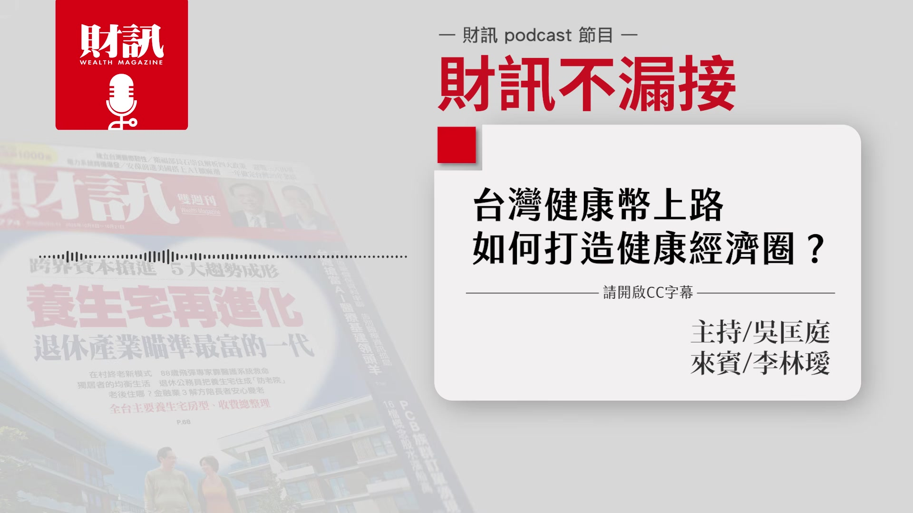

**逐字稿片段：** 折抵 10%-20% 的消費 比如說我有 5 元的健康幣好了 我就可以拿去折抵 25 元的飲料其中的這 5 元 所以他就推估說 它可能可以撬動 500-1000 億的 健康經濟圈的消費 聽起來它的使用方式 會是給你一個打折優惠 不像是運動幣 它可以直接用那個幣去換東西 對 它比較像是 30 元的豆漿 然後讓你變成 20 元或 25 元之類的 所以它比較能發揮 槓桿撬動的這種成效 不過他剛說 要發大概 100 億左右的健康幣 聽起來是一筆不小的數目 這筆錢大概是誰會來提供呢 其實目前這個不是政府來提供 因為我們現在健康幣 能夠兌換的是健康的商品 無糖豆漿或是雞胸肉 這類型的產品才能做兌換 它比較像是搭了一個這樣的平台 然後業者 超商 藥局或是運動場館 壽險這些業者 它融入到這些平台裡面 然後讓民眾可以到平台上面 知道有哪些商品 是政府認證所謂健康的產品 去做消費這樣子 對 所以其實政府 並沒有真的出這 100 億 來發這個錢 所以健康幣其實是一種 比較像是虛擬的幣這樣子 那當初在訪石崇良部長的時候 他有說過他有預期達到什麼樣的效果嗎 他其實有提到一個滿有趣的 他就說 像之前大家玩寶可夢 或是現在玩皮克敏 大家其實 沒有真的拿到什麼實體的東西 它就是一些收集的徽章的概念 但是大家非常熱衷 因為皮克敏的關係 大家也會去外面 走路或是運動這樣子 所以他就覺得說 其實健康幣這樣的集點 或者是收集這個錢幣的狀態 就有一點類似這樣 是一個遊戲的概念 然後大家為了收集健康幣 或是去跟你朋友比較說 我有多少錢 你有多少錢 這個健康幣 而去做這樣預防保健的行為 或者是未來會導入運動的行為 他也有提到說 那企業的誘因是什麼 除了政府會認證它的一些產品 是健康的產品之外 很多公司都在做 ESG 永續這些 所以有很多 它是可以跟公益方案做結合的 他就有提到說 自行車協會理事長 他都要辦那種自行車的運動賽事 會收報名費 然後比賽之後會拿到一些 水壺或是毛巾 每年都是發類似的東西 所以他其實也很苦惱 覺得說每一年要想新的獎品 他覺得也很苦惱 所以剛好 如果可以跟健康幣做結合的話 就非常的好 他未來就可以有一些新的獎品在裡面 然後另外像之前有聊到 奇美醫院的院長 他們醫院本來就有在做 類似健康幣的活動 他們叫健康點數 那就是讓院內的醫護同仁 可以去兌換院內的餐點 或者是一些醫療的費用這樣子 現在健康幣上路之後 奇美醫院就會跟健康幣去做結合 然後同樣 你做健康行為的時候 不僅可以累積奇美醫院裡面的健康點數 健康幣也可以同步累積這樣子 石崇良部長就是說 他還是想要細水長流 也就是培養 大家的健康消費的習慣跟概念 就是你慢慢的 在每一次做消費的選擇的時候 你都有意識到說 我買這個無糖綠茶 是可以折 5 元 但是我買這個奶茶 就沒有折扣 我就會慢慢的去趨向於 選擇比較健康的產品 所以它當初設計的用意 滿好的 立意良善 如果真的把這一些 健康習慣跟遊戲做結合 我相信會帶來滿不錯的效果 像皮克敏 大家都變得很喜歡走路 聽起來政府把這個平台架設好了 然後讓各個企業 來做響應 來做參與 國外有其他可以參考的案例嗎 有的 其實新加坡 它已經做這件事情做了十年多了

**話題推測：** 說明健康幣折抵消費的方式為10%-20%

---

## 00:10:13

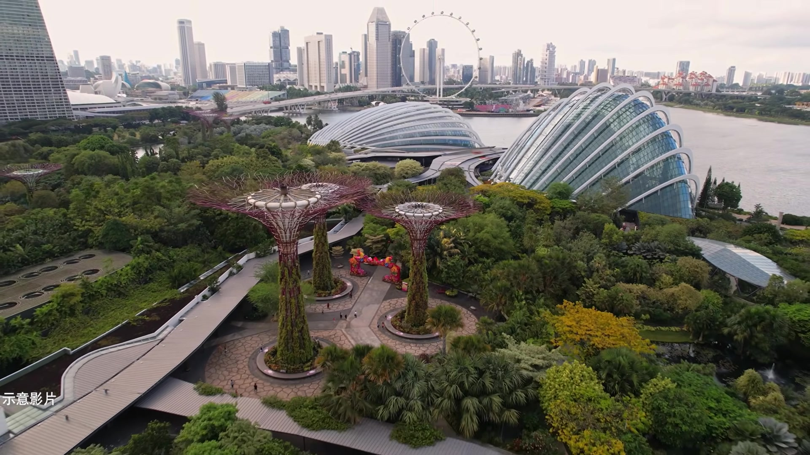

**逐字稿片段：** 它們 2015 年的時候 就有推出一個 APP 叫做 Healthy 365 應該說台灣就是借鏡新加坡 再把運動跟健康遊戲化這件事情上面 引導到台灣進來 那可以知道新加坡它做這個 它們 2015 年就開始推動 那它們一開始 是從走路開始 所以其實是跟運動幣有一點點像 是記錄步數 然後去換健康點數 然後這個健康點數 可以去折抵健康產品的消費 然後它們從 2015 年 一直到 2025 年 6 月

**話題推測：** 提及新加坡2015年推出Healthy 365 APP

---

## 00:10:46

**逐字稿片段：** 已經累積有 210 萬人參與 大概是新加坡總人口的 34% 那滿多的 所以其實是滿多的 等於三分之一的人 都有參加這個活動 只是其實它們政府 是有投入滿龐大的經費的 10 年大概投入了 3.09 億新加坡幣 所以大概是 76.5 億台幣 但它們也有去推估 投入這麼多的經費跟成本 那是不是真的能讓健保 省下一些金錢這樣 計算之後 發現大概可以 減少 111 億台幣的醫療支出 也可以降低照護或是長照的社會成本 推動這些之後 它們就預估可以降低 大概 14.1 億元新幣的社會成本 所以等於每投入 1 元的新加坡幣

**話題推測：** 提出新加坡Healthy 365已累積210萬人參與，約總人口34%

---

## 00:11:36

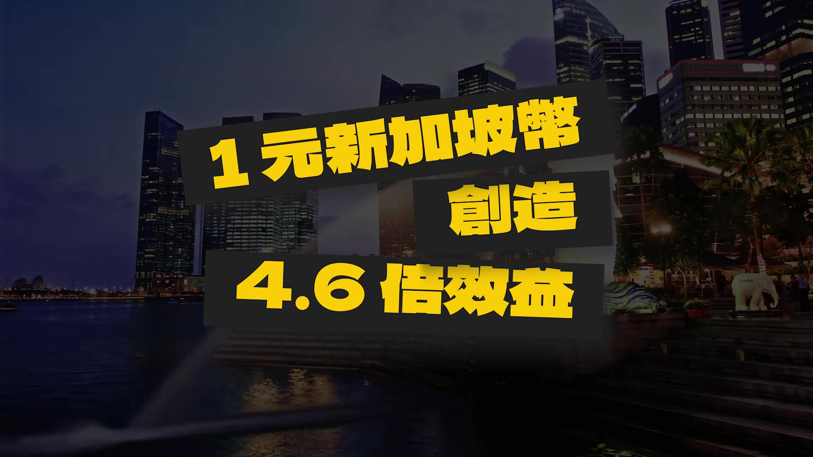

**逐字稿片段：** 就可以達到大概 4.6 倍的效益這樣子 聽起來成效還不錯 那它們有沒有把這樣的一個運動風氣 或者是健康生態建立起來 變成一個產業的結構呢 跟石部長的想法類似 就是說要把它變成 你每一次的購物選擇 都是往健康邁進 後來有推動一個很可愛的名字叫

**話題推測：** 提出新加坡每投入1元新幣可達4.6倍效益

---

## 00:11:58

**逐字稿片段：** 吃吃喝喝買買保健大挑戰 也就是不管你 吃東西 喝東西 或是你購物 或是你買保健食品 這些都是可以拿到健康積分的 所以很快喔 它一推出 大概 2025 年底 就有 190 萬人參加 同時呢 也要鼓勵企業 這個大挑戰能夠鼓勵民眾 去採購這些產品 但是沒有產品 民眾也沒辦法買 所以它們就補助業者 去開發一些健康的食品 包含健康餐點 然後開發一些健康的米 或是健康的食用油 比較低鈉的醬料 比較低糖的飲料 這些在 3 年內 就已經投入了 2000 萬新幣 來補助業者去開發 它在 2018 年的時候 又再加碼 1500 萬新幣給這些廠商 開發的這些產品 上面都會幫它貼一個

**話題推測：** 提及新加坡推出「吃吃喝喝買買保健大挑戰」

---

## 00:12:48

**逐字稿片段：** 健康標章的認證 一個貼紙 然後讓民眾在選購的時候 知道這些飲料或者是食品 是有經過健康認證的 它這個食品的銷量

**話題推測：** 提及新加坡健康食品的「健康標章」認證

---

## 00:13:00

**逐字稿片段：** 已經從三成提高到七成 民眾它們是願意去選擇這些產品 也可以實際為廠商帶來這些收益 整體聽起來 整個成效算是還滿不錯的 不過它們在推廣的路上 有沒有遇到什麼困難 是我們也可以學習的呢 其實它們也滿多困難的 怎麼說 它們一開始推出的是健走活動 或者是一些運動活動 那有些是你要到實體現場 然後參加這個活動

**話題推測：** 提出健康食品銷量從三成提高到七成

---

## 00:13:28

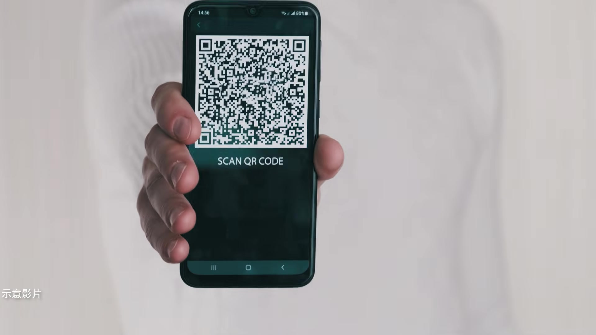

**逐字稿片段：** 掃描 QR Code 可以拿到點數 那就會有人把 QR Code 截圖分享給大家 所以等於沒有去現場的民眾 他也拿到了點數 所以它就暫停了 6.2 萬帳戶 然後就開始去核對這些出席記錄 然後 後來又甚至發現說

**話題推測：** 提及健走活動中QR Code被分享盜用

---

## 00:13:45

**逐字稿片段：** 有 594 個已經過世的人 但是他的帳號 仍然在賺取這些健康點數 而且其中有些帳號 甚至是他過世之後才建立的 一方面是說新加坡人 還滿熱衷於收集這個健康點數的 但是也突顯它們 就是有一些身份驗證的問題 後來新加坡有加強這些 身份驗證的機制 那另外就是 一開始活動出來的時候 其實大家參與度都很高 但它們也有發現 留存率滿低的 歷史平均的留存率 大概只有 28.3% 大概有 117 萬人 就是他參加之後又退出了 所以新加坡就想說 那怎麼辦呢 它就想說 那不要針對一般民眾好了 我們就是針對 比較需要健康行為的亞健康族群 去做推廣 所以它們就針對高齡者 推出一些運動營養 或是心理健康的篩檢的活動 另外是針對糖尿病前期 或者是比較肥胖的族群 推出一個數位教練計畫 然後它就是跟一個 台灣的廠商合作 叫做慧康生活科技 它有一個 APP 大家可能有用過 叫智抗糖的 APP 搭配連續血糖監測的記錄 然後來去記錄你的飲食 血糖 運動跟睡眠 再接著會給你一些衛教 改善你的生活習慣這樣子 那這個計畫其實成效也滿不錯的 大概只做了幾個禮拜 但是它就有讓參與的民眾 BMI 身體質量指數

**話題推測：** 提及發現有594個已過世帳號仍在賺取點數

---

## 00:15:20

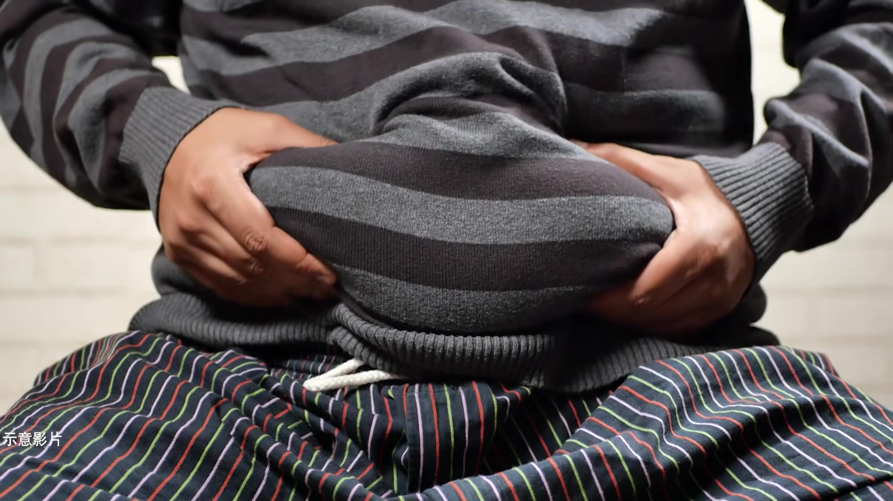

**逐字稿片段：** 降低 0.8 血糖比較不好的民眾 它也控制的比較良好這樣子 所以是還滿有幫助的 聽起來 第一個就是身份驗證 再來第二個就是 活動的留存率要想辦法維持 那還有其他的挑戰嗎

**話題推測：** 提出計畫成效：參與民眾BMI平均降低0.8

---

## 00:15:37

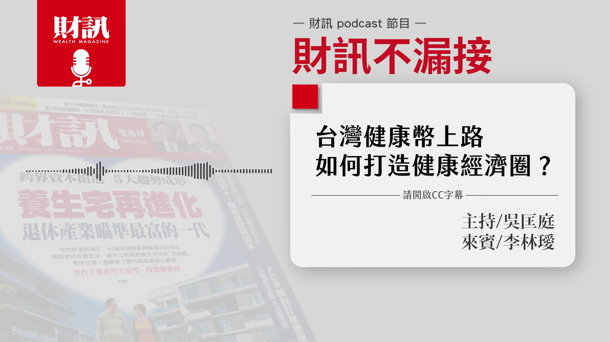

**逐字稿片段：** 還有高齡長者 因為高齡長者比較不會使用 APP 它們就派數位大使到社區裡面 然後直接去教這些長輩 怎麼使用這個 APP 提升這些長輩參與的興趣這樣子 那之後台灣的健康幣 或者是台灣之後這些健康的生態 有沒有什麼可以前進或者是改善的地方 其實台灣在高齡長者 這個數位落差的地方 應該也是滿需要協助的 因為其實很多長輩 在健康幣推出的時候 也都會去問自己的子女說 我到底要下載什麼 APP 我到底要怎麼用 才可以拿到這個健康幣 不過我覺得長輩的參與度 其實還滿高的 像我媽就有來問說 到底要怎麼下載 然後馬上就填好問卷 就可以拿到 300 健康幣 然後接著去 最近有流感跟新冠的疫苗 她馬上就去打疫苗了 然後又可以再拿到健康幣 所以他們其實還滿熱衷 我覺得長輩的興趣是很高的 不過數位這個門檻是需要跨越的 未來就是下一步 大概在明年初的時候 就有可能把穿戴裝置 慢性病的資料 串接到健康幣系統裡面 就是未來如果你有戴手錶

**話題推測：** 提及高齡長者不善使用APP的挑戰

---

## 00:16:49

**逐字稿片段：** 不管是 Apple Watch 或是小米手環這樣子 然後有記錄你的運動 或者是血糖 血壓 血脂的記錄 那它都可以串接到 APP 裡面 有可能 目前這個機制還在規畫當中 但有可能 未來你運動 或是你有定期量血壓 血糖 獲得改善的話 就有可能拿到健康幣這樣子 所以這個是另外一波 就是業者可以進入的空間 衛福部其實也滿開放的 就是很推薦這些 健康數據想要跟健康幣串接 數位科技的廠商 可以去跟它們做洽談 好 聽下來就是

**話題推測：** 舉例Apple Watch或小米手環等穿戴裝置

---

## 00:17:26

**逐字稿片段：** 我們知道台灣的一些醫療困境 高齡少子化 所以缺人 缺工 我們的健保也有可能會有一些 比較難以應付的狀況 與其一直在想辦法做後段的調整 那不如我們從前段 讓大家提升健康 或許能更有效的解決這個問題 好 那感謝今天林璦的分享 聽完今天的節目 你會為了累積健康幣 而去健檢或是多走一些路嗎 歡迎大家留言 分享你們的想法 如果還想瞭解更多的內容 歡迎點擊資訊欄中的文章連結 或是購買財訊第 774 期的雜誌 跟我們一起 追蹤政經趨勢 掌握投資脈動 財訊不漏接 我們下次見 bye bye

**話題推測：** 總結台灣醫療面臨的高齡少子化困境

---
