# wealth1974_Q0o_qMtMzBc — 關鍵畫面索引

- 來源逐字稿：[wealth1974_Q0o_qMtMzBc_GT.srt](wealth1974_Q0o_qMtMzBc_GT.srt)
- 影片：https://www.youtube.com/watch?v=Q0o_qMtMzBc
- 截圖數：14

## 00:00:08

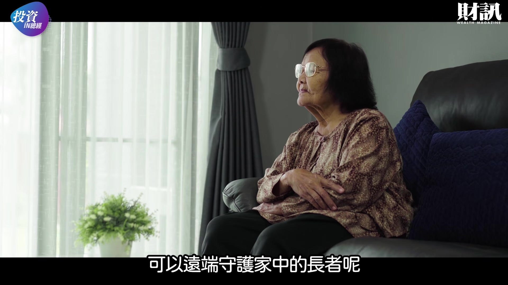

**逐字稿片段：** 在日本就有一顆燈泡做得到喔 今天這集我們就來聊聊 開燈就能報平安 燈泡變銀髮守護者 許多上班族 每天大半的時間不在家 或者已經離開家鄉住在都市裡 為了確認家中老人的安全

**話題推測：** 介紹燈泡作為遠端守護長者的解決方案

---

## 00:00:31

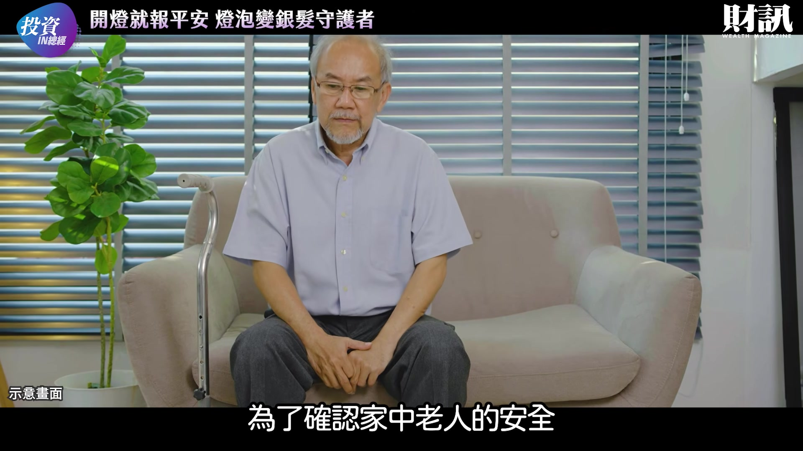

**逐字稿片段：** 可能會裝設家用監視器 或者替長輩購買智慧手錶 健康手環 甚至加裝人體感測設備 但是其實許多長者 並不喜歡被監視的感覺 穿戴式裝置又必須由長者記得充電 而且願意每天戴上 在使用上還是有一定的門檻 或者心理障礙 其實要解決這個問題 反而不用想得太複雜

**話題推測：** 討論現有的高齡照護設備，如監視器、智慧手錶

---

## 00:00:56

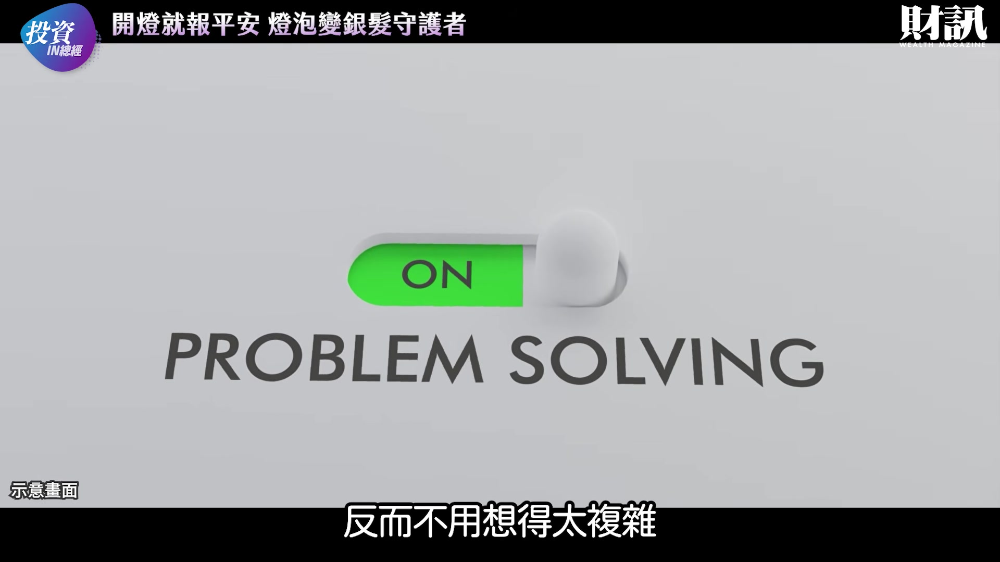

**逐字稿片段：** 日本一家科技公司 就開發了一款智慧燈泡 讓長者報平安更無感 更自然 因為每天早上起床走進廁所 順手把燈打開 這個再普通不過的動作 就可以成為確認獨居者 是否平安的重要訊號

**話題推測：** 介紹日本一家科技公司開發的智慧燈泡

---

## 00:01:12

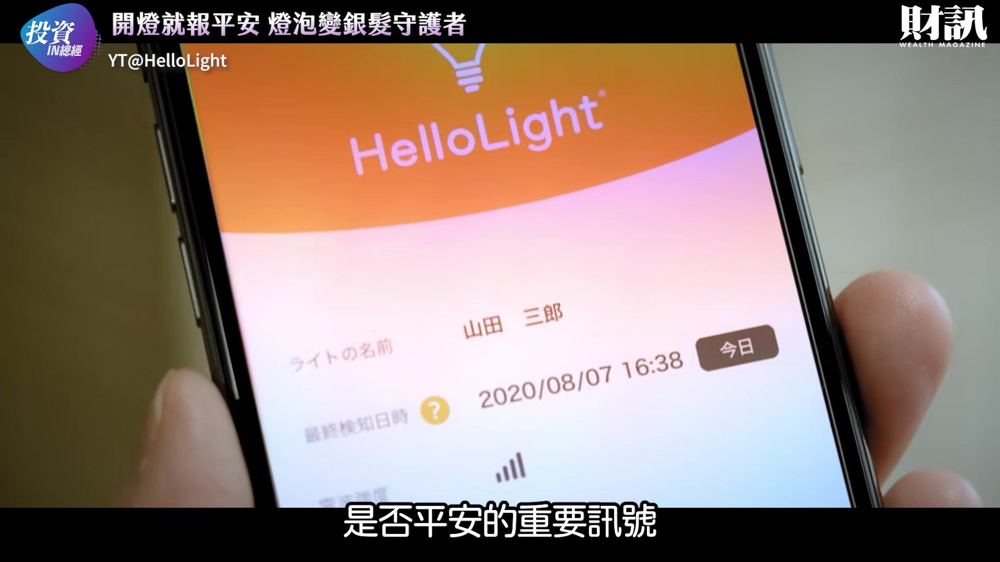

**逐字稿片段：** 這個燈泡就是 Hello Light 它的外觀看起來和一般 LED 燈泡沒有什麼兩樣 但特別的地方在於 裡面可以直接裝進 SIM 卡 不需要 Wi-Fi 也不必另外安裝感測器 而且不用施工 就能夠把燈泡開啟關閉的資訊 傳送到雲端 由於燈泡原本就存在於每個家庭 尤其安裝在廁所 洗手間等 每天固定要使用的空間 只要老人家維持正常生活 自然就會留下開關燈的記錄 換句話說 如果在一定的期間之內 系統沒有偵測到正常的開關燈變化 就可能代表生活出現了異常 這個時候系統就會寄出通知 提醒事先登錄的聯絡人 讓家屬進一步打電話去確認 它不需要透過鏡頭去「看見」老人 也不必知道老人家究竟在做什麼 只需要知道今天有沒有活動 屬於自然不具侵入性的守護方式

**話題推測：** 揭示產品名稱「Hello Light」與其外觀

---

## 00:02:11

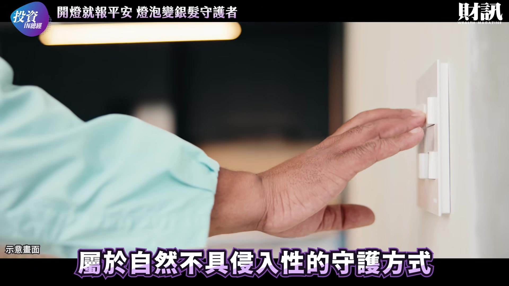

**逐字稿片段：** 開發 Hello Light 的 Hello 科技公司 成立於 2019 年 創辦人鳥居曉 原本是富士通的系統工程師 2015 年 鳥居注意到高齡者照護的問題 許多照護人員即使在工作之外 仍會因為放心不下獨居老人 主動打電話確認狀況 然而照護人力本身就不足 而且頻繁確認安危 也可能打擾高齡者原本的生活

**話題推測：** 介紹開發公司Hello科技及其創辦人鳥居曉

---

## 00:02:38

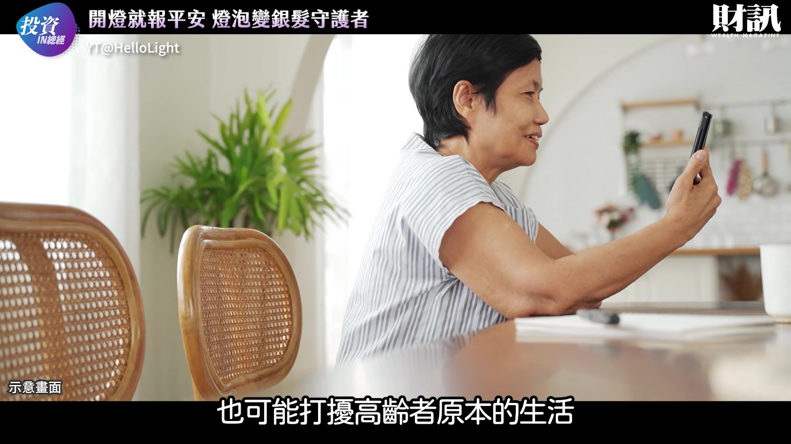

**逐字稿片段：** 日本獨居高齡人口 目前仍然持續增加 Hello 科技預估到 2030 年 獨居高齡者將達到約 800 萬人 日本一年約有 6.8 萬名高齡者孤獨死 鳥居就看到了這個痛點 決定利用科技尋找解決的辦法

**話題推測：** 展示日本獨居高齡人口增長的統計數據

---

## 00:02:56

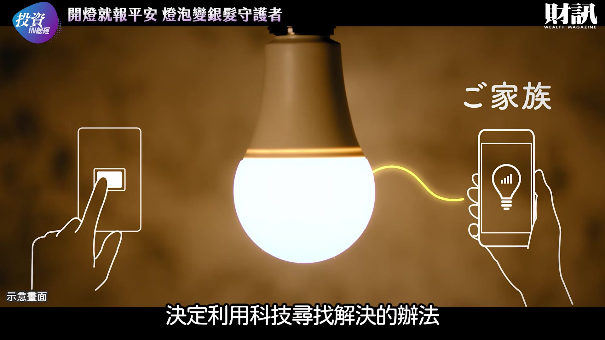

**逐字稿片段：** 在 2015 年 團隊發表了第一代的產品 但是當時的燈泡 必須另外搭配網路連接裝置 不僅初期的設備要花數萬日圓 每月的費用也高達數千日圓 環境也必須要有網路 連接裝置也需要插電 就曾經發生裝置被長者 拔掉插頭的情況 因此並未能夠普及 在經過三年多的研發和實證實驗

**話題推測：** 回顧第一代產品及其限制

---

## 00:03:21

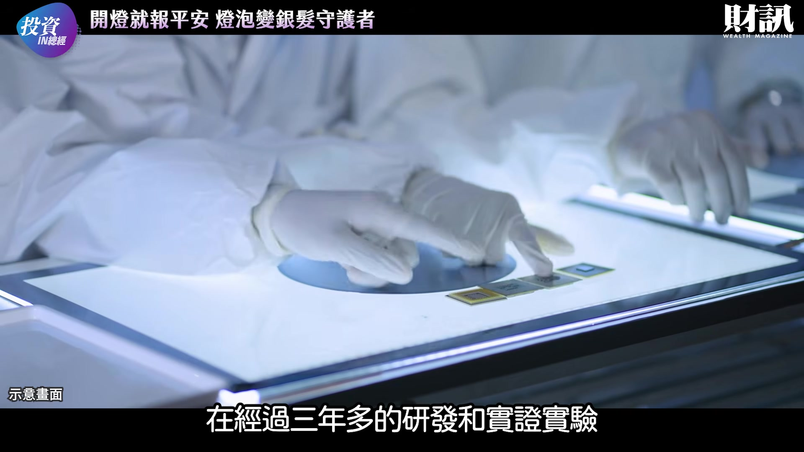

**逐字稿片段：** 2018 年 12 月 團隊成功把低功耗廣域通訊 LPWA 技術與燈泡一體化 並採用物聯網通訊平台 SORACOM 的 IoT SIM 讓 LED 燈泡本身就能夠直接通訊 成本更降到約舊系統的十分之一 也不再需要依賴 Wi-Fi 環境 消費者購買燈泡之後 可以透過管理網頁辦理啟用手續

**話題推測：** 說明新一代產品的技術改進，如LPWA技術和IoT SIM

---

## 00:03:45

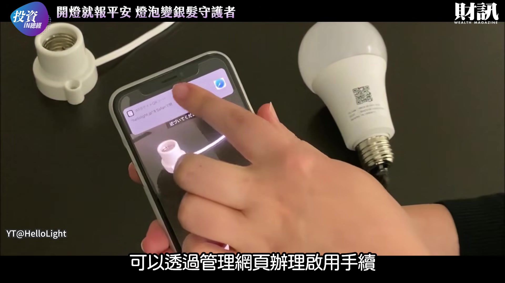

**逐字稿片段：** 標準方案每月使用費 495 日圓 折合台幣大約 100 元 最多可以設定五組通知信箱 也可以自訂異常偵測時段 例如可以設定 上午 7 點到下午 1 點 這個時間段如果沒有點燈 就在下午 2 點發出通知 甚至可以反過來設定 一點燈就通知 就可以應用在防盜等其他的用途

**話題推測：** 公布標準方案的每月使用費用

---

## 00:04:10

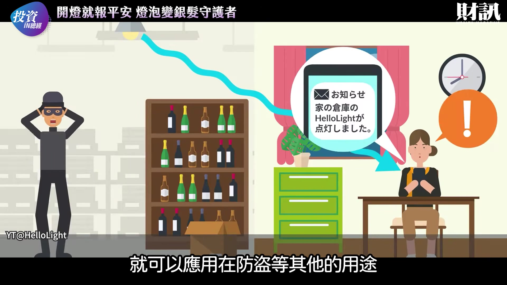

**逐字稿片段：** 截至 2025 年 9 月 Hello Light 累計點燈次數 突破1億次 公司表示已經有超過 1.6 萬名高齡者使用 這個應用的成果 看起來很不錯 但是真正讓這顆燈泡 進一步朝社會基礎建設發展的

**話題推測：** 展示Hello Light的累計點燈次數和使用者數量

---

## 00:04:26

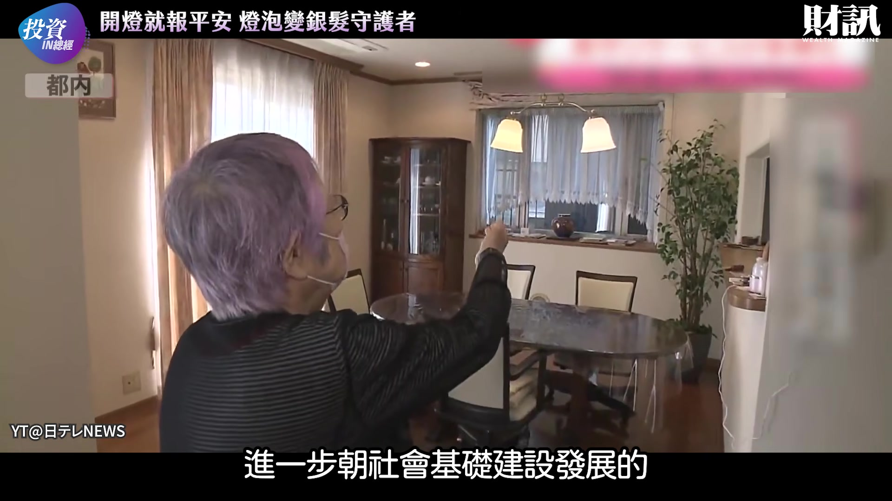

**逐字稿片段：** 則是與日本物流龍頭 黑貓宅急便的合作 會有這個合作是因為 如果燈泡沒有正常點燈 還是需要有人前往現場查看 所以黑貓宅急便就把 IoT 燈泡 與原本遍布全國的物流網結合 一旦家屬收到異常通知 又聯絡不上老人的時候 就可以委託當地人員前往住家確認 工作人員到場之後不會進入屋內 而是透過對講機呼叫 查看郵件是否堆積等等方式來確認

**話題推測：** 介紹與日本物流龍頭黑貓宅急便的合作

---

## 00:04:57

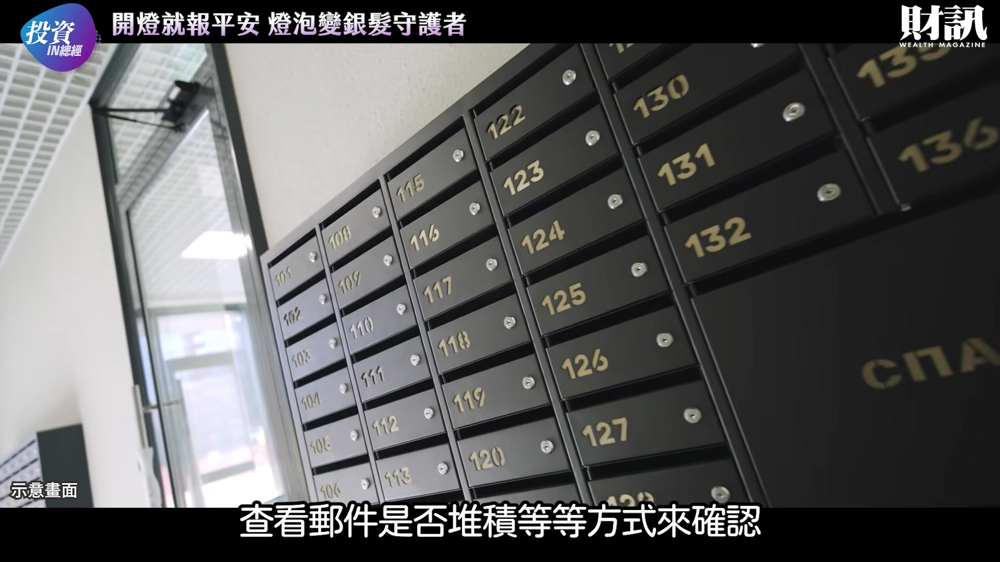

**逐字稿片段：** 這個專案的月費是 1738 日圓 折合台幣約 350 元 雙方於 2020 年 先在東京都多摩市進行合作實驗 確認現實面可以執行之後 2021 年將服務擴大到日本全國 Hello 科技並沒有自建龐大的 高齡照護團隊 而是把自己定位成技術平台 與 IoT 設備供應者 再與原本就深入地方的 企業合作

**話題推測：** 公布黑貓宅急便合作專案的每月費用

---

## 00:05:24

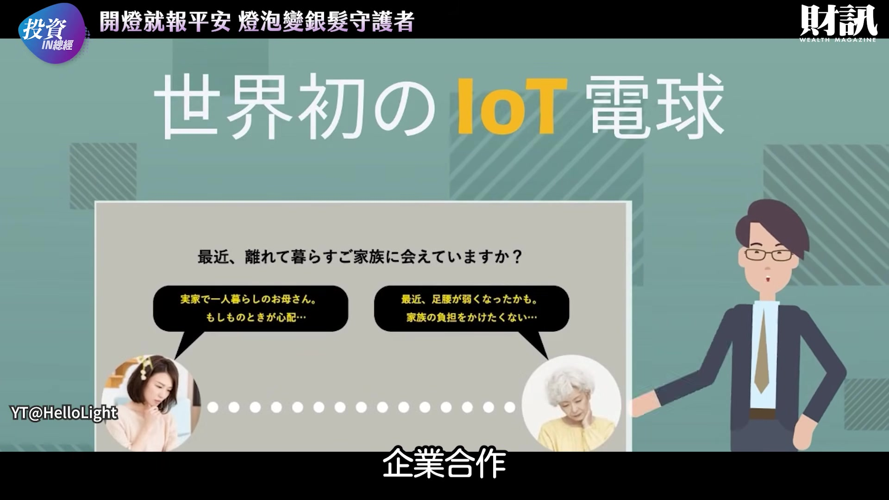

**逐字稿片段：** 除了物流業之外 電力 瓦斯 長照 不動產 家事服務等 只要原本就擁有大量家庭客戶 都可能利用 Hello Light 在既有的服務上 增加高齡者守護功能 Hello Light 這項技術 讓開燈這個最自然的生活習慣 成為高齡社會的安全網

**話題推測：** 探討Hello Light與電力、瓦斯、長照等其他行業的合作潛力

---

## 00:05:44

**逐字稿片段：** 財團粉絲們 你也會想使用這樣的設備 照護家中的長輩嗎 A 會 感覺非常方便 保護隱私 而且不用改變什麼生活習慣 B 不會 功能太簡單了 而且還需要月費 C 不知道 還需要多觀察未來的發展 留言告訴我們吧 今天的《投資IN總經》 到這邊告一段落 喜歡這個節目的觀眾 記得幫我們按讚與分享喔 我們下次見

**話題推測：** 提出問題，邀請觀眾參與投票或留言

---
