# wealth1974_SSExzKZ7Iuk — 關鍵畫面索引

- 來源逐字稿：[wealth1974_SSExzKZ7Iuk_GT.srt](wealth1974_SSExzKZ7Iuk_GT.srt)
- 影片：https://www.youtube.com/watch?v=SSExzKZ7Iuk
- 截圖數：44

## 00:00:23

**逐字稿片段：** 大家好歡迎收看《女王撩財經》 我是主持人劉軒彤

**話題推測：** 節目開場，主持人介紹。

---

## 00:00:26

**逐字稿片段：** 最近台股又大幅的下修 美股也碰上期中選舉 所以行情非常的詭譎 那今天就是邀請到我們的資深分析師 杜金龍老師來跟大家分享 今年底和明年初 台股到底怎麼走 我們歡迎杜金龍老師 軒彤各位聽眾大家好 杜老師這陣子真的很煎熬喔 對台股的投資人 那我們今天錄影是 11 月 3 日 那今天最大跌點到 1700 多 最後收在跌逾 1600 點 對 那大家的這種感覺就是說 不管是選舉 油價 戰爭 或者匯率等等變數 那大家現在最想知道一定第一件事 什麼時候落底 那落底之後到底是要買還是怎麼樣 因為我們還要看明年的趨勢 因為現在剛好是所有的投信投顧法人 都在看明年嘛 那所以我們今天要解答這兩個問題 到底最近的台股這種慘烈的走勢 你怎麼看呢 包括美股正在選舉 那我們台灣也要選舉 對 上半年我們因為 6 月 23 日是高點 後來砍了 8800 點大概跌 18% 後來 V 轉到 10 月 6 日 後來這一波開始就又回檔 那我們本來認為 3Q 4Q 就有兩個比較大的變數 就 11 月 3 日美國期中選舉 再來就 11 月 28 日台灣六都選舉 那我們先講美國期中選舉 我們今天錄的時間已經開始要開票 那最壞的結果就是 那個川普參眾兩院都沒有 輸掉 那如果比較好的話 輸了眾議院 參議院稍微沒有 大概在媒體裡面就講說 如果民主黨兩個都過半的話 對 AI 稍微會有影響 那所以這幾天美國也大概都是 那個電子股跌得比較多 道瓊就漲 你看我這個字卡就道瓊 在 10 月分道瓊是漲了 我們台灣跌 5% 道瓊是漲

**話題推測：** 主持人提及台股大幅下修，介紹今日議題。

---

## 00:02:19

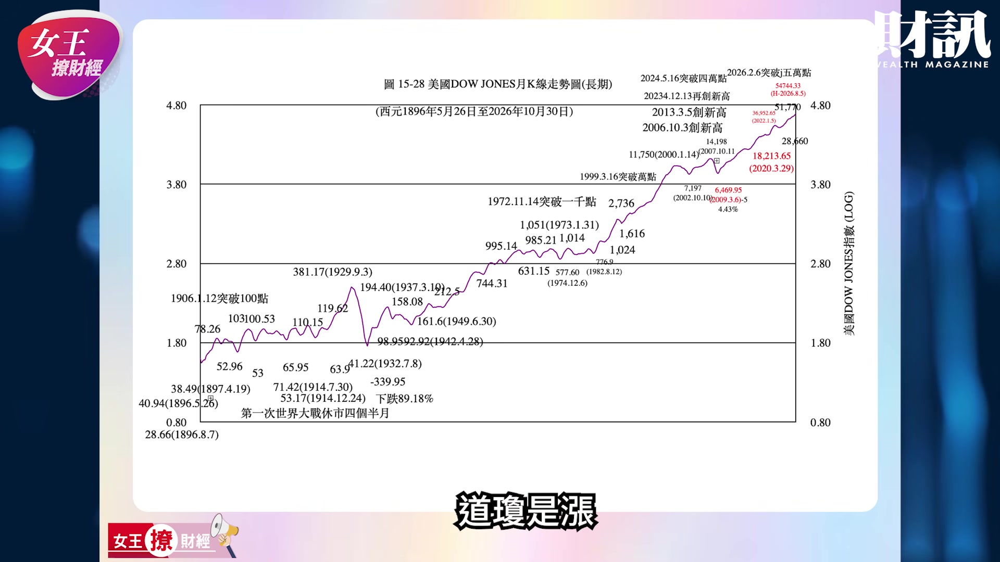

**逐字稿片段：** 那費半跌更多 所以美國科技股在跌的話 它大概躲到道瓊的股票 再來就是美國這一次跌得比較多 是費半跟 Nasdaq 那妳看看我們台灣 也是會受到影響 可是我們這個圖裡面 我們台灣的走勢圖就相對 沒有那麼受到它的影響 1 到 10 月分我們台股大概還漲 56% 費半剩下 50% 我們是全世界好像前面第一名的樣子 是 你說論年度的漲幅來說 對 今年來講 所以我個人認為美國期中選舉完以後 這個不確定因素就暫告段落

**話題推測：** 老師提及費半指數跌幅。

---

## 00:02:58

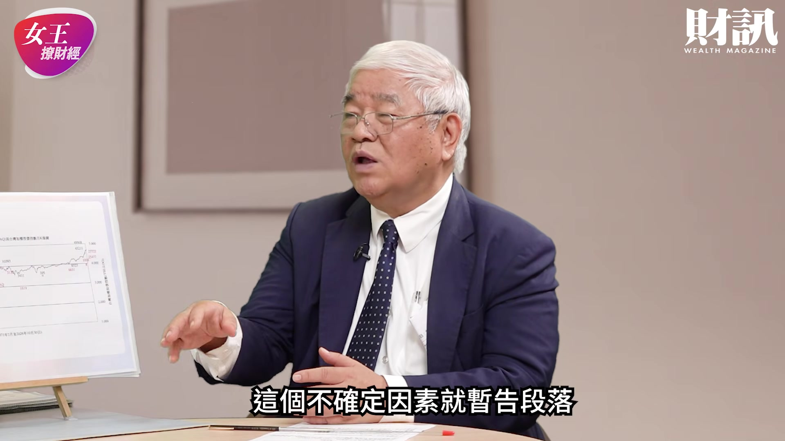

**逐字稿片段：** 再來就看它 12 月分會有沒有調高利息 目前看起來美國要調高利息 機率好像又偏高了 因為通膨的關係 因為油價今年 1 到 10 月分 美國西德州原油布蘭特原油 大概都漲 80% 所以又有可能 到 12 月美國會不會再調高利息 所以它期中選舉的因素 大概我們股票市場只要確定完以後 就又回歸另外一個

**話題推測：** 老師轉向討論12月美國是否會調高利息。

---

## 00:03:25

**逐字稿片段：** 我們台灣六都選舉 台灣的選舉會有影響嗎 我們 10 月分外資不是賣了 1 兆左右 今年賣了 2 兆多左右 所以外資大賣台股 所以我們在 10 月分 我們台股是跌了 5% 左右 5.6% 可是 整年度我們還是漲 6% 尤其這幾天你看到美國期中選舉的話 動不動就是大跌大跌 那我們錄影的時間

**話題推測：** 老師將討論焦點轉向台灣六都選舉。

---

## 00:03:48

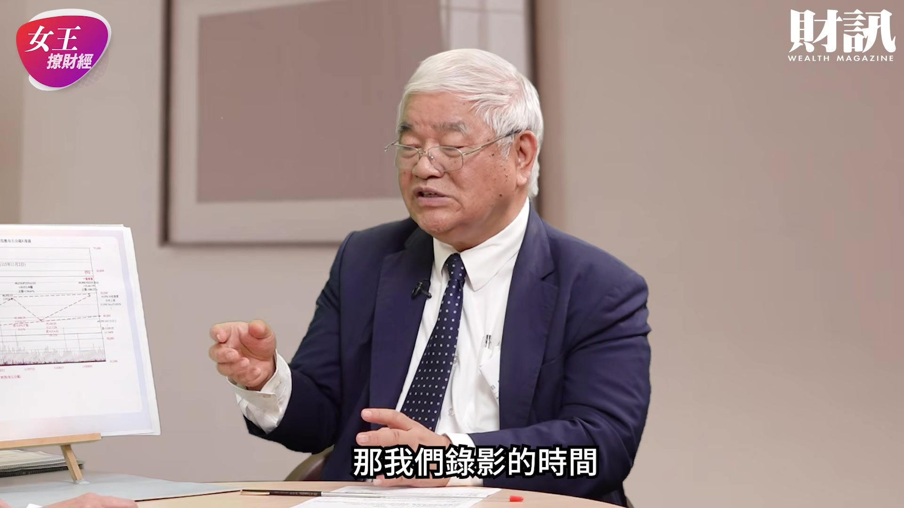

**逐字稿片段：** 目前已經破了半年線 我們目前大概在 43000 點 離我們上一次 7 月底的話 是 39384 點我們把它看作 4 萬點 那我認為啦 因為 7 月分跌 6% 8 月分漲 6% 9月分漲 3% 10 月分跌 5% 你看到我們其實這四個月都在上下盤整 一個區間 現在 10 月分是跌 如果說後面美國期中選舉完以後 自己六都選舉 這次搞不好政府會稍微比較賣力一下 那我們就盤整了五個月 那按照費波南希 你從那個高點下來盤整五個月 理論上可以修正結束

**話題推測：** 老師指出台股已跌破半年線。

---

## 00:04:27

**逐字稿片段：** 那我們這一波上次是跌 8800 點 這次跌 6600 點 這個短底可能就在 11 月分 選前那邊就落底 完以後 12 月分到明年 2 月 7 日 我們叫舊曆過年 我們就會開始展開做帳行情 還有元宵行情 所以我認為 我們今天錄影的時間 我認為我們現在在 11 月這附近 還是在打一個底 上次我們是在 4 萬點 這次搞不好在這邊 那完以後到 11 月以後 它要開始展開行情到明年 2 月分

**話題推測：** 老師比較這次與上次台股跌點。

---

## 00:05:00

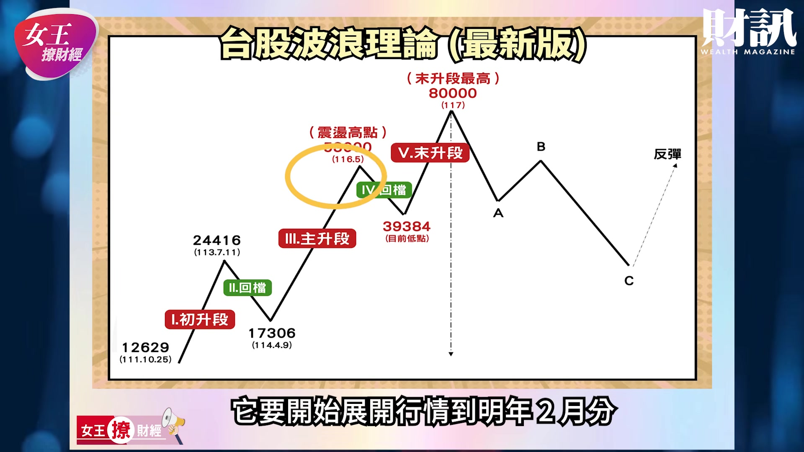

**逐字稿片段：** 我這個字卡還是標 5 月分 標那個費波南希的轉折點 就是說 12629 點到 55 個月 因為我們上次來是 55 個月是最高 有沒有 還有跌 5 個月漲 8 個月 就是到 2028 的總統選舉 才是我們主升段的結束 原因有兩個 一個是上市公司的獲利 我們上市公司獲利非常的好

**話題推測：** 老師再次提及字卡內容，顯示費波南希的轉折點。

---

## 00:05:25

**逐字稿片段：** 我們今年上市公司獲利成長 68% 有人說七成 明年還有（成長）三成

**話題推測：** 老師說明今年上市公司獲利成長率。

---

## 00:05:31

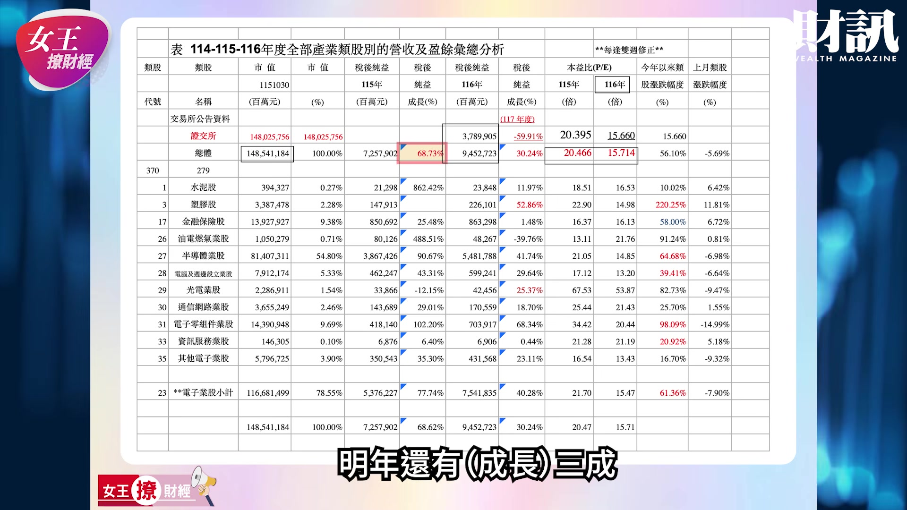

**逐字稿片段：** 所以我們現在本益比 到今天 10 月底是 20.39 倍 我們台灣 65 年來本益比只有 20 倍 我們上個月收盤是 45000 點 才 20 倍就代表很中間 那另外你看到 1 到 10 月分 我們大盤不是漲 56% 你看到漲幅第一名是誰 塑化 220 幾有沒有 還有我們的相對的半導體 零組件 都不錯 所以理論上因為基本面很好 所以我們把那個高點往後延

**話題推測：** 老師提及目前的本益比數字。

---

## 00:06:00

**逐字稿片段：** 另外還有一個東西叫 GDP 我們 3Q 的 GDP 不是成長 14.36% 嗎 今年大概會成長 12% 明年 6% 所以基於這兩個上市公司的獲利 還有 GDP 成長 所以我們把那個高點往後移 點數往上移 本來就是說 明年 5 月分大概在 53000 點 回來在 4 萬點完以後 後年到那個 8 萬點 所以回答剛才的問題 我是認為這個 4Q 盤整完以後 我們還會再走 明年的主升段跟末升段 大概是這樣 所以那你認為說 2028 年會到 8 萬點 你現在也開始喊到 8 萬點了 我覺得 2028 是目前最樂觀的 是樂觀的 最樂觀 因為我們從現在開始 不是很多人會做法說會 現在外面有一個外資

**話題推測：** 老師提出第二個原因：GDP成長。

---

## 00:06:49

**逐字稿片段：** 說年底會到 57000 點 因為我們最高點差 32 點就算 5 萬 所以現在有一個外資說會 57000 點 另外它 57000 點的目標是說 本益比 16 倍 上市公司獲利是今年乘以 70% 明年 30% 跟我的大概一樣 另外還有一個東西 它們現在有一家已經喊出來

**話題推測：** 老師提及有外資預測年底台股達57000點。

---

## 00:07:10

**逐字稿片段：** 台積電後年的 EPS 會到 218 元 目標價會到多少妳知道嗎 第一次聽到的 5000 元 那我們上次有字卡不是說 大盤 53000 點 台積電 3000 元 大盤如果 8 萬點 台積電就 5000 元 所以現在不是只有我 在講那個比較樂觀的版本 是有人已經開始在修正明年的高點 跟以後的高點 所以這一個假設是 AI 一定要非常的強 一直續強而且獲利一直提高 你的本益比會提高 對 對 所以會到 就是說我們不管 它是不是到 6 萬 7 萬 8 萬 但是就是說您看的這個明年趨勢 還是往上 我們上次來 （公司獲利成長）本來是六成 65% 那這個到 10 月 30 日 有沒有

**話題推測：** 老師引用法人預估台積電後年EPS及目標價。

---

## 00:07:54

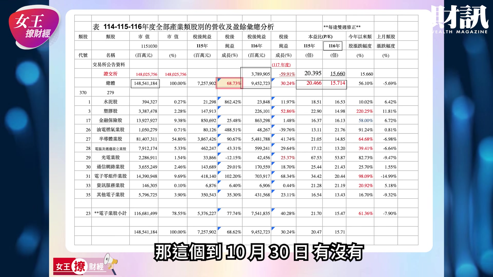

**逐字稿片段：** 68% 那另外來講的話 成長率 再來就零組件 被動元件 這個都是成長 那所以才會有造成這個現象 那這裡面的 32 類股裡面 現在目前的主流 目前大概已經知道第一個

**話題推測：** 老師更新上市公司獲利成長率到68%。

---

## 00:08:09

**逐字稿片段：** ABF 這個類股 那再來 ASIC ASIC 現在最有名就是創意 創意還有聯發科 再來 CCL（銅箔基板） CCL 就台光電 銅箔基板 再來就是塑化 塑化裡面 你看到我們 1 到 10 月分有沒有 大盤漲 56% 塑化漲逾 220%

**話題推測：** 老師開始列舉目前市場主流類股：ABF。

---

## 00:08:31

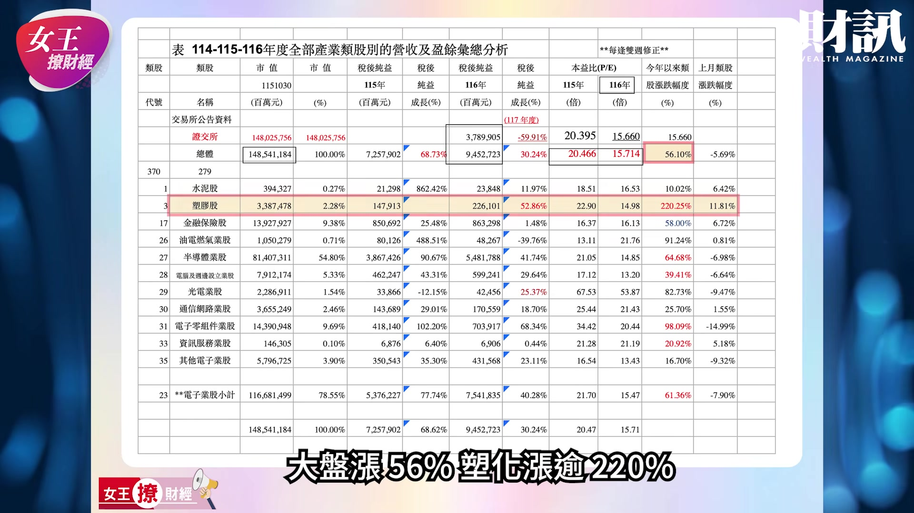

**逐字稿片段：** 那連金融也漲逾 50% 算還不錯的一個類股 那被動元件跟半導體都名列前茅 所以主流還是 AI 只是說它在 8 9 10 月的時候 我們大盤高價電子股在回檔的時候 它有一部分錢跑到塑化 還有跑到金融去躲起來 那尤其像我們現在不是今天 11 月分

**話題推測：** 老師提到金融類股的漲幅。

---

## 00:08:54

**逐字稿片段：** 3Q 財報公布 我現在弄了 3Q 財報 都很多人主流股的 EPS 獲利都大幅成長 就像說我們剛才講的 那個創意 2028 的 EPS 逾 500 元

**話題推測：** 老師提到第三季財報公布。

---

## 00:09:07

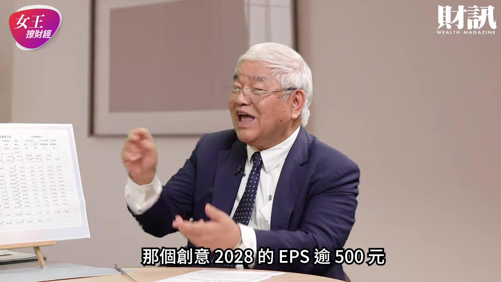

**逐字稿片段：** 台光電的獲利 EPS 逾 500 元有很多像聯發科 不是法說會完以後 很多人把它 EPS 2028 EPS 也大幅調高到 335 元 所以很多的電子股 目前 3Q 財報的話 大家紛紛的都把它大幅的調高 那我們因為這個月啦 尤其從 10 月 6 日完以後 我們這次不是跌了滿多 而且都高價電子股

**話題推測：** 老師列舉台光電2028年預估EPS。

---

## 00:09:32

**逐字稿片段：** 我是認為是因為台幣貶值的關係 外資開始大賣台股 可是妳想 它賣了 2 兆以後 萬一它會回補的話 2 兆只要補 5000 億到 1 兆（口誤） 台股就怎樣 在一個底部就開始會翻身上來 大概是這樣 對 那現在如果要落底 所謂的落底翻身 你大概認為是說就在選舉 以前我們的 11 月底的之前 這一段時間就會落底 還是說最近就落底 還是說你有什麼樣的觀察指標 我以前大概都看兩個日期 一個是 11 月 3 日 我們錄影的時間已經過了 所以假設說美國確定完以後 不管結果怎樣 那再來就是我們拖了比較久 就 11 月 28 日六都選舉 可是四年前八年前 因為執政黨 那時候六都選舉都已經大敗 所以基期比較的關係 它大概這一次選舉的話 會稍微比較好一點 或是按照現在的氣氛 搞不好會更好一點 那這個利空就比較不會像 美國期中選舉 大家比較看空川普 所以本來我 7 月底的話

**話題推測：** 老師分析台股下跌原因為台幣貶值。

---

## 00:10:36

**逐字稿片段：** 我持股降到五成 像我現在為什麼是說 我在 10 月 16 日 我那時候持股 那一天拉到 95% 那上來 V 轉完以後 我把持股降到六成 就留了聯發科沒賣 那完以後最近跌下來 我持股今天錄影的時間 我大概又慢慢加到 75% （台股）會不會去跌破 4 萬點都無傷 因為我們上次最低是 39384 點 就 V 轉上去了 那我這邊就會把持股拉到 85% 或是九成 那萬一重挫完以後 也沒關係 因為為什麼 很多人都說我們這次叫做假突破

**話題推測：** 老師分享他個人持股比例的調整。

---

## 00:11:13

**逐字稿片段：** 可是我們剛才按了波浪理論 我們現在是明年 5 月分 是主升段的高點 我們還有一個末升段 所以有很多人說 我們這次會不會像以前啊 形成一個 M 頭 因為以前會 M 頭都是選總統才會 我們這一次是六都選舉 明年理論上按照這個獲利來講 明年應該還會再挑戰一個高點 我擺在明年 5 月分 對 你的主升段是到明年 5 月分 我的字卡是 53000 點 我後面有一個括號是 6 萬 這個再來 休息大概在逾 4 萬點左右 再漲一倍就 8 萬

**話題推測：** 老師再次引用波浪理論分析市場走勢。

---

## 00:11:49

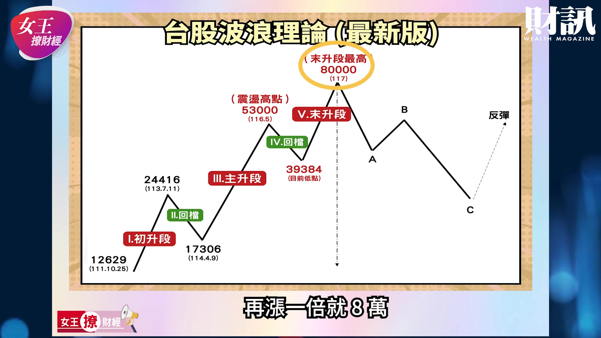

**逐字稿片段：** 我的字卡是 12682 點漲一倍 24416 點 回到 17326 點 漲三倍 就是 53000 點 回到 4 萬點 再漲兩倍就是 8 萬點 我的字卡是這樣歸類的 按照波浪理論 所以明年就算到了 53000 點 可能會再掉一次 對 會掉一次 再跌一次很深的一次 對 而且那一次我會把持股降下來 我一直在這個節目講說 從 12629 點漲到明年 5 月分 大家記得 費波南希的 55 個月 那時候 12629 點漲到 24416 點的話 剛好 21 個月 再來跌 8 個月 從 17302 點到現在 第 20 個月 12 月分是 21 個月應該要回 可是因為我們從 12629 點 有一個 55 個月高點在這邊 所以我畫的字卡 就是畫到明年的 5 月分 其實我們大概在 2 月 7 日過完年 到春節的時候 那時候如果有相對過 5 萬點 53000 點的話 你應該要把持股稍微降下來 對

**話題推測：** 老師再次說明字卡上的點位計算邏輯。

---

## 00:12:46

**逐字稿片段：** 所以老師我現在幫你做一個小小的結論 就是說現在開始應該可以慢慢加碼 你已經加回到 75% 了 那接下來到明年的元宵節 它基本上還是一個多頭的回升的行情 就反彈的行情 然後可能到元宵附近 如果是高點 它可能會再下來一點點 但是你看到的是明年5月 是一個主升段的頂 大概差不多是如果以費波南希係數來看 是這樣子 到時候可能會有再下一波 然後再到衝到 2028 年的事情 那那個是後面的事情 我們就先不談 所以最近應該是站在加碼對不對 你前面有減的當然可以加 像我不是 沒減的人 就沒有辦法 就是等了 那等很久完以後 我們開始最近不是開始慢慢盤嗎 後來開始這幾天就 10 月 12 日開始跌 有沒有 慢慢跌 慢慢跌 最後最近是跌了比較多 尤其 10 月 14 日

**話題推測：** 主持人為老師的市場分析做總結。

---

## 00:13:40

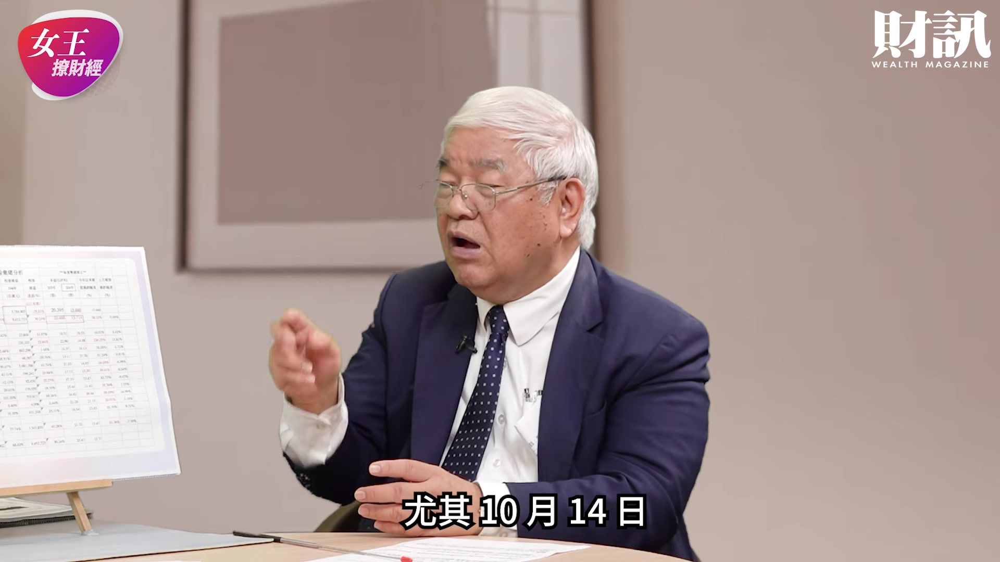

**逐字稿片段：** 那一天我們的台幣出現 100 億的大量 那時候台幣就在那邊有一個支撐 因為台幣每一次 止貶回升都會出天量 所以其實台幣已經央行在那邊擋 那台幣只要沒有再貶值的話 外資賣超就會暫告一段落 你看到我們外銷訂單那麼多 怎麼台幣會貶值 那個是有特殊的目的在 每隔四年 選六都選舉 它就打台灣股票市場 這是很奇怪的一件事 那完以後 過完 這個賣盤它就回來回補台灣股票市場 所以我就基於這個理由 就是我大概最近跌 我就慢慢建持股 因為還有 11 月 28 日 所以我留最後一筆錢 等那一天再加上去 大概我現在操盤這裡是這樣 現在你的操盤是這樣 那你有沒有擔心

**話題推測：** 老師提及10月14日台幣出現大量。

---

## 00:14:29

**逐字稿片段：** 會不會有什麼最大的可能的變數是什麼 最大可能變數就是說 完以後彈上來 沒有再像這一次 V 轉 那我就會把最近買的股票 只要看到那個大環境不對 我就會把現在買的 假設說我現在如果萬一加到九成 有沒有 我就會把那個九成裡面的 多的三成有沒有 把它丟掉 因為跌下來你總是會反彈 我就把它賣掉 再等下一次的機會 上次那個跌下來我就看對了 它 V 轉 只是賣得太快了 因為它後來聯發科噴出去

**話題推測：** 主持人提問老師對於未來市場變數的擔憂。

---

## 00:15:01

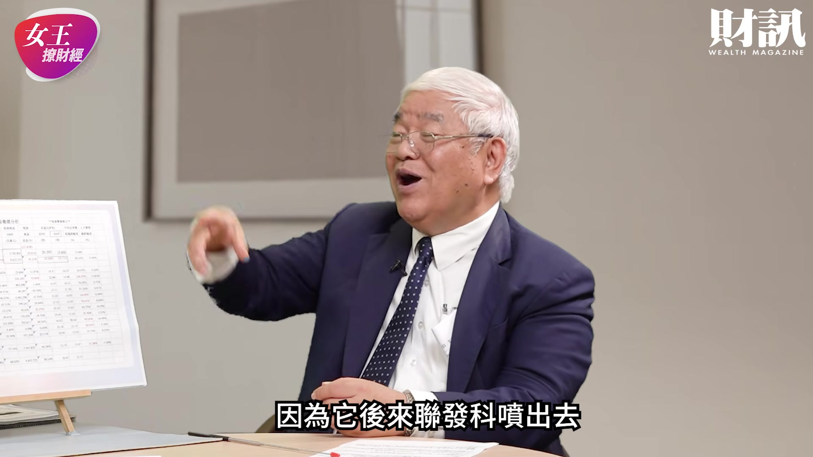

**逐字稿片段：** 還有台積電也漲到那個 2590 元 我是賣到 2510 元 它後來漲到 2590 元 我們不可能賣到最高點 大概是這樣去做 來回的一個價差 好 老師既然你提到個股 那你也剛跟我講說 老師剛說他在捷運站 還有一些投資人會來問他 看到我們這個杜老師 會來問這個個股 所以表示說大家現在 心裡都很擔心 那也有期待 因為跌深你就有期待 那既然這樣子 我們就把老師你有一些 你剛剛提到的 或者說大家的熱門股 比如說你在財訊的這個專欄上面有講到

**話題推測：** 老師提及台積電漲到2590元。

---

## 00:15:33

**逐字稿片段：** 比如說你有買欣興 你有買南亞科這些 這都是熱門股 或者是大家講的聯發科 今天聯發科在台灣週上面還說 歡迎大家買它家的股票 所以我們現在來一個一個解釋 你有什麼樣的想法 對於這些熱門股 對 我剛才有講 我們從選後到明年舊曆過年 各個媒體都會講說 看好的個股還有類股

**話題推測：** 主持人提及欣興為熱門個股。

---

## 00:15:55

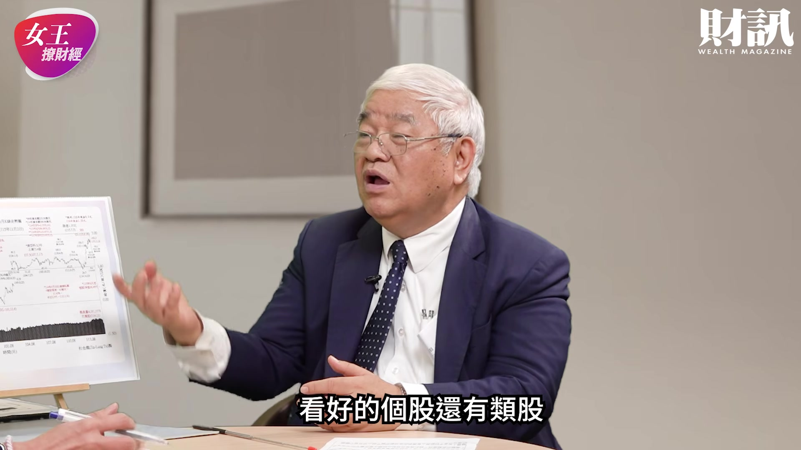

**逐字稿片段：** 新年度的展望 對 DRAM 股票很多人看不好 我認為以獲利它還是很好 就說它有雜音 可是有的人認為它 DRAM 到 2030 年 都還沒有問題 那我都是看這個 這個 EPS

**話題推測：** 老師開始分析DRAM類股。

---

## 00:16:09

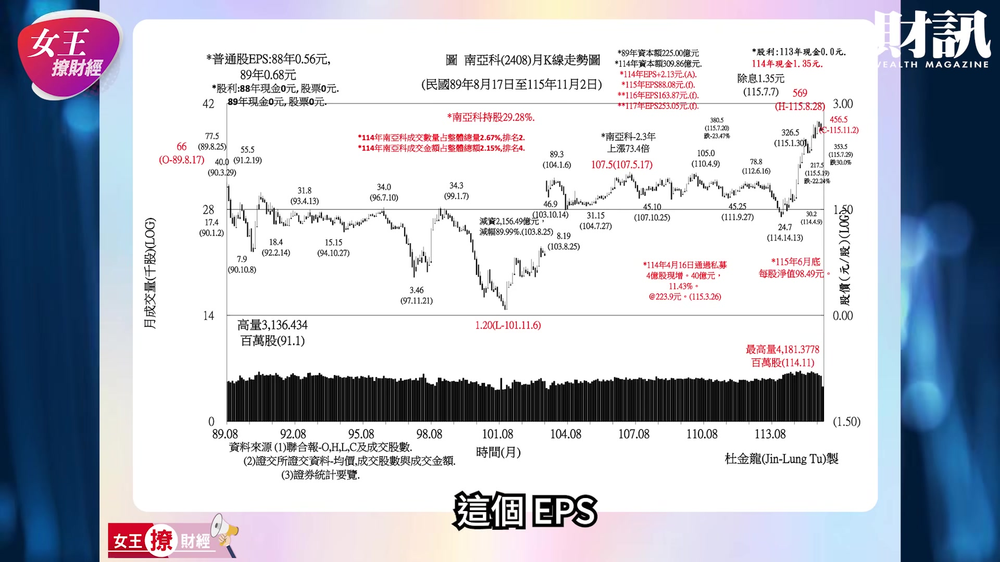

**逐字稿片段：** 這個是南亞科的線圖 對 因為我們現在都有 2028 的 EPS 有沒有 逾 200 元 那雖然說它這一波漲到逾 500 元 現在有回檔 那它每次以前也是 200 多元回檔 後來又 V 轉 所以在 DRAM 裡面 比較四支股票裡面 這一支是比較 你還是比較看好南亞科 因為我買它 上次我來節目有講 從 80 幾元上來有沒有上

**話題推測：** 老師明確提及南亞科的線圖。

---

## 00:16:33

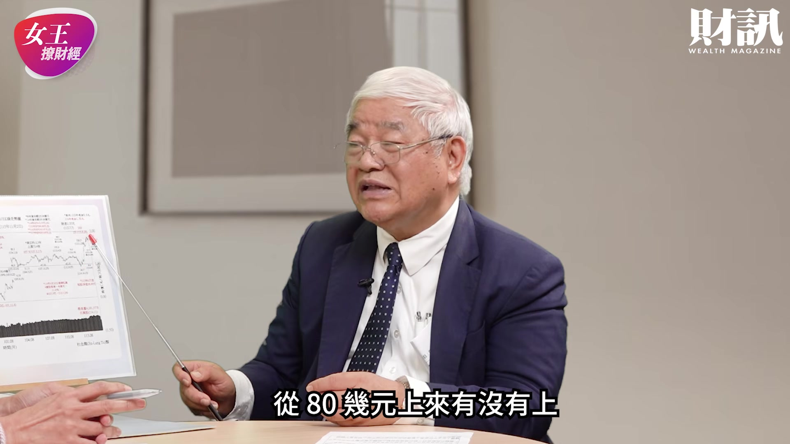

**逐字稿片段：** 那台塑集團其實六支股票理論上 在我們等一下要講的年底做帳 或是結帳 它是最好的一個類股 雖然說今天全部都很多跌停板 可是它以如果逾 200 元的 EPS 來講 這個是拉回讓你買 200 多元 EPS 是 2028 年 對 所以可能明年下半年以後才會反應 現在很多股票都做到 2028 年 已經提前反應到 2028 年 那明年反應什麼 過渡站 所以像現在我們那個交易所不是

**話題推測：** 老師提到台塑集團的股票。

---

## 00:17:03

**逐字稿片段：** 前一個月有一個叫做財報 2.0 版 它是鼓勵你們有 52 家股票 可以公布三年的財報 金融股還有高價電子股 以前是只公布兩年 所以我現在手上有的 大概都會用到 2028 的資料 就是法人普遍的預估 這個類股應該 DRAM 不錯 那像現在最有名力積電 它因為有股權開始爭了 而且它後年 2028 的 EPS 9 元

**話題推測：** 老師提及交易所推動的「財報2.0版」。

---

## 00:17:31

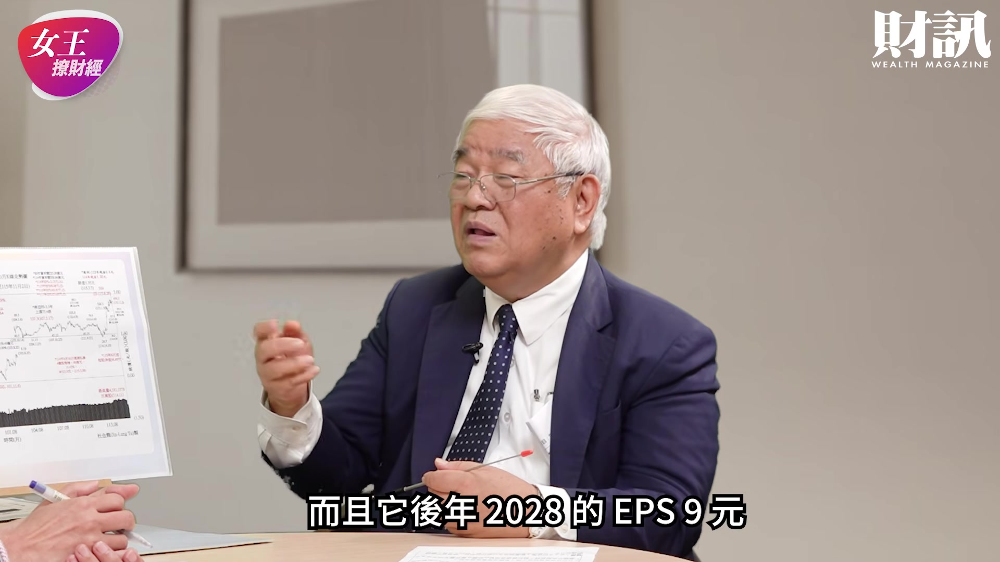

**逐字稿片段：** 那像旺宏 旺宏 2028 EPS 多少 66 元 股價才逾 100 元 所以其實四支的 台灣的記憶體股 都還算不錯 那首選是它 所以我這個類股我還推薦 那另外我們看現在最有名的

**話題推測：** 老師提及旺宏並說明其EPS預估。

---

## 00:17:46

**逐字稿片段：** 這一支股票 發哥 發哥 它 3Q 法說會完以後 不是好像大家一起很不好 它不是跌破 4000 元 上個禮拜六完以後出研究報告 2028 年 335 元 EPS 就怎麼差那麼多 它獲利成長一倍 EPS 第一次看到 335 元 就是說它修正完以後 它那時候就是 ASIC 的量會增加 所以本來那個聯發科那時候不是 法說會完以後盤中跌很多 最近你看它都開低走高 所以我太太從昨天開始就去買零股 這支股票目前來講 最低到 2900 元 那上次 9 月 1 日的話 可轉債的價格是逾 4500 元 這個法說會它們研究員給它報告是說 雖然說 3Q 不是好 可是它已經跟你明顯的交叉 明年的業績會大幅的成長 所以那一天就利空出盡完以後 股票大概就有人在底下接 所以這支股票目前來講 很簡單的 最近外資的研究報告

**話題推測：** 老師開始深入分析聯發科(發哥)。

---

## 00:18:52

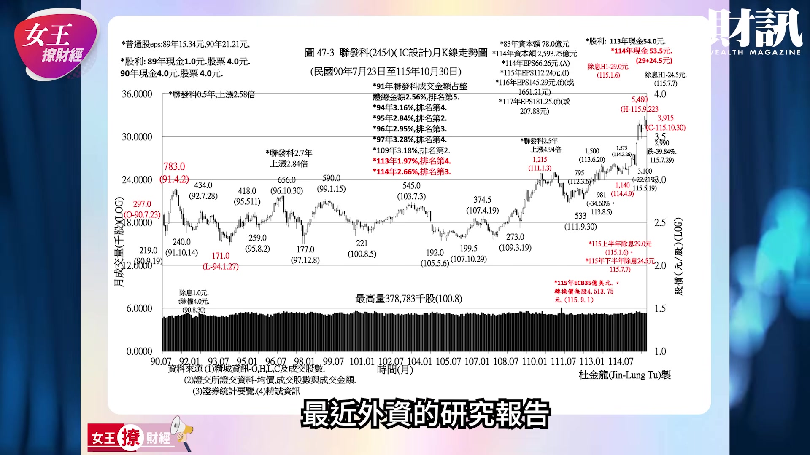

**逐字稿片段：** 有把它今天早上有調到 7800 元 那那家本土法人的話 EPS 大幅調高 目標價給它到 6000 元 現在就是在這邊做打底動作 所以這一支外資 10 月分 買超第一名就台積電 第二名就聯發科 還有鴻海還有台達電 所以這一次發哥 你還是非常看好就對了 對 我沒有賣它 可是盤跌的話你就建立持股 假設說你一張 400 多元 你可以分五等分 200 股 200 股五次 五次你不會跌到更低了吧 這相對一個操盤方法 其實最近有一些那個雜音是說

**話題推測：** 老師提及外資調高聯發科目標價至7800元。

---

## 00:19:27

**逐字稿片段：** AI 好像它的那個資料中心建置 在美國可能有一些延遲 可是它只是延遲 它後面還是會出來 所以可能 2027-2028 年這個業績 還是非常的看好 有兩個 一個是說 我的現金流量變成負的 因為我的獲利沒有 這個你可以去發行可轉債 特別股來把它消弭掉 那像假設說美國期中選舉 很多人怕民主黨選勝完以後 它會卡 AI 的資料中心的基礎建設 可是我認為你只要是以後 這個還有成長的話 理論上應該遲早還是會回來 所以來講的話為什麼我們剛才 我會比較看偏多那個 DRAM 的股票 因為 DRAM 的話你如果基礎建設完以後 它有個需求量很大 那不是像以前我們景氣循環

**話題推測：** 老師提及AI資料中心建置可能延遲的雜音。

---

## 00:20:14

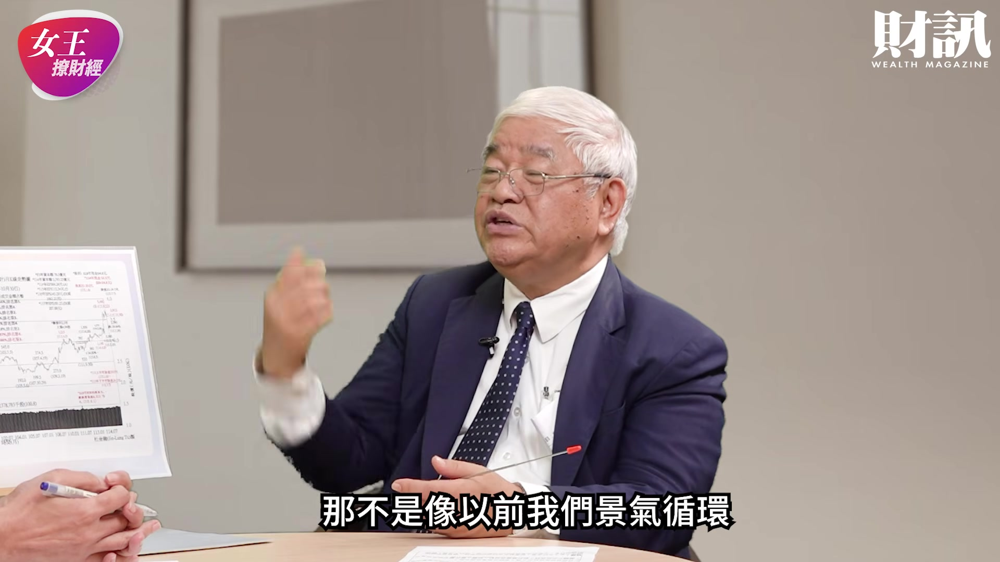

**逐字稿片段：** 我們知道有一個類股就 ASIC 創意 創意的 2028 EPS 多少 逾 500 元 我第一次看到 目標價有的人弄到 1000 元 我想說它爸爸那個 台積電只有 2600 元 你這個兒子為什麼要 大概 9000 元 1 萬元 好 再下一檔我們來看這個 欣興也是熱門股 ABF 載板的龍頭

**話題推測：** 老師再次提及ASIC類股的創意。

---

## 00:20:38

**逐字稿片段：** 你看到我這字卡最新的 EPS 87 元了有沒有 EPS 87元 2028 年 87 元錢 本來 50 元現在逾 80 元 所以外資的目標價 像這家本地的證券商 給它的目標價是 1700 元 在上個禮拜我到高雄去演講 我那天快要進入會場 我就看到它跌下來 我就買 1090 元 隔天就漲到了 我沒賣 完以後這幾天不是跌破今天重挫 就是因為我這一次 已經好幾次想要買 我在那個 900 元要買沒買就噴出去 現在漲到 1400 元 我總是買 買完以後短期套牢 所以你去參加論壇的過程中 你還可以記得要買股就對了 有一次在台大也是財訊辦的

**話題推測：** 老師明確提及欣興的字卡，顯示最新EPS。

---

## 00:21:19

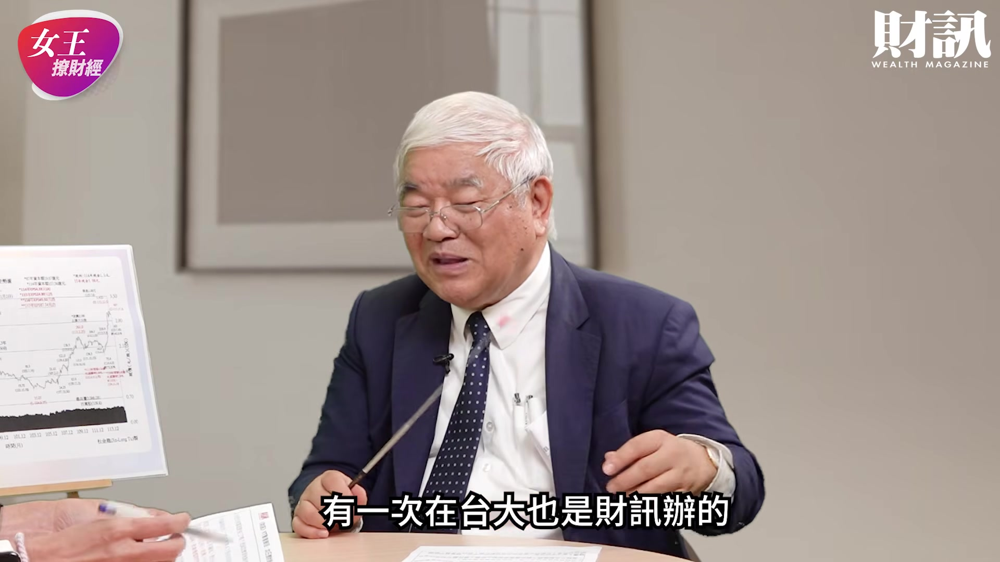

**逐字稿片段：** 我開完以後我就買 ETF 不看還好買完以後破它發行價 我太太罵我說杜金龍你喔 自己還在跟人家推薦股票 你還買 ETF 我說沒代誌 因為為什麼 因為有時候資產平衡 就是資金的配置 對 因為有的有股票像千金股 萬金股很貴 你不可能 10 元錢 我們如果要買高價電子股 這個 ETF 有幫你帶 也是一種選擇 對 所以我才去買它 想不到買完以後連跌好幾天 那欣興我買了 因為 ABF 我們剛才講 到明年各個很多研究報告都寫 而且它四檔喔 臻鼎 還有景碩 南電 今天景碩也出研究報告 目標價 900-1000 元 不只一支 四支都有 像我剛才講的 DRAM 的股票四隻 EPS 都大幅調高

**話題推測：** 老師分享他購買ETF的經驗。

---

## 00:22:09

**逐字稿片段：** 那 CCL 更不得了 CCL 的台光電 台燿 還有貿聯這個都往上調高 所以我們一般選股你大概 都選這個獲利 我的獲利跟人家稍微不一樣 因為我每天有抄研究報告 都有到 2027 2028 我都是只寫 2028 好 老師這些是我們大家的熱門股 那順便節目最後 你在車站捷運站碰到的人 或者其他人現在還有關心哪些

**話題推測：** 老師再次提及CCL類股。

---

## 00:22:33

**逐字稿片段：** 特別的類股嗎 每次我走過去都不會抬頭 只要我講實話他們就 因為我這個破台灣國語 AI 花三個月才把我破解掉 從 10 月分的資料大概看出來 塑化可能是今年第一名 因為現在 1 到 10 月分的 其實南亞是半支電子股 所以你塑化如果說南電 南亞科 南亞太高

**話題推測：** 主持人提問老師還有哪些特別關心的類股。

---

## 00:22:55

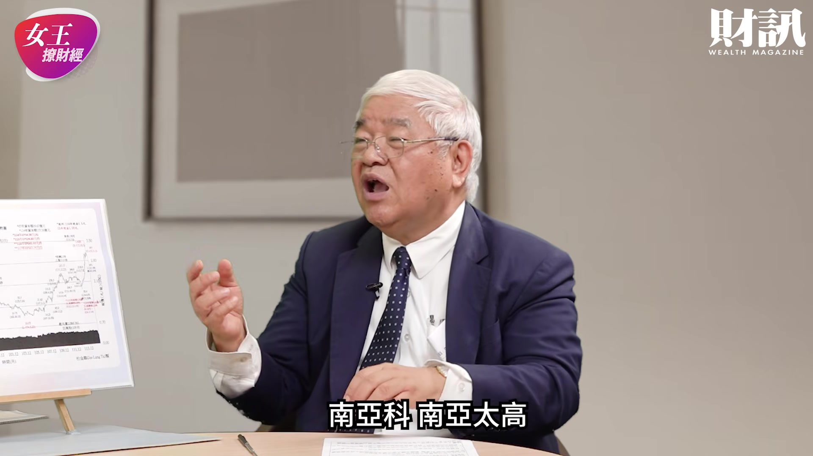

**逐字稿片段：** 你可以買台化跟台塑 台塑我舉一個例子 它 1Q 的每股淨值 50 元 2Q 每股淨值多少 90 元 我們這個月不是要公布 3Q 嗎 台塑集團的很多股票都大漲 它沒有賣會提列每股淨值 所以台塑的每股淨值搞不好 會升到 100 元 所以到 10 月 14日 台化跟台塑都 10 月 14 日高點 而且做到快要 100 元 這個還有 1326 的台化

**話題推測：** 老師推薦台化和台塑。

---

## 00:23:24

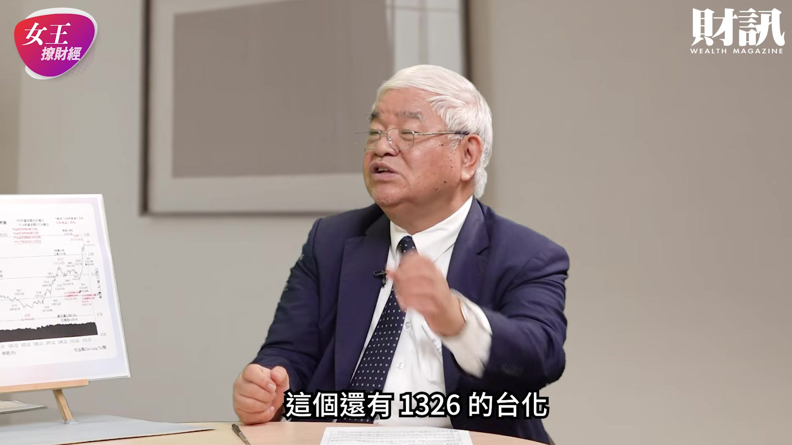

**逐字稿片段：** 台塑今年 EPS 是逾 4 元 台化也逾 4 元都已經上來 還在每股淨值以下 所以這個可以

**話題推測：** 老師列出台塑和台化今年的EPS。

---

## 00:23:33

**逐字稿片段：** 那台塑化是已經外資做一段 它 EPS 今年 9 元明年 7 元它還有 所以其實台塑六寶加台勝科 今年不要買那個最貴那家 買台勝科 那再來就一個類股叫金融股 大盤要漲金融股 金融股你看 10 月分大盤跌 5% 左右 金融股是漲好像 6% 塑化漲 11% 就逆勢上漲 對 所以你看美國道瓊不是 10 月分還漲 因為它躲到金融股 假設說我們 12 月分如果說 美國還要調高利息 那另外我們每年的 1 月分 大家都沒有業績 金融股稍微會表現多一點 像金融股我在這個節目經常講 我買 2881 的富邦金有沒有 這次突破 100 元到 166 元

**話題推測：** 老師提及台塑化的表現。

---

## 00:24:17

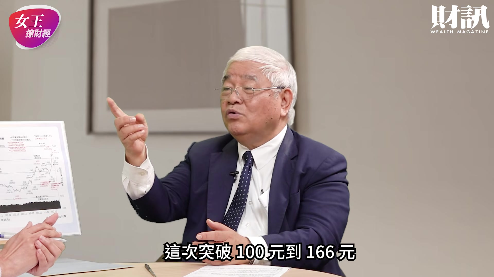

**逐字稿片段：** 而且像有一支股票 00919 它 50% 是金融股 最近因為大盤跌了逾 6000 點 妳有價差從高點下來已經 15%-20% 是 好 謝謝老師在今天這個 台股最混沌的時候呢 分享你的操作邏輯 然後也讓我們心稍微安一點 好 那感謝大家今天的收看 如果你也支持我們的節目 請幫我們按讚訂閱加分享 也歡迎收看我們財訊其他的影片 我們下次見 bye bye 謝謝老師

**話題推測：** 老師提及股票00919。

---
