# wealth1974_S_jWTG0qUVc — 關鍵畫面索引

- 來源逐字稿：[wealth1974_S_jWTG0qUVc_GT.srt](wealth1974_S_jWTG0qUVc_GT.srt)
- 影片：https://www.youtube.com/watch?v=S_jWTG0qUVc
- 截圖數：15

## 00:00:00

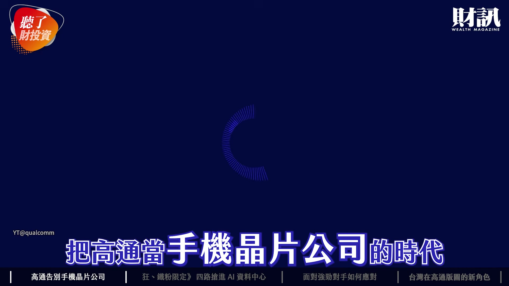

**逐字稿片段：** 把高通當手機晶片公司的時代 將在今年正式結束 這句話是 高通財務長兼營運長 Akash 首度接受台灣媒體專訪時 丟出了這句話 靠手機晶片起家的高通 正把數十年來 累積的邊緣算力 搬向雲端

**話題推測：** 影片主題或高通財務長的關鍵引言

---

## 00:00:15

**逐字稿片段：** 今天這集 我們會先來聊聊 高通說要告別手機晶片公司 這次的高峰會到底談了哪些事情 再來分享一下 四路搶進 AI 資料中心 高通的 AI 策略到底是什麼 最後我們聊一下 台灣在高通版圖裡面的 重要新角色是什麼

**話題推測：** 節目議程概述

---

## 00:00:29

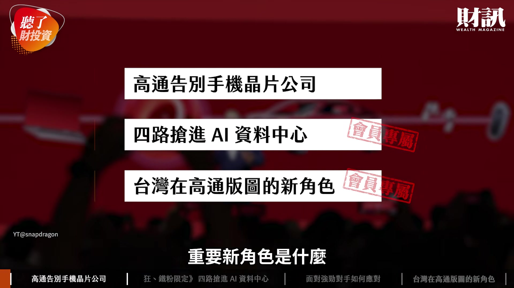

**逐字稿片段：** 大家好 我是今天主持人 陳彥淳 今天來賓是 財訊雙週刊的主編 陳碧珠 歡迎小珠 大家好我是小珠 對 其實一年一度的 高通的（Snapdragon）高峰會 一直是大家非常關注的重點 這次小珠前往的時候 有一些不同的收穫啦

**話題推測：** 主持人與來賓介紹

---

## 00:00:44

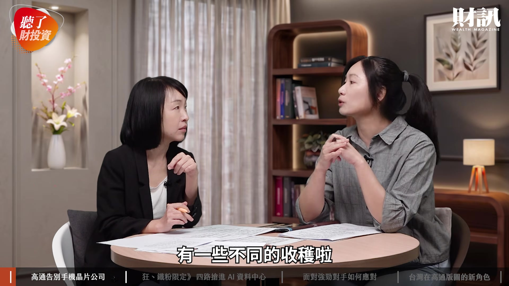

**逐字稿片段：** 我們先跟觀眾介紹一下 到底這個高峰會 每年舉辦的意義 跟它的代表性在哪裡呢

**話題推測：** 高通高峰會的背景與意義介紹

---

## 00:00:52

**逐字稿片段：** 在夏威夷茂宜島 高通這個峰會 已經舉辦第 11 個年度

**話題推測：** 高通高峰會的舉辦地點與屆數

---

## 00:00:57

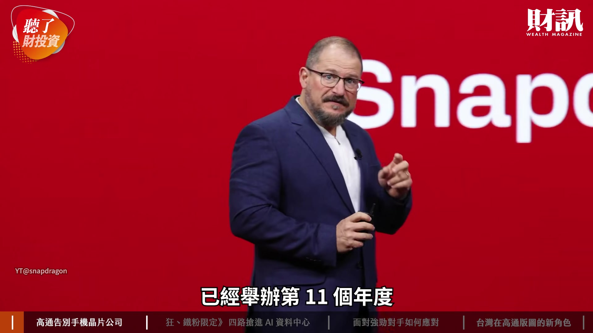

**逐字稿片段：** 其實大家都知道它是從 手機晶片崛起 辨識度最高的就是它的 CDMA 這些數據相關的 那它在 4G 的時候 其實基本上就是稱王 後來慢慢的 慢慢的 因為聯發科在中國市場的崛起 那它們也開始兩個較勁 當然手機市場也成熟 加上 Apple 起來 對 所以它每年要宣示的 當然就是它在手機晶片 非常厲害 所以這一次

**話題推測：** 高通手機晶片發展歷史與競爭關係

---

## 00:01:19

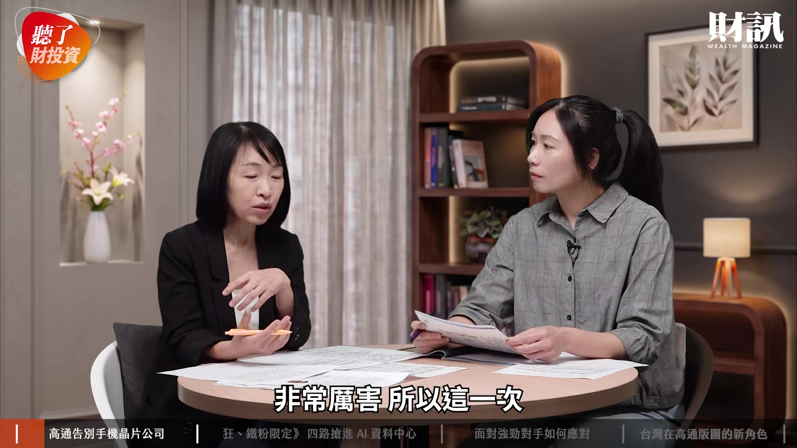

**逐字稿片段：** 我們可以依然看到 在它的 4 天的峰會 它先展示的是它 手機最新旗艦版的晶片 還是先展示手機晶片啦 對 那當然也很厲害的是 它用台積電的 2 奈米 然後呢 它推的是 Gen 6 然後叫做 Elite 第 8 代 跟 Extreme 這個都是 它想要強調的效能

**話題推測：** 本次高峰會展示的最新旗艦手機晶片

---

## 00:01:37

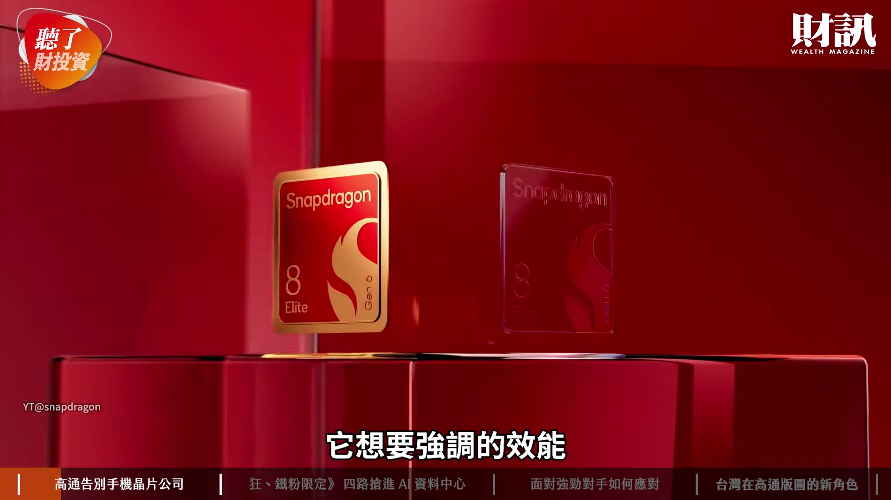

**逐字稿片段：** 我看到的不一樣的是 它在效能之外 它在很多的應用上面的體驗 告訴我們說 手機是不會消失 但是它互動的方式改變了 對 那這件事情就會呼應到 剛剛總編一開始說 高通要告別手機晶片時代 看起來好像有點衝突 可是其實是不違和 是因為它很清楚知道說 手機這個載體 依然是它 在市場最大的一個來源 可是在 AI 的時代 一定要再去做 更多的算力服務 而不只有在手機

**話題推測：** 高通強調的應用體驗與手機互動方式改變

---

## 00:02:08

**逐字稿片段：** 對 那 Google 這一次 也是非常的積極 它以前大家比較清楚的是 Chromebook 就是低價教育版這種 對 可是它（高通）很清楚知道說 它一定要在 AI 時代 也要搶占 AI PC 所以它在高峰會的附近不久 它就宣示它要做 Googlebook 那事實上它（Google）有找 Intel 高通也是夥伴 聯發科也有 再來就是智慧眼鏡 甚至還有推出可以看的 所謂的耳機 可以看得耳機 就是導入相機 對 就是說 耳機是用來聽的 可是其實它裡面有導入一個 類似感測器功能 也可以當作是你第二個眼睛 在幫助你 比如說 如果你在 Supermarket 那你可能戴個耳機 也不用戴厚重的眼鏡 用一個語音指令 告訴它說 今天我在這個超級市場 我可以買些什麼東西 然後它可能就可以回答你 對 那這些東西的交互作用 也讓高通知道說 原來的市場 我要延伸到其他 可是更重要的是 它有強調一個混合 AI 什麼叫混合 AI 就是 在以前它可能會一直覺得說 我的邊緣端算夠就好了 我們現在都知道連網時代來臨 大家每個地方都可以連線上網 所以它也開始知道說 我不要去執著 是地端還是雲端 我的算力服務 也要涉及到所謂的雲端的業務 對 因為其實過去大家理解 高通都是聚焦在 消費型晶片上面 都是比較是端點的 使用上面 就像剛剛講的 手機 眼鏡 汽車 電腦 都屬於比較端點 但因為現在 AI 的趨勢 看起來是在雲端上面運算 對使用者來說 他可能沒辦法分辨 到底我這個運算 是來自雲端 還是來自於 這個手機或是載具本身 有時候是很難分的 是 所以高通面對這樣的趨勢 是不是也代表說 它其實會往雲端的 應用跟發展愈來愈多 沒錯 在今年 透過專訪的過程當中

**話題推測：** Google在AI PC領域的佈局與Googlebook

---

## 00:03:51

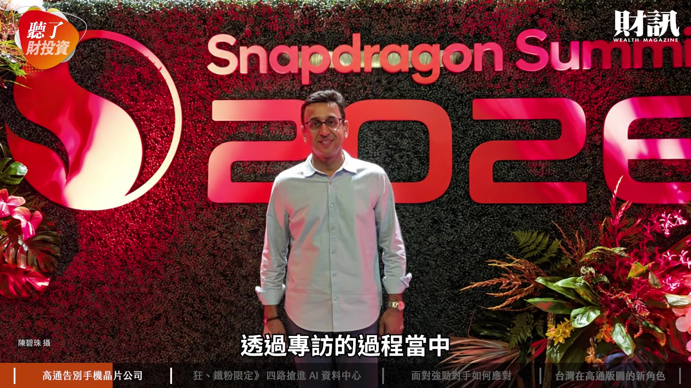

**逐字稿片段：** 他也就宣示了 它一個四大戰線 就是進入所謂的資料中心 這四大戰線其實它 勾勒得算滿清楚 也是我們等一下 可以好好的再盤點說 它這四大戰線到底有什麼 優勢跟特色 瞭解 所以是看起來 它的策略有稍微做一些小調整 但我就很好奇 因為他在接受妳採訪的時候 有提到說 不要從手機晶片公司 來定位高通的話

**話題推測：** 高通宣示進入資料中心的四大戰線

---

## 00:04:11

**逐字稿片段：** 那現在業績表現 到底手機晶片的占比有多高 其實高通的營收 有 85%-87% 是來自於所謂的核心半導體 是來自於所謂的核心半導體 其實就是它的晶片

**話題推測：** 高通手機晶片在營收中的占比提問

---

## 00:04:19

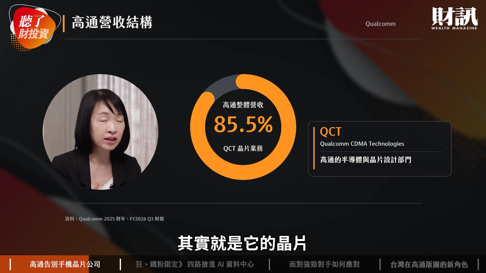

**逐字稿片段：** 到最新一季 還有 6 成是手機的營收 妳是指它的這個 核心的半導體這個事業裡面 其中有 6 成的營收 來自於手機晶片嗎

**話題推測：** 高通最新一季手機營收佔比（6成）

---

## 00:04:29

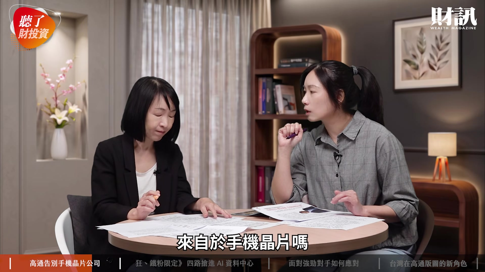

**逐字稿片段：** 去年是 7 成 72% 然後到今年的 它們算財年第三季 我們算第二季 4-6 月還有 6 成 意思就是說手機業務 還是它的營收最大來源

**話題推測：** 高通去年手機營收佔比（7成/72%）

---

## 00:04:40

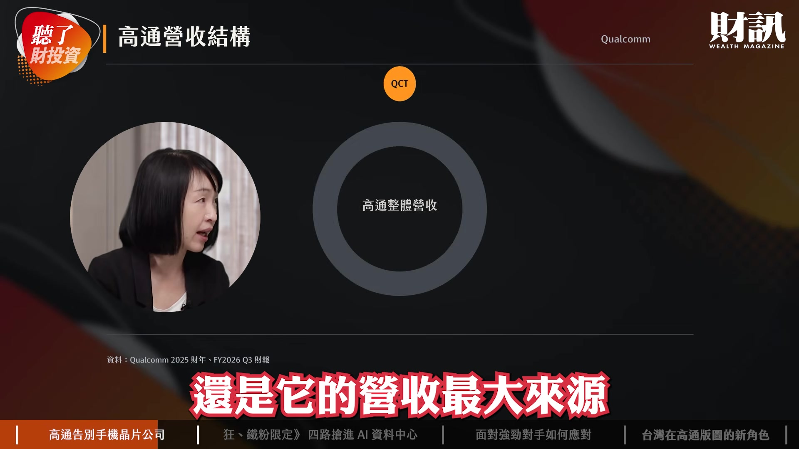

**逐字稿片段：** 對 那它另外 15% 是它的授權 IP 其實它一直不斷地 在建立它的專利 其實那 15% 的 IP 也是它毛利維持的一個來源 瞭解 那當然我們還是要 看它的晶片 畢竟剛剛跟妳講

**話題推測：** 高通授權IP營收佔比（15%）

---

## 00:04:52

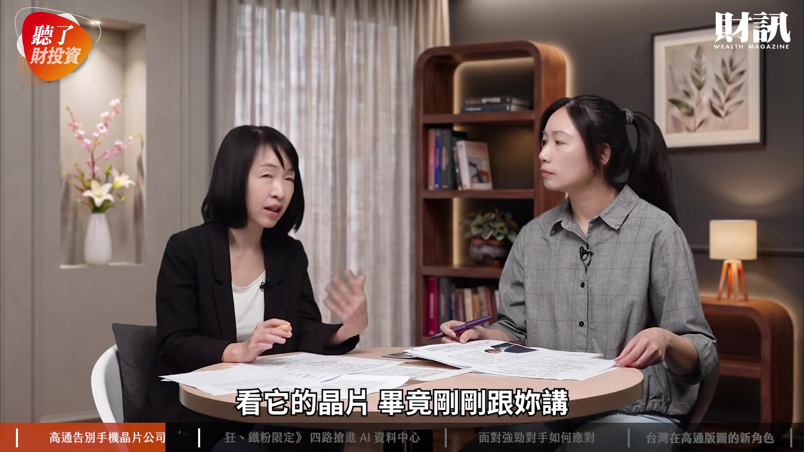

**逐字稿片段：** 高通其實現在是 全球第四大的 IC 設計公司 對 前面就是輝達 博通 超微 接下來是它 後面就是聯發科 這五家這樣子 但可以看得出來 趨勢上好像它手機晶片 占它這個 QCT （Qualcomm CDMA Technologies） 沒有愈來愈高 比率愈來愈降低 我們這次採訪的 Akash 就是他其實是高通的 CFO 兼 COO 其實他的角色就是 在幫高通抓策略 然後如何化成的實際營收 所以他也告訴我們就是說 手機這塊市場 現在雖然是最大的比重 可是從明年開始 它會下降到一半 他的意思是說這個東西 不代表它們會消失 而是其他在長大 就是整個餅是在做大的 這個是占比的問題 沒錯 那甚至他更預估到 2 年後 2029 年 它可以讓 非手機的部分擴大到 3 分之 2 手機是 3 分之 1 這個是滿新的 這個代表是另外一個勢力的 高度成長 他才會說 不要把高通說成 只是手機晶片公司而已 好 所以接下來我們就要 再仔細的來分析一下說 高通從邊端要攻向雲端的 四個戰線到底內容是什麼 策略在哪裡 這件事情當然就非常重要 攸關到高通接下來 到底會不會成功的關鍵 接下來的內容 是屬於狂粉跟鐵粉的專屬內容 歡迎大家加入頻道會員 解鎖所有的影片 看完今天影片 你覺得高通跨進 AI 資料中心 能夠搶到一席之地嗎 歡迎大家留言分享你們的觀點 如果想瞭解更多的內容 歡迎點選資訊欄裡面的文章連結 或者購買財訊第 774 期雜誌 跟我們一起追蹤政經趨勢

**話題推測：** 高通全球IC設計公司排名（第四大）

---
