# wealth1974_SfJ4ZC3rd-Q — 關鍵畫面索引

- 來源逐字稿：[wealth1974_SfJ4ZC3rd-Q_GT.srt](wealth1974_SfJ4ZC3rd-Q_GT.srt)
- 影片：https://www.youtube.com/watch?v=SfJ4ZC3rd-Q
- 截圖數：21

## 00:00:06

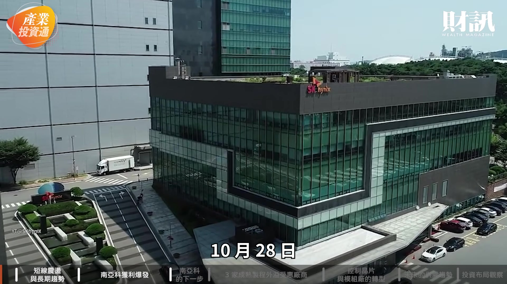

**逐字稿片段：** SK 海力士公布財報 當時其實還滿樂觀的 它預計記憶體 供不應求的狀況 會延續到 2030 年 而且已經跟 14 家的主要客戶 簽訂了長約 看起來非常的樂觀

**話題推測：** 討論 SK 海力士公布財報

---

## 00:00:18

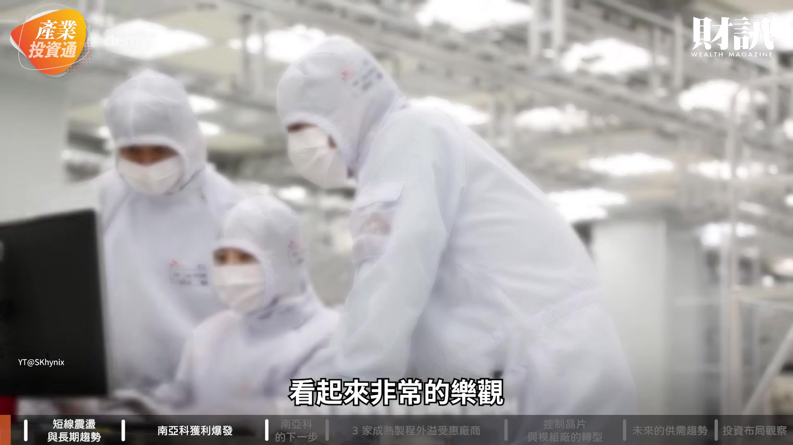

**逐字稿片段：** 不過隔天 英特爾公布財報 市場對 AI 的投資疑慮 又再次出現

**話題推測：** 討論英特爾公布財報

---

## 00:00:24

**逐字稿片段：** 費半大跌 7% 那台股怎麼跌就不用說了 台灣記憶體的族群也跟著震盪 今天這一集 我們就要來跟大家聊聊

**話題推測：** 提及費半指數大跌 7%

---

## 00:00:32

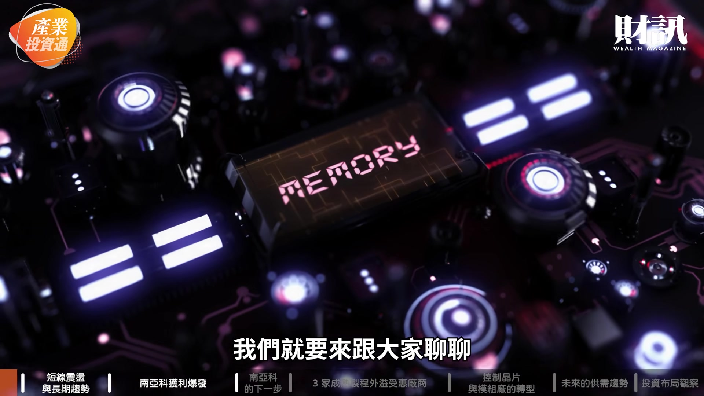

**逐字稿片段：** 短線震盪與供給吃緊的長期趨勢

**話題推測：** 介紹本集討論主題：短線震盪與供給吃緊的長期趨勢

---

## 00:00:35

**逐字稿片段：** 南亞科獲利爆發與擴產布局

**話題推測：** 介紹本集討論主題：南亞科獲利爆發與擴產布局

---

## 00:00:38

**逐字稿片段：** 7 家台廠的外溢商機 志明哥其實剛才講到兩個現象 一個是剛講 SK 海力士生意很好 但另一方面隔天美股大跌 台股也是大跌 那我們是不是先請志明哥 幫我們解析一下說 2 件事情 第 1 個 修正是怎麼來的 第 2 個 記憶體的供給 為什麼這麼的緊呢 其實這次的修正

**話題推測：** 介紹本集討論主題：7 家台廠的外溢商機

---

## 00:00:59

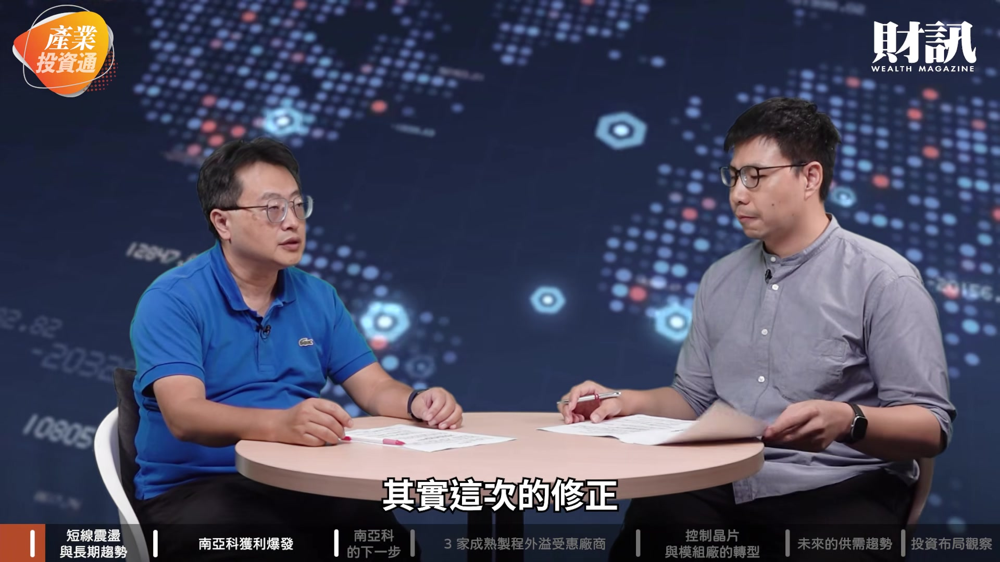

**逐字稿片段：** 主要還是因為升息的原因 那 10 月是沒有升息 但是大家估計 12 月可能還會 升息可能機率是 8 成 過去升息表示景氣變好 但現在因為今年的狀況 是很多的這種 CSP 它需要做一些投資

**話題推測：** 解釋市場修正原因：升息

---

## 00:01:16

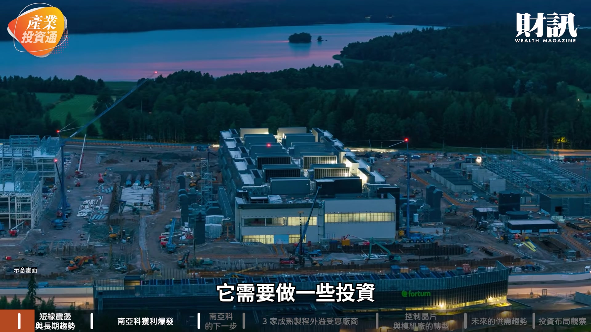

**逐字稿片段：** 所以它自由現金流就往下掉 就不再是正的 所以說大家對這種 自由現金流疑慮比較高 然後再來升息

**話題推測：** 討論 CSP 廠商自由現金流下降

---

## 00:01:25

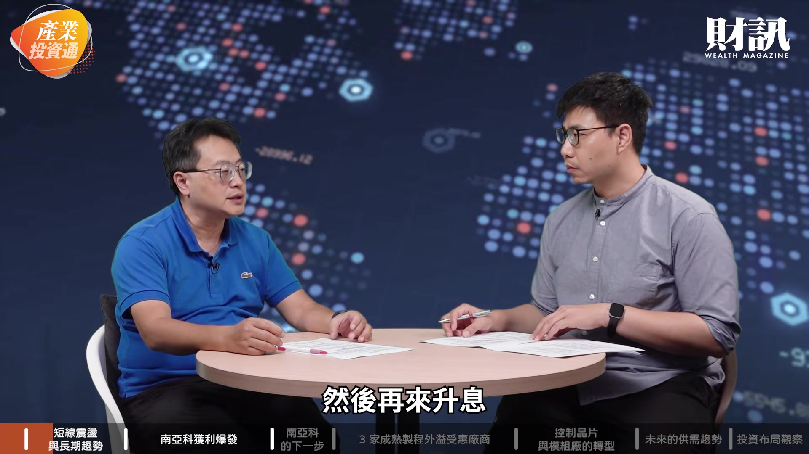

**逐字稿片段：** 再加上川普期中選舉的狀況 可能也會有些變數 所以說大家對 AI 的這種投資 還是謹慎待之 所以目前看起來 就是科技股都修正 就連台積電這麼好的財報 也是修正了一個比率 未來這種利空的衝擊 其實會慢慢淡化 尤其在川普期中選舉之後 那看起來你說 自由現金流為正的公司 記憶體應該是 絕對是都是正的 當然過去的記憶體 是 2 年的不景氣 然後 1 年的景氣 那當然記憶體 今年年初大漲之後 短期現在也是盤整 甚至修正一大段 那其實你看 目前不管是海力士 不管是三星 對記憶體 認為說缺貨

**話題推測：** 提及川普期中選舉的變數

---

## 00:02:11

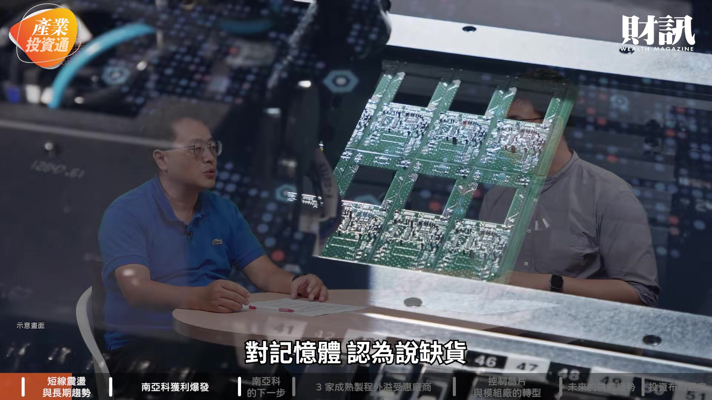

**逐字稿片段：** 一直到 2028 到 2030 年 都有可能 所以說它慢慢會改變這種 景氣循環的一個狀態 跌深反彈的部分 我覺得記憶體這一塊 在未來的大盤反彈的時候 其實它有機會 扮演一定的角色 當然對這波記憶體的修正 大家會有些疑慮 但是因為它不管是 EPS 不管是獲利都還是滿好的 所以說到 2028 年前 大家應該是找一個 記憶體落底的時間點 然後去做投資的話 我覺得 2027 年也有一段 至少是一個反彈的一個契機 其實這次我們看摩根大通

**話題推測：** 預估記憶體缺貨狀況將持續至 2028-2030 年

---

## 00:02:48

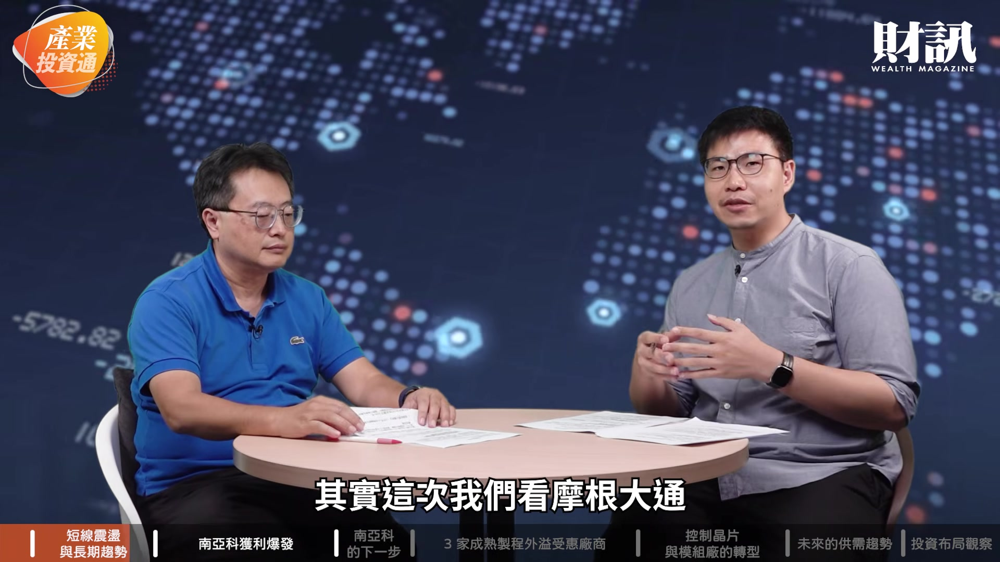

**逐字稿片段：** 其實有一個報告 就是它在 10 月 20 日 我記得它們大概會針對 記憶體的產業狀況 會有一個更新 不管是 DRAM 或是 HBM 價格都是成長的 但它其實就連 報告的分析師本身也很疑惑 明明產業價格一直在成長 缺貨的狀況 也還是持續的延續下去 反而股價一直在跌 簡單來講就是情緒 市場的情緒導致了投資人 對於現在 AI 的這個 是沒有信心的 但其實各位觀眾 其實可以從剛才志明哥提到 其實從產業面 從獲利面來講 看起來記憶體的族群 還是可以讓大家有所期待 那我們接下來就要來進一步去看 剛剛講到其實三大的記憶體股 它們主要講的是 HBM 就是跟 AI 最直接相關的 雖然台灣的廠商 並不是直接的生產 最熱門的 HBM 但其實當國際大廠把產能轉走之後 外溢效應就慢慢地顯現出來

**話題推測：** 提及摩根大通的記憶體產業報告

---

## 00:03:37

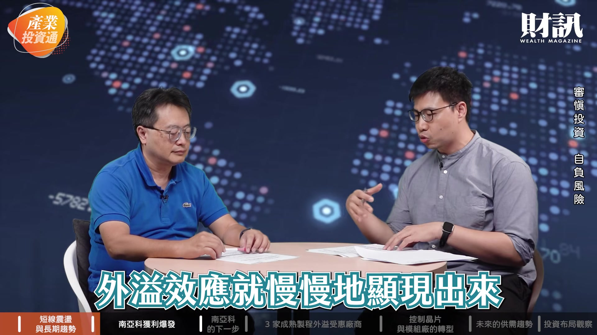

**逐字稿片段：** 獲利表現最突出的就是南亞科 那能不能先請志明哥 來幫我們解析一下 南亞科這間公司 就南亞科來講 其實過去的思考邏輯是 國際廠商是生產 HBM 它的產能卡住的是滿多 所以說它根本沒有餘裕

**話題推測：** 介紹南亞科獲利表現突出

---

## 00:03:54

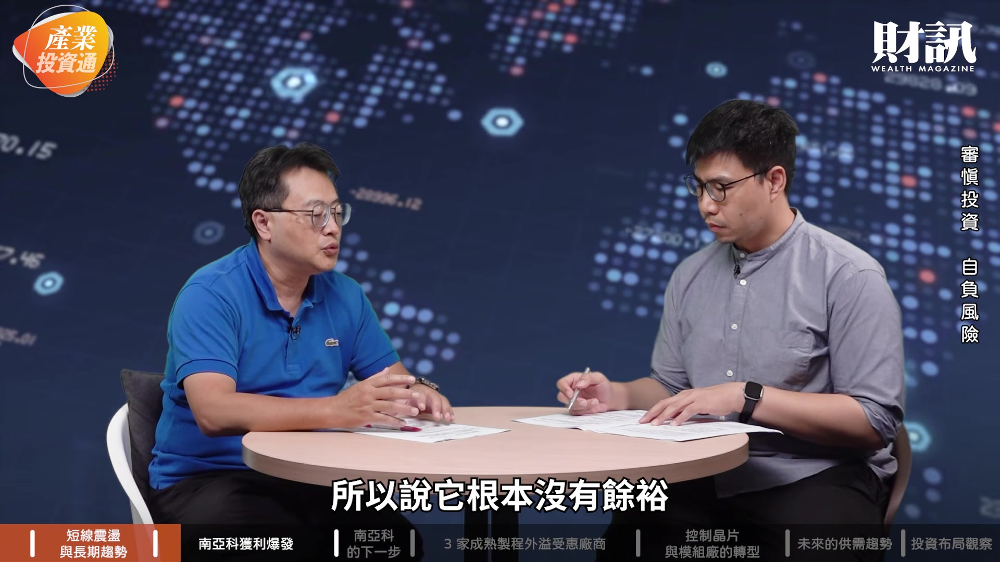

**逐字稿片段：** 去生產這種 DDR4 跟 DDR5 這樣的標準型記憶體 這部分就是南亞科的強項 那當然你看它第三季的營收

**話題推測：** 南亞科專注於 DDR4 與 DDR5 標準型記憶體

---

## 00:04:05

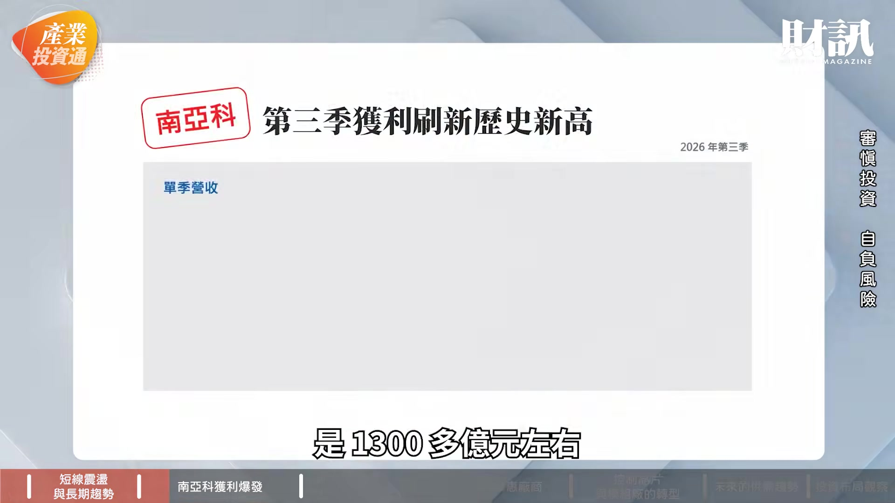

**逐字稿片段：** 是 1300 多億元左右 它的季增是 61% 那 EPS 是 25.4 元 毛利率是快 85%

**話題推測：** 南亞科第三季營收達 1300 多億元

---

## 00:04:13

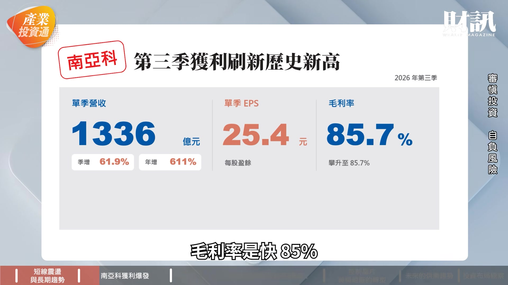

**逐字稿片段：** 今年的話法人預估至少是 EPS 75 元 明年都有可能在 120-130 元左右 其實看起來本益比相對是低的 原因是因為獲利的狀況 其實還是不錯 那第三季 雖然它生產的量是變少 但是它獲利是變多 表示它的長約 開始換約以後 報價其實是往上走 那另外一個是產能的話

**話題推測：** 法人預估南亞科全年 EPS 至少 75 元

---

## 00:04:37

**逐字稿片段：** 可能要等到 2027 年下半年 才會有新的產能的挹注 所以說新的產能又開出來以後 它營收獲利又有機會再成長 對南亞科來講 它是生產記憶體 從無到有的公司 狀況是好的 因為它不是買高賣高這樣的方式 它的利差不會變差 台灣其他記憶體模組廠商 就會有買高賣高這樣的問題 所以說南亞科 它的第三季的平均銷售（單價） 是季增 6 成 獲利其實持續往上漲 那另外一個 南亞科總經理有講說 其實 DRAM 的這種需求 還是一直往上走 然後南亞科現在目前也往高階

**話題推測：** 南亞科新產能預計 2027 年下半年挹注

---

## 00:05:19

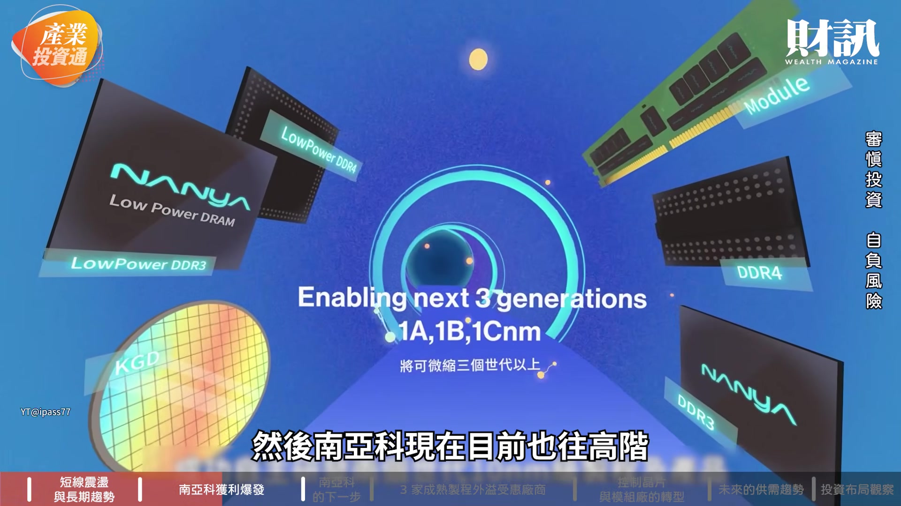

**逐字稿片段：** 像先進封裝的這方面去布局 等於是它不只在傳統 標準記憶體方面卡位 它未來在先進封裝的部分 也會有一定的它的角色 看起來它今年資本支出

**話題推測：** 南亞科布局高階先進封裝

---

## 00:05:33

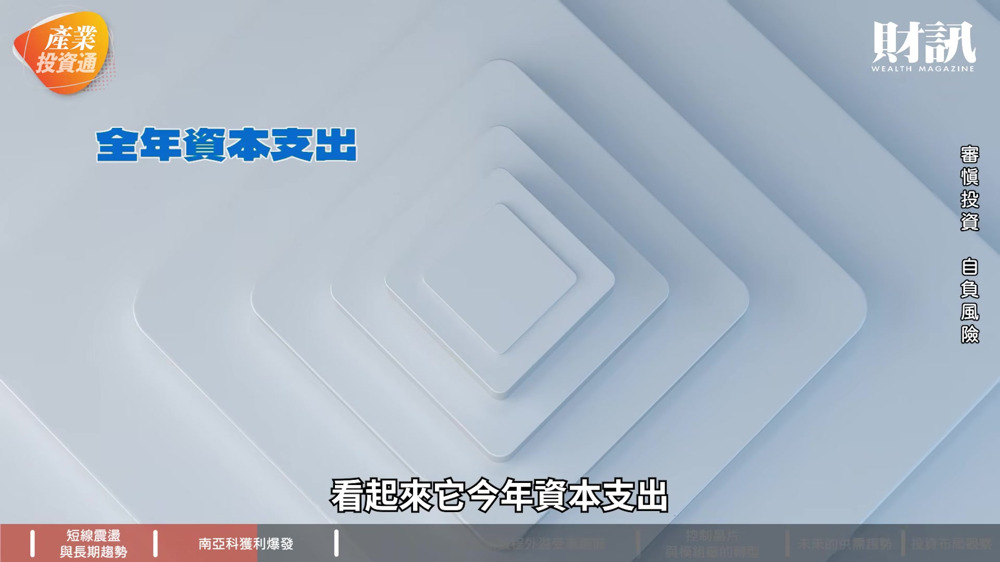

**逐字稿片段：** 從 500 多億元提升到 697 億元 成長滿高的 看起來它的狀況 未來還是會持續地 穩健地往上走 當它本益比超低之後 其實利空之後的反彈 它一定會有一個角色 其實經過今年這樣的 台股的走勢 投資人應該都會感覺到說 當然題材很好 技術沒問題 那獲利很棒 但其實還是需要資金的幫助 這個行情真的把它走出來 那我們回到剛才講 其實我們一開始就有講到籌碼 就是這個資金面的部分

**話題推測：** 南亞科資本支出從 500 多億元提升至 697 億元

---

## 00:06:04

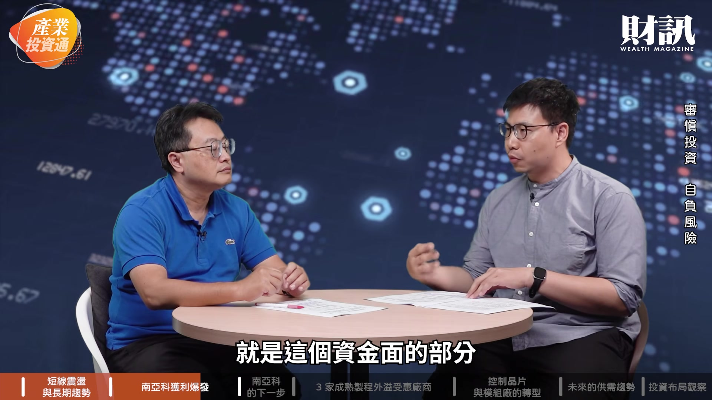

**逐字稿片段：** 10 月外資其實是 賣超台股不手軟的狀況 那稍微回顧了一下 其實台灣主要的那種 大的科技型的 ETF 其實 南亞科幾乎都是標配 隨著這 10 月 11 月 有很多新的主動 ETF 或者是被動 ETF 這樣出現 其實它可能會是一個 新的進來買的資金的來源 但是就志明哥來看 你覺得說如果說資金面上 要能夠支撐像南亞科 這樣記憶體的公司谷底反彈 有沒有一些投資人 應該注意的地方 其實我覺得從現在到明年初 這段時間就怎麼講 因為它記憶體這些公司 其實獲利都很好 它明年的配息也會相對好

**話題推測：** 討論 10 月外資賣超台股狀況

---

## 00:06:42

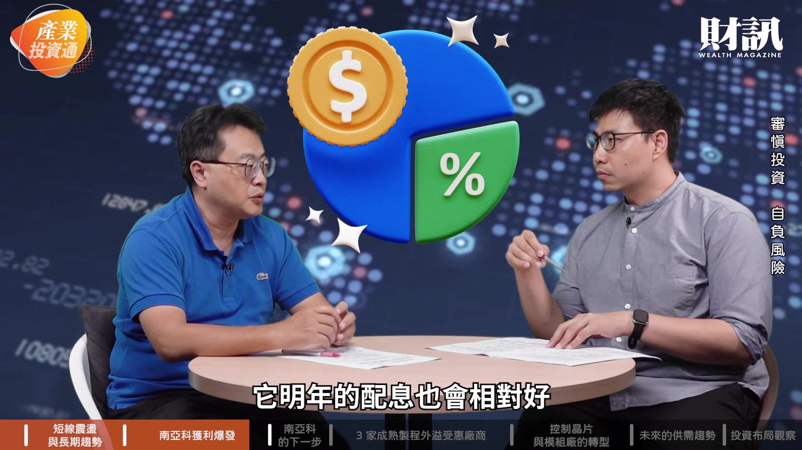

**逐字稿片段：** 表示它的殖利率也會相對高 那 9 月 10 月那時候的氛圍 是高股息的這 ETF 的成長力道 好像比主動型 ETF 要好 那等於是你明年 這些高股息的 ETF bye bye 它有可能投資 類似記憶體這樣的公司 當然外資賣南亞科比較多 但是看起來這種 不管是主動型 ETF 甚至高股息 ETF 也有可能投資南亞科 這樣至少是一個反彈的 一個部位的投資 它其實有機會持續的往上走 是 南亞科賺到錢之後 下一步要怎麼走呢

**話題推測：** 討論記憶體公司的殖利率

---

## 00:07:19

**逐字稿片段：** 那其他的台廠狀況又如何 接下來的內容就是屬於 會員專屬的內容 如果你有興趣的話 歡迎訂閱財訊的頻道會員 那我們就聊到這邊 《產業投資通》我們下次見 bye bye 好 志明哥

**話題推測：** 提問其他台灣廠商的狀況

---
