# wealth1974_X-kNRcZc5Ek — 關鍵畫面索引

- 來源逐字稿：[wealth1974_X-kNRcZc5Ek_GT.srt](wealth1974_X-kNRcZc5Ek_GT.srt)
- 影片：https://www.youtube.com/watch?v=X-kNRcZc5Ek
- 截圖數：31

## 00:00:14

**逐字稿片段：** 新北市的青年局 局長邱兆梅 邱局長來到我們節目現場 局長好 社長好 各位觀眾朋友大家好

**話題推測：** 介紹嘉賓新北市青年局局長邱兆梅

---

## 00:00:22

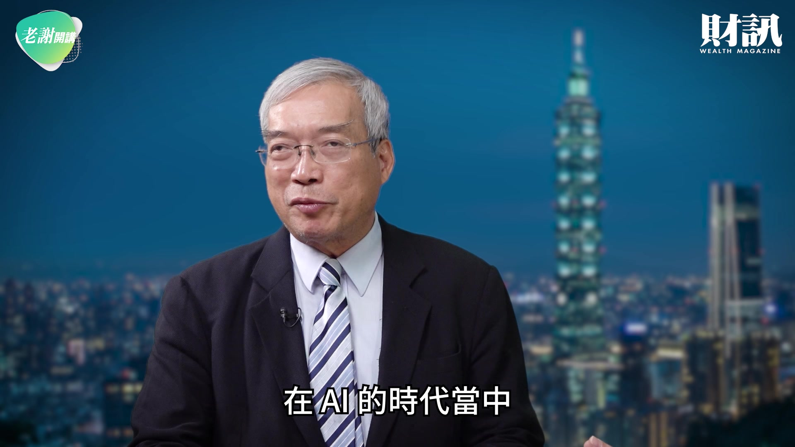

**逐字稿片段：** 在 AI 的時代當中 我們看到 AI 帶來了機會 同時也帶來很多的挑戰 最近大家看到 微軟已經祭出一個 全球員工的 優惠資遣方案 換句話說 過去靠軟體 能夠行遍天下 那麼現在慢慢被 AI 來取代了

**話題推測：** 新話題：AI時代帶來的機會與挑戰

---

## 00:00:41

**逐字稿片段：** 最近我們看到 Anthropic 準備股票要上市 那麼它在資安這一塊 也會撞擊到 現在全世界的資安大廠 AI 帶來的空前機會 但是它也會帶來 非常大的 產業的調整力 在這些年當中 我們可以看到

**話題推測：** 提及Anthropic準備上市

---

## 00:00:57

**逐字稿片段：** 新北市它成立非常多的 現在新創的園區 也在鼓勵年輕人 能夠利用 AI 來創業

**話題推測：** 新話題：新北市成立新創園區鼓勵青年創業

---

## 00:01:04

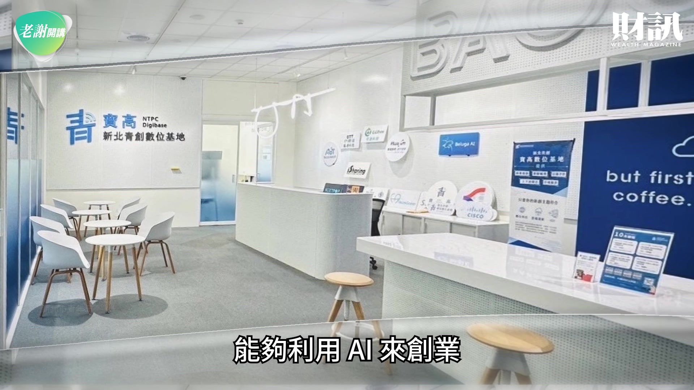

**逐字稿片段：** 今天要請我們邱局長 來跟大家好好來談談 妳觀察到年輕人 在面對 AI 這個新時代 他們到底是恐懼 還是勇於承擔 勇於挑戰

**話題推測：** 主持人提問，將對話焦點轉向年輕人對AI的態度

---

## 00:01:16

**逐字稿片段：** 感謝頻道會員長期的支持 因為有您們的肯定 才能讓我們持續帶來精彩的內容 如果您也喜歡我們的節目 也歡迎大家幫我們 按讚訂閱還有分享 我覺得都有 比較恐慌的 可能是還在學校 或是剛出社會的這些人 因為他會很快的感覺到說 他原本學了至少 3-4 年 或甚至是 7-8 年的專業 很可能 AI 會取代 很大部分的工作 現在美國有個教授 他最近 他說不改考卷了 他說學生的考卷 全部都 AI 回答的 對 他們也分不出來 沒錯 其實現在很多 不管是寫作的比賽 甚至是影片的比賽 評審都不知道該怎麼評 真的沒有辦法分辨 這到底是不是 AI 生成的 我們確實看到 就像剛剛社長講的 AI 在很多的基礎的 很基本的能力上面 它取代人類是非常迅速的 但是同時我剛剛提到

**話題推測：** 頻道會員支持與節目宣傳

---

## 00:02:09

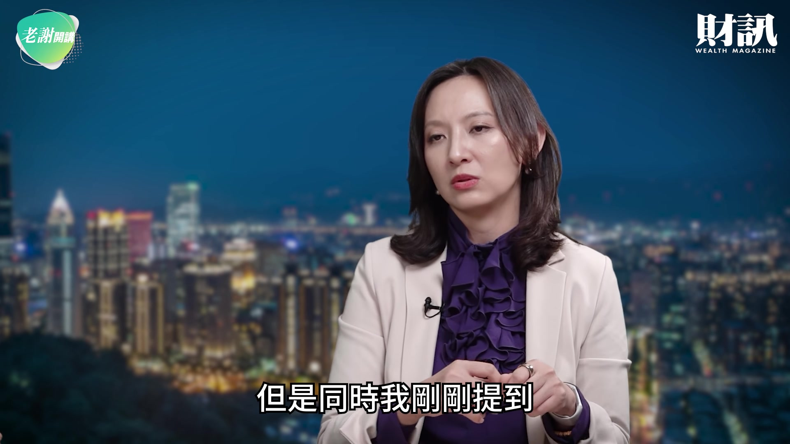

**逐字稿片段：** 我們現在新北市青年局 在新北市負責的 就是青年創業這一塊 也是我們的業務 所以不管是說青年的職涯培力 我們看到很多年輕人 很願意來上非常多的 AI 的課

**話題推測：** 新話題：新北市青年局在青年創業方面的具體業務

---

## 00:02:20

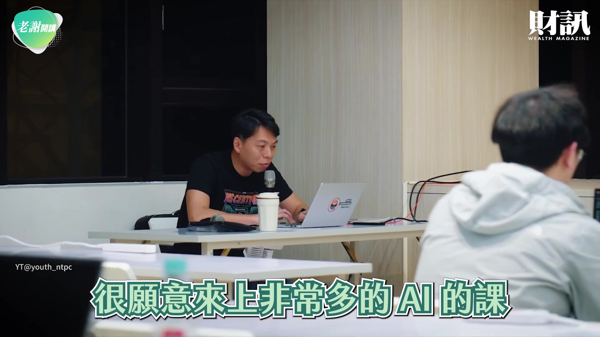

**逐字稿片段：** 甚至是我們開跟 NVIDIA 或者是 Microsoft 合作的證照課 也都會瞬間爆滿 你可以看到大家的恐慌 跟大家願意努力的部分 但是同時我覺得 更能夠掌握機會的 實際上是在 創業的這一群人 現在 在 AI 相關的創業 是非常非常地發達 因為說實在話 現在很多人可以用一人公司 他就可以用 AI 領導一個虛擬的團隊 那 假設是在 AI 的創業方面的話 其實在新北市 我們就看到非常多的實踐

**話題推測：** 提及與NVIDIA和Microsoft合作的證照課程

---

## 00:02:51

**逐字稿片段：** 黃仁勳提過 AI 的五層 五層蛋糕 它的第一層是電力 第二層是晶片 第三層是基礎設施 大概是 Data Center 這個 Level 第四層就是 Model 第五層是應用層 你會發現一二跟四 大概跟新創不太有關係 因為 那個都要很大的資本 但是我們在新創 能夠服務最多 尤其我們在台灣看到最多的 其實就是在應用層 對 應用層當然是很多的 再來其實還有 服務 Data Center 這一塊 比方說有很多的新北市的新創 其實就在協助 Data Center 怎麼樣配置它的算力 甚至設計晶片 然後或者是說 配置它的電力等等 那應用層當然就更多了 比方說我覺得 現在非常流行的一塊 年輕人一定都知道 就是軟硬整合 比方說我們有硬體是可以 像錄音筆一樣放在桌上 就把我們今天所講的內容 自動整理成這個會議紀錄 然後我們有現在的智慧門鎖 這也都是邊緣 AI 去進入這個硬體之後 能夠做的青年的創業 那軟體層面也有非常非常多 像我們之前輔導過的 一個律果科技 它有它自己的 Domain Knowledge 就是它自己的專業知識 是 20 幾年的律師 那它用這樣子的知識 進入 AI 的時候 它就可以做法律科技這一塊 把它這個產業垂直整合 所以它可以服務法律廠商 法律事務所 它可以服務一般 需要用法律工作的人 比方說旅行社 它需要打很多很多的法律合約 其實我覺得這些 都是我們看到 不只是青年創業 現在機會非常大 而且也是投資人非常喜歡的部分 好 剛剛局長講到 AI 的五層蛋糕 其實到最上面這一層 在這一層當中 其實我們慢慢要感受到 AI 的應用落地之後 它其實影響全世界

**話題推測：** 新概念：黃仁勳提出的AI五層蛋糕理論

---

## 00:04:38

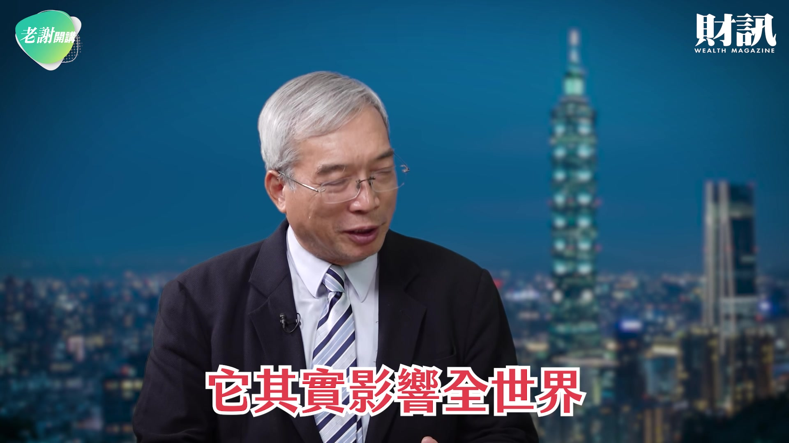

**逐字稿片段：** 中國現在有非常多的短影片 短影片崛起之後 它同樣會撞擊很多產業

**話題推測：** 新話題：中國短影片崛起對產業的衝擊

---

## 00:04:43

**逐字稿片段：** 你看最近 Netflix 很慘 股價還跌得很深 中國很多在地的演員 他們發現沒有片子可以拍 為什麼 現在 AI 就把你取代了 年輕人在這樣的一個環境當中 你要去熟練 AI 能夠駕馭 AI 我們剛剛局長也講到 讓更多年輕人領證照 我們如何培養新北市民 在 AI 的賽道上 讓他們能夠更駕輕就熟 在 AI 的一個大海當中去拚搏 我們青年局現在做了哪些事

**話題推測：** 提及Netflix股價下跌

---

## 00:05:12

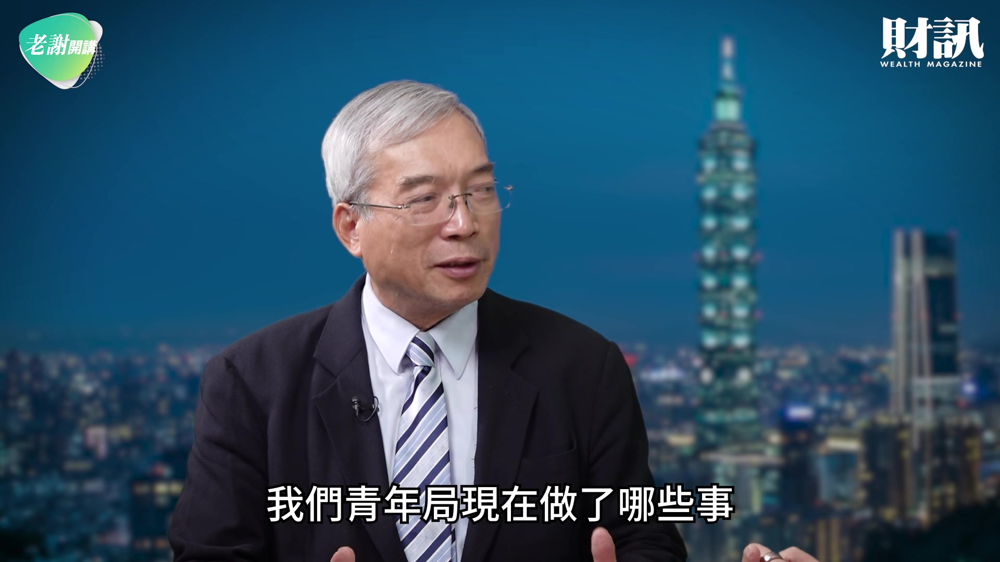

**逐字稿片段：** 我們做的事情 大概可以分 3 個層面來討論 第 1 個就是非常專業的 就像剛剛社長提到 我們鼓勵大家 尤其是現在正在求職的青年 去拿證照 因為 AI 就是一個新的領域 所以如果是僱主的話 其實他也不知道 你說你會 AI 多會 他也不知道 對不對 所以如果你可以 在你的履歷上面 有一個原廠的證照 比方說像我們現在每年會開

**話題推測：** 新話題：青年局培養AI人才的三個層面

---

## 00:05:37

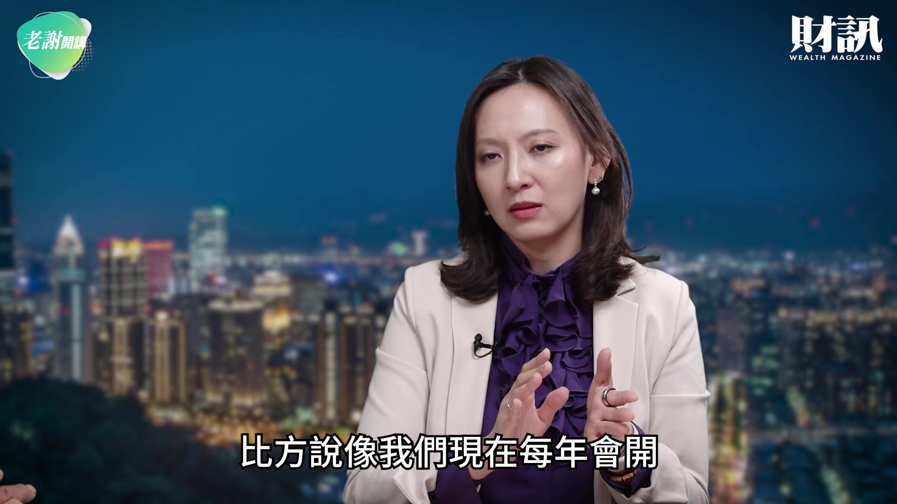

**逐字稿片段：** 20-30 堂的這個證照課 我們是跟 NVIDIA 合作授權 跟 Microsoft 所以這個證照課 等於是你報到了之後 你可以免費的上完這個課 然後獲得一個資格 然後你就可以 把它放在你的履歷上面 變成是你是 NVIDIA 認證的 Microsoft 認證的 AI 的架構師 還是等等的 那這是第 1 層 這其實很 Hardcore 你可能要具備一些 機器學習的一些基本的知識 那第 2 層其實是協助 傳統企業去來做 AI 轉型的人才 這是我覺得 我最努力的一部分 因為我覺得現在大家 還沒有真的認知到 這樣子的人才的需求有多大 跟他們可以做什麼 因為說實在話 現在很多的傳產 都還在被 AI 驚嚇當中 就大家還反應不過來說 我的企業到底應該要怎麼調整 才可以面臨這一波的浪潮 所以實際上很多的中小企業 真正需要的是 協助你 AI 轉型的人才 他們要可以理解 我的這個企業裡面 哪些東西是可以簡化的 是可以更有效率的 是可以更節省成本的 青年局怎麼樣培養 這樣子的人才呢 我們基本上會有 比方說 3 個月到好幾個月的 這個實戰營 我們叫 AI 實戰職涯營 所以你進來了之後 我不只是教你工具 不只是你每天都會的 這個 ChatGPT 還是教你怎麼用 AI 生成文章 影片 圖片 甚至是 code 等等 而且你要在這個過程當中 去解企業提出來的問題 就是企業今天有一個 什麼樣子的議題 我要怎麼樣寫一隻機器人 它可以自動幫我去找資料 它可以自動分析 它可以自動告訴我們人類說 你接下來應該要採取什麼工作 所以真正具備這樣子能力的人 他可以隨時去面對問題 解析問題 然後用 AI 去處理問題的人 他就有可能去未來的企業當中 協助企業來做 AI 轉型 所以這是我說的第 2 個層面 第 3 個層面呢 其實就是工具的層面 青年局做的事情就是 我們開放了 YouTube 我們自己青年局 有一個 YouTube 頻道 搜尋新北市青年局 就可以找得到 所以在那裡面呢 就有非常多的 AI 工具課 所以從最簡單的 AI 教你怎麼樣做簡報 然後 AI 教你 怎麼樣修改你的履歷 都可以直接在我們的 免費資源上面找到 因為我們服務的 新北青年實在有夠廣大 我們新北青年

**話題推測：** 提及每年20-30堂證照課的數字

---

## 00:07:49

**逐字稿片段：** 大概就有 120 萬人左右 所以其實我沒有辦法 一一幫他們開課 所以我們就是 把這個資源直接公開 免費在網路上 讓大家想要學的人 就可以來學這樣子 所以我大概分成 這 3 個層面來說明 現在對年輕人來講

**話題推測：** 提及新北市120萬青年人口數

---

## 00:08:03

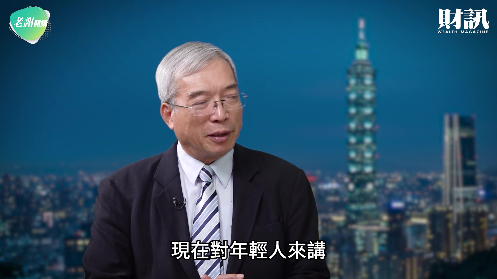

**逐字稿片段：** 他們大概會面對一個 缺資金 缺場域 還有缺客戶 大概有 3 個缺 那從場域來講 像新北市 我也去

**話題推測：** 新話題：年輕人創業面臨的「三缺」（資金、場域、客戶）

---

## 00:08:18

**逐字稿片段：** Google 的園區參觀過 那它們其實在培訓員工 有一個非常好的規模跟基礎 新北市有很多的場域 都可以作為年輕人 培養身手一個很好的所在 站在新北市青年局的立場 我們這 3 個（缺乏） 到目前為止我們解決多少 回到剛剛就是缺資金 缺場域 缺客戶這些事情 缺資金 如果你是 不同的題目的創業者 你的感受可能會非常的不一樣 因為我們這個月

**話題推測：** 提及參觀Google園區

---

## 00:08:50

**逐字稿片段：** 才剛收到去年的 FINDIT 的報告 去年整體台灣的資金 在投資新創是下降 微微下降 但是投資 AI 這個領域 跟半導體這個領域

**話題推測：** 引用FINDIT報告關於新創投資數據

---

## 00:09:02

**逐字稿片段：** 上漲了（近） 8 成 所以其實投資人跟資金 也都有這個 FOMO（錯失恐懼症） 就是他們很害怕自己 錯過了最好的資金運用的機會 所以如果青年 他創一個現在很夯的題目的話 他可能不會覺得 他的資金是非常困乏的 但是相對來講 如果你不是在這個題目 你確實有可能會覺得 你找不到資金 以青年局來說 我們協助的事情 其實就是我們把所有的 科技創業者

**話題推測：** 提及AI和半導體投資上漲近八成

---

## 00:09:27

**逐字稿片段：** 分成大概 4 個階段 第 1 個就是草創階段 他可能就只有一個 idea 他根本就還沒有打造出產品 也沒有賺錢 第 2 個階段就是 你可能開始賺錢 但是還沒有損益兩平 第 3 個階段就是 賺的比較多錢 大概可以發展 可以來規模化了 第 4 個階段就是 它已經很成熟了 所以第 1 個階段 我們青年局給他的輔導 是相對單純的 你可能就是在我們網站上 就可以找到 一對一的創業輔導 那青年局第 4 個階段 它大概也不會需要我 所以我們的所有的創業輔導資源 是集中在給 第 2 跟第 3 個階段的 科技創業者 那回到我們剛剛講說 缺資金跟缺場域怎麼辦 實際上我們青年局 在這邊做的事情就是 大量的輔導跟媒合 也就是說 當這個創業者 他今天可以進來 我們的青創基地 現在新北市有

**話題推測：** 新概念：將科技創業者分成四個階段

---

## 00:10:14

**逐字稿片段：** 10 個青年創業的基地 他可以進來創業基地的時候 我們就可以一對一的協助他 整理他的商業模式 你要怎麼樣設計你的商品 是可以真正面對客戶 然後你要怎麼樣找到你的市場 我們是手把手帶著他去 可能拜訪他的客戶 甚至是幫他 拜訪他的上下游廠商 來做產品的製造的驗證 就是你的產品 到底能不能在 合理的成本底下做出來 跟你的產品能不能夠用 合理的利潤賣出去 所以這些包含 商業模型的整理等等 這其實都是我們非常 專精的項目 那再來呢 剛剛社長提到 就是缺場域跟缺客戶 其實對我來講 這是同一件事情的原因是 如果你今天已經有一個 合理的科技創業的產品 我們合理的意思就是說 它真的能夠運作 它是可能找到潛在的客戶 那其實你缺的 其實比較像是公信力 因為以新北市來講 我們這邊是 全台灣最大的產業的城市

**話題推測：** 提及新北市有10個青年創業基地

---

## 00:11:11

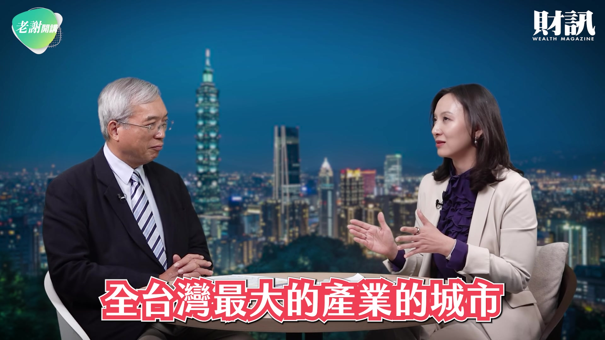

**逐字稿片段：** 我們有 20 幾萬家的中小企業 然後我們的工業區數 工廠數 全部都是最多的 所以你今天如果是做一個新創 你要賣給你的客戶的時候 你的客戶很可能 真的都在新北市 但這些人為什麼 對你的產品沒有興趣 因為他不知道你是誰 如果你今天要作為 一個新創的業者 然後你要去跟一個工廠老闆說 我有一個新的東西 可以幫你節省成本什麼 他很高的機率不會理這個人 但是青年局可以做什麼呢 就是我們把你變成是 我青年局的輔導廠商 甚至是你參加我的比賽 青年局可以給你 一個什麼樣的頭銜 這樣子的時候 你去找這些廠商的時候 他就有比較高的機會 能夠理解 你不是來亂的 這種時候 我們就比較能夠 協助這些新創業者 在新北市的範圍 甚至是台灣的範圍 找到一些機會 也就是去解決剛剛提到的 他缺場域或者缺客戶的問題 好 另外一個問題

**話題推測：** 提及新北市有20幾萬家中小企業

---

## 00:12:08

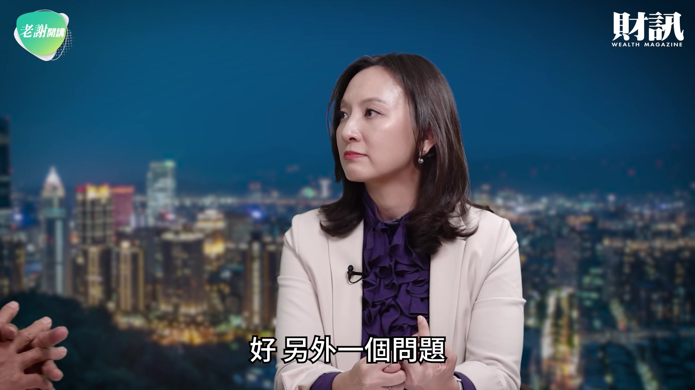

**逐字稿片段：** 我想我曾經跟著侯市長 大概去走訪 一個呢 坪林 另外三峽的老街 也到過鶯歌的老街 我看現在侯市長 對年輕人的地方創生 他其實非常重視 對 所以我們看到在坪林 我看到很多年輕人在地 回去創業 現在有人種茶 現在很多人喝茶 很怕裡面噴農藥 有很多年輕人就乾脆讓雜草 跟你的茶園共生 無毒的有機的茶園 創業的模式也在這個地方 開始不斷地伸展 所以把 AI 的技術跟地方創生 把它完整的連結起來 現在我們青年局 能夠從這個地方 發揮更大的空間嗎 我們剛好青年回鄉跟地方創生 也是青年局關心的範圍 我大概說明一下 青年局關心的 大概就是 3 個類別 就是剛剛提到的科技創新 然後還有社會企業的創新 跟藝文方面的創新 像是地方創生這件事情 其實它就跟社會創新 或者是說藝文創新 有比較高的連結 所以確實比方說像是坪林茶青 因為坪林的狀況非常的特別 就是它是一個 水源特定的保護區 它們當地的創業者的困難 其實是他沒有辦法蓋新的房子 所以他沒有新的場域 他一定要用舊的場域 所以確實市府在這方面 不只是青年局 我們的農業局 甚至是經發局 都有來協助這些產業 看它不管是說 你的茶葉要怎麼樣產銷 或者是怎麼樣打造出 你一個獨一無二的品牌 所以像我們今年就有一個案子 是在協助坪林茶青他們的產銷 我覺得跟 AI 的關係 稍微比較弱一點 但是其實它比較像是說 協助你說你要怎麼樣 計算你的通路成本 因為你茶葉 你不可能 自己去所有的地方賣 所以你要怎麼樣計算 你在哪些地方賣才不會虧錢 怎麼樣的賣法 你才會損益兩平 這個品牌怎麼樣打造 你要做哪一些的社群行銷 或者是說哪一些的素材 可以真正說服你的客人說 來 我們這個是 在地的 然後是有機的 沒有農藥的 所以這些其實是 比較是青年局努力的方向 協助它的行銷 打造品牌 然後運用 AI 可以協助它更快的去 建立它的商業管理模式 好 我想還有一個

**話題推測：** 新話題：侯市長重視地方創生，走訪坪林、三峽、鶯歌老街

---

## 00:14:23

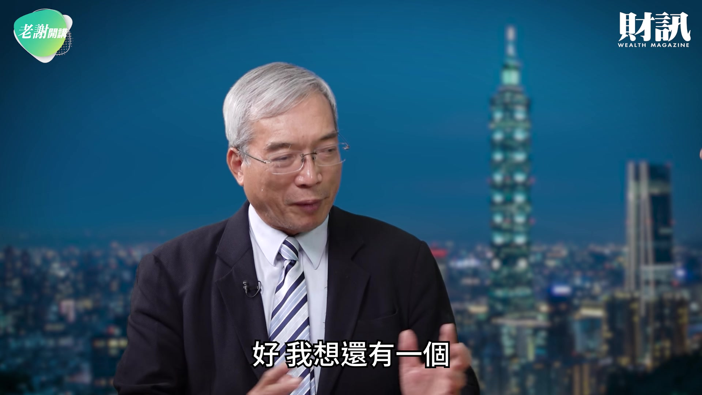

**逐字稿片段：** 大家很關注的 就是說 青創基地 每一個地方首長 其實都很關切 年輕人在地的發展 台灣過去來講 大家認為我們腹地很小 所以如果一直都局限在台灣 其實企業長不大 我們現在如果從 青年局的角度來講 我們現在從青創基地 開始培養他們的創業 然後扶植它們產生競爭力 然後能夠走上全球 我們在目前這樣的一個空間 跟環境當中 青年局有哪些比較具體的做法 這其實是我們還在努力的方向 簡單地說 我確實認為 尤其是科技新創的青年們 他沒有只做台灣市場的理由 因為科技新創 今天你就是要規模化 它不像我們今天坊間的創業 可能是說我開一個手工皂 或是開一個麵包行 我服務一個里或是一個村 大概可以養活我一輩子 這樣子 科技新創 它設計來的時候 你就應該要去看 它怎麼樣可以最大的規模化 除非你今天是做 半導體相關的新創 那有可能你真的服務台灣市場 就是服務全世界 但是大部分的科技新創 我們都會希望它 至少要去看 亞洲或者是歐洲 或者是北美的市場 可是怎麼樣推它們出去 這件事情其實 涉及很多當地政府 就是像我作為新北市政府 其實我鞭長莫及的部分 就像我們協助別的新創 來到新北落地一樣 我其實最需要的 就是我要是一個 瞭解當地市場 瞭解當地法規 並且可能是我在當地 有一個輔導 可以連接投資人的生態系 這樣子的角色 我才有辦法協助 別人的新創來到新北 所以其實我們也都在找 在海外的這樣子的對象 可以來協助我們到當地落地 像我今年 就我們談了一個

**話題推測：** 新話題：如何協助台灣新創走向全球市場

---

## 00:16:12

**逐字稿片段：** 在 LA 的 就是 LA 其實就是一個 全世界頂尖的新創生態系 在那個矽谷之外 它可能是第二的 那所以我們今年呢 就有一個案子 它就是我們就跟 LA 當地 非常大的這個創投輔導單位

**話題推測：** 提及在洛杉磯（LA）推動新創海外落地

---

## 00:16:26

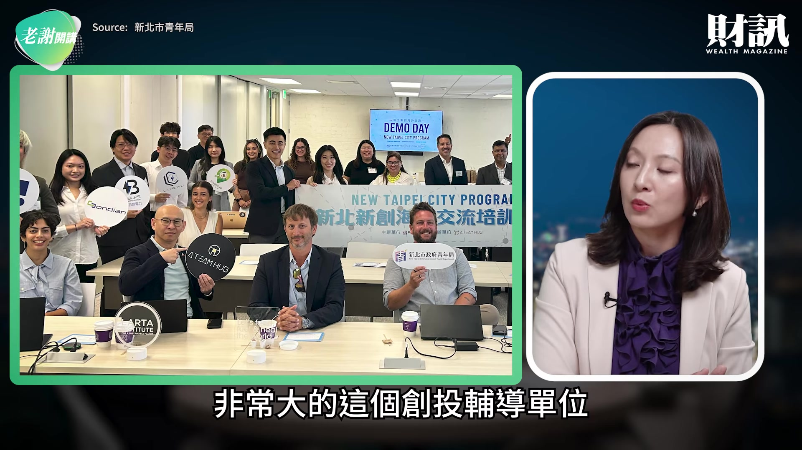

**逐字稿片段：** 它叫做 LARTA 跟它合作

**話題推測：** 提及與LARTA合作推動新創

---

## 00:16:28

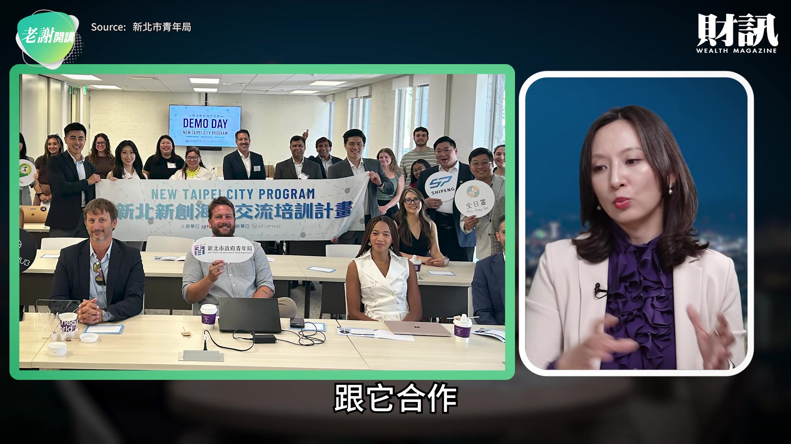

**逐字稿片段：** 我們今年就遴選了 9 組 我們自己的新創 飛到 LA 那在這個 10 天 20 天的 過程當中呢 他們可能就要接受嚴格的培訓 然後去見 20 幾組的投資人 或是潛在夥伴 最後要給他們一個 Demo Day 然後讓他們在那邊 真正的談到 MOU 或者是談到下一步的合作 我們就是有這樣子的機制 去逼著他們說 你要去面對你第一線的客人 面對未來你會面對的 這個潛在投資人 所以今年我覺得這個成果還不錯

**話題推測：** 提及遴選9組新創飛到LA

---

## 00:16:55

**逐字稿片段：** 像我們有一家叫做哥布林 它其實是在 新北市青年局的青創基地 應該也是 1 年多了 那它今年呢 它去這一趟 LA 的時候 它就簽到了一個創投的 MOU 今年底之前 它的第一版的產品就會出來 也就是說 它在那邊 實質的拿到了一個客戶 跟它接下來的合約

**話題推測：** 介紹哥布林新創公司獲得投資MOU

---

## 00:17:13

**逐字稿片段：** 另外還有一個是科淨能源 它也是在我們青年局的 新創之星得過獎的廠商 然後它非常的黑科技 它是把現在的二氧化碳 把它轉化變成是氫來源的燃料 所以這個科技其實在各地 都非常地受到 這個創投的關注 所以一樣它去到 LA 這邊 它也拿到一些 就是初步的成果 預計也是今年底 要簽下第一份的 MOU 那我個人還其實在努力的方向 就是在美國還有其他的地方 比方說有一個 全美最大的智慧城市

**話題推測：** 介紹科淨能源新創公司獲得初步成果

---

## 00:17:45

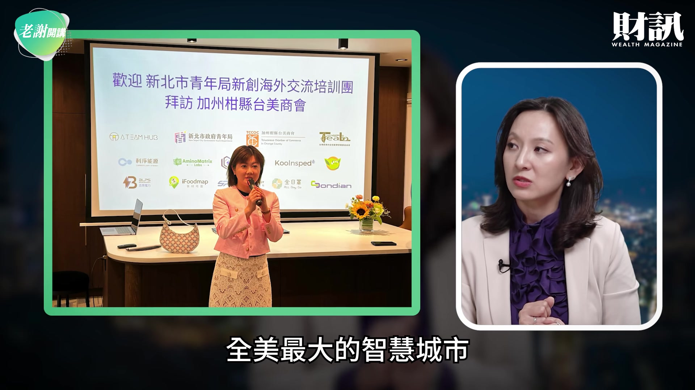

**逐字稿片段：** 叫做 Peachtree Corners 它其實是在喬治亞的 一個當地的政府設立出來 它就是要作為智慧城市的基地 說實在話 我們在選合作夥伴的時候 非常重視 你的誠意 就也就是說 你找我們的新創過去 你到底是把它們當一個旅行團 還是你真正希望 這些台灣的新創 可以落地在當地 那以像我剛剛談到的 這兩個案例來講 它們都是非常積極 希望它們的生態系 能夠變得更大 花了非常多的資源 所以實際上我們都非常信任 這些合作夥伴 未來可以把台灣的新創 持續帶到海外去 然後幫它們真正建立起 屬於台灣新創的勢力 跟進入當地的生態圈

**話題推測：** 提及全美最大智慧城市Peachtree Corners

---

## 00:18:24

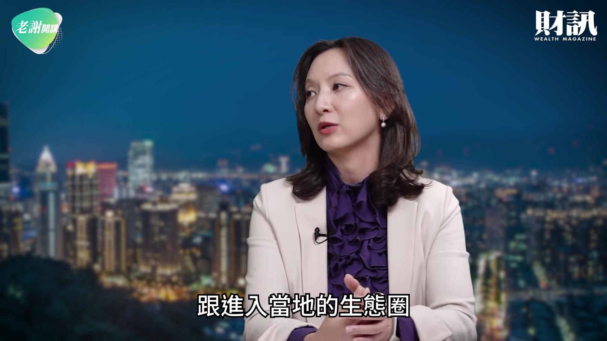

**逐字稿片段：** 好 我想新北市的侯友宜市長 其實他當了 8 年的副市長 也當了 8 年的市長 這 16 年的時間 我常常跟侯市長講 他把他一生最寶貴的時間 其實都獻給了新北市 我想在這 4 年當中 妳跟著我們侯市長 應該學習到很多 那我們節目在最後 也讓妳來談談 這 4 年的生涯 妳的心得跟妳的感受

**話題推測：** 主持人結語，回顧侯友宜市長在新北市的貢獻

---

## 00:18:52

**逐字稿片段：** 我其實來到新北市之前 就是受侯市長邀請 來到新北市之前 我沒有想過 我自己會進公部門 因為我以前是創業者 然後也是在科技新創 我們的步調 跟公部門的工作步調 是差真的非常多 但是我確實 就像剛剛社長說的 其實我真的跟侯市長 跟整個市府團隊 都學習非常多 就是整個市府有這麼多 不同面向的事情要處理 跟服務各種 各式各樣 從各種生長背景來的市民 然後我覺得這是 我以前從來沒有過的 體驗跟學習 像以前我在 可能是協助創投的時候 新創能夠跟創投要到的東西 就是資金跟連結 但是實際上 政府能夠給它們的東西 更有趣跟更有意義 我可以給它名聲 我可以協助它建立它的信用 其實有時候 我不用花那麼多的錢 但是其實新創 拿到這些東西之後 它能夠長得更快跟長得更好 對我來講真的是看到了 什麼叫做公部門才能夠做的事情 然後學習也非常的多 好 我想有一天我跟侯市長講 我說你這一生在新北市是精彩 所以妳能夠跟侯市長 共同打拚 4 年 我相信我們邱兆梅局長 應該這 4 年當中 人生應該也是非常值得 大家來回味的一段往事 那我想這些年新北市的青年們 要好好感謝我們邱局長 我們節目到這邊告一段落 謝謝我們邱局長 感謝大家觀賞 下週見

**話題推測：** 邱局長分享在公部門服務的心得與感受

---
