# wealth1974_XBbZ3BWNp8Y — 關鍵畫面索引

- 來源逐字稿：[wealth1974_XBbZ3BWNp8Y_GT.srt](wealth1974_XBbZ3BWNp8Y_GT.srt)
- 影片：https://www.youtube.com/watch?v=XBbZ3BWNp8Y
- 截圖數：38

## 00:00:33

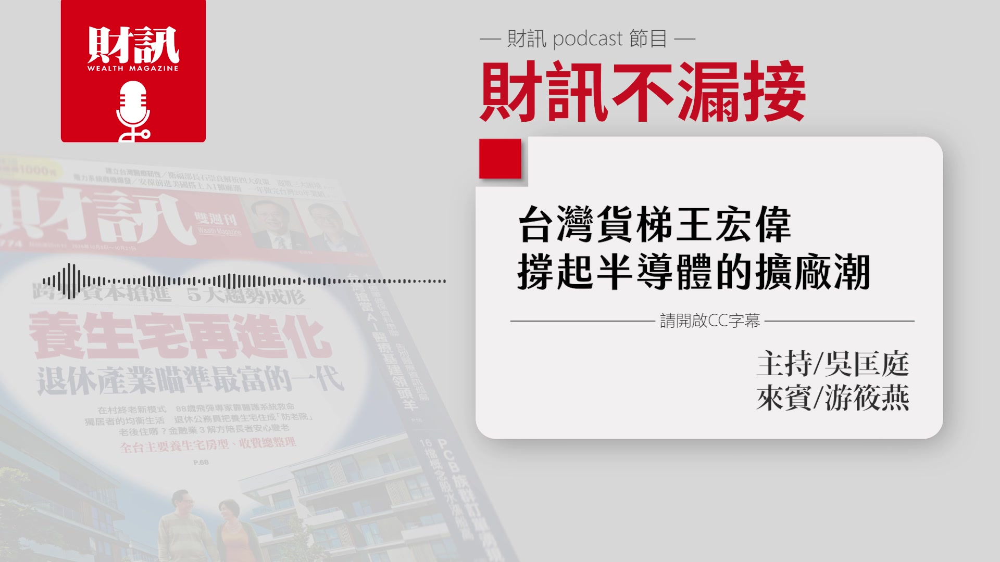

**逐字稿片段：** 我們來聊一下最近的市場動態 有注意到的就是 美股最近的表現不是很好 因為有非常多的利空訊息 首先我們先看一下公司的層面 Anthropic 它第三季的營收 成長有 45% 達到了 168 億美元 不過大家對它的預期是更高的 所以開出這樣的數字 市場有一點失望

**話題推測：** 開始討論最近的市場動態，可能顯示總體經濟數據或市場趨勢圖表

---

## 00:00:56

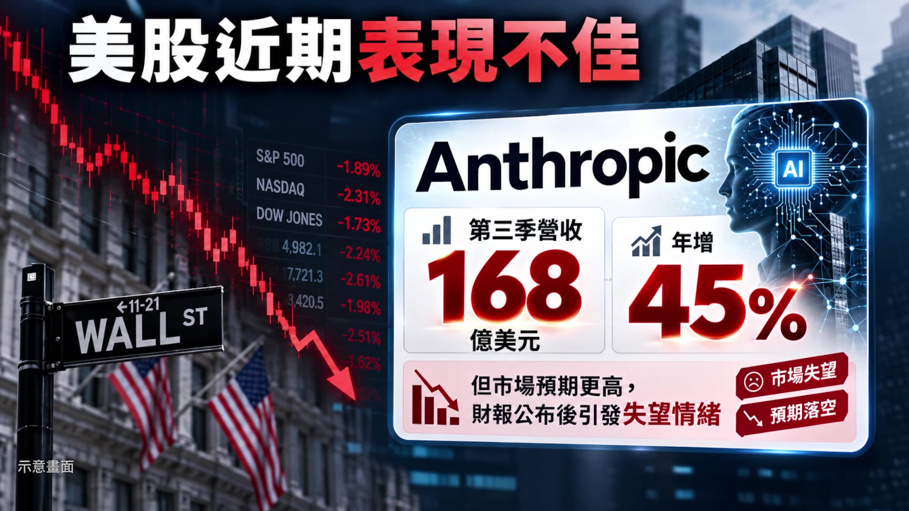

**逐字稿片段：** 它自己公司預估全年的營收 可以達到 1000 億美元 不過市場現在比較保守 它們覺得應該可能 只有 740 億元左右 它們也預估會在今年年底之前 進行 IPO 市場比較擔心比較疑慮的是 它有可能會透過一個 北極星的計畫

**話題推測：** 提及Anthropic全年營收預估，可能更新數據圖表

---

## 00:01:16

**逐字稿片段：** 預計要籌資 600 億美元 會用來採購 Google 開發的

**話題推測：** 提及Anthropic的北極星計畫及籌資規模，可能顯示相關計畫說明或圖表

---

## 00:01:19

**逐字稿片段：** 1.5 GW 規模的 TPU 它有可能會創下歷史上 最大的晶片的融資規模 不過市場當然會擔憂 你花了這麼多錢 那你到底什麼時候可以回收 大家比較疑慮的地方

**話題推測：** 提及採購Google TPU的規模，可能顯示相關技術或供應鏈資訊

---

## 00:01:33

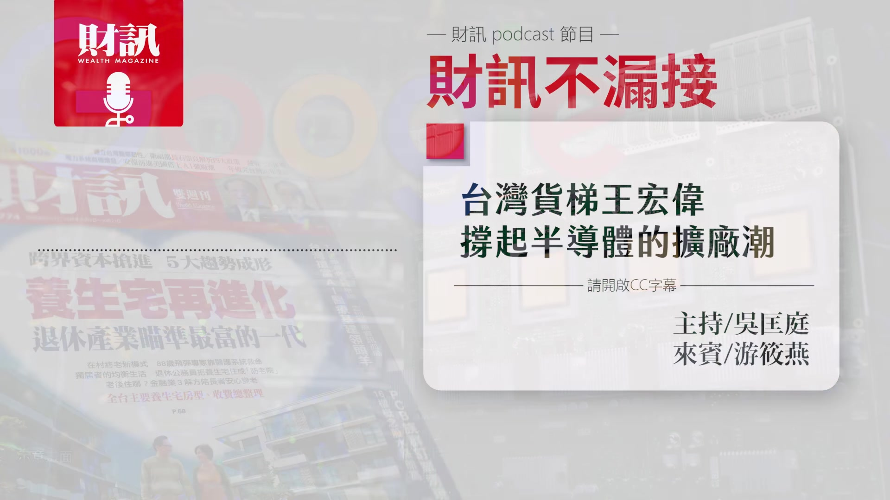

**逐字稿片段：** 再來一個國際政經局勢 就是最近地緣衝突不斷升溫 像是美伊或者是烏克蘭這兩個戰場 因為持續長期的戰火衝突 使得飛彈的消耗量不斷的上升

**話題推測：** 話題轉向國際政經局勢，可能顯示地緣政治地圖或相關新聞畫面

---

## 00:01:48

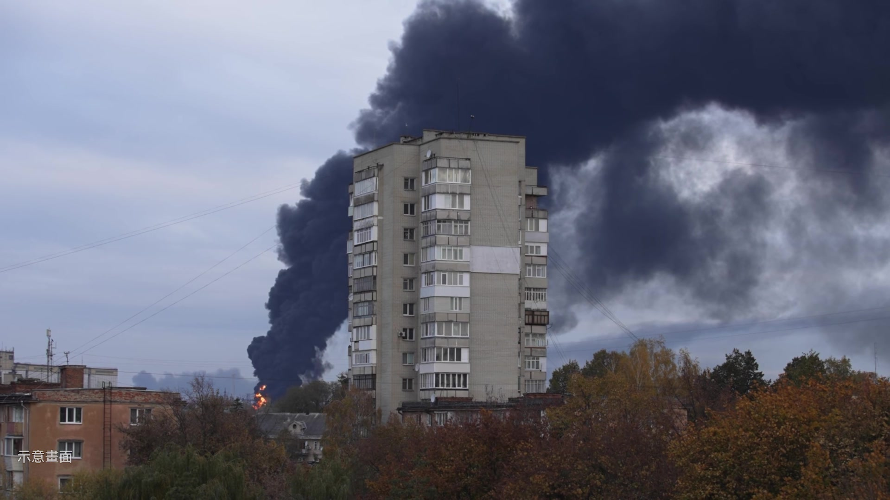

**逐字稿片段：** 造成了美國與全球的 飛彈庫存量不斷的下降 川普也表示他們會 訂立新的伊朗打擊計畫 不過最近也因為期中選舉快到了 所以大家還是會密切關注 那也因為地緣的衝突

**話題推測：** 討論飛彈庫存量下降的問題，可能顯示相關數據或軍事圖表

---

## 00:02:01

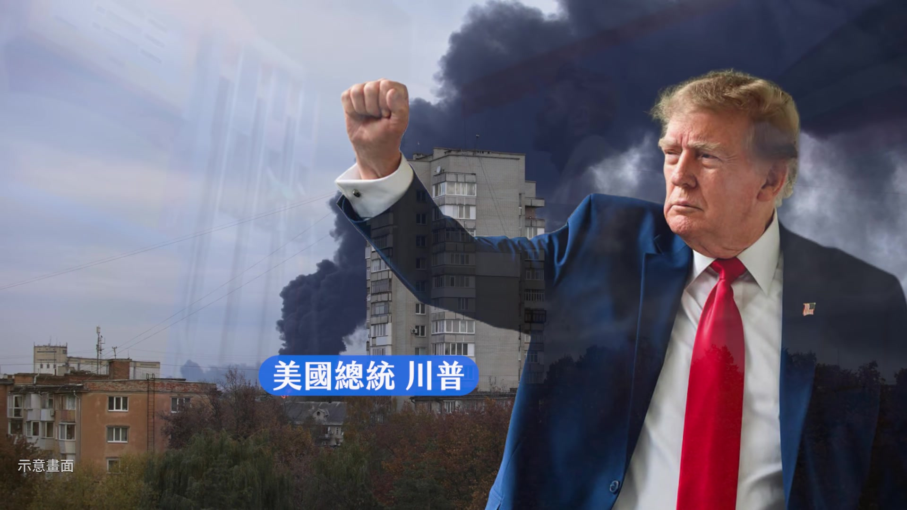

**逐字稿片段：** 使得油價又屢屢創新高 就在百元（美元）以上 所以通膨似乎還會再延續一陣子

**話題推測：** 討論油價屢創新高，可能顯示原油價格走勢圖

---

## 00:02:08

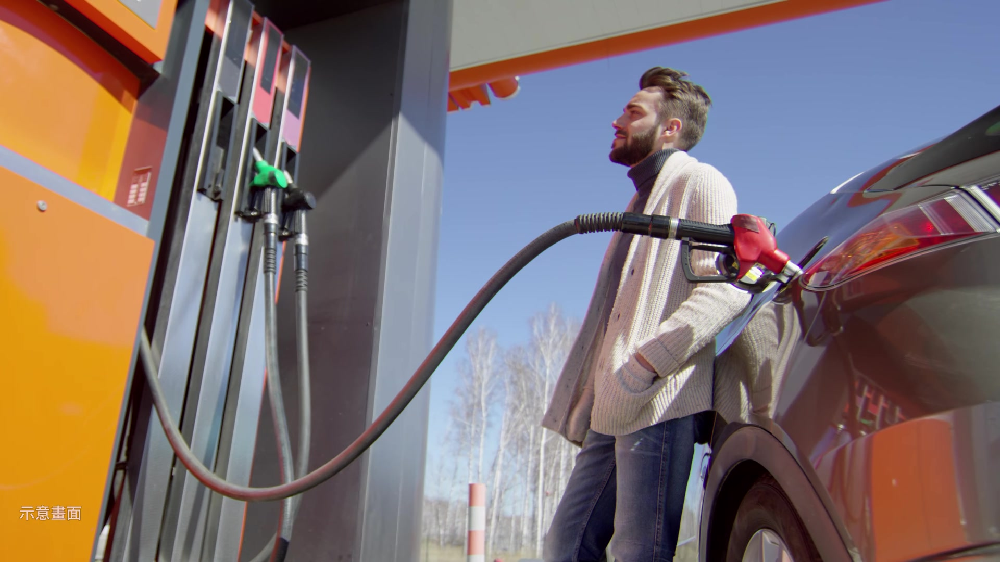

**逐字稿片段：** 那也使得美國可能會在年底升息一次 那另外一個就是

**話題推測：** 提及美國年底可能升息，可能顯示央行政策或利率預測圖表

---

## 00:02:13

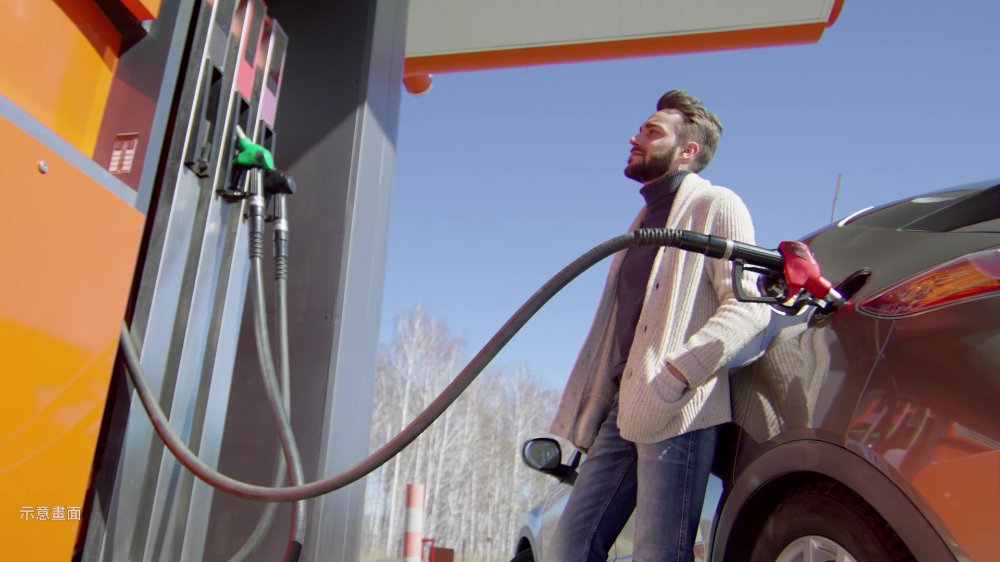

**逐字稿片段：** 歐洲最近也滿動盪的 就是我們有看到滿多新聞 或者是社群都有在報導

**話題推測：** 話題轉向歐洲情勢動盪，可能顯示歐洲地圖或新聞畫面

---

## 00:02:19

**逐字稿片段：** 就是法國有 50 萬人 走上街頭在抗議 他們主要的就是因為 教育 醫療以及生活成本太高 導致他們民眾有所不滿

**話題推測：** 提及法國50萬人抗議事件，可能顯示新聞畫面或相關統計圖

---

## 00:02:30

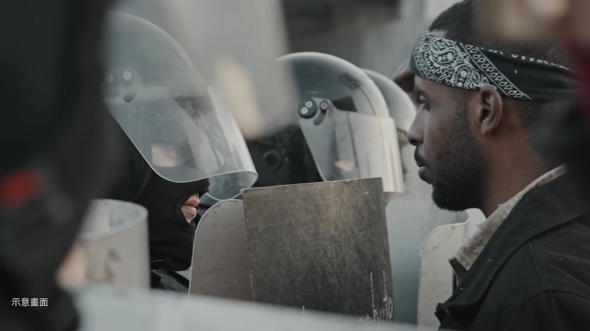

**逐字稿片段：** 那除了法國以外 比利時 義大利 葡萄牙 也有發生一些示威遊行 或者是抗議的運動

**話題推測：** 提及比利時、義大利、葡萄牙等國也發生示威遊行，可能顯示歐洲地圖標示這些國家

---

## 00:02:37

**逐字稿片段：** 法國大概會是在明年 4 月 進行總統大選 現任的總統馬克宏 他也有表示

**話題推測：** 提及法國總統大選時程，可能顯示選舉相關資訊

---

## 00:02:44

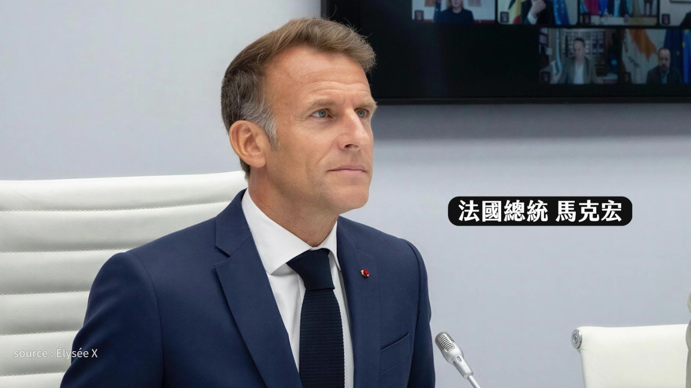

**逐字稿片段：** 他從這週一 10 月 19 日 他開始會去拜訪波斯灣國家 確保他們的燃料供應 看能不能降低他們生活的一些成本 讓通膨不要太誇張

**話題推測：** 提及馬克宏拜訪波斯灣國家確保燃料供應，可能顯示其行程或相關新聞

---

## 00:02:57

**逐字稿片段：** 最後回來我們看一下台灣 台灣最熱當然就是 上個禮拜 10 月 15 日 台積電公布了它第三季的財報 表現非常亮眼

**話題推測：** 話題轉回台灣市場，可能顯示台灣地圖或相關經濟指標

---

## 00:03:06

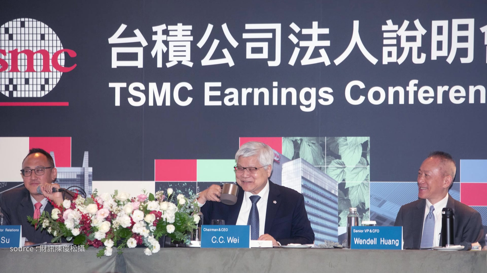

**逐字稿片段：** 每股賺了 29.43 元 第三季的合併營收 有到 1 兆 4942 億元 年增 50.9% 大家更關注的就是 魏哲家他有回應說

**話題推測：** 提及台積電每股盈餘數字，可能顯示EPS圖表

---

## 00:03:18

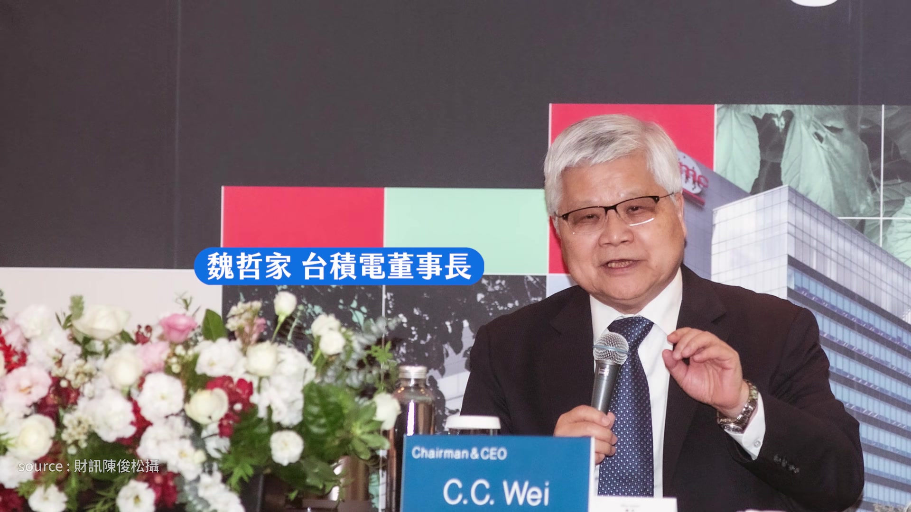

**逐字稿片段：** 他們會到德州進行評估 跟 TeraFab 的合作在洽談中 因為台積電的表現實在是太亮眼了 也帶動了一些周邊的效應 相關的供應鏈也跟著水漲船高 那這部分筱燕可不可以 跟觀眾朋友分享一下 台積電董事長魏哲家 在 10 月 15 日的法說會上面有說

**話題推測：** 提及魏哲家回應德州設廠評估，可能顯示相關新聞或地圖

---

## 00:03:38

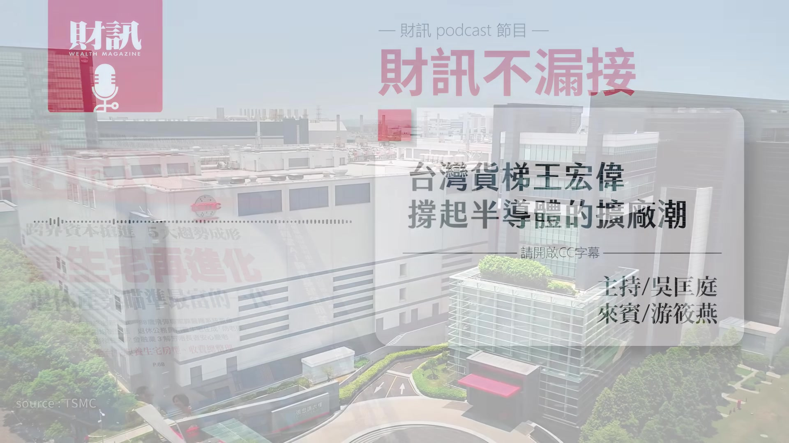

**逐字稿片段：** 在明年就是 2027 年的 2 奈米製程將會大幅成長

**話題推測：** 提及台積電2奈米製程的未來成長，可能顯示技術路線圖或時間軸

---

## 00:03:43

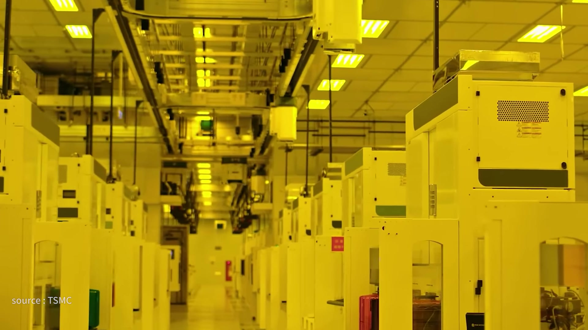

**逐字稿片段：** 今年 2026 年的資本支出 預估會達 600 億到 640 億（美）元 這個數字到 2028 年 資本支出還會比過去 3 年顯著增加 我們知道說台積電最近

**話題推測：** 提及2026年資本支出預估，可能顯示資本支出趨勢圖

---

## 00:03:54

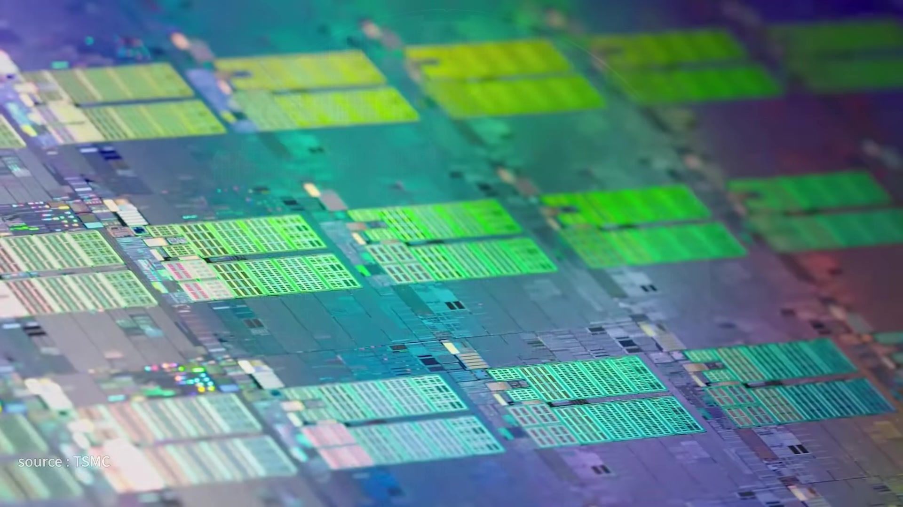

**逐字稿片段：** 在全球準備要推進 近 20 座新廠 這些新廠準備要建設 然後設備零組件跟耗材的需求 也會水漲船高 像是廠務來講

**話題推測：** 提及台積電在全球推進近20座新廠，可能顯示全球晶圓廠分佈圖

---

## 00:04:05

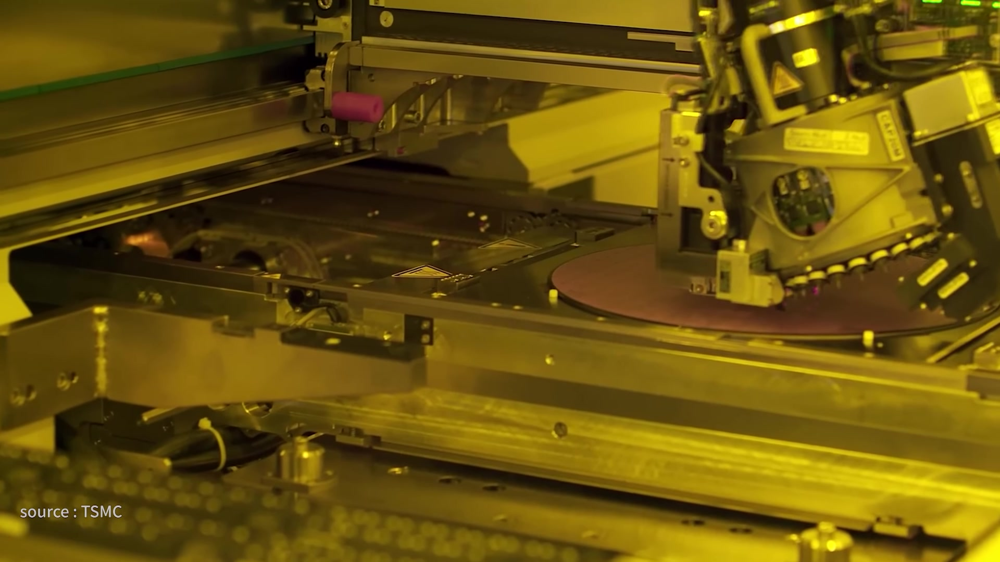

**逐字稿片段：** 第四季是滿高的認列的這一季 因為第四季是一整年的最後一季 那有一些帳要結清的 還沒付完錢的什麼 也都要在第四季 準備把錢整個收進來 所以就說第四季的這個廠務 都值得觀察 也可以給聽眾做一個參考 好 那順著台積電半導體的話題

**話題推測：** 討論廠務相關產業第四季認列狀況，可能顯示季節性營收圖表

---

## 00:04:24

**逐字稿片段：** 我們就進入今天的主題 我們都知道晶圓廠裡面 動輒就是數十億元的設備或者是機台 它們都非常的貴重 除了是貴以外 它本身的重量也很重 可能是幾噸 幾十噸的那些機台 每天它們都要在那些樓層裡上上下下 背後靠的就是一家台灣本土的

**話題推測：** 進入今日主題：台灣貨梯王宏偉，可能顯示公司名稱或主題圖示

---

## 00:04:46

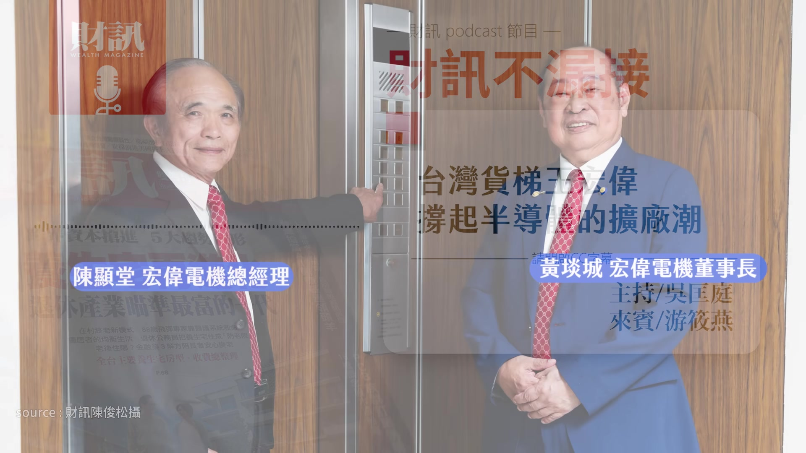

**逐字稿片段：** 貨運電梯的龍頭 就是宏偉 先跟觀眾講一下 這個電梯它到底能發揮什麼作用 跟我們一般在搭的 民間大樓的電梯有什麼不同

**話題推測：** 介紹宏偉為台灣貨運電梯龍頭，可能顯示公司標誌或產品圖片

---

## 00:04:57

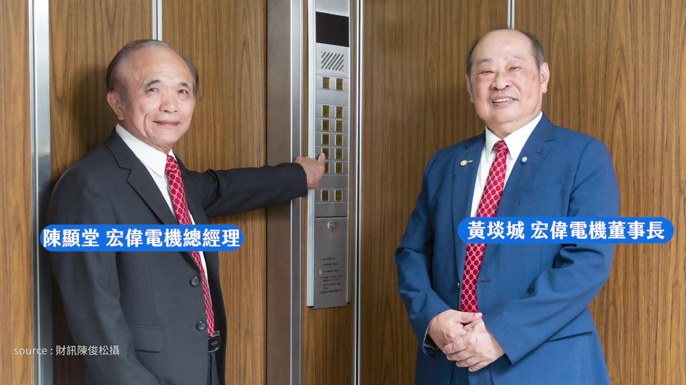

**逐字稿片段：** 宏偉這家是 1979 年創立的公司 這家電梯跟大家平常在百貨公司 或是在自己家社區搭的電梯不一樣 宏偉是我們平常不會接觸到 但是卻是這些科技大廠常常看到的電梯 像我常常去採訪各式各樣的這些工廠 不時都會看到宏偉電梯 那它厲害的地方在哪裡

**話題推測：** 提及宏偉創立年份，可能顯示公司簡史或時間軸

---

## 00:05:17

**逐字稿片段：** 它的載重可以高達 29 噸 一般的工業貨梯多半是在 5 噸上下 載人的又更少 可能只有 1 噸或 3 噸 那它可以到 29 噸 然後我有看過宏偉有秀一下它的電梯 看了畫面滿震驚的 就是它可以放得下兩台卡車 大卡車可以進去 我覺得哇 這實在太驚人了 像它的巨無霸電梯 它的車廂可以長 14 公尺 寬 4.5 公尺 然後我就問宏偉電梯的黃董 我們平常搭的這些客梯 想要跨入貨梯的門檻 技術力不一樣的地方在哪裡 他就跟我講一個很直白很簡單可以懂的 他說如果說我們一般人要搭的客梯 它講究的是速度 譬如說 101 高樓 它最強的就是從 1 樓到 90 幾樓 這個速度有多快 但是貨梯完全不一樣 它講究的是很穩 然後又可以耐重 因為它畢竟要放下 譬如說像是 ASML 的機台 一台都非常重 兩個 Know-how 是完全不一樣的 這兩個領域要互相跨入 其實也是相對不容易 這也就造成宏偉電梯 它有自己的 know-how 有它自己的利基市場 那它自己是從客製化 從設計製造到安裝 到最後的售後維修保養 它都有一條龍的服務 整個業界都算是滿知名的一家公司

**話題推測：** 提及宏偉電梯的載重能力（29噸），可能顯示規格比較圖表

---

## 00:06:28

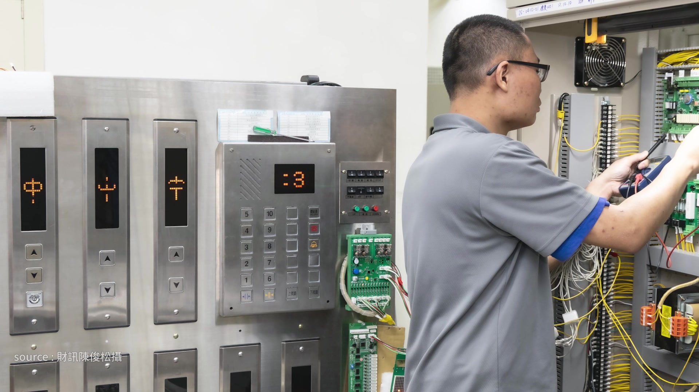

**逐字稿片段：** 它目前的客戶有哪些 在半導體跟科技電子的這個領域

**話題推測：** 開始列舉宏偉電梯的客戶，可能顯示客戶名單或標誌

---

## 00:06:33

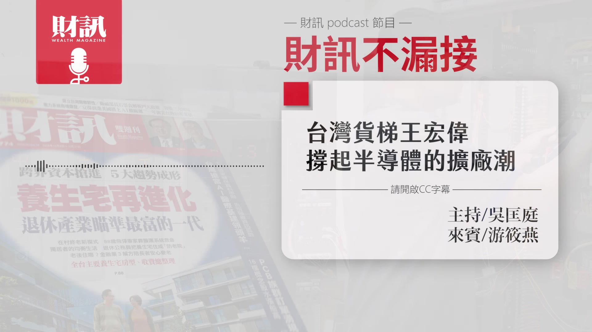

**逐字稿片段：** 它的客戶就有日月光 聯電 鴻海 友達 它的外商跟傳產的公司 就是有康寧 像3M 還有這個 ASML 在中國市場 它也很早就西進了 所以它在中國市場 像是台商一定會跟它買電梯 外商就像是三星或大金 或是中芯半導體 還有中國一家鑄幣廠 製造貨幣的這個廠 也是用它的貨梯 所以算是滿厲害的一家公司 那它兩岸跟越南都有設廠 也會跟著台商到海外去設廠 我們知道客梯的市場很早期就被歐美 或者是日本的大廠給搶走市占 宏偉它是怎麼樣慢慢在 這個市場中打出一條生路 1990 年的時候它是跟瑞士一個大廠技術轉移 跟它去學習要怎麼製造貨梯載重的核心技術 那它在有了這個技術的技轉之後 它自己不斷的研發 自己再慢慢的試驗 慢慢開始就一步一步 把這個技術給練起來 它也透過義大利的相關公司 然後也知道說市場在哪裡 客戶在哪裡這樣子 所以它有點像是避開客梯的紅海競爭 它先切入貨梯嗎 對 因為客梯其實像是崇友 或是日立永大 還有更多海外品牌 這個品牌其實滿多的 然後競爭也很激烈 所以他就覺得說 他就是從比較利基的這個方向去切入 他也覺得比較是自己的機會 那他是怎麼樣跟客戶建立信任關係 他是跟我形容說 他可以做到別人做不到的事情 譬如說 20 年前 客製 10 噸以上的貨梯 整個業界放眼過去 就是只有宏偉 那後來它們也就是慢慢的累積 培養整個長期客戶的信任 還有它就是反應很快 它可以一個多月就改好 這整個控制的面板 假設你今天是跟日本大廠 或是跟歐美大廠要買貨梯的話 這些國家都在海外 那可能在台灣駐點的人也少 然後運送往返 壞掉件要找新的件來維修就很不容易 剛好宏偉它就是在台灣 可以在地服務 這也是它們的優勢 然後還有就是我有去問它的客戶 就說為什麼你這家科技大廠 跟宏偉合作超過 20 年 然後會想要用它們的貨梯 他就私下跟我講說 記得有一次印象很深刻是 廠裡面的貨梯剛好連續有 3 台 突然都有一些問題 他就記得說宏偉的人馬上就來到現場 然後跟他從中午就開始一直去測試 一直去調整 然後去維修 結果一直跟他修到凌晨 3 點 等到修好了之後才收工回家 所以這讓他印象很深刻 它不僅可以及時服務 很快到達現場 然後又任勞任怨的精神 這個半導體大廠的生意都非常重要 它今天也必須要維修好 所以大家就有那種 一起奮鬥的革命情感 所以到現在這家公司 就還是用它們的貨梯 甚至去海外設廠 都想要拜託它們 可以跟它們一起去美國 用它們的貨梯 那還有比較特別的是說 它們除了剛剛講的 可以載重很厲害的 它們還有防爆電梯 因為塑化廠電梯也是用它們的 塑化廠裏面有很多就是 跟火比較有相關的這種型態 宏偉光是從這個防爆的認證 來回送審其實也耗時 1 年 這種防爆認證也是相對不容易的 那它就不只可以載重 然後它又有防爆的這些功能 增加它在貨梯上面的這個競爭力 感覺它們貨梯建立起了 滿高的一個護城河 那它在這個 AI 浪潮下 隨著半導體擴廠潮之下 它的營運表現目前是怎麼樣 我們可以看到它今年

**話題推測：** 提及半導體客戶如日月光、聯電、鴻海、友達，可能顯示這些公司標誌

---

## 00:10:06

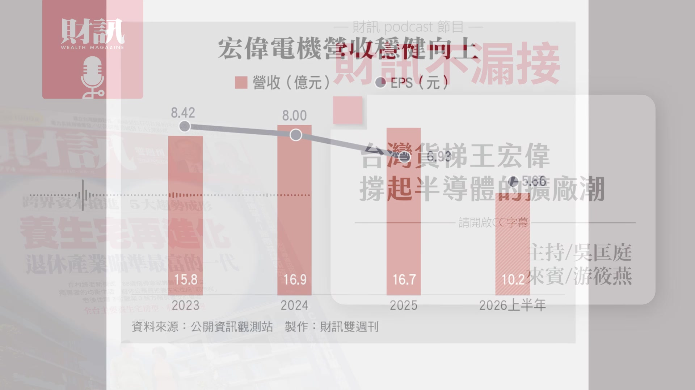

**逐字稿片段：** 2025 年的 EPS 是 6.93 元 在 2026 年

**話題推測：** 提及2025年EPS數據，可能顯示盈利能力圖表

---

## 00:10:10

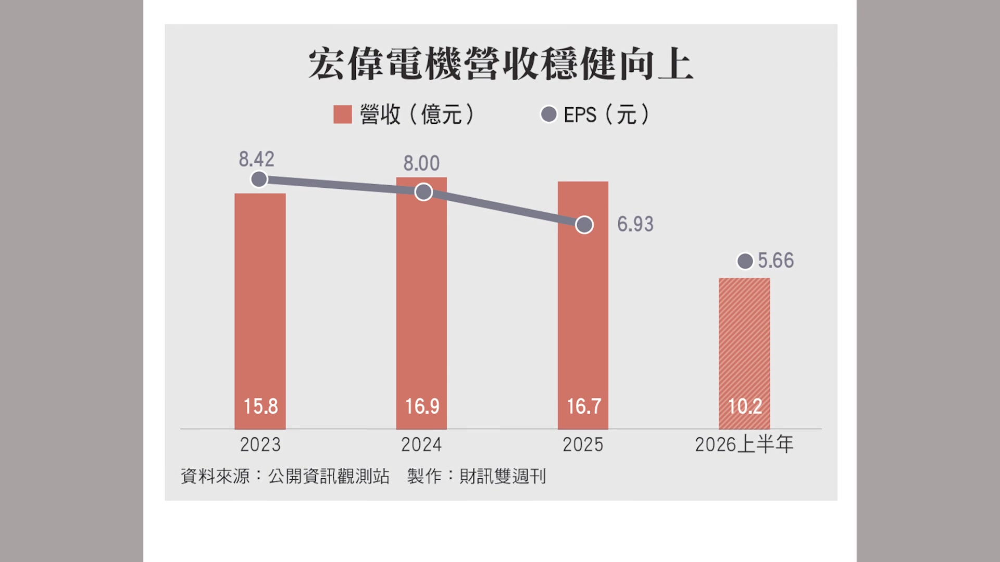

**逐字稿片段：** 就是今年上半年的 EPS 有 5.66 元 光是上半年就已經賺 逼近去年的 8 成了 這個數字其實非常亮眼 法人是預估今年非常有機會 可以挑戰一個股本 還有一個好消息就是 它們已經興櫃滿多年了

**話題推測：** 提及2026年上半年EPS數據，可能更新盈利能力圖表

---

## 00:10:24

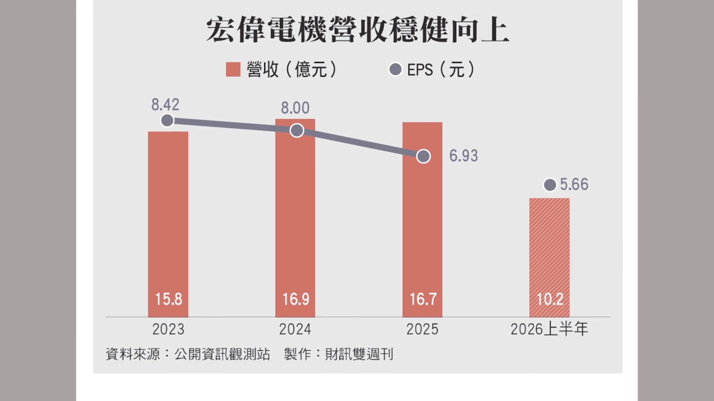

**逐字稿片段：** 它們最近準備就是要掛牌上櫃

**話題推測：** 提及宏偉準備掛牌上櫃的訊息，可能顯示股票上市資訊

---

## 00:10:27

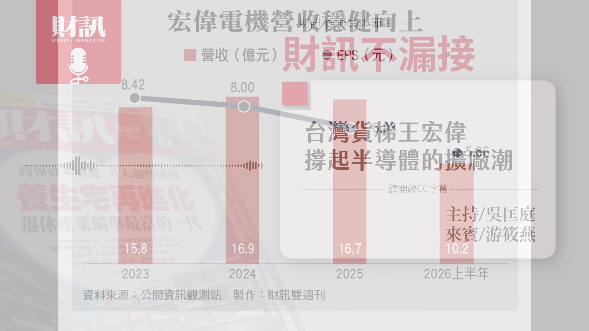

**逐字稿片段：** 它的毛利率就是從 2021 年的 34.6% 拉升到今年第一季的 47% 我們看到這個毛利率的上升幅度滿快的 就知道它應該接了很多科技大廠的生意 科技大廠的這個毛利率是高的 所以就可以帶動它的毛利率 跟獲利的成長表現 黃董事長他有跟我們分享說 其實他真正很厲害的這個金雞母

**話題推測：** 提及宏偉毛利率從2021年到今年第一季的成長，可能顯示毛利率趨勢圖

---

## 00:10:47

**逐字稿片段：** 是在它的售後維修保固 它在手簽約維保的台數 超過 5600 台 這些機齡 6 年以上的 又占了 78% 左右 我有去問一下剛剛有提到的 那個半導體科技大廠的 這個主管他就有跟我說 就是每一個月它們工廠裡面電梯 都是需要去維修保養的 所以簽的都是年約 然後你跟宏偉買了貨梯 你就一定會請它來幫你保養 宏偉在這個維修保養的毛利率

**話題推測：** 提及售後維修保固為宏偉的金雞母，可能顯示服務營收結構圖

---

## 00:11:15

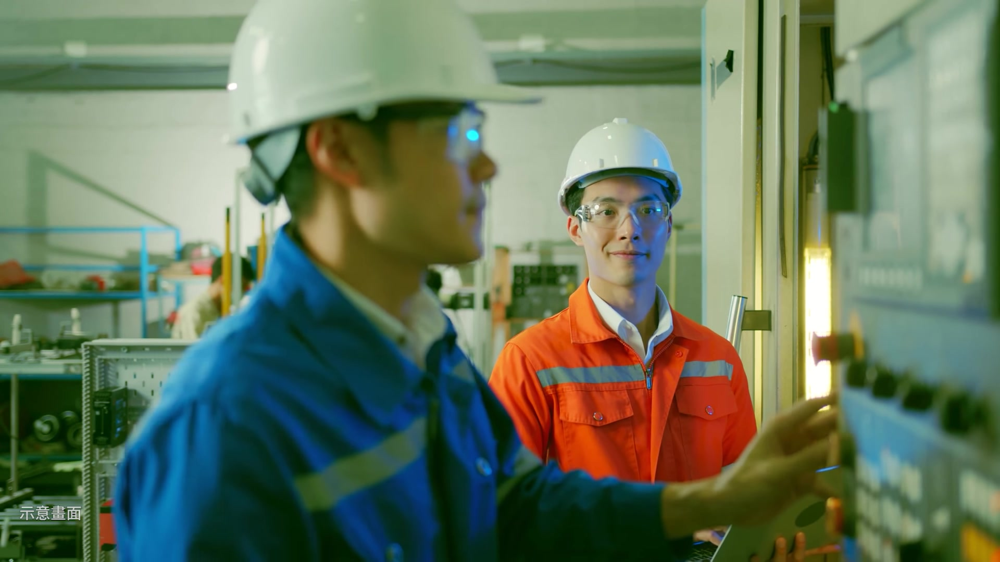

**逐字稿片段：** 有高達 50-55% 黃董事長也有跟我說一個滿驚人的事情 他說以公司的營運狀況來講 他就算不賣新機了 他光是靠維保的這個生意 就可以養活整間公司了 等於新機多賣就是多賺的錢 新機賣一台是賺一次的錢 但是你的維修 售後的維保

**話題推測：** 提及維修保養業務毛利率高達50-55%，可能顯示服務利潤率圖表

---

## 00:11:35

**逐字稿片段：** 可以做 20-30 年 所以這是一個循環 然後會不斷累積的一門好生意 企業都在講要創造穩定的現金流 它賣出一台之後可以陸續做 20-30 年的維修售後服務 感覺就是它一個滿穩定的 持續進來的金流 那它還有哪些成長動能 除了這個以外 我們剛剛也有聽到 好像客戶甚至想要拜託它 一起去美國建廠 那它有沒有想要跨出台灣的市場 我們剛剛提到說現在 全世界的科技業 半導體業 都是在不斷的擴廠

**話題推測：** 提及售後維保服務可持續20-30年，可能顯示長期營收模式

---

## 00:12:06

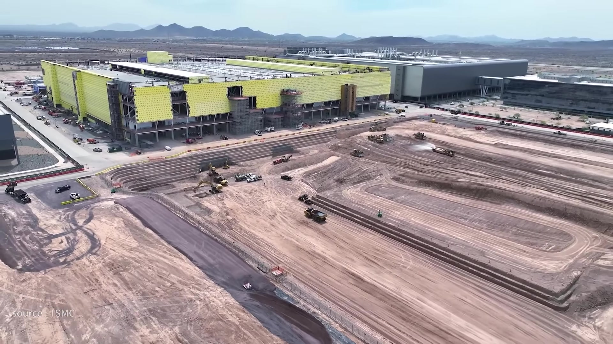

**逐字稿片段：** 像是台積電 像是美光 都是在擴廠 所以這些也都是它未來成長的動能 還有就是有一個數據 就是全球的電梯市場 有一個研究報告指出全球的電梯市場

**話題推測：** 提及台積電和美光等公司擴廠，可能顯示相關新聞或公司標誌

---

## 00:12:19

**逐字稿片段：** 2024 年的時候有 790 億美元 到了 2030 年就會到達 1161 億美元 它的年複合成長是 6.7% 所以這也是它基本的成長動能 那再來就是說 現在大家都一直在講 ESG 電梯的能源再生 可以符合 ESG 的這個議題 也是很重要的 宏偉它在電梯的能源再生系統

**話題推測：** 提及2024年全球電梯市場規模，可能顯示市場數據圖表

---

## 00:12:41

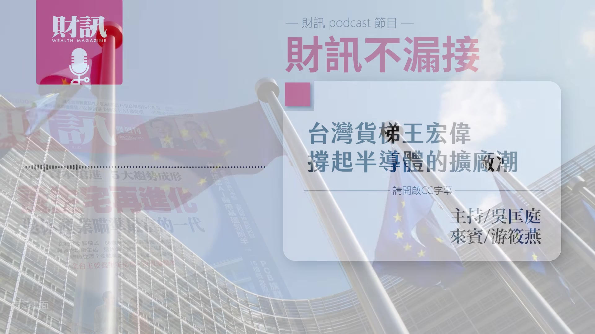

**逐字稿片段：** 已經有獲得歐盟的認證了 它可以把載重下行的動能 轉成電能提供客戶減碳 然後還有就是剛剛匡庭有提到說 因為它的大客戶 就是半導體的大廠 現在要去美國蓋廠 目前美國的廠是採用當地的電梯 那它覺得在這個配合度上面 譬如說我要你跟我一起 維修到半夜 3 點 這怎麼可能 所以它也希望宏偉不知道 能不能去當地設廠 提供在地的服務 但是宏偉就有說 也是要為股東賺錢 要為股東負責 他有說如果當地的需求

**話題推測：** 提及宏偉電梯能源再生系統獲得歐盟認證，可能顯示證書圖示

---

## 00:13:16

**逐字稿片段：** 有達到 100 台以上才會慎重考慮 台數很夠的話 第一階段車廂會在地生產 主機這邊跟控盤會由台灣供應 面積比較龐大的車廂可以在地生產 前提是它的量一定要足夠 那再來就是說 我覺得老闆是第一代的創業者 他們也都是從黑手起家 然後自己開始慢慢創業的 我就問他說那你們最近 就是有沒有什麼接班的問題 因為我們知道很多像這種黑手產業 其實二代都不太願意接班 我覺得滿幸運的是黃董還有陳總

**話題推測：** 提及宏偉考慮在美設廠的條件（100台以上需求），可能顯示市場進入策略

---

## 00:13:48

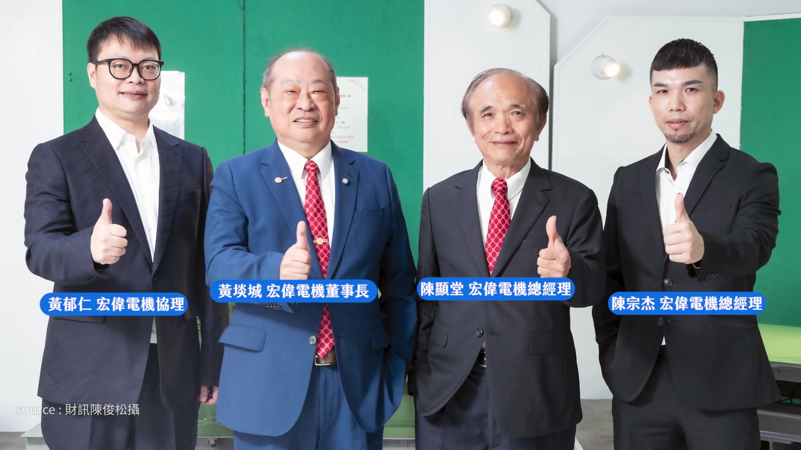

**逐字稿片段：** 他們的小孩二代現在也都進了公司歷練 而且他們是從基層開始歷練 到現在超過 10 年了 對公司的業務都滿嫻熟的 然後他們的分工也都滿明確的 所以我覺得這是一個滿和諧 然後也是一個滿不錯的接班表現 感覺這家公司也是一個 在半導體擴廠潮下 受惠的其中一家公司 那也有滿深厚的護城河 也有穩定的現金流 我們後續也會繼續的追蹤 好 那今天感謝筱燕的分享 聽完今天的節目 你還知道有哪些像宏偉這樣的 台灣的隱形冠軍嗎 歡迎大家留言分享你們的想法 如果您還想瞭解更多的內容 歡迎點擊資訊欄中的文章連結 或是購買財訊第 774 期的雜誌 跟我們一起追蹤政經趨勢 掌握投資脈動 《財訊不漏接》 我們下次見 bye bye

**話題推測：** 提及宏偉二代接班狀況，可能顯示公司治理或家族傳承圖示

---
