# wealth1974_XNB_fxkXlm4 — 關鍵畫面索引

- 來源逐字稿：[wealth1974_XNB_fxkXlm4_GT.srt](wealth1974_XNB_fxkXlm4_GT.srt)
- 影片：https://www.youtube.com/watch?v=XNB_fxkXlm4
- 截圖數：53

## 00:00:53

**逐字稿片段：** 到了 比利時的第一天 這次到比利時 基本上要來觀察一下 比利時這個國家

**話題推測：** 講者開始介紹比利時，可能切換到比利時地圖或國家介紹畫面

---

## 00:00:59

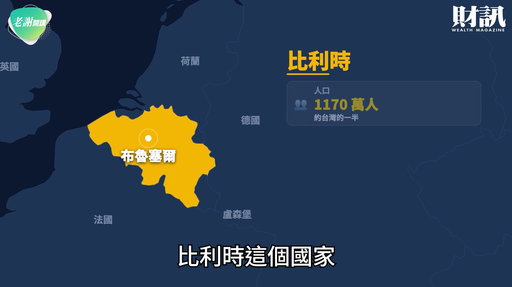

**逐字稿片段：** 有 1170 萬的人口 它的整個經濟總量 大概在 7669 億美元 基本上比利時是全世界 在經濟體的排名當中 它排名在第 25

**話題推測：** 提出比利時人口數字，可能切換到顯示國家統計數據的圖表

---

## 00:01:15

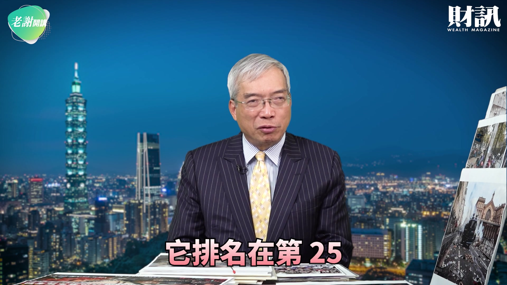

**逐字稿片段：** 大致上台灣在 22 所以我們整個來看 經濟總量 台灣跟比利時在旗鼓相當 但是比利時的人口 大概只有台灣的一半 所以比利時的人均所得 比台灣將近多了一倍

**話題推測：** 將比利時與台灣經濟排名和總量進行比較，可能顯示兩國數據對比圖

---

## 00:01:29

**逐字稿片段：** 比利時是歐盟的總部所在地 同時也是北約的組織的總部 那麼最重要來看看 謝志偉大使 到了比利時的第一天 我們也看到

**話題推測：** 提到比利時作為歐盟及北約總部，可能顯示相關組織標誌或地圖

---

## 00:01:40

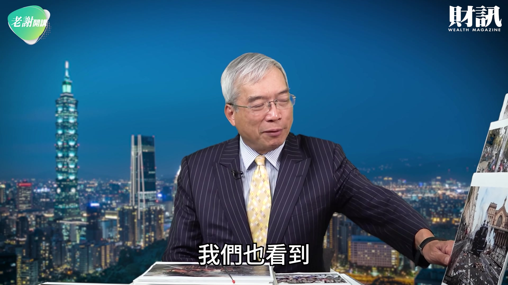

**逐字稿片段：** 比利時的大罷工 在第一天我放下行李 謝志偉大使 夫人 就帶著我們到 比利時的市區 這次所看到 剛好罷工結束 罷工結束之後我們可以看到 地面上是滿目瘡痍 所以這個是景象 讓人感到非常的驚悚 很多的腳踏車 都躺平了 這個是在這樣的一個 抗爭當中 我們從謝大使的家 坐電車 然後再坐地鐵 然後 看看比利時的市區 所以這次所看到的應該是 非常真實的比利時的現況 整個來講 你可以看到 歐洲現在 整個的抗爭現在看起來是 沒有底線 所以在比利時的罷工之後

**話題推測：** 提到比利時大罷工，可能顯示罷工現場照片或新聞畫面

---

## 00:02:19

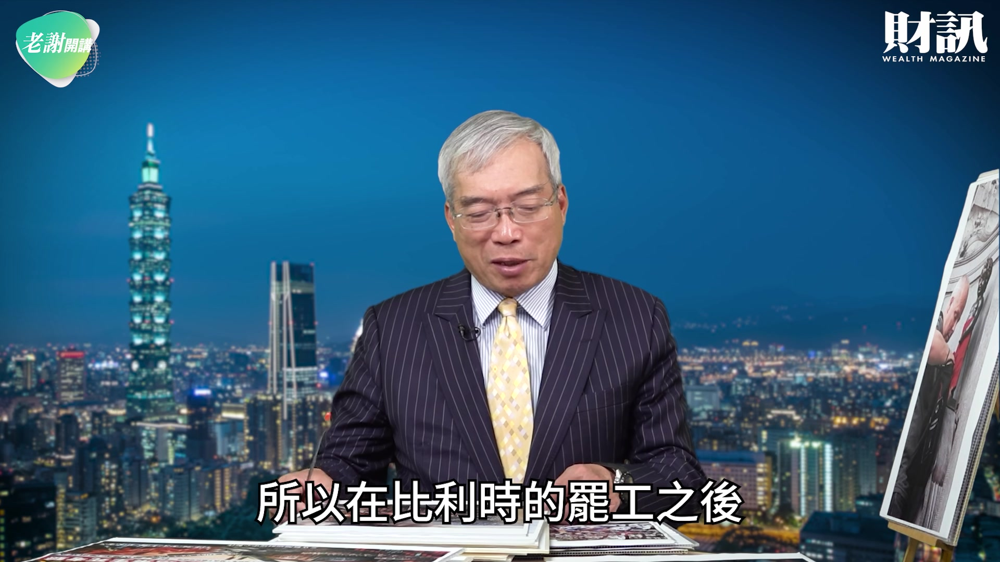

**逐字稿片段：** 我們看到最大規模的罷工 出現在法國 這個法國是

**話題推測：** 從比利時轉到法國大規模罷工，可能顯示法國罷工的畫面或新聞

---

## 00:02:23

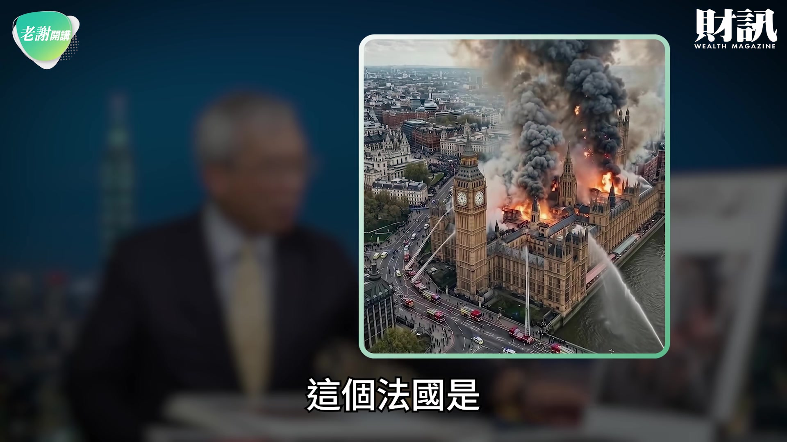

**逐字稿片段：** 這個是利摩日的市政廳 被大火燒毀 這個很多的古蹟 在這一次都受創 所以這個是我們看到

**話題推測：** 提到法國利摩日市政廳被燒毀，可能顯示該建築損毀前後對比圖

---

## 00:02:31

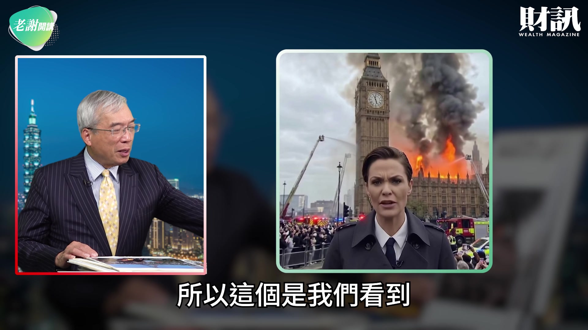

**逐字稿片段：** 法國的罷工 這一次有 55 萬的人走上街頭 規模非常大 讓大家感覺到非常觸目驚心 國際媒體 用很大的篇幅來報導 包括在抗爭的路上 你可以想像得到 最大的源頭是高中生上街頭 他們抗議天花板會漏水 夏天沒有冷氣 這個時候一發不可收拾 整個罷工的浪潮 大家全世界非常矚目的

**話題推測：** 提出法國罷工的人數，可能顯示抗議人數統計圖或現場人群照片

---

## 00:02:58

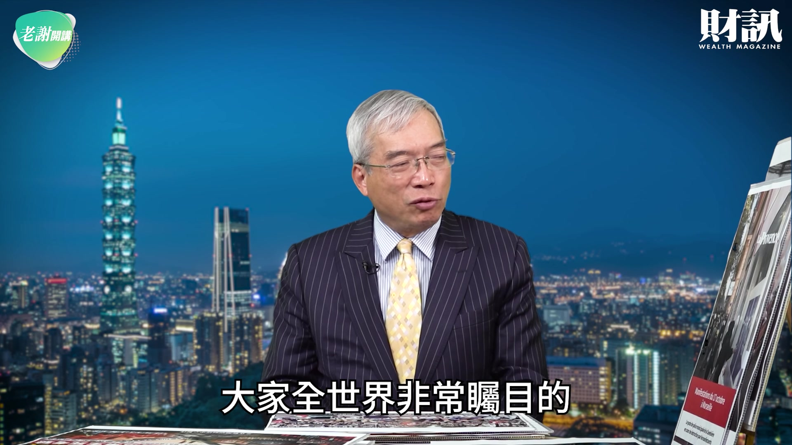

**逐字稿片段：** 拉法葉百貨 罷工所造成的很多人 到裡面去劫掠一空 是造成全世界非常大的震撼 所以 在大火焚毀了很多的古蹟 然後也看到拉法葉百貨 這個被破壞之後很多的精品 被劫掠一空

**話題推測：** 提到法國拉法葉百貨被劫掠一空，可能顯示商店被破壞後的景象

---

## 00:03:15

**逐字稿片段：** 這是利摩日的市政廳 被大火燒過的 跟現在原來的照片 做一個對比 是讓人觸目驚心 所以對法國來講 在這一場 55 萬個人走上街頭的 大罷工行動當中 其實也給全世界很大的啟發 所以在第一時間

**話題推測：** 再次提到利摩日市政廳，強調燒毀前後的對比，可能顯示照片比較圖

---

## 00:03:35

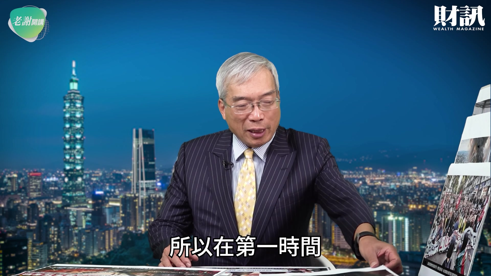

**逐字稿片段：** 川普總統在講 他說 關閉邊界 奪回控制權 否則一切為時已晚 這話我們回頭看 我想在這趟歐洲的行程當中 我對歐洲的未來 其實有點擔心 第一個在過去

**話題推測：** 引入川普總統對歐洲的評論，可能顯示川普照片或語錄

---

## 00:03:50

**逐字稿片段：** 從德國的梅克爾夫人時代 大力開放邊界 造成很多的穆斯林的移民 那麼到現在 在很多的國家 現在這一次你也看到 這是法國的

**話題推測：** 提到德國梅克爾夫人時代開放邊界政策，可能顯示梅克爾照片或相關新聞畫面

---

## 00:04:02

**逐字稿片段：** 可能是下一任的總統 馬琳勒龐她 原來是反對穆斯林的移民 那麼現在看起來她為了勝選 也承認現在的現況 對法國來講 現在所造成的 政治上的分崩離析 是值得大家高度來關注的 歐洲在大罷工的背後 你可以看到大部分的歐洲國家 現在慢慢都在騷動 大火 野火

**話題推測：** 介紹法國總統候選人馬琳勒龐，可能顯示其肖像或政見相關圖表

---

## 00:04:24

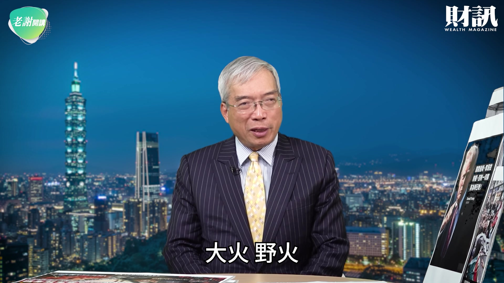

**逐字稿片段：** 已經慢慢燒到義大利

**話題推測：** 提到抗爭延燒至義大利，可能顯示歐洲地圖上標示騷動國家或義大利新聞畫面

---

## 00:04:26

**逐字稿片段：** 義大利的總理梅洛尼 現在出面發表講話 要保持警戒狀態

**話題推測：** 介紹義大利總理梅洛尼發言，可能顯示其肖像或相關新聞報導

---

## 00:04:32

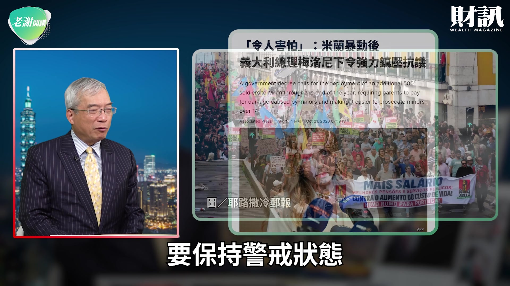

**逐字稿片段：** 我們看到葡萄牙也蠢蠢欲動

**話題推測：** 提到葡萄牙也開始騷動，可能顯示葡萄牙相關新聞

---

## 00:04:34

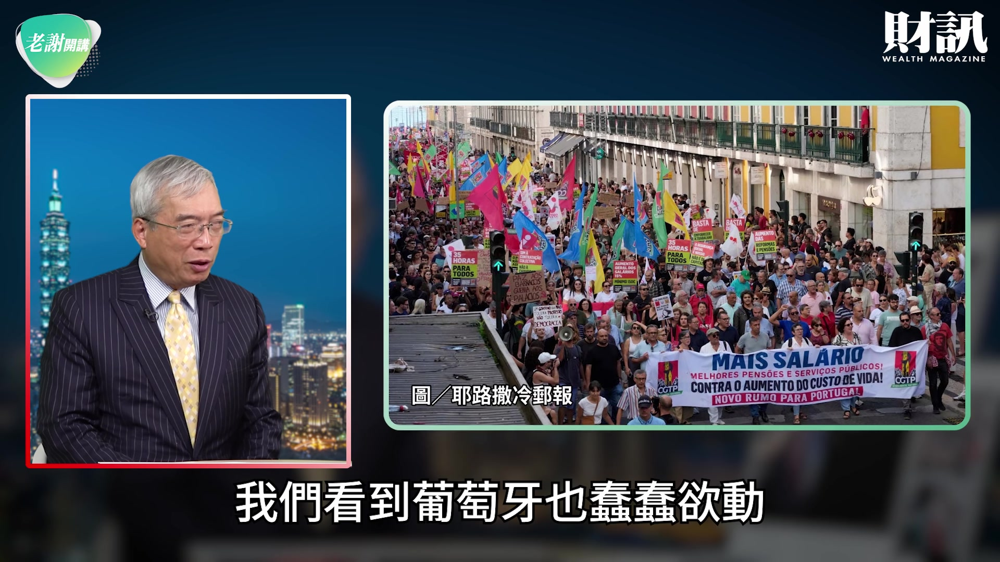

**逐字稿片段：** 我在維也納的街頭 也看到有人 小規模的抗爭慢慢起來了 柏林也有類似的狀況 整個歐洲現在瀰漫一個 好像火藥快被點著的狀態 這種罷工的背後 我們可以來看看 到底怎麼一回事

**話題推測：** 講者提到維也納街頭見聞，可能顯示維也納城市景觀或小型抗爭畫面

---

## 00:04:54

**逐字稿片段：** 川普從他上任的時候 不斷對歐洲指指點點 他認為歐洲的大部分國家 都有非常龐大的 社會福利的支出 大家不工作 也可以領到很多的錢 國家的國庫 你在相對的收入少 但是你的支出 很龐大的情況之下 最後只有舉債 這個舉債一直往上疊加之後 債務會壓垮這個國家的財政 所以我這次到 比利時所看到的

**話題推測：** 再次提及川普，將焦點轉向其對歐洲社會福利制度的批評，可能顯示相關論點列表

---

## 00:05:21

**逐字稿片段：** 比利時罷工從哪裡來 是因為它內閣 宣布要撙節財政支出 這個話一宣布

**話題推測：** 解釋比利時罷工的起因是撙節財政支出，可能顯示相關新聞報導或財政數據圖

---

## 00:05:28

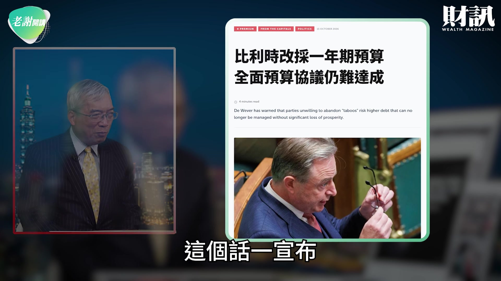

**逐字稿片段：** 馬上有 3 萬人走上街頭 法國現在的

**話題推測：** 指出比利時因撙節政策有3萬人上街，可能顯示人數統計或抗議畫面

---

## 00:05:31

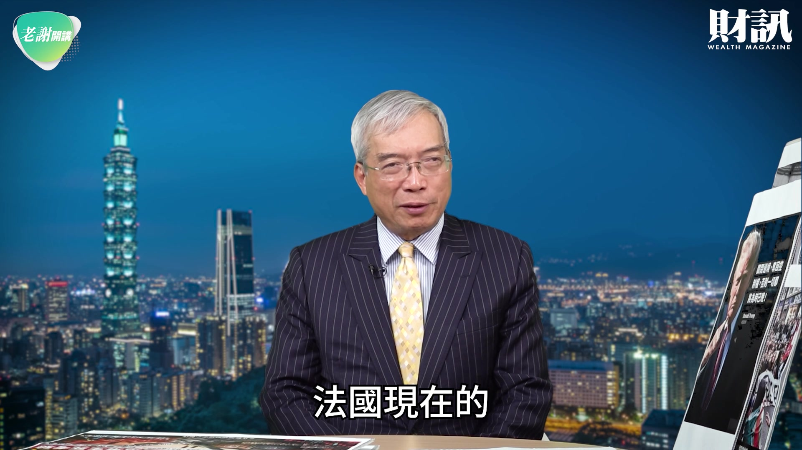

**逐字稿片段：** 整個財政狀況非常不好 所以馬克宏的任期 剩下最後的半年 在這種情況之下你可以看到 他已經無心國政了 那 對法國來講 現在留下了大的爛攤子 可能在國家的發展上 是一個空前考驗 所以川普講的有一些話 我們現在如果回頭想

**話題推測：** 討論法國財政狀況不佳，可能顯示法國國家債務或預算赤字圖表

---

## 00:05:50

**逐字稿片段：** 第一個他要求歐洲國家 要管制邊界 這個移民規模太大 流入這個國家之後 整個社會秩序 都帶來非常大的問題 第二個川普要求歐洲國家 要撙節開支 不能把社會福利弄那麼大 現在歐洲國家 看起來是積重難返 第三個川普不斷的要求 歐洲國家安全要自己照顧 那麼現在看起來歐洲國家 大家也不願意花費太多的（國防） 因為在社會福利的支出 太龐大之後 它們也沒有能力在國防支出上 付出更大的心力 所以在過去很長時間

**話題推測：** 回顧川普對歐洲的三項主要批評：邊界管制、撙節開支、國防自主，可能顯示列表或圖示

---

## 00:06:25

**逐字稿片段：** 歐洲的三隻腳 第一隻腳 安全靠美國 第二隻腳 在能源的發展上 它充分依賴俄羅斯 在俄烏衝突之後 大家可以看到

**話題推測：** 介紹歐洲過去依賴的三個支柱（安全、能源、工業），可能顯示圖表或示意圖

---

## 00:06:35

**逐字稿片段：** 歐洲現在的電價 能源的價格都貴到非常的嚇人 第三個呢 歐洲的工業化 幾乎被中國打趴了 這個打趴 其實現在情況是嚴重的 所以川普講的幾個重點 其實都給大家留下一個 非常大的省思 法國的大規模的抗爭 到底如何善了 看起來沒有底線 那麼我們也看到

**話題推測：** 提到俄烏衝突後歐洲電價及能源價格飆升，可能顯示能源價格走勢圖

---

## 00:06:56

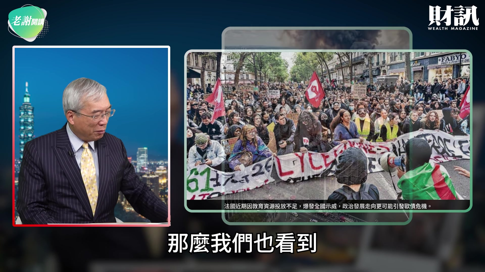

**逐字稿片段：** 歐洲國家對中國的依存度 是非常高的 在過去幾十年當中 歐洲國家都把中國 當成最大的市場 那麼大家一定要全力去 逐鹿這個市場 但是幾十年的發展下來之後 大家可以看到 中國的廉價商品 充塞到歐洲各個角落跟 各個層面 這各個層面 現在所引發的很大的災難 馬上要吞噬整個 歐洲的產業了 這當中 最值得大家注意的 我們看到

**話題推測：** 討論歐洲對中國的貿易依存度，可能顯示歐中貿易統計圖表

---

## 00:07:26

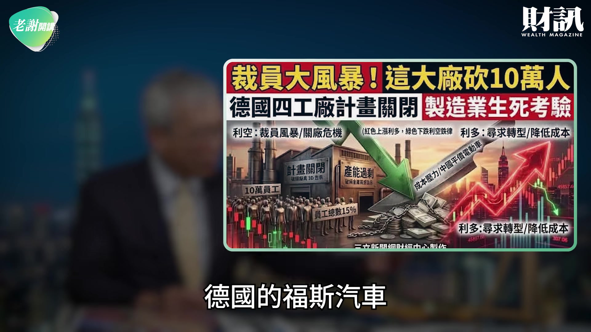

**逐字稿片段：** 德國的福斯汽車

**話題推測：** 提到德國福斯汽車裁員10萬人，可能顯示福斯品牌標誌與裁員新聞

---

## 00:07:28

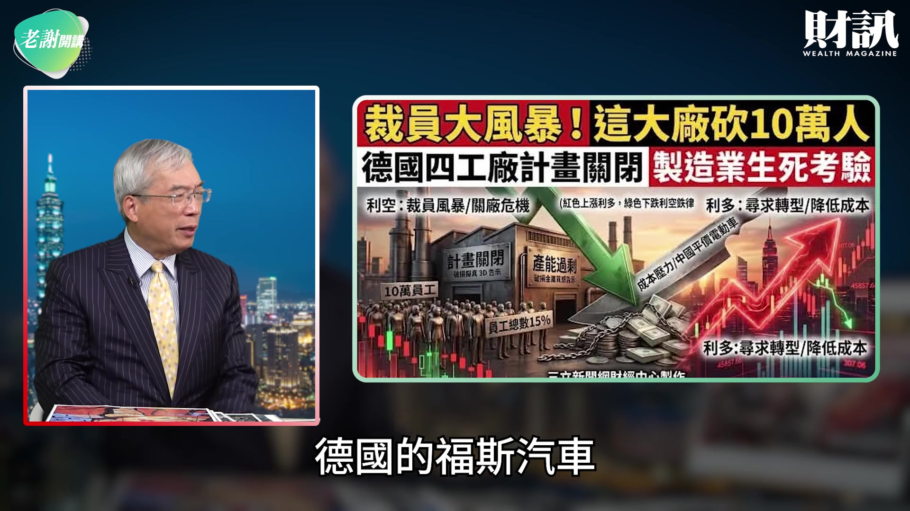

**逐字稿片段：** 準備裁員 10 萬人 這個時候德國四大工廠 已經慢慢在關閉了 對德國來講 汽車工業是德國 最重要的生命線 德國發展到今天 大家可以想像得到德國是歐洲 首善之國 我這一次到

**話題推測：** 指出福斯汽車裁員人數高達10萬，可能顯示裁員數字圖表

---

## 00:07:43

**逐字稿片段：** 法蘭克福轉機的時候 也看到法蘭克福的機場之大 也值得台灣 好好來思考 就是它是一個歐洲的轉運站

**話題推測：** 提到法蘭克福機場的規模，可能顯示機場全景圖或內部照片

---

## 00:07:51

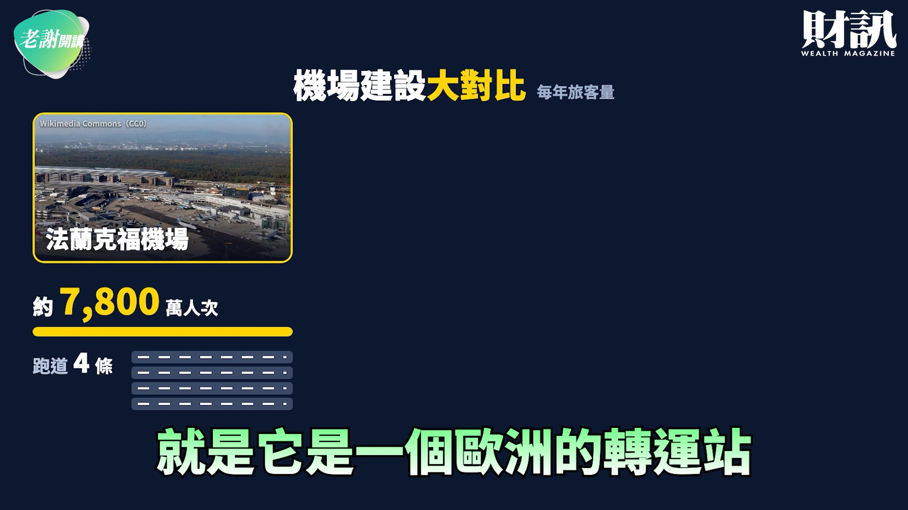

**逐字稿片段：** 在一年的吞吐的人數 大概 7800 萬人 這個 7800 萬人 其實台灣要想

**話題推測：** 提出法蘭克福機場的年吞吐量數字，可能顯示機場數據圖表

---

## 00:07:57

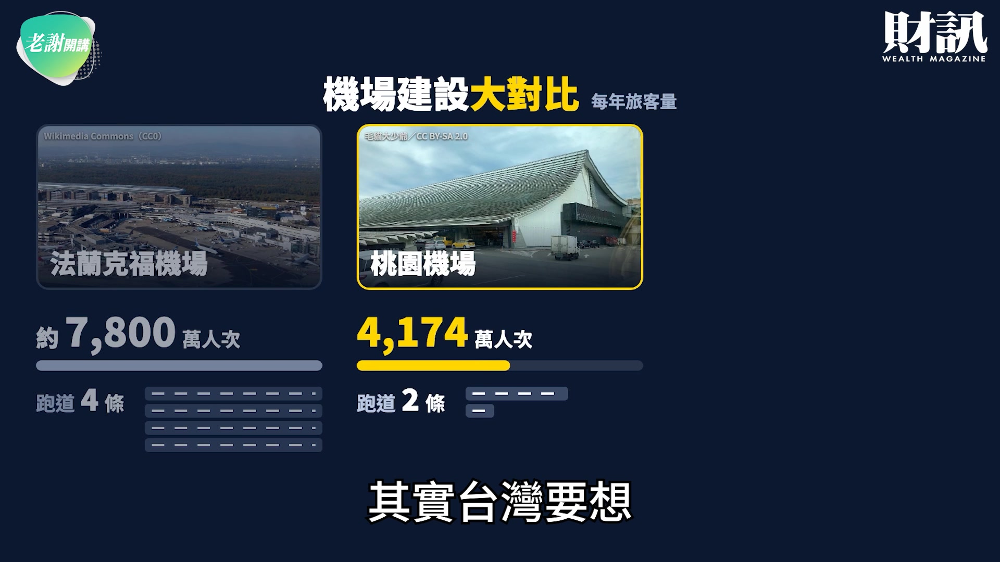

**逐字稿片段：** 我們現在台灣機場有 4800 萬 我們也不小 而且現在看起來 亞洲的轉運的 最重要的核心的樞紐 也降落在台北 所以 我們把國內的出境大廳 能夠在第三航廈 能夠落成之後 我們看到包括第三條跑道 台灣在機場的建設 相對是比較緩慢的 所以如果你比擬一下

**話題推測：** 比較台灣機場的年吞吐量4800萬人次，可能顯示兩地機場數據對比圖

---

## 00:08:18

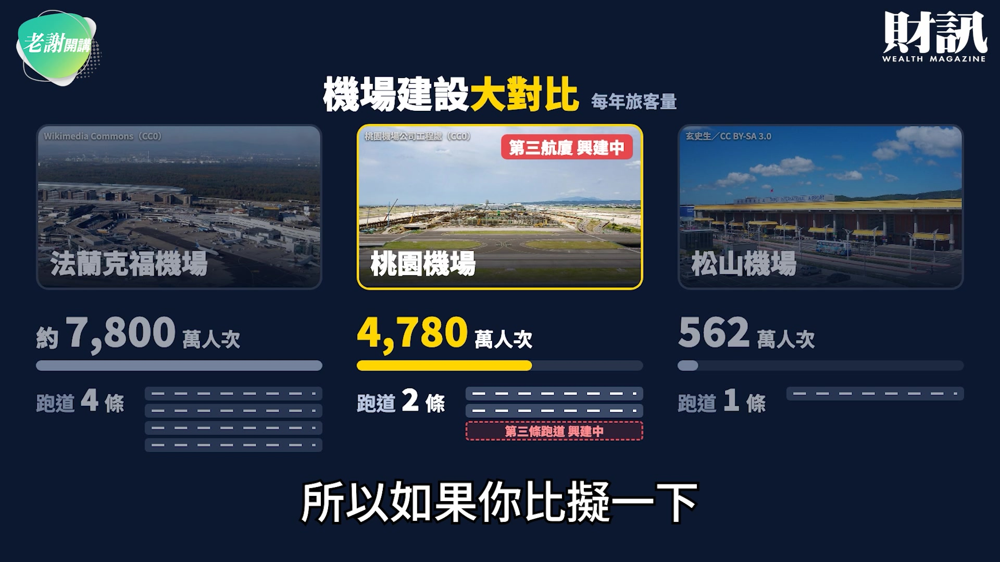

**逐字稿片段：** 包括對松山機場 完整的開發計畫

**話題推測：** 提到松山機場開發計畫，可能顯示松山機場相關規劃圖

---

## 00:08:21

**逐字稿片段：** 或是現在高雄需要 一座 24 小時可以 飛行的國際機場 這個都應該一併納入考量 第二個 我們可以想像得到

**話題推測：** 提及高雄興建24小時國際機場的需求，可能顯示高雄機場規劃圖

---

## 00:08:30

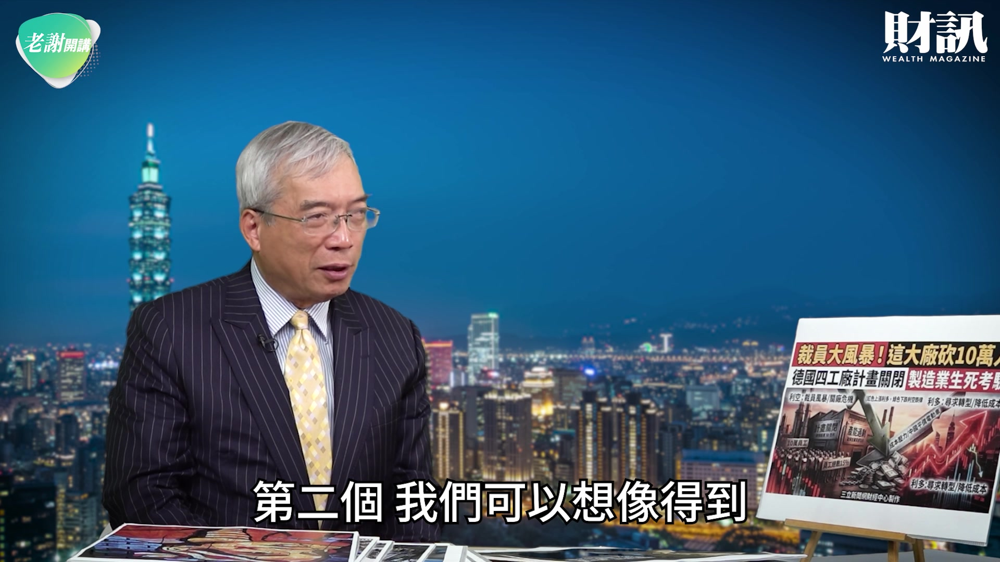

**逐字稿片段：** 中國對整個歐洲 所帶來的壓力 跟它的未來的改變 台灣其實作為 歐洲未來在工業化的 改革當中 台灣應該可以扮演 非常重要的角色 那麼大家可以想一想

**話題推測：** 再次探討中國對歐洲工業化的壓力，可能顯示中歐工業產值對比圖

---

## 00:08:48

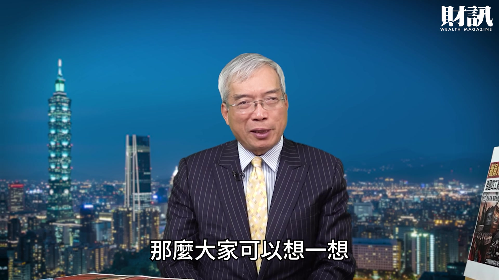

**逐字稿片段：** 台灣其實從 2016 年開始之後 在蔡英文總統時代 祭出的台商回台 投資三大方案 這個回台投資三大方案 是改變台灣 非常重要的轉折點 我們可以理解到 今天大部分的歐洲國家 還不曉得 中國的工業化的能力 所造成的內捲跟價格的破壞 這個價格破壞之後 包括現在大家可以看到

**話題推測：** 提到台灣2016年開始的台商回台投資三大方案，可能顯示相關政策圖表

---

## 00:09:12

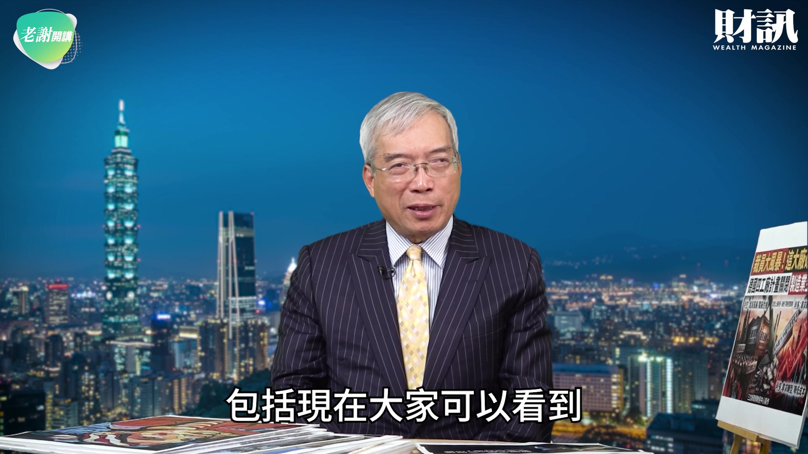

**逐字稿片段：** 福斯汽車到中國發展 大眾汽車 但是 中國現在用比亞迪 打回來的時候 連德國的車系 都沒有辦法招架 這個沒有辦法招架其實 也給德國留下非常大的省思

**話題推測：** 討論福斯汽車在中國市場面臨比亞迪競爭，可能顯示兩品牌銷售數據或車款對比

---

## 00:09:25

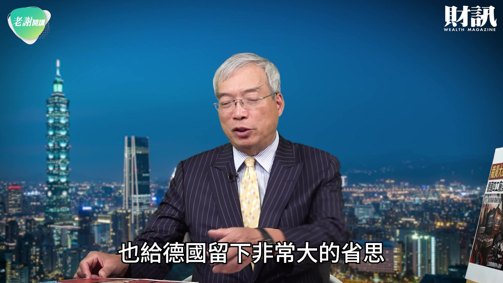

**逐字稿片段：** 那麼這一次我在柏林 停留兩天的時間 我們可以看到對德國來講 它是二戰之後 受到破壞最大的城市 那麼在這樣的一個 巨大破壞當中 德國重新再重建站起來 這個站起來對德國來講是 非常重要的一個 在這 70 年當中的變化 我們看到 這是德國的街景 但是在這場抗爭當中 我發現 福斯汽車的大裁員計畫 影響到德國非常多的年輕人

**話題推測：** 回到柏林話題，強調其二戰後重建的歷程，可能顯示柏林重建前後對比圖

---

## 00:09:54

**逐字稿片段：** 我們看到 德國的州議會正在選舉

**話題推測：** 提到德國州議會選舉結果，可能顯示選舉地圖或政黨得票率圖表

---

## 00:09:57

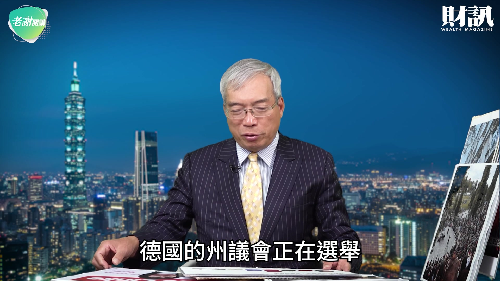

**逐字稿片段：** 現在所選出來的這位 女性候選人是 土耳其移民的律師 她年紀不大 40 幾歲

**話題推測：** 介紹德國州議會選舉中的土耳其移民女性律師候選人，可能顯示其肖像

---

## 00:10:05

**逐字稿片段：** 她是代表 Die Linke 這個是德國的在野黨 她在所有候選人當中

**話題推測：** 提及候選人代表德國左翼政黨Die Linke，可能顯示該黨黨徽

---

## 00:10:12

**逐字稿片段：** 得到 25.3% 的得票 所以在州議會的選舉當中 它現在整個是左翼的政黨 它整個勝出了 我們大家可以看到

**話題推測：** 提出候選人的得票率25.3%，可能顯示選舉結果統計圖

---

## 00:10:21

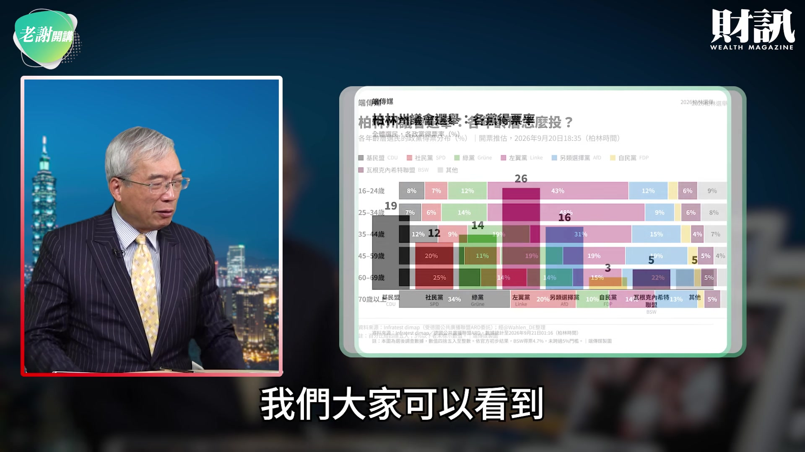

**逐字稿片段：** 她要建立一頓飯 3 歐元的 大型的食堂 讓德國人可以去消費 第二個 她準備要

**話題推測：** 闡述候選人提出3歐元大型食堂政策，可能顯示政策海報或示意圖

---

## 00:10:28

**逐字稿片段：** 要徵收 20 萬戶的 這個德國企業的住宅 來給年輕人來租房子 這個就是現在德國所面臨的 現在各方面的壓力都湧上了 所以德國也看到這種 走上街頭的景象 德國的汽車業是 德國最重要的生存命脈 但是現在看起來德國 都挺不住的時候 義大利的相關的國家 我相信都面臨很大的影響 所以我們可以看到 歐洲的抗爭 現在看起來無所不在

**話題推測：** 提到徵收20萬戶企業住宅的提案，可能顯示相關政策圖示

---

## 00:10:57

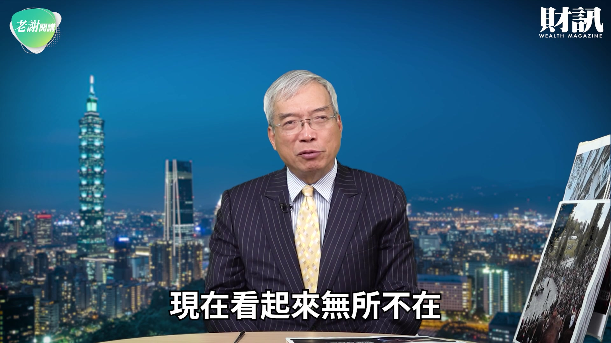

**逐字稿片段：** 我們看到前歐盟的大使李淳 一直在講一句話 他說 歐洲人在溫泉裡面 泡了 70 年 現在從溫泉池走出來之後 發現全身冷颼颼 這個是一個 歐洲走到今天 其實再工業化 可能是一條非常重要的 寬闊大道 這是我們 在歐洲所看到的 在國際外交當中 我們也看到 歐洲如果要再工業化 其實台灣應該是 歐洲重要的夥伴 我這次到奧地利

**話題推測：** 引用前歐盟大使李淳的觀點，可能顯示其肖像或語錄

---

## 00:11:25

**逐字稿片段：** 也看到奧地利的大使 劉玄詠大使 也到比利時

**話題推測：** 提到台灣駐奧地利大使劉玄詠，可能顯示其肖像

---

## 00:11:31

**逐字稿片段：** 送了一件沈伯洋的 T 恤 給謝志偉大使 所以我們相談甚歡 這當中 台灣的駐外代表 在國際上

**話題推測：** 提及沈伯洋T恤，可能顯示T恤圖片

---

## 00:11:39

**逐字稿片段：** 我們面臨中國 非常強大的挑戰 換句話說 台灣生存與發展 最重要的天敵 中華人民共和國 我們也看到 劉玄詠大使跟我講 他說他是外交人員

**話題推測：** 討論台灣在國際上受中國強大挑戰與打壓，可能顯示兩岸關係示意圖

---

## 00:11:52

**逐字稿片段：** 因為他是長號的首席的音樂師 在奧地利有很好的人脈 他是奧地利維也納大學 留學出來的 所以在地他在音樂界 有很好的人脈 很多的奧地利的人士 都來跟他打招呼

**話題推測：** 介紹劉玄詠大使的長號音樂背景及在奧地利的人脈，可能顯示其演奏照片或維也納大學

---

## 00:12:06

**逐字稿片段：** 中國的大使一看非常的吃味 後來就把貴賓席都取消了 這個是可以感受到 連在音樂的場域 其實中國都想盡辦法 要封殺台灣

**話題推測：** 提到中國大使對劉玄詠人脈的反應及取消貴賓席事件，可能顯示外交衝突示意圖

---

## 00:12:18

**逐字稿片段：** 這次我特別邀請大使去參加 聯發科跟達發科技的 它們所主辦的 參與的 Network X 的 網通大展 我們也看到台灣很多的 眾多的參展的廠商 在國際上展現台灣的實力 所以在這個回合當中 我們可以感受到 在國際生存舞台當中

**話題推測：** 提到邀請大使參加聯發科、達發科技的Network X網通大展，可能顯示展覽照片或公司Logo

---

## 00:12:39

**逐字稿片段：** 像最近《愛爾蘭時報》 它在《衛報》的修改的文章當中 特別寫到 這個拉斯穆森的 全球顧問公司 把台灣駐布魯塞爾的大使館 正式註明就是大使館 中國立刻跑出來抗議 所以這是給大家 一個很大的省思

**話題推測：** 提到《愛爾蘭時報》與《衛報》修改文章，將台灣駐布魯塞爾機構稱為大使館的事件，可能顯示新聞截圖

---

## 00:12:58

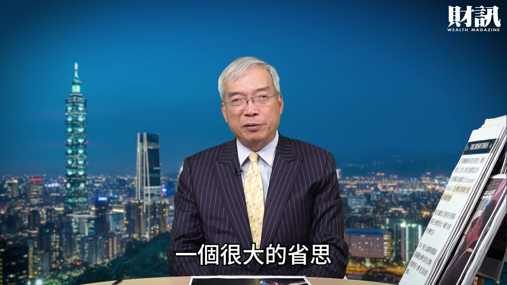

**逐字稿片段：** 我們看到歐洲在 再工業化的路上 其實非常需要台灣的夥伴

**話題推測：** 總結觀點一：歐洲再工業化需要台灣作為夥伴，可能顯示總結圖示

---

## 00:13:04

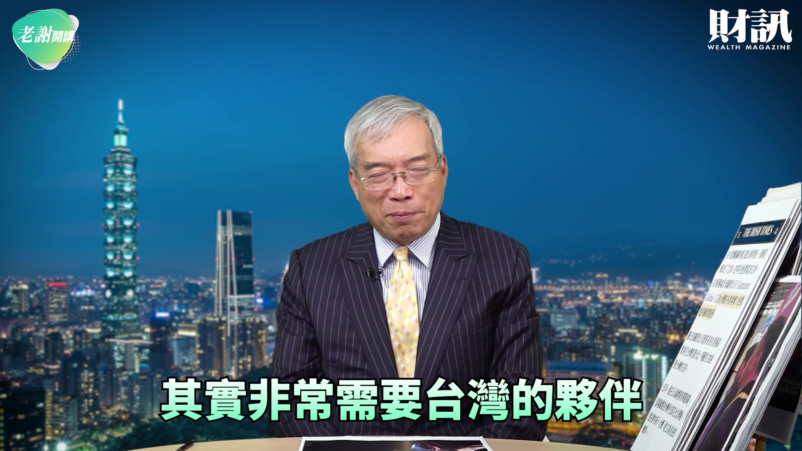

**逐字稿片段：** 另外一個 我們看到 台灣在爭取 國際外交的路上 其實我們面對的中國的打壓是 無所不在 國人一定要有這樣的想法 台灣在國際上要生存 其實你面對的天敵就是中共 那麼今天要能夠突圍 台灣要用自己的 更強大的經濟力 在國際上來展現台灣能夠 來協助歐洲再工業化 我想這是台灣 應該要的企圖心

**話題推測：** 總結觀點二：台灣國際外交面臨中國無所不在的打壓，可能顯示總結圖示

---

## 00:13:29

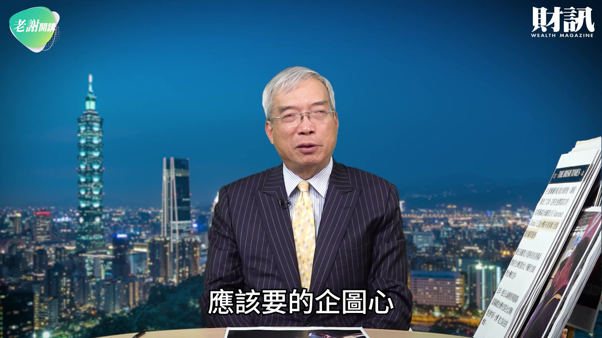

**逐字稿片段：** 第三個角度我們看到 一個國家過度在 社會福利的支出 不斷的開支票 不斷的討好老百姓的時候 最後你還是要買單 歐洲國家在 過度沉重的社會福利支出當中 現在稍微想要改革 立刻 引起人民的反噬 政客更加不敢改革 這樣的一個爛攤子走到最後 歐洲一定面臨崩解的危機 所以我想在這一趟 歐洲的行程當中 我特別想到其實 川普對歐洲講的每一句話 其實句句針砭 恰到好處 但是歐洲人聽不下去 這個時候歐洲所面臨的變局 應該是未來我們可以看到 每一步路它都會 走得異常的辛苦 這是在這一趟歐洲行程當中 給大家做的簡報 感謝大家的觀賞 下週見

**話題推測：** 總結觀點三：警惕國家過度社會福利支出將引發危機，可能顯示總結圖示

---
