# wealth1974_YSzEeYK9hUk — 關鍵畫面索引

- 來源逐字稿：[wealth1974_YSzEeYK9hUk_FIN.srt](wealth1974_YSzEeYK9hUk_FIN.srt)
- 影片：https://www.youtube.com/watch?v=YSzEeYK9hUk
- 截圖數：45

## 00:01:05

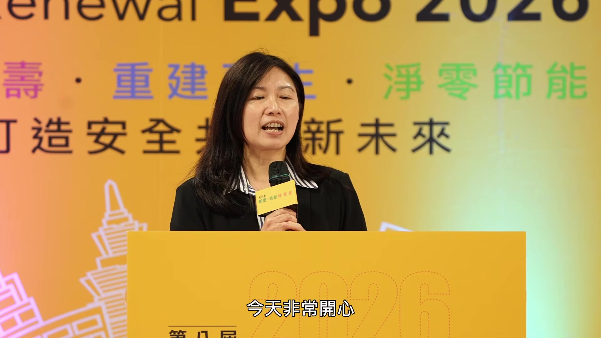

**逐字稿片段：** 我們就透過從產業的方向 從政策的工具 到最接地氣的執行面 來跟大家做分享 其實財訊不是隻有每年舉辦博覽會 所以我們也做了一個都更全都通網站 基本上我們也收集了每一年的過程中 所有重要的都更政策 所有的工具都在網站上可以被搜尋得到 希望大家可以共同的一起為臺灣努力 老宅延壽機能復興計畫 為什麼會有這樣子的議題的產生 就是希望面對我們這麼多的老屋 只要大家能夠有百分之百同意 有相關的修繕的意向 不管室內或室外 政府都來幫幫忙

**話題推測：** 介紹演講主題框架：從產業、政策到執行面

---

## 00:01:58

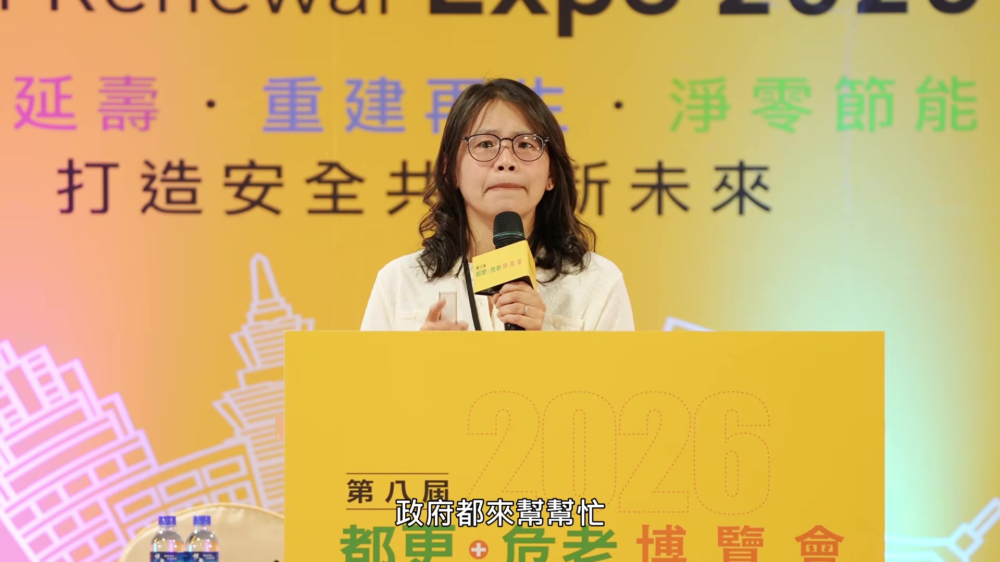

**逐字稿片段：** 這個是兩年的計劃 從現在到明年12月31號截止

**話題推測：** 說明計畫為期兩年，至明年12月31日截止

---

## 00:02:06

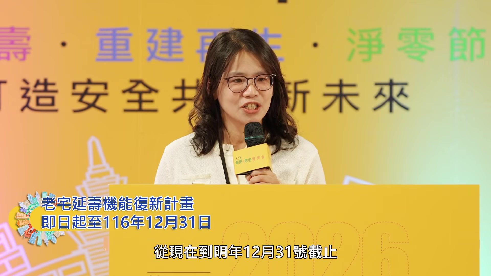

**逐字稿片段：** 經費預算的部分 是特別預算50億元 所以明年截止之後 117年是不是還會有新的計劃產生 這個還沒有辦法確認 我們期待50億元 能夠協助三千棟建築物 來完成室內室外的修繕 大概可以協助這個 二到三萬戶的住宅來辦理 老宅老宅

**話題推測：** 說明計畫經費預算為特別預算50億元

---

## 00:02:32

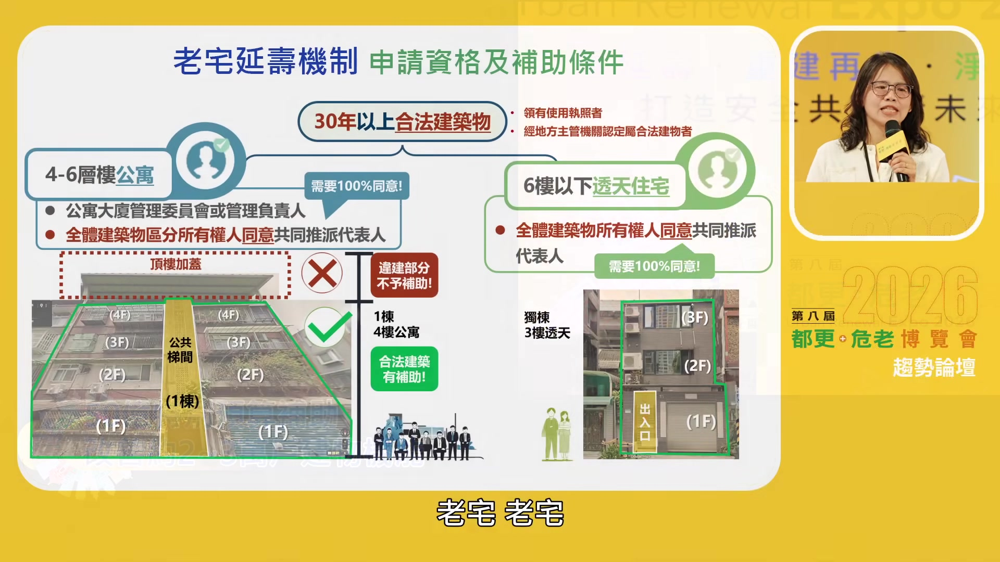

**逐字稿片段：** 那三十年 我們用三十年來定義老宅 所以屋齡必須要三十年以上 四到六層樓的布燈公寓 或者六層樓以下的透天住宅 這個是我們補住的建築物的太陽 必須要取得全體所有權人百分之百的同意

**話題推測：** 定義「老宅」需屋齡三十年以上

---

## 00:02:55

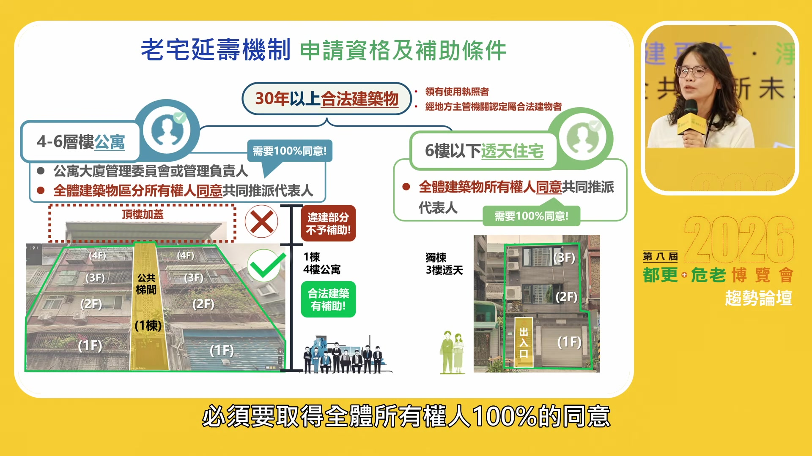

**逐字稿片段：** 這邊有特別跟各位講 申請這項補助 它是要有自籌款的 住戶至少要有35%的自籌款 還有第二個規定 它必須超過二分之一以上的戶數 或者樓地板面積 它必須做住宅使用

**話題推測：** 說明申請補助需有35%自籌款

---

## 00:03:13

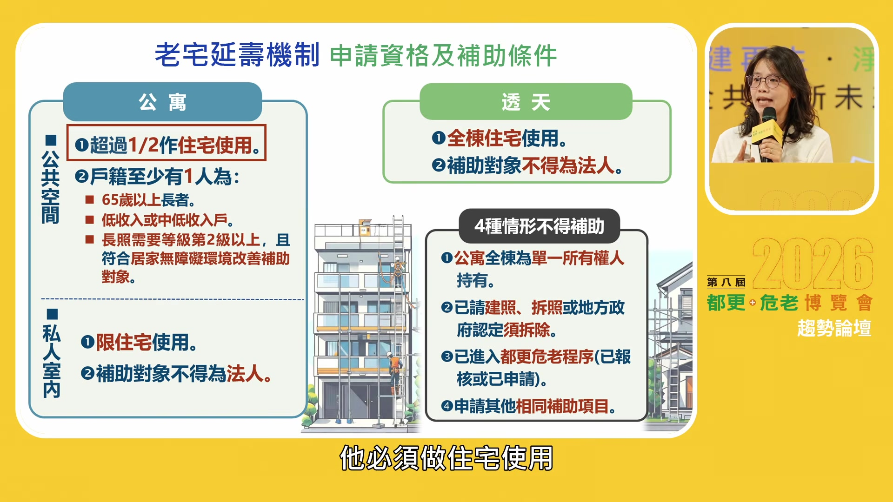

**逐字稿片段：** 公寓裡面住了這麼多人 要跟雙老議題做呼應 所以其中至少要有一個人 涉及在這棟公寓裡 然後他的年齡超過65歲的長者 不然的話你就是要符合 長照等級第二級以上 而需要政府提供居家無障礙環境 補助的對象 或者是中低收入戶的成員 必須要有符合這樣子的要件 這個計劃除了補助公共空間 我們也考量室內空間 也可以給予相關的補助 各戶各戶自己申請 這個每一戶申請的室內空間的部分

**話題推測：** 說明公寓需有65歲以上長者或符合長照條件者居住

---

## 00:03:56

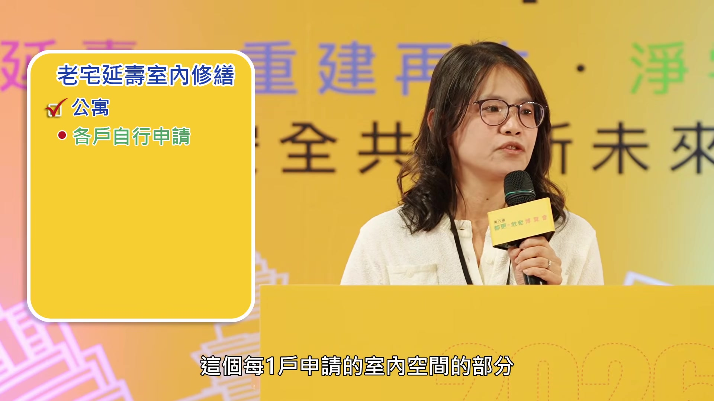

**逐字稿片段：** 就必須全戶做住宅 該戶不得是所謂的公司法人 或者行政法人 或者公法人都不行 他必須是自然人為所有權人 才可以做室內修繕的申請 透天的部分 則是全棟都必須做住宅使用 而且全棟的補助對象 所有全人不得為法人

**話題推測：** 室內空間補助限全戶住宅使用且所有權人須為自然人

---

## 00:04:20

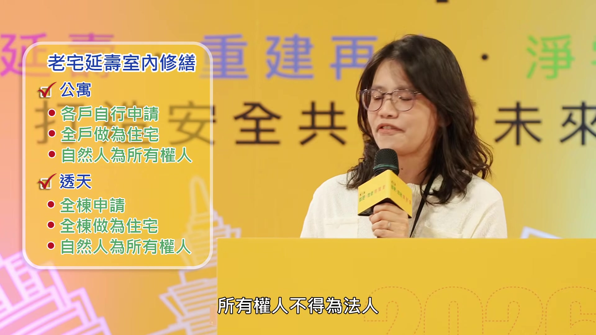

**逐字稿片段：** 申請老宅延壽 要先去申請耐震評估 耐震評估的費用 也不會造成住戶的負擔 因為耐震評估的費用 內政部在這個計畫裡面 也給予適當的補助

**話題推測：** 申請老宅延壽需先申請耐震評估，費用可獲補助

---

## 00:04:36

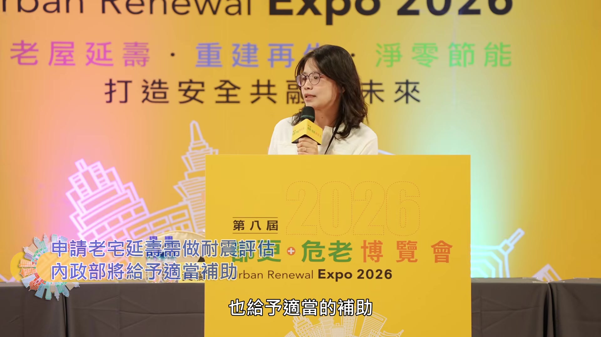

**逐字稿片段：** 補助的經費其實最高上限公寓 一棟公寓最高可以達到960萬元 最高 但是是不是能夠申請得了那麼多 不見得 因為要看你社區的需求是什麼 你實際的花費是多少 每一項補助 它都有相對應的補助的上限 那全部加起來可以達到960萬元

**話題推測：** 公寓最高可獲960萬元補助

---

## 00:05:04

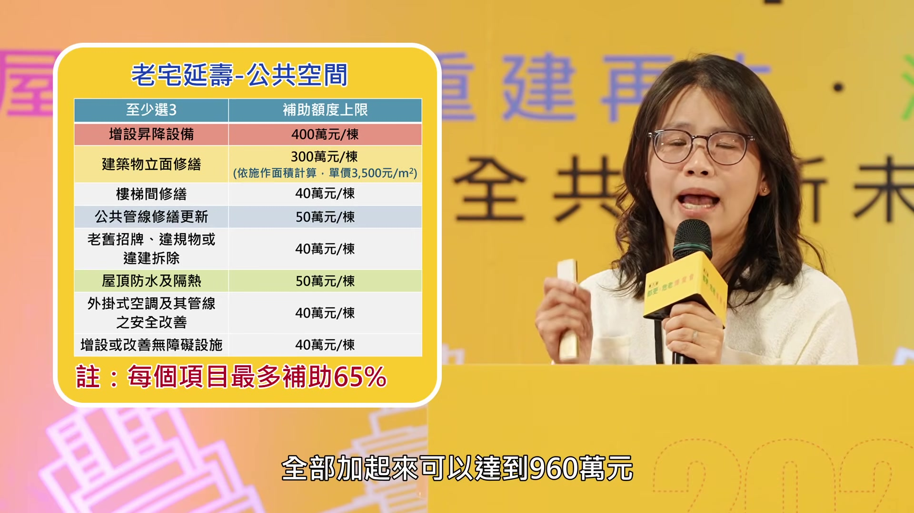

**逐字稿片段：** 那補助要有自籌 所以你實支的金額 在這個上限內 你要自籌35% 咱們政府的補助是65% 我也要跟各位說 這65%不是都是中央出的 這65%裡面 有一部分是地方跟中央合作 所以地方也有配合款 地方也有配合款 會依照地方的財政分級的部分 有配合款 但是政府部門 這個補助的部分最高就是65% 有35%要社區自籌 要社區來自籌 好 那

**話題推測：** 補助為65%政府出資，35%社區自籌

---

## 00:05:46

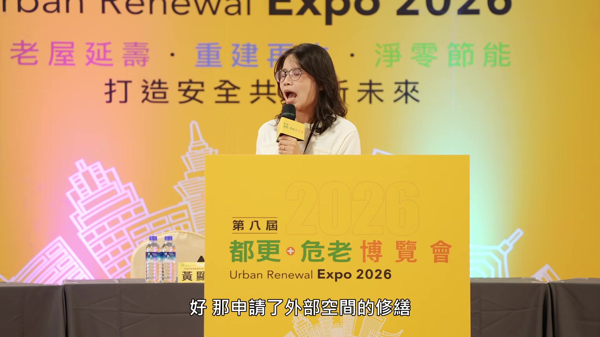

**逐字稿片段：** 申請了外部空間的修繕 可以來提出室內的修繕 一戶補助20萬元為上限 一樣自籌35% 補助20萬元為上限

**話題推測：** 室內修繕每戶補助上限20萬元

---

## 00:06:01

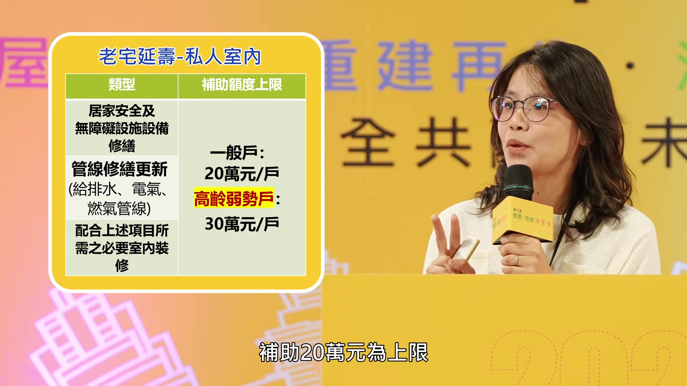

**逐字稿片段：** 那我們剛剛是不是講到說 我們要跟雙老議題結合 所以如果該戶人家裡面 剛好他就有65歲以上的長者 有中低收入戶 有所謂的需要這個長照3.0 這一戶裡面 如果有這樣三類其中的一種 那麼就該戶呢 就可以提高室內修繕的補助 可以加碼1.5倍 一戶就可以申請最高30萬元的補助 透天的部分呢 的補助項目比較少 那我們透天的最高就是六百三十萬 如果申請室內修繕的部分呢 一樣一戶一棟二十萬元 如果有所謂的高齡弱勢戶 提高一點五倍達到三十萬元 所以呢 我們其實可以在這兩年裡面 我們有兩年的時間 其實大家可以考慮一下 剛好趁著這個時間 我們來檢視我們的需求 那透過政府的經費 來做一個修繕

**話題推測：** 符合高齡弱勢條件的家庭，室內修繕補助可提高1.5倍至30萬元

---

## 00:07:09

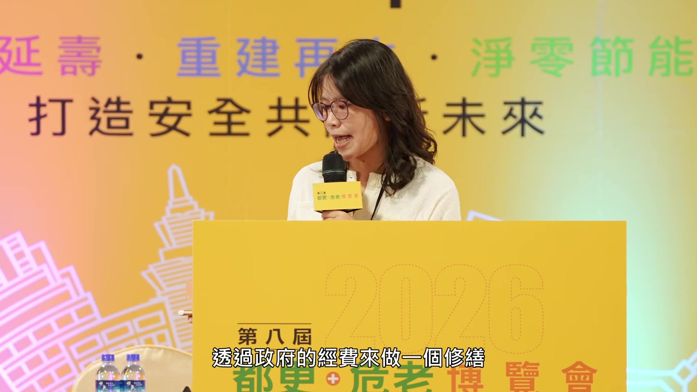

**逐字稿片段：** 是不是可以請執行長 先聊一下說 住都中心對於推動公辦都更的想法 跟計畫是什麼

**話題推測：** 轉換講者，開始討論住都中心推動公辦都更的理念與計畫

---

## 00:07:22

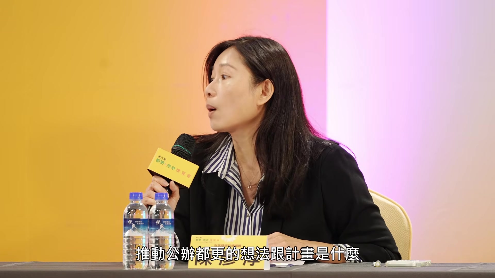

**逐字稿片段：** 國家住都中心 其實有兩大主要業務 第一個就是 推動我們公辦都更新 第二個業務就是 興辦我們社會住宅

**話題推測：** 介紹國家住都中心兩大業務：公辦都更與興辦社會住宅

---

## 00:07:33

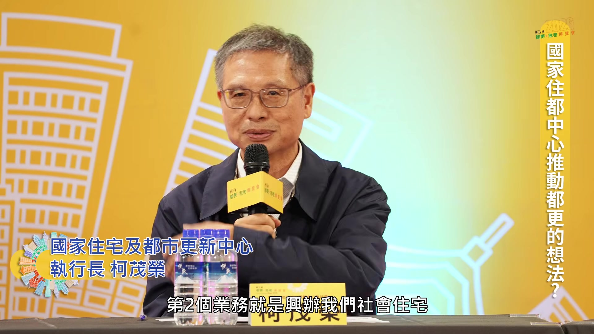

**逐字稿片段：** 我們成立八年 大概到現在已經做了18個案子 整個投資金額大概1000億 今年我們大概做9個案子 第一個已經簽約了 第二個正在招商當中 還有七個在今年會陸續招商 投資金額大概達到600億

**話題推測：** 住都中心成立八年已完成18個都更案，總投資額達1000億

---

## 00:07:53

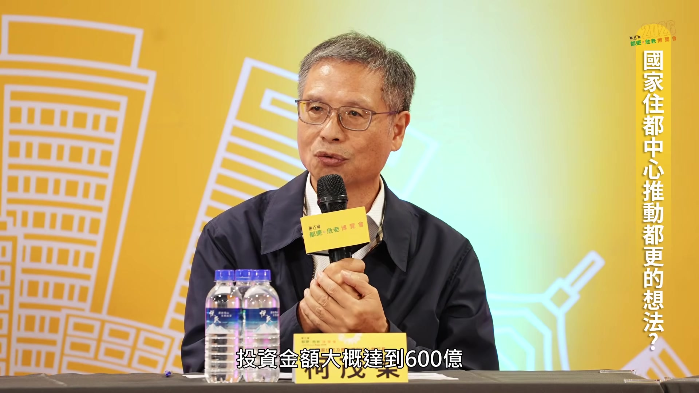

**逐字稿片段：** 在公辦都更 尤其公辦都更能夠帶動 整個區域的發展 才是我們非常需要努力的地方 所以我們今年一口氣 準備要拖A9個案子 在政策方面的調整是這樣 我們之前都一個單點單點做 那我們現在開始 整個結果整個結果做了 在做的時候一定有私人的土地嘛 有國有的土地 我們都把所有的私人 接國內的所有的私人的部分 都把他納進來 民眾都非常願意參與我們中心辦的都更 因為我們中心就是值得民眾來信賴 我們做的都透過潛力變換 所以他的潛力價值都非常清楚 也不會騙他 也沒有什麼檯面下的承諾什麼 就是我們都非常務實的 而且在公辦都更透過權力變換 他獲得的權利 我覺得是最高的 這個就是我們從單點的 擴到接鍋

**話題推測：** 說明公辦都更政策調整：從單點走向區域整合

---

## 00:08:54

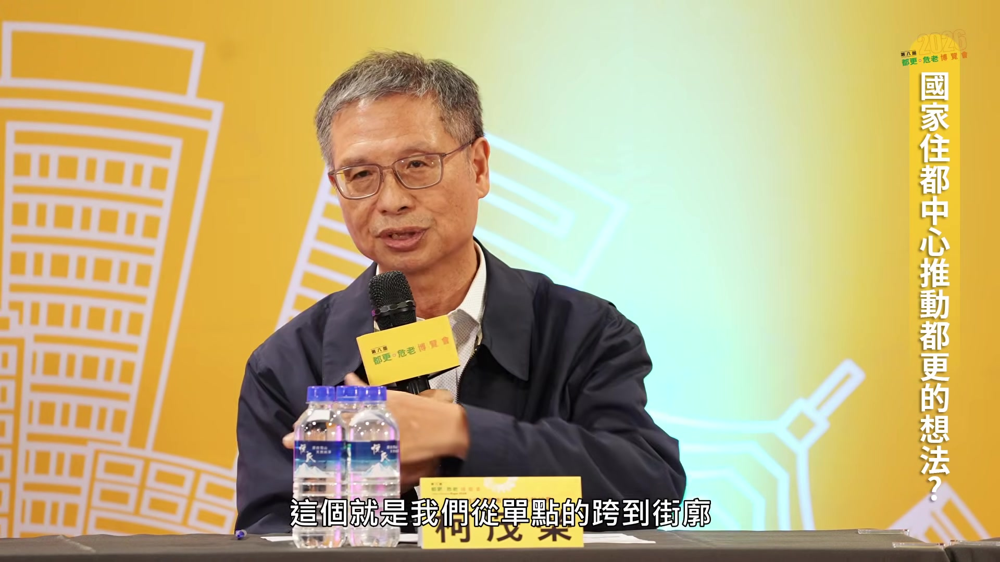

**逐字稿片段：** 後面未來的歲月 我們可能會用中心的高度 來組一個都更聯盟 那我希望把整合的人 把它訓練一下 再來透過工程管理 把建金公司 還有我們銀行都把它納進來 這樣把做成一個都更的聯盟 我們再把它做一些訓練 變成一個都更的一個正規部隊 這樣來做的時候希望它的量會更大 你看我們做了八年 今年才做到九個案子 希望更擴大更快 我們烏老的速度比我們人的年紀還更快 那我們希望把這個產業的規模再擴大 這個大概是我們在公辦都更 想要往下做的方向

**話題推測：** 未來住都中心將組建「都更聯盟」以擴大能量

---

## 00:09:41

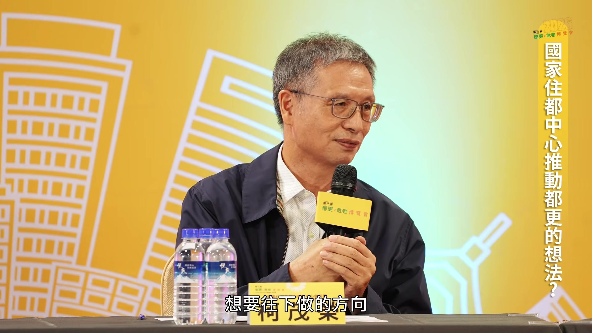

**逐字稿片段：** 這個可不可以請總經理幫我們分享一下 臺灣今年現在在自主都根上面的部分 你們扮演什麼樣的角色 那實際上自主都根案為什麼會不成功

**話題推測：** 轉換講者，討論自主都更的角色與成功率不高原因

---

## 00:09:52

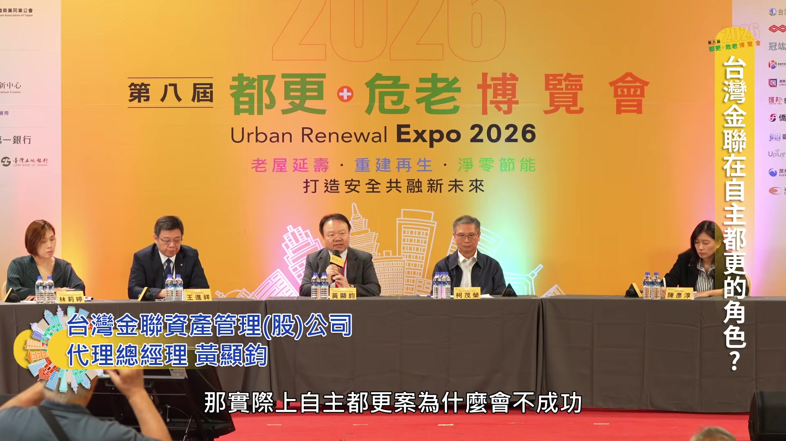

**逐字稿片段：** 因為地主在辦都根的時候 他在前期的資金是沒辦法透過土地去跟 銀行做所謂的土建樓 所以前期的這個資金不夠的話 通常沒辦法走到最後

**話題推測：** 說明自主都更不成功原因一：前期資金不足

---

## 00:10:08

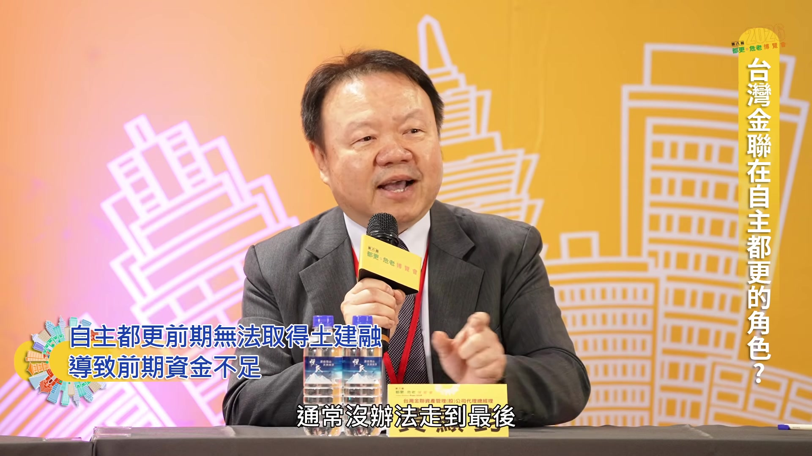

**逐字稿片段：** 那第二個就是說 都更整個過程當中 它涉及非常多的專業 包括你在一開始 你要不要建築師畫圖 還有地震師 這種種專業都要進來 那前面就會缺乏 這個前級資金的一個介入 所以導致自主都更 它的成功機率不高 那臺灣今年在8月26號 正式開辦這個所謂的 自主都更全案管理之後 我們就是要去扮演全案管理機構 那我們這項業務 跟業界有在做全案管理公司 最大的不同 一個就是所謂的前期資金的帶電 我們大概顧過 一個自主都跟案 它前面要花的錢 會在差不多三千萬左右 那我們可以來做這一個帶電

**話題推測：** 說明自主都更不成功原因二：缺乏專業整合

---

## 00:10:59

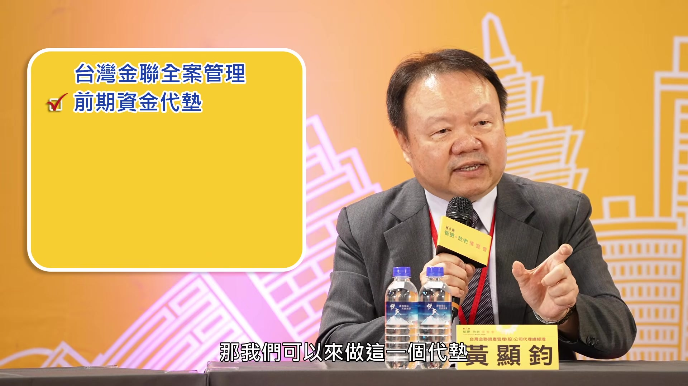

**逐字稿片段：** 那第二個就是說 我們來提供 在整個自主都跟過程當中 所缺乏的這個專業整合 包括整合規劃 還有後面的財務規劃 以及新建跟未來的銷售 提供一個完整的一條龍的服務 另外也提供一個就是 我們在整合過程當中 原則上是透過更新會 未來就是提供地主的土地 跟銀行借所謂的土建龍 我們接觸的個案裡面 不劃有部分地主 他不願意提供自己的土地 去跟銀行借錢 那這一部分 臺灣今年提供一個 就是所謂的多元轉軌機制 不願意走自主都更 那我們公司就協助你們 來找其他的實施者 或者是我們公司 臺灣今年自己進來 扮演所謂的實施者 那提供所謂的合建 或者是違建的一個服務 讓整個自主都更 能夠順利的走下去 自主都更的專案管理公司 他們所收取的服務費用 大概是跟後價值 也就是說全案的總銷售金額 大概百分之五 所以一般建商百分之二十的利潤 減掉百分之五的 全案管理公司利潤 這個差異大概是 差不多有百分之十五 所以如果說 能夠透過自主都更來進行 老秀住宅的一個都更改建的話 實際上未來地主 是可以分為更多的面積

**話題推測：** 台灣金聯提供自主都更全案的專業整合服務

---

## 00:12:38

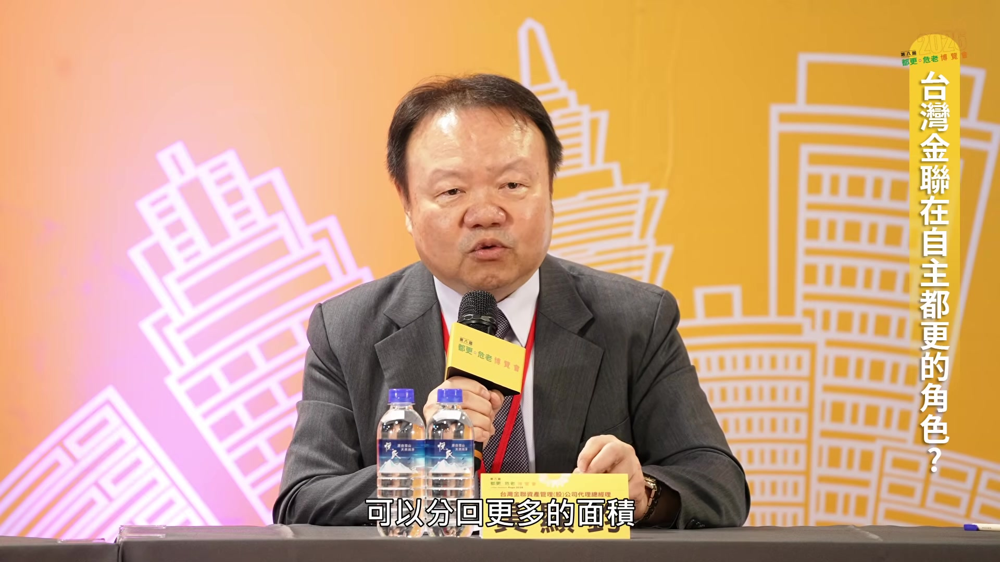

**逐字稿片段：** 接下來想要問王理事長 說在這個大基層潮的過程中 世代交替 房屋繼承 會不會讓都更變得比較容易一點

**話題推測：** 轉換講者，討論房屋繼承對都更的影響

---

## 00:12:48

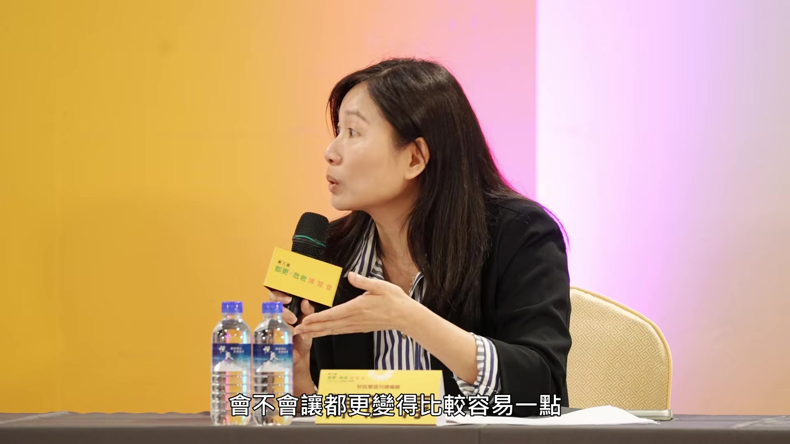

**逐字稿片段：** 繼承不是問題 繼承的問題都在分配 你看對不對 繼承有兩大問題 一個是日據時期到現在 或者因為某種原因 沒辦法辦繼承 另外一個是 發生的繼承的原因 就是有被繼承人死亡 然後就遲遲沒辦法去辦 或者他辦公同共有 為什麼會辦公同共有 就是他要去分配 要遺產分割 或要辦應濟分 產生內部的問題 可以解決的 也就是說 要不要利用都更的整合過程 把這個問題提出給整合人

**話題推測：** 分析繼承問題點：未辦理繼承或辦理公同共有後的分配問題

---

## 00:13:30

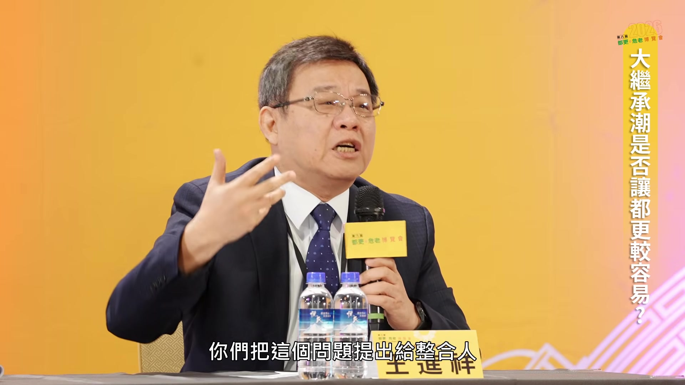

**逐字稿片段：** 第二個 我要給各位一個概念 要研究哪些產權分配的合理跟不合理 那我隨便舉例 不知道各位可不可以接受我這個觀念 第一個 你有沒有看過說 皇屋土地不同人的 你絕對不要以為說 我家土地都皇帝同一人 問題就會出在皇帝不同人 皇帝不同人的時候 可能還是屋主在住 地主在享受都更 所以他們之間有沒有地租 有沒有租金請求錢 可能都沒有 但是以後還有使用權分配 以後還有租金補貼 以後還有拆遷會 拆遷補償都是給屋主 但是地主又要使用錢給屋主 所以裡面又產生第一個矛盾

**話題推測：** 提出產權分配不合理的問題，例如房屋與土地所有權人不同

---

## 00:14:19

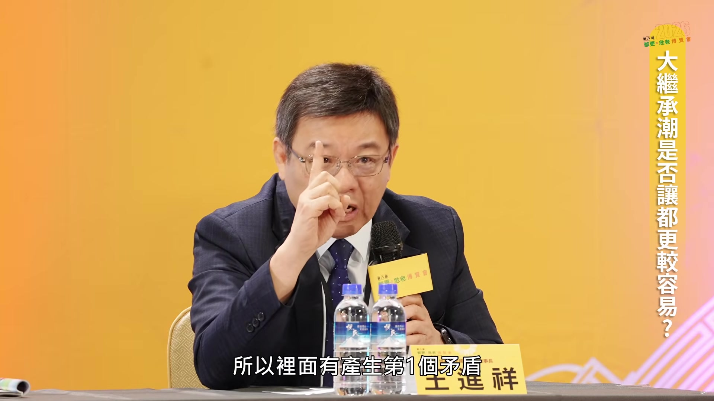

**逐字稿片段：** 第三個這個很重要的觀念 萬一我剛剛談的 比如我再幾個例 可能大家會比較清楚 四層樓公益 一樓土地40% 二樓土地30% 三樓土地20% 四樓土地只有10% 你看以後怎麼督根 事實上現在登記就這樣子啊 所以它都會產生差異嘛

**話題推測：** 舉例說明老公寓各樓層土地持分比例不同導致的分配問題

---

## 00:14:41

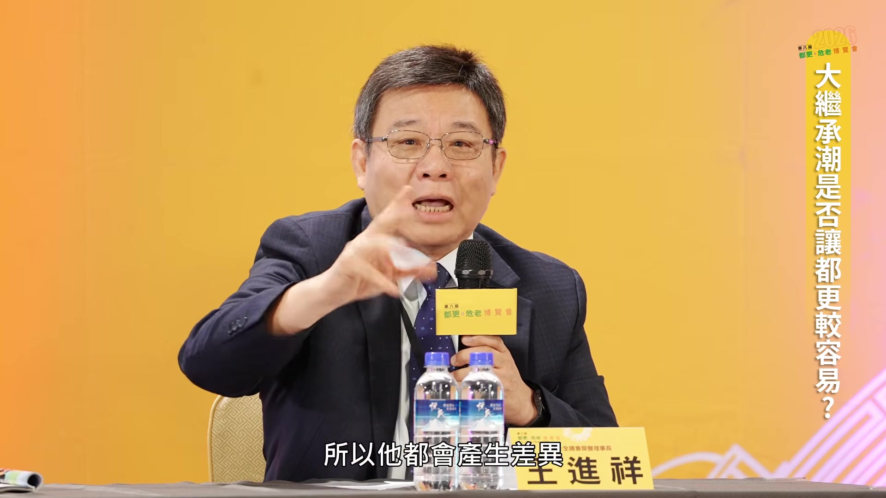

**逐字稿片段：** 這種差異要解決只有一個條件 透過估價師的估價條件把它平和掉 各位一定要聽進去 結論旁邊多幾個專業的地震師 多幾個仲介 多幾個估價師在當你的朋友 不是壞 還有更重要的 因為我今天還有一個身份 我是仲裁協會的理事長 所以結論不要打訴訟 有爭議都不要打訴訟 打訴訟拖了五年十年二十年 根本要拖垮人家 仲裁好住在哪裡 不要訴訟 第二個 自己指定仲裁人 仲裁人就是準司法官 就準法官 你自己找法官還不好找 然後原告找一個仲裁人 被告找一個仲裁人 兩個仲裁人再找一個主任仲裁人 三個仲裁人 六個也就把你解決掉 那接下來我想要問一下林理事 那其實臺灣獨耕的問題 就是面臨到人老巫老 這樣子的問題 站在開發商的角度 你們的想法跟建議可能有哪些

**話題推測：** 強調需透過估價師的專業估價來平衡產權差異

---

## 00:15:37

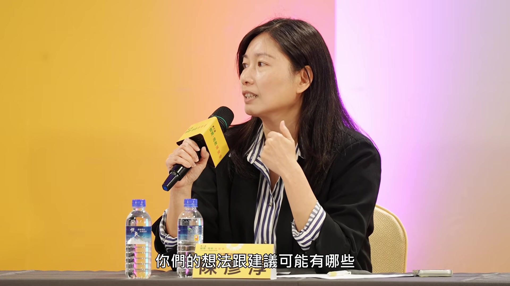

**逐字稿片段：** 我覺得住宅在未來絕對是超高齡社會的基礎建設 因為這個基礎建設做得好 你有很好的通用設計 你有很好的無障礙的環境 你有適合全齡友善的公共空間 未來這個空間將來服務業者會走到社區來服務 包含醫療的系統 包含健康促進的系統 包含送餐的系統 包含居家照護的系統 有太多太多 所以房子蓋好是一個基礎

**話題推測：** 提出住宅是超高齡社會的基礎建設，強調通用設計與無障礙環境

---

## 00:16:11

**逐字稿片段：** 我在這邊也很希望呼籲政府 對於在政策上不動產業 應該是大家公私協力 我們有太多的公辦都更 我們也有民間向大家 踴躍來參與都更 我們的學校也因為少子化 未來校園會釋出來 我們講的EOD校園的 重新的更新 跟TOD跟大眾運輸改善的 這樣的一個投資案 這些公共的政策如何透過政策來讓民間有更多的誘因 把房子蓋得節能減碳 但是同時要能夠讓住在裡面的人可以住到最後 我想這個是在這邊我也很希望呼籲的

**話題推測：** 呼籲政府透過政策工具鼓勵民間參與都更，包含EOD/TOD開發

---

## 00:16:55

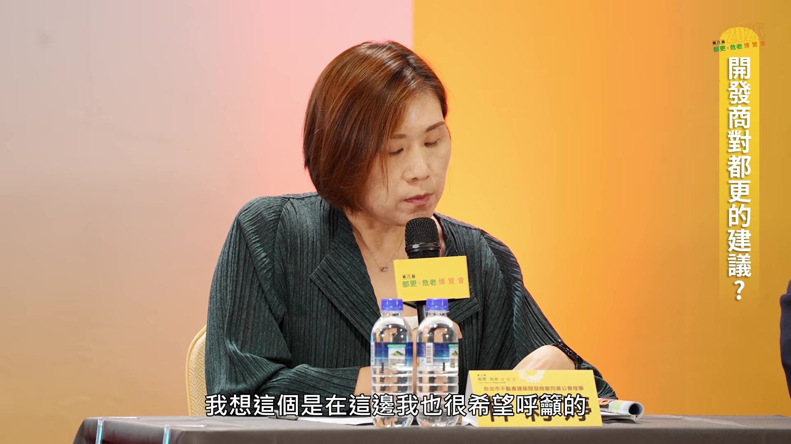

**逐字稿片段：** 那另外一個其實我本身在降解集團服務 其實我們現在在自己的建案裡面 也都已經把這樣的一個硬體的設備都已經完善了 這些通用設計 這些全靈友善的健身空間 這些用餐的空間 然後呢我們也在這個開發了一個像生活物業的這樣的一個APP 那這個APP除了大家收收包裹 繳繳管理費 同時我們也把居家照護的服務已經放在這個平臺上 未來這個平臺等於是今天的公司我慢慢退場了 可是我可以透過線上整合服務 讓這些生活服務的支持 可以提供給社區 管委會提供給住戶 讓在這個社區裡面 大家可以透過空間的資源 可以有服務業者進來服務 我想這是我們自己 從自己先做的一個示範 開發商其實透過政策的引導 我們是可以公私協力 做到很多的事情

**話題推測：** 分享降解集團在建案中落實通用設計與生活物業APP服務

---

## 00:17:54

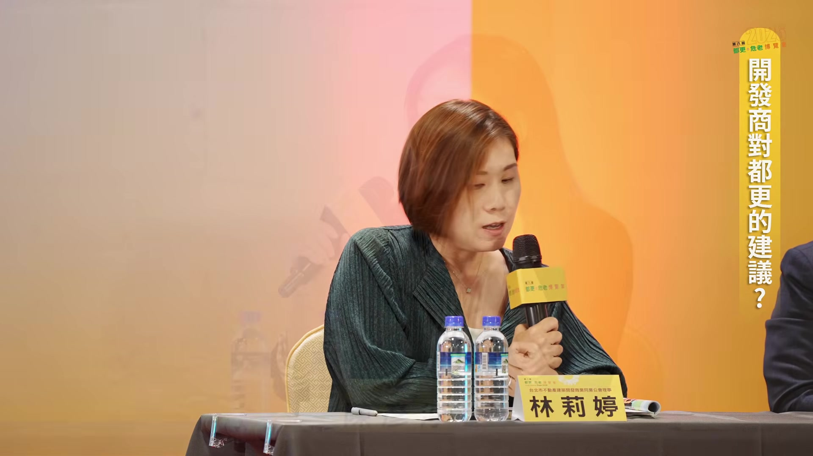

**逐字稿片段：** 請教柯執行長 剛剛提到說整個都更的量能要提高 我們要建立一個大聯盟的機制 我們其實國家住宿中心有推出一個整合達人計畫1.0 現在要進入到2.0 這個計畫內容跟未來的發展方向 可不可以跟大家分享一下 就是說我們整合人很多 提著公事包到處在去跑 我們想說我們業界既然那麼多專業的人員 我們有需要借重他們的人數跟經驗 來做更好的能量的擴充 所以我們國家住宿中心就推出了整合達人1.0

**話題推測：** 轉換講者，討論國家住都中心「整合達人計畫1.0/2.0」

---

## 00:18:32

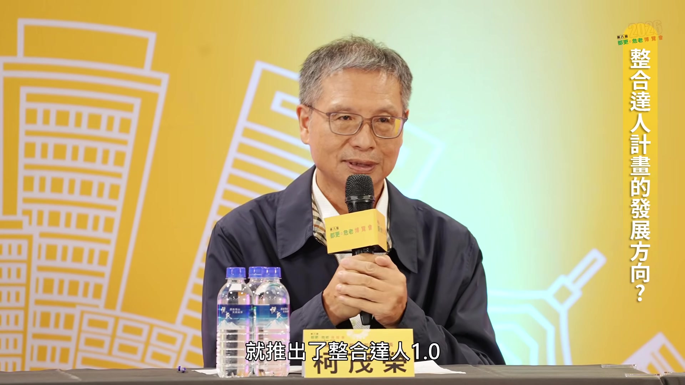

**逐字稿片段：** 透過公開的程序 就是說我們廣發英雄帖 所謂的整合團隊我們都歡迎 那進來以後我們再篩選 大家公平競爭 篩選到我們有三個基地 我就說我們要有做這三個基地 那請專業的團隊來投入來 考量的部分 第一個就是擴大它的能量 第二個就是說 我們國家住中心 我可以這樣講 我們非常專業 但是對於整合的能力 就像那個王理事長一樣 我們沒有他那麼厲害 他非常接地氣 所以我們要借重他們的經驗 整合的團隊 向我們瞭解一下 我們專業的規劃的技巧 到底在哪邊 這個第二考量 第三個就是說 我們國家住宿中心 在做都更的時候 尤其公辦都更的時候 會考量的層面會比較廣 第一個一定是說 我們整個街區的發展 因為一般投資公司在做的時候 那個基地 但是我們國際投資公司做了 一定把他基地的周邊的道路 一定要納進來 因為交通的改善是第一個要件 第二個我們同時會設置 不是拖老就拖嬰或是日照這些 我們會把它整合成類似有公益事業 為什麼 因為住的人要老人照顧 就是嬰兒要照顧 所以我們考量社會的責任 會把它放進去 這個大概是我們中心的核心價值

**話題推測：** 說明整合達人計畫1.0透過公開程序遴選專業整合團隊

---

## 00:19:58

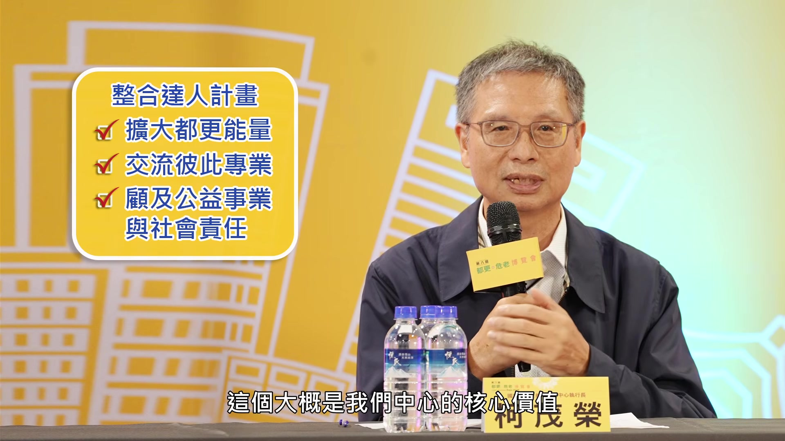

**逐字稿片段：** 接著我們再推出整合達人奧運 改善一些技巧 為什麼 對整合團隊我們後來再調整一下 就是你來做的時候 基本功的服務會 我們用基本會 另外一個你達到更高的標準 整合到八九十的時候 我們就發給激勵獎金 整合的百分比越高 獎金越高 就是經過1.0以後把它溝通 讓它動能更高

**話題推測：** 介紹整合達人計畫2.0，引入基本服務費與激勵獎金制度

---

## 00:20:24

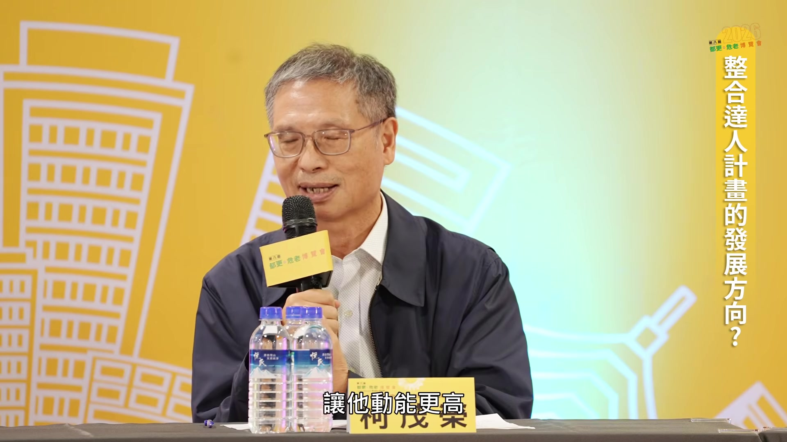

**逐字稿片段：** 接下來想請教黃總 其實大家知道 臺灣今年過去比較擅長的事情 是在處理不良資產這件事情 現在都更跨到這個領域裡面來 我們怎麼樣延伸這樣子的優勢 去處理都更的問題

**話題推測：** 轉換講者，討論台灣金聯如何將不良資產處理經驗應用於都更

---

## 00:20:40

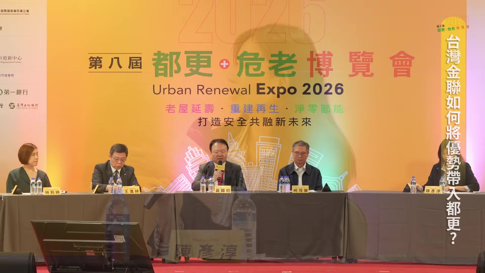

**逐字稿片段：** 臺灣今年成立到今年是第25年 我們在前面的10年 大部分都是做銀行的不良債權的處理 臺灣今年透過那個標售 去把銀行的債權買回來 然後透過法院的強制執行 去取得這些當初的單薄品 那單薄品裡面有包括 荒廢的大樓 荒廢的飯店 荒廢的商場 甚至是蓋到一半的住宅大樓 還有積零不完整的一個土地 都是所謂的那種不良的單薄品 那臺灣今年做這25年來 就累積了部分土地

**話題推測：** 介紹台灣金聯過去25年處理不良資產的經驗

---

## 00:21:22

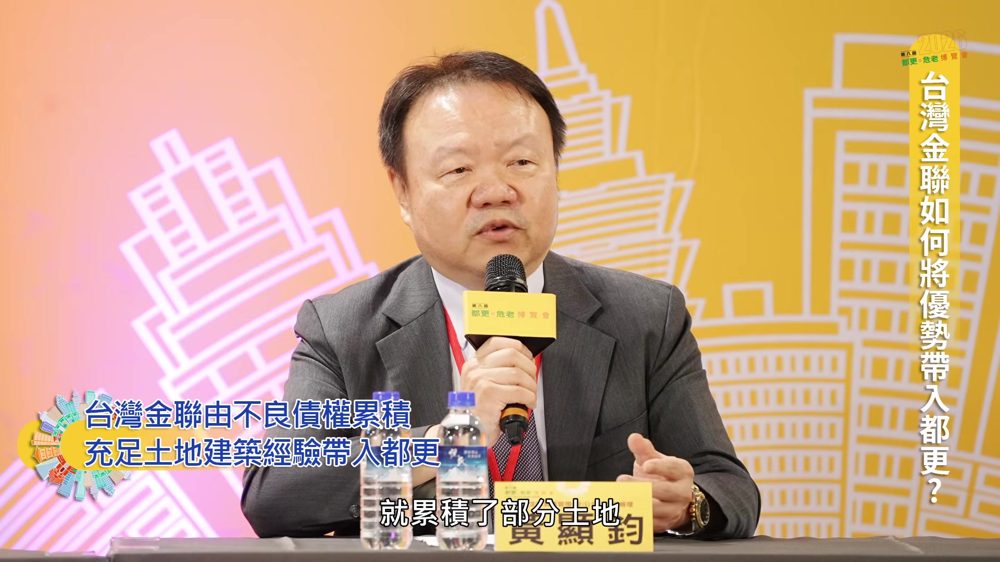

**逐字稿片段：** 另外就是說我們也有透過取得的鑑定 我們有自鑑案 我們也有之後去做所謂的危老鑑案 在龍江路今年年底就可以拿到使用執照 也有做渡耕案 另外我們最近也做公辦渡耕 然後我們也做民辦渡耕 民辦渡耕我們自己扮演所謂的施施者 另外我們也有去參與一般民辦都更的協議出資人 所以有關於都更為老 這部分在這後面的這十年十五年 我們陸陸續續有很多這種成案 所以這算是臺灣今年一個在都更為老的一個優勢 有豐富的經驗 另外臺灣今年本身跟其他業界的建設公司 或者是說做所謂的自主路跟的全案管理公司 不一樣的地方就是在於說 我們的資本額是105億 那我們目前公司所擁有的資產高達250億 我們公司的股東全部都是所謂的銀行 總共有26家 然後沒有一般的法人公司 也沒有一般的自然人是股東 這26家銀行股東里面有82%是所謂的公股的股權 所以我們公司等於說是具有換公股的色彩的一家資產管理公司 目前來做所謂的都更 尤其是所謂的自主都更全案管理這個角色 最主要就是能夠獲得更新會 或者是社區住戶的一個 最重要的一個信任

**話題推測：** 台灣金聯透過自身建案、危老、都更案等積累經驗

---

## 00:23:20

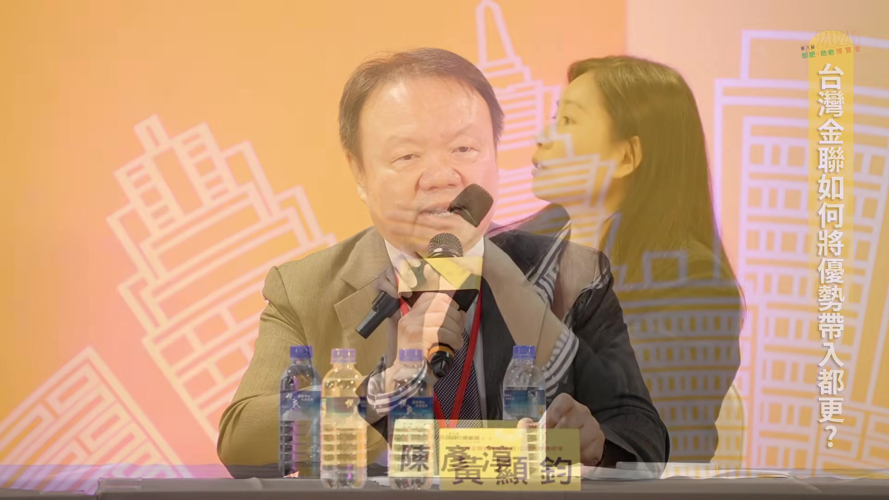

**逐字稿片段：** 想問一下林理事就是說 最近其實房市看起來相對表現 沒有那麼好看 那麼亮眼 是否會影響到都更或危老的推展 這個部分想幫我們分享一下

**話題推測：** 轉換講者，討論房市表現對都更與危老推動的影響

---

## 00:23:32

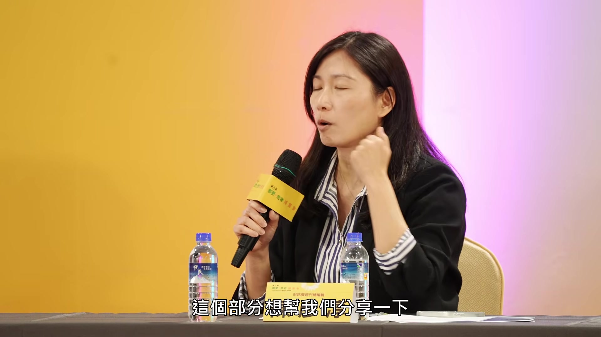

**逐字稿片段：** 就一個不動產開發商而言 我想房市第一名對都更的推動 只有一件很關鍵的事情 就是風險的控制 第一個當然資金 資金如何來做重建 第二個就是整合也很重要 一個都更案大家都知道 談判這些事情的過程中 是需要大家住戶的共識 整合不容易 資金不容易 還有一個就是不要忽略了 都更動輒可能七八年 甚至十年以上時間的風險 所以這些東西在所有的地主 跟開發商甚至跟政府大家共同來參與的過程中

**話題推測：** 開發商認為都更推動的關鍵是風險控制、資金與整合

---

## 00:24:16

**逐字稿片段：** 我還是認為找到一個比較有品牌公信力的投資人 或實施者我覺得還是一個非常非常重要的事情 因為如果大家找到一個對的單位來推動都更 協助社區來推動都更 我相信剛剛講的資金整合跟風險控制 這件管理的事情 真的是會有得到一個很大的益助 所以剛剛提到的這個利率或者是政策 我覺得很多事情 都更它是需要長時間去經營的 所以對開發商而言 我們還是會奮力的去投入 那也包含跟政府單位的一些 公辦都更的合作 那最後我還是想 從不動產開發商的角色 我一直想丟出一些新的觀念 都更加上人口老化 人屋雙老 這是未來臺灣最大的內需經濟體 也就是說過去房地產都是一個火車頭的產業 但是都更住宅再加上服務業者到社區來 它會是一個臺灣最大的內需經濟體 它值得政府來重視 再來就是也希望政府可以在推動都更的同時 能夠在業者願意再加碼投入全零友善 這樣的一個讓這個長者安心 幼兒在這裡面生活也可以安心的 這樣的政策 有更多的一些政策的支持 包含就是一些友善環境的認證 或者是說在我們有這個綠色金融 可能在這個高齡支持上 也有社會金融這樣的一個概念 能夠讓開發商有更多 願意這樣政策的引導之下 帶著開發商的業者 一起來做未來 我認為是房市很重要的一個轉型

**話題推測：** 強調找到有品牌公信力的投資人或實施者的重要性

---

## 00:26:06

**逐字稿片段：** 最後的壓軸當然留給王理事長 現在政府就是政策上要推動自主都更 有哪些注意事項 或是哪些要提醒大家的 請您分享

**話題推測：** 轉換講者，討論政府推動自主都更的注意事項

---

## 00:26:17

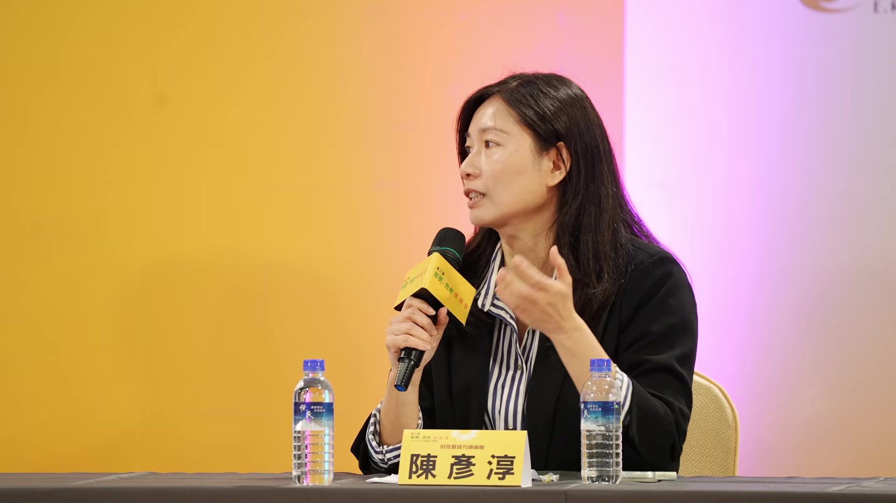

**逐字稿片段：** 第一個 因為你要成立更新會 各位要注意喔 自主都更的更新會的成立比例 跟更新會會員大會的計算比例 不等於都更的同意比例 我們要給各位第一個觀念 叫做啟動的比例 不等於報核實施的比例

**話題推測：** 提醒自主都更「啟動比例」不等於「報核實施比例」

---

## 00:26:38

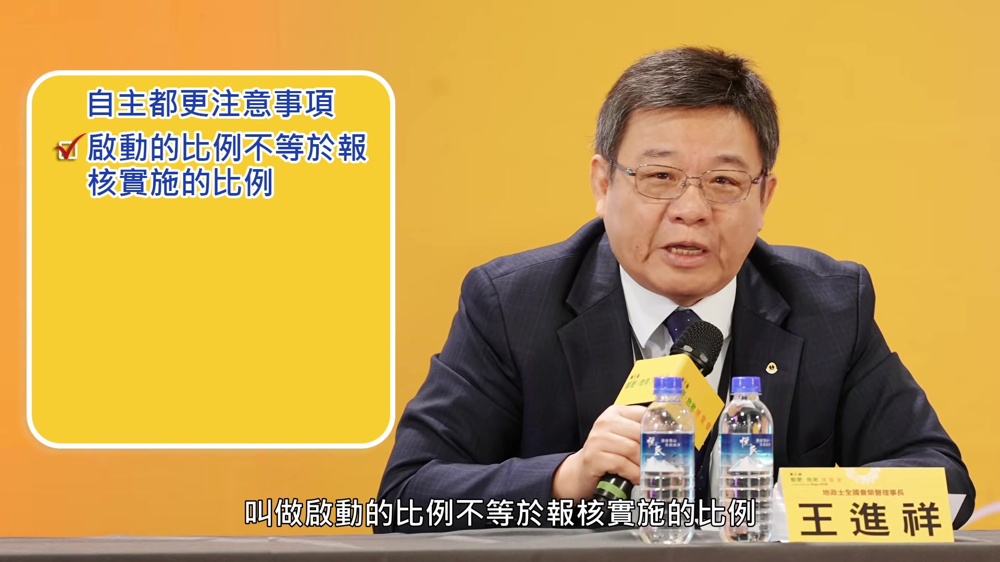

**逐字稿片段：** 第二個 第二個 我鼓勵大家要先做意願調查 你沒有意願調查 講白一點 第一個 你要多少平 人家也搞不清楚 建築師設計也可能跟你脫軌 第二個 你漁屋你要不要自己拿 你自己拿你是要賣還是要保持 還有你賣 賣得掉嗎 你要不要配合社會住宅 要不要 如果不配合社會住宅 要不要配合婚育宅 如果你都不配合 那你總是要配合包租貸款吧 要不然你怎麼賣得掉 賣不掉 賣不掉就包租貸款 賣得掉最好嘛 所以意願調查非常重要 要牽扯到建築師要配合我們去設計 不同的樓層不同的坪數 這第二個我提醒大家

**話題推測：** 鼓勵先進行意願調查，配合建築師設計與餘屋處理規劃

---

## 00:27:14

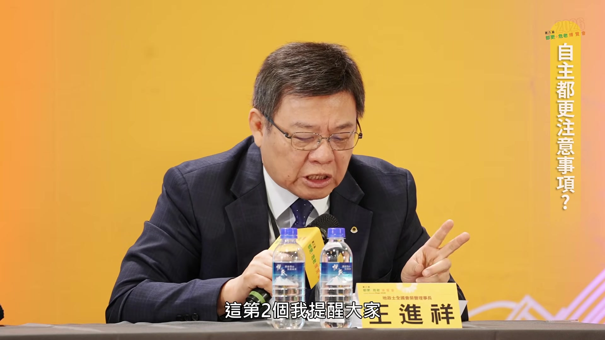

**逐字稿片段：** 第三個我要提醒大家要尊重專業 我們整個都更裡面的建築師 結構技師 土木技師 地政室 估價師 還有律師 甚至記帳室 會計師都有 你要尊重他們 重點來了 可能我們會有質疑 當我們質疑的時候 我建議各位用專業去跟專業協商 譬如說你對那個估價師的估價有意見 你找你的估價師跟他協商說 為什麼我估100萬 你為什麼估100億 可以去談 不是我們去談 不是我們用世家之語去談的 是專業對專業 但專業跟專業可能有問題對不對 可能 兩個之間協商還是有問題 找工會 找專業的工會 地震有問題找地震師工會 Nano的估價有問題找估價師工會 然後我剛剛有談到 估價師工會有沒有可能調解還不行 有可能 那就只好題呼仲裁 速度 最快速度把它 正義把它解決

**話題推測：** 強調尊重建築師、估價師等專業人士，並透過專業協商解決爭議

---

## 00:28:09

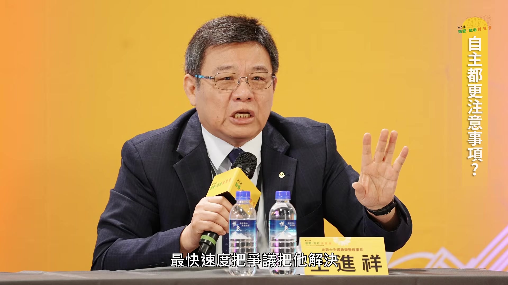

**逐字稿片段：** 然後第四個 我要提醒大家 就是你在剛剛的意願調查尊重以外 你要有一定的程序 所以先找整合團隊 注意 這個是基本概念 你先找整合團隊 先找整合顧問 你這些人沒進來 當然這些整合顧問 我剛剛講要一定的要件 要一定的都更規劃的程序 通通要懂 要不然就反而會害到整個都更的過程的流程 第一個 第二個 要找全案管理公司 第三個 才找建築師 第四個找地政室 估價室還在地政室的後面 為什麼 建築師算出來的都算面積嘛 搞清楚面積以後 估價室算出來的 更新後價值才會準確嘛 所以一定是全案管理建築師 然後地政室 然後再來估價室 然後才是杜根規劃公司

**話題推測：** 說明自主都更需遵循程序：先找整合團隊/顧問，再依序找專業人員

---

## 00:28:54

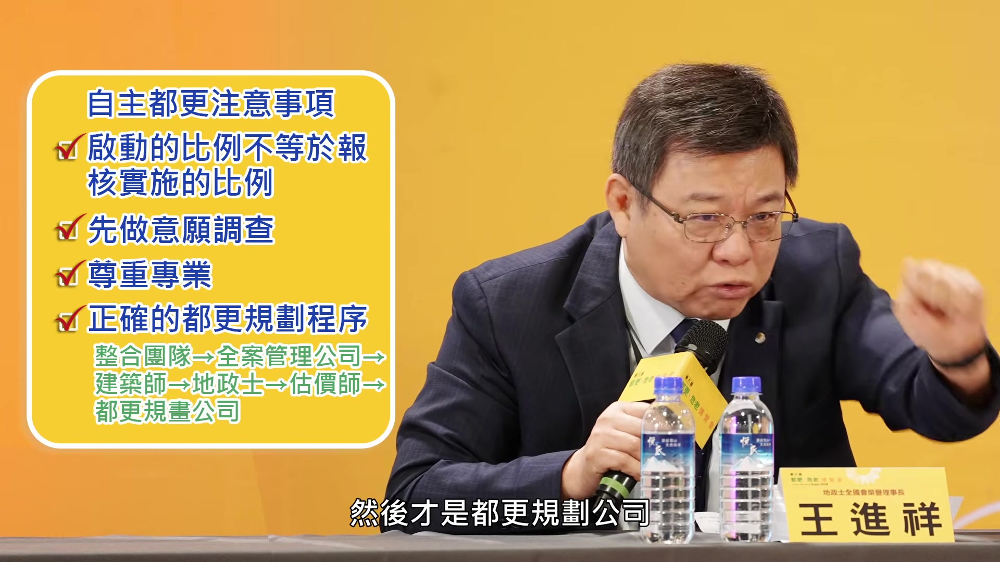

**逐字稿片段：** 第五個要公開遴選 一切東西更新會 通通要公開遴選 這個公開遴選程序是不能免的

**話題推測：** 所有相關作業，更新會都應公開遴選

---

## 00:29:01

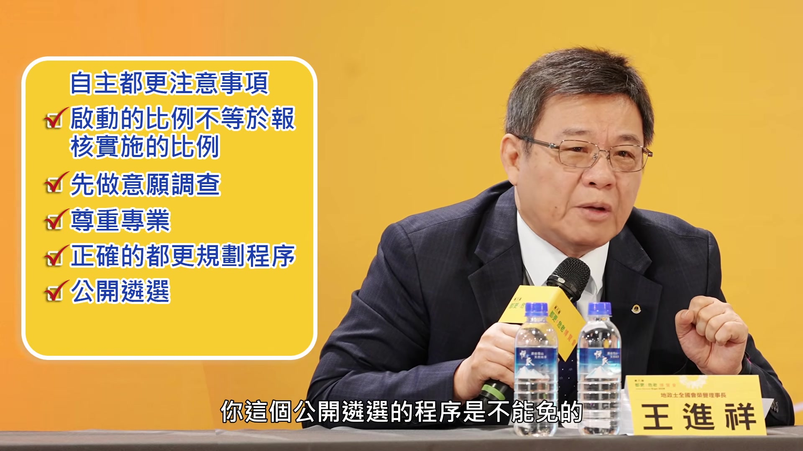

**逐字稿片段：** 最後一個就是訊息要公開 這個是自主杜根時代 已經來臨了

**話題推測：** 強調都更過程中的資訊公開透明

---
