# wealth1974__HerInBKq-4 — 關鍵畫面索引

- 來源逐字稿：[wealth1974__HerInBKq-4_GT.srt](wealth1974__HerInBKq-4_GT.srt)
- 影片：https://www.youtube.com/watch?v=_HerInBKq-4
- 截圖數：66

## 00:00:01

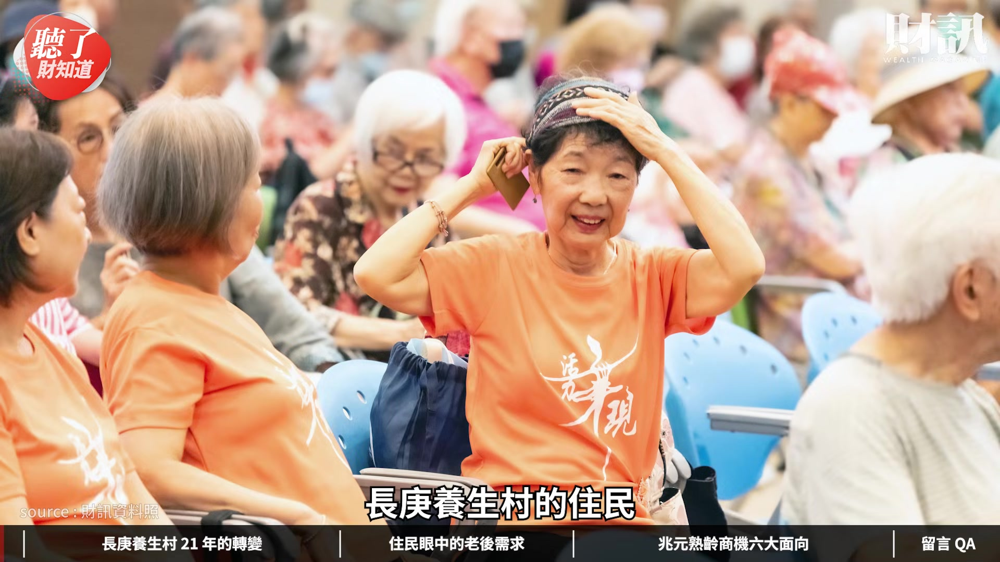

**逐字稿片段：** 平均活到 91 歲 比國人平均多了 10 歲 還有超過 5000 人 排隊等著進去住 這到底做對了什麼事情呢

**話題推測：** 長庚養生村住民的平均壽命數字。

---

## 00:00:09

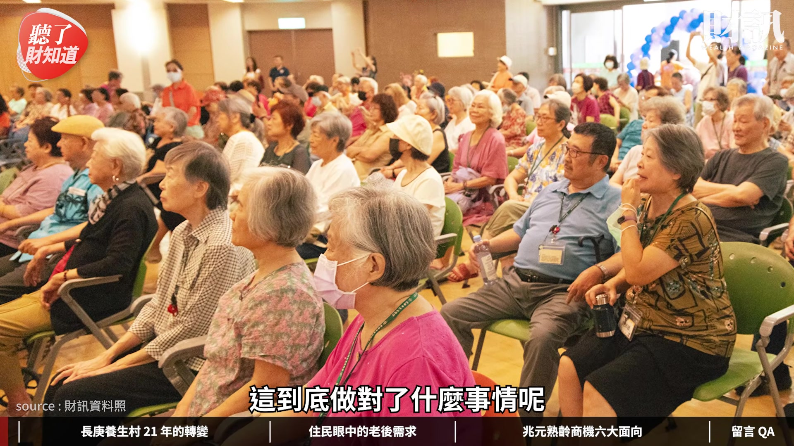

**逐字稿片段：** 今天這一集 我們會先來聊聊 長庚養生村 21 年的轉變

**話題推測：** 介紹本集影片的節目內容架構。

---

## 00:00:13

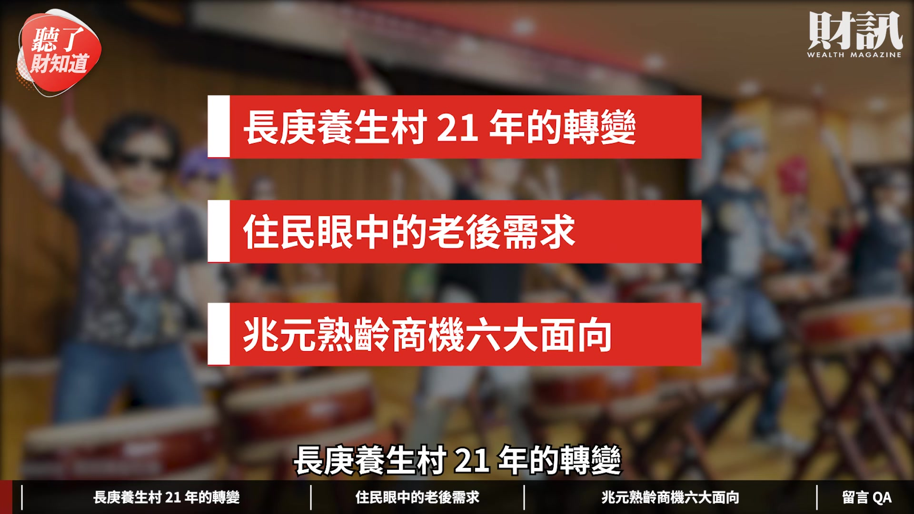

**逐字稿片段：** 再來分享住民眼中的老後需求 最後談一談

**話題推測：** 預告節目第二個討論點：住民眼中的老後需求。

---

## 00:00:16

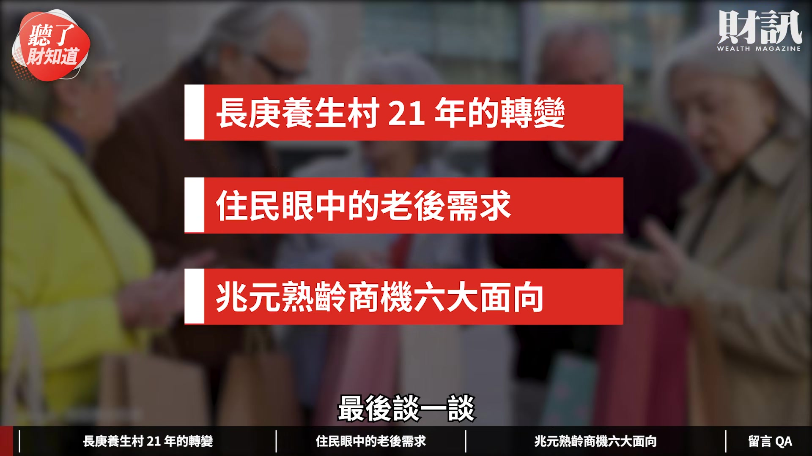

**逐字稿片段：** 兆元熟齡商機的六大面向

**話題推測：** 預告節目第三個討論點：兆元熟齡商機的六大面向。

---

## 00:00:18

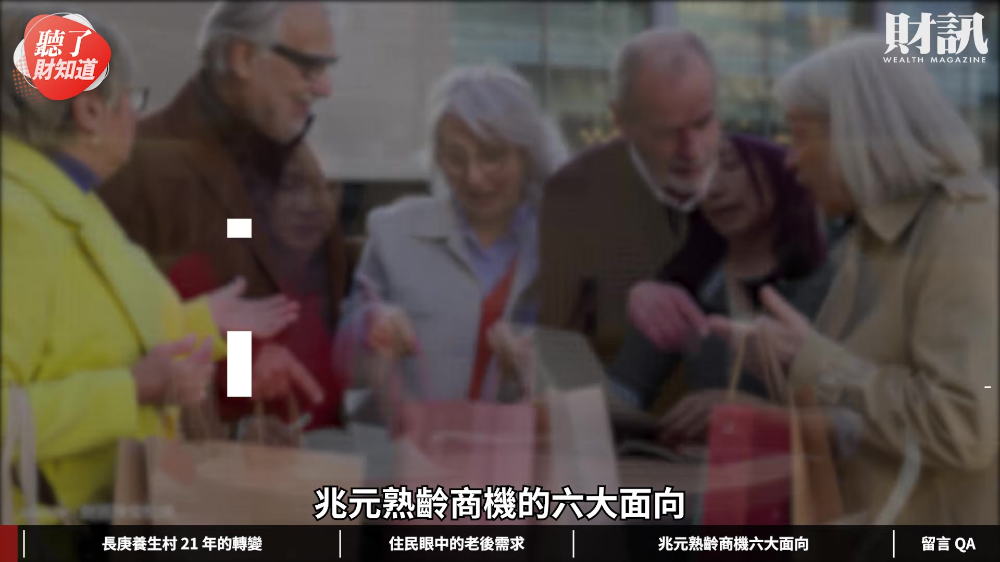

**逐字稿片段：** 大家好 我是今天主持人陳彥淳

**話題推測：** 主持人開場介紹。

---

## 00:00:20

**逐字稿片段：** 今天來賓是財訊雙週刊的 總主筆劉軒彤 歡迎軒彤 各位觀眾大家好 我是軒彤

**話題推測：** 介紹來賓劉軒彤。

---

## 00:00:26

**逐字稿片段：** 台灣進入高齡化社會 50 歲以上的人口超過 4 成

**話題推測：** 導入影片主要議題：台灣進入高齡化社會。

---

## 00:00:32

**逐字稿片段：** 這次財訊雙週刊 就針對這樣子的人口結構 我們就去瞭解說 到底 50+ 以上熟齡族群 它的需求是什麼 尤其是現在進入超高齡社會之後 80 歲 70 歲 甚至 90 歲 100 歲的非常多 他們的新需求是什麼 很多事情是要從 50 歲開始準備 甚至更早

**話題推測：** 說明財訊雙週刊針對熟齡族群需求進行了解。

---

## 00:00:52

**逐字稿片段：** 這次我們軒彤採訪了長庚養生村 長庚養生村是王永慶 當年發願要照顧員工 跟高齡族群的一個退休宅 這樣的概念

**話題推測：** 點出長庚養生村作為本次報導的主要案例。

---

## 00:01:02

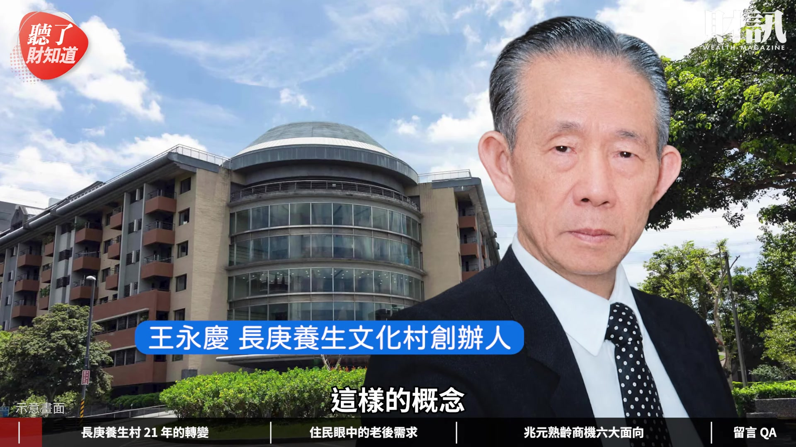

**逐字稿片段：** 那它到今年 2026 年 它已經經營了 21 年 我覺得它應該是見證了 台灣整個高齡過程 他們的需求是什麼 他們應該最知道

**話題推測：** 提及長庚養生村的經營年限。

---

## 00:01:12

**逐字稿片段：** 而且他們住進去之後的平均壽命 也被延長了 10 年 表示照顧得很好 他就會有辦法 延長他的健康的壽命 這部分我就覺得很值得參考 所以這次我們透過 採訪長庚養生村的經營模式 以及它如何對照 這些熟齡族的需求 來看看說台灣未來的商機 跟它的市場規模在怎麼樣的地方

**話題推測：** 強調長庚養生村延長住民壽命的成果。

---

## 00:01:33

**逐字稿片段：** 那第一部分 我們大概先回來聊一下 長庚養生村現在的情況是怎麼樣 可以先幫我們介紹一下長庚養生村嗎

**話題推測：** 明確的章節分隔，開始深入討論長庚養生村現況。

---

## 00:01:40

**逐字稿片段：** 它就是台灣規模最大的養生村

**話題推測：** 介紹長庚養生村是台灣規模最大的養生村。

---

## 00:01:42

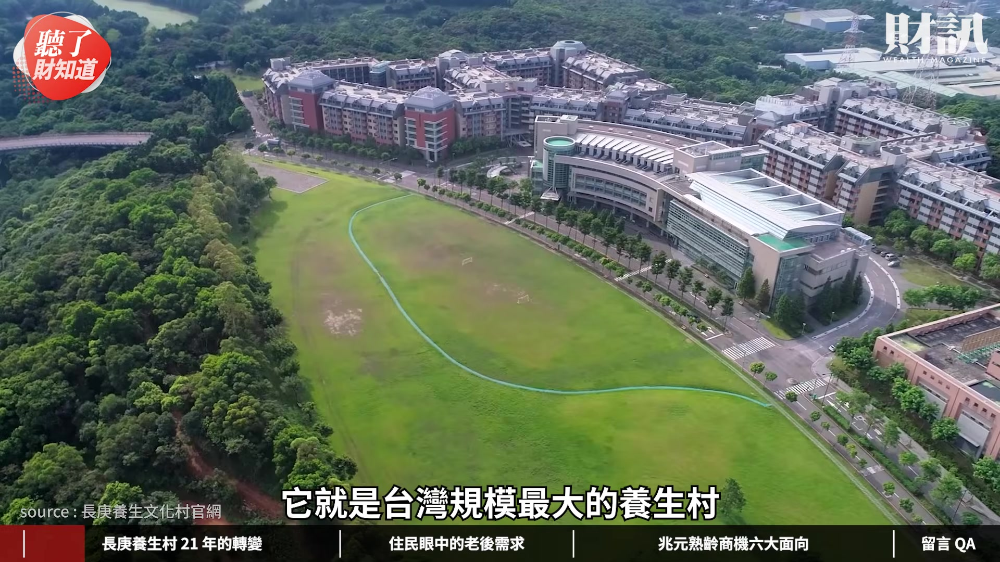

**逐字稿片段：** 34 公頃大概是 10 萬多坪 那 10 萬多坪裡面 大概有一半屬於公共空間 所以它規模很大

**話題推測：** 具體描述養生村的佔地面積（34公頃，10萬多坪）。

---

## 00:01:49

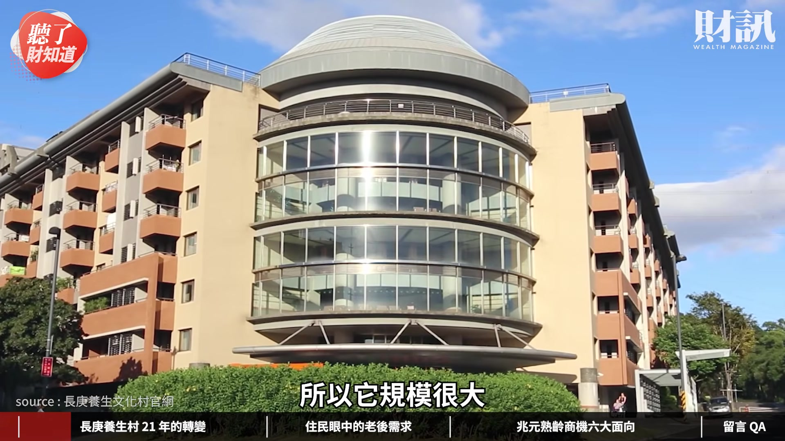

**逐字稿片段：** 那它現在 1573 個人 這樣的入住人數 也是台灣最大的規模 但我們不談那種榮民之家 它是比較屬於公家的

**話題推測：** 說明目前養生村的入住人數（1573人）。

---

## 00:01:57

**逐字稿片段：** 比較特別就是說 長庚養生村它一開始 就是醫院的角度出發 再往護理之家走 然後再走養生村 所以它是醫養結合整個一套 所以它在台灣 特別的指標意義就在這裡 它是醫養結合 園區規模最大的 這樣的一個養生村

**話題推測：** 介紹長庚養生村「醫養結合」的特色。

---

## 00:02:13

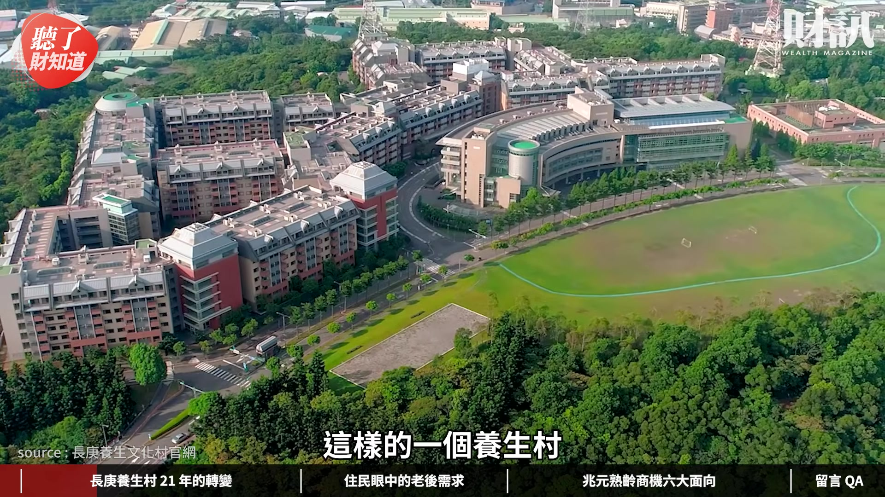

**逐字稿片段：** 其實長庚養生村 早年經營得滿辛苦的 但是後來到一位難求 轉變真的是滿巨大的 這過程到底是怎麼樣

**話題推測：** 討論長庚養生村從初期經營困境到一位難求的轉變。

---

## 00:02:21

**逐字稿片段：** 它是 2005 年開放

**話題推測：** 說明養生村開放的時間（2005年）。

---

## 00:02:22

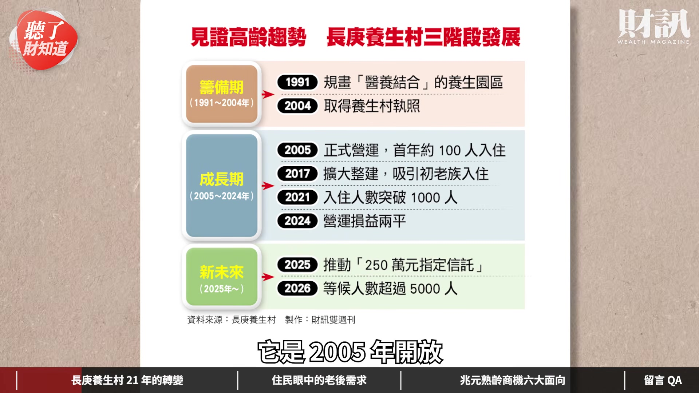

**逐字稿片段：** 就登記 500-600 人 結果只來 100 個人 其實王永慶先生當時也覺得 咦 怎麼會這樣 其實我覺得 從 100 個人到現在的 1573 人 經過 21 年 第一個最大的轉變 就是大家對於老後的這個養護 我們這一代可能是 最後一代三代同堂 那也是第一代 就是不太跟兒女住在一起了 就是有這種新的觀念

**話題推測：** 提及初期登記人數與實際入住人數的落差。

---

## 00:02:43

**逐字稿片段：** 中間還有一個比較特別 就是早期都是軍公教 我們知道軍公教有退休金 非常穩定

**話題推測：** 討論入住族群結構的轉變（從軍公教到工商界）。

---

## 00:02:49

**逐字稿片段：** 可是到了 2016 年 年金大改革 就是那次的大改革以後 就有些軍公教就擔心說 它後面的會不會一直被砍 所以那個軍公教比率本來 70% 以上 就慢慢降下來

**話題推測：** 提及2016年年金改革對軍公教族群入住比例的影響。

---

## 00:03:00

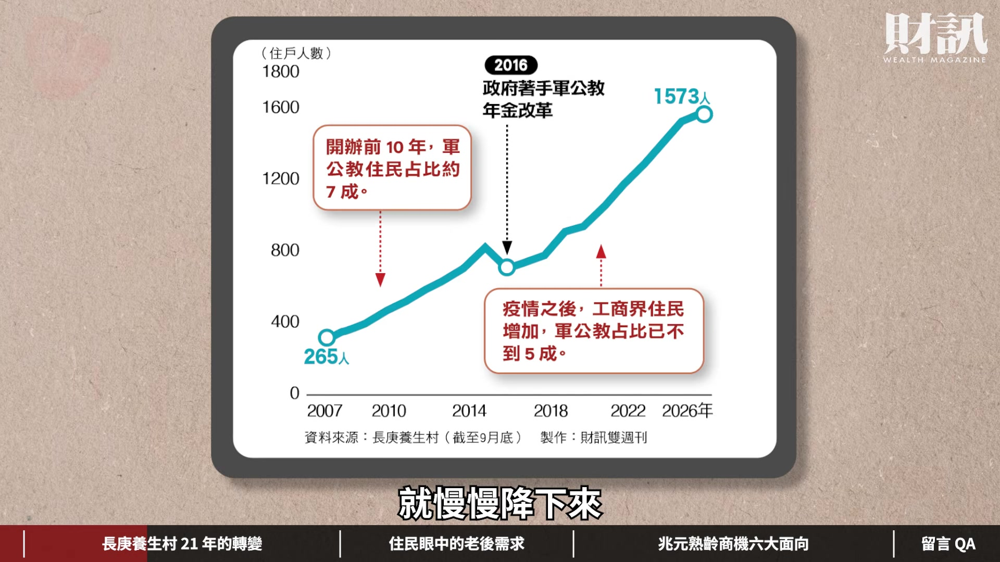

**逐字稿片段：** 然後現在疫後經濟大發 所以工商界很多 那現在軍公教降到 5 成以下 這是一個台灣人口結構的改變 那另外一個就是海歸派 從第一年到現在 基本上就是維持 40% 我們都知道 我們台灣醫療相對比較便宜 那再加上我覺得 海歸派就是他們的觀念 本來就是比較不一樣 對 所以大概的人口結構 就是這幾年的最大的變化 我覺得滿有趣就是 到後來其實整個觀念的改變 大家覺得說 我們也不一定要跟小孩住在一起 大家彼此有個空間 感覺好像關係會更為融洽

**話題推測：** 提及疫後經濟對工商界族群入住比例的影響。

---

## 00:03:32

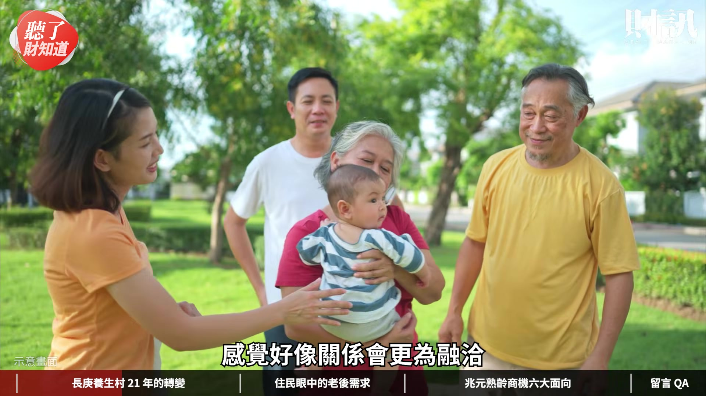

**逐字稿片段：** 對 我們這幾年財訊 不是寫很多養生村 我們也去看了很多養生村 你就開始發覺 以前覺得沒有在我的考慮之內 可是現在我們就慢慢把它考慮進去 就是這個社會的觀念 也是一直在轉變的

**話題推測：** 轉換視角，以財訊媒體的觀察補充養生村議題。

---

## 00:03:44

**逐字稿片段：** 還有一個就是說 我覺得同溫層的相處滿重要 你這個族群想講的話跟話題 可能跟下一個族群 或下一個世代人不太一樣 住在一起的時候 有一個共通話題也滿重要的 像我們去採訪 長庚養生村院長楊政達 楊政達就講說其實他看到最後 就是快樂是最重要的 熟齡族群我們一定要維持 你的心理健康 他說他也思考 20 多年 他覺得說一個孤獨的老人 是很可怕的 就是他比較會孤獨老 可是一群老人 他從同溫層可以得到 心理跟社交支持 不是說我不跟年輕人接觸 但是當你得到心理支持 你快樂以後 你就會去接觸外面的事情

**話題推測：** 討論同溫層相處在養生村中的重要性。

---

## 00:04:21

**逐字稿片段：** 我採訪一個董大哥 他七十幾歲 他很喜歡打乒乓球 他說他看到一個九十幾歲的長輩 打乒乓球就打得很厲害 所以他就說 這也是一種很好的社會示範 他說 我就想像他一樣 所以我努力告訴自己 我要活得快樂 我要活得健康

**話題推測：** 引入住民董大哥的案例故事，說明快樂對長壽的影響。

---

## 00:04:37

**逐字稿片段：** 感謝頻道會員 一直以來對我們的支持 你們的鼓勵是我們深入報導 持續帶來精彩內容最大的動力 歡迎加入頻道會員 或者是贊助我們訂閱財訊頻道 跟我們一起追蹤政經趨勢 掌握投資脈動

**話題推測：** 影片中插播的呼籲訂閱與贊助訊息。

---

## 00:04:51

**逐字稿片段：** 我覺得長庚養生村經營了 21 年來 證明了幾件事情 就是照顧得好可以延長壽命 而且是健康的生活下去

**話題推測：** 回歸長庚養生村主題，總結其在延長壽命方面的成果。

---

## 00:04:58

**逐字稿片段：** 那有幾個數字 我覺得可以跟大家分享 整個長庚養生村的住戶 平均壽命大概是 91 歲 那現在國人平均大概是 80.3 歲 平均多了 10 年

**話題推測：** 引入新的數據來證明長庚養生村的照護價值。

---

## 00:05:08

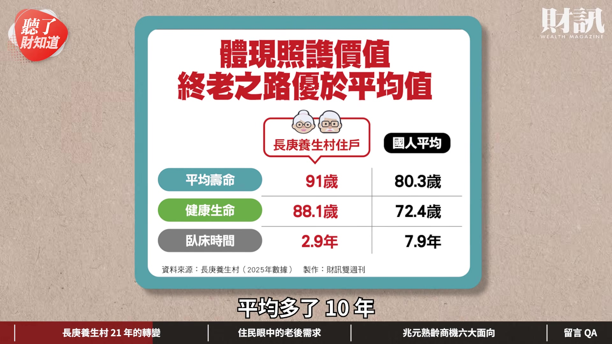

**逐字稿片段：** 那健康生命到 88.1 歲 國人平均大概是 72.4 歲 大概也多 10 年 所以它就證明了一個事情 就是說照護是有價值的

**話題推測：** 呈現養生村住民健康壽命與國人平均的比較數字。

---

## 00:05:19

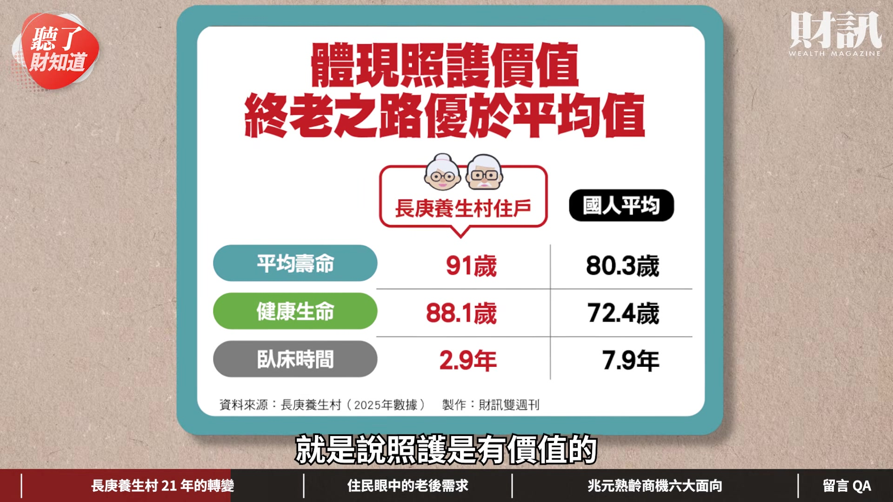

**逐字稿片段：** 那接下來就要探討 照顧的價值怎麼做出來

**話題推測：** 轉入討論如何創造照護價值。

---

## 00:05:22

**逐字稿片段：** 那我想長庚養生村 它最好的就是它有醫院 它今天一發現什麼不對 它有綠色通道 可以到長庚醫院去做這個檢查 另外一個最重要的就是 他們一開始每一個人 都有一年的高階健檢 你的健康數據就留在醫院 留在養生村 它們就可以做很多的資訊規畫 把這個健康數據跟平常的表現這些 它分成健康 亞健康跟衰弱 那衰弱可能是你有失智傾向 或者你開始有那個功能下降很多 那它們就可以做分級管理

**話題推測：** 介紹長庚養生村的醫療結合特色，如綠色通道。

---

## 00:05:51

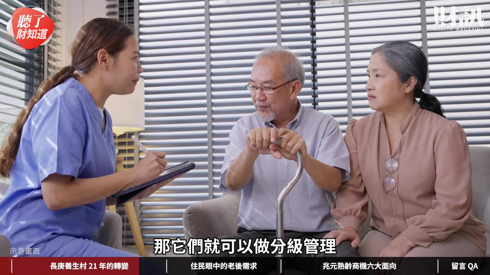

**逐字稿片段：** 還有就是它們有一個住民日誌 它這住民日誌 就是每一天我都有你的這些情況 你有沒有什麼特別變化 比如說 它可能突然在某一天發覺 這個長輩以前很開心 每天都講很多話 結果最近都不講話了 那它是第一線的 或者它們前台這個服務台的人員 他會發覺一個長輩 怎麼每天都來跟我講我鑰匙掉了 一直重複 可能就有失智徵兆 那它們就有 QR code 或什麼 讓它們隨時都可以進到住民日誌 把這個現象寫下來 資訊系統就會抓出這個警訊 那就會慢慢地區分這樣 然後你才知道 什麼叫做高危險的個案 然後它就把他照顧得好 我覺得這樣的分級管理 也是一個重要的

**話題推測：** 介紹住民日誌與異常警訊系統的運作方式。

---

## 00:06:26

**逐字稿片段：** 但是我覺得長庚 除了有這個醫療當 base 之外 我覺得最重要的是 它在其他面向也做得非常好 其實我們在觀察熟齡的需求的時候 健康是最基本的 剛剛軒彤講的 心理快樂也很重要

**話題推測：** 轉向討論醫療之外的照護面向，如心理健康。

---

## 00:06:37

**逐字稿片段：** 對 所以它們一年有 5000 場活動 其實是也滿驚人的 或者有大型的活動 成果發表 或者是工作坊 或者它們帶他們出去等等 那些活動也非常多 所以他的社交是有需要的 社交支持真的很重要 很多人可能 I 人就宅在裡面 那你要怎麼讓他出來 你一定要是用氣氛去感染 你不能強迫他 可是你要一次一次 可以把一些人慢慢的 推到這個社交的圈子裡面就會開心

**話題推測：** 提及養生村每年舉辦的豐富活動數量（5000場）。

---

## 00:07:01

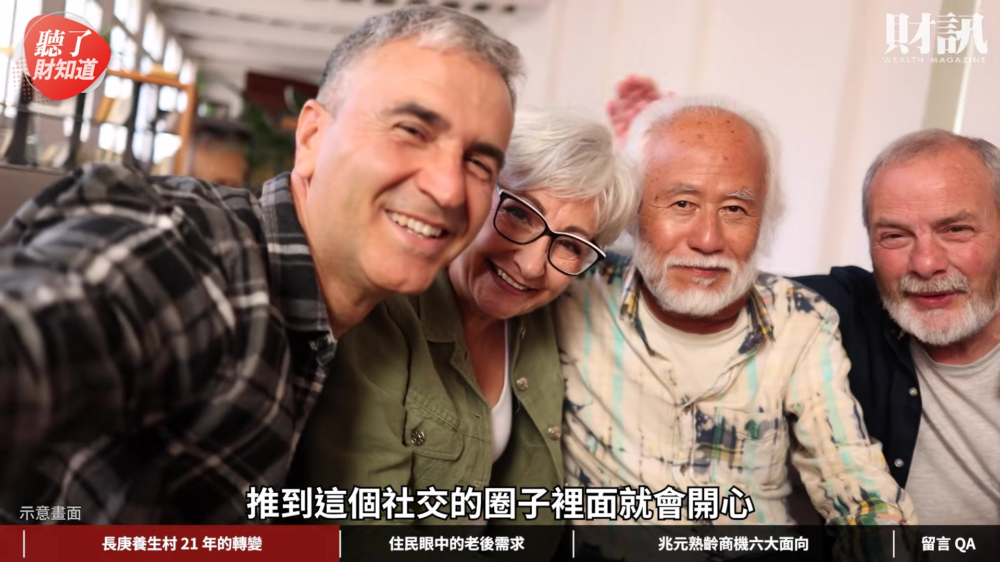

**逐字稿片段：** 所以我覺得以後 提供像這樣子社交服務 或者是說活動服務的這個商機 應該是非常大 因為你可以想像說 針對這一群人 你要幫他客製化什麼樣 適合的活動跟項目 讓他們覺得開心 因為他們的需求 可能跟年輕人又不一樣了 即便是一樣的桌球課 或者是一樣的繪圖課 可是 是不是內容也會有一點差異 對啊 就像 70-80 歲出去 他一定跟你這個 20-30 歲是不一樣的 真的不一樣 他 20-30 歲就是要晚起 那最重要是這一群熟齡

**話題推測：** 討論未來社交與活動服務的商機。

---

## 00:07:29

**逐字稿片段：** 是我們台灣經濟奇蹟裡面 就是累積最多財富的一群 沒錯 而且他們的需求 要慢慢被開發了 過去大家都會瞄準年輕人的市場 所有的產品跟服務都瞄準他們 覺得他們最有消費力 但事實上現在這個情況 已經慢慢在做翻轉了

**話題推測：** 討論熟齡族群作為台灣經濟奇蹟中累積最多財富的一群。

---

## 00:07:44

**逐字稿片段：** 更何況 65 歲這群人 他們是戰後嬰兒潮 是台灣最富有的一代 他們開始慢慢變長壽之後 但他們也沒有老過 他們不曉得他們的需求 可能會是什麼 大家就要共同來開發說 熟齡的需求原來有這麼多 無限延伸的可能性 像我訪一個 98 歲 應該虛歲百歲的一個邱阿嬤 她就很注重自己的安全 那她的孫女也講過 因為她確實在房間內也跌倒過 你知道老人家有時候在一時之間 她會忘記求救鈴在哪裡 那她就用爬著去找她的手機 然後打給孩子 那像這種狀況呢 她的孩子可能就會裝了監視器 但是這不夠啊 那怎麼辦呢

**話題推測：** 強調65歲以上戰後嬰兒潮世代的消費潛力。

---

## 00:08:19

**逐字稿片段：** 如果現在有這種緊急的手環 阿嬤可能就會考慮願意用了 就是說其實很多人沒老過 都會覺得這個不需要 可是你現在知道說 有些東西是需要的 我覺得很多東西 是慢慢被開發的 以前阿嬤可能也不能接受 後來她覺得 就算我還能夠自己走 但是我還是要助行器避免跌倒 預防的觀念變得更重要 就是說我們沒有老過 但是長庚養生村 讓我們看到老過的人是怎麼過的 重點是在學習這一部分

**話題推測：** 提出針對高齡安全需求的新產品概念，如緊急手環。

---

## 00:08:46

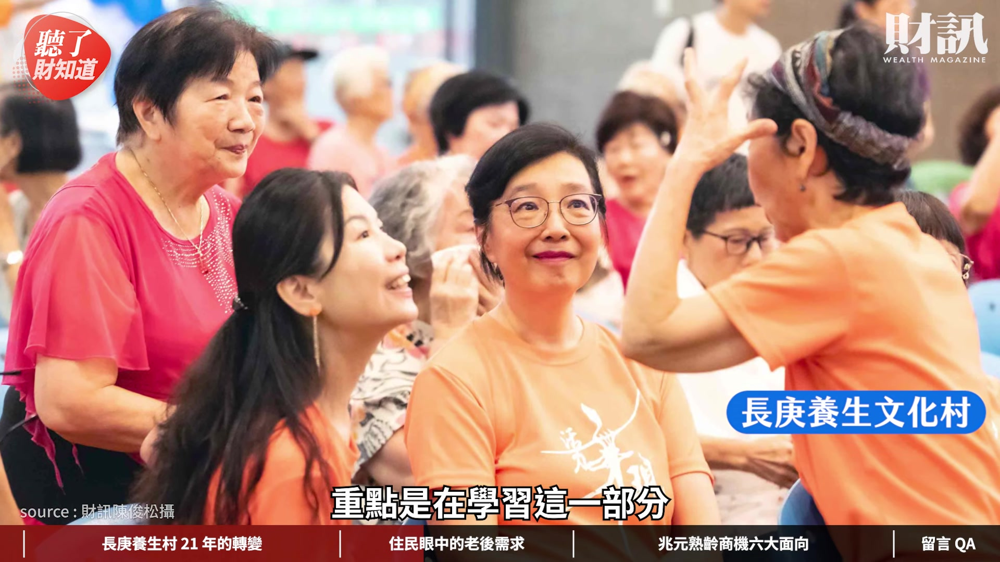

**逐字稿片段：** 沒錯 沒錯 這次訪了 除了那 100 歲的阿嬤之外 我們也訪了董大哥 還有麵包阿姨

**話題推測：** 介紹更多受訪住民的故事。

---

## 00:08:50

**逐字稿片段：** 他們的需求 跟他們生活的態度是怎麼樣 也可以分享一下 麵包阿姨她是只有 65 歲 她是住了三年 那她本來就是一個很亮眼活潑的人 我想麵包阿姨應該是家境比較不錯 那她是從大家庭 63 歲就出來住 主要是因為她看過她婆婆失智 她也希望她自己能夠維持健康 那就不會讓周邊（親友）比較麻煩 第二個是說 她的先生有一隻眼睛度數深一點 有時候的視差就會造成他跌倒 她的家雖然是大別墅 但是不好改建 不好裝電梯 所以他們就住到這裡來 她就發覺它這個平緩的坡道 可以練她的腿力 又沒有階梯 讓她先生可以在園區裡面走 然後他們去吃飯的時候 就有很多的朋友 然後大家就一起聊天 她就發覺她先生很內向 就突然間變得很開朗 還有醫療 她有看到說 其他的長輩可能中風 黃金救援的時間就被送到長庚 那就恢復得很快 所以她也覺得說 第一個環境的安全 第二個是說醫療她也看見了 那再來就是你要讓自己快樂 就是社交活動 但我想他們 60 多歲 是沒有什麼問題的 願意站出來還是很重要 對 那像董大哥一樣 他也是很活潑 他有特別提到一個財務的規畫 因為董大哥是海歸派 他就是海歸派的上班族 那他在規畫說 他 70 歲回到台灣的時候 我的錢到底夠不夠 我能不能每個月 支付我這個養生村的錢 還有我跟我太太的生活費

**話題推測：** 引入麵包阿姨的案例故事，分享其入住養生村的原因。

---

## 00:10:10

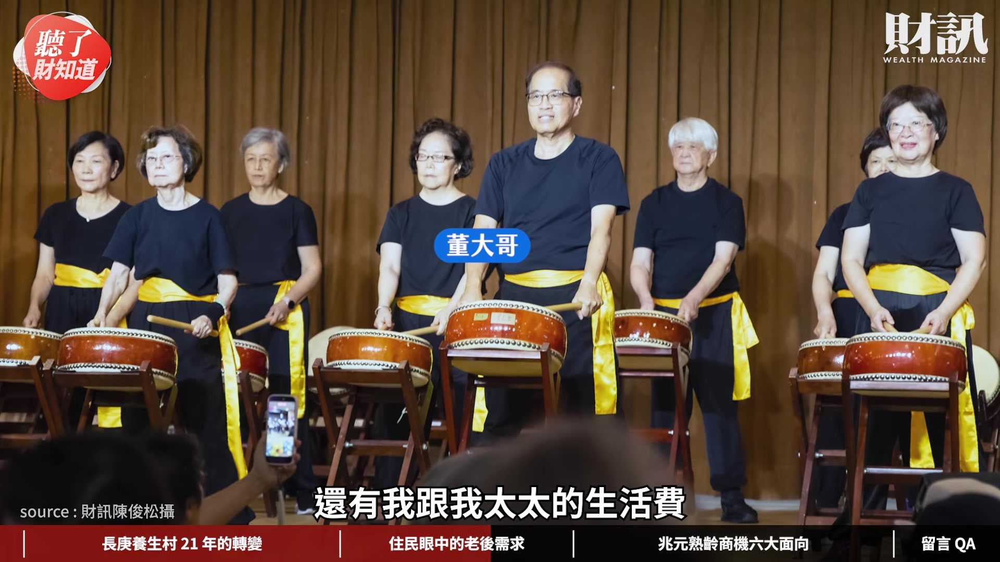

**逐字稿片段：** 他自己算出來 他要（每個月） 5000 美元 他跟他太太才安全 那他也算到說還有通膨 你現在的 4 萬元的租金 搞不好以後是 5 萬元都有可能 你要把這個通膨算進去

**話題推測：** 董大哥估算的每月生活費（5000美元）。

---

## 00:10:20

**逐字稿片段：** 還有他講到一個很重要就是 可是如果你們生病了 比如說你在家裡躺著你都不動 可能就要有那個看護 那些都是費用 那個費用都是很高 不見得健保能夠全部給付這些東西 這些都是非常值得關注的話題

**話題推測：** 提醒長期看護可能產生的費用問題。

---

## 00:10:34

**逐字稿片段：** 其實這一次我們在做養生村的時候 裡面的人講一句話 我聽了滿膽顫心驚 有幾位 80 幾歲住進養生村的人 他覺得說我大概再住 10 年之後 我可能就會離開 但是因為養生村 把他們照顧得非常的好 所以他們一路從 80 歲住到 90 歲 再從 90 歲住到 100 歲 健康的延長壽命當然非常好 但財務是一個大問題 今天你原本退休住進去的時間 大概原本只有抓 10 年 那你 10 年之後 你還健康的活著 你的財務該怎麼辦 這些是一個大問題 我就有朋友在 50 多歲 他已經賺了 3000 萬元 他就覺得頂多 20 年 3000 多萬元 他應該夠用 那大不了就是最後把房子賣掉 可是我後來就在想說 3000 萬元夠用嗎 你要是活到 100 歲怎麼辦 而且現在活到 100 歲

**話題推測：** 探討長壽帶來的財務挑戰，預期壽命延長與資金準備。

---

## 00:11:18

**逐字稿片段：** 真的很有可能耶 現在你看養生村裡面 1573 個人 它 90 歲以上 我記得統計到 9 月底是 128 人 百歲也是 10 個吧 你去看人口推估圖 百歲愈來愈多了 那我們現在 65 歲 假設你活到 95 歲 要準備 30 年錢 而且你可能 90 歲以後 你的醫療花費會愈來愈多 就是一來現在大家 對於健康的觀念比較成熟了 二來老實說 現在醫療非常進步 所以延長壽命這件事情 是的確有可能發生的 那這樣的情況下 如何做好財務規畫 那財務規畫只是 熟齡市場商機的一部分啦

**話題推測：** 說明養生村內高齡人口的比例，如90歲以上與百歲人瑞人數。

---

## 00:11:52

**逐字稿片段：** 我覺得整個 50+ 以上的市場規模 是新的消費力的崛起 所以我們叫做熟齡經濟力

**話題推測：** 轉向討論50歲以上熟齡市場的整體規模。

---

## 00:11:59

**逐字稿片段：** 那這個市場規模是上兆元以上 其中除了健康管理 財務管理 相關的學習課程都是在裡面 這個部分其實財訊 也觀察到這個議題 所以我們透過養生村這樣子的案例 來看看說到底台灣的熟齡經濟力 我們是怎麼看這個市場的發展

**話題推測：** 揭示熟齡經濟的巨大潛力（上兆元以上）。

---

## 00:12:16

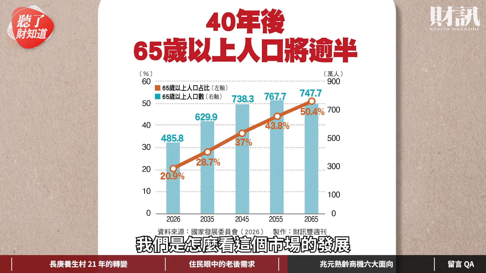

**逐字稿片段：** 現在台灣超高齡社會 就是 65 歲以上已經有 480 萬人 剛才講了 50 歲以上大概也占 4 成的人口 2300 萬 4 成就 800-900萬人了 我們有採訪東方線上 它們有一些調查 台灣 65 歲以上的老人 93% 是沒有房貸 另外有 7 成他們表達說他們不會留給子女 讓自己快樂 所以我覺得這一方面的錢是滿多的

**話題推測：** 台灣超高齡社會的最新人口數據（65歲以上480萬人）。

---

## 00:12:38

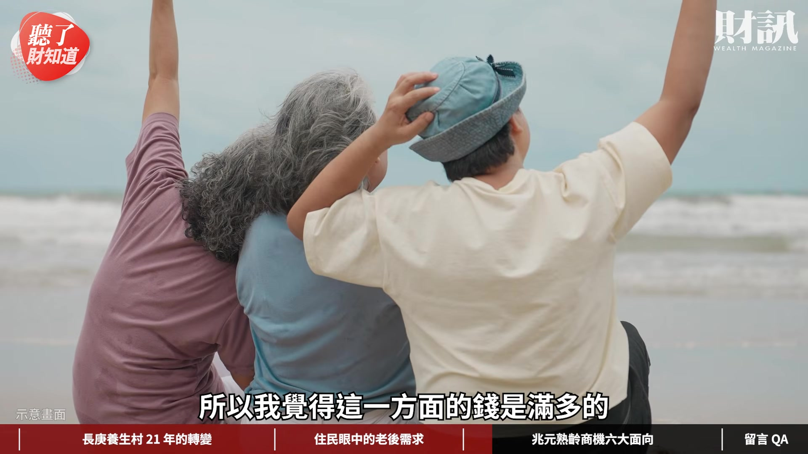

**逐字稿片段：** 它們也統計 2025 年健康福祉 可能包括你的輔具也在內 就是你的營養品 你的運動 健身 什麼都在裡面 台灣 2025 年大概（市場規模） 3300 億元 那年增是 12% 這個年增率應該是會愈來愈多

**話題推測：** 預估2025年健康福祉產業的市場規模與年增率。

---

## 00:12:53

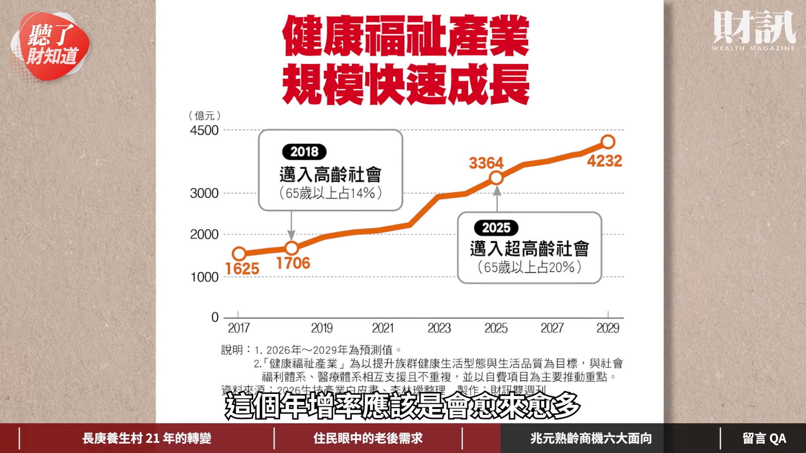

**逐字稿片段：** 所以食衣住行其實商機都滿多的 熟齡族要吃得好 吃得開心快樂 慢慢吃 然後他要吃什麼 這也是一種商機 另外一種是熟齡族的衣服 像法國女人 對不對 就很優雅 我們也想這樣 但是你要有東西引導

**話題推測：** 討論食衣住行相關的熟齡商機。

---

## 00:13:09

**逐字稿片段：** 還有就是說 大家常常在講這個共融職涯

**話題推測：** 討論熟齡族群的共融職涯議題。

---

## 00:13:12

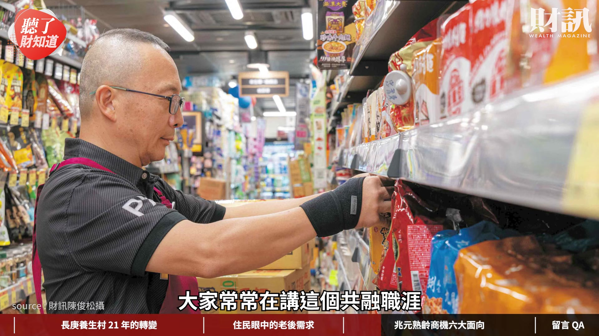

**逐字稿片段：** 像全聯它們現在就用 很多的 45 歲以上的（員工） 我再訪問麵包阿姨 她也很可愛 她就講說 65 歲我也很願意貢獻 可是她有一點不知道管道 那她就會呼籲說 政府是不是有一些管道 讓我們知道怎麼做 或者說可以再教育 然後我可以做更多的 他們也希望政府有這一方面的（管道） 我覺得其實這群人 都很希望再貢獻給社會 因為他們有些經驗 老實說他也有健康的身體 然後他們也有很好的活力跟精力 他怎麼樣把他的經驗傳承下去 他們其實是非常樂意分享的 可能要架一個平台 做一些媒合這樣的事情 所以這種平台商機也是非常的多 非常有商機 很大的

**話題推測：** 舉全聯雇用高齡員工的例子，說明共融職涯的可能性。

---

## 00:13:48

**逐字稿片段：** 那有一件事情 我是自己很有感覺 就是說現在很多產品 都標榜高齡專用 銀髮專用 像這樣的字眼 其實長輩老實說不太喜歡 我媽媽快 80 歲 然後我常常跟她講說 妳要用這個用那個 她就說我有這麼老了嗎 她就會問這個問題 就是大家心態上其實是年輕的 他們其實也非常的健康 所以很多東西不是老人才能夠用 或者是說大家對老人這個定義 是不是要重新思考一下

**話題推測：** 討論高齡產品標示的觀念轉變，長者不喜「銀髮專用」。

---

## 00:14:14

**逐字稿片段：** 所以現在都在講全齡 就是你要撕掉那個 銀髮專用的那個標籤 比如說像有些健康的平台 你該做什麼樣的運動 它會根據你的歷史健診 或你的體重 你的年齡什麼 然後來給你設計這一些 但是 你不會對外說 我這個東西只為了老人家 沒有的 所以大家會重新定義老這件事情 怎麼樣變不老 我覺得這才是真正重要的商機 而不是一味的很害怕說 台灣好像進入超高齡社會 怎麼樣把這個危機變成商機 我覺得這個觀念的轉變非常重要 而且把這一群熟齡的經濟力 釋放到市場上 我覺得年輕人 他就專心去努力的發展台灣經濟 但是我們釋放一些 讓他們共享這個經濟的成果 然後才可以往上正向發展 就是善的循環

**話題推測：** 引入「全齡」設計概念，強調去除「銀髮專用」標籤。

---

## 00:14:58

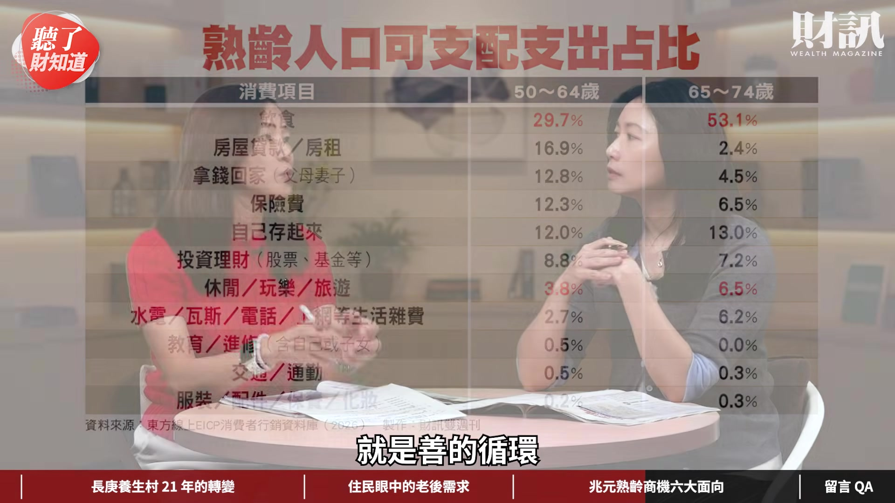

**逐字稿片段：** 財訊看到這樣子發展的趨勢 今年我們也針對 這個熟齡經濟力辦了 幸福經濟學創新服務獎的徵選 跟評選還有頒獎 我們的目的就是希望 可以鼓勵所有的產業界 一起往這個方向來發展 畢竟很多事情是需要創意的 因為過去沒有 有些是消費者可能已經發現的 消費者可能沒有發現的需求 它需要可能是產官學 甚至是跨產業的 都一起來努力

**話題推測：** 宣布財訊舉辦「幸福經濟學創新服務獎」。

---

## 00:15:24

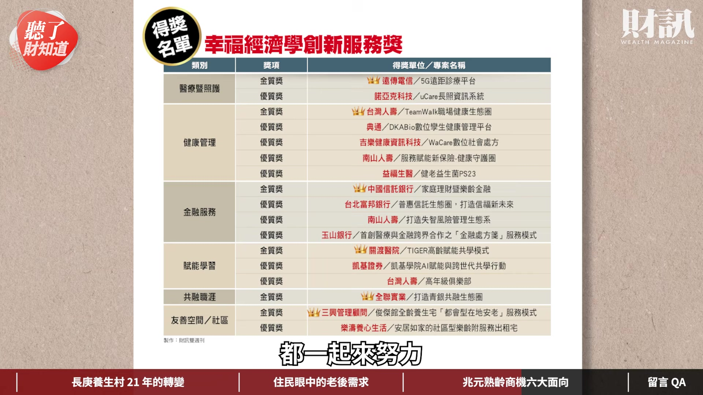

**逐字稿片段：** 這個大概有幾個面向 可以請軒彤分享一下嗎 剛剛講有六大面向 第一個 醫療跟照護 絕對是最重要的 譬如說諾亞克 這種 uCare 長照系統 在 2005-2008 年 王永慶先生也做過 所謂的 uCare 當時技術不夠成熟 所以後來沒有繼續下去 但是現在技術成熟 你就發覺這一些照護的系統 就很多的創意 尤其是結合科技力 我覺得很多新的應用 是要值得被開發的

**話題推測：** 預告將詳細介紹兆元熟齡商機的六大面向。

---

## 00:15:49

**逐字稿片段：** 那第二個就是健康的管理 那健康的管理 一定是分成身體跟心理 現在非常多的 APP 那心靈的東西也一直在開發 還有這種精準運動 精準運動就譬如說 你可能去做 InBody 做這個身體的監測 然後告訴你說你肌力缺哪裡 你要做什麼樣的運動 這些東西慢慢的就有這些商機

**話題推測：** 闡述第二個面向：健康管理（含身心與精準運動）。

---

## 00:16:08

**逐字稿片段：** 再來就是一個金融服務 真的非常重要 以前我們都買個人保險 它現在不是 它是把你的家庭 你的配偶 你的子女一起納進來 我們用家庭的考量 將來你的父母老的時候 你的兒女可以成長到什麼程度 我們錢怎麼樣的分配 免得到時候有一天 突然有一些意外產生 你的錢到底從哪裡出來 大家不會有這些爭議 其實開始有這種外溢保單 像長庚它去年開始 每個人入住要先給 250 萬元的指定信託 這個不是長庚拿走 而是它希望你存下 250 萬元 然後用信託的方式放在銀行那邊 然後有孳息 但是你不準亂動 因為哪一天你真的有什麼狀況 有狀況的時候 你這 250 萬元可以應急 我覺得信託是一個滿好的工具 大家可以多思考一下 就是說對於保全我們 某些生活需求的時候 我覺得信託是一個不錯的工具 大家可以考慮一下

**話題推測：** 闡述第三個面向：金融服務（含家庭保險與信託）。

---

## 00:16:55

**逐字稿片段：** 再來就是賦能學習 我想現在都很多課程 那剛剛我講了 譬如說長庚養生村 5000 場活動 這種都是賦能學習 再來就是我剛舉例全聯的共融職涯 怎麼樣能夠讓熟齡族的生產力 能夠一直維持下去 年輕人跟長者不管怎麼樣 全年齡都可以共融 這個職涯上面怎麼設計 不同的族群他可能體能不一樣 大家要有這樣的一個協調

**話題推測：** 闡述第四個面向：賦能學習（終身學習與活動參與）。

---

## 00:17:17

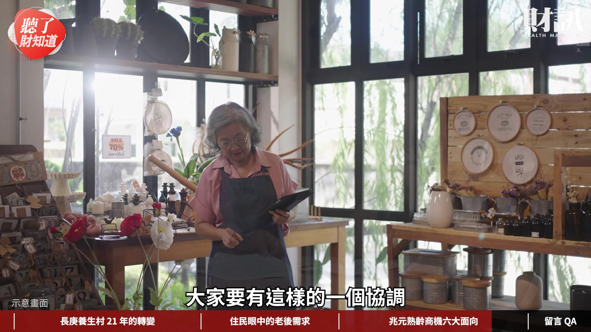

**逐字稿片段：** 再來就是友善空間 或者友善社區 我想這個就跟智慧城市有關係 就是像我講長庚養生村 它還有一個特點是 一開始王永慶先生就講了 你要做通用設計 早期人家進去長庚養生村的那個房間 都會覺得它的廁所好像比較像病房 我以前也曾經這樣想過 但是我進去看才知道說 你設計那個是為了 老人家不要常搬家 因為搬家對他適應環境是一個傷害 最好是能夠在一個穩定環境 這樣慢慢的終老 那你這個浴室要預留到 輪椅迴旋空間 你的門必須是拉門 不然你有一天昏倒在裡面 請問你門怎麼打開 包括你那個洗手台 你那個輪椅要能夠推進去 讓你自己洗手 就很多的狀況是我們 現在年輕人不能想像出來的 所以它們在設計的時候 可能就改成就是 讓他少推那一道門或什麼的 包括你全區的無障礙 你要讓他覺得我今天住進去 我可以住到老 我不用一直搬 那我覺得不只是長庚養生村 其他的養生村 或者以後的高齡宅 都要注意到這一點 那這個所謂的友善空間 跟社區的連結 也是我們的第六大面向

**話題推測：** 闡述第六個面向：友善空間與友善社區（通用設計）。

---

## 00:18:18

**逐字稿片段：** 所以醫療 健康促進 金融 還有學習 還有共融職涯 還有一個是友善空間 這六個是我們的中心 六大面向的主軸 這個部分也是重要的產業趨勢 財訊會繼續為大家追蹤以及開發

**話題推測：** 總結並條列熟齡商機的六大面向。

---

## 00:18:32

**逐字稿片段：** 今天非常感謝軒彤的分享 看完今天的影片 你認為熟齡商機有多大 你有什麼創意的想法可以分享嗎 歡迎留言分享你們的觀點 如果不想錯過我們的節目 歡迎訂閱財訊頻道 或是加入頻道的會員 解鎖所有的會員影片

**話題推測：** 節目進入尾聲，主持人感謝來賓分享。

---

## 00:18:47

**逐字稿片段：** 接下來我們要回覆一下 財團在 《聽了財知道》 第 379 集

**話題推測：** 轉入觀眾留言回覆環節。

---

## 00:18:50

**逐字稿片段：** 700 億健保資料串聯 告別醫療資訊孤島 裡面的留言 好 這位財團好朋友他說呢 應該建議政府將捐血者的點 列入健康幣 這個我贊成 鼓勵大家做這件事情 其實捐血是一件有意義的事情 當然石崇良部長已經講了 就是健康幣它未來會擴大範圍 包括那時候自行車協會都有跟他討論 是不是以後我不要送水壺 毛巾 我可以送健康幣 然後讓大家去發揮 多運動

**話題推測：** 提及前一集節目的主題：《700億健保資料串聯 告別醫療資訊孤島》。

---

## 00:19:18

**逐字稿片段：** 第二個財團好朋友說 就醫分級後 診所沒有儀器協助 診所應該讓民眾掛號前 提前知道這家診所 後面有沒有高端儀器 耳鼻喉科只有手電筒跟消炎藥 可能中重症會拖延治療 又要轉診到大醫院 就是折騰再折騰 尤其對老人家 台灣學名藥又太大顆 老人難吞 切割後又容易受潮 所以他說藥師也沒有辦法 依照個人的服藥包藥 然後尤其鋁箔錠劑慢箋 常常受潮膨脹 這些狀況我想我們也會反映給衛福部 不過我覺得政府也有在做 像我們之前採訪 陳相國 全聯公會理事長 他就說他們在台南也是想到這種問題 小診所沒有這些設備 他們就聯合幾百家診所 後面就是成大醫院 定期的 X 光車或者眼底鏡那些 它就定期在這幾個診所巡迴 然後一有問題 那就是後送成大 那成大它們之間 有一些協議跟合作 它幫你找醫生找好 然後你就是安排到那邊去 不會像你一個人 還要自己跑一圈 所以我覺得我們財訊 其實做滿多好的報導 大家細細的看 就會看到很多資訊

**話題推測：** 回覆第二則觀眾留言，關於就醫分級、診所儀器與藥品設計的建議。

---

## 00:20:24

**逐字稿片段：** 從他這個觀眾的留言 我覺得有兩個點 一個就是說 其實資訊的透明度真的非常重要 很多事情可能政府在做了 但很多民眾不知道 那我覺得要善加利用資訊 那第二點就是說 我覺得商機也很大 就像這個高齡者 或是老人吞藥這個問題 其實很多人反映 所以如何做到他們的需求 這就是商機 這東西我覺得 大家就一起來考慮 一起推動台灣的進步這樣子

**話題推測：** 總結觀眾留言的啟示：資訊透明度與高齡商機。

---

## 00:20:46

**逐字稿片段：** 如果想瞭解更多的內容 歡迎點選資訊欄裡面的文章連結 或者購買財訊第 776 期雜誌 跟我們一起追蹤政經趨勢 掌握投資脈動 《聽了財知道》 我們下次再見 謝謝軒彤 謝謝大家

**話題推測：** 呼籲讀者點選資訊欄文章連結或購買雜誌以了解更多內容。

---
