# wealth1974_d-PQNhYUhK8 — 關鍵畫面索引

- 來源逐字稿：[wealth1974_d-PQNhYUhK8_FIN.srt](wealth1974_d-PQNhYUhK8_FIN.srt)
- 影片：https://www.youtube.com/watch?v=d-PQNhYUhK8
- 截圖數：32

## 00:00:48

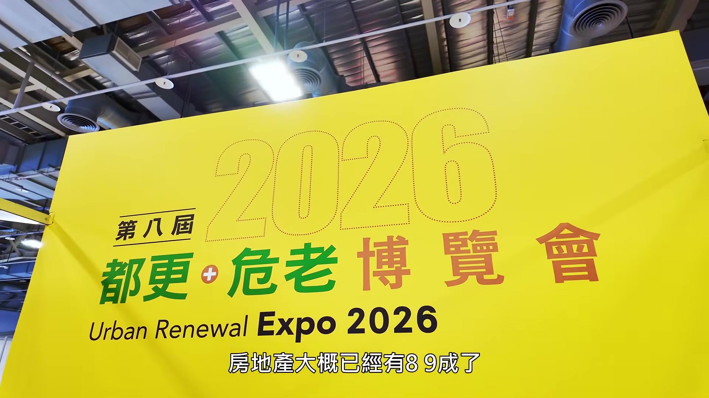

**逐字稿片段：** 現在已經有八九成從都更的案子而來。 都更在整個讓城市進步的地道,它的角色會越來越重要。 我們用好的成功的都更的案子, 能夠來打動人心, 能夠讓都更在未來城市的美化當中, 它能夠扮演更重要的角色。 我們在都更的路上要加快腳步。

**話題推測：** 提及都更案的比例，可能搭配圖表顯示都更佔比。

---

## 00:01:15

**逐字稿片段：** 那麼財訊在2017年開始 我們開始來承辦都更博覽會 那麼做一個推動都更的引路者 我想這八年當中 我們每一年都看到 臺灣在都更的路上 不斷地在往前進一步 都更的路上 我們會走得更強韌有力

**話題推測：** 提及「財訊」與「2017年」開始舉辦都更博覽會，可能顯示活動海報或時間軸。

---

## 00:01:37

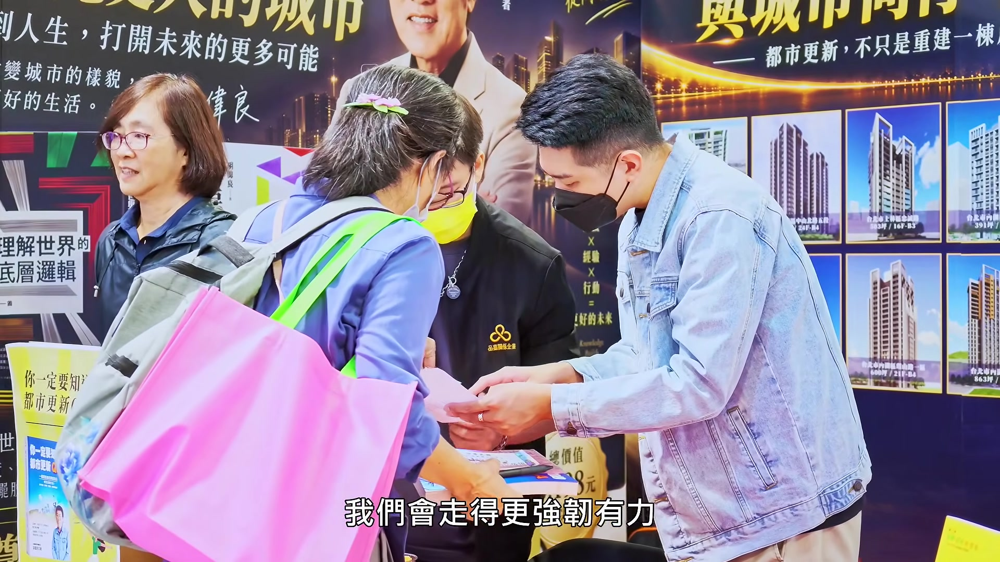

**逐字稿片段：** 我們新北市人口多 我們老屋也多 所以我們一直在想 都更不能只靠個案 一個一個慢慢做 我們想要把規模做大 我們希望把它整合做起來

**話題推測：** 話題轉向新北市的人口與老屋數量，可能搭配新北市的地圖或統計數據。

---

## 00:01:53

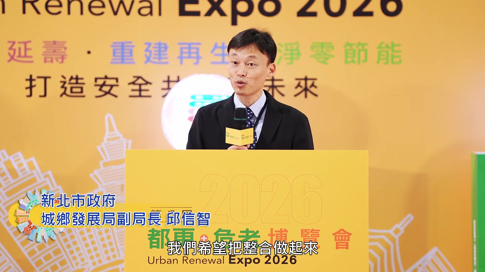

**逐字稿片段：** 因此我們在侯市長推動都更三建的政策下 我們新北市是第一個成立都更推動辦公室的直轄市 也是第一個成立住宅及都市更新推動中心的地方政府 那我們從政府帶頭做到公司協力一起做 我們陸續完成了全國規模最大

**話題推測：** 提及侯市長的「都更三箭」政策，可能顯示政策標語或圖示。

---

## 00:02:18

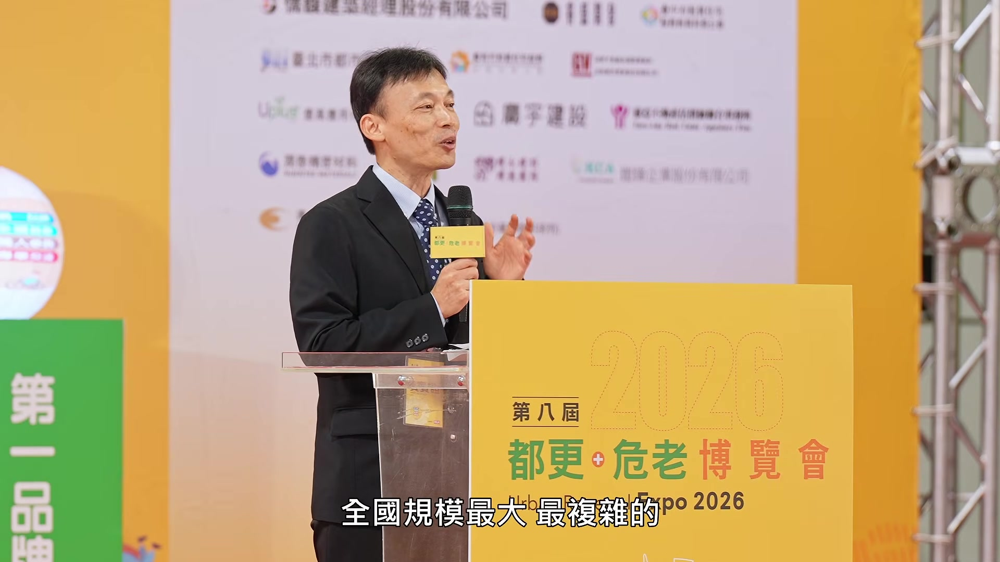

**逐字稿片段：** 最複雜的永和大城都庚案 那我們現在也在永和頂西地區 在推動大面積的更新 我們希望透過大尺度的整體規劃 我們把公共設施 把交通 把居住環境 跟所謂的都市發展一次到位 這也是我們現在最重要的一個方向

**話題推測：** 提及「永和大陳都更案」，可能顯示該案的圖片或規劃圖。

---

## 00:02:40

**逐字稿片段：** 我們希望從單點都庚 走向大面積的整合 我們希望從單一建築的更新 走向整個生活環境的改善 我們特別值得一提的是

**話題推測：** 對比「單點都更」與「大面積整合」，可能以圖示或簡報頁面說明概念。

---

## 00:02:52

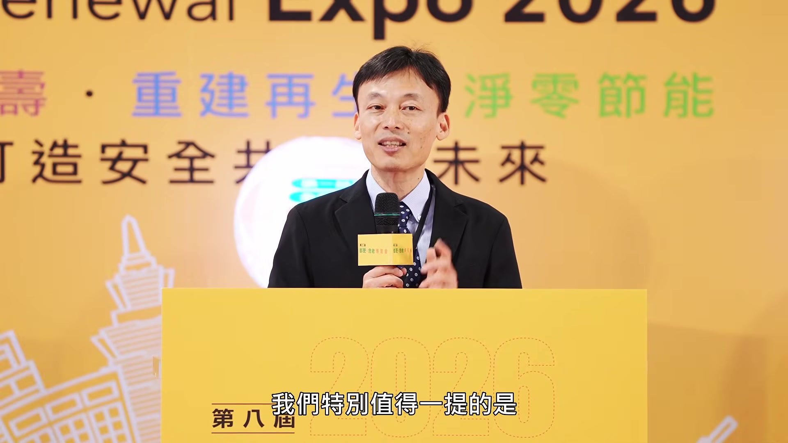

**逐字稿片段：** 我們也在跟國家駐都中心共同合作 推動大面積的更新 這代表什麼 代表中央跟地方 我們不是各做各的 而是把資源 專業 還有行政力量整合在一起 我們一起把都跟這件事情 做得更有規模 更有效率

**話題推測：** 提及與「國家住都中心」合作，可能顯示合作夥伴的標誌或協作模式。

---

## 00:03:14

**逐字稿片段：** 桃園現在正迎來非常多的重大交通建設 我們正在利用這個機會 不僅要讓交通翻轉 也要讓都更以及縫合城市軸線的黃金契機 來正面的迎接

**話題推測：** 話題轉向桃園的「重大交通建設」，可能顯示桃園地圖上的交通規劃。

---

## 00:03:34

**逐字稿片段：** 我們正在規劃把未來鐵路地下化的綠色廊道 打造成桃園城市的黃金軸線 也要在這個軸線的周圍擴大都更的劃定地區

**話題推測：** 提及桃園「鐵路地下化的綠色廊道」規劃，可能顯示概念圖或設計草案。

---

## 00:03:48

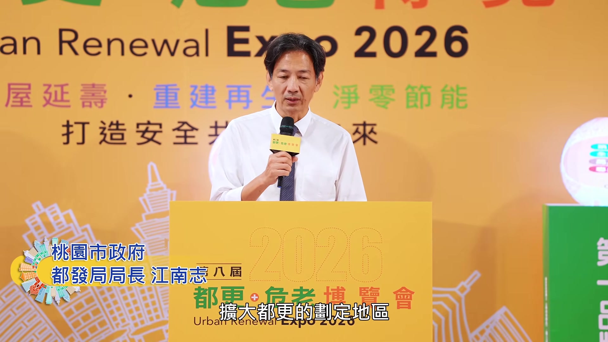

**逐字稿片段：** 引導周邊老舊社區以TOD的導向進行都市更新

**話題推測：** 提及以「TOD導向」進行都市更新，可能顯示TOD模式的圖解或案例。

---

## 00:03:54

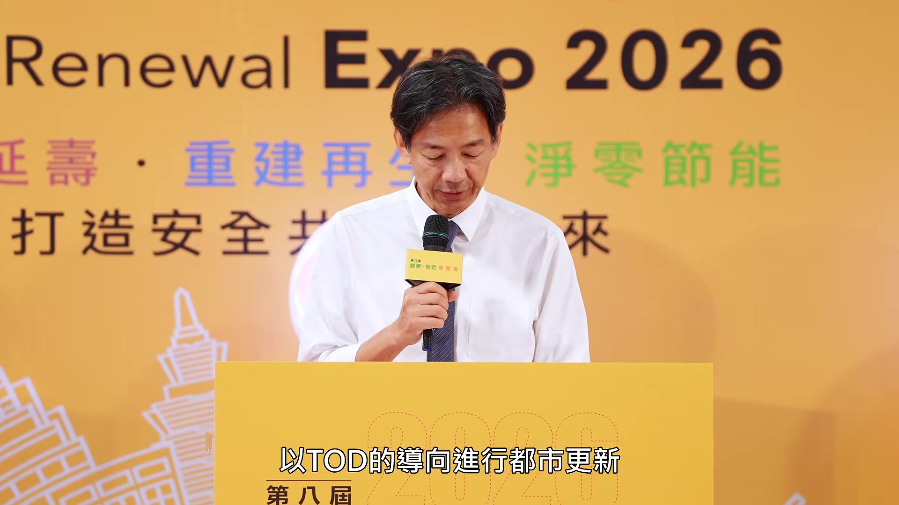

**逐字稿片段：** 那我們更把這個防災型都更放在我們目前的首要的位階

**話題推測：** 引入「防災型都更」的新概念，可能顯示相關政策說明頁面。

---

## 00:04:02

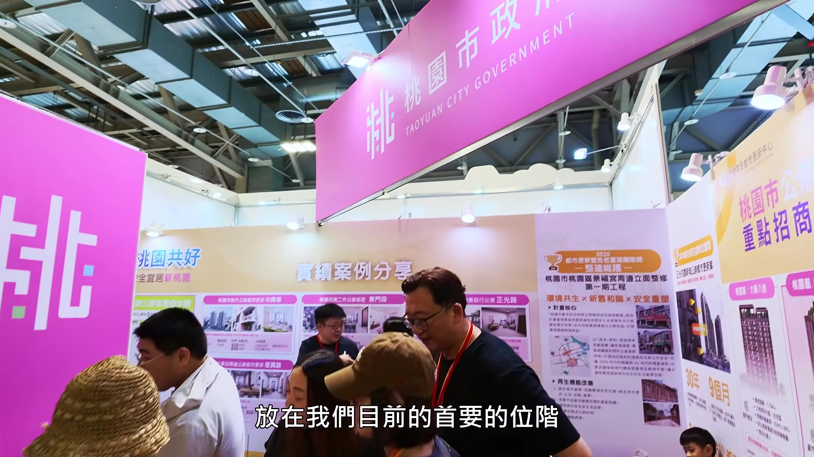

**逐字稿片段：** 我們降低了同意的門檻 然後希望在社區達到意願的最低門檻的時候 我們就直接介入 然後以模擬量體跟財務規劃的雛形 讓社區趕快順利地接受 我們防災型公辦都更的協助

**話題推測：** 說明降低同意門檻的政策細節，可能顯示政策前後比較或流程圖。

---

## 00:04:24

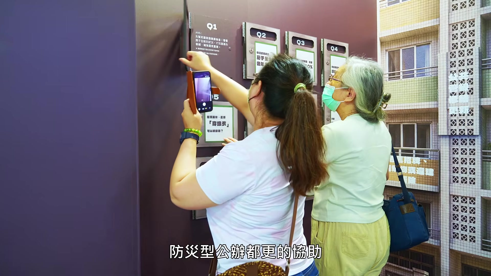

**逐字稿片段：** 我們以兩倍的基準容積 或者1.5倍的圓龍 來讓它順利重建 來展現我們桃園處理圍樓 這個不定時炸彈的破例

**話題推測：** 提及「兩倍基準容積」或「1.5倍圓龍」等數字獎勵，可能顯示容積獎勵方案的圖表。

---

## 00:04:36

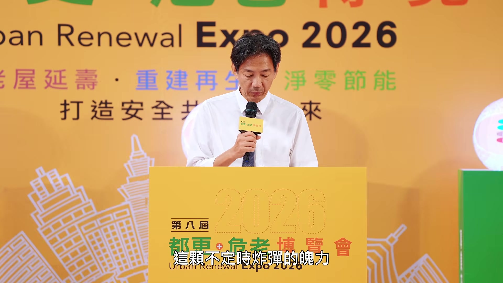

**逐字稿片段：** 桃園也首創了一個奇招 就是可負擔住宅 那我們用零土地成本 零營建成本的機制 來讓建商捐建可負擔住宅 那用優惠的房價 來確實讓婚育家庭 減輕購屋的負擔

**話題推測：** 引入桃園首創的「可負擔住宅」機制，可能顯示相關政策或建案資訊。

---

## 00:04:56

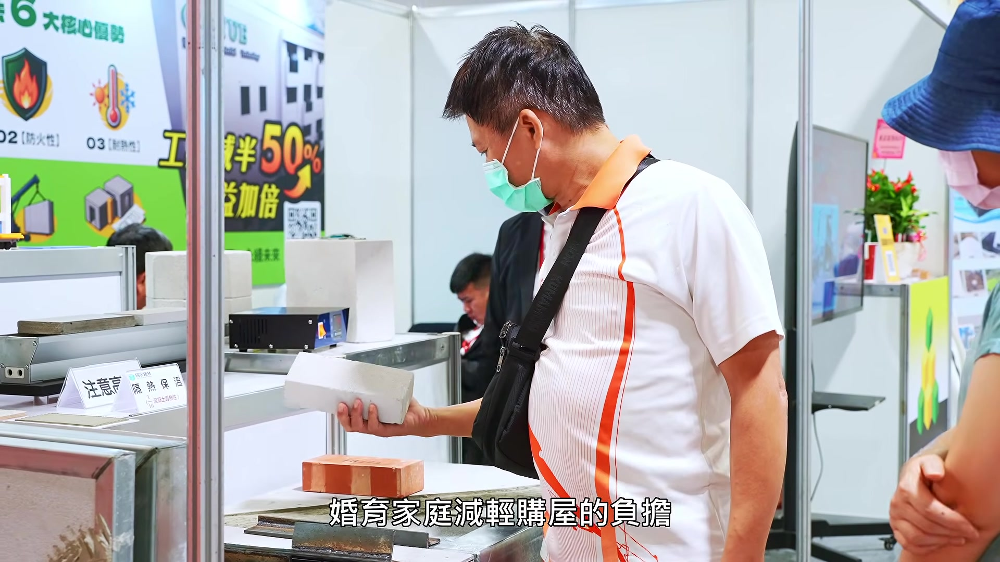

**逐字稿片段：** 過去的臺灣 我們因為經濟成長 我們過去的祖先們 打造了這樣一個臺灣奇蹟 與此同時 我們過去也花了許多的資金 進行都市的公共重要的投資 我們的捷運網路線遍及二地 如果我們沒有辦法有效推動都市更新 我們就會將這些許多的公共投資變成浪費 因為年輕人沒有辦法住回到 原本的具有完整豐富公共投資的都市核心區

**話題推測：** 話題轉向臺灣經濟成長與過去公共投資，可能顯示歷史照片或捷運網絡圖。

---

## 00:05:29

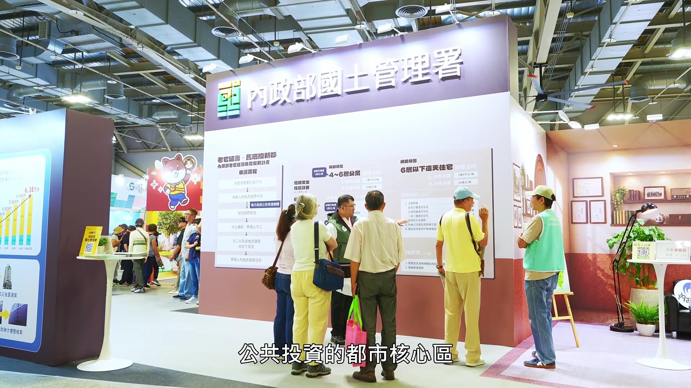

**逐字稿片段：** 所以內政部提出了三支重要的改善的方向 也就是都更三件 都更三件其中包括

**話題推測：** 提及內政部提出的「都更三箭」方向，可能顯示政策列表或概念圖。

---

## 00:05:37

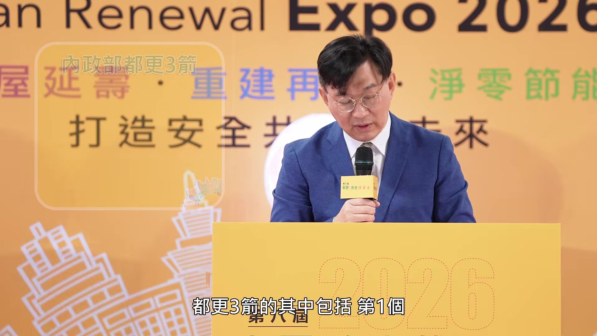

**逐字稿片段：** 第一個我們要擴大自主都更 讓民眾有能力 社區能做主 某一些相對於弱勢的區塊 一直沒有辦法完成有效的都更 而這些地方的人必須照顧到 這是政府的責任 所以政府希望能夠透過 擴大自主都更 讓社區自己做主 所以我們在今年

**話題推測：** 說明都更三箭的「第一個」方向：擴大自主都更，可能顯示政策子項目。

---

## 00:06:02

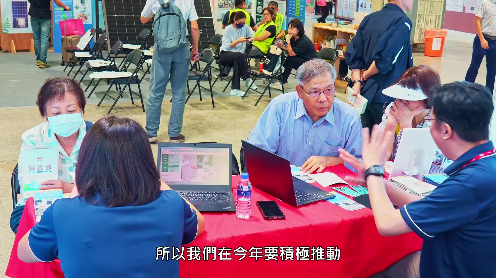

**逐字稿片段：** 要緊急推動都市更新條例的修正草案 我們也已經在7月15號 通過行政院院會 而且送入立法院審議 在這裡面有三個重要的重點 在整個都更條例裡面的修正裡面

**話題推測：** 提及都市更新條例的修正草案時程，可能顯示立法流程圖或新聞畫面。

---

## 00:06:16

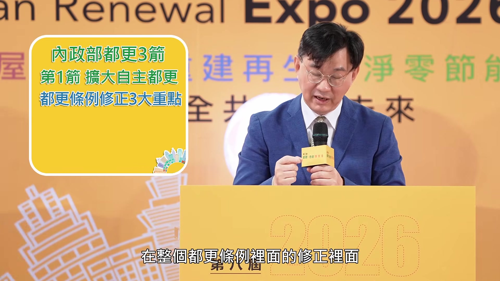

**逐字稿片段：** 第一個我們提出了全案管理機制 並且透過全案管理跟程序的簡化 讓自主性都更能夠快速的達到 第二個我們結合國家的婚姻宅政策 所以只要願意捐贈婚姻宅 我們就會讓整個都更的條件變得更好 那第三個也是最關鍵的 許多自主都更都有信用保證跟資金取得的困難 那麼內政部運用我們的中央都更基金作為後盾 來補齊資金的最後一里路 讓自主都更變成可行 那除了自主都更這支建之外 我們另外一個更重要的建就是 圍老重建 我們已經送入立法院 我們將期限撤除 因為我們知道臺灣的圍老房租 未來越來越多 我們必須將這些危險老舊的房子 要一一的找出 針對這些狀況 用針灸式的方式 或者是擴大的方式 讓它能夠快速的轉變成一個 安全可居住的環境 配合我們的婚育宅政策 也會給予相對的榮獎 來降低相當的負擔

**話題推測：** 說明修正重點「第一個」全案管理機制，可能顯示機制圖解。

---

## 00:07:27

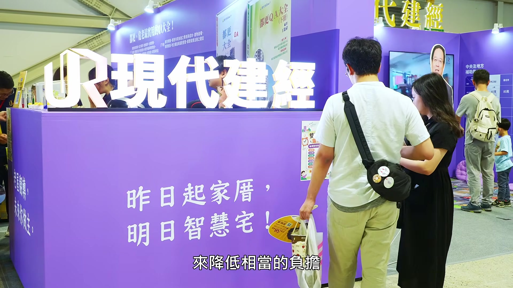

**逐字稿片段：** 那第三個就是老宅延壽 畢竟都更危老 都要花一點時間 那很多時候 有些長輩已經等不及 對於長輩來講 怎麼樣讓他能夠在地安居 是一個非常非常重要的事情 那麼要在地安養 我們就要改善 他原本所居住的生活環境 在臺灣

**話題推測：** 介紹都更三箭的「第三個」方向：老宅延壽，可能顯示老舊住宅的改造前後對比。

---

## 00:07:49

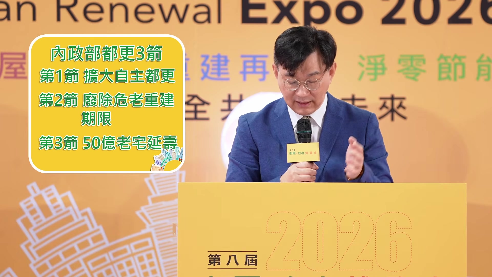

**逐字稿片段：** 有許多30年以上的房子 都是4到6層樓的布燈公寓 這些布燈公寓 對於長輩來講 真的是很不好 我們提出了 50億的老財延壽計畫 這個初步的計畫的重點 就是要將4到6層樓的公寓 以及透天厝 將它的立面 將它的內部環境 將它的管線做修繕 並且如果可以偵測電扶梯或樓梯 我們全部都幫它協助 那希望能夠在全臺 都能夠做到這樣的事情 這些舊市區的老宅 只要它的結構是安全的 環境是安全的 我們就應該讓長輩在熟悉的環境裡面 在地安養 在地安老

**話題推測：** 提及30年以上4到6層樓公寓，可能顯示這類建築物的照片或數據。

---

## 00:08:30

**逐字稿片段：** 現在將近繼承房子的人大有17% 很多年輕人繼承了老房子之後 他也不知道怎麼辦 我們就鼓勵他們把這些房子進行老宅延售之後 拿出來提供給包租貸款業者 做婚育宅或社會住宅的使用 這樣子我們又增加更多的機會 讓年輕人住回舊市區 對內政部來講 中央與地方攜手合作 才能夠共同打造一個安居 宜居 任性永續的臺灣

**話題推測：** 提及17%的人繼承老房子，可能顯示相關統計數據圖。

---

## 00:09:00

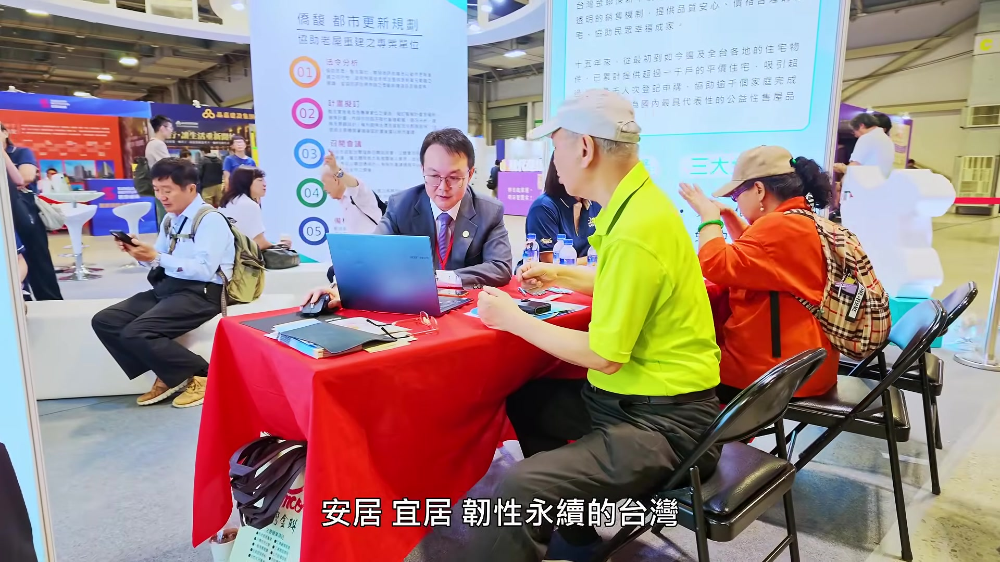

**逐字稿片段：** 今天再一次來參加都更為老的博覽會 每次來都讓我感受到業界對投入這項工作的動力 也感受到大家提出很多新的作為 我們現在除了在公辦私辦都更之外 行政院願意跟業界來合力

**話題推測：** 活動進入下一階段，可能是主持人開場白或另一位講者上台。

---

## 00:09:23

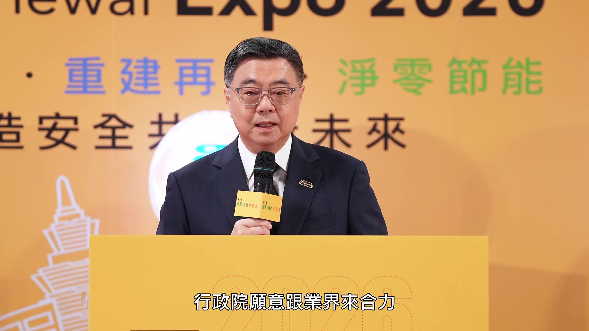

**逐字稿片段：** 來找第三條路就是自主都更 也配合在座所有金融機構 你們可以全力的來協助 讓我們可以在更沒有財政壓力 更沒有資訊不對成的狀況底下 合力來產生新的杜根模式 但這個時候 我們不會放棄大街闊的公辦私辦杜根 我們還是會從法令上 來給業者更充分的一些協助 因為住宅與城市 是國家發展重要的基石 是人民生活重要的改善的條件 明顯的象徵

**話題推測：** 再次強調自主都更作為「第三條路」，可能顯示三種都更模式的比較圖。

---

## 00:10:03

**逐字稿片段：** 因為人口結構的轉變 老年化增高了 也因為整個建築年代的久遠 建築物老化的事實也已經存在

**話題推測：** 提及人口結構轉變（老年化），可能顯示人口金字塔圖或老年人口比例圖。

---

## 00:10:17

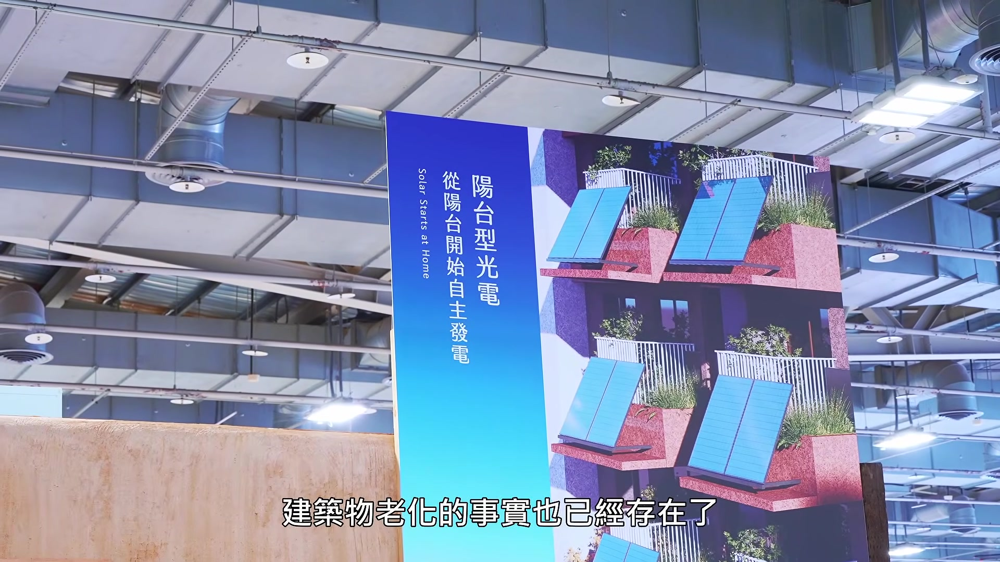

**逐字稿片段：** 今天新北市 是全國人口最多的城市 所以你們的問題當然多

**話題推測：** 重新提及新北市作為人口最多城市，可能顯示各縣市人口數比較圖。

---

## 00:10:23

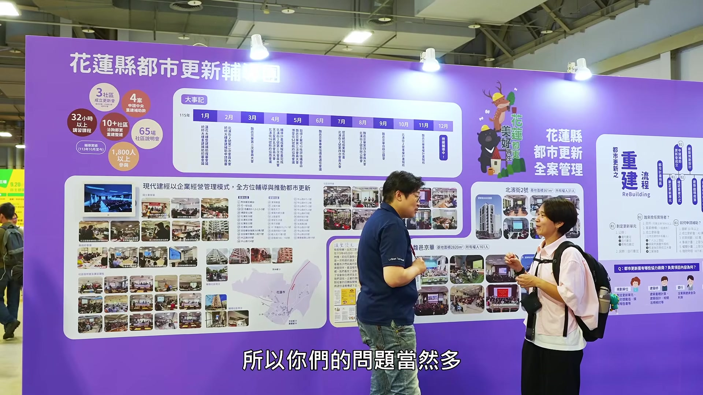

**逐字稿片段：** 桃園市是全國最年輕的城市 有年輕的國人 我們需要的 更是把過去這些老舊住宅 也讓他繁新 所以都跟危老 成為各個縣市 必須共同面對的一個重要問題 住宅是有生命週期的 但過去我們沒有辦法 大規模有政策性的 全面的來檢討 包括修繕維護 包括讓它再建重生 而今天我們必須要面對這個問題 所以在傳統的多根之外 內政部提出了

**話題推測：** 對比桃園市作為最年輕城市，可能顯示年輕人口比例或城市活力圖。

---

## 00:10:58

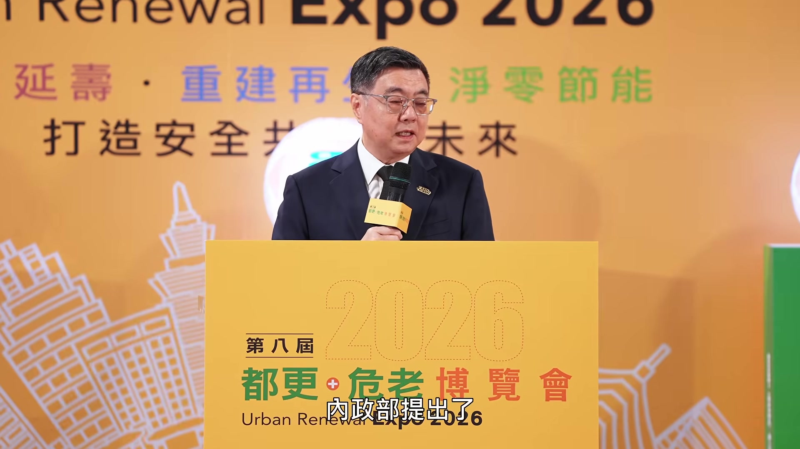

**逐字稿片段：** 老屋延壽的 這樣的一個觀念 讓老宅能夠經過一個延壽的機制 讓它恢復它的機能 不僅生活環境改善 而且對高齡的長者生活更加的便利 不論是內部公共管線的翻新 或是增加對無障礙空間的增加等等 也都是這個老宅延壽重要的精神 所以希望透過我們杜根的基金 跟信保基金 還有金融機構的各位負責人 來幫助業界 幫助國人 那政府的政策 剛剛董事長講得非常清楚 那我們要把這兩個政策連結起來 我們選擇一個方向

**話題推測：** 再次提及「老屋延壽」觀念，可能是政策重點回顧或深化說明。

---

## 00:11:47

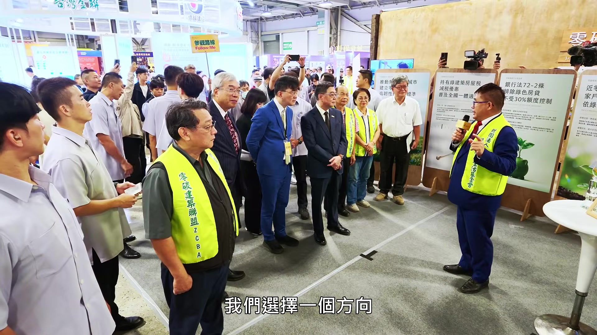

**逐字稿片段：** 就是來增加婚育宅 只要能夠提供更大的婚育宅 不僅讓年輕人敢婚敢生 也能夠有更好的居住環境 只要能夠提供更好的婚育宅 當業界投入這種都更跟危老的時候 政府當然必須回饋 我們回饋的機制就是 就是在危老的條例當中

**話題推測：** 重新聚焦於「婚育宅」的提供，可能顯示婚育家庭購屋補貼政策。

---

## 00:12:13

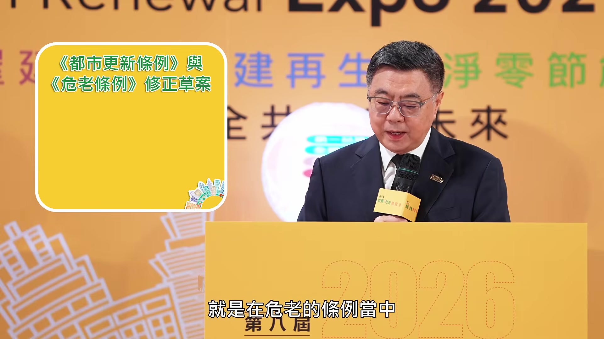

**逐字稿片段：** 就現在的1.3倍的容積獎勵 我們再增加15% 幾乎達到100% 150%的危老的部分 而在都更 除了現在的150%的獎勵之外 我們再往上堆疊 增加50% 就達到200%的容積獎勵 這是起點 如果全國能夠大量的展開 而且成效非常的好 各界非常的需求 我認為臺灣要成為一個更開放的國家的時候 整個農機我們必須面臨再檢討 因為人口是在減少 建築的技術是在進步 土地雖然有限 可不可以往上增加 必須做到更開放的一個政策的討論 所以如果大家認為這個政策是值得歡迎的 值得接受的 業界也同意投入 當大量在進行的時候 我們會再進行容積的再檢討 以符合各界的需要 然而剛剛所說的 不論是提高到150 或是提高到200 這個危老跟都更的這個法律 現在送到立法院 我希望立法院 像這種法律要趕快審 要趕快通過 那行政院一定附屬 絕對沒有問題 這才是福國利民真正的工作

**話題推測：** 提及危老條例中「1.3倍容積獎勵」再增加15%，可能顯示獎勵計算公式或圖示。

---

## 00:13:38

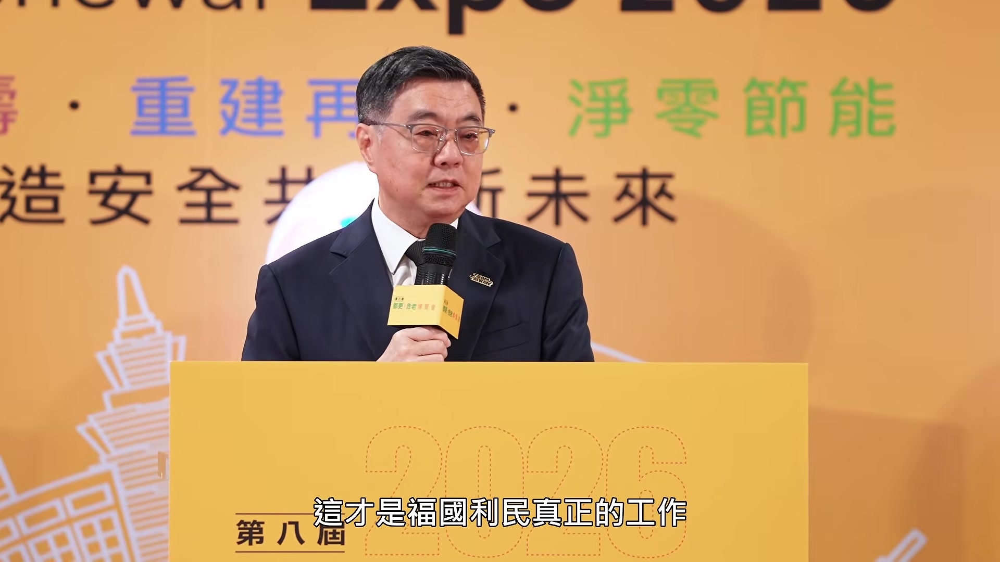

**逐字稿片段：** 接下來有請院長

**話題推測：** 明顯的流程轉換，主持人引導頒獎環節，可能顯示頒獎嘉賓或獎項名稱。

---

## 00:13:40

**逐字稿片段：** 為我們頒發 2026年都市更新祭為老重建團隊獎

**話題推測：** 提及「2026年都市更新暨危老重建團隊獎」，可能顯示獎項的預覽或名稱。

---
