# wealth1974_eHQElh8GgkI — 關鍵畫面索引

- 來源逐字稿：[wealth1974_eHQElh8GgkI_GT.srt](wealth1974_eHQElh8GgkI_GT.srt)
- 影片：https://www.youtube.com/watch?v=eHQElh8GgkI
- 截圖數：29

## 00:00:03

**逐字稿片段：** 8 成市占的隱形冠軍 「3 大未來」要讓城市變成礦山 想要知道的聽眾朋友 記得聽到最後 今天的來賓是 財訊的主編孫蓉萍 各位聽眾大家好 我是蓉萍 節目開始前也提醒大家 這是財訊的 Podcast 節目 如果是透過 YouTube 平台來收聽的聽眾 可以打開右下角的 CC 字幕 那我們就開始吧 首先第一段 我們來看一下市場動態 近期比較熱的就是

**話題推測：** 介紹主題：8成市佔的隱形冠軍

---

## 00:00:36

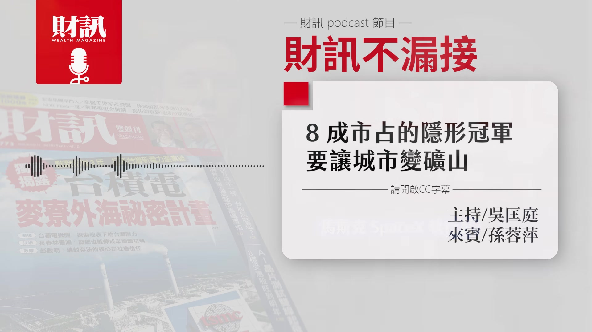

**逐字稿片段：** 台積電跟馬斯克可能會聯手 馬斯克在個人的社群平台上 有承認說他們在評估 跟台積電聯手 Tera Fab 的合作 馬斯克也表示 目前只是在討論的階段 至於台積電有什麼樣的方式 可能跟 Tera Fab 進行合作呢 大家都討論滿多的 其中也有包含像是 SpaceX 會入股 或者是台積電當顧問等等之類的

**話題推測：** 新話題：台積電與馬斯克聯手合作

---

## 00:01:03

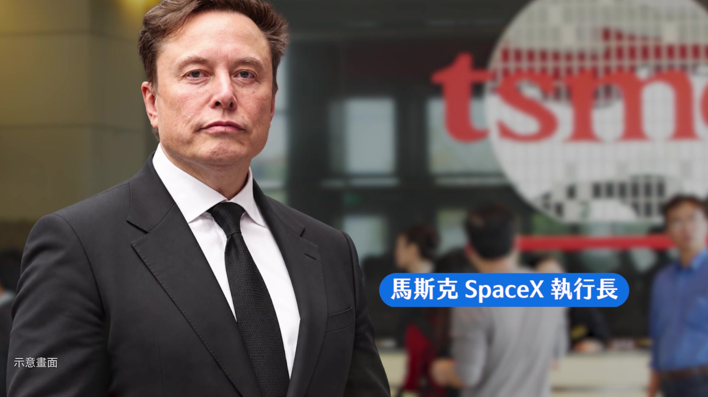

**逐字稿片段：** 我們的專欄作家李鎮宇 他也有發表一則看法 我覺得也滿值得大家一讀的 他認為台積電最有價值的護城河 並不是 2 奈米的技術 而是它 40 年累積下來的經驗 這個東西是沒辦法短時間內 你砸錢就可以複製的 接下來我們也會持續的關注 再來一個是

**話題推測：** 引用專欄作家李鎮宇的看法

---

## 00:01:24

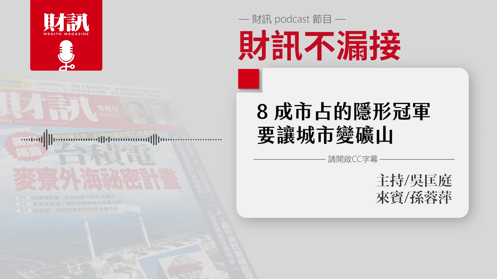

**逐字稿片段：** Nike 它在美國的時間 10 月 1 日 發布了上一季的財報 財報開出來後 營收的表現其實不如預期 我們可以看到它

**話題推測：** 新話題：Nike發布上一季財報

---

## 00:01:33

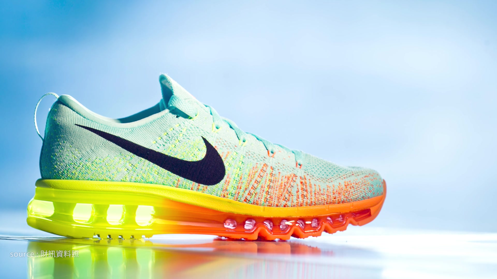

**逐字稿片段：** 上季的營收是 112.1 億美元 年減 4% EPS 是 0.48 美元 毛利率 42.8% 比前一季度 49.2% 還要衰退一些

**話題推測：** 呈現Nike上季營收數字：112.1億美元

---

## 00:01:48

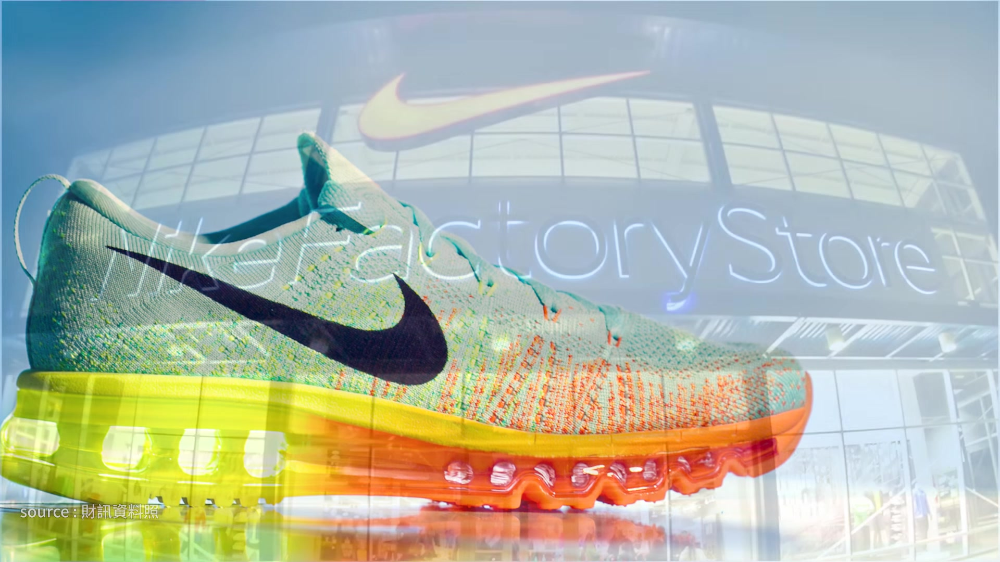

**逐字稿片段：** 主要是受到中國市場的 業績持續的衰落為主要的影響 它在中國市場的營收有 11.8 億美元 不過年減 26% 相較之下 其他像是北美地區 亞太或拉丁美洲 表現是比較持平的 其中歐洲和中東以及非洲 則是稍微年減 5% 左右 針對這樣的現象呢 Nike 它們也表示

**話題推測：** 分析Nike營收衰退原因：中國市場表現

---

## 00:02:14

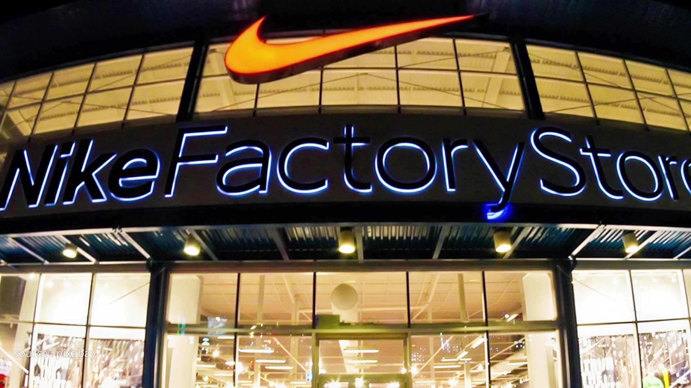

**逐字稿片段：** 會進行組織改造的計畫 有可能會進行新一波的裁員 以及打造更新的系列產品 看是不是能夠挽回一些 營收表現不如預期的狀況 也有發現 Nike 營收跟市占掉 其他運動品牌的表現反而更好 蓉萍可以跟聽眾朋友分享一下 前一陣子就是 9 月中旬的時候

**話題推測：** Nike的組織改造與裁員計畫

---

## 00:02:36

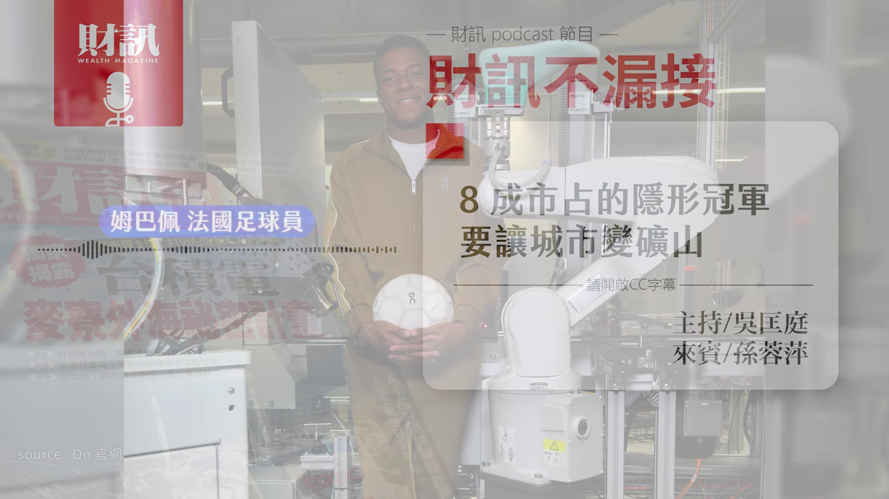

**逐字稿片段：** 法國足球明星姆巴佩 他已經結束了跟 Nike 長達 20 年的合作關係 然後他加入了快速成長的

**話題推測：** 新事件：姆巴佩結束與Nike合作

---

## 00:02:43

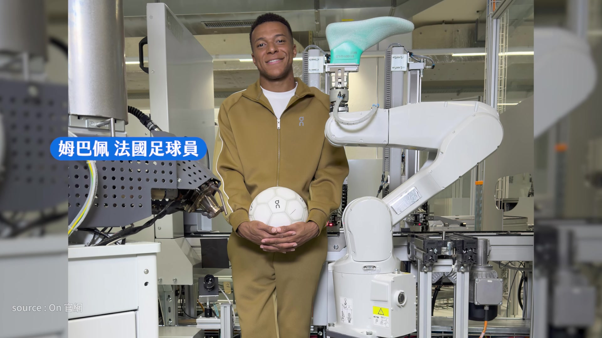

**逐字稿片段：** 一個瑞士運動品牌 On On 這個品牌 我相信很多人大概都喜歡這個品牌 就是我記得去日本的時候 大家說要去 On 那個店買那個球鞋 聽說要排好幾個小時 它的那個設計是它們獨家研發的

**話題推測：** 介紹瑞士運動品牌On

---

## 00:02:57

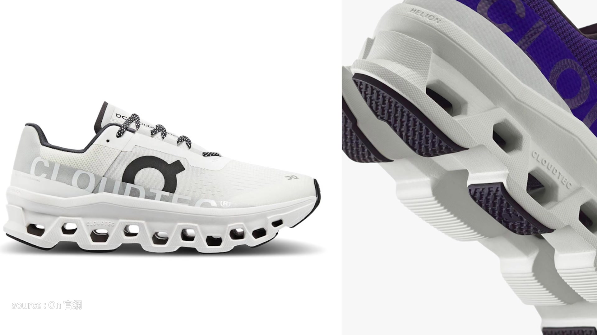

**逐字稿片段：** 一個叫做 CloudTec 的技術 它可以降低著地的衝擊 很多人都覺得說好穿 它會竄起其實還有一個滿重要的原因 就是它的創新生產技術 叫做 LightSpray On 的共同執行長 Coppetti 他之前 接受日本經濟新聞採訪的時候就有說 它們利用這樣子的技術 製作單腳的鞋面只要 3-5 分鐘 就算是把上色計算在內 整雙鞋完成也大概只要 15 分鐘就夠了 他說以前製造一雙鞋 原本要經過 400 雙手 可是用它們這個 LightSpray 技術 就能完全自動化 從設計到上市的時間 從要 1 年 現在可以縮短到 1 個月這樣子 這樣生產很快

**話題推測：** 介紹On的CloudTec獨家技術

---

## 00:03:36

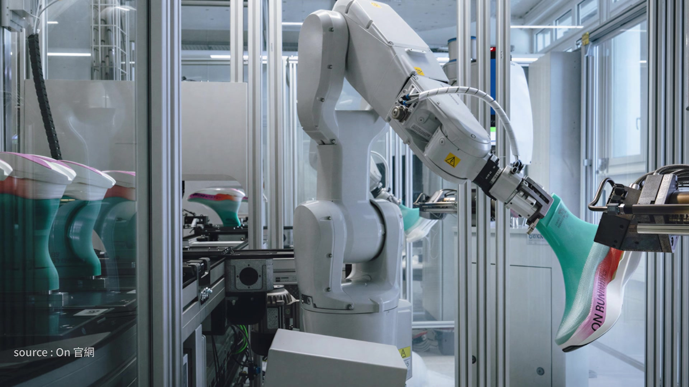

**逐字稿片段：** 然後再加上那個網球天王費德勒 覺得它的鞋很好穿 2019 年就成為它的投資合作夥伴 一起開發網球鞋 那滿早的 對 所以他應該也賺了滿多的 就是這個成長他其實都有參與到 現在加上姆巴佩進去以後 其實在姆巴佩之前

**話題推測：** 提及網球天王費德勒成為On的投資合作夥伴

---

## 00:03:52

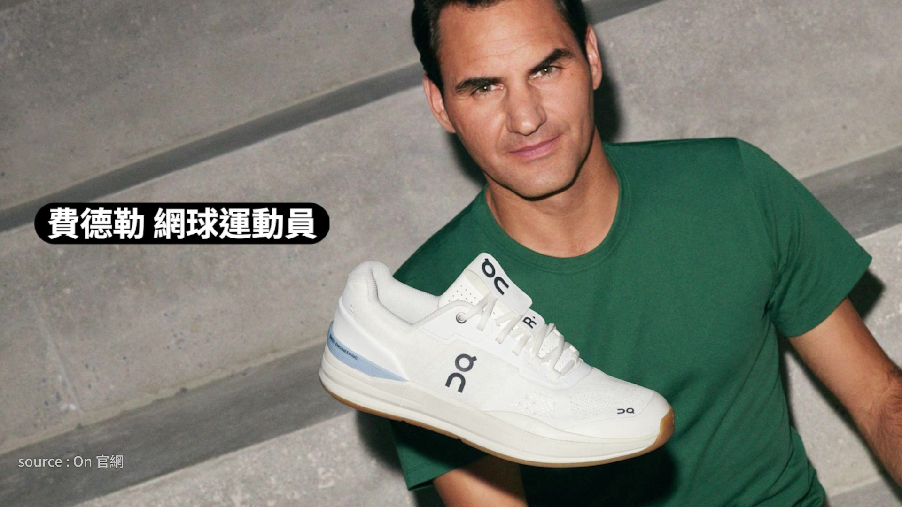

**逐字稿片段：** 法國的傳奇前鋒叫做亨利 他已經出任它的足球事業總監 協助它們規畫品牌進軍足球市場 所以姆巴佩他不是只擔任代言人而已 他還會就是把他的經驗 導入將來製作足球的釘鞋 或者是運動服飾 所以覺得 On 這個品牌 好像還滿值得關注的 當然它的市值跟 Nike 或者是說跟愛迪達還有一段距離 不過它的竄升速度滿快的 所以我覺得這還滿有趣的 之前我也在一些專櫃上 有看到 On 的一些鞋子 確實價位是偏中高一點的 對 它的策略就是說它不太降價 很少在大賣場看到大量打折的鞋子 它覺得說這才是維持品牌的 一個重要的策略 好 那我們也會持續的追蹤

**話題推測：** 提及法國前鋒亨利出任On足球事業總監

---

## 00:04:37

**逐字稿片段：** 再來就是最近國際政經局勢方面 中東的戰火又再度打起來

**話題推測：** 新話題：國際政經局勢與中東戰火

---

## 00:04:42

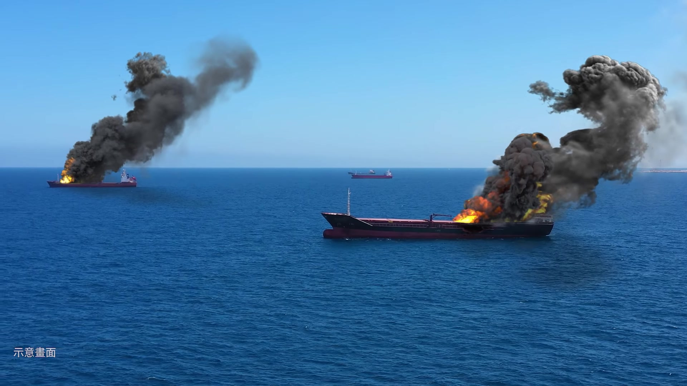

**逐字稿片段：** 布蘭特原油它破百（美元）了 目前觀察大概是 100 美元左右附近的水準 伊朗也表示它們會一邊作戰 然後一邊跟美國協商 荷姆茲海峽目前還是持續關閉的狀態 那我們也會繼續的追蹤

**話題推測：** 布蘭特原油價格突破100美元

---

## 00:04:57

**逐字稿片段：** 那接下來我們就進入今天的主題 就是在電動車 儲能快速普及的時代 我們也發現了一個 特別的 有趣的議題 就是廢棄的鋰電池呢 它竟然也是一波商機 我們今天要介紹的這家公司 它拿下了二次鋰電池處理

**話題推測：** 進入今日主題：廢棄鋰電池的商機

---

## 00:05:17

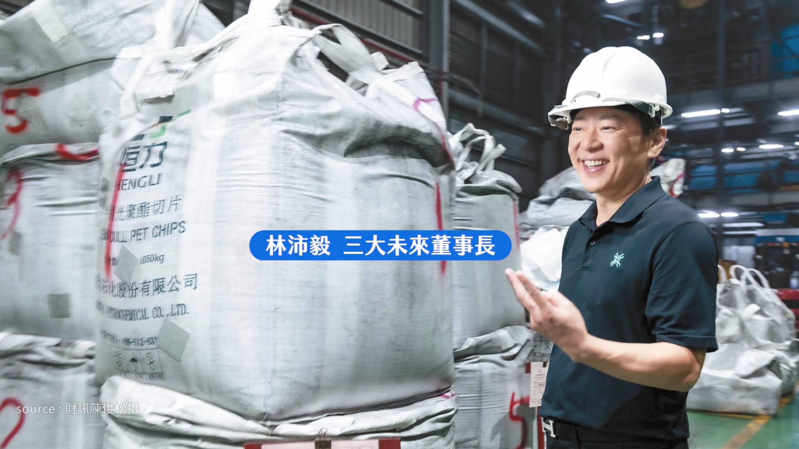

**逐字稿片段：** 大約 8 成市占 它也算是一個隱形冠軍 為什麼我們會說 它算是一門好生意 也是一門比較難的生意呢 我們現在用手機 然後看到很多電動車 電動巴士 電動機車這些 鋰電池已經無所不在 但是我們就沒想到說 那它以後怎麼辦 我們手機換新的 那舊手機它的電池怎麼辦 那舊手機它的電池怎麼辦 我們很少去想到這件事情 以前乾電池回收是有一定的業者

**話題推測：** 提及3大未來在二次鋰電池處理領域的8成市佔

---

## 00:05:43

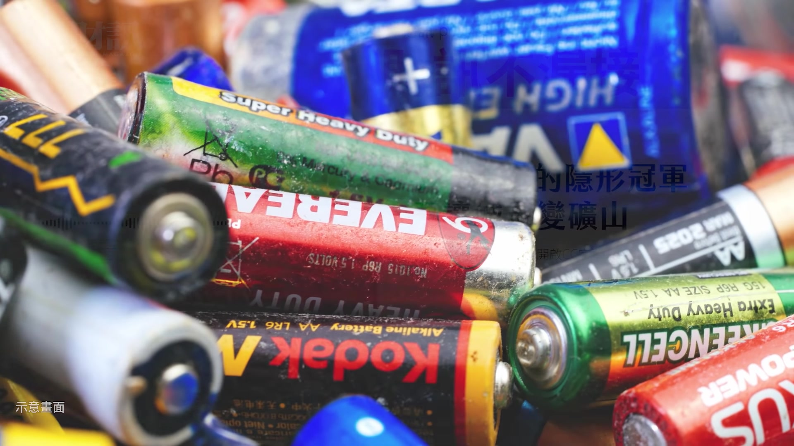

**逐字稿片段：** 像是 3 大未來公司以前叫做延龍再生科技 它其實就是處理這些乾電池 乾電池破碎以後呢 它可以分離出鋅錳粉和廢鐵這些東西 但是鋰電池它的整個結構 或者是它的生態又完全不一樣 這個 3 大未來科技的董事長 他很早以前他就想到說 這會不會變成一門生意呢 就是這些鋰電池之後 我們要怎麼處理呢 我要怎麼回收再利用呢 所以他很早之前開始注意到這件事情

**話題推測：** 介紹3大未來的歷史與前身：延龍再生科技

---

## 00:06:12

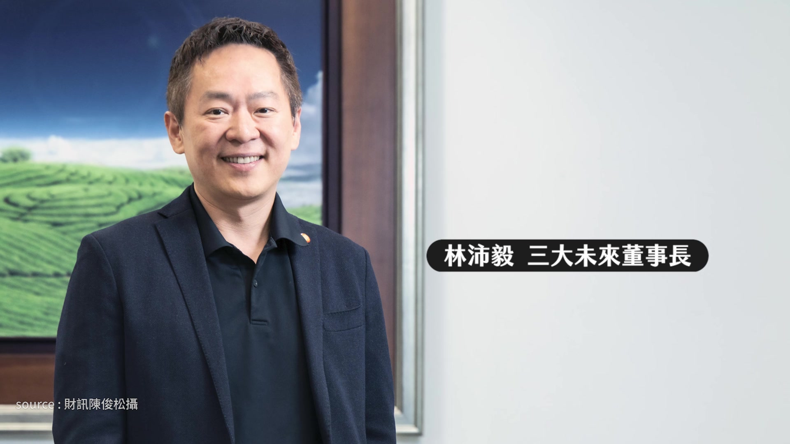

**逐字稿片段：** 他 2018-2019 年的時候 就開始研究鋰電池的處理技術 很多人都想說為什麼叫 3 大未來 我也很好奇 我也問他 他講這個代表他三個期許 他想要成為產業龍頭 他想要成為循環經濟的推動者 他想要成為國內率先布局 鋰電池回收市場的業者 那看起來他就是慢慢的在朝這個方向走 那 2018-2019 年他就開始研究 可是一樣是鋰電池 光是行動充電就有各種大大小小規格尺寸 然後內容物都不同 更何況是汽車的 機車的（電池） 而且外表看起來其實都一樣 可是我們不會知道它裡面 是不是有什麼壞掉了 我們根本不知道 所以我覺得回收這件事情 最難的就是它必須先去瞭解 這個電池的狀況 我就問這個董事長說 那很危險的 他說對 所以 2018-2019 年它們就是慢慢做 從小量的開始做 從小的開始做 慢慢的去確認怎麼分解它 然後它的安全 因為爆炸就不得了 所以它們就從小量的開始做 然後慢慢的去把它擴大 所以才有了現在的規模 他自己不是念理工的 但是他就是有看到說除了 ESG 之外 像我們剛剛提到就是戰爭 你在地緣政治風險升高的情況下

**話題推測：** 提及3大未來董事長在2018-2019年開始研究鋰電池處理技術

---

## 00:07:22

**逐字稿片段：** 鈷 鋰 鎳這些其實已經是戰略資源 所以你怎麼樣去從廢電池當中 去回收這些材料再投入製造 就是我們叫城市採礦 這個是他先看到的 所以他就是比人家更早一步 去做這件事情

**話題推測：** 提及鈷、鋰、鎳等戰略資源的回收價值

---

## 00:07:36

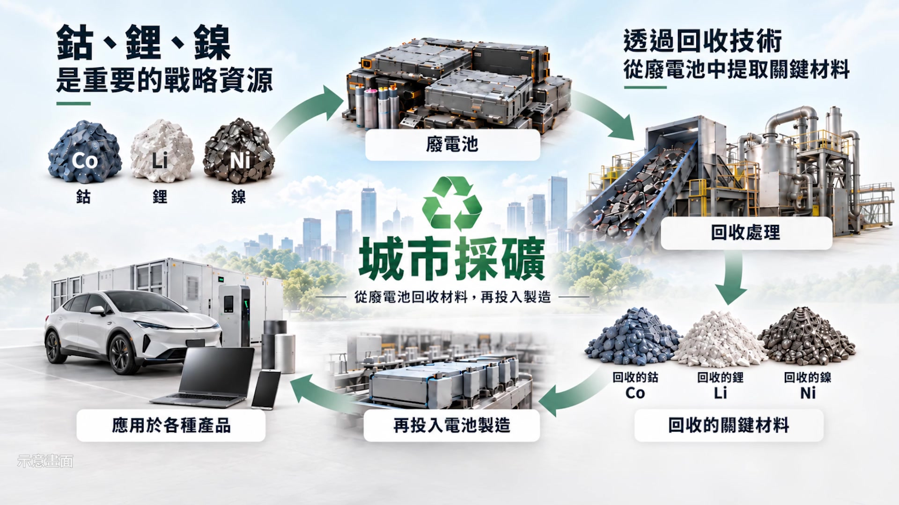

**逐字稿片段：** 我有看到它在 2025 年處理了 1666 噸的二次鋰電池 真的是滿龐大一個數量 所以真的算是一門好生意 也是一門滿困難的生意 就是你有可能沒辦法光從外表 去看出這個電池 它到底有沒有殘留的電量 或者是裡面有沒有受損 不過我也滿好奇的 它叫做二次鋰電池的回收 為什麼叫二次

**話題推測：** 提及3大未來在2025年處理1666噸二次鋰電池的數量

---

## 00:07:59

**逐字稿片段：** 它的流程大概是怎麼樣子的 就是它其實內部的受損程度 本來就不一樣 你從把電池交給環保人員的時候 你的運輸當中或者你在存放的時候 你要怎麼拆解它 還有你在破碎的時候 這每一個關卡都有可能會造成意外 然後你電池進廠了以後 它就會依序分類 比如說是大的或小的 然後檢測 它電可能還有 然後還要專業放電 再拆解 再破碎還有分選 經過了這些關卡 這些手續之後 你才會得到一些黑粉 鐵 銅 鋁這些再生材料 所以這不是像我們的服務業 SOP 一樣 我把這些關卡做好就好 很多時候你是要人員的經驗 就是你可能要知道說 這樣子的電池會有什麼樣的問題 就是必須非常專業的人 而且是長久工作的人 所以它們今年業務量才開始放大 其實主要就是因為 它們的那個經驗已經到了 然後工廠也建起來了 所以才可以把那個量放大 那之前就是做了很多準備的工作 聽起來就是踏入門檻也是滿高的 那它們的經驗是要怎麼樣傳承下去呢 當然有些設備 但是為了安全考量 一定是一位老手帶著一位新人 不會讓一個新人就自己這樣子（作業） 畢竟這個工廠最重要的是要安全 之前也看到滿多新聞報導 或者是社會事件 就是因為家裡的鋰電池失火 爆炸什麼的 滿多意外的 感覺是需要小心處理的事情 開頭也有說它是隱形冠軍 那 3 大未來它的客戶有誰呢 它的客戶 3C 比如說是 Apple 那還有像電動機車 電動汽車 像 Gogoro 光陽 或者是賓士 BMW 保時捷 Audi 現代 這些都是它們的客戶 就會交給它處理它們的電池

**話題推測：** 說明二次鋰電池的回收流程與挑戰

---

## 00:09:48

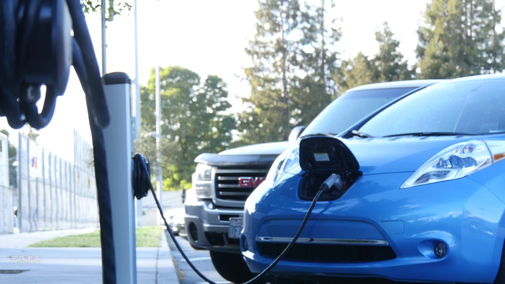

**逐字稿片段：** 那盤點一下它們營收的主要來源 會是哪幾個業務 它們營收的來源主要是有 3 大部分 第一個就是國內資源回收制度 取得的廢電池回收處理補貼費 這個就是責任業者繳納的 回收清除處理費 然後看你的回收數量是多少 會給合格的處理業者 第二個是再生材料的銷售收入 就是因為你廢電池經過處理以後 你會產生什麼黑粉 銅 鐵 鋁 鋅 這些再生材料 你就可以按照材料的品質 和市場的行情去銷售 第三個就是說像事業單位 或者是品牌客戶 就比如說剛剛講到這些汽車業者 去收取廢電池的處理服務費 包括大型電池 特殊規格電池 還有一些其他需要專業安全處理的廢電池 大概從這三塊來

**話題推測：** 分析3大未來營收的三大主要來源

---

## 00:10:40

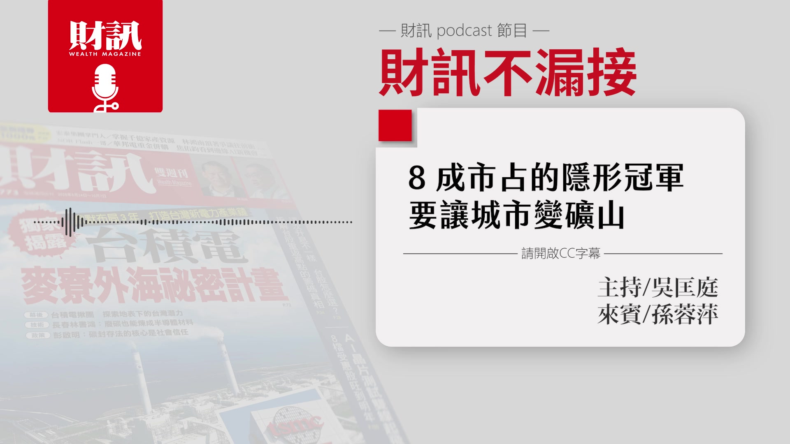

**逐字稿片段：** 那它們去年的營收表現大概怎麼樣 去年的營收是 2.22 億元 比前一年度是明顯的成長

**話題推測：** 公布3大未來去年的營收表現：2.22億元

---

## 00:10:48

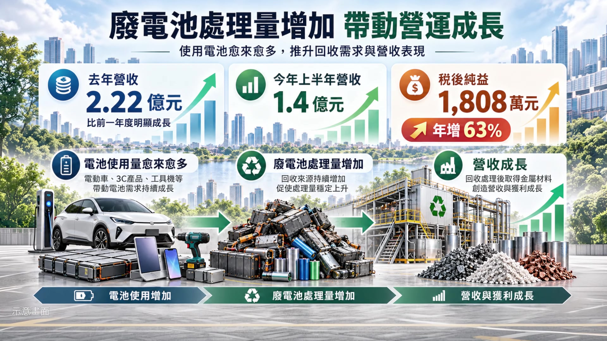

**逐字稿片段：** 那今年上半年營收是 1.4 億元 稅後純益是 1808 萬元 年增了 63% 就是因為它們廢電池的處理量增加 因為畢竟使用電池愈來愈多 然後再加上說它們在屏東縣佳冬鄉 有一個新廠的產能已經逐漸發揮了 產出的效益都已經改善了 尤其是上半年它們電動車的 電池處理量已經比去年同期 增加了將近 8 倍 就是量已經整個放大了 一家公司的基本面 它的財報會是過去的業績表現 但我們也要看未來 那看未來的話 大家可能就會有一點疑惑就是說 台灣會有這麼多廢電池需要處理嗎 畢竟台灣的量體就是在那邊

**話題推測：** 公布3大未來今年上半年的營收與稅後純益：1.4億元，1808萬元

---

## 00:11:29

**逐字稿片段：** 台灣二次鋰電池的回收量 2021 年的時候是 630 公噸 可是 2025 年的時候 已經到達了 2000 公噸 然後再加上說早期投入市場的 那些電動機車或者是電動車 還有一些儲能設備 其實陸續都要進入汰換期 我們認為說廢電池的數量會加速增加 公司估計未來每年可能會 增加 1000 公噸以上

**話題推測：** 分析台灣二次鋰電池回收量的成長趨勢（2021年630公噸，2025年2000公噸）

---

## 00:11:51

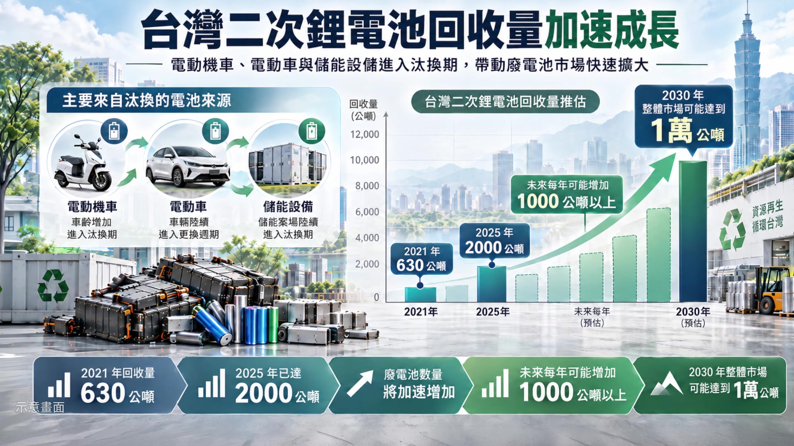

**逐字稿片段：** 所以到了 2030 年的時候 整體市場甚至可能達到 1 萬公噸 我們都會擔心你的料源 有沒有那麼多回收的電池 但這個董事長說 其實我不那麼擔心料源 就像我們剛剛講電池愈來愈多 但是他比較擔心的是能不能更有效 然後更安全的提高稼動率

**話題推測：** 預估到2030年整體市場可能達到1萬公噸

---

## 00:12:09

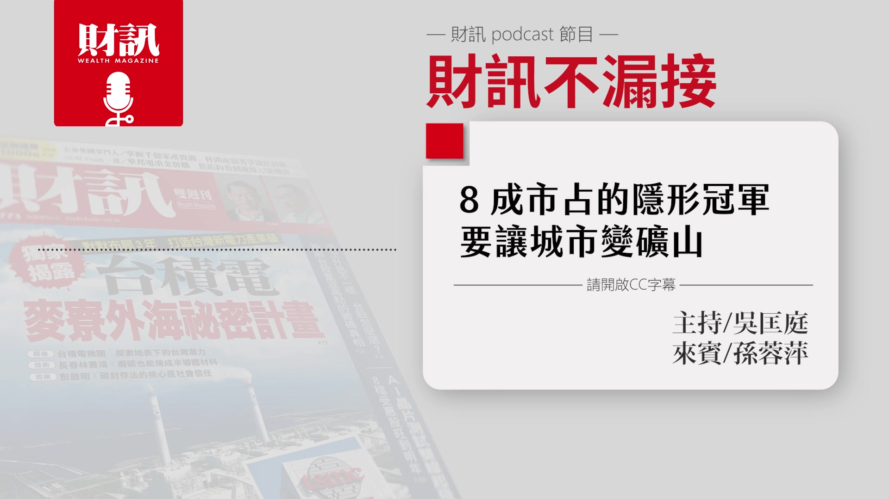

**逐字稿片段：** 那它們認為它們未來面臨的挑戰是什麼 以及要如何克服呢 我們剛剛提到循環經濟 我們只是回收的話 那還沒有到循環 就算是我把這些黑粉 這些鐵 鋁 這些回收過來 但是如果沒有辦法讓它 回到原來的製程的話 其實它都不算是一個循環 它可能就降階了 所以林沛毅董事長其實希望說 這些東西最後能夠回到原來的製程 但是回到原來的製程 你就必須把你這些再生材料 提高它的純度 還要取得原廠的認證 才能重新回到電池 或者是電子產品的供應鏈 所以這個是它們正在努力的事情 它們其實有跟外面的業者要合作 大家各自有專業 未來要跟這些業者合作 希望能夠真正回到循環 回到原來的產業鏈 這是他未來最希望做到的事情

**話題推測：** 探討3大未來在提高稼動率和實現循環經濟方面的挑戰

---

## 00:13:00

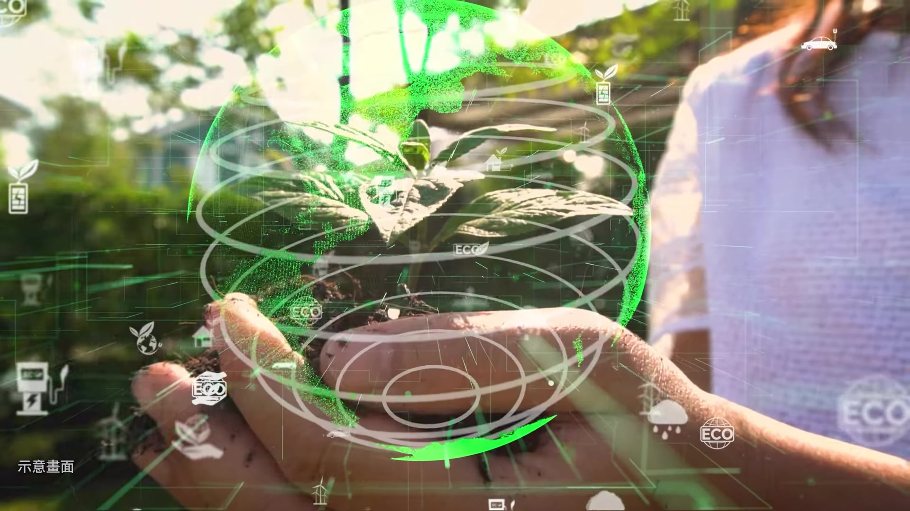

**逐字稿片段：** 我好奇問一下政府在這邊 有扮演什麼樣推進的角色嗎 台灣有一個「台灣綠色成長基金」 這個基金其實是環境部推動的

**話題推測：** 討論政府在推動循環經濟中的角色，特別是「台灣綠色成長基金」

---

## 00:13:10

**逐字稿片段：** 然後國發基金其實有匡列了 100 億元 採取這個民間投資人領投 然後國發基金搭配投資的模式 就是要鎖定這些淨零轉型 和綠色成長的潛力企業 那 3 大未來就是有得到 台灣綠色成長基金的投資 是它們投資的第一家企業 所以這個滿有指標性的 但是接受投資 所以它們也受到非常嚴格的監管 比如說它們的工廠其實是 24 小時的監控 就是你要真的保證說 你這些是有安全的在運作 當然你拿到政府的錢 所以你也要付出更多的努力 這樣才能讓我們投資人放心 確實國際上共識的目標 就是要朝潔淨能源 然後循環經濟這個方向去走 台灣其實也有滿多的隱形冠軍 那蓉萍最後有沒有什麼想要補充的呢 我佩服這個董事長很早就看到這個願景 很早就發現了這個商機 但是你看到了 你還是要有足夠的實力 去做到這件事情 不然 我知道那邊有錢 可是我沒有那個辦法去拿到那些錢 那也是沒有辦法 所以我必須要不斷的累積自己的實力 我覺得這個滿重要的 那再加上說 好 我現在有 83% 的市占率 我也不能以此為滿足 我還要真的做到循環經濟 我要怎麼再去精進自己的實力 讓它更上一層樓 真的做到循環經濟這一塊 未來我們拭目以待 好 感謝蓉萍的分享 聽完今天的節目 你家裡的廢電池 舊的行動電源 都是怎麼樣處理的呢 歡迎大家留言分享你們的想法

**話題推測：** 提及國發基金匡列100億元投資淨零轉型企業

---
