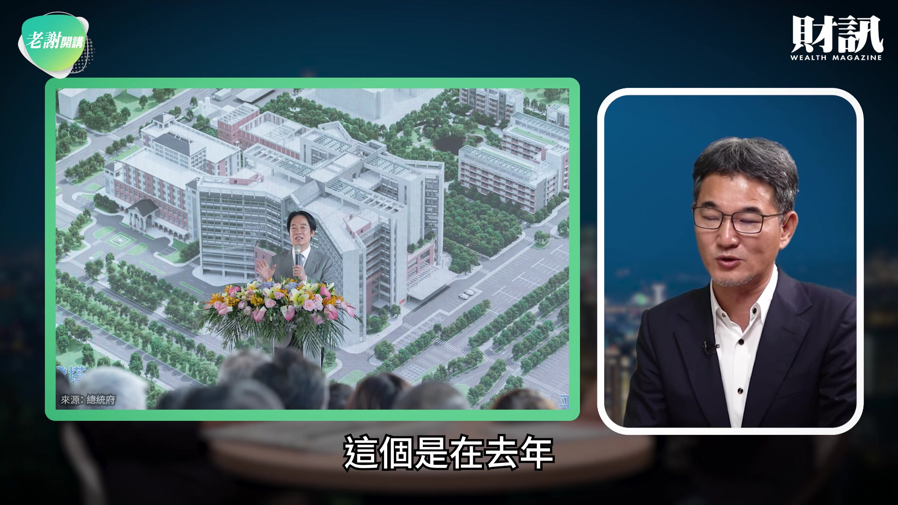
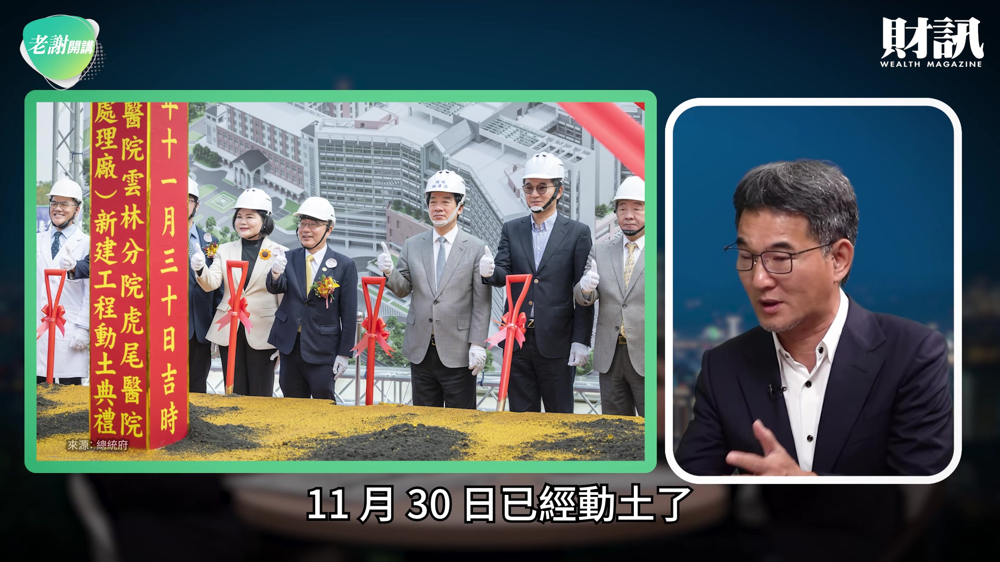
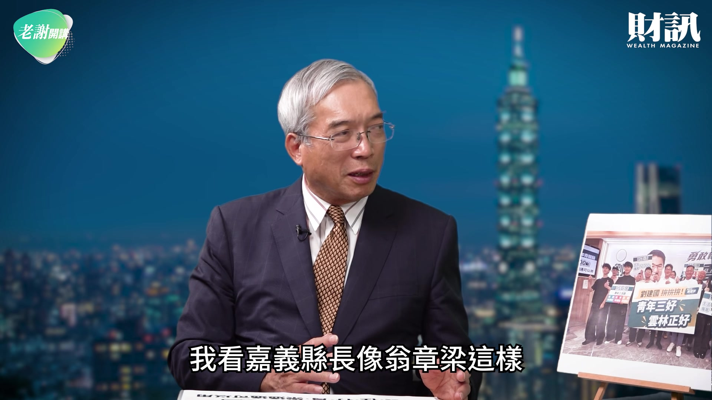
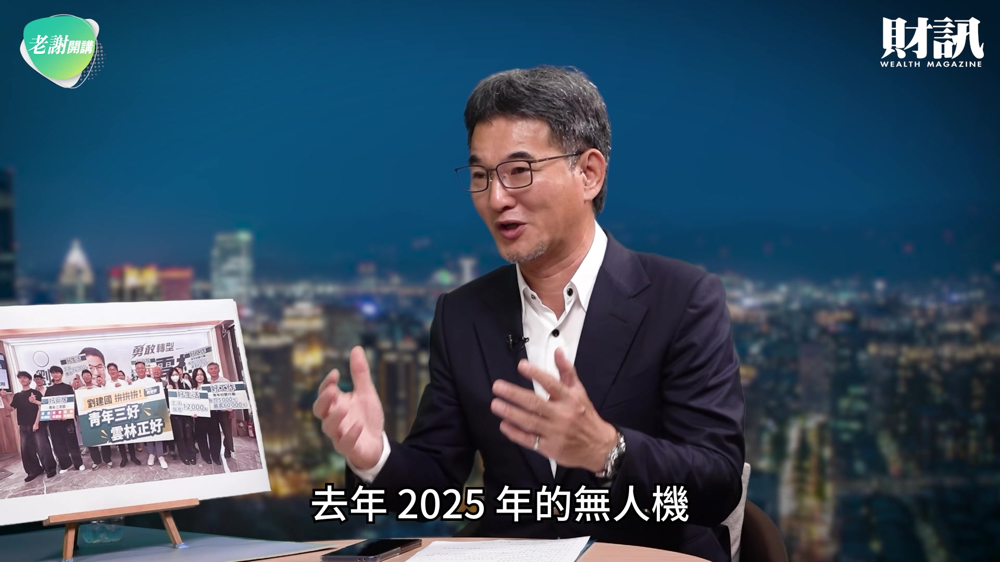
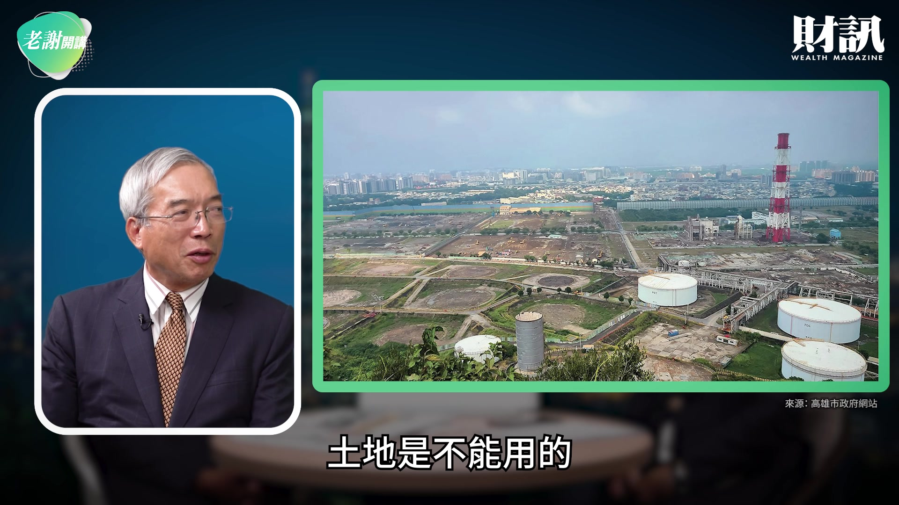

# wealth1974_ixv2vFp9MNs — 關鍵畫面索引

- 來源逐字稿：[wealth1974_ixv2vFp9MNs_GT.srt](wealth1974_ixv2vFp9MNs_GT.srt)
- 影片：https://www.youtube.com/watch?v=ixv2vFp9MNs
- 截圖數：31

## 00:00:33

**逐字稿片段：** 青年三好 雲林正好 那麼有好的工作 好的安居 大家可以看到 他已經開始端出牛肉了 今天有這個機會 來讓劉建國委員 跟大家來分享 他的未來經營雲林的策略 劉委員好 社長 各位好朋友 大家好 好 我想這個 在你參選的過程當中

**話題推測：** 介紹競選主軸「青年三好 雲林正好」，可能顯示標語圖卡

---

## 00:00:56

**逐字稿片段：** 我們看到賴總統 親自擔任你的 競選總部的主任委員 我想這個意義 當然是不同凡響 所以 今天有這個機會 讓劉委員來跟大家分享一下

**話題推測：** 提到賴總統擔任競選總部主委，可能搭配新聞畫面或合照

---

## 00:01:06

**逐字稿片段：** 你的競選藍圖當中 準備怎麼樣的一個來 翻轉雲林 好 謝謝社長給我這個機會 我想雲林在台灣的整體的 重要的位置裡面 大家可能會比較有印象的

**話題推測：** 說明競選藍圖，可能顯示總覽投影片

---

## 00:01:33

**逐字稿片段：** 一天可以提供全國 將近四分之一的蔬果

**話題推測：** 指出雲林蔬果供應量佔全國四分之一，可能顯示數據圖表

---

## 00:01:37

**逐字稿片段：** 養豬也是全國最大宗 相關的畜牧都是數一數二 包含也有這個牛奶這個 酪農區 然後現在國產的豆奶 也是都源自於 來自雲林 然後還有濁水溪 最好吃的西瓜 也在社長的故鄉 等等等 那我想今天在一個 米香 然後 所有的物產豐富的一個縣市 我們希望有更好的一個 發揮的餘地 甚至於我們也連結到 相關的這樣的一個 科技的產業 就像現在的 智慧農業道理一樣 所以我過去一直主張 屏東有農業生技產業園區 那屏東的農業產值 又沒有高過於這個雲林 那雲林為什麼 20 多年來 沒有所謂的 農業生技產業園區 所以我就一直在主張

**話題推測：** 說明雲林養豬量全國最大宗，可能顯示相關統計圖

---

## 00:02:20

**逐字稿片段：** 希望雲林可以打造一個雙技 就是科技跟生技的 農業產業園區 現在已經是 AI 時代 當然就是 AI 所謂的雙技的農業產業園區 是我一直想要 努力打拚的一個目標 希望從農民的產值 然後轉換 可能可以提升到 它有更高的價值 所以農民不只要豐收 他是更應該豐利 好 這是一個基礎

**話題推測：** 提出打造「雙技農業產業園區」的願景，可能顯示概念圖或規劃圖

---

## 00:02:43

**逐字稿片段：** 其二 雲林的醫療的品質 基本上在過去 我開始當立委的時候 我就覺得有很多不足 也有很多遺憾的地方 這個是在去年

**話題推測：** 轉向第二個主要議題：雲林醫療品質現況與改善

---

## 00:02:55

**逐字稿片段：** 台大虎尾院區 二期動土的時候 賴總統特別講了一段話 他曾經當過成大 總院的住院醫師 他說在那個時候 他的印象裡面 很多雲林人 急重症都送到成大 當然很多就是到院前就 OHCA（到院前心肺功能停止） 那救了起來 就是在加護病房 坦白講 病患很痛苦 但是照顧的家屬也很辛苦 南北奔波 有交通問題 安全問題 所以健保費（口誤） 雲林人沒有繳輸台南 沒有繳輸台中 對不對 那怎麼我們沒有辦法 享受到更好的 這樣的一個 醫療品質 所以我們很清楚 在醫療的緊急救治裡面 有一個叫黃金治療時間

**話題推測：** 提及台大虎尾院區二期動土，可能顯示動土儀式照片或新聞畫面

---

## 00:03:37

**逐字稿片段：** 一般講就 30 分鐘 雲林到台南一定超過 30 分 雲林到台中的榮總 這兩個都叫醫學中心 也都超過 30 分 那雲林為什麼到現在 沒有一個醫學中心 所以我就朝向這個目標 去做努力打拚 好 總算皇天不負苦心人 最終在小英主政的時候 願意接受我們這樣的建議 讓台大虎尾的院區 二期可以擴建 它現在擴建已經在去年 11 月 30 日已經動土了

**話題推測：** 引用醫療急救「黃金治療時間 30 分鐘」的數字，可能顯示醫療相關資訊圖

---

## 00:04:05

**逐字稿片段：** 未來會再增加 531 床 再加上斗六的台大分院 兩個加起來有 1500 床 我們就可以朝向醫學中心 讓雲林人急重症 不用在他鄉外里 也可以縮短黃金治療時間 除此之外在旁邊

**話題推測：** 提及台大虎尾院區二期將增加 531 床，可能顯示擴建後的病床數變化圖

---

## 00:04:20

**逐字稿片段：** 我們也爭取到 國家高齡醫學暨 健康福祉研究中心 它是全國唯一 我們是仿照像日本 美國 德國 但是隸屬的機關 隸屬的層級不太一樣 我們是把它放在 國家衛生研究院 底下的一個中心 但是它是一個國家級的機構 這也是雲林縣有史以來 第一個有國家級的研究機構 坐落在我們雲林縣 這兩個中心

**話題推測：** 介紹爭取到的「國家高齡醫學暨健康福祉研究中心」，可能顯示機構名稱或示意圖

---

## 00:04:46

**逐字稿片段：** 這一個已經 5 月 1 號 開始正式營運 那也是賴總統 正式主持的 那我在那邊當下 也特別感謝蔡前總統 也特別感謝賴總統 所以我的目標很清楚 這個中心坐落在這地方 對雲林的長輩 所有的研究員 他都必須要去 對接我們所有的長壽俱樂部 我們俗稱的老人會 然後有健康的促進 然後有體適能檢測 然後把相關可以事先的 預先的醫療醫學 可以去導入到 我們所有的社區 然後它未來也會成為一個 誠如賴總統最後的一個說法 就是它是成為國家 照護高齡者的一個 政策的研究中心 好 這兩個中心放在 我們雲林之後 它一定會有共伴效應 我是特別商請 我們當時（109 年 12 月 5 日）的院長蘇貞昌 到了台大虎尾院區的 7 樓 正式做宣布的 照理說那個時候我一直期待 只要在附近裡面 趕快去盤整相關的這些土地 然後打造一個醫療 照護產業園區 我想會跟這兩個中心 不只有共伴效應 而且有加成的效應 然後也會有更多的廠家 願意進駐到這個地方來 我想醫療跟照護的產業園區 基本上就是所謂的 中藥西藥這些製藥 也有健康食品 當然也有像現在更先進的 醫療機器人 還是長照機器人 相關的醫療器材的產業 都會在這個地方孕育而生 因為產官學的連結 我想這是最自然的 很可惜 從 109 年（口誤）核定完到現在 我們並沒有盤整出 建置一個合法合規的 一個新的產業園區出來 所以雲林的腳步 也因為這樣子在原地踏步 就我個人認為 所以大家現在對你 如何來翻轉雲林 我想寄與厚望 從這些的做法 未來我們有什麼樣的一個 翻轉的策略 我當然希望用最快的速度 把醫療照護產業園區 趕快把它可以建置完整 甚至有更多的 雲林的年輕學子 可以畢業即就可以就業 其他外縣市的優秀人才 涉略到相關產業面向的 這些人才都會來到這個地方 我看嘉義縣長像翁章梁這樣

**話題推測：** 提到國家高齡醫學中心 5 月 1 號正式營運，可能顯示啟用典禮照片

---

## 00:07:01

**逐字稿片段：** 我覺得在這 8 年裡面 我看中央很多政策 他是主動去爭取 比如說像無人機的亞創中心 它幾乎是原來 好像要落腳雲林 結果被他搶走了 然後你現在看到 科學園區裡面 現在連嘉義也有科學園區 它本來叫農業大縣 現在叫農工大縣 再來農工科技大縣 它一直在轉 那我想對雲林來講 我老家在西螺 其實我也從雲林出來 所以也希望說 像過年過節回南部 去陪媽媽的時候 我就想說 騎個腳踏車 我就發現人愈來愈少了 所以這種 這個農村凋零的景況 其實 這個看起來 讓人有點惶恐 那我想在這個上頭 你也盡了很大努力 將來應該怎麼做會比較好 謝謝社長提醒 那我要特別報告說 我們看到嘉義縣的進步 4 年前翁縣長來 跟我輔選的時候 特別提到 就是誠如你所講的 嘉義農工大縣即將實現 它現在不只是農工大縣 已經實現 又加入科技 甚至於它已經 導向整體規畫 消費經濟的這樣動線 跟這樣的一個範圍 他都已經逐步在建置完成 我們看嘉義縣的部分 當然某種程度 我們真的是很羨慕 所以我才特別提到說 雲林腳步在原地踏步 其實就是退步 剛剛社長特別提到了無人機

**話題推測：** 將雲林發展與嘉義縣長翁章梁的政績進行比較，可能顯示兩縣市地圖或數據對比

---

## 00:08:20

**逐字稿片段：** 我實在是很難過了 差不多 3 年前 虎科大張校長 他特別來跟我拜託說 虎科要 向教育部爭取一個計畫 叫無人機基地計畫 我就把當時的教育部的次長 帶到虎科的高鐵的校區 我一進去看到 它在那個一個類似好像 空軍基地的倉庫裡面 然後就擺設了各式各樣 有國防用的 一代 二代 三代無人機 有農用的無人機 過去我們都用大疆 現在不可能 對不對 我們台灣有自己 這樣的一個能力 甚至於它承載農藥的量體 容量是從幾公升 變成 1 加侖 2 加侖 再來就是表演用的 再來就是所謂的救災型用的 那我看到 這虎科有這樣一個量能 坦白講我的腦筋裡面 就很清楚在思考說 如果今天有這些 人才留在我們自己故鄉 然後我們有一個 無人機新創產業園區 坦白講 去年 2025 年的無人機

**話題推測：** 重新聚焦無人機產業發展，可能顯示各式無人機圖片

---

## 00:09:20

**逐字稿片段：** 整體的一個產值是 129 億 它雖然不是很多 嘉義縣就已經占了一半 今年的第一季 早就已經超過 2025 全年的 這樣的一個產值 所以它是一個趨勢產業 大家都很清楚 嘉義縣有亞創一館 亞洲無人機創新研究中心的一館 這個一館全國 40-50 家的廠家進駐在這個地方 打造國家隊 那當時的雲林怎麼沒有去 有這些人才怎麼沒有去爭取 好這個亞創一館

**話題推測：** 引用 2025 年無人機產值 129 億的數據，可能顯示產業產值圖表

---

## 00:09:48

**逐字稿片段：** 我在 8 月 5 日拜訪 翁縣長的時候 其實翁縣長 他真的做得很積極 也做得很不錯 但是他也滿謙虛的 他說這一個一館的 整體的維護營運管理 坦白講要感謝虎尾科技大學 虎尾科技大學的人才 是一條龍 從研發 設計 製造 檢測 認證 是一條龍 包含旁邊都還有在做 相關的一些訓練 那虎科的人才 每天跑到嘉義的一館 去做這樣的管理 維護管理 我心裡就想說 他們怎麼沒有辦法留在 自己的故鄉 現在你講到青年

**話題推測：** 提到拜訪翁縣長的特定日期，可能搭配會面照片

---

## 00:10:23

**逐字稿片段：** 就是說你這一次青年三好 我想從好的安居 到好的工作 這個三好當中 其實包括好生活 是 如果這三個都能夠落實 我想最少雲林的人口外流 或人口的減少 這個趨勢可以煞車 所以你這次的想法 我覺得非常好 你可以跟大家分享一下

**話題推測：** 再次強調「青年三好」政見，可能顯示政見總覽投影片

---

## 00:10:45

**逐字稿片段：** 好 簡單講就是要好居住 在雲林縣來講 中央對租屋已經有補貼 那雲林縣政府一樣加碼 讓你如果租屋的時候 你還是可以減輕 外縣市在雲林工作可以加碼 外縣市還有本地的 我們自己雲林的子弟回來 我們都願意來予以協助 就是政府可以多做一點點 他們就可以負擔少一點點 這是其一嘛 如果他跟他的爸爸媽媽 還是直接住在一塊 本身現在還有在繳房貸的 那我們也補貼他這些利息 讓他可以減輕一些這些負擔 另外一個就是首次購屋 但是我們會去設定 因為不能豪宅也在補助對不對 雲林的子弟還是願意回來的子弟 你首次購屋 那我們就是連續 3 年 可以去採購 綠能相關標章的這些家電 也減輕你一些負擔 這是其一

**話題推測：** 說明「好居住」政策細節，可能顯示租屋補貼或房貸優惠方案圖表

---

## 00:11:38

**逐字稿片段：** 其二就是一定要好工作 好工作我剛剛特別就提到了 講到無人機這一塊 我再做一個簡單的補充就是說 雲林如果早在規畫 小小的一個產業園區 坦白講 無人機相關的生態系的 這些零組件 propeller 機身 電池等等 一個小小的工業區

**話題推測：** 說明「好工作」政策細節，可能顯示就業機會相關圖表

---

## 00:11:58

**逐字稿片段：** 50 家廠家進來 一家聘 50 個人 這都很小的規模 那就有 2500 個就業的人口 就業的機會 而且它是一個趨勢產業 我想這個要做起來並不困難 現在雲林還有一個 王牌還沒打的就是 台積電 現在全台灣都去了 雲林其實還有很多地 可以盤點 我覺得如果你能當縣長 如果能夠把台積電請來 我想這個就是一張好牌 對 所以我就在趕速度 所以我才特別跟社長報告說 如果我有機會 我的速度一定要非常的加快 不然就誠如各位都很清楚

**話題推測：** 計算無人機產業園區可創造 2500 個就業機會，可能顯示數字推估圖

---

## 00:12:37

**逐字稿片段：** 113 年台積電到嘉科的時候 你看 3 月確定 5 月動土 當年度 5 月遇到這個（文化）遺址 它不曉得要停工多久 好 它趕快 7 月跑到群創

**話題推測：** 提到 113 年台積電進駐嘉科的事件，可能顯示新聞報導截圖或時間軸

---

## 00:12:48

**逐字稿片段：** 去買南科舊廠 花了 170 幾億 這是 113 年 那個時候我們就在想說 你怎麼沒有來到雲林 因為雲林沒有準備好 雲林到現在沒有 一個完整好的 新的一個科技產業園區 好 現在事隔 2 年過後了

**話題推測：** 提及台積電花 170 多億購買南科舊廠，可能顯示新聞畫面或金額數據

---

## 00:13:05

**逐字稿片段：** 115 年 台積電又跑到屏科去動土 怎麼又沒有到雲林 這個就讓我們會很難過 為什麼雲林縣 一直沒有準備好 即便台積電現在 講說我明天就到雲林縣來 我們還是一樣承接不起來 因為我們沒有 一塊合規合法的 像屏東 像嘉義 屏科 嘉科的這樣的一個產業園區

**話題推測：** 指出 115 年台積電在屏科動土，可能顯示新聞畫面或時間軸

---

## 00:13:25

**逐字稿片段：** 你如果從陳其邁市長 那個當年高雄煉油廠 他提供煉油廠要給台積電 蓋成熟製程的半導體 那個時候一看 那個土地 因為長期中油煉油廠 土地是不能用的

**話題推測：** 舉例高雄市長陳其邁快速處理煉油廠土地供台積電設廠，可能顯示高雄煉油廠舊照或地圖

---

## 00:13:37

**逐字稿片段：** 他說評估洗地要花 100 年 但是他說他可以在 3 年之內 這個把地洗乾淨 然後交給台積電 他只花了 2 年多 馬上讓台積電開始 在高雄大興土木 而且到現在看起來 6 個廠 那個都是在很短時間 所完成的績效 所以我想這個就是 雲林將來有空間的 真正最大的憑藉 對 這個就是陳市長 他的一個治理的能力 他的魄力跟執行力 這次市議會的總質詢裡面 他也特別提到說 他當時也沒有把 爭取台積電 列為他的政見 但是一個趨勢產業來的時候 他就是要快速的 去把它承接起來 所以相關的技術作為 就是應變的很快 那雲林就是不夠快 所以到現在沒有準備好 你看隔了 2 年之後 台積電跑到屏科 怎麼沒有跑到雲林來 的道理一樣

**話題推測：** 比較土地清洗所需的百年時間與實際三年完成的效率，可能顯示效率對比圖

---

## 00:14:26

**逐字稿片段：** 現在嘉科的二期 在上個月也動土了

**話題推測：** 提及嘉科二期動土，可能顯示動土儀式照片

---

## 00:14:28

**逐字稿片段：** 然後民雄的航太產業園區 我聽說是 這個月的月底（2026.9.28）要動土 而且是賴總統要去主持 所以嘉義在處理這些事情的 魄力跟執行力 真的是讓人家非常敬佩的 雲林就必須要迎頭趕上 雲林再不趕上 以前叫雲嘉嘉 再不趕上就變成嘉嘉雲了 我不想這個事情發生

**話題推測：** 提到民雄航太產業園區即將動土，可能顯示園區概念圖或新聞畫面

---

## 00:14:48

**逐字稿片段：** 所以最後要好生活 對 好生活就是我們是很期待 從雲林縣的各個產業 因為我們不能只有承接 趨勢產業 科技產業 我們還有相關的傳產業 包括餐飲業 我們都要兼顧 所以我們希望 只要你願意回來 只要你持續居住在雲林縣

**話題推測：** 說明「好生活」政策細節，可能顯示政策總覽投影片

---

## 00:15:04

**逐字稿片段：** 我們都希望從 18 歲到 39 歲 給你所有的年輕的夥伴 一個月有 1000 點 然後就是這個地方政府 跟這些廠家有特約的優質的 從食衣住行育樂 你要看電影 你要購買書籍 你要在求知 求進步的情況之下 1 個月給你 1000 點 那 1 年就是 12000 點 所以就是雲林輕鬆點 給你 12000 點 我希望我們有別於其他縣市在 鼓勵年輕夥伴的 這樣的一個處理的政策 我們希望透過這樣的方式 讓雲林的這些好朋友們 年輕的夥伴 都可以更加瞭解到 我們是有想法 而且這個想法 是可以做得到的 因為畢竟雲林縣政府

**話題推測：** 詳細說明青年每月 1000 點、一年 12000 點的消費點數，可能顯示點數機制說明圖

---

## 00:15:43

**逐字稿片段：** 現在的總預算 跟我在當議員的時候總預算 那個是差了 1 倍多 逾 100% 的一個成長 所以地方政府跟人民 坦白講是 最直接最密切的 當你的財源 到達某種程度 許可情況之下 應該可以做更多的事情 而且應該給 這 18 歲到 39 歲的年輕的夥伴 是一個最堅強的一個依靠 我想這個是我的一個 核心的一個理念 這一次其實 大家對你有很高的期待 所以你在誓師大會當中 其實我們可以看到

**話題推測：** 指出雲林縣政府總預算成長一倍多（逾 100%），可能顯示財政數據圖表

---

## 00:16:13

**逐字稿片段：** 那天你在西螺造勢 我有很多鄉親把你的影片 傳給我看 所以大家很希望 你能夠翻轉雲林 我想今天非常感謝 我們劉委員 能夠從雲林北上 那麼我們有這個機會 讓我們劉建國委員來分享 他未來在雲林的發展的路上 他的心中的想法 今天非常感謝我們劉委員 希望你這次出奇制勝 謝謝社長 謝謝大家 好 非常感謝 我們下週見

**話題推測：** 回顧在西螺舉辦的誓師大會造勢活動，可能顯示活動影片或照片

---
