# wealth1974_oN0Ug8PJn3k — 關鍵畫面索引

- 來源逐字稿：[wealth1974_oN0Ug8PJn3k_GT.srt](wealth1974_oN0Ug8PJn3k_GT.srt)
- 影片：https://www.youtube.com/watch?v=oN0Ug8PJn3k
- 截圖數：28

## 00:00:30

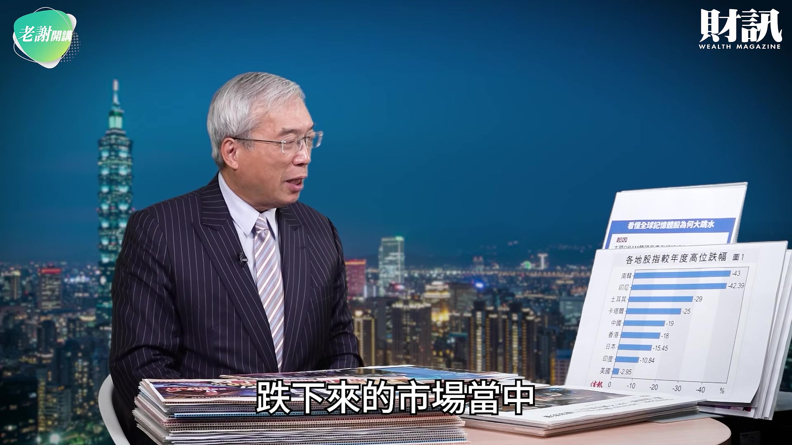

**逐字稿片段：** 南韓跌幅第一名 它跌了 43% 那麼南韓在整個 股市的調整當中 7 月分南韓受到 兩倍槓桿的影響 到了 10 月分

**話題推測：** 開始分析南韓股市跌幅，可能顯示國家股市表現排行圖表。

---

## 00:00:52

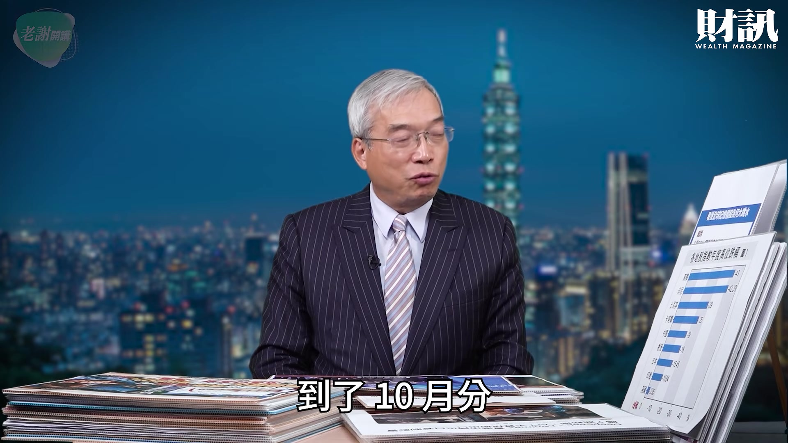

**逐字稿片段：** 長鑫存儲 它宣布了一個 用 4F 平方的新製程 那麼這個新製程 還沒有受到檢驗 但是它已經撞擊了 南韓的股市了 我們也看到

**話題推測：** 提及中國長鑫存儲及其4F平方新製程，轉換至具體公司與技術。

---

## 00:01:04

**逐字稿片段：** 印尼股市下跌 42.39% 那這最重要原因是 整個印尼在 過度的親中之後 它的傳統產業 包括財政 現在都受到很大的撞擊

**話題推測：** 切換到印尼股市的下跌數據與原因。

---

## 00:01:16

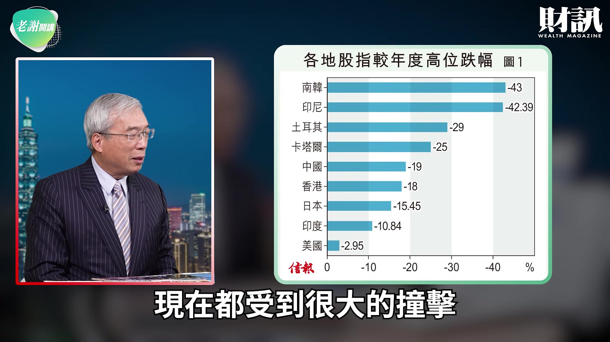

**逐字稿片段：** 土耳其 里拉的大幅的貶值之外 整個國內的經濟的蕭條 那麼現在跌幅第三 我們看到卡達是在受到 這一次伊朗的危機的影響 那麼股市今年跌了 25% 這當中我們看到 從中國到香港 到日本然後到印度 大家也可以看到 台股從 49978 點 跌到 4 萬 6 千點附近 台股大概跌了 7.8% 台股在今年的漲幅 全球居冠 但是台股的跌幅相對的輕 主要原因是台積電的 業績獲利的表現相對的良好 所以這是一個 在市場調整當中 我們所看到的面向 回來我們來談一下

**話題推測：** 切換到土耳其的經濟狀況與里拉貶值。

---

## 00:01:56

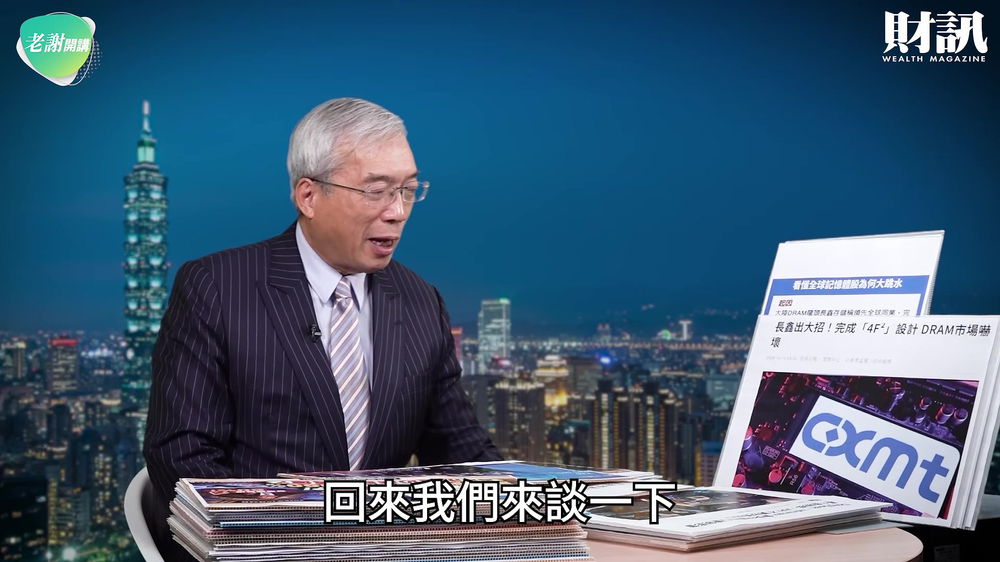

**逐字稿片段：** 這個在中國的長鑫存儲 那麼它出大招 它宣布 完成 4F 平方 那我們現在可以看到 長鑫現在 在 DDR4 DDR5 有很大的量 但是在 HBM3 現在的良率大概不到三成 所以它其實在全球影響不大 但是它在這一次 它的總裁叫曹堪宇 在上海發表了一個 半導體的最小的線寬 就是 4F 平方設計的 每一個記憶體單元裡面 占據的面積叫 4F 的平方 那麼能夠在單一晶片 放入更多的單元 提高儲存的密度 相對之下目前主流的 現在 DRAM 都用 6F 平方 包括美光 它們都是使用 6F 平方 那麼現在 長鑫宣布它用 4F 平方 密度會更高 但是能不能良率提高 現在看起來還有待市場考驗

**話題推測：** 回頭詳細討論長鑫存儲的技術與影響。

---

## 00:02:48

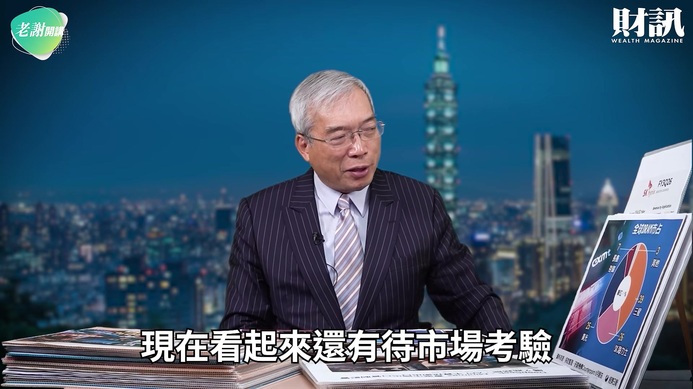

**逐字稿片段：** 我們先把整個 全球 DRAM 市場的結構看一下 現在三星市占率 39% 海力士 26% 美光 25% 然後長鑫 7% 其他類似 台灣的南亞科 華邦 占比相對的小

**話題推測：** 引導觀眾查看全球DRAM市場結構圖表。

---

## 00:03:02

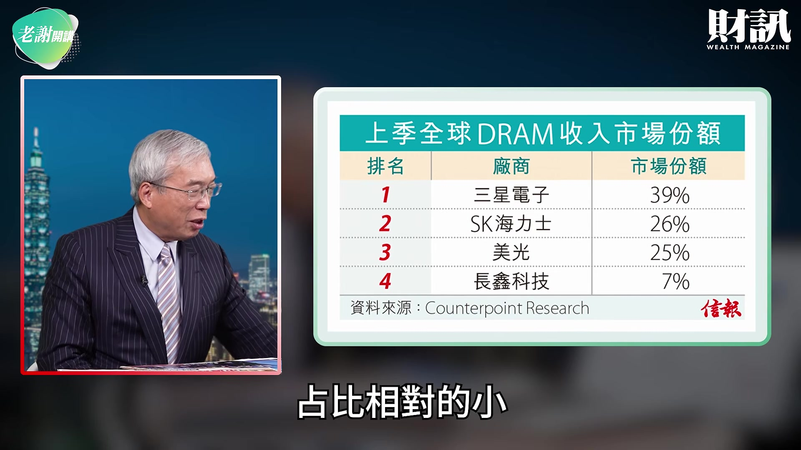

**逐字稿片段：** 我們現在看到長鑫的股價 在 A 股 它原來最高 61.8 元 但是它宣布完之後 股價變成急跌 這個急跌 跌幅很重 那麼最低跌到 39.1 元 這個跌幅 其實告訴大家 如果長鑫真正有 那麼大的威力 股價應該會大漲 但是現在好像它把 所有中國的半導體 相關的個股 全部都拖下水 我們看到長鑫大跌之外 在 SSD 的記憶體當中的

**話題推測：** 切換到長鑫存儲在A股的股價走勢。

---

## 00:03:35

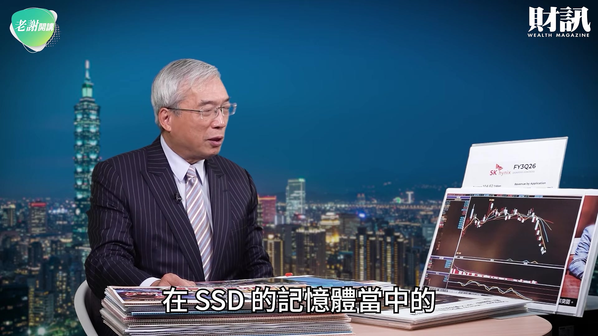

**逐字稿片段：** 兆易是從 1248 元 現在最慘跌到 396 元 所以這個跌幅是重的 我們也看到中芯在

**話題推測：** 提及中國半導體公司兆易的股價表現。

---

## 00:03:43

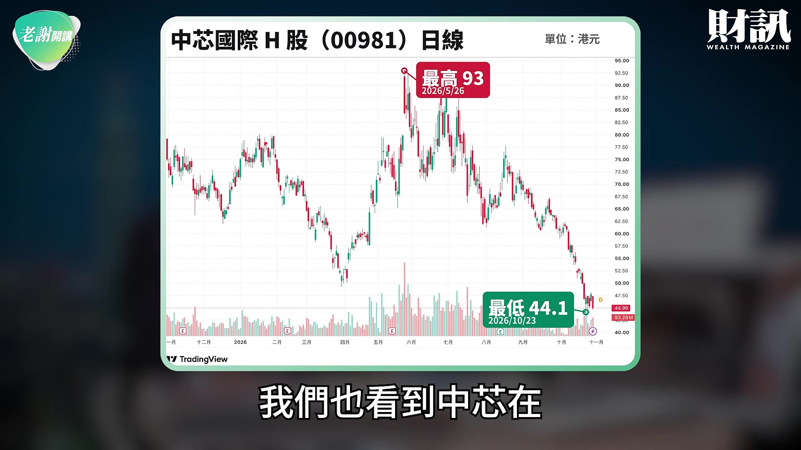

**逐字稿片段：** 香港的 H 股 從 93.6 元 那麼也跌到剩下 44.6 元 然後華虹半導體從 217.9 元 那麼現在掉到 61.7 元 這個長鑫到底會對 市場帶來多大的撞擊 我們看到它在前三季

**話題推測：** 提及中芯國際在香港H股的股價表現。

---

## 00:03:57

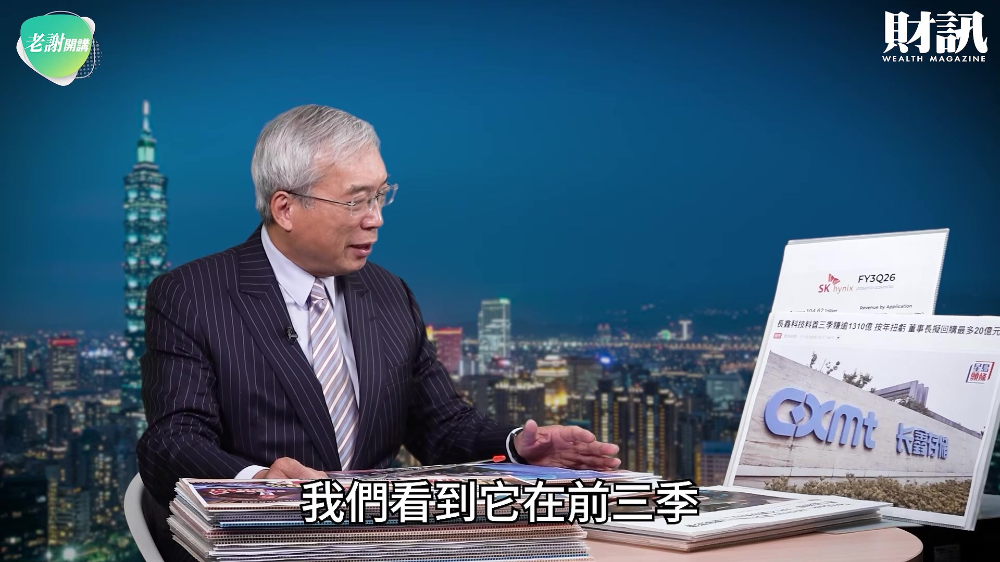

**逐字稿片段：** 賺了 1310 億人民幣 所以它轉虧為盈 但是它在市場的記憶體的 排名順位其實不大 但是在 4F 平方宣布之後

**話題推測：** 提及長鑫存儲的最新獲利數據。

---

## 00:04:09

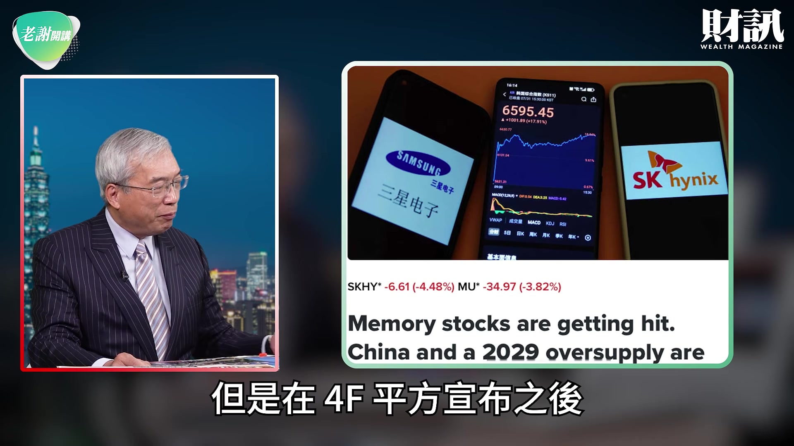

**逐字稿片段：** 海力士的股價 有兩天是跌幅超過 10% 那麼三星也大跌 海力士跌破上一波的低點 所以南韓股市承受 非常巨大的壓力 現在美光的技術長 他說他們不跟進 所以它還是維持原來 6F 平方 那麼這個是 現在他認為 4F 平方 大概不會對市場 帶來多大的撞擊 所以我們看到海力士

**話題推測：** 切換到海力士的股價表現。

---

## 00:04:31

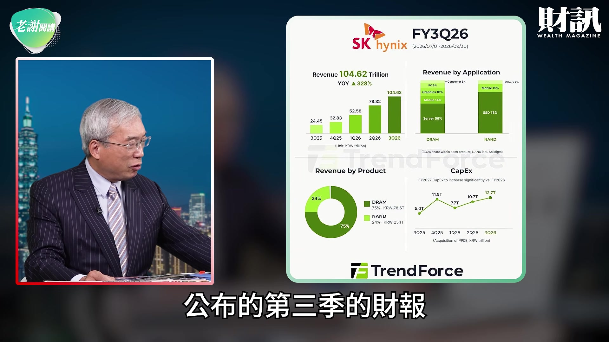

**逐字稿片段：** 公布的第三季的財報 這個第三季的財報其實 非常出色 海力士的營收 是 104.62 兆韓元 毛利率達到 86.8% 所以這個是一個 我們看到市場上 海力士用它的獲利 來洗刷市場上對它的疑慮 所以這是一個 長鑫現在所 造成的一個市場的 撞擊跟波瀾 我們也看到 中國現在它是一個市場 價格的破壞者 也就是說 如果長鑫真的能夠讓 4F 平方快速量產 在 DDR5 快速量產 然後把市場價格打趴的話 全球的記憶體產業很可能 會非常的慘烈 這當中我們現在就用

**話題推測：** 開始分析海力士第三季的財報數據。

---

## 00:05:15

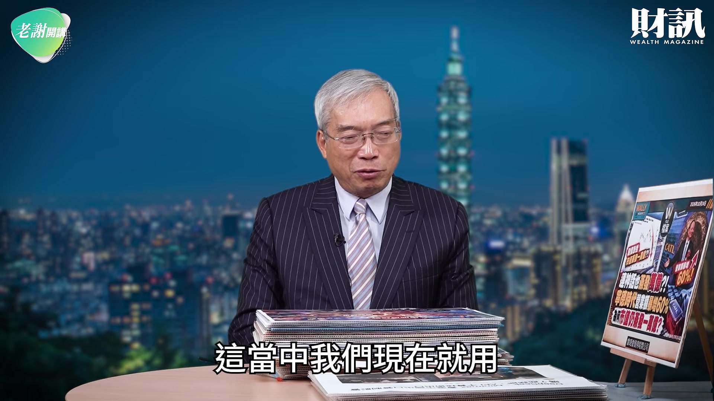

**逐字稿片段：** 電動車來做一個類比 我們看到 這個是寧德時代 股價突然之間 在今年暴跌 60% 寧德時代是中國 最具競爭力的 電動車的代表 你可以想像得到 一輛車 上海的創業板當中 寧德時代今年是從 488.79 元 那麼最近掉到 229 元 所以這個跌幅 其實非常的沉重 所以你可以看 寧德時代過去它的 整個市場對它的評價非常高 現在包括很多做電池的

**話題推測：** 主要話題從記憶體轉為電動車產業。

---

## 00:05:46

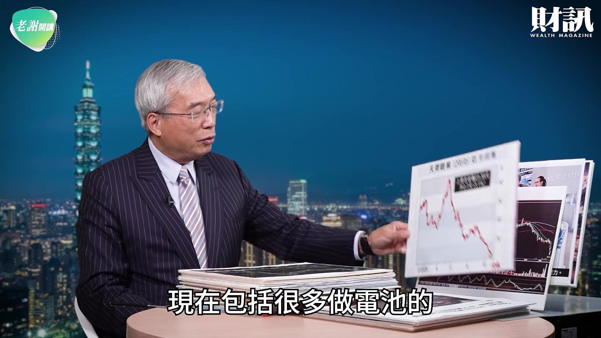

**逐字稿片段：** 你看這個是天齊鋰業 其實跌幅都非常的慘烈 那麼最大的關鍵是 現在在整個電動車產業的 殺戮當中 我們回頭看一下 在整個電動車的

**話題推測：** 提及電池相關公司天齊鋰業的跌幅。

---

## 00:05:58

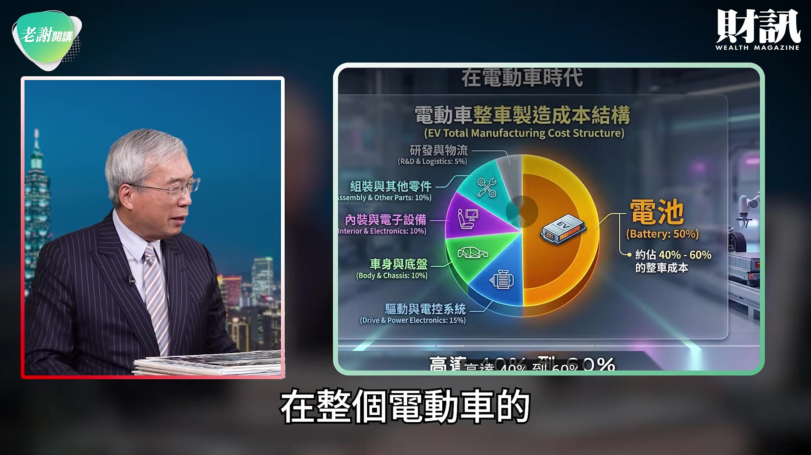

**逐字稿片段：** 製造成本結構 從組裝內裝電池 電池占的比重非常的高 那麼現在大概降到 40% 左右 所以寧德時代 在整個電動車時代 它扮演最核心 關鍵重要的角色 現在我們也看到 中國的電動車 它因為產能極大 它已經開始侵蝕到 全世界的汽車產業了 所以在這當中我們可以看到 在歐洲也好在東南亞也好 中國的電動車現在無所不在 而且價格殺戮已經讓 歐洲的車系 現在疲於招架了

**話題推測：** 引導觀眾查看電動車製造成本結構圖表。

---

## 00:06:30

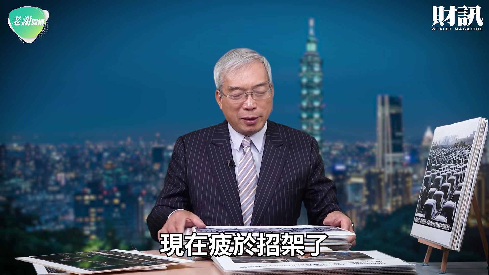

**逐字稿片段：** 你看到福斯 預計今年要裁 5 萬人 到 2030 年再裁 5 萬 我們也看到 歐盟現在最近為了 中國的混合電動車 要不要削減一半的配額 跟中國鬧得不歡而散 最大的關鍵就是歐洲的車系 現在看起來情況不太好 那麼德國過去的賓士 很重要的市場在中國 但中國現在沒有消費力

**話題推測：** 提及福斯汽車的裁員計劃。

---

## 00:06:54

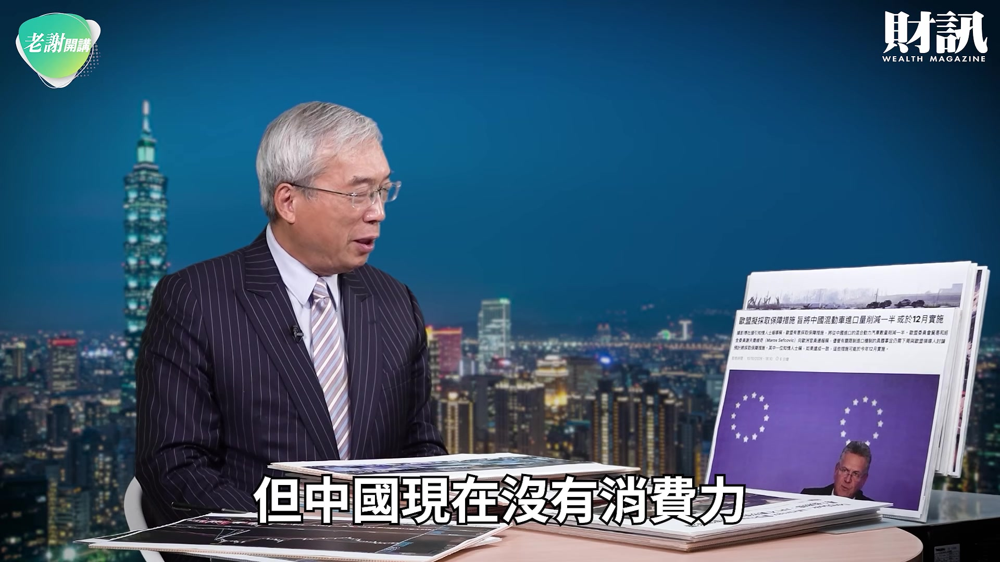

**逐字稿片段：** 包括 Volvo 它宣布今年 預計虧損 56 億克朗 那麼主要的關鍵是 在中國市場 現在非常的疲弱 這個疲弱當中 我們現在回來看一下 中國的電動車 從內捲自己到捲別人

**話題推測：** 提及Volvo的預計虧損。

---

## 00:07:08

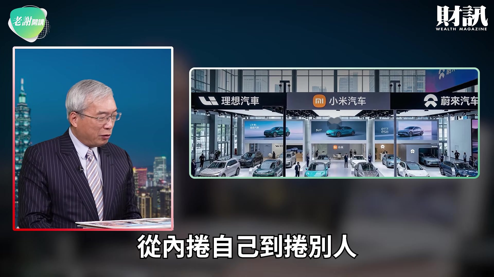

**逐字稿片段：** 所以這個比亞迪的股價 最高它的 A 股到 418.8 元 那麼這次跌到 77 元 整個中國現在 從內捲到外捲 這個對歐洲帶來非常巨大的影響 德國過去它是非常尊貴的 德國的技術領航全球 但是現在看起來中國 有更廉價的生產優勢 所以現在這整個結構來看 從股價上來講 那麼它已經對整個香港股市 帶來非常巨大的影響 你可以想像得到 香港股市其實 不斷的在下跌的一個路上 除了比亞迪股價創新低之外

**話題推測：** 開始分析比亞迪的股價走勢。

---

## 00:07:49

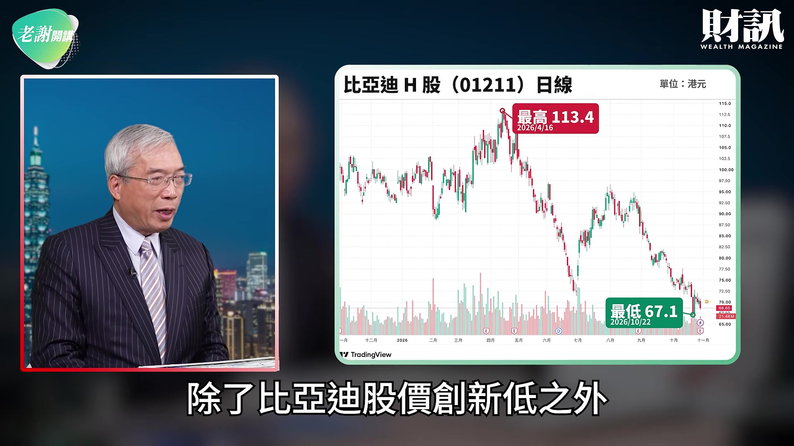

**逐字稿片段：** 我們看到蔚來的股價 從 185.5 元 一直跌到 25 元左右 小鵬 包括理想 包括零跑 也包括我們看到吉利汽車 其實在這個回合當中 都跌得很慘烈 這個下跌的主要關鍵原因是 在過去中國把電動車的補貼

**話題推測：** 提及蔚來汽車的股價。

---

## 00:08:07

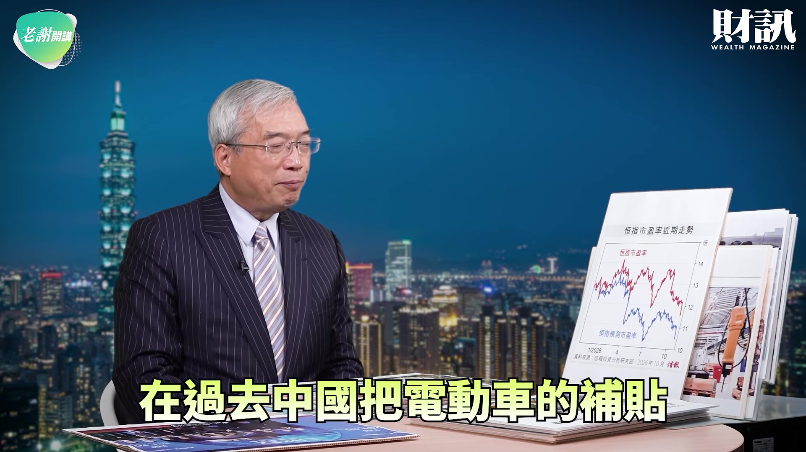

**逐字稿片段：** 現在移到 AI 相關的領域 所以現在中國電動車的產業 在失去國家補貼之後 今年的營運看起來 大家都會虧損 在 2026 年 看起來是電動車整併 非常關鍵的一年 這個一年當中我想 這個殺戮的時代 會受到非常大的擠壓 所以我們可以看到 在 AI 相關的產業 它的內捲其實也非常嚴重

**話題推測：** 主要話題從電動車轉移到AI相關領域。

---

## 00:08:30

**逐字稿片段：** 中國已經把 DeepSeek 跟 MiniMax 列為重要的國家的 戰略性產業 包括智譜 所以 美中角力的最主要戰場 其實在 AI 這一塊

**話題推測：** 提及DeepSeek、MiniMax、智譜等中國AI戰略性產業。

---

## 00:08:40

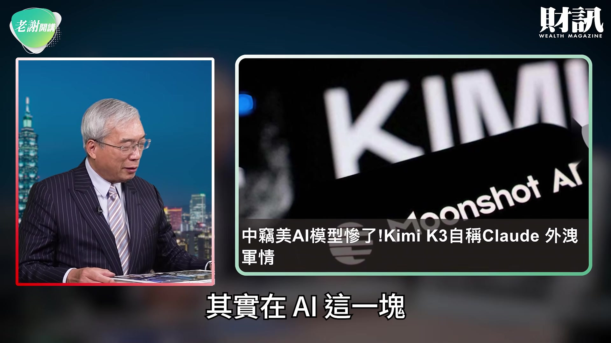

**逐字稿片段：** 我們看到智譜的股價 它最高 2980 港元 現在最低掉到 444.8 港元 所以這個跌幅是重的 所以我們現在可以想像得到 在這一段時間 包括跟 AI 晶片有關的

**話題推測：** 開始分析智譜的股價。

---

## 00:08:54

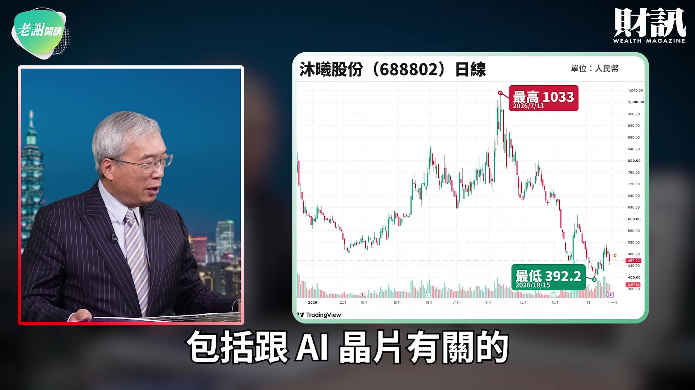

**逐字稿片段：** 這個是沐曦 從 1033 元 現在掉到 200 多元 我們也看到摩爾線程 最高是 941 元 那麼現在跌到 315 元 這個寒武紀從 1682 元 現在掉到 800 多元 這段時間 中國相關的 AI 的股票跌幅非常的重 包括宇樹 你看到

**話題推測：** 提及AI晶片公司沐曦的股價。

---

## 00:09:15

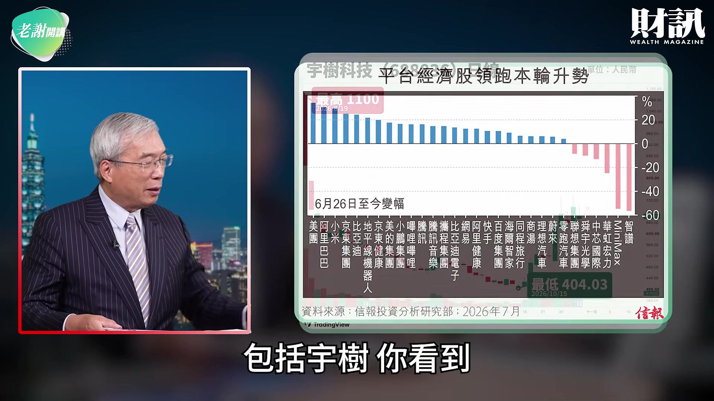

**逐字稿片段：** 宇樹以人形機器人著稱 但它股價掛牌第一天 是 1100 元人民幣 最慘掉到 404 元 現在回到 600 元左右所以 在這個回合當中其實 中國股市 香港股市 都在 調整過程當中 它非常的弱勢 這個弱勢也包括 現在發行的 ETF 散戶都嚇壞了 那麼這個 世茂 股價現在已經剩殘值 0.04 元 世茂過去在上海 它是最重要的房地產公司 所以房地產公司

**話題推測：** 提及人形機器人公司宇樹的股價。

---

## 00:09:42

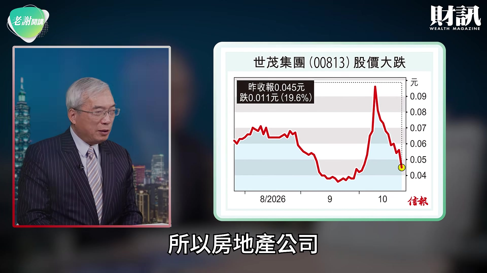

**逐字稿片段：** 包括恒大 碧桂園 包括融創中國其實 現在房地產已經泡沫化 已經無可挽回 那麼這個影響消費 所以我們可以看到

**話題推測：** 提及恒大、碧桂園、融創中國等房地產公司狀況。

---

## 00:09:52

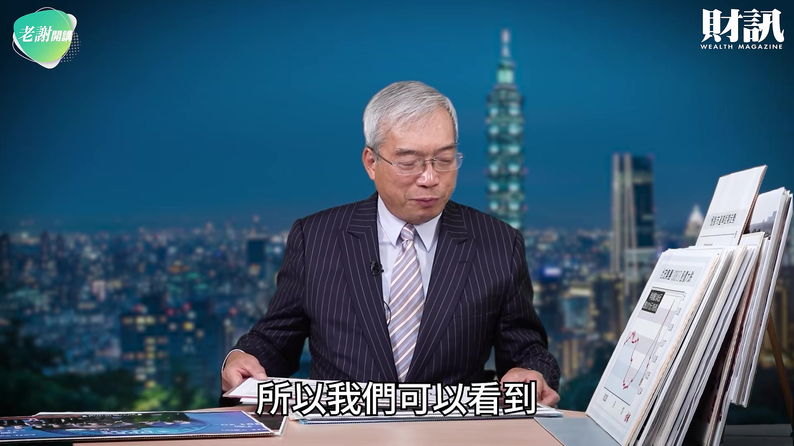

**逐字稿片段：** 中國旺旺的股價 它最高 13.1 元 最近掉到 2.675 元 在過去一段時間 股價表現非常

**話題推測：** 提及消費品公司中國旺旺的股價。

---

## 00:10:00

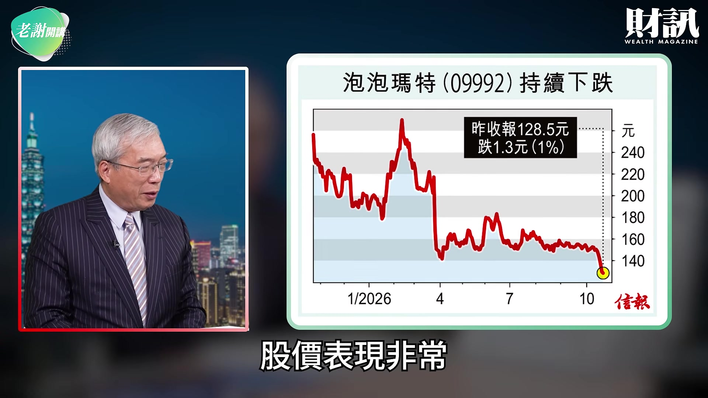

**逐字稿片段：** 優秀的泡泡瑪特 你可以看到 它最高 279.5 元 最近掉到 128.5 元 所以這個跌幅相對是重的 也包括在香港掛牌

**話題推測：** 提及泡泡瑪特的股價。

---

## 00:10:11

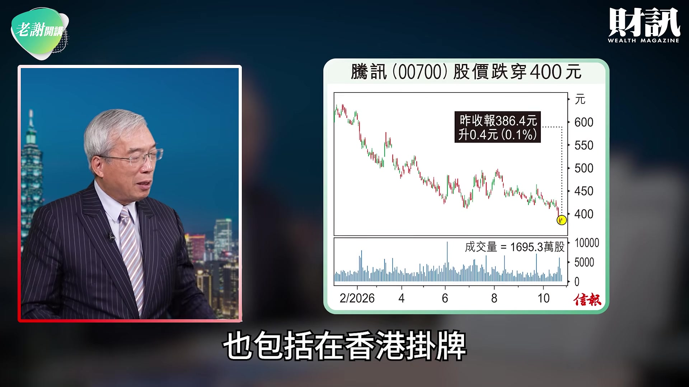

**逐字稿片段：** 最大市值的騰訊 它最高從 775.5 元 那麼現在最慘掉到 386.4 元 中興通訊 一度在美中角力當中 它是一個大家 非常看重的焦點 但現在看起來也是 股價大幅的下滑 這個是一個功率元件 瀾起科技 它的股價從高到低 它的調整也非常的巨大 好 現在我們可以看到 中國的經濟調整當中 現在國家財政 愈來愈困難 包括大家可以想像的到 很多中國人 去貸款買房子 現在的房價不斷的在下跌 這個下跌之後 現在開始有 負資產的情況出來 那負資產它更加不敢消費 不敢消費影響內需消費 理論上來講 中國經濟要走向 更開放的路線 來招商引資 讓全世界到中國來投資 但是中國現在的管制 愈來愈嚴格 所以它不但沒有招來 全球外資進入中國 反而嚇跑更多的外資 從中國離開 這個時候再加上 人民幣的升值 這個是一個相對 一個雙殺的局面 所以未來 我們在觀察中國經濟 我想中國的調整 它會不會成為一個 全世界經濟往下走的破口 這個是值得大家 高度關注的大事 中國緊閉門戶 而且動不動在國外 用這種 跨境鎮壓的方式 我想中國經濟不但不會好 會加速往下探底的 相對的風險會更大增 所以這個是今天 我想從中國股市的下跌

**話題推測：** 提及香港市值最大的騰訊股價。

---
