# wealth1974_r1dlasilZHg — 關鍵畫面索引

- 來源逐字稿：[wealth1974_r1dlasilZHg_GT.srt](wealth1974_r1dlasilZHg_GT.srt)
- 影片：https://www.youtube.com/watch?v=r1dlasilZHg
- 截圖數：43

## 00:00:14

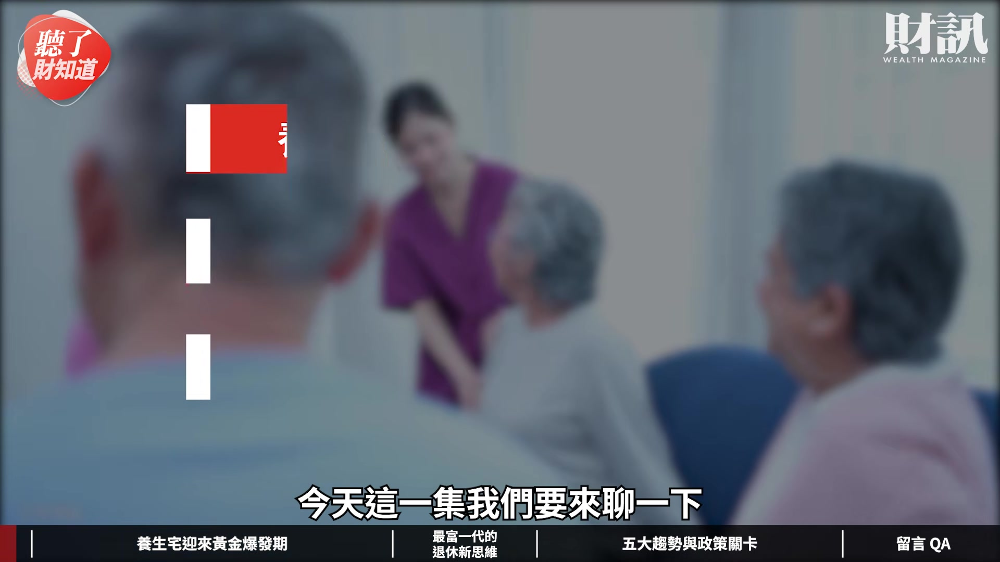

**逐字稿片段：** 養生宅迎來黃金爆發期 再來分享最富一代的

**話題推測：** 介紹本集主題：養生宅的黃金爆發期

---

## 00:00:19

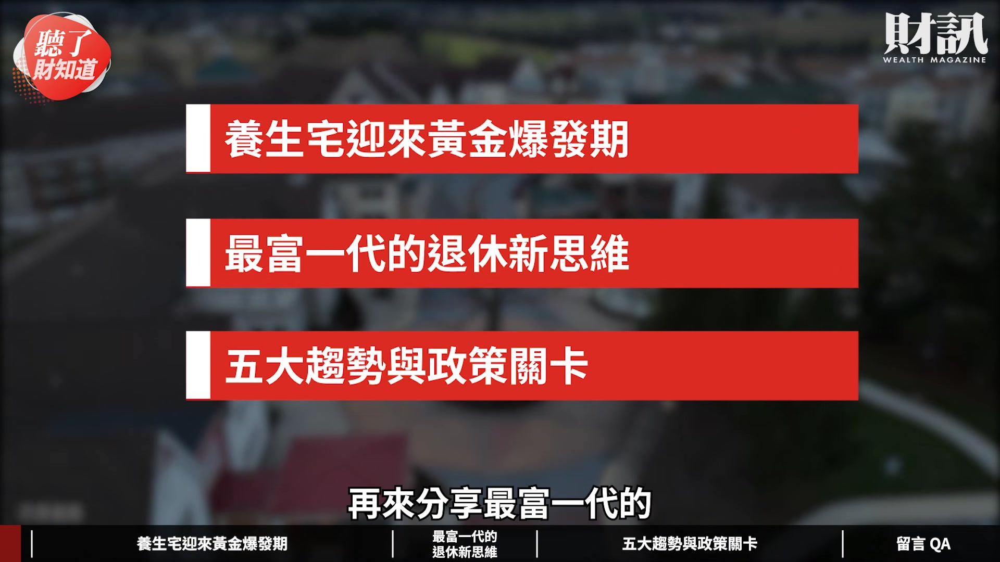

**逐字稿片段：** 退休新思維 最後談一談

**話題推測：** 介紹本集子題：最富一代的退休新思維

---

## 00:00:22

**逐字稿片段：** 五大趨勢和政策的關卡 我是主持人陳雅潔 今天我們的來賓是

**話題推測：** 介紹本集子題：五大趨勢和政策關卡

---

## 00:00:26

**逐字稿片段：** 財訊的主編游筱燕 筱燕妳好 副總好 各位觀眾朋友們大家好 我是筱燕 我和筱燕一起關注這個 養生宅 退休宅的議題好多年了 其實它每一年都有新的變化 然後都有新的業者投入 或者是說又有哪一家開始營運了 這一類的消息 但是還是有一些趨勢 就是慢慢的在形成 今年我們看到一個 比較特別的例子

**話題推測：** 介紹本集來賓：財訊主編游筱燕

---

## 00:00:51

**逐字稿片段：** 就是可以退休了還去念大學 妳幫我們講一下這個案子好了 這一個例子呢 是一個最近發現新的商業模式 然後也算是全台灣首創 就是中信金旗下的台灣人壽 它們在台南新市的中信科技大學 然後它把大學裡面的學生宿舍 就是把它改裝

**話題推測：** 切入第一個養生宅案例：退休後念大學模式

---

## 00:01:13

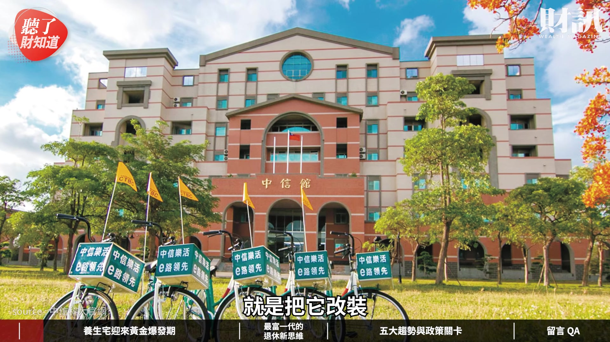

**逐字稿片段：** 預計就是 2027 年 就可以投入市場營運 它就是要打造全台的第一座 學習型的養生村 未來呢 你超過 50 歲以上 你就可以申請入學校當學生 可以在學校跟大學生一起修課 或者是修其他 它們開的一些對長輩的課 譬如說健康食品課 或是一些什麼畫畫課啊等等的 儘管你只修 1 學分 你也可以住在這個學生宿舍裡面 它裡面的收費方式

**話題推測：** 提及該案預計投入市場營運的年份：2027年

---

## 00:01:40

**逐字稿片段：** 我是覺得也滿親民的 營運方有跟我們說呢 它們大概全案有 100 間房間 在 2027 年 3 月開幕 那每人每個月收費 它們期望是不要超過 4 萬元 但是這個錢是不含三餐的 三餐還是要自理 因為每個人吃飯的時間點 或者是吃幾頓飯的這個習慣不太一樣 取得學生身分之後呢 就可以選修一些自己喜歡的課 運動健身課或是一些 AI 課程都可以的 那我是覺得這個途徑滿特別的 就是說因為少子化 很多校園都閒置 對 很多私校現在都有營運的問題 那也在想說這些校地應該要怎麼處理 之前也想過說是不是要蓋社會住宅 還是做什麼樣的方式 但是我覺得養生村的 這個方向是現在趨勢 我覺得挺好的 你不用再考大學 就可以再度享受大學生活 對 然後光是聽到裡面 就覺得還滿開心的 而且整個人都年輕起來了 對 而且你想要上硬（體）的課或軟（體）的課 都可以對不對 都可以 你都可以自己選修 或者是它們可以另外 就是再幫長輩們開課 所以大學宿舍也要開始 走上養生村這條路 這真的是滿新鮮的一個開始 在校地的利用上 可以更有效率的話 這的確也是一個方向 之前我們曉得一直都有 其他產業的業者 想要跨入這一個市場 那妳再告訴我們 最近還有什麼新的案例 剛剛講的是大學校園的案例 然後最近也有一個就是

**話題推測：** 說明養生村的收費方式與費用數字

---

## 00:03:06

**逐字稿片段：** 2026 年 5 月剛開幕的

**話題推測：** 提及「大毅高年級聚樂部」的開幕年份：2026年5月

---

## 00:03:08

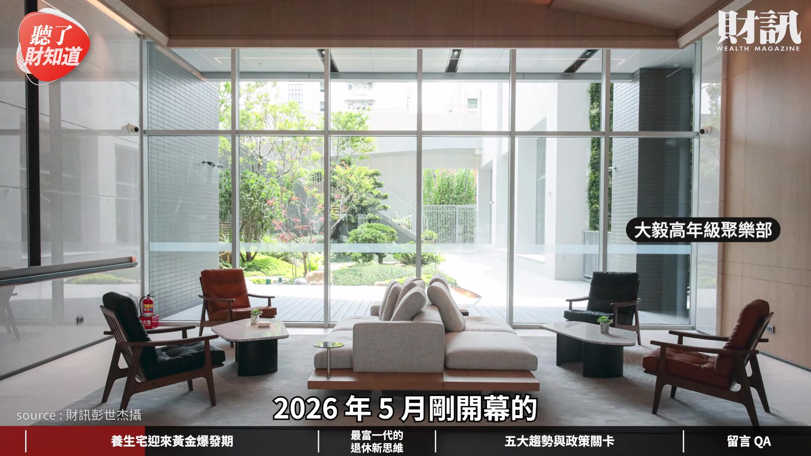

**逐字稿片段：** 台中一家叫做「大毅高年級聚樂部」 它其實也是台灣算第一座 用五星級飯店式管理的養生宅 它就是導入老爺酒店的管家服務 這個案子是申請飯店牌 把飯店 學院還有社群三位一體 把它打造成居住空間 這個案子裡面就是飯店式的裝潢規畫 它的那個自助餐 就是像飯店形式的早餐 每天都在吃飯店 buffet 對 每天吃 然後它們說他們每天早上 都一定會有一條魚 每一位 因為早餐就是要補充蛋白質 是一天的開始 對於長輩的健康也滿注重 我看到裡面就覺得 那個裝潢真的不輸五星級飯店 就是你此生之後都住在飯店裡的意思 住在飯店裡面 下了樓就是可以吃早餐 然後下午喝下午茶 就約朋友在飯店的大廳 這樣的退休生活 真的也是滿新的一個方法 然後再試算一下台北的房價 就覺得住飯店也是滿划算的 是啊 是啊 你就是會享受很好的飯店式的服務 飯店式的設施等等的 但是你支付的是飯店的價格 它的門檻還是稍微高一些 對 是啊 是啊

**話題推測：** 介紹第二個案例：台中「大毅高年級聚樂部」

---

## 00:04:14

**逐字稿片段：** 然後還有其他的

**話題推測：** 主持人提問，切入新的案例介紹

---

## 00:04:16

**逐字稿片段：** 還有就是康軒文教 投入大概 17 億元左右 在新竹的陽明交大旁邊

**話題推測：** 介紹康軒文教集團投入養生宅市場的案例

---

## 00:04:21

**逐字稿片段：** 會蓋一個「樂活居」 日前已經動土了 它會規畫地上 12 層 預計在 2028 年營運 我們也有去採訪董事長李萬吉 從出版業跨域經營養生宅 它們就是有辦學校 大家都知道 他說照顧小孩跟照顧老人 這個邏輯核心概念是一樣的 一樣是要規畫活動 然後一樣是要照顧他們的三餐 所以他說有把握這件事可以做好 那他也覺得說 未來長輩的市場是一個大趨勢 所以這個是文教業者 跨入這個領域的一個案例 然後我們也有談到就是說 市場現在也很多元 有租賃型的 也有一次買斷等等的 所以消費者的選擇是愈來愈多了 可是雖然是這樣

**話題推測：** 提及康軒文教養生宅的名稱：「樂活居」

---

## 00:05:10

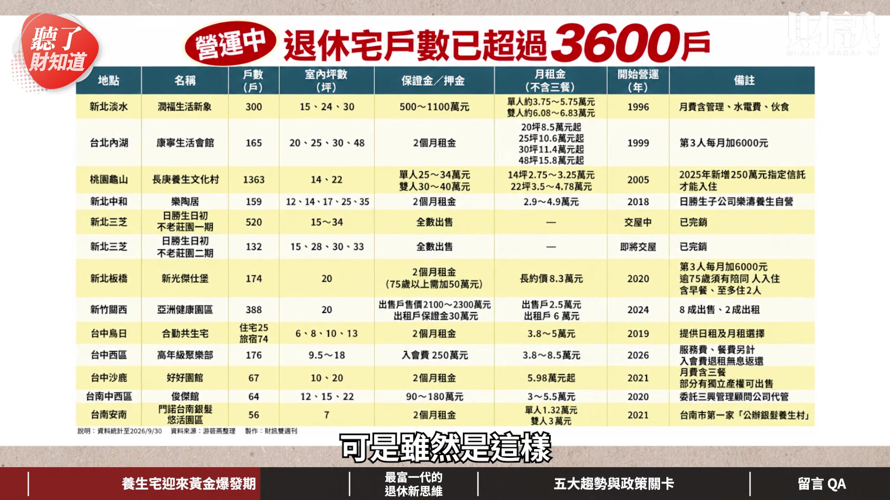

**逐字稿片段：** 但是我們知道有一些老牌的養生村 它們還是在排隊 表示說建立了口碑之後 其實這個支持度還是很高 對 沒錯 我們看到很多新的業者 雨後春筍般一直冒出來 就是會覺得看到商機 我們原本這些比較老牌 比較知名的這些養生村 在過去可能入住的人沒這麼多

**話題推測：** 轉變話題，討論老牌養生村的現況

---

## 00:05:32

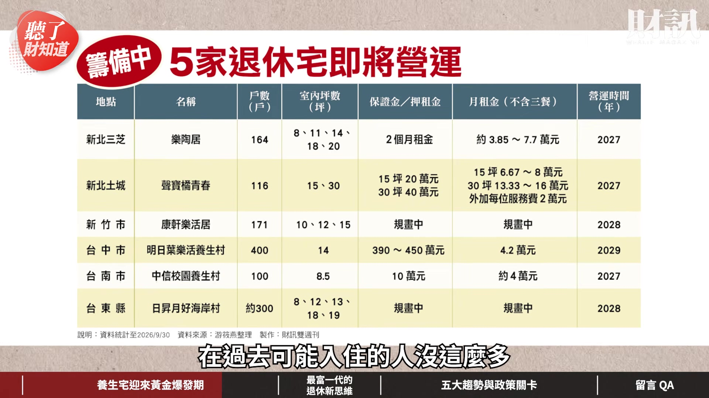

**逐字稿片段：** 舉例來說就是長庚養生文化村 當時候的風氣還沒有這麼的盛 所以坦白說 它們在過去是沒有住滿房的 所以前面也有一段 經營得很辛苦的時間

**話題推測：** 提及老牌養生村案例：長庚養生文化村

---

## 00:05:42

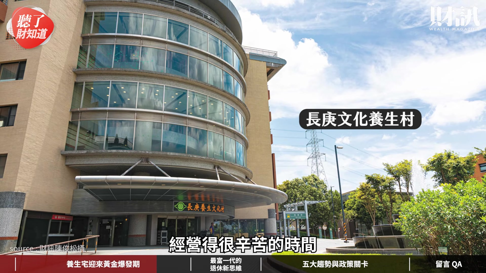

**逐字稿片段：** 對 它直到 3 年多前 才開始損益兩平

**話題推測：** 提及長庚養生村開始損益兩平的時間：3年多前

---

## 00:05:45

**逐字稿片段：** 所以你看就是它虧了 20 幾年 對 簡單講是這樣子 今年好像要 30 （年）了 那目前就是有 5000 多個人排隊 等 1 年半到 2 年 長庚養生村因為這樣子的熱況

**話題推測：** 提及長庚養生村虧損時間：20幾年

---

## 00:05:56

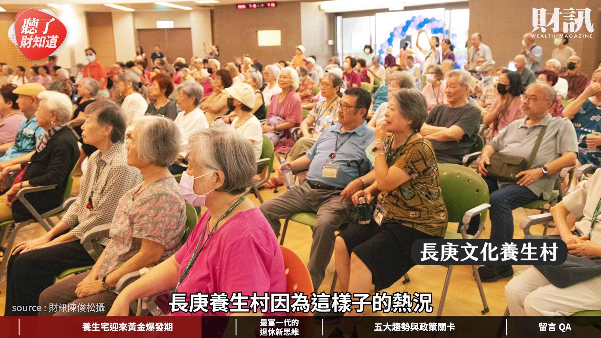

**逐字稿片段：** 因此最近開始整修了 300 間房間 它其實在多年前 早就已經蓋好毛胚屋 因為入住人一直沒有這麼多 那毛胚屋就是毛胚到現在 直到就是去年開始重啟 因為實在太多人排隊了 那最近 300 間房裝潢好 就可以再投入供給 我們剛才說它應該是將近 30 年 但是有一個是真的

**話題推測：** 提及長庚養生村整修房間數量：300間

---

## 00:06:16

**逐字稿片段：** 今年已經 30 年了 而且也是大台北地區 如果說是資產族群的話 都非常嚮往的

**話題推測：** 主持人轉變話題，介紹另一間30年老牌養生村

---

## 00:06:25

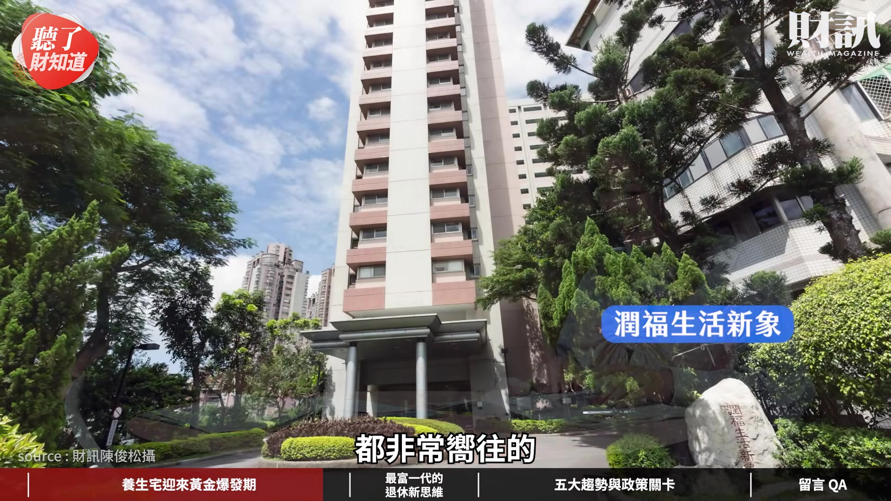

**逐字稿片段：** 它其實就是潤福生活新象 它就是 1996 年創立的 今年就真的是滿 30 年 它有 300 間房間常年滿房 排隊要超過 1 年 它比較特別的是說 它有一個比較特別模式 就是你今天住進去是健康的長輩 到比較晚年一點 就是年紀再大一點失能了 你還是可以住在裡面 就是你只要有看護 他願意跟你一起住在裡面 照顧你不影響他人的情況下 你還是可以繼續住在裡面 就是人生的最後一站 我覺得這個是滿特別的 就是你真的可以 把這裡當成最終站 而且很有趣的是 我看到筱燕寫的內容 就是因為它的時間已經那麼久了 30 年了 所以有很多是當年 自己的長輩住在裡面的 然後可能長輩離開了之後 二代也住進去了 我覺得這一切最主要是因為

**話題推測：** 提及另一間老牌養生村：潤福生活新象

---

## 00:07:38

**逐字稿片段：** 我們在 2025 年 就會開始進入超高齡社會 所以現在退休族群的人數大增 而且重點是這一代的退休族群 真的是有（經濟）實力的 對 也滿多人的 因為這群人是戰後嬰兒潮 總計台灣有 378 萬人 會在 2031 年全數都退休 就是說到 2031 年 這些人就全部都超過 65 歲了 對 這一群人過去就是有經歷過 台灣錢淹腳目的時代 有一個對於這個養生 非常厲害的專家

**話題推測：** 轉變話題至高齡化社會背景，提及超高齡社會進入年份：2025年

---

## 00:08:09

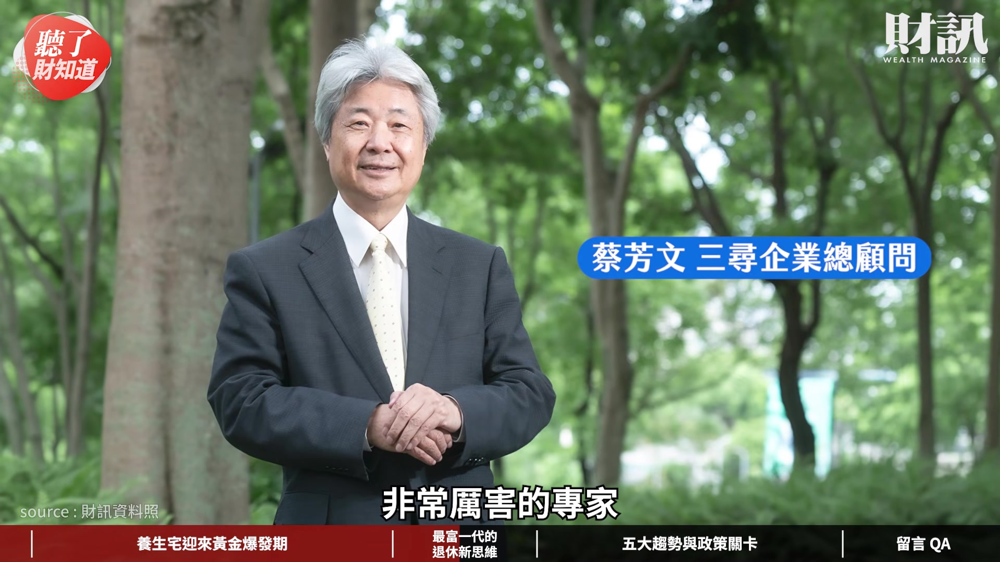

**逐字稿片段：** 就是三尋企業的總顧問蔡芳文 他有跟我們說 整個世代的觀念都已經在翻轉 就是過去這一群人的父母親 可能都是非常節省吃苦耐勞 苦自己然後都給小孩最好的 那現在這一群退休的人 他們觀念已經轉變 他們發現說 花得掉的才是財產 花不掉的就是變成遺產 就是覺得要對自己好一點 就是更願意把錢花在自己身上 追求比較好的生活品質 因為你在養生村裡面 你有朋友可以陪伴你 你不是一個人在家裡比較孤獨 那他們也想說 不要成為兒女的負擔 他們也可能會搬出去 就是住這種養生村養生宅 是 很多關係也不需要綁得那麼緊 有空間有距離才是美感 而且我覺得現在的長輩 也更注意自己的健康狀態 他們覺得獨立生活 只要在需要的時候 能夠有照應就可以了 那真的是還滿適合去尋找一個 比較適合自己需求的養生村 按照全台灣的長輩來統計 就是需要居家長照的

**話題推測：** 提及專家觀點：三尋企業總顧問蔡芳文

---

## 00:09:09

**逐字稿片段：** 大概在 10% 左右 因為重度失能需要更多照顧

**話題推測：** 提及需要居家長照的長輩比例：10%左右

---

## 00:09:13

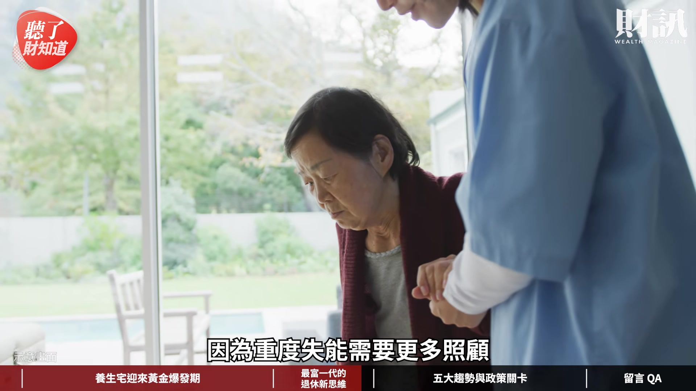

**逐字稿片段：** 大概也只有 5% 剩下的 85% 的高齡者 都是可以自理 又是健康跟亞健康的長輩 這就是這一波養生村針對的主力 確實 然後我們知道 市場已經是愈來愈大 而且可能現在是進入 一個爆發期的情況 所以現在整個在供給面的部分

**話題推測：** 提及重度失能長輩比例：5%

---

## 00:09:33

**逐字稿片段：** 筱燕這次也幫我們分析了新的趨勢 對 我整理出了五個趨勢 我想分享第一個趨勢就是說 原本入住養生村 就是固定的什麼押金 先收你一筆押金 那後來這個押金變成信託 就舉例長庚養生村 從 2025 年開始 入住前要先加收 250 萬元的安養信託金 就是說這 250 萬元 等到你退租之後會再還給你 真的是很多老人家的預期壽命 都比原本想像的長 你在相關的費用上 其實是要做更多預留的空間 所以就變我會多收一筆錢 就是預備用的啦 那第二個趨勢呢 就是校園空間的轉型 就是在一開始有講到這個例子 就是中信在台南會有一個案子 那其實祥寶集團 也買下了中華科大 中華科大裡面 它有一個雲林校區 雲林校區有一個教學的飯店 正在規畫中 可以把它變成一些養生宅 也是一個新的選擇方向 這樣同時也可以達到教學的目的 然後又可以服務到年長的朋友

**話題推測：** 介紹養生宅市場五大趨勢

---

## 00:10:37

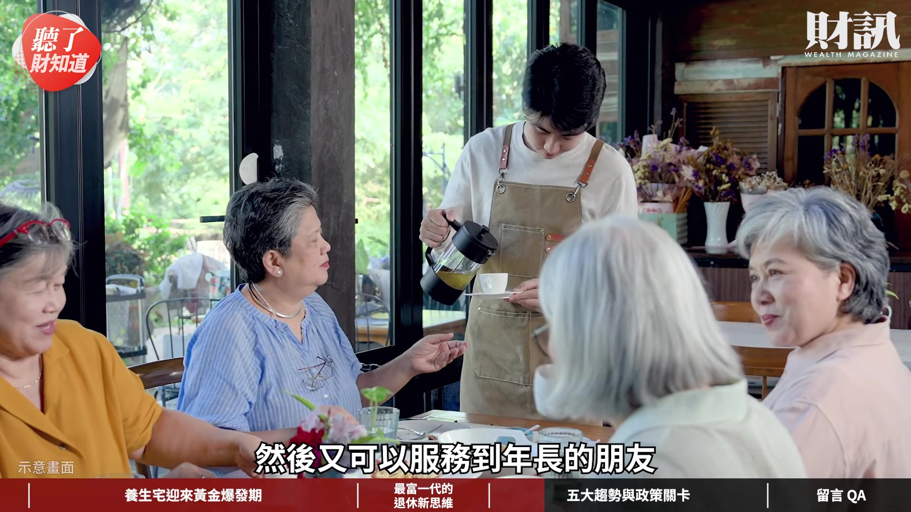

**逐字稿片段：** 那第三個趨勢呢 就是上下游整合的結盟 剛剛也有講到大毅高年級聚樂部 它其實就是大毅建設蓋的養生飯店

**話題推測：** 介紹第三個趨勢：上下游整合的結盟

---

## 00:10:46

**逐字稿片段：** 最近有在跟青松健康（合作） 青松健康也是做這個長照相關 就是居家長照 日照中心 跟社區長照這樣的公司 大毅就說它可以結合青松健康 在離它們養生飯店 可能 5 分鐘或 10 分鐘以內 然後青松那邊 再蓋一個長照相關的 可以一條龍 就是說之後長輩可能有一些失能 或是有一些問題的話 就直接到長照機構 其實這個例子真的滿多的

**話題推測：** 提及大毅建設與青松健康合作的例子

---

## 00:11:11

**逐字稿片段：** 像我們知道的夏都飯店 在宜蘭的案子 也是跟北榮合作 一起打造一個園區 就是你一個園區裡面 要有健康的長輩住的 然後也要有一些失能的長輩可以照護的 比較是一條龍的概念 這樣才不會說 離開了這個原本的養生村 也不知道再被送去哪裡這樣子 就是萬一失能之後你還得搬家 這真的是太辛苦的一件事了 那剛剛有提到說祥寶集團 它是想說可以在學校的場域蓋養生宅 因為它本來就做長照的 那它也想說旁邊有空地 它要買下來 然後再蓋健康老人的住宅 就說現在上下游整個跨域聯手 也愈來愈多了 大家都想要切入這一塊

**話題推測：** 提及夏都飯店與北榮合作的例子

---

## 00:11:55

**逐字稿片段：** 所以就是妳說的第四個趨勢了 就是所謂跨域的搶進 第四個趨勢就是剛剛有講到說 康軒是做出版的 它也開始要做這個 那像是聲寶土城 最近這幾年討論度也滿高的 就是聲寶的這個 在土城蓋一個「橘青春」 這個主要都是要把 閒置的產能給拉起來 對 就是資產活化 因為它原本是聲寶的廠房

**話題推測：** 介紹第四個趨勢：跨域的搶進

---

## 00:12:19

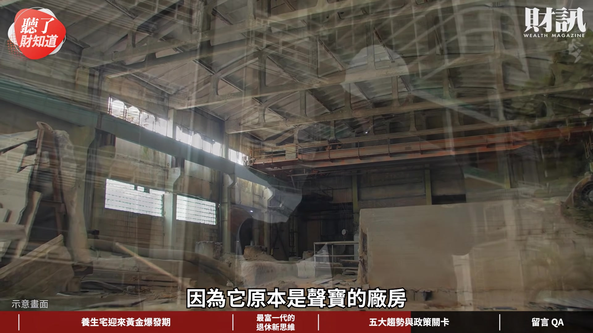

**逐字稿片段：** 那麗寶也在南投的埔里 買下一個度假村 也想說要把它改成養生宅 目前都還在規畫中啦

**話題推測：** 提及麗寶集團在南投埔里買下度假村改建養生宅的規劃

---

## 00:12:26

**逐字稿片段：** 那第五個趨勢呢 就是公有閒置的土地活化 不只是學校校園 遇到少子化的問題 像台東的太平榮家 已經也閒置 10 多年了 就空在那裡 所以台東縣政府

**話題推測：** 介紹第五個趨勢：公有閒置的土地活化

---

## 00:12:38

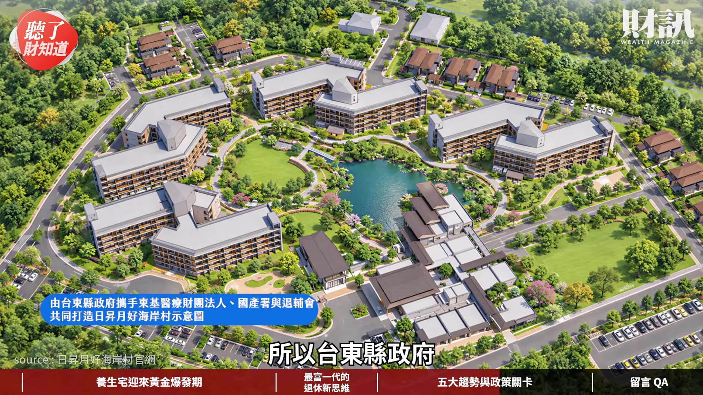

**逐字稿片段：** 要打造「日昇月好海岸村」 會變成說是全台灣第一個 公私協力活化公有地的例子 滿期待這個 因為這個案子也滿大的 有 9.2 公頃 它也會蓋健康的跟長照的 就希望可以好好的規畫 好好蓋出來 那現在我們知道民間產業 聽起來是愈來愈積極了 可是就是一直以來 從我們一開始研究這個題目

**話題推測：** 提及台東榮家活化案的名稱：「日昇月好海岸村」

---

## 00:13:02

**逐字稿片段：** 到現在都還是有一個問題存在 就是說你這樣一個居住的空間 要提供這麼多的功能 然後還有涉及這麼多不同的業向 也跨到很多不同部會主管的項目 就譬如說我們剛剛提到中信的例子 它今天是在大學校園裡面要蓋

**話題推測：** 轉變話題，討論養生宅面臨的政策關卡

---

## 00:13:22

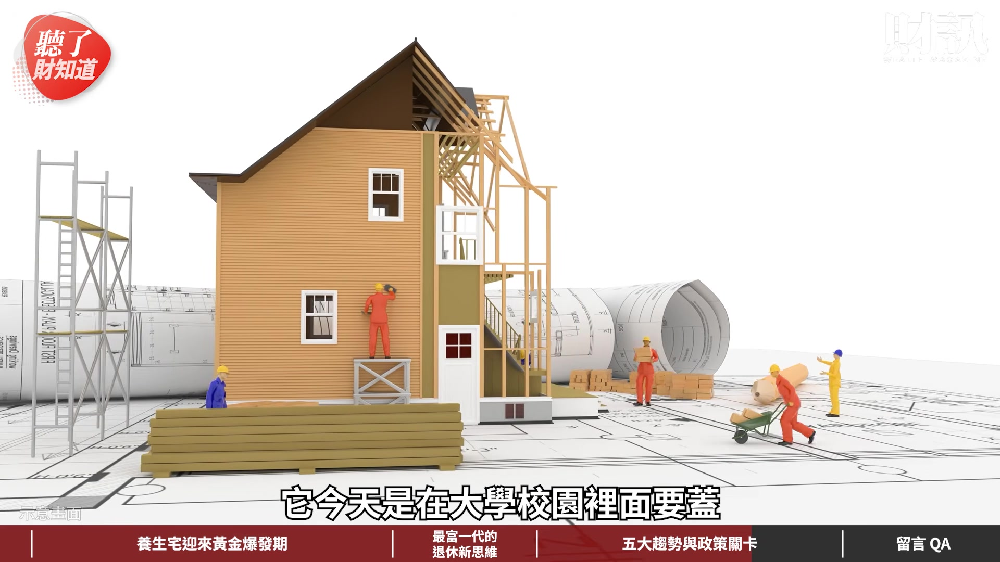

**逐字稿片段：** 所以那是教育部 對 教育部負責這個 它如果改成學生宿舍 要找 50 歲以上的老人

**話題推測：** 提及主管大學校園議題的部會：教育部

---

## 00:13:28

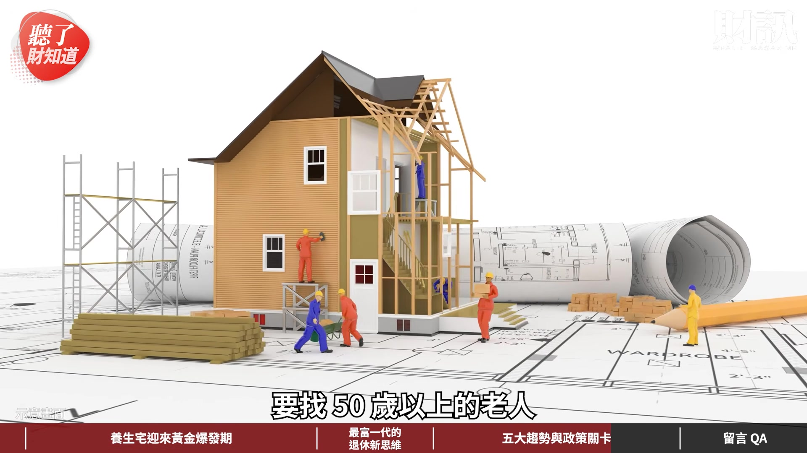

**逐字稿片段：** 那是不是衛福部也要來講說 是不是有什麼要注意的 就是說假設現在這個 學生宿舍反應很好 那我想要再多蓋一棟 但是它是新蓋的 不是學校原本的改裝的

**話題推測：** 提及主管高齡長輩議題的部會：衛福部

---

## 00:13:40

**逐字稿片段：** 那是不是又要再去跟國土署 可能要再申請 所以就是說真的是一個 多頭馬車的情況 這個問題我是覺得 像是日本是滿值得我們借鏡

**話題推測：** 提及主管新蓋建築議題的部會：國土署

---

## 00:13:51

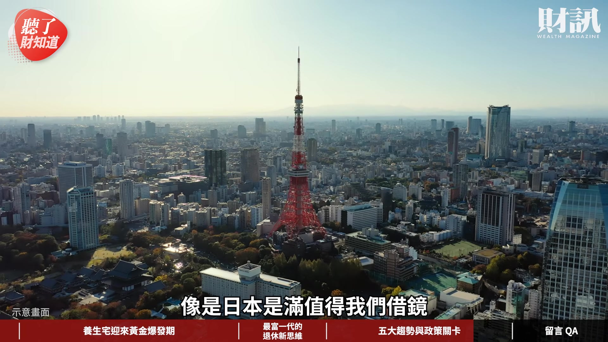

**逐字稿片段：** 就是說日本它透過高齡者居住安定法 跟建築基準法 明定說集合住宅裡面 如果設置高齡專用的照護 或是共用的活動空間 它可以不用算你計入容積的總量 就等於說這個空間就是送給你 給你一個就是容積獎勵的概念 所以這是一個激勵 那它在修這個法的時候呢

**話題推測：** 提及日本的相關法規：高齡者居住安定法

---

## 00:14:11

**逐字稿片段：** 它其實是由國土交通省 就是管住宅跟建管的 跟厚生勞動省 就是管長照醫療這個部門 它們其實就是一起 跨部會整合這個平台 全力扶持服務附帶高齡住宅的 這樣子的方案 這個就滿值得我們借鏡 就是用一個專法 然後來讓想要提供這些服務的人 他有一個可以依循的管道 不用每一個部會都去敲門 然後公文跑來跑去 對 然後就往返好幾年 因為有很多新的做法跟新的突破 如果有這個整合的跨部會 就會相對容易 因為我們真的在過程中 聽到很多業者的分享 就是太辛苦了 我如果做了這個話 我可能其實是不符合 另外一個部會的什麼法規的 政府也已經意識到 這個民眾的需求的話呢 也可以趕快幫大家開一個門 好 感謝筱燕的分享 看完今天的影片 你會考慮退休以後搬進養生宅嗎 歡迎來留言告訴我們你的觀點 如果不想錯過我們的節目 歡迎訂閱財訊頻道 或是加入頻道會員 解鎖所有的會員影片

**話題推測：** 提及日本負責住宅與建管的部會：國土交通省

---

## 00:15:14

**逐字稿片段：** 接下來我們要回覆財團在

**話題推測：** 轉變話題，進入觀眾留言回覆環節

---

## 00:15:16

**逐字稿片段：** 《聽了財知道》 第 369 集 台灣 30 年的老屋 比你想的多更多的留言 我們的財團高純瑛說 30 年很老嗎 我們社區大約 30 多年 感覺都還好 前幾年還更新了電梯 其實我們並不是說 只要是 30 年就是老房子 沒有這樣的意思 但是因為 30 年會設為一個門檻 有一個原因是 1999 年的時候 921 的大地震 那到現在也 20 多年了 所以如果你 30 年的房子 是有經歷過一些強震 結構上到底有沒有受到影響 所以現在對於這個 30 年的老屋 其實你可以用整建維護的方式 譬如說你拉皮 或者是你的結構補強 然後申請這樣子的補助之後 再同步申請都市更新 就是拆除重建 這件事情是同時可以進行 因為大家都知道都更 要重建沒那麼快 對 看你有沒有需要 我們是覺得說 30 年的房子 沒有說一定都要打掉重蓋 但是也許可以做一個健檢了 像我覺得這一位財團好朋友 他們的社區顯然就滿有這樣意識的 就還有去把電梯更新 然後其他屋況很好 那很好 就繼續維持 但是就是 30 年的房子 我們會覺得說是一個 可以健檢的門檻了 對對 好 然後 還有我們這位財團好朋友說呢 大型建商目前都是偏好重劃區 都更吃力不討好 最近新聞

**話題推測：** 提及留言來自的集數：《聽了財知道》第369集

---

## 00:16:43

**逐字稿片段：** 高雄屋齡 57 年 18 坪開 2500 萬元 建商直接放棄收購 寧缺勿濫 對 這沒錯 就是看各縣市 因為高雄或是台中 其實坦白說可以開發的重劃區素地 還是相對多的 那在雙北市其實就不是 因為雙北市可能就是土地供給已經少了 所以台北市建商現在 根本也沒有任何大面積的土地 像之前北士科還比較大片 但是現在也都被訂光光 現在整個重劃區幾乎是沒有了啦

**話題推測：** 提及高雄老屋交易案例的數字資訊：57年屋齡、18坪、2500萬元

---

## 00:17:13

**逐字稿片段：** 那就剩新北市塭仔圳

**話題推測：** 提及新北市重劃區案例：塭仔圳

---

## 00:17:14

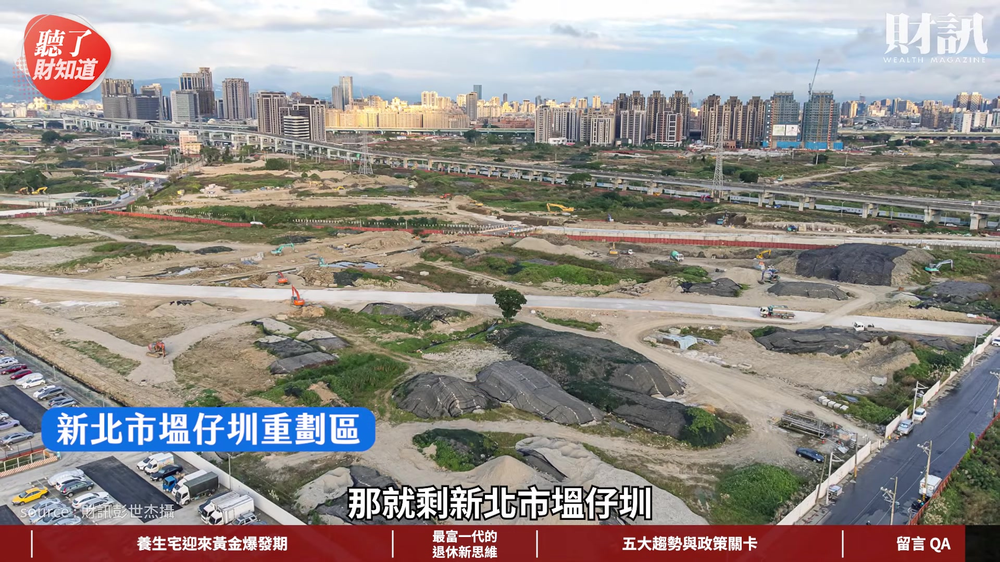

**逐字稿片段：** 比較大片的 400 公頃 就是一個供需的問題 如果你的土地供給還夠多的話 那建商當然會去找對它來講 開發利益相對比較高的 所以雙北的情況跟高雄的情況 這真的是不能夠一起比較啦 但說真的高雄也算是 開發的滿早的地方 也有很多老房子 在整個都會區的核心 還是有很多需要都更的老房子 坦白說還是有這個需求 就是因為這個安全問題 呼應剛才第一位財團好朋友說的 其實我們重點是在於 你的房子還安不安全 重點是安全 好 如果您還想要瞭解更多的內容 歡迎點擊資訊欄裡面的文章連結 或者是購買我們財訊

**話題推測：** 提及塭仔圳重劃區面積：400公頃

---

## 00:17:54

**逐字稿片段：** 第 774 期的雜誌 跟我們一起追蹤政經趨勢 掌握投資脈動 《聽了財知道》 我們下次見 謝謝筱燕 謝謝副總 bye bye

**話題推測：** 推廣最新財訊雜誌期數：第774期

---
