# wealth1974_skm3kwzl_Bk — 關鍵畫面索引

- 來源逐字稿：[wealth1974_skm3kwzl_Bk_GT.srt](wealth1974_skm3kwzl_Bk_GT.srt)
- 影片：https://www.youtube.com/watch?v=skm3kwzl_Bk
- 截圖數：28

## 00:00:00

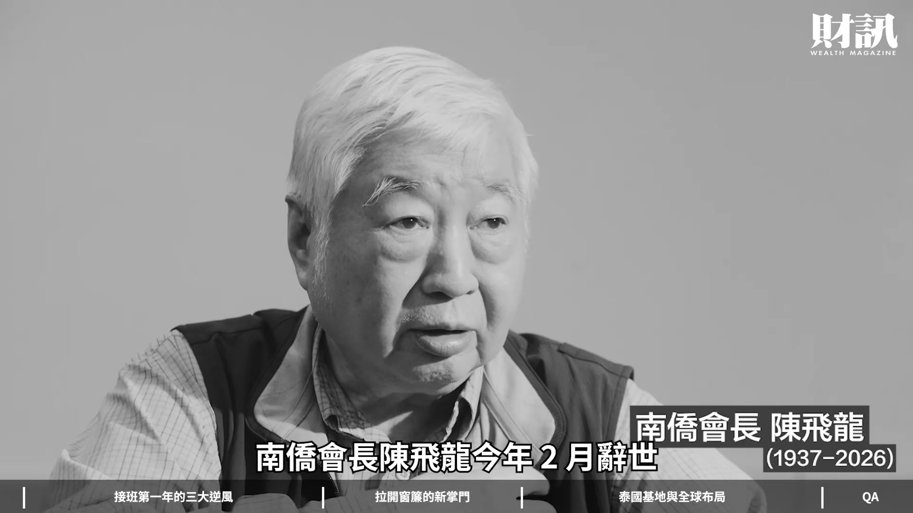

**逐字稿片段：** 南僑會長陳飛龍今年 2 月辭世 次子陳正文接班 就碰上油品風暴和中國的大內捲

**話題推測：** 介紹南僑會長陳飛龍，預計顯示其照片或公司標誌。

---

## 00:00:07

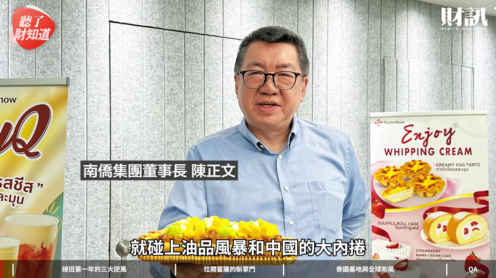

**逐字稿片段：** 上半年 EPS 竟然創下 18 年的同期新低

**話題推測：** 揭示上半年EPS創18年同期新低，預計顯示EPS走勢圖或財務數據。

---

## 00:00:10

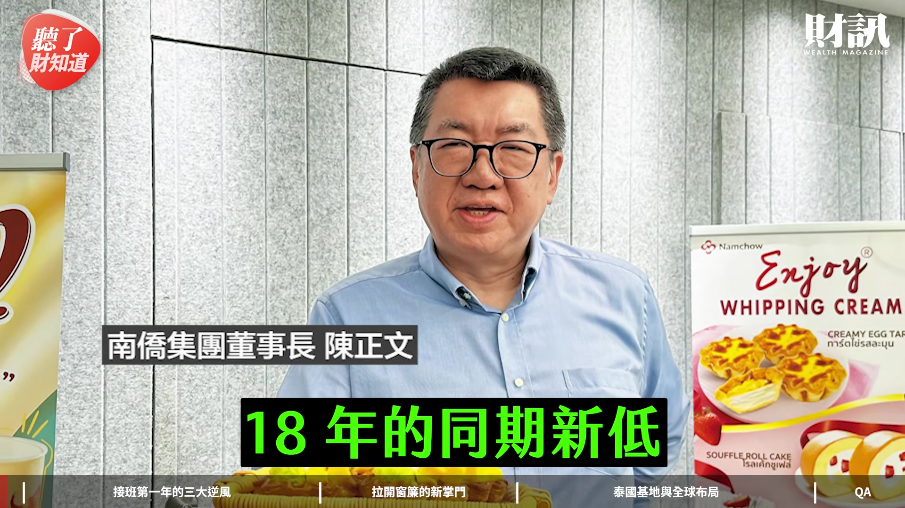

**逐字稿片段：** 而他上任的第一件事情 竟然是拉開會議室的窗簾 這到底是怎麼回事呢

**話題推測：** 引述陳正文上任第一件事是拉開會議室窗簾，預計顯示象徵性圖示或會議室畫面。

---

## 00:00:15

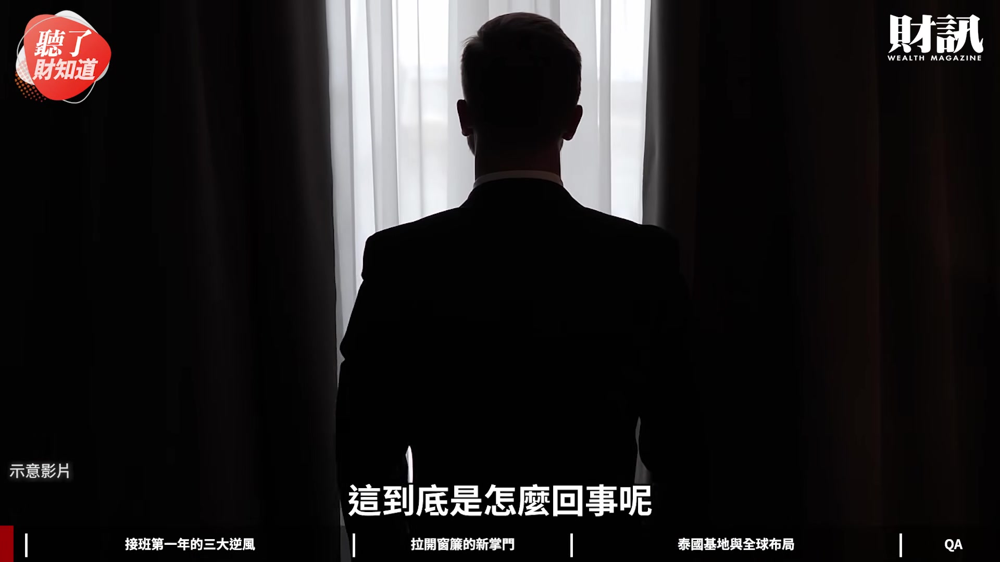

**逐字稿片段：** 今天這一集我們會先聊一下 南僑接班人 第一年接班的三大逆風

**話題推測：** 開始討論南僑接班人第一年的三大逆風，預計顯示節目議程或主題列表。

---

## 00:00:19

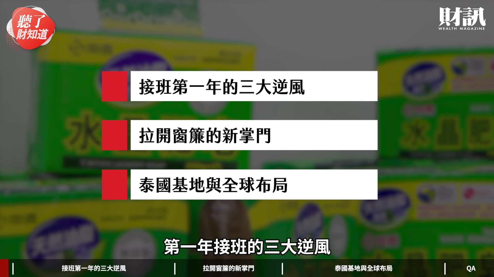

**逐字稿片段：** 接下來分享一下 拉開窗簾的新掌門人 他到底在想什麼 最後談一談 泰國基地與全球布局的想法

**話題推測：** 接續討論新掌門人的想法與作為，預計更新議程或顯示相關圖示。

---

## 00:00:26

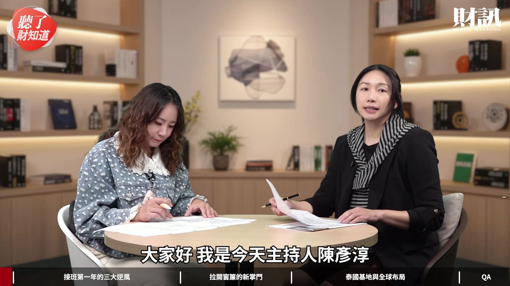

**逐字稿片段：** 大家好 我是今天主持人陳彥淳 今天來賓是財訊雙週刊的主編 游筱燕 歡迎筱燕 總編好 各位觀眾朋友們大家好 我是筱燕 南僑是一家 台灣的老字號的食品公司 其實創辦人陳飛龍先生 他是一個非常有特色的經營者 因為它們其實不做大宗物資 跟一般性的消費品 它們都聚焦在 利基型的商品上面 其實是一個非常特殊的經營哲學 今年 2 月的時候陳飛龍就過世了 大家也非常的不捨 那他的接班人就是陳正文先生 就接任了南僑集團的董事長 大家都會非常好奇說 到底南僑的下一步 會往哪裡去 這件事情大家會非常的關心 畢竟它是上市公司 那是不是請筱燕 先幫我們介紹一下說 整個南僑集團 現在的事業版圖 大概是長什麼樣子 整個南僑集團 如果依照財報上面的分類來看

**話題推測：** 主持人陳彥淳與來賓游筱燕自我介紹，預計顯示兩位講者的姓名條或畫面切換。

---

## 00:01:29

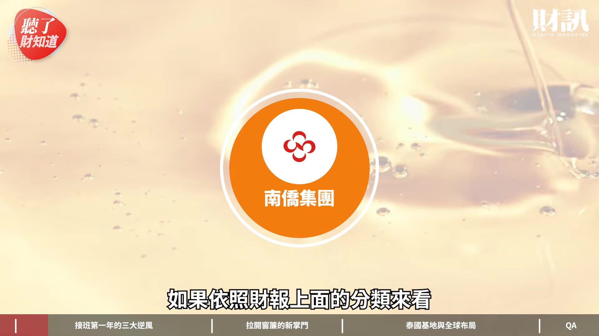

**逐字稿片段：** 旗下有三家上市櫃公司 一個是南僑投控 再來是皇家可口 再來是上海的南僑食品 那它們的這個 主要業務的這個營收範圍

**話題推測：** 提及南僑旗下三家上市櫃公司，預計顯示公司名稱列表。

---

## 00:01:41

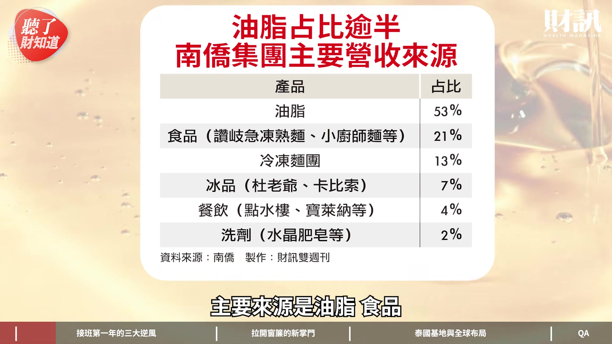

**逐字稿片段：** 主要來源是油脂 食品 冷凍麵團 冰品 餐飲還有洗劑 那油脂還是占了這個最大宗

**話題推測：** 說明主要業務營收來源，預計顯示營收佔比圓餅圖或條狀圖。

---

## 00:01:50

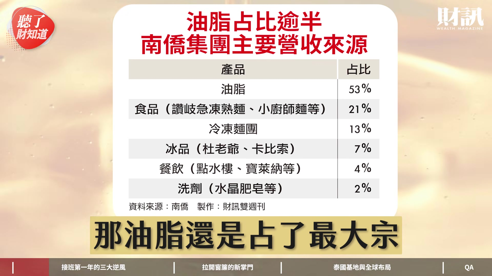

**逐字稿片段：** 占了 53% 那食品呢 像是譬如說速食麵 米果

**話題推測：** 提及油脂佔53%，預計更新營收佔比圖並標示數字。

---

## 00:01:55

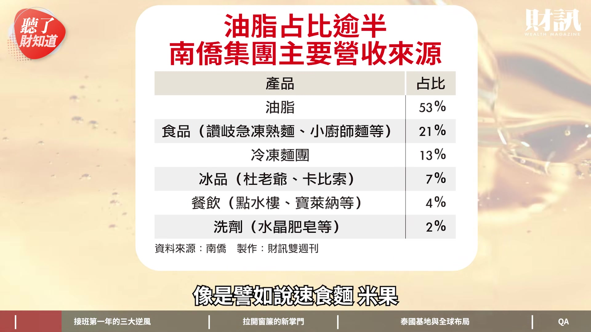

**逐字稿片段：** 常溫米飯這種的是占了 21% 是排名第二的 排名第三的產品呢 是冷凍麵團占了 13%

**話題推測：** 提及食品佔21%，預計更新營收佔比圖並標示數字。

---

## 00:02:02

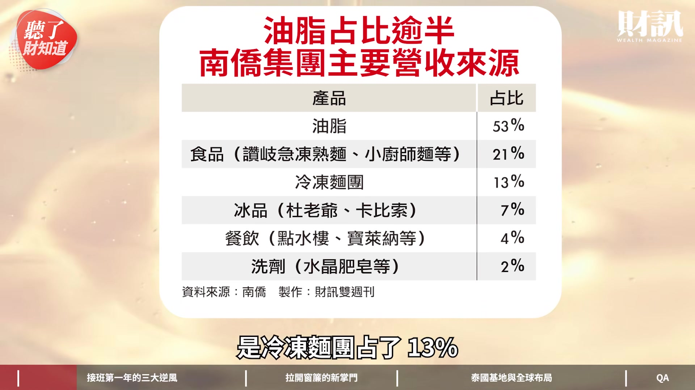

**逐字稿片段：** 再來就是冰品 杜老爺或是卡比索 便利超商裡面的這個冰品 其實都是這個南僑集團裡面的範疇 然後還有像餐飲 就是我們知道 這個點水樓跟寶萊納餐廳 再來就是洗劑是占 2% 就是南僑的水晶肥皂 大家都耳熟能詳的 真的 大家還記得吧 我就記得那個以前南僑的總裁 陳進財先生 他就說他的南僑水晶肥皂 是從頭洗到腳 代表說它是純天然的概念 非常溫和 那其實南僑這幾年來 在陳飛龍的帶領下 它們在每個利基市場上 都有滿好的基礎的 但事實上環境在改變 我們也不可諱言說 如果以業績表現來看 南僑集團在這個時候 的確面臨到一個轉折的關鍵點

**話題推測：** 提及冰品品牌杜老爺和卡比索，預計顯示品牌標誌或產品圖片。

---

## 00:02:44

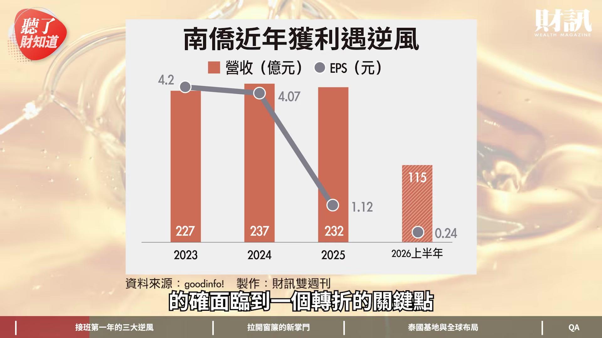

**逐字稿片段：** 陳正文今年接任董事長之後 擺在面前就非常多的挑戰 我們一個一個來跟大家分享 對 他今年上任 然後就馬上遇到了

**話題推測：** 轉入陳正文接任後所面臨的挑戰，預計顯示主題投影片或問題列表。

---

## 00:02:53

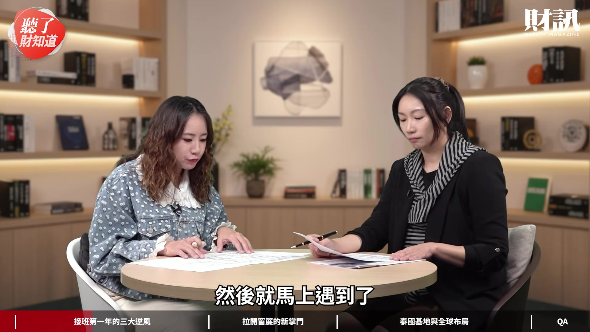

**逐字稿片段：** 這個中聯油脂的違規事情 就是大家如果都還有印象的話 就是前陣子的油品事件 南僑就是發現了 這個中聯油脂的苯駢芘偏高 它後來有些商品就被迫下架 然後銷毀這個產品 造成了它第三季 就是提列這些 認列這些損失 對 其實這件事情我想補充一下 就是說其實這是一個專業問題 但這次在事件的處理上 已經有點過度政治化被放大 尤其在選舉面前 所以其實有非常多無辜的廠商受害 其實整個食品供應鏈 因為很多的政治因素 而蒙受損失 其實不只是南僑 其實很多食品加工業 都因此受到滿大的損傷的 南僑也說它們因為這件事情就是 因為它們在泰國有基地 所以它們也很快的在泰國 看有哪些油品是合規的 然後它們也趕快進口來 就是台灣 應變的滿快的 所以也很快應變 瞭解 那還有第二件逆風就是中國內捲 中國現在內捲很嚴重 譬如說像原物料 跟這個人工成本也攀升 這些成本的攀升 但是它並沒有辦法 轉嫁到這個消費市場 就等於說 消費市場的力道是很弱的 所以就變成說過去呢 原先南僑的很大的獲利支柱 其實是在上海南僑 因為中國市場的這個疲弱 所以變成上半年的獲利 大減超過 9 成 這是一個很可怕的數字 是 因為南僑在上海的烘焙油脂的事業 它是掛在上海南僑 這家上市公司的下面 所以其實看得到財報 那南僑做什麼 就是現在看到很多的麵包連鎖店 它就是供應給它冷凍麵團 供應給它烘焙用的油脂 就等於是有點像業務通路這樣的概念 那大家可以想像說 如果中國的消費力變得比較疲弱 不願意花那麼多錢 去買比較好的麵包的時候 整個上游就會被擠壓到 對 所以這個東西就是滿辛苦的 如果中國不斷的什麼降級消費 對於經營中國內需市場的廠商來說 原本是個大餅 現在可能餅就會稍微縮小一點 對 那主要又是因為說 整個中國市場就占了南僑 6 成 我們就攤開整個營收占比來看

**話題推測：** 第一個逆風是中聯油脂違規事件，預計顯示相關新聞報導或事件圖示。

---

## 00:04:52

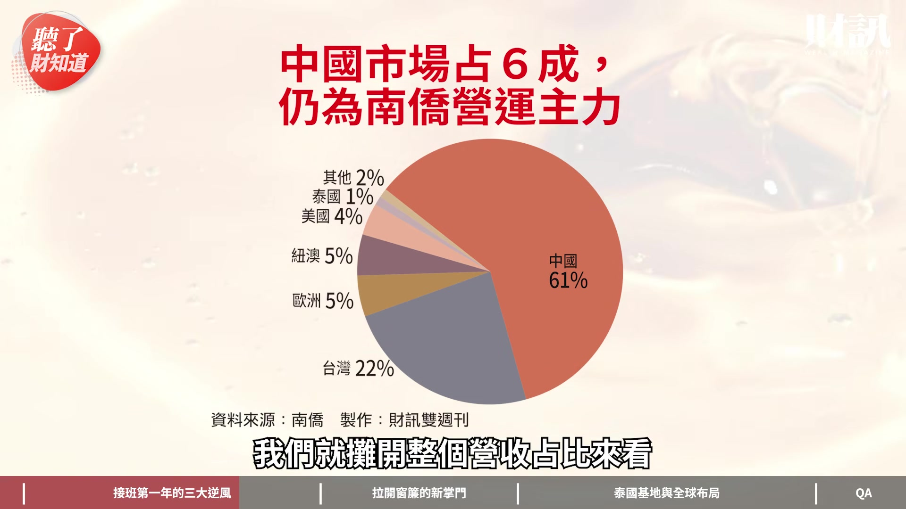

**逐字稿片段：** 就是中國市場至今占比 61% 然後第二名是台灣市場是 22% 然後第三名是歐洲是占 5% 那紐澳是 5% 美國 4% 泰國 1% 那其他地方就 2% 其實最主要的營收來源 不是講獲利是營收的來源 所以就是說 受到中國的拖累會滿嚴重的 瞭解 所以影響所及 它今年上半年的 應該 2026 年上半年的獲利表現 看起來就有點辛苦了 對

**話題推測：** 說明營收佔比中中國市場高達61%，預計顯示各區域營收佔比圓餅圖。

---

## 00:05:17

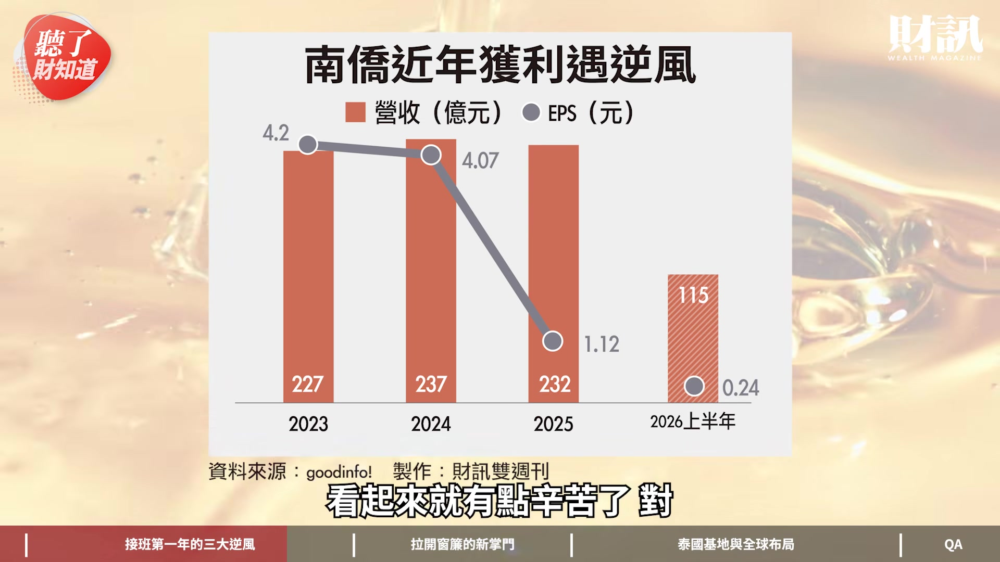

**逐字稿片段：** 所以才說它的這個上半年的 EPS 是創下新低 18 年來的同期新低 對 挑戰滿大的 但是成長空間也是有的 對 瞭解 那還有第三個原因是

**話題推測：** 重申上半年EPS創18年同期新低，預計顯示EPS歷史數據圖。

---

## 00:05:27

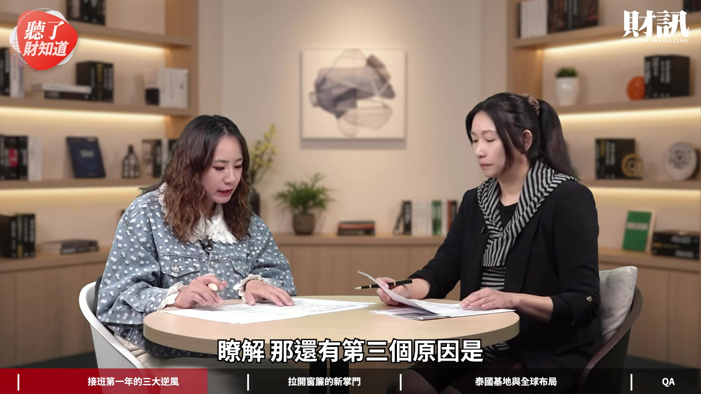

**逐字稿片段：** 第三個逆風是說 因為皇家可口 我們知道皇家可口 就是做這個冰淇淋的 那它也受到就是颱風 影響人流 然後再加上就是皇家可口 自己出去掛牌之後 它的這個股本就是整個被稀釋 回饋到整個母公司 母集團的獲利也會變少 皇家可口的業務內容包含哪些呢 皇家可口就是有杜老爺 還有卡比索 還有這個冰品的代工 譬如說全家的這種霜淇淋這種的 所以像冰品如果碰到颱風 這樣子的季節變換 下雨的時候 就會影響到消費的意願 對 是這樣 過去點水樓 就是台灣跟中國都有市場 那因為中國的降級消費 剛剛我們也有聊到 所以其實 中國的點水樓收了不少間 就是說可能比較沒那麼賺錢的店面 收起來了 當然就是 陳正文董事長也有說 看有好的據點也不排除 就是再繼續擴點 只是說先暫時先把一些 覺得好像效益沒那麼高的店面 先收起來 瞭解 通常在碰到逆風的時候 就是一個汰弱留強 調整體質的最好時機 對不對 所以其實陳正文接任之後 我覺得他一定碰到滿多的挑戰 跟困難要去解決 尤其是面對中國市場這樣子的表現 但我覺得筱燕寫文章的時候 非常有趣 她寫到說 她問說你 董事長你上任之後 第一件事要先做什麼 他就說 先打開窗簾 為什麼會有這樣的對話呢 就問他說 覺得公司在他父親時期 跟他時期的時候 有什麼改變 然後他的心路歷程這樣子 因為他說他過去就是 發現就是辦公室的窗簾 一直都是關著的 其實也都沒有人去問會長說 為什麼窗簾要關著 就是一直關著 然後大家都很習慣了 後來上任之後他就覺得說 窗簾就打開 然後在中國 或是在各個辦公室也都是落地窗 然後那種很透亮的這種明亮的光線 然後這種才比較有事業衝勁 這件事情我覺得 我自己腦補 我自己心得是說 因為過去很多事情 可能都是約定俗成 或是既定都是這麼做的 然後大家都沒有去改變 因為我們大家知道 傳統產業是一個步調稍微慢 就跟 AI 產業比起來 就是說 可能覺得我們現在都可以在賺錢 那我們可能就 在這個相對的舒適圈裡面 那現在就是新的掌門人接班之後 就是他有想過說要怎麼突圍 要怎麼創新 對 他也無時無刻在想這件事情 是 第一件事就是改變 過去大家覺得理所當然的事情 他就先打破 大家重新思考 因為畢竟環境挑戰已經不一樣了 所以就先打開窗簾 以前大家都不敢問 也不會問的事情 對 看起來是可以改變的 就至少先做 我覺得雖然是個小小的動作 但我覺得寓意滿深遠 就是說 在面對不同的環境 跟不同時期的時候 迅速的應變 這件事情滿重要的 所以他會怎麼做呢 譬如說如果針對中國 他要怎麼面對這件事情 是 其實先講結論 他覺得中國現在整個降級消費 然後內需市場很差 在內捲 這是事實 但是說真的 他覺得中國人口還是這麼多 餅沒有變小 只是說大家板塊可能轉移了 大家願意消費的地方不太一樣了 他現在就是從中高價的連鎖烘焙 然後移向就是超市 跟連鎖餐飲 譬如說像是中國的山姆 盒馬 還有一些連鎖咖啡店 過去可能就是賣冷凍麵團 或賣油脂 那我現在是不是能夠 直接供應成品 譬如說我做蛋塔 我就把整個蛋塔都做好 那些店家 我再自己加巧克力 然後再自己加水果 就是盡量增加自己的附加價值 然後看能幫業者多做到哪裡去 就多做一點 做的事情更多 附加價值更高 所以它現在的新的成長的引擎 就是它從油脂的原料供應商 變成綜合食品的供應鏈的服務商 然後這個成績 其實看得出來一些成績單 譬如說在去年的時候 中國的這個營收 是人民幣 4.8 億元 然後呢 光是這個 剛剛講的這個預製烘焙這個部分 就是整個食品供應鏈的部分

**話題推測：** 第三個逆風是皇家可口受颱風影響及股本稀釋，預計顯示主題投影片或相關圖示。

---

## 00:09:12

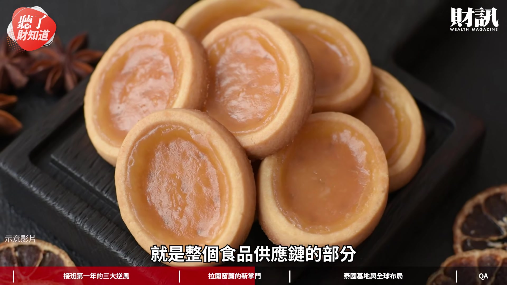

**逐字稿片段：** 就年增了 26.5% 比重占比就提升到了 中國事業 15% 就是說過去這個可能是占比 幾近為零這件事情 但它自然就可以突圍 然後一次就提升到 15%

**話題推測：** 提及預製烘焙年增26.5%並佔中國事業15%，預計顯示成長率和佔比數據圖。

---

## 00:09:23

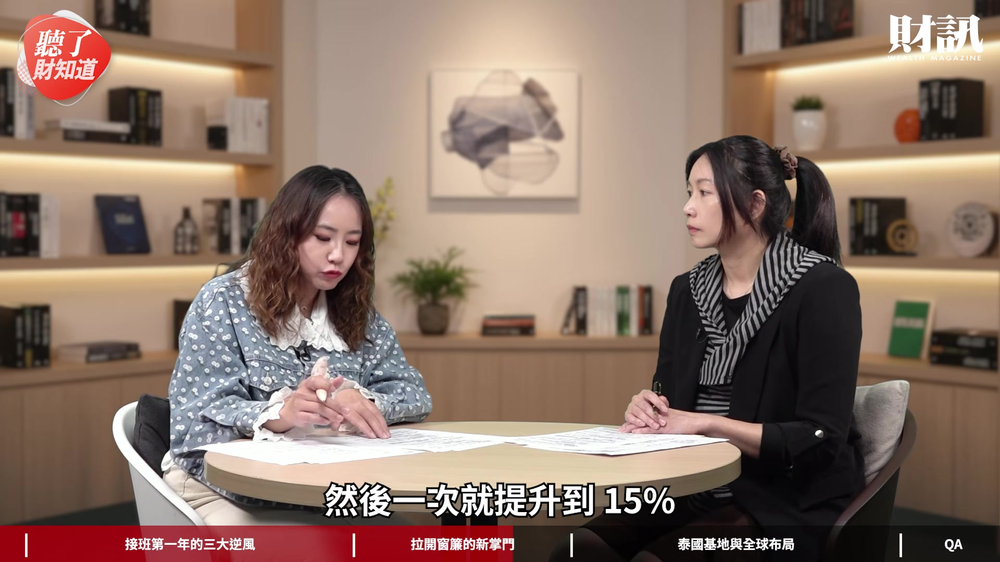

**逐字稿片段：** 而且它也打入了 這個山姆會員的商店 就是說現在成績就是 開始覺得這個方向不錯 然後繼續再持續深耕這樣 它等於是開發出新的產品 打入新的通路裡面 等於是開發一個新的市場 對 更多的延伸 就讓整個一條龍裡面 可能做更多的服務 這是不是也是因應 整個中國的消費習慣的改變 因為可能個人的麵包店 或連鎖店愈來愈少 可能走向那種大型的 對 都直接去超市 連鎖店 對 或是去整個商城 就是那種商場型的 瞭解 對 然後去那邊消費 那他有講到說 客單價降低這件事情嗎 就是說大家會覺得說 好像中國降級消費 所以是不是 它所有的產品價格 也可能要必須因此而做調整 他只是說就是沒有辦法 反映到很多給消費端 就價格沒辦法轉嫁 但是如果我今天可以預製到 多做一步 多高附加價值 然後賣跟過去一樣的錢 那我的競爭力是不是就變高了 變高了 瞭解 就變成說我比較容易被廠商選用 對 因為我們都知道說 南僑對品質是非常非常在意 跟非常講究的 有時候他就想說 我寧可要少做一點點生意 但是我也要維持我的品質 那現在用這種方式來開拓新的市場 我覺得還滿值得期待的 對 那這個中國的部分 他看起來有些新的解決方案 然後另外這一次 其實筱燕也到泰國 去看它的生產基地 那大家都知道說 其實卜蜂集團的 base 這個 home base 就是在泰國 它不只供應亞洲市場 基本上它也是 供往歐美的一個根據地 就我所知 其實南僑早期 在泰國設立工廠 除了供應台灣之外 也有外銷到歐美市場去 那這次妳去看了之後 他有重新定位這件事情嗎 有 這次去看覺得還滿驚訝 而且也覺得 原來泰國廠已經成立 37 年了 所以其實台商西進到中國的時候 其實陳飛龍會長 他早就在泰國南僑就是駐點 就是泰國的萬磅廠 因為當時候他看好 就是泰國的米食是非常豐富的 也是很盛產 米也好吃 所以他就在當地設這個米食的線 然後就是做這個米果 譬如說他在當地有叫賓賓米果的 就類似我們小時候的旺旺仙貝 在台灣的地位這樣子 那它從米果開始起家之後 它就開始做到嬰兒米果 那其實我覺得滿有趣的說 假設我們現在去這個歐洲市場 然後你看到這個嬰兒米果 背後是寫 Made in 泰國的

**話題推測：** 提及打入山姆會員商店，預計顯示山姆會員商店的標誌。

---

## 00:11:37

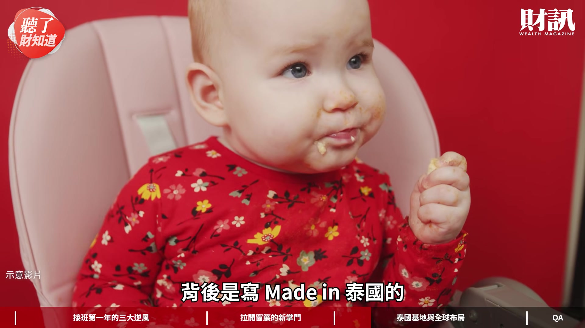

**逐字稿片段：** 其實有 8 成左右 其實都是這個泰南僑 這個萬磅廠做出來的 其實它已經 幫各大的嬰兒米果品牌 在做代工 所以這點算是滿厲害的 也是我們都不太知道這個隱形冠軍 隱形產品的部分 那因為中國市場 內捲非常嚴重 當然就是陳正文董事長 他也知道這件事情 所以他就變成說 更加看重這個泰南僑 重要的地位跟角色 就是說因為 我們剛剛有提到整個南僑集團

**話題推測：** 說明歐洲8成嬰兒米果Made in Thailand，預計顯示歐洲市場嬰兒米果相關資訊。

---

## 00:12:03

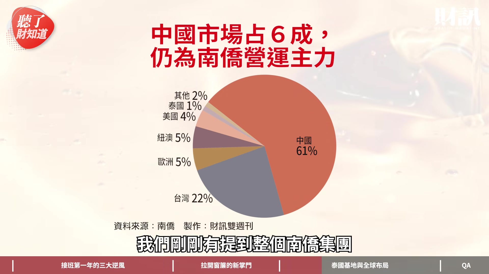

**逐字稿片段：** 在泰國的營收占比只有占 1% 意思就是說 泰國廠做的東西全部都外銷去了 可是現在東南亞

**話題推測：** 提及泰國營收占比僅1%，預計顯示泰國市場佔比圖。

---

## 00:12:09

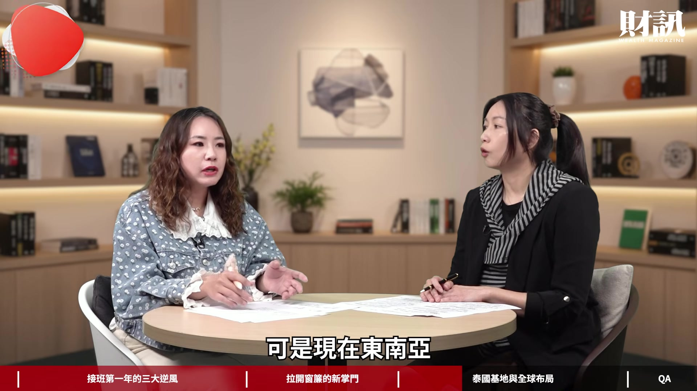

**逐字稿片段：** 也是有很大的內需市場 內捲的程度相對沒有中國這麼嚴重 那也覺得說 這邊泰國可以是 好好值得深耕經營的 所以呢 有提到說剛剛的米果線 還有一些米食線 那他也想說 把在中國大陸做的還滿不錯的那些 就是預製烘焙 或是一些冷凍麵團這些產品 也可以慢慢的 把它複製到泰國來 所以他目前在泰國已經有一些基地 然後去研發說 我要怎麼提供 當地的連鎖超市或是麵包店 也是給它一些預製的產品 是 所以他會擴大在泰國的投資嗎 是 因為在 2019 年的時候 陳飛龍陳會長的時候 他就講說 五年要投 50 億泰銖的擴建計畫 當時候其實董事會都已經通過了 但是後來就遇到了 COVID-19 就遇到了疫情 所以它這個投資計畫 後來就是有延宕 然後還沒有投到 50 億元 陳正文有提到說 目前已經建置了第一期跟第二期 已經投了 28 億元泰銖 他就會把這個 50 億元把它投資完 然後建置這個智慧化工廠 跟自動化倉儲 還要再繼續的擴建 所以我們這次去看他的廠的時候 他還去旁邊買了一些空地 蓋員工宿舍 因為要提升員工的福利 然後留才 然後繼續在那邊 設研發中心 所以他其實未來的三年 他預計 他是希望說可以再投入 這個 25 億元的這個 泰銖的這個部分 然後來建置一些新的廠房 跟新的產線 擴大在泰國的投資 也會是整個公司轉型的 一個很重要的這個據點 瞭解 所以意思是說以前的泰南僑 扮演它們行銷歐美的生產基地 它們現在也要透過泰國基地 來深耕整個東協市場 沒錯 這個邏輯就對了 所以它等於是 台灣 中國 泰國 彼此互補 然後又做國際市場的生意 對 瞭解 好 那我想回來談談

**話題推測：** 說明東南亞內需市場潛力，預計顯示東南亞地圖。

---

## 00:13:54

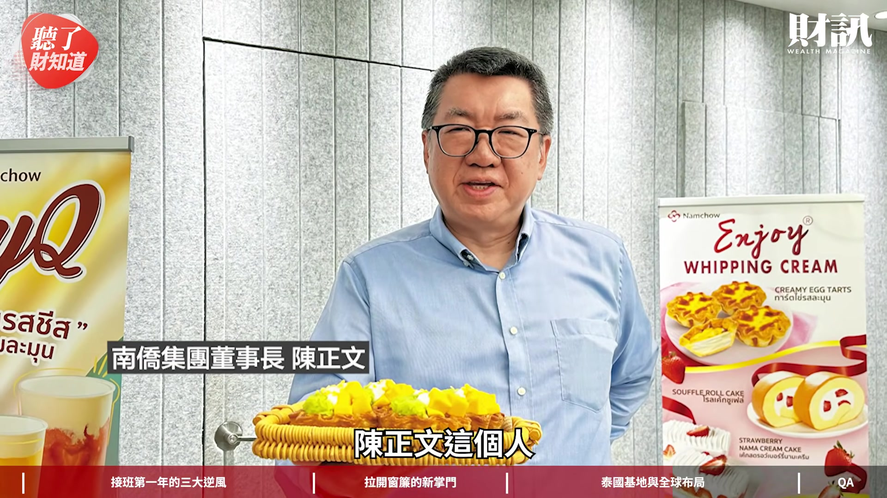

**逐字稿片段：** 陳正文這個人 因為其實就我們的理解 當然我認識陳正文非常久 他是一個非常低調 而且穩健經營風格的人 但是因為他其實比較長年 都在上海比較多 這次妳跟他接觸 妳覺得他接下來 對於整個領導團隊 經理人之間的合作默契 大概是怎麼樣 我們剛剛有講過說 他有很努力的想說要怎麼突圍 在他接任之後

**話題推測：** 回頭討論陳正文的個人風格和領導，預計顯示陳正文個人肖像。

---

## 00:14:17

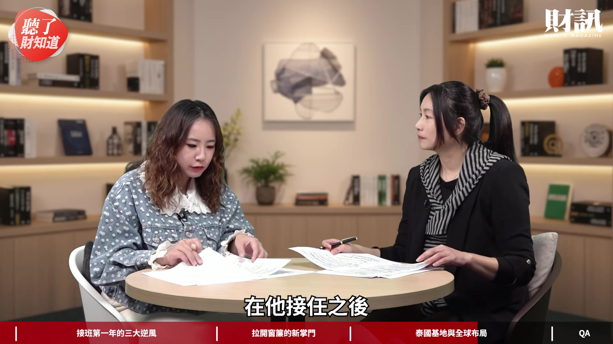

**逐字稿片段：** 他開始做一些人事的調動 譬如說 像是我們都知道過去泰國 我們都叫南僑的李勘文總裁 叫他泰國王 因為他在泰國深耕很久 還把他就調回台灣 坐鎮台灣

**話題推測：** 提及陳正文的人事調動，預計顯示組織圖或人事異動示意圖。

---

## 00:14:28

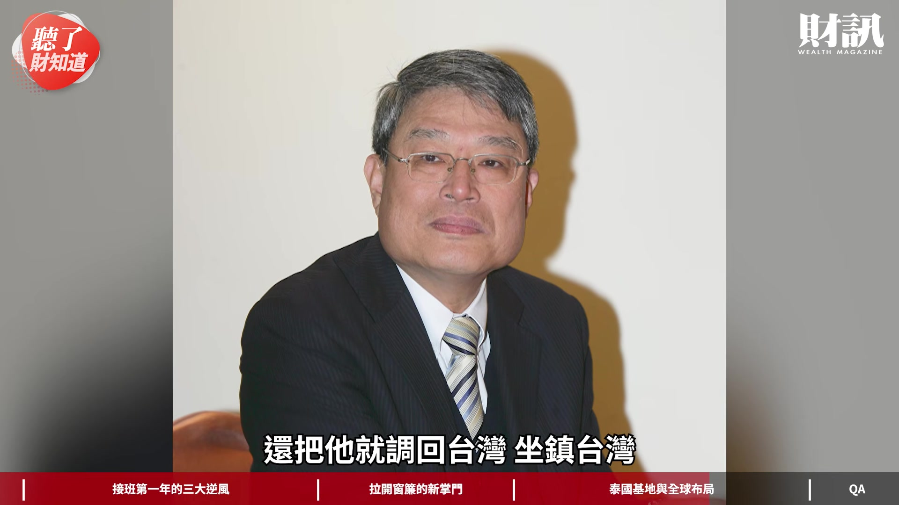

**逐字稿片段：** 然後泰國這邊就由 之前泰國的兆豐銀行退休的 這個賈瑞恆 賈總經理來擔任 就說 他在泰國在金融的業界這麼久了 然後他也熟悉泰國的一些市場 所以就由他來 負責營運 來負責泰國的營運的部分

**話題推測：** 提及泰國由賈瑞恆總經理負責營運，預計顯示賈瑞恆先生照片或姓名。

---

## 00:14:43

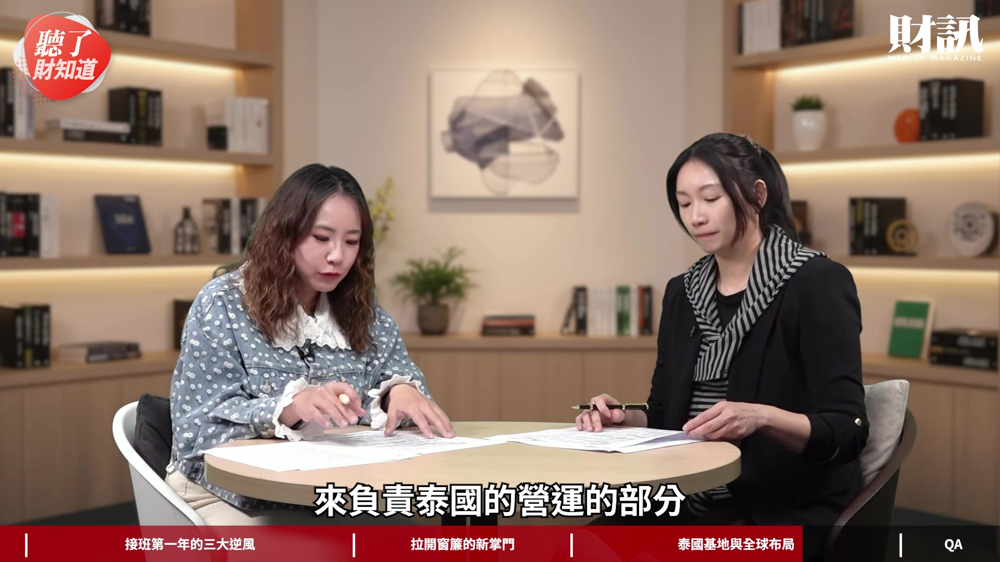

**逐字稿片段：** 9 月底的時候呢 就是會計處的副總經理 這個汪時渭 他也接任發言人 可以看到一系列的人事的調動 你看得出 他想要試看看說 怎樣的方式 可以對集團是最好的 也有想一些方法 一些出路 他的個性我是覺得 因為我是第一次跟他 有這麼長時間的 因為這次是去看泰南僑 發現他其實人滿親和的 他很喜歡拍照 所以他手上就是帶一個徠卡相機 然後大家說 這是在二手的相機市場買的 然後其實你會覺得 他就很像很親和的老闆 然後你也不會覺得 他是富家公子哥這樣子 就是那種擺架子還是什麼的 然後就可以跟你閒聊日常的事情 然後拍照也可以聊 還說我是上哪裡買的 你可以去那邊買比較便宜 然後什麼的 我就覺得跟我自己的 原本的想像不太一樣 原本覺得他很有距離感嗎 對 因為就是比較少說 比較少聊到 對 其實陳正文真的是一個 滿謙卑 而且非常好相處的人 當然我覺得身為一個經營者 一定有非常多的困難要面對 他在領導的過程中 也不得不有時候 扮演一些黑臉 因為要執行下去 所以我覺得真的是滿困難 尤其是陳飛龍會長 他其實是一個非常強人領導的作風 到陳正文之後 我覺得他可以比較包容不同的聲音 所以接下來的南僑新格局 我覺得大家會滿期待的 對 我覺得滿值得期待 尤其在泰南僑這個市場 如果真的有做起來的話 未來整個格局會很不一樣 對 我們就拭目以待 好 今天非常感謝筱燕的分享 看完今天的影片 你覺得接班第一年 就遇到逆風的陳正文 能帶著老字號的南僑 轉型成功嗎 歡迎留言 分享你們的觀點 如果不想錯過我們的節目 歡迎訂閱財訊頻道 或是加入頻道會員 解鎖所有的會員影片

**話題推測：** 提及汪時渭接任發言人，預計顯示汪時渭先生照片或姓名。

---

## 00:16:30

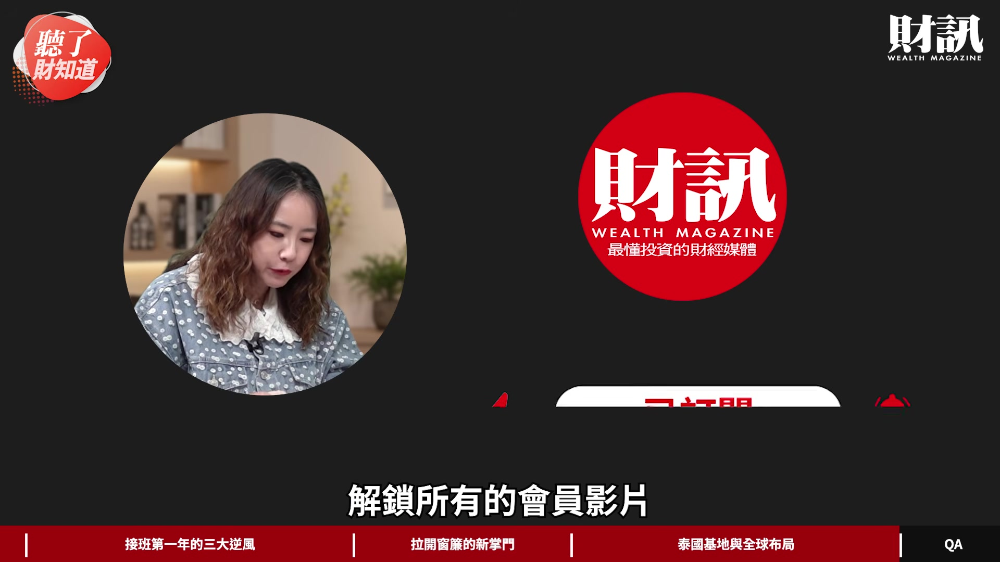

**逐字稿片段：** 接下來我們要回覆一下 財團在《聽了財知道》第 380 集 石化業上半年獲利暴衝 下半年行情又轉折 裡面的留言 是不是請筱燕幫我們念一下

**話題推測：** 轉入回覆聽眾留言，預計顯示前一集影片標題或留言區截圖。

---

## 00:16:40

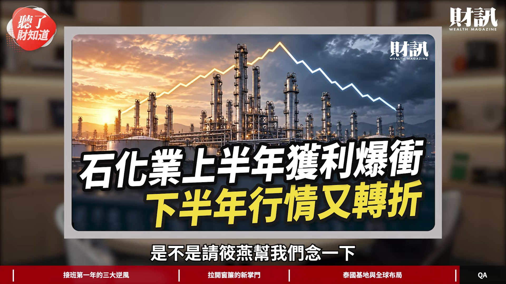

**逐字稿片段：** 好 我們的財團的 B 大 他說 應該轉型還有增加 內部廢棄物回收功能 例如廢水純化 產線產生內部廢棄物再利用 PVC 管回收 既然是石化大廠能生產 或許也能同時發展回收 做到一個循環經濟 這位財團粉絲真的非常專業 的確事實上非常多石化廠 在做這件事情了 以後我們也會陸續 跟大家分享跟報導 好不好

**話題推測：** 回覆B大的留言，預計顯示留言內容截圖。

---

## 00:17:07

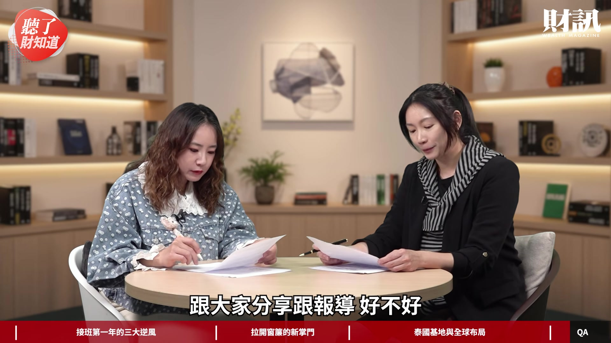

**逐字稿片段：** 然後我們的財團的 R 大他說 有沒有想過大家都減產以後 全部市場就只有中國廠商才有 大家就等著被宰 這也是為什麼很多石化業大佬 會提出這個警訊 就是說台灣要維持 一個基本的安全量 以後才不會被人家掐住脖子 對 雖然現在很多原料是陷入紅海 但各國在供應鏈安全的前提考量下 是不是應該也要保護最基本的量 不然的話老實說 沒有上游就沒有下游 你今天如果上游都沒有的話 你更不要講什麼高值化 更不要講什麼半導體材料了 所以這件事情是非常重要的 值得思考 不只是這個石化業 各產業其實都是 沒錯 還有我們的財團林淑美說 往高附加價值發展轉移 利潤差停工 2-3 年後又可以是一條活龍 對 我覺得台灣廠商其實很有彈性的 因為其實筱燕跑很多傳統產業 都看到它們轉型的故事 其實還滿激勵人心的 對 對 但有些當然稍微要花一點時間 慢慢等待 就會看到很好的成果 這個部分筱燕會幫我們 繼續挖掘好的公司 對 台灣還是有很多隱形冠軍 是在中國整個逆風的市場下 然後突圍的 其實還是有很多 可以為大家挖掘 再跟大家分享 好 今天非常感謝筱燕的分享 如果想瞭解更多的內容 歡迎點擊資訊欄裡面的文章連結 或者購買財訊第 776 期雜誌 跟我們一起追蹤政經趨勢 掌握投資脈動 《聽了財知道》 我們下次再見 謝謝筱燕 謝謝大家 bye bye

**話題推測：** 回覆R大的留言，預計顯示留言內容截圖。

---
