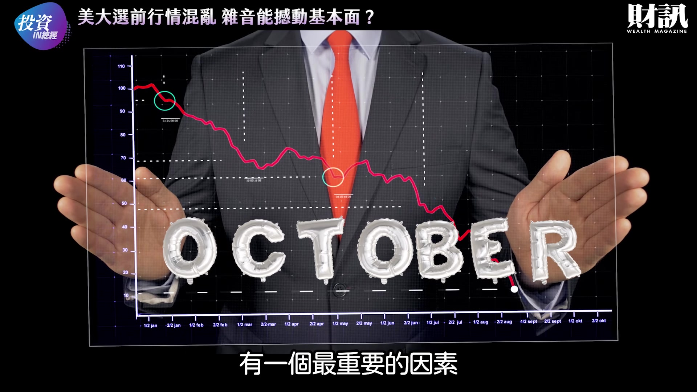
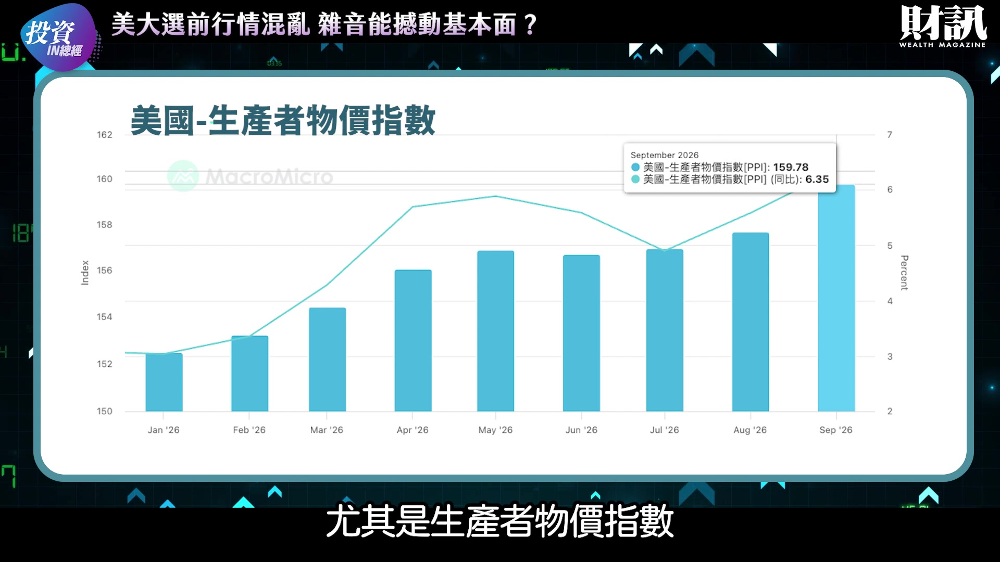
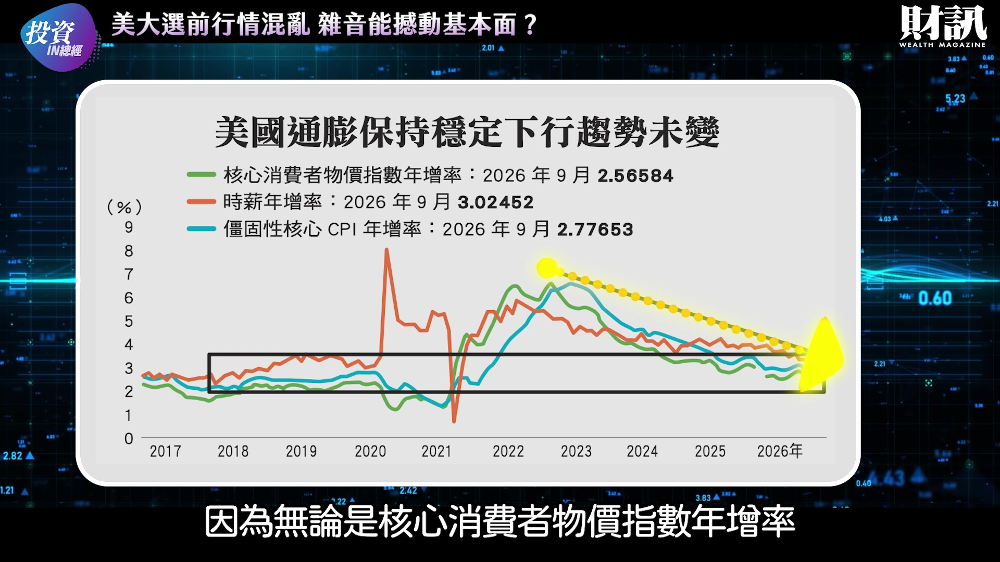
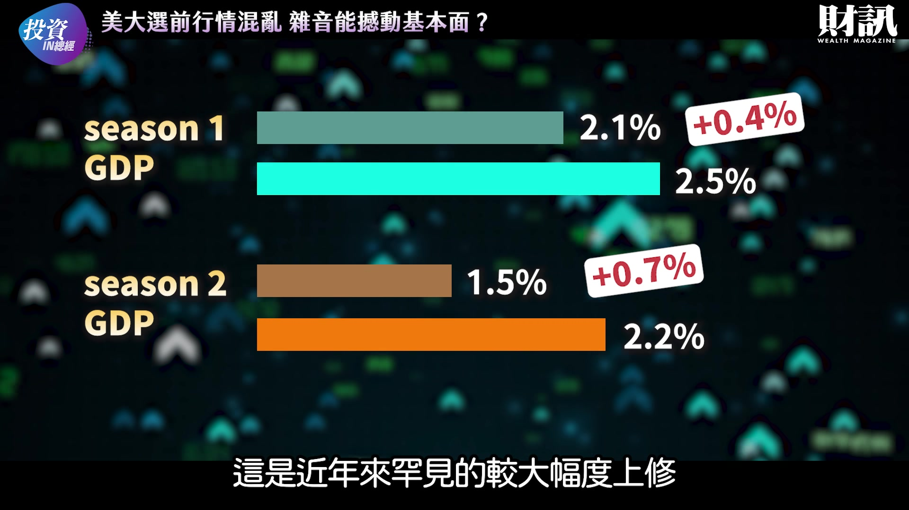
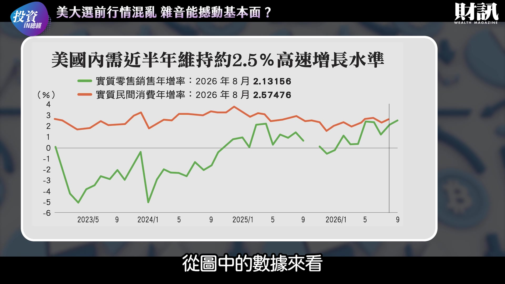
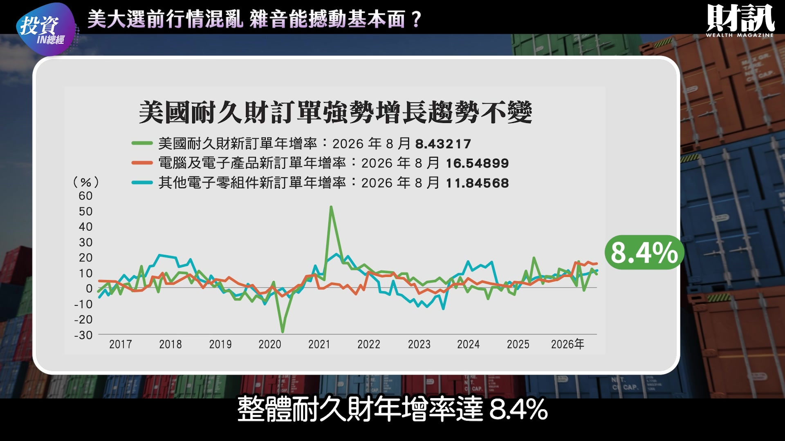
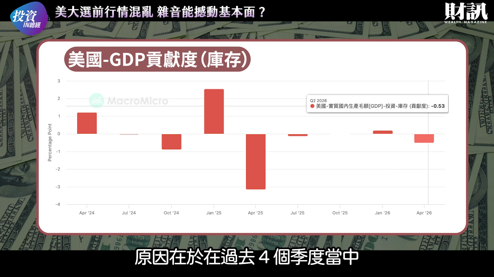
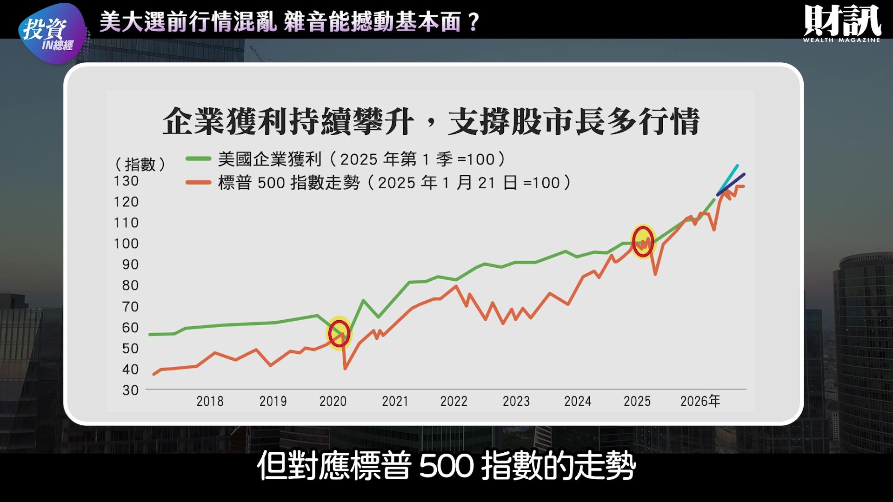
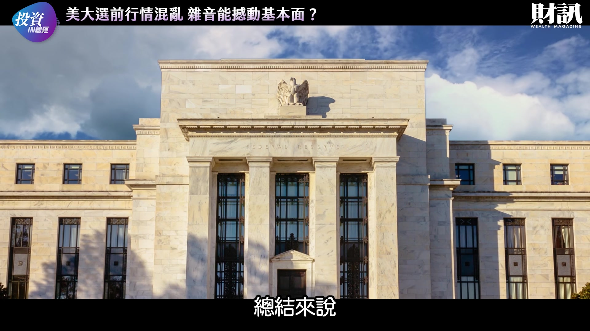

# wealth1974_vZetC_HMbJA — 關鍵畫面索引

- 來源逐字稿：[wealth1974_vZetC_HMbJA_GT.srt](wealth1974_vZetC_HMbJA_GT.srt)
- 影片：https://www.youtube.com/watch?v=vZetC_HMbJA
- 截圖數：28

## 00:00:01

**逐字稿片段：** 美股行情遇上期中選舉 很多正常的事情 都會開始變得有點不正常 川普想要壓下油價 成效卻很有限

**話題推測：** 介紹影片主旨：美股行情與期中選舉

---

## 00:00:10

**逐字稿片段：** 各州政府為了討好選民 開始找資料中心的麻煩 政治局勢詭譎多變

**話題推測：** 提及各州政府找資料中心麻煩，可能顯示新聞畫面或相關圖表

---

## 00:00:15

**逐字稿片段：** 加上新公布的生產者物價指數 突然飆上新高 一時之間讓市場的波動再起 在上沖下洗的市場激情之中 讓我們跟著愛榭克一起推敲 選後的投資局勢

**話題推測：** 引入新公布的生產者物價指數，預期顯示相關圖表

---

## 00:00:36

**逐字稿片段：** 10 月中的市場回檔 有一個最重要的因素

**話題推測：** 開始分析10月中的市場回檔，預期顯示市場走勢圖

---

## 00:00:39

**逐字稿片段：** 就是 9 月通膨數值 比想像中來得高 尤其是生產者物價指數

**話題推測：** 詳細說明9月通膨數值，預期顯示通膨數據圖表

---

## 00:00:44

**逐字稿片段：** 名目 PPI 的年增率來到 6.4% 核心 PPI 也來到 5% 此外 名目 CPI 和核心 CPI 的月增率 分別來到 0.6% 和 0.3% 如果轉化成年增率 就會發現明顯高於聯準會的 通膨目標區 那麼這些數據值得我們擔心嗎 特別是聯準會會不會因為 短期單月的通膨攀升 而提早啟動升息呢 愛榭克認為機率非常低 首先雖然從單月數值來看 通膨竄升確實會讓人滿擔心的

**話題推測：** 列出名目PPI年增率具體數字，預期顯示PPI詳細數據

---

## 00:01:17

**逐字稿片段：** 但是只要我們把時間軸拉長 就會發現 整體通膨其實正在持續改善中 因為無論是核心消費者物價指數年增率

**話題推測：** 討論拉長時間軸的通膨趨勢，預期顯示長期通膨走勢圖

---

## 00:01:27

**逐字稿片段：** 還是黏性通膨 目前都已經大致回落到 川普第 1 任任內的長期平均水準 值得注意的是 和長期通膨趨勢最為相關的時薪年增率 也持續下行 9 月已經來到 3% 的保衛戰了 在美國就業市場持續擴張的背景下 時薪增長卻不斷的下行

**話題推測：** 引入「黏性通膨」概念，預期顯示相關數據或圖表

---

## 00:01:48

**逐字稿片段：** 這意味著整體工作職缺的擴張 更加仰賴中低薪資職缺的拉抬 例如像是餐飲 觀光 醫療等服務產業 或者是基礎製造業 而失去的工作則比較多是高薪產業 像是科技業

**話題推測：** 解釋工作職缺擴張背後的結構性變化，預期顯示產業別就業數據圖

---

## 00:02:03

**逐字稿片段：** 別忘了聯準會的 Dual Mandate 也就是雙重使命 就業和通膨 當時薪增長持續下行的時候 它本身不但會帶來 強大的壓制通膨威力 更會讓聯準會投鼠忌器 進一步緊縮 此外要推究這些數據 對聯準會決策的影響

**話題推測：** 提醒聯準會的「雙重使命」，預期顯示文字說明或圖解

---

## 00:02:21

**逐字稿片段：** 就不能忽視新任聯準會主席華許的觀點 他在 Jackson Hole 全球央行年會上

**話題推測：** 引入新任聯準會主席華許的觀點，可能顯示人物照片或名字

---

## 00:02:27

**逐字稿片段：** 提出所謂的通膨擴散框架 簡單來說就是 以 6 個月或是 12 個月的週期來看 有多少的通膨項目類別 增長會超過 3% 按照這個方式來衡量就會發現 截至 9 月

**話題推測：** 介紹「通膨擴散框架」，預期顯示框架圖解或說明文字

---

## 00:02:41

**逐字稿片段：** 消費者物價指數所統計的 175 個類別當中 僅有 38% 的項目 增長超過 3% 這個比例遠遠低於今年5月的時候 高達 56% 的項目都高於增長 3%

**話題推測：** 應用框架分析CPI項目，預期顯示通膨項目分佈圖表

---

## 00:02:55

**逐字稿片段：** 如果拉長到 12 個月週期來看 9 月雖然通膨數字上升 但項目高於 3% 的比率 同樣逆勢從 51% 下降到 47% 換句話說從通膨的擴散面來看 通膨的持續改善 是廣泛而且逐漸深化的 因此從這兩個角度來看 不但投資人不需要 過度擔憂通膨失控的問題 對於聯準會可能強力緊縮的恐慌 實際上也是不需要的 除了通膨

**話題推測：** 討論12個月週期的通膨擴散情況，預期顯示更新後的圖表

---

## 00:03:25

**逐字稿片段：** 美國經濟近期也有一個重大的好消息 那就是美國第 2 季國內生產毛額 也就是 GDP 終值 出現了顯著上修

**話題推測：** 轉向討論美國經濟的重大好消息

---

## 00:03:34

**逐字稿片段：** 第 1 季 GDP 從 2.1% 上修到 2.5% 修正了 0.4%

**話題推測：** 列出第一季GDP上修具體數字，預期顯示Q1 GDP數據

---

## 00:03:39

**逐字稿片段：** 第 2 季 GDP 從 1.5% 上升到 2.2% 修正了 0.7% 這是近年來罕見的較大幅度上修

**話題推測：** 列出第二季GDP上修具體數字，預期顯示Q2 GDP數據

---

## 00:03:48

**逐字稿片段：** 如果轉化成絕對金額 名目 GDP 上修達到 769.64 億美元 實質 GDP 更是高達 1383.98 億美元 這樣的調整其實也符合 我們過去一段時間文章的結論 那就是美國經濟增長水準 顯然比市場預期更為強勁 那麼本季的經濟表現又會如何呢 基本上我們始終強調 不需要過度擔憂通膨 但坦白說

**話題推測：** 將GDP上修轉化為絕對金額，預期顯示GDP金額數據

---

## 00:04:14

**逐字稿片段：** 受到美伊戰爭的衝擊 大家仍然會擔心 高漲的油氣原物料價格 以及高利率環境 是否會讓美國的內需引擎受到衝擊呢 從圖中的數據來看

**話題推測：** 提及美伊戰爭對經濟的衝擊，預期顯示新聞畫面或相關圖表

---

## 00:04:26

**逐字稿片段：** 美國的實質零售銷售增長 在 8 月增長高達 2.1% 而最新 9 月的數據已經高達 2.5% 另外更為廣泛 包括服務業在內的實質個人消費支出 8 月年增率也高達 2.6% 從這兩個數據來看 美國內需動能無論是商品或者服務 目前都已經初步站穩 2.5% 的高速增長水準 而隨著年底購物旺季的接近 可望進一步推升內需拉抬經濟的動能 美國內需市場的增長 投資人大可不必太過擔心

**話題推測：** 引入美國實質零售銷售增長數據，預期顯示零售銷售圖表

---

## 00:05:01

**逐字稿片段：** 而愛榭克長期追蹤的美國耐久財訂單 雖然目前處於比較高的基期 但進入 8 月之後 同樣維持相當驚人的高速增長 整體耐久財年增率達 8.4%

**話題推測：** 轉向分析美國耐久財訂單，預期顯示耐久財訂單圖表

---

## 00:05:14

**逐字稿片段：** 其中電腦與電子產品訂單 年增竟然高達 16.6% 而電子零組件訂單 同樣高達 11.9% 從有統計以來 經濟從來沒有在電腦與電子產品訂單 都呈現雙位數增長的情況下進入衰退 相信這次也會是一樣的 GDP 整體數據情況良好 但這個已經堪稱理想的增速 可能還有一些低估 原因在於在過去 4 個季度當中

**話題推測：** 列出電腦與電子產品訂單增長率，預期顯示分項數據

---

## 00:05:42

**逐字稿片段：** 有 3 個季度的庫存貢獻值是負的 特別是剛出爐的今年第 2 季 在打庫存的情況之下 竟然出現高達 0.52% 的負貢獻 換句話說 如果不是因為建構庫存如此的消極 美國上半年的經濟增速 應該要已經回升到 3% 的水準 說到這裡先做個小結 目前美國內需升溫 通膨降溫的趨勢 還沒有任何明顯改變的跡象 而只要美國的個人和企業繼續大買特買

**話題推測：** 討論庫存貢獻值為負的情況，預期顯示庫存對GDP貢獻圖表

---

## 00:06:11

**逐字稿片段：** 那麼當前極度偏低的庫存銷售比 很有可能會在今年年末或者明年上半年 出現大舉拉貨的回補庫存潮 當庫存潮一來 美國 GDP 重新站上 3% 的增長 就會是水到渠成的事情了 從總體經濟基本面來看 當通膨和成長 這兩個影響市場的基本面因素 都呈現正向發展的時候 股市自然是欲小不易了 不過除了通膨和成長之外

**話題推測：** 提及極度偏低的庫存銷售比，預期顯示庫存銷售比圖表

---

## 00:06:41

**逐字稿片段：** 企業的盈利 同樣也是未來要推動股市發展 不可或缺的因素 無論我們是採用 2020 年疫情前的高點位置 還是 2025 年川普就職時的時間點 做為基準點計算 從美國整體企業盈利來看 雖然過去幾年股市很飆 但對應標普 500 指數的走勢

**話題推測：** 轉向分析企業盈利，預期顯示企業盈利成長圖表

---

## 00:07:01

**逐字稿片段：** 企業獲利的增長軌道 相較股市其實沒有討到什麼便宜 絕大多數的時間 標普的漲幅是比不上企業盈利增長的 同樣的趨勢我們也可以 在 FactSet 的報告上看到 圖中顯示的標普 500 指數本益比 隨著企業優於預期的盈利不斷開出 在 10 月中指數創高的同時 本益比在今年以來卻是一路的往下修 目前美股整體前瞻 12 個月本益比 已經跌破 19 倍 正式回到 10 年均值以下 雖然企業持續開出亮眼的成績單 但是投資人 對於市場估值的拉抬意願並不高 這也是導致市場前瞻本益比 不斷往下走的原因 總結來說

**話題推測：** 比較企業獲利增長與標普500指數走勢，預期顯示比較圖表

---

## 00:07:45

**逐字稿片段：** 當市場整天擔心通膨惡化推升利率 擔心經濟擴張會戛然而止 又擔心市場估值過高 然後不斷追逐市場訊息的風吹草動 就很容易導致市場上沖下洗 出現大幅波動 對投資人來說 這無疑是一種很大的負擔 但對我們來說 需要做的其實只有一件事 那就是把握回檔 審慎進行優質標的或產業的投入 如此一來就能夠把握住 這千載難逢的布局機會了

**話題推測：** 總結市場擔憂因素，預期顯示文字列表或重點圖解

---

## 00:08:17

**逐字稿片段：** 財團粉絲們 您認為美國經濟與資本市場需要擔心嗎 A 不用 數據已經講得很明白 大多都是市場情緒在波動 B 需要 資金還是最敏銳的 C 不清楚還需要更多觀察 留言告訴我們吧 今天的《投資IN總經》到這邊告一段落 喜歡這個節目的觀眾 記得幫我們按讚與分享喔 我們下次見

**話題推測：** 進入觀眾互動問答環節，預期顯示投票選項畫面

---
