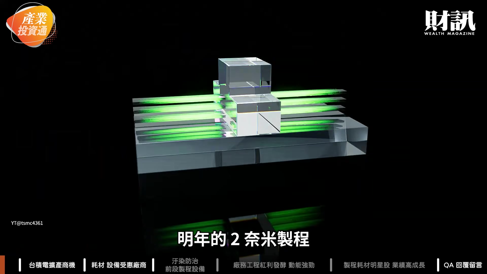
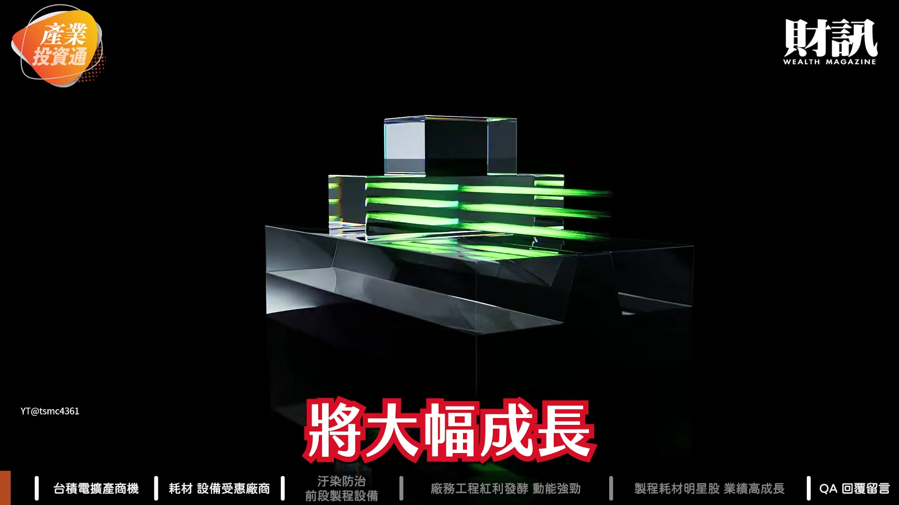
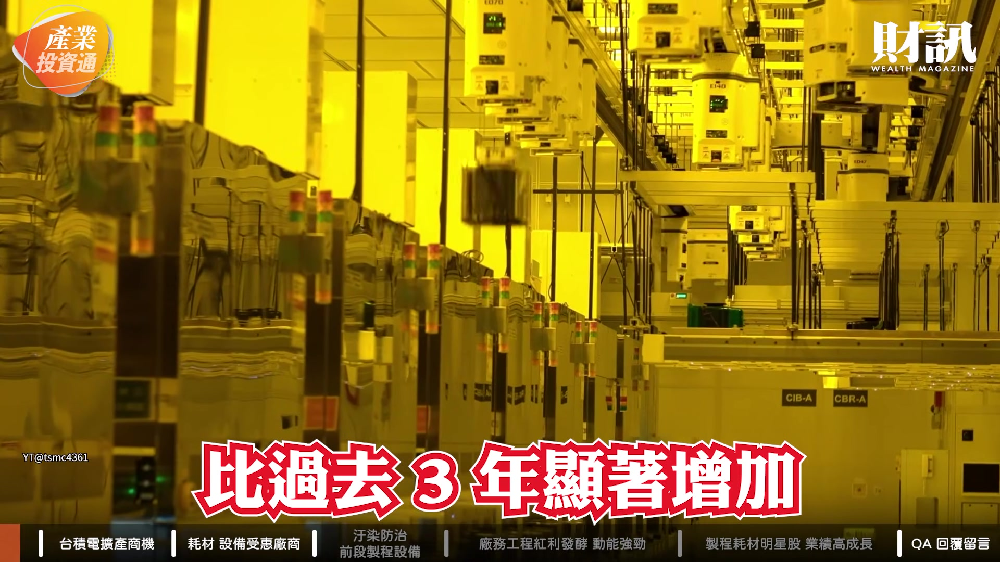
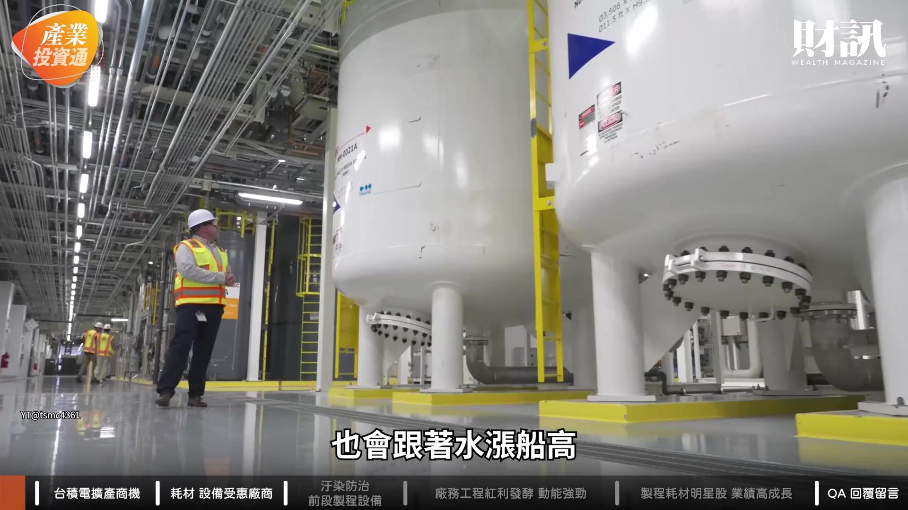
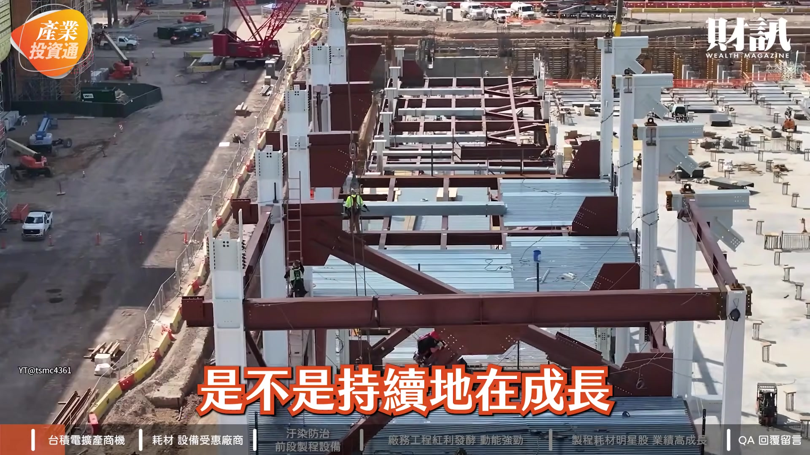
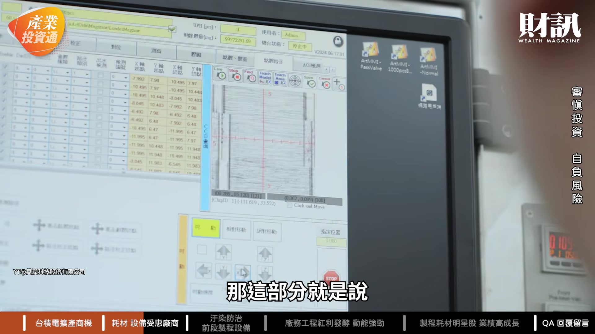

# wealth1974_wDxKEGE0vpY — 關鍵畫面索引

- 來源逐字稿：[wealth1974_wDxKEGE0vpY_GT.srt](wealth1974_wDxKEGE0vpY_GT.srt)
- 影片：https://www.youtube.com/watch?v=wDxKEGE0vpY
- 截圖數：10

## 00:00:11

**逐字稿片段：** 明年的 2 奈米製程 將大幅成長

**話題推測：** 預期畫面內容：台積電2奈米製程相關數據或計畫簡報

---

## 00:00:13

**逐字稿片段：** 今年的資本支出 預估會達到 600 億到 640 億美元 到了 2028 年 資本支出還會 比過去 3 年顯著增加

**話題推測：** 預期畫面內容：台積電資本支出數據圖表

---

## 00:00:22

**逐字稿片段：** 隨著台積電在全球推進了 有近 20 座新的廠 設備 零組件跟耗材的需求 也會跟著水漲船高

**話題推測：** 預期畫面內容：台積電全球擴廠地圖或數量列表

---

## 00:00:30

**逐字稿片段：** 今天這集 我們就要來跟大家聊聊 台積電擴產 帶動設備耗材的商機 還有建廠紅利發酵 廠務工程第四季入帳高峰 以及製程耗材明星股 業績高成長 台積電這波擴產 規模跟速度都非常驚人 就這幾年都可以看到 有這樣的訊息 那我們想要請志明哥 可以先來幫我們分析 來瞭解一下說 這個台積電的資本支出 會帶來哪些的商機呢

**話題推測：** 預期畫面內容：今日節目主題大綱簡報

---

## 00:00:59

**逐字稿片段：** 台積電這次法說之後 股價有修正 那隔天 C.C. Wei （魏哲家）董事長 他參加一個活動 就講說他不太開心 因為他覺得 台積電其實業績是很好 但是股價當然 因為升息的一些氣氛下 所以讓科技股修正 當然我覺得這部分 其實對台積電來講 未來還是沒有什麼大的問題 其實我們最重要看是 台積電它的資本支出 是不是持續地在成長

**話題推測：** 預期畫面內容：台積電股價走勢圖

---

## 00:01:26

**逐字稿片段：** 那以台積電 2 年前 大概 300 億元 去年是 400 億元 今年大概是 600-640 億元左右 但是現在法人估 它明年到後年 每年都增加 大概 200 億元左右 等於是明年可能到 800 億元 後年可能挑戰 1000 億元了 所以說以台積電投資的 這種步調跟戰略來講 其實台積電未來業績 還是會非常好 所以說現在台積電 修正到季線左右 其實反而是一個 還不錯的布局的時間點 那當然支持台積電 相關的這些供應鏈 因為升息的關係而修正 其實也是一個 不錯卡位的時間點

**話題推測：** 預期畫面內容：台積電歷年資本支出數據圖表

---

## 00:02:06

**逐字稿片段：** 那其實我們這次 值得觀察的一件事就是 魏董事長有講說 有關那種高數值孔徑極紫外光 的布局的話 一般像外資分析是說 你沒有先買這個 可能會失去你的競爭優勢 但是魏董事長講說 要到 2030 年才會正式地用 這樣的很好的設備 來製造它的晶圓 最重要的原因是 他說良率要好 然後成本要夠低 然後效率要高 所以說等於是台積電 不用最新的 最貴的技術跟設備 就可以做到全世界的 這種良率 成本跟效率 可見台積電的技術 的確是滿好的 那這部分會落實到什麼地方呢 就是被台積電訓練的 這些設備與材料 它的價值會提升 所以這部分 其實對台灣廠商 是非常好的一個消息 那當中就是說 我們有看到 志明哥剛剛講的這些設備 還有這些耗材的供應商 其實大家的技術 也愈來愈厲害了 就是被台積電 磨練這麼多年 然後也進步非常多 那其中我們有看到 像是有成精密跟萬潤 這兩家公司的成長 其實算是特別亮眼 請志明哥來幫我們分享一下說 這兩家公司 到底厲害在哪裡 其實萬潤很有趣 它本來只是日月光 做一些 AI 檢測相關的供應商 當初可能是在 封裝的部分的一些設備 那後來因為技術提升以後 它其實在台積電先進封裝 像點膠機 甚至是 檢測的相關機台的部分 早就已經卡位了 CoWoS 這相關的機台 不管是台積電或是輝達 需要的這些晶片 都會用它的這些 相關的設備去做 其實台灣這些 本來名不見經傳的 這些本土的企業 因為受到台積電 這些訓練之後 它的技術層次是 往上提升得滿多 那即使是將來 CoPoS 相關的晶圓 由圓轉方的這種設備 其實它也卡位的很成功 所以說不管是先進封裝 跟 CoPoS 跟 CoWoS 這部分 萬潤其實都有 不錯的競爭力 那這部分就是說

**話題推測：** 預期畫面內容：高數值孔徑極紫外光（High-NA EUV）技術簡介

---

## 00:04:18

**逐字稿片段：** 它今年前 9 月的營收年增 已經 58% 法人估它這 2 年的 也是今年跟明年 都會有個高營收成長的 這種機會 所以說我覺得 如果這次波動修正的話 其實也可以考慮 這個萬潤的 未來布局的一個時間點

**話題推測：** 預期畫面內容：萬潤營收年增率數據圖表

---

## 00:04:35

**逐字稿片段：** 那另外有成精密 其實它是在 離子植入設備的耗材 跟相關的精密零組件 那這部分當然也就是 台積電製程中 重要一些零組件 像比如說石墨件 或電極的這些設備 其實台積電良率 為什麼會那麼好的原因 就是它在製程中 這種顆粒汙染的影響 變少的狀態下 它就會讓自己 晶圓的良率提高 那這部分像有成精密 也有打入台積電相關供應鏈 它這部分未來會愈來愈好 那它今年像前 3 季的 營收成長也是有 57% 左右 那獲利率是成長 250% 那表示它成長力道是滿強 所以說也是值得 大家去注意的一家公司 剛剛志明哥幫我們講解 這兩家公司 其實在這個市場上 其實都滿厲害的 大家都有耳聞 也都知道 那至於其他的台廠的狀況 是怎麼樣呢 接下來就是屬於 我們會員專屬的內容 有興趣的觀眾 歡迎加入頻道會員來觀看 那接下來我們要來回覆一下 觀眾的留言 我們的頻道會員 I 大

**話題推測：** 預期畫面內容：有成精密公司介紹或股價走勢圖

---

## 00:05:44

**逐字稿片段：** 他說請問聖暉訂單滿檔 為什麼股價都起不來呢 想要請志明哥 來幫我們分享解答一下 其實我覺得聖暉的 在手訂單還是滿高的 只是說認列的時間點 跟現在的升息氣氛 對科技股是比較不利的 像今年 7 月 也因為升息的氣氛 讓股市修正了一大段 那後來科技股也都漲回來 那現在的氣氛 就比照當時那種氣氛 那就等這種升息的利空消息 被消化之後 其實這些科技股 相關的業績公告 然後本益比提升之後 它股價就會有不錯的反應 我覺得這還是要等一下時間 是 這次聖暉也有在 我挑選的廠務七雄裡面 然後有去查過它的訂單 未來 2 年都是沒有問題的 所以其實就像志明哥講的 這個整個是一個氛圍 因為股價比較受氛圍的影響 但是其實業績長線 台積電還要建這麼多廠 其實這都是沒有問題的 其實最重要還是升息的氣氛 那過去投資界就說升息是好事 那現在等於是你 CPI 變高 升息的時候你的資金會緊縮 那當然對科技股短線來講 是會受到壓抑的 那等到慢慢這些利空 受到消化之後 其實整體往上走的機會 還是滿高的 謝謝志明哥 以上就是本集的內容 如果大家喜歡這個節目 歡迎邀請你的親朋好友

**話題推測：** 預期畫面內容：聖暉公司介紹或股價走勢圖

---
