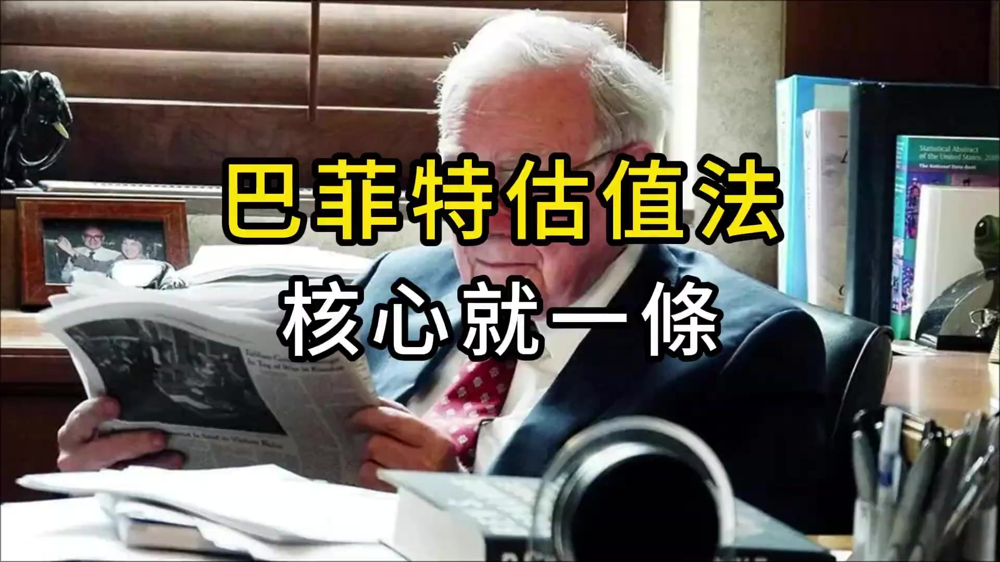
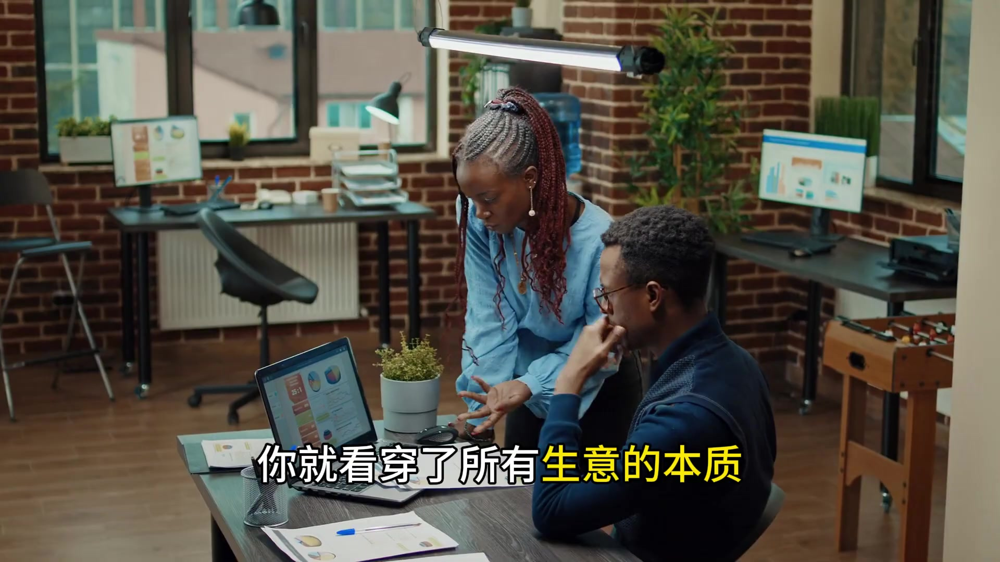
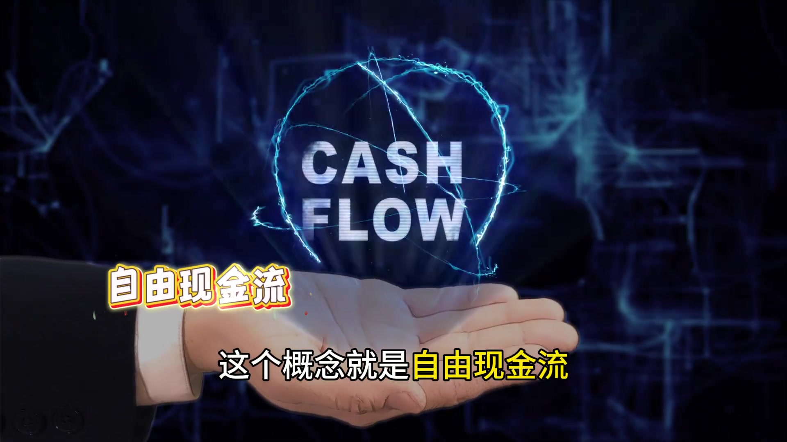
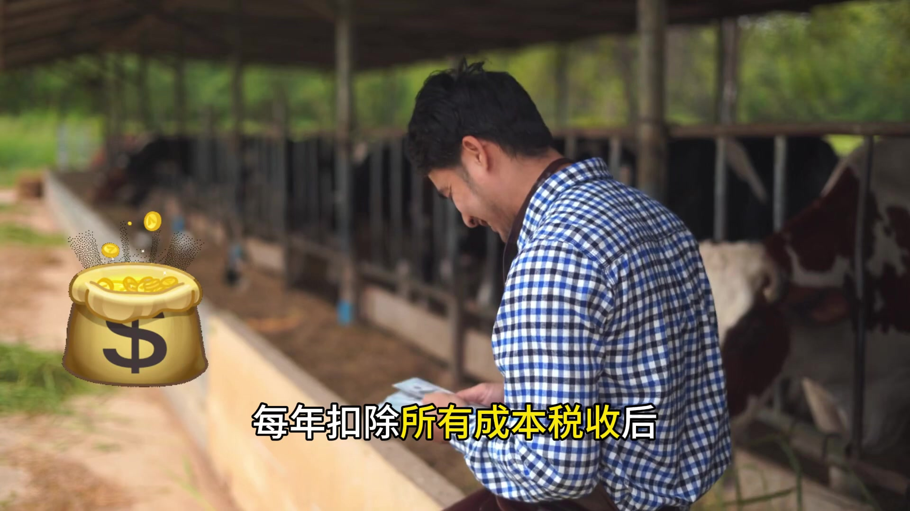
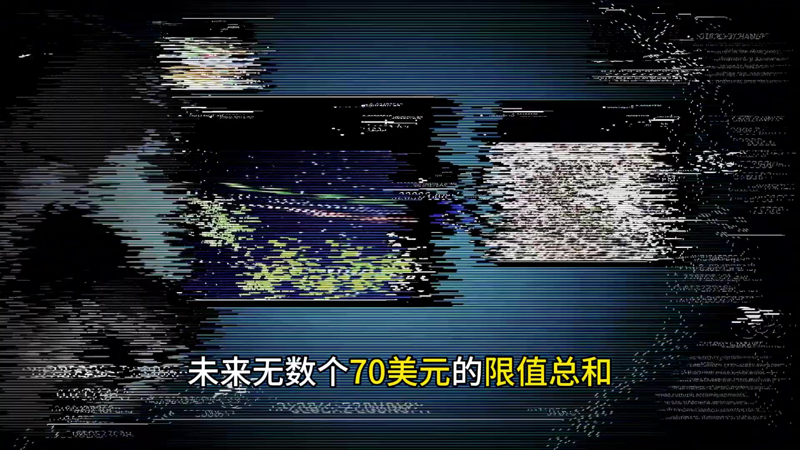
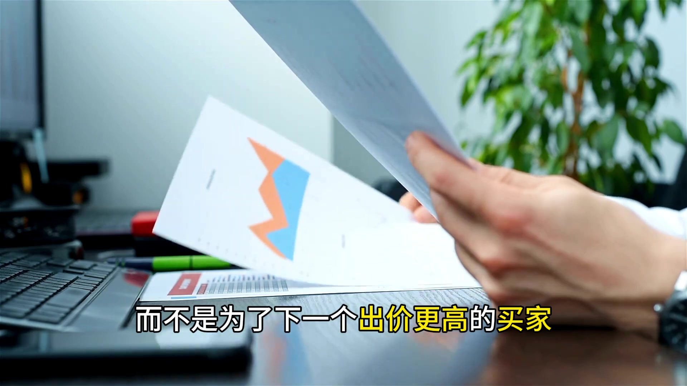
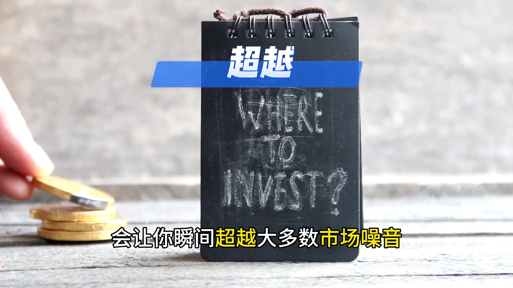

# x_Ofio1iI-i50 — 關鍵畫面索引

- 來源逐字稿：[x_Ofio1iI-i50_FIN.srt](x_Ofio1iI-i50_FIN.srt)
- 影片：https://www.youtube.com/watch?v=Ofio1iI-i50
- 截圖數：9

## 00:00:00

**逐字稿片段：** 市盈率、市淨率、DCF 模型，是不是讓你覺得公司估值像天書？巴菲特認為不必把事情弄得太複雜；估值的核心只有一個概念，掌握它就能看懂生意的本質。

**話題推測：** 介紹複雜的公司估值方法，可能搭配標題圖示或簡報頁。

---

## 00:00:15

**逐字稿片段：** 這個概念就是自由現金流。

**話題推測：** 提出核心概念「自由現金流」，可能搭配定義或概念圖。

---

## 00:00:18

**逐字稿片段：** 巴菲特用農場的例子解釋自由現金流：假設你買下一座農場，每年扣除所有成本與稅金後，

**話題推測：** 引入巴菲特農場的例子，可能搭配農場插畫或案例標題。

---

## 00:00:25

**逐字稿片段：** 還能賺到 70 美元，而且不必再把這筆錢投入農場維護。這 70 美元就是農場主每年實際可取得的現金；農場的價值，取決於未來現金流的總和。

**話題推測：** 提出農場每年賺取「70美元」的具體數字，可能顯示在圖表中。

---

## 00:00:42

**逐字稿片段：** 這就是價值投資的核心：買股票等於買下一部分生意。我們投資，是看重資產本身創造現金的能力，而不是期待下一位買家出更高的價錢。

**話題推測：** 總結「價值投資的精髓」，可能搭配重點摘要頁面。

---

## 00:00:54

**逐字稿片段：** 因此，他只閱讀財報，就能做出決定。

**話題推測：** 引入巴菲特收購克萊頓房屋公司的真實案例，可能顯示公司名稱或巴菲特照片。

---

## 00:00:56

**逐字稿片段：** 他決定以 170 億美元收購克萊頓房屋公司，甚至沒有見過執行長。因為他看的不是故事或概念，而是財報背後的生意能創造多少自由現金流。

**話題推測：** 提及收購金額「170億美元」及公司名稱，可能搭配新聞標題或交易資料圖。

---

## 00:01:11

**逐字稿片段：** 下次看到一家公司，先別看股價漲跌，問問自己：如果我買下整家公司，它每年能為我帶來多少現金？這種思考方式能幫助你避開許多市場雜訊。

**話題推測：** 轉向給觀眾的實際操作建議，可能搭配「下次這樣做」或「關鍵問題」的提示。

---

## 00:01:28

**逐字稿片段：** 你也可以試著用這個方法，估算身邊熟悉的手搖飲店或小超市值多少錢，並在留言區分享看法。

**話題推測：** 建議將估值思路應用於身邊的「奶茶店、小超市」，可能顯示生活化例子圖片。

---
