# x_SE5CoXNuG_Y — 關鍵畫面索引

- 來源逐字稿：[x_SE5CoXNuG_Y_FIN.srt](x_SE5CoXNuG_Y_FIN.srt)
- 影片：https://www.youtube.com/watch?v=SE5CoXNuG_Y
- 截圖數：13

## 00:00:00

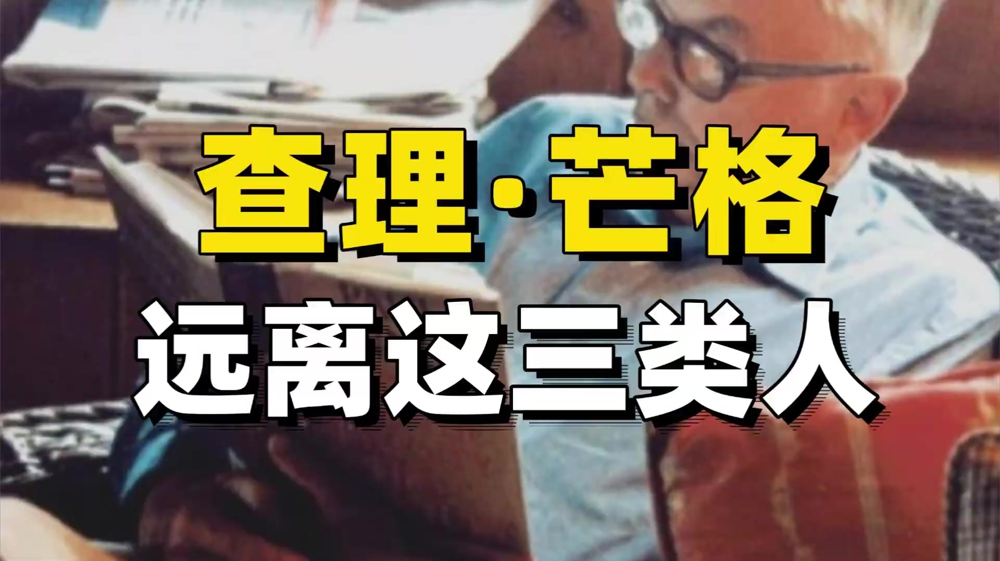

**逐字稿片段：** 芒格一生反覆強調一個常被忽略的道理：人生許多遺憾，都可能源於選錯身邊的人。

**話題推測：** 引出影片主題：芒格對選擇身邊人的觀點

---

## 00:00:06

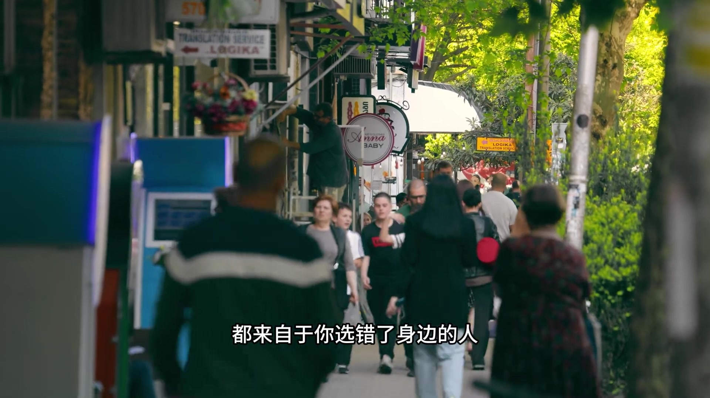

**逐字稿片段：** 他在 2007 年南加州大學的畢業典禮上說過：「你會逐漸變成每天相處的人。」這種影響往往在不知不覺間發生。若身邊的人總是抱怨，你可能也變得憤世嫉俗；若身邊的人投機取巧，你也可能逐漸放棄自己的底線。

**話題推測：** 提及芒格2007年在南加州大學畢業典禮上的發言

---

## 00:00:22

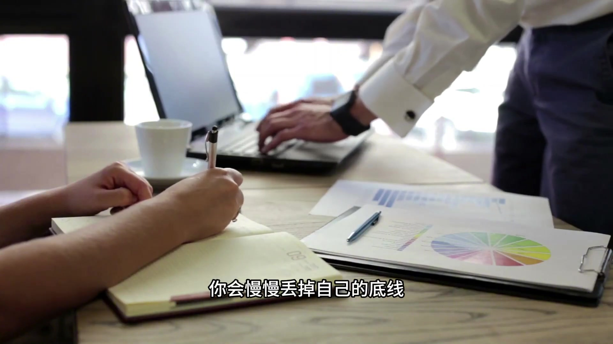

**逐字稿片段：** 芒格很早就定下一條原則：不要替自己不尊敬的人工作，也不要和自己不尊敬的人交朋友。他認為這不是道德潔癖，而是有效的處世之道；他見過許多聰明人因為跟錯了人而毀掉一生。

**話題推測：** 引出芒格定下的一條「鐵律」

---

## 00:00:37

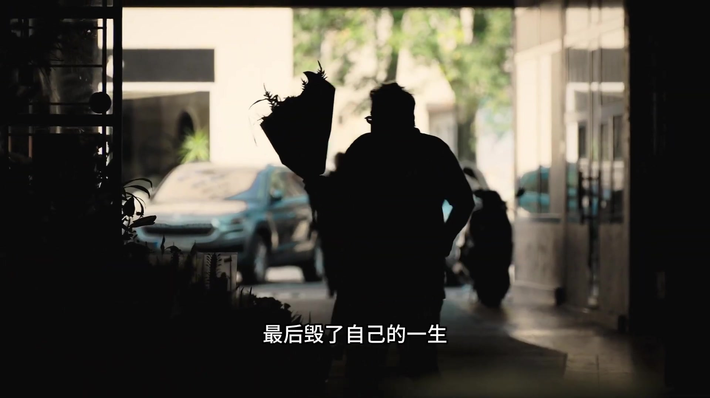

**逐字稿片段：** 人生就像果園。想收成好果實，就得定期修剪枝葉。那些不結果、又搶走陽光與養分的枯枝，就像消耗你的人；適時遠離他們，才能把有限的心力留給真正重要的人。這不是功利，而是尊重自己的生命。

**話題推測：** 透過「果園」比喻人生與人際關係的修剪

---

## 00:00:54

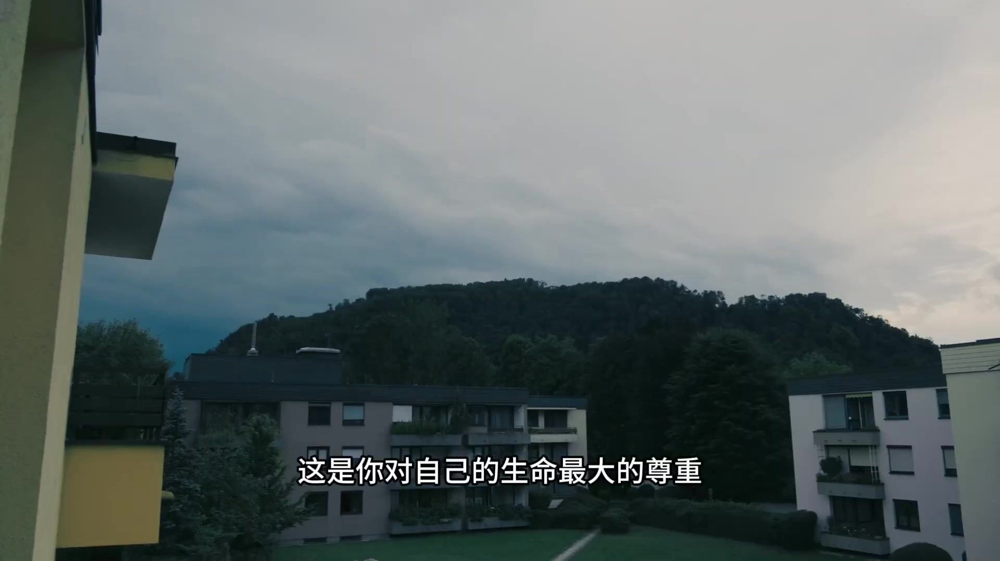

**逐字稿片段：** 有三種人，即使是親戚，也應該果斷保持距離。第一種是：

**話題推測：** 引出三種需要果斷保持距離的人

---

## 00:00:58

**逐字稿片段：** 第一種是深陷受害者心態的人。

**話題推測：** 第一種人：深受受害者心態的人

---

## 00:01:00

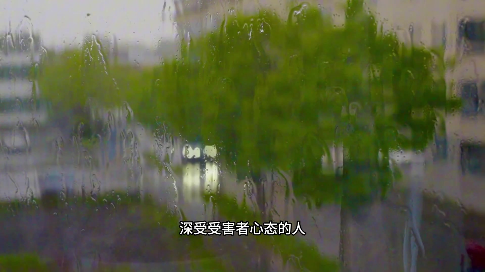

**逐字稿片段：** 《窮查理寶典》提到，自憐是有害的精神狀態。陷入受害者心態的人總覺得全世界都在針對自己：工作不順怪老闆，投資虧損怪市場，生活不如意則怪別人。他們不願解決問題，只反覆訴說痛苦，甚至把旁人也拉進負面情緒中。芒格年輕時遇過這樣的人，後來選擇斷絕往來；多年後對方仍在原地抱怨。

**話題推測：** 提及《窮查理寶典》這本書

---

## 00:01:28

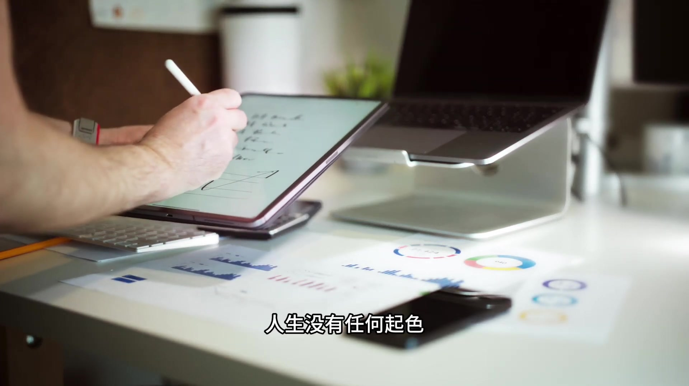

**逐字稿片段：** 第二種是缺乏誠信的聰明人，也是最危險的一種。芒格說，他從未見過和壞人做生意還能全身而退的例子。這類人可能很有魅力、口才好、智商高，卻沒有底線，為了利益可以出賣任何人。一個人在小事上不誠實，遇到大事也可能背叛你。

**話題推測：** 第二種人：不誠實的聰明人

---

## 00:01:46

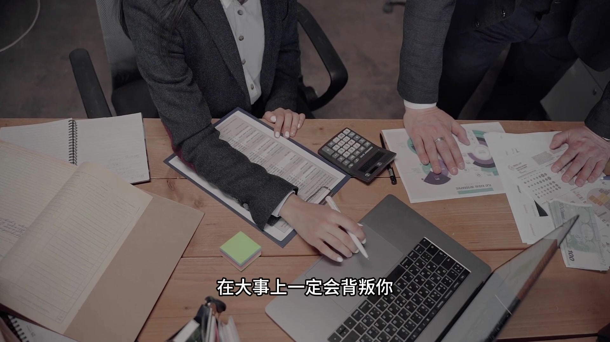

**逐字稿片段：** 芒格說，他寧願和一位智商 130、誠實可靠的人共事，也不願和一位智商 150、卻自以為是的天才共事。

**話題推測：** 提及芒格對智商與誠實可靠的比較

---

## 00:01:53

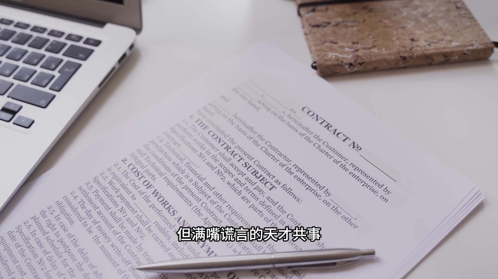

**逐字稿片段：** 第三種是嫉妒心強的人。

**話題推測：** 第三種人：嫉妒心強的人

---

## 00:01:55

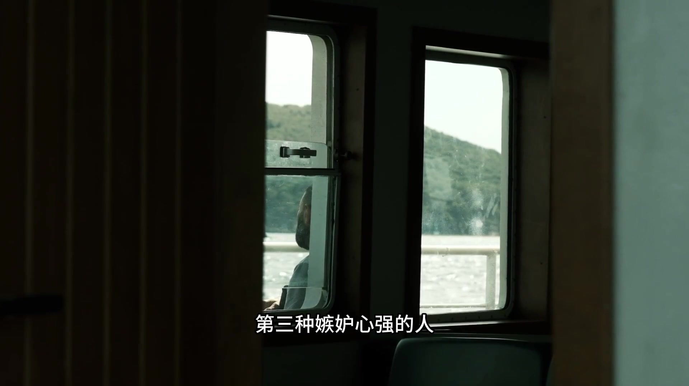

**逐字稿片段：** 芒格在 1986 年哈佛畢業典禮上談到，嫉妒是最愚蠢的情緒之一，因為它不會帶來快樂。你嫉妒別人，對方毫髮無傷，受折磨的卻是自己。至於嫉妒你的人，可能見不得你好，甚至在背後詆譭或阻撓你；即使是親人，也應保持適當距離。

**話題推測：** 提及芒格1986年在哈佛畢業典禮上的發言

---

## 00:02:14

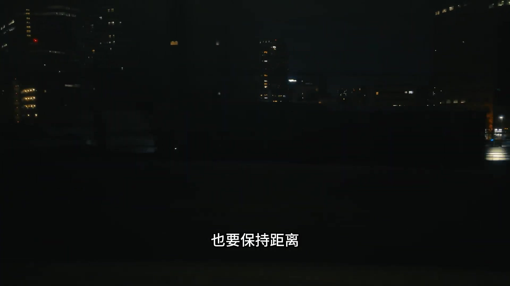

**逐字稿片段：** 有人會問，這樣做是不是太冷漠？恰恰相反，遠離消耗你的人，才能騰出空間，留給真正關心、支持你的人。

**話題推測：** 對清理人際關係的提問與總結

---

## 00:02:22

**逐字稿片段：** 芒格最好的朋友，包括巴菲特和李克格林，都是他由衷尊敬的人。和這樣的人相處，不必設防或內耗，只要專心把事情做好。人生的幸運不只是中獎，而是在年輕時遇見幾位值得同行的人；身邊的人會影響人生的方向。

**話題推測：** 提及芒格的摯友巴菲特與李克格林

---
