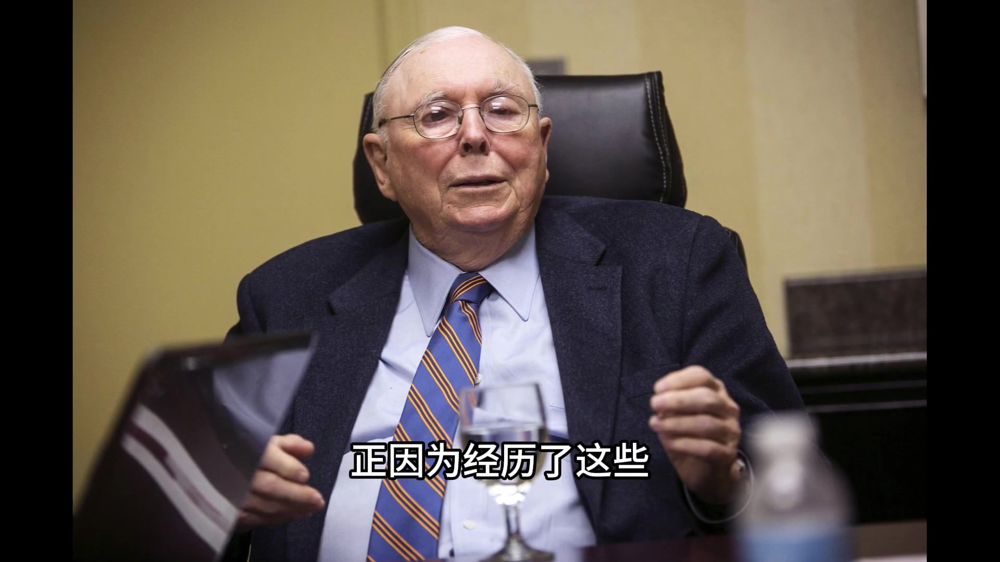
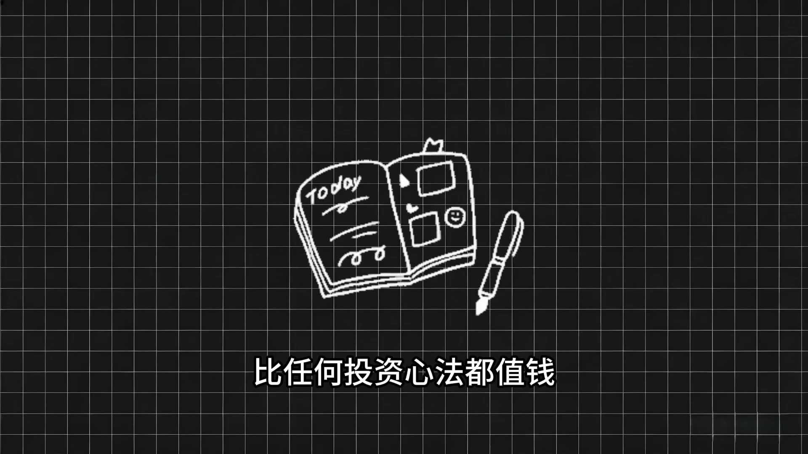
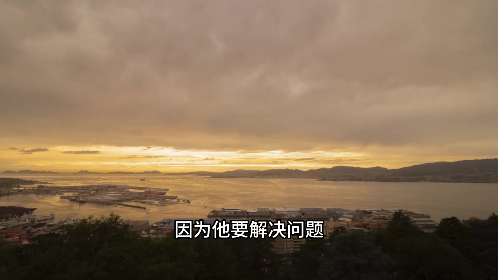
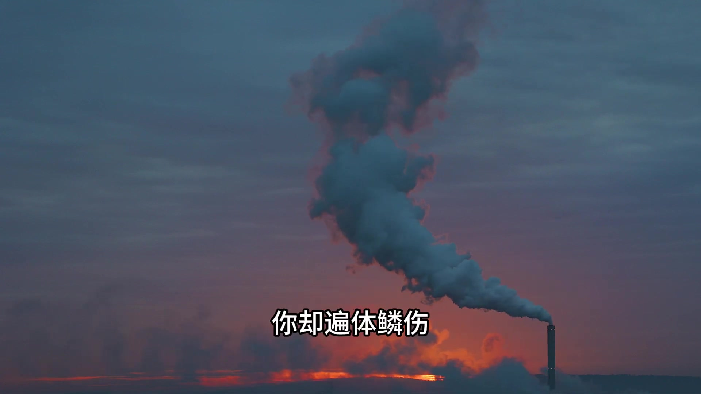
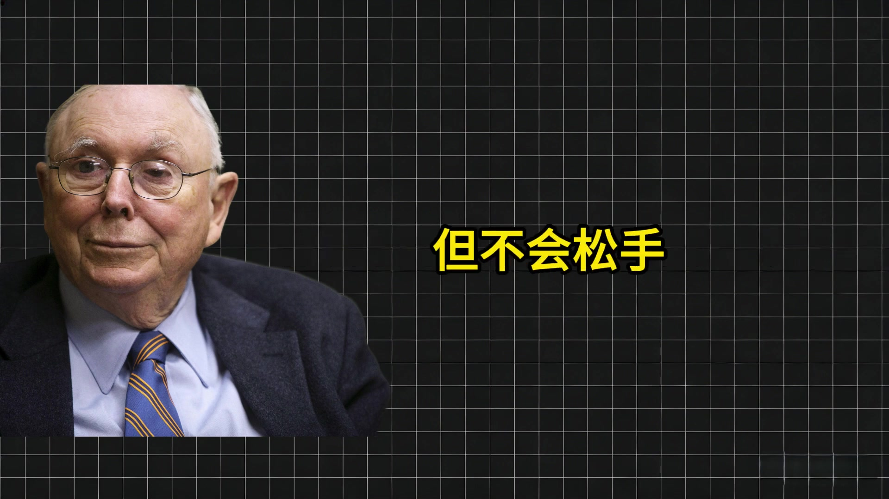
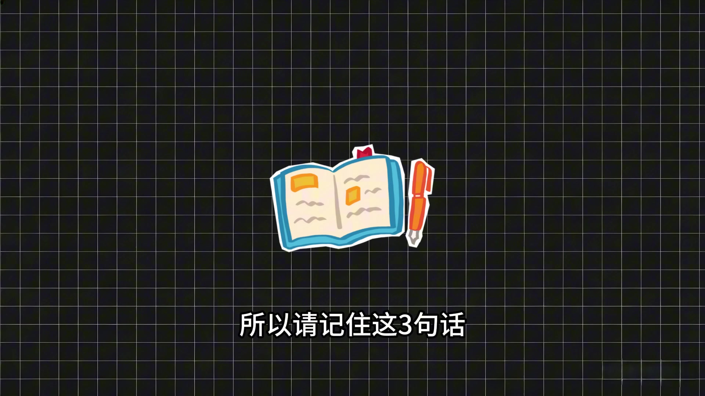
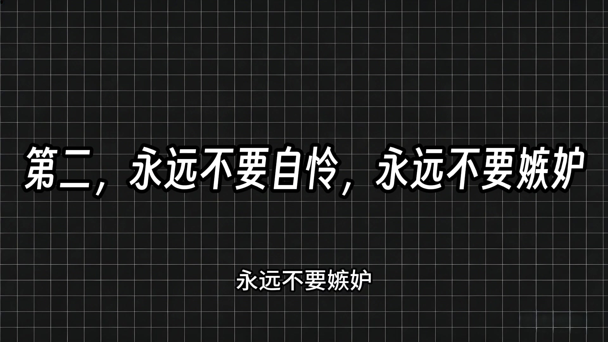

# x_WozyR-uRgUs — 關鍵畫面索引

- 來源逐字稿：[x_WozyR-uRgUs_FIN.srt](x_WozyR-uRgUs_FIN.srt)
- 影片：https://www.youtube.com/watch?v=WozyR-uRgUs
- 截圖數：7

## 00:00:49

**逐字稿片段：** 他總結出兩條以人生經歷換來的原則，認為這些道理比許多投資心法更值得記取。

**話題推測：** 介紹芒格總結出的人生鐵律

---

## 00:00:54

**逐字稿片段：** 第一，不要自憐。即使孩子罹患重病，也不能只沉溺於自憐；芒格的兒子生病期間，他下班後便趕往醫院，查閱醫學資料、努力籌錢並尋找專家，專心面對問題。

**話題推測：** 芒格人生鐵律的第一條原則

---

## 00:01:08

**逐字稿片段：** 第二，永遠不要嫉妒。嫉妒是無法帶來快樂的情緒，就像自己喝下毒藥，卻盼著別人受苦；對方毫髮無傷，受傷的只有自己。

**話題推測：** 芒格人生鐵律的第二條原則

---

## 00:01:18

**逐字稿片段：** 2023 年 11 月，99 歲的芒格在生前最後一次受訪時說，每個人都在掙扎：你無法讓逝者復生、治好垂危的孩子，也無法留住想離開的人。人生總有無法如願之處，但仍要堅持下去。想哭的時候就盡情哭泣，只是不要放棄。

**話題推測：** 提及芒格於2023年11月生前最後一次採訪

---

## 00:01:39

**逐字稿片段：** 請記住以下三個原則：

**話題推測：** 總結三個重要的生活原則

---

## 00:01:40

**逐字稿片段：** 第一，承認痛苦是人生常態，不必假裝堅強。第二，不要自憐，也不要嫉妒。

**話題推測：** 第一個生活原則

---

## 00:01:47

**逐字稿片段：** 第三，可以哭泣，但不要放棄。最後送給大家芒格的一句話：坦然接受遭遇的苦難，也坦然接受到來的福氣。

**話題推測：** 第三個生活原則

---
