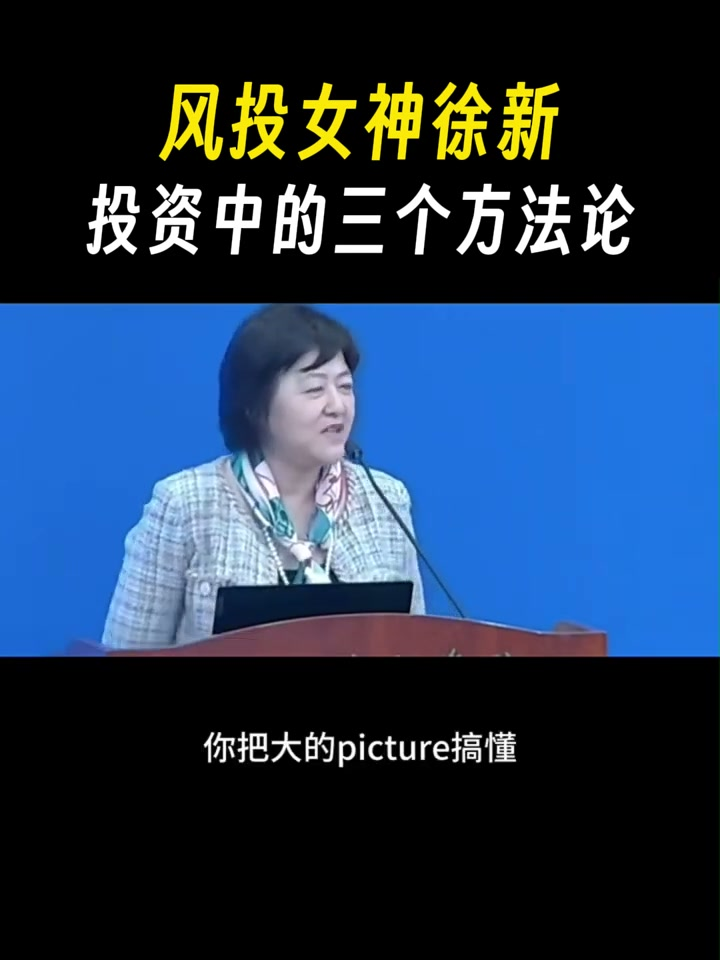
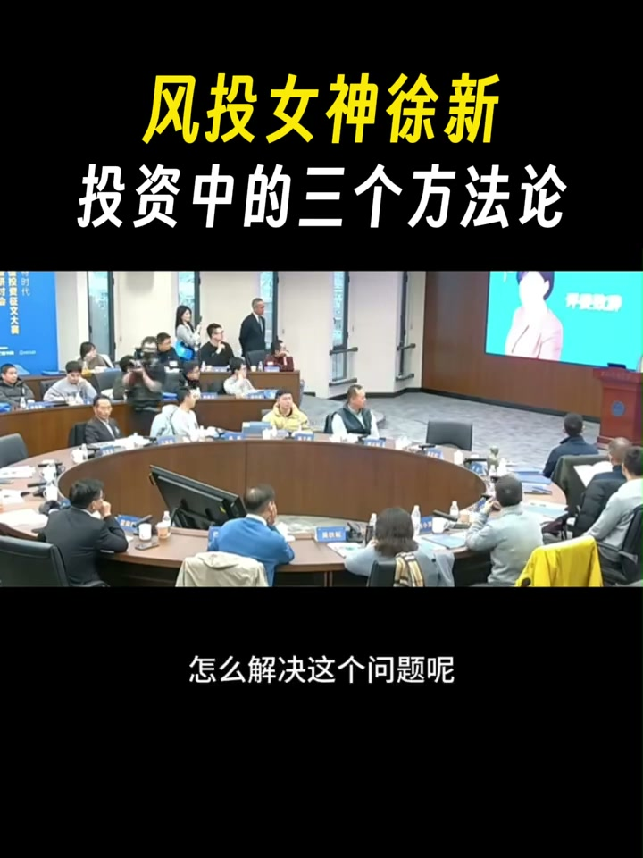
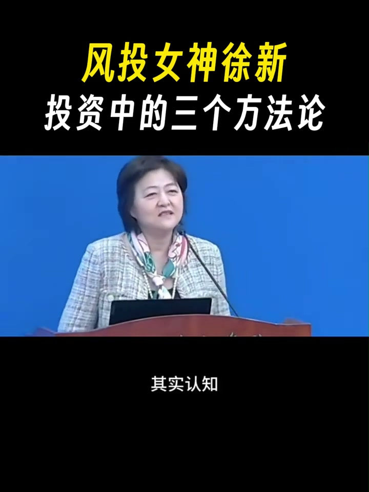
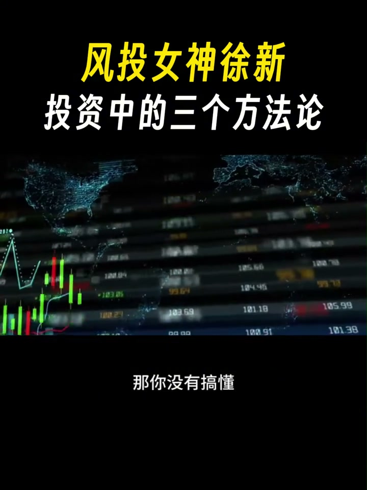
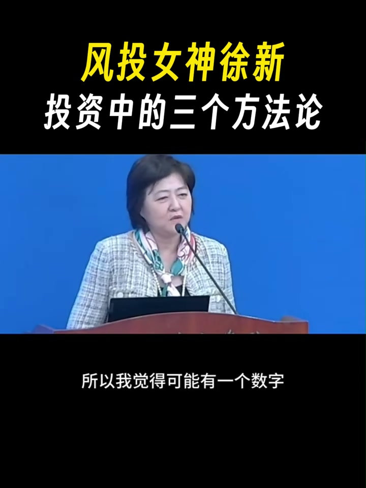
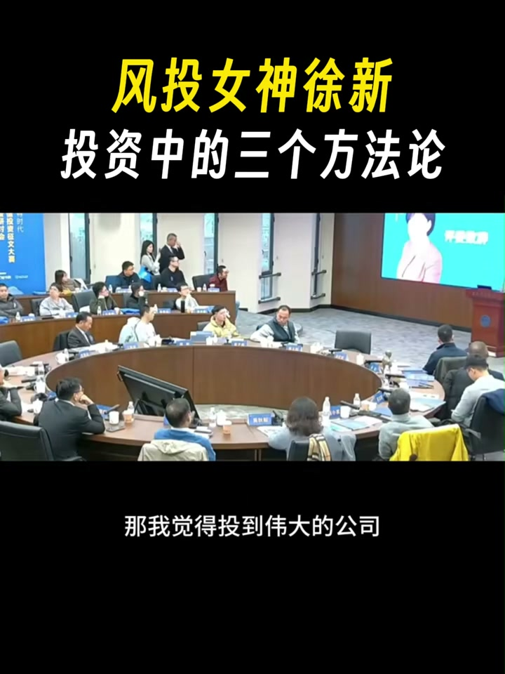
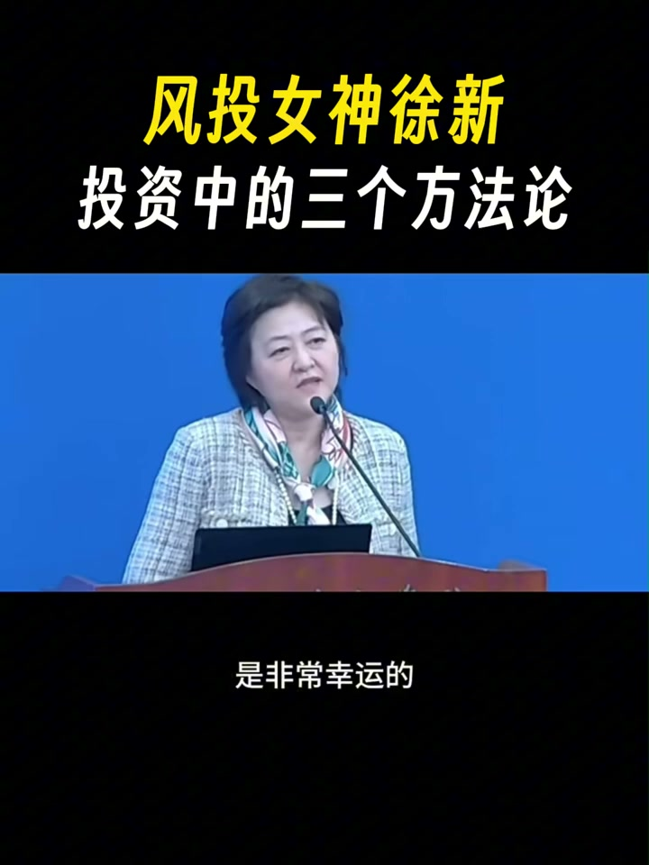

# x_dzTP-abkWCc — 關鍵畫面索引

- 來源逐字稿：[x_dzTP-abkWCc_FIN.srt](x_dzTP-abkWCc_FIN.srt)
- 影片：https://www.youtube.com/watch?v=dzTP-abkWCc
- 截圖數：8

## 00:00:14

**逐字稿片段：** 芒格曾說，一生只需要幾筆偉大的投資，四、五筆就夠了；投資人應花時間看懂公司。但創投往往得在一個月內決定是否投資，否則公司可能被別人投走，下一輪估值也會更高。如何在短時間內真正了解一家公司？

**話題推測：** 引用芒格的名言，可能顯示芒格的圖片或引言文字。

---

## 00:00:38

**逐字稿片段：** 我們找到三種方法：研究成功案例、深入了解消費者，以及全面比較同一產業的公司。不要只看一家企業；多看十家、二十家，才能看見整個產業。研究的案例夠多，心中自然會形成全貌。投資靠認知賺錢，而認知可以用一個公式來說明：

**話題推測：** 提出解決問題的三個方法，預期畫面會列出這三點。

---

## 00:01:16

**逐字稿片段：** 可以用一個簡單公式表示：認知來自資訊輸入與資訊處理，最後形成資訊輸出。要提升輸出品質，第一要確保輸入資訊的品質，第二要採用科學的決策方法。

**話題推測：** 提出一個簡單的公式來表示認知，預期畫面會顯示此公式。

---

## 00:01:33

**逐字稿片段：** 做決策時，我最重視兩件事：第一性原理與長期主義。認知會不斷更新。即使只有一個月可以研究，也能透過拜訪同一領域的多家公司，逐步掌握這門生意的關鍵所在。

**話題推測：** 介紹決策過程的兩點，預期畫面會列出這兩點（第一性原理、長期主義）。

---

## 00:02:02

**逐字稿片段：** 如果還不了解，就不要投。我很佩服段永平，他對於不投資這件事非常堅決。創投常面臨錯失恐懼，擔心錯過偉大的公司；但也要避免因此投資自己並不看好的企業。如何在兩者之間取得平衡，是重要的判斷。

**話題推測：** 提及段永平作為投資案例，可能顯示他的照片或相關資料。

---

## 00:02:28

**逐字稿片段：** 我一直在思考，一檔基金能投中幾家偉大的公司。創投最重要的是找到能帶來重大回報的標的。我對「偉大」的定義是：投資報酬達 18 倍，單一案件為基金賺進 3 億美元。每家機構的標準可能不同。

**話題推測：** 引入關於偉大公司的數字討論，可能顯示一個關鍵數字或統計。

---

## 00:02:56

**逐字稿片段：** 這裡有兩個要素：一是命中偉大公司的頻率，也就是一檔基金在四、五年內能投中幾家；二是投資的回報規模。投中公司的機會有運氣成分，過去中國的創投也相當幸運。

**話題推測：** 將投資偉大公司分解為兩個要素，預期畫面會列出頻次與強度。

---

## 00:03:20

**逐字稿片段：** 網際網路、行動網路和 AI 等技術浪潮，為創投帶來不少機會，其中也有運氣成分。投中好公司後，回報規模取決於持股比例、投資金額，以及持有時間所累積的複利。講者估計一檔基金可能投中三、四家優秀企業，也提醒投資組合不能過度分散，否則無法深入了解每家公司；自己願意花時間長期追蹤的企業，大約是六到八家。

**話題推測：** 列舉中國風險投資業抓住的技術浪潮（網際網路、移動網際網路、AI）。

---
