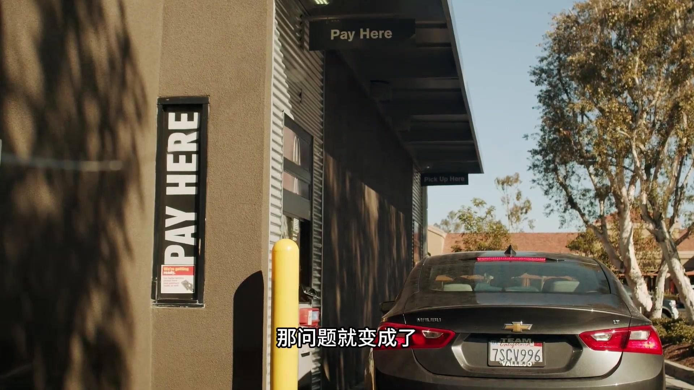
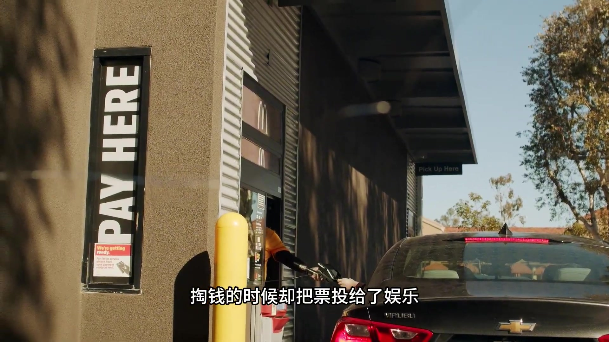
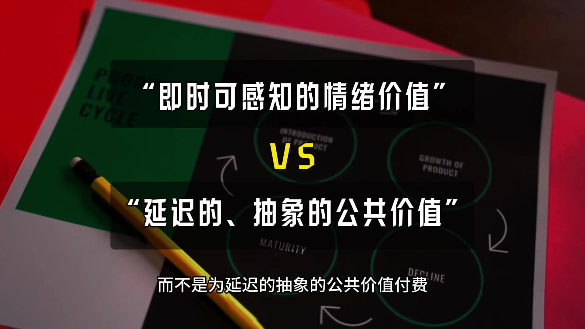
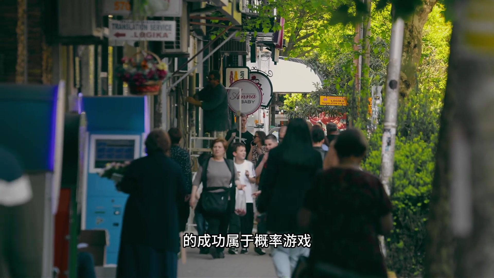
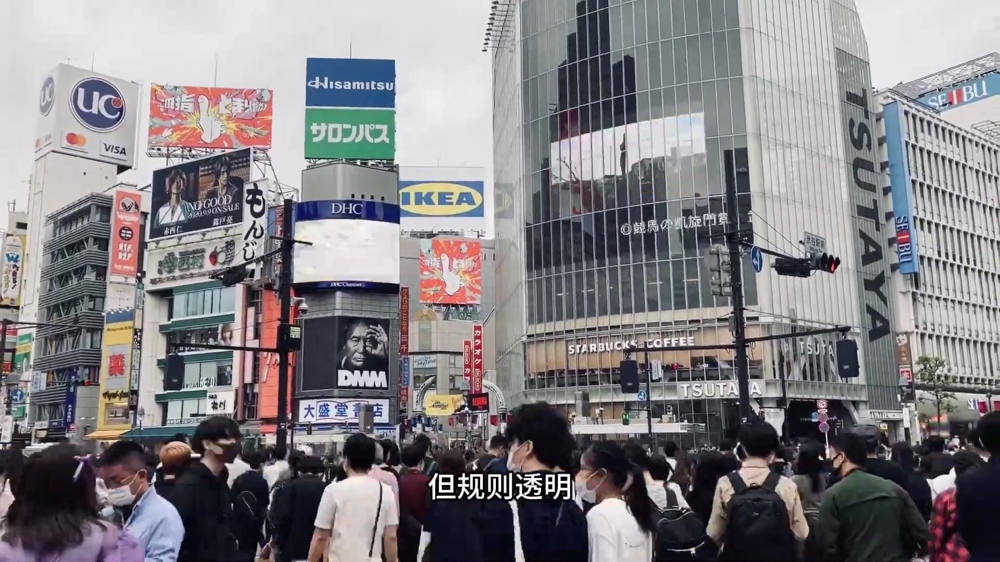

# x_nNtdo6Lsop4 — 關鍵畫面索引

- 來源逐字稿：[x_nNtdo6Lsop4_FIN.srt](x_nNtdo6Lsop4_FIN.srt)
- 影片：https://www.youtube.com/watch?v=nNtdo6Lsop4
- 截圖數：16

## 00:00:05

**逐字稿片段：** 巴菲特曾在股東大會上談到：老師培養孩子、影響他的一生，護士照護病人、甚至挽救生命，這難道不比唱歌或打拳賽重要嗎？仔細想想，市場中的每一筆消費，都是一個人用錢表達自己的選擇。

**話題推測：** 引述巴菲特在股東大會上的話，可能顯示巴菲特頭像或股東大會畫面。

---

## 00:00:39

**逐字稿片段：** 買演唱會門票、訂閱影音服務、熬夜看世界盃，都是自願的選擇。每一筆消費都反映一個人的偏好；市場就像一面真實的鏡子，把這些偏好呈現在搜尋排行上。於是問題變成：

**話題推測：** 舉例說明市場投票，可能顯示演唱會門票、串流媒體會員介面或世界盃畫面。

---

## 00:00:56

**逐字稿片段：** 為什麼我們嘴上說教育和醫療很重要，掏錢時卻把票投給了其他選擇？

**話題推測：** 提出核心問題，可能顯示問題文字或圖表。

---

## 00:01:01

**逐字稿片段：** 我們來拆解這個問題。原因只有一個：人們天生願意為即時、能感受到的情緒價值付費，卻不容易為延遲、抽象的效益付費。

**話題推測：** 準備拆解問題，可能顯示圖解或解釋框架。

---

## 00:01:09

**逐字稿片段：** 舉例來說，支持的球隊或球星贏球時，你會非常開心。這種感受不需要刻意思考，便能直接觸動情緒，帶來即時的滿足感。

**話題推測：** 引入具體例子，可能顯示世界盃足球比賽畫面。

---

## 00:01:21

**逐字稿片段：** 老師塑造學生的思維方式、護士維護病人的尊嚴，價值真實而深遠，卻無法在短時間內被量化，也難以帶來即時的滿足感。

**話題推測：** 轉為對比老師和護士的價值，可能顯示相關職業形象或抽象價值圖示。

---

## 00:01:32

**逐字稿片段：** 巴菲特曾以泰森為例：如果觀眾願意花錢看他比賽，市場就會持續提供人們喜愛的娛樂。並不是市場先創造娛樂再強加給消費者，而是人們先有娛樂需求，市場再設法滿足。

**話題推測：** 回到巴菲特引言，可能顯示巴菲特引言文字或相關圖表。

---

## 00:01:50

**逐字稿片段：** 回到一開始的問題：為什麼教師、護士等職業的收入不高？

**話題推測：** 回顧開頭問題，可能顯示開頭問題文字或轉場動畫。

---

## 00:01:54

**逐字稿片段：** 社會使用兩套截然不同的評價標準。其中一套是價值認同，我們以掌聲、讚美和教師節表達肯定；在這套標準下，教師與護士備受尊重。

**話題推測：** 闡述社會兩種不同的評價標準，可能顯示對比圖或列表。

---

## 00:02:04

**逐字稿片段：** 另一套標準是支付意願，也就是實際花出去的錢。能帶來快樂、讓人感受到價值的事物，往往更容易得到市場回報。這兩套標準之間的落差，反映了人們口頭認同與實際選擇的差異。看到這裡，你可能會問：

**話題推測：** 介紹第二套評價標準「支付意願」，可能顯示其定義與相關圖示。

---

## 00:02:20

**逐字稿片段：** 那麼，年輕人該怎麼辦？難道大家都去當明星嗎？

**話題推測：** 提出年輕人如何應對的實際問題，可能顯示問號或解決方案的標題。

---

## 00:02:22

**逐字稿片段：** 巴菲特的建議很務實：找一份正當的工作，一步一步向前走，這才是更可靠的起點。他沒有鼓吹人人都去當明星，因為那類成功終究是機率遊戲。

**話題推測：** 轉述巴菲特給年輕人的建議，可能顯示巴菲特頭像或建議文字。

---

## 00:02:33

**逐字稿片段：** 他還補充說，不平等永遠存在，真正需要警惕的是機會不平等；人與人之間的能力差異也會一直存在。理解這些之後，

**話題推測：** 補充巴菲特的另一句重要建議，可能顯示補充建議文字。

---

## 00:02:43

**逐字稿片段：** 你面前有兩條清晰的路。第一條是參與市場，提供人們願意付費的情緒價值或專業能力，換取可觀的回報。這條路競爭激烈，但規則透明。

**話題推測：** 提出人生兩條清晰的路徑，可能顯示流程圖或對比圖。

---

## 00:02:54

**逐字稿片段：** 另一條路是跳脫金錢標準，去做只能以意義衡量的事，同時坦然接受這條路未必能讓你致富。它或許清貧，卻有自己的尊嚴。兩條路都不容易，也都值得尊重。

**話題推測：** 介紹第二條人生路徑，可能顯示不同於第一條路的視覺內容。

---

## 00:03:06

**逐字稿片段：** 真正清醒，是不在追逐金錢時假裝清高，也不在追求意義時抱怨貧窮；看清現實，並為自己的選擇負責。

**話題推測：** 提出對「清醒」的最終總結，可能顯示總結性文字或引人深思的畫面。

---
