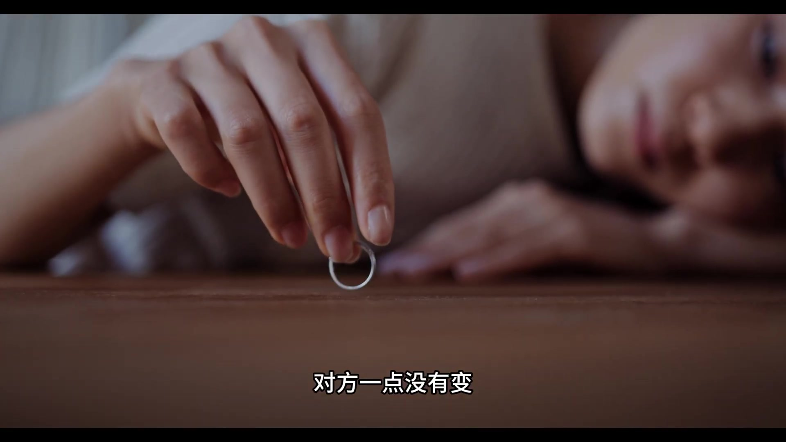
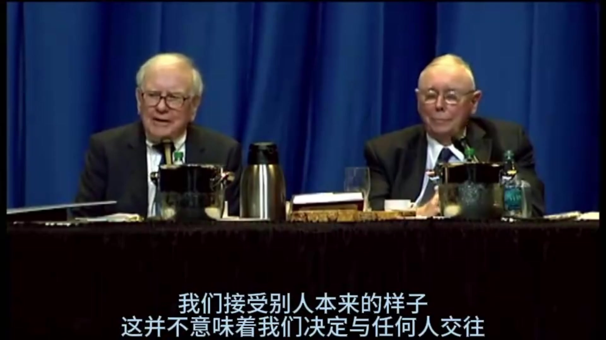
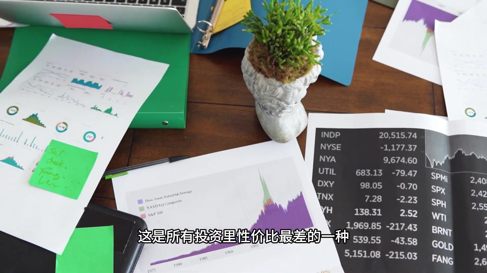
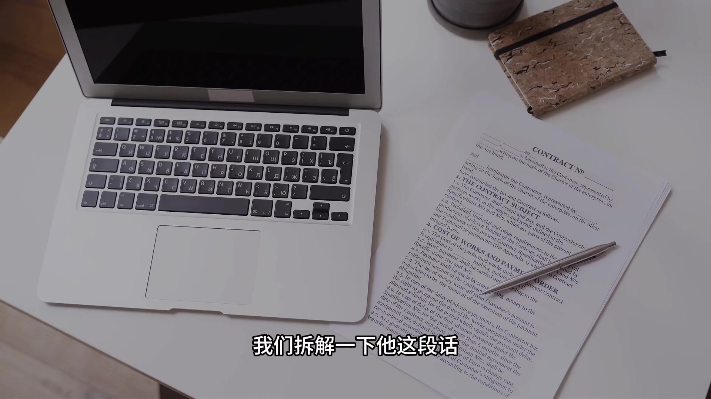
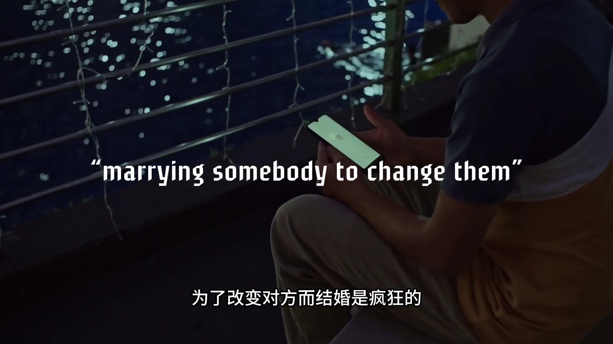
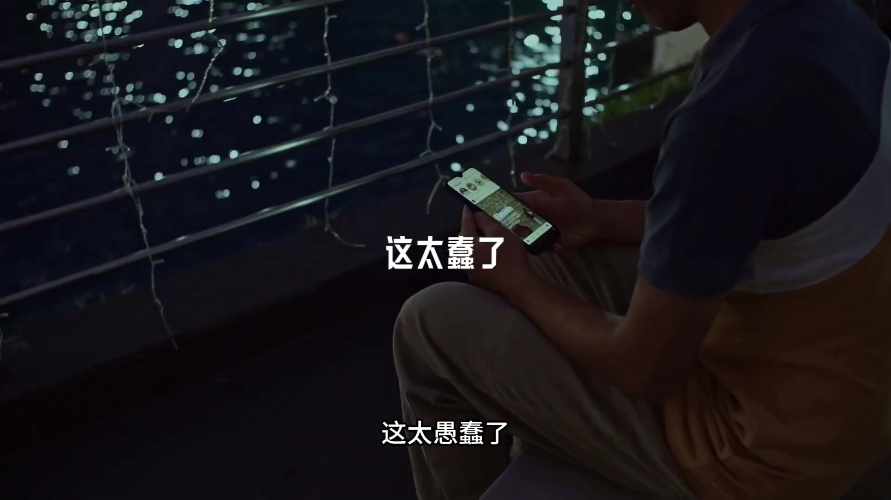
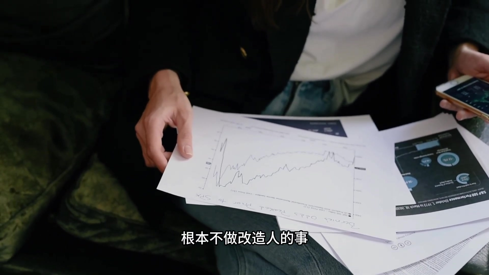
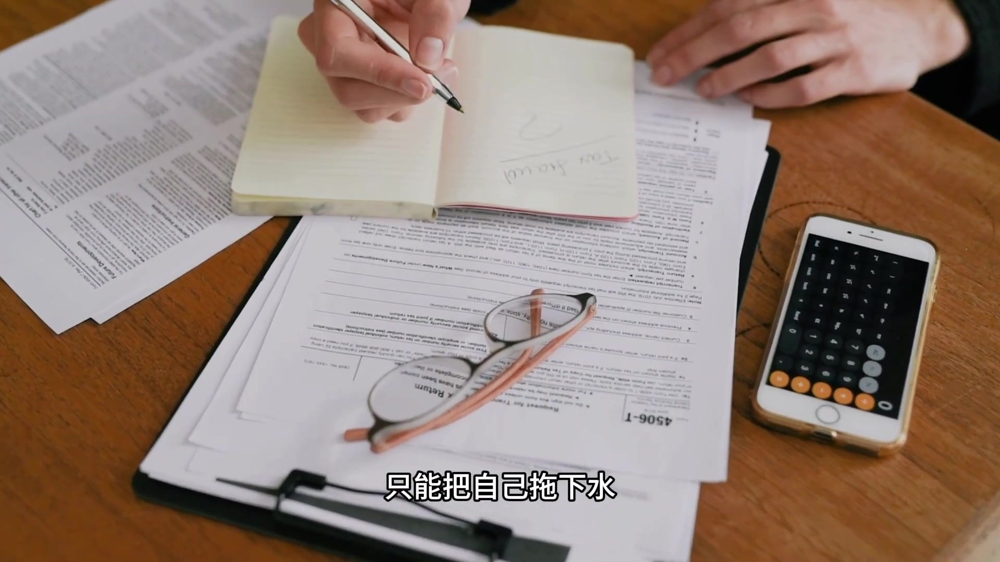
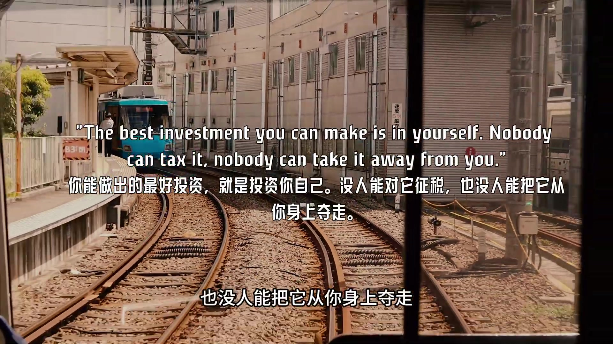
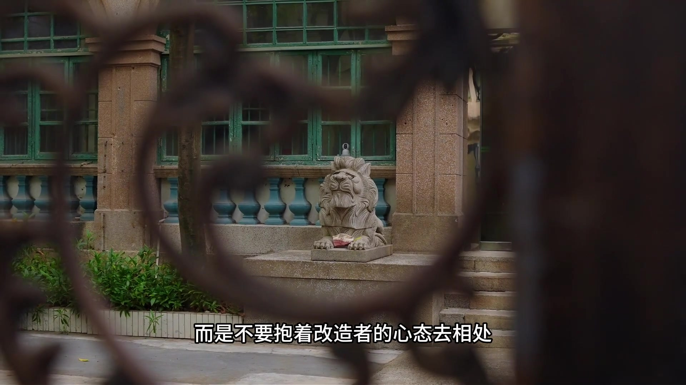

# x_vF4QvcDmWIs — 關鍵畫面索引

- 來源逐字稿：[x_vF4QvcDmWIs_FIN.srt](x_vF4QvcDmWIs_FIN.srt)
- 影片：https://www.youtube.com/watch?v=vF4QvcDmWIs
- 截圖數：15

## 00:00:09

**逐字稿片段：** 今天我們用第一性原理，結合巴菲特和芒格的原話，把這件事的本質說清楚。

**話題推測：** 介紹影片主旨，結合巴菲特和芒格的觀點

---

## 00:00:30

**逐字稿片段：** 先談底層邏輯：試圖改變別人，往往是一筆成本高、成功率低的投資。一個人的觀念、習慣和行為，是多年經歷與環境共同塑造的，就像一套運行多年的系統。想靠幾句話或幾次爭吵改變它，耗費大量時間與精力，結果卻掌握在對方手中，成本效益並不理想。

**話題推測：** 影片進入新的段落，講述底層邏輯

---

## 00:00:57

**逐字稿片段：** 巴菲特在 2015 年的一次演講中說，為了改變對方而結婚很荒唐；雇用一個人、試圖改造他，同樣荒唐；為了改變對方而成為合夥人，更是如此。接下來拆解這段話。

**話題推測：** 引述巴菲特（艾維特）在2015年演講中的名言

---

## 00:01:08

**逐字稿片段：** 這段話可以從三個層面理解。第一是婚姻：許多婚姻的痛苦，源自試圖改造配偶。有人明知對方的性格、習慣或價值觀有自己無法接受之處，仍抱著婚後能讓對方改變的期待，說服自己「結婚後他會收心」「有了孩子就會懂事」。這正是巴菲特所說，為了改變對方而結婚很荒唐。

**話題推測：** 預告將巴菲特的話拆解成三個層面

---

## 00:01:39

**逐字稿片段：** 芒格說得更直接：「如果你想毀掉自己的生活，就花一輩子試圖改變配偶。這太愚蠢了。」

**話題推測：** 引用芒格關於婚姻的直白建議

---

## 00:01:45

**逐字稿片段：** 第二是商業。更換管理團隊和改變婚姻關係一樣，既耗時又充滿不確定性。有些收購者認為公司業務不錯，只要換掉管理層就能改善；這就像招聘時明知對方有難以接受的問題，卻以為入職後可以慢慢改造。巴菲特的做法是挑選本來就優秀、管理可靠的公司，收購後讓團隊持續經營。

**話題推測：** 展開第二個層面的討論，聚焦於商業管理

---

## 00:02:21

**逐字稿片段：** 第三是合夥。有人明知合夥人的人品、做事方式或價值觀有問題，仍以為合作後可以監督、影響甚至改變對方，最後往往以內耗和虧損收場。與其事後改造，不如一開始就慎選夥伴。正如巴菲特所說，改變別人效果不好；應接受對方原本的樣子，除非他自己想改變。

**話題推測：** 展開第三個層面的討論，聚焦於合夥場景

---

## 00:02:57

**逐字稿片段：** 芒格在《窮查理寶典》中也反覆提到：遇到認知不同、甚至會消耗你的人，首先應該保持距離，而不是試圖改造對方；否則可能連自己也被拖累。

**話題推測：** 引用芒格在《窮查理寶典》中的觀念

---

## 00:03:08

**逐字稿片段：** 相較之下，投資自己是值得長期投入的事。能力、認知與技能掌握在自己手中，不會因通膨而消失，也不會被他人奪走；運用得越多，往往越能累積價值，並帶來複利效果。

**話題推測：** 影片主要話題轉折，從「不改造別人」轉向「投資自己」

---

## 00:03:26

**逐字稿片段：** 巴菲特在 1998 年佛羅里達大學的演講中說過：「你能做的最好投資，就是投資自己；沒有人能對它課稅，也沒有人能把它從你身上奪走。」

**話題推測：** 引用巴菲特在1998年佛羅內達大學研究中的名言

---

## 00:03:36

**逐字稿片段：** 他在 2020 年股東大會上再次重申，對抗通膨的好方法，是讓自己成為某個領域的優秀人才；本領是重要且不易貶值的資產。

**話題推測：** 引用巴菲特在2020年股東大會上重申的觀點

---

## 00:03:45

**逐字稿片段：** 芒格一生也奉行相同的道理：想找到好的伴侶，先讓自己成為值得信賴的人。與其費力改造別人來配合自己，不如提升自己，去遇見更好的人與事。

**話題推測：** 提及芒格關於「投資自己」以找到好配偶的邏輯

---

## 00:03:58

**逐字稿片段：** 這裡有個常見誤解：不試圖改變別人，不代表要變得冷漠或拒絕合作；重點是不帶著改造對方的心態相處。

**話題推測：** 提出一個關於前面觀點的常見誤區

---

## 00:04:05

**逐字稿片段：** 如果真的想影響一個人，可以參考富蘭克林的說法：說服別人要訴諸利益，而非只講道理。讓對方看見這麼做也對他有益，才有機會達成雙贏。改造別人所花的每一分鐘，都可以拿來投資自己。

**話題推測：** 引入富蘭克林關於如何影響他人的引言

---

## 00:04:26

**逐字稿片段：** 別再把精力花在當別人的人生導師，把心力收回來，用在自己身上。當你持續成長，身邊的人事也可能隨之改善；持續學習，前方就會出現新的道路。

**話題推測：** 影片的最終總結和行動呼籲

---
