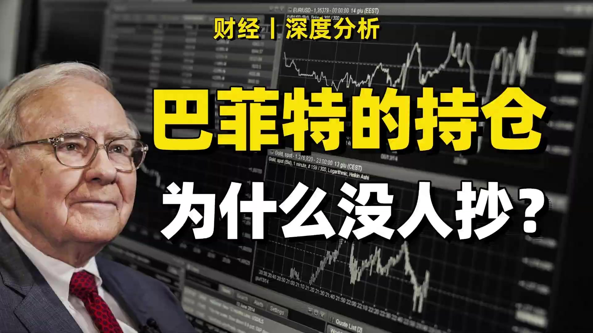
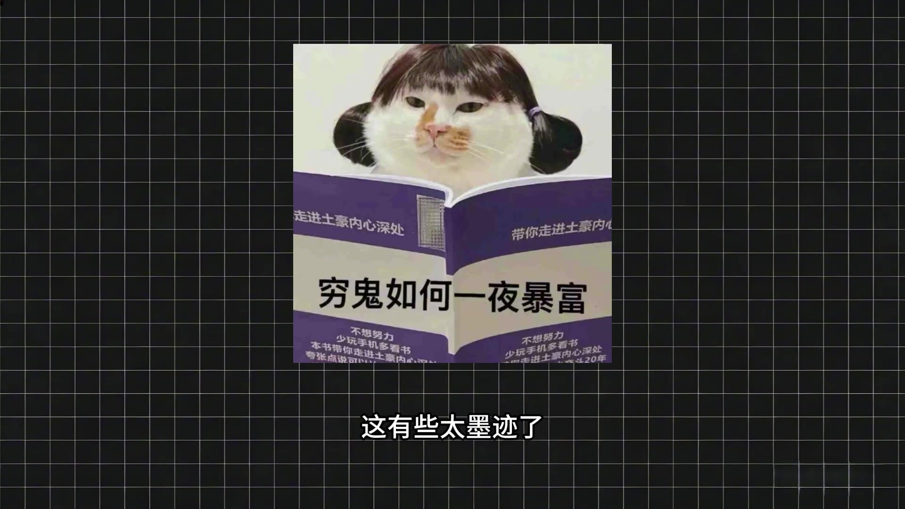
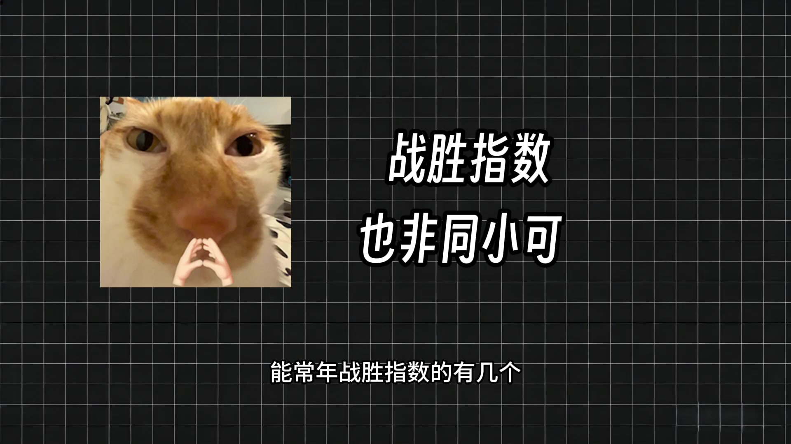
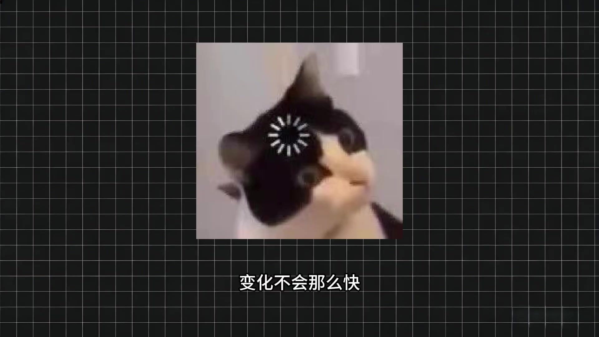
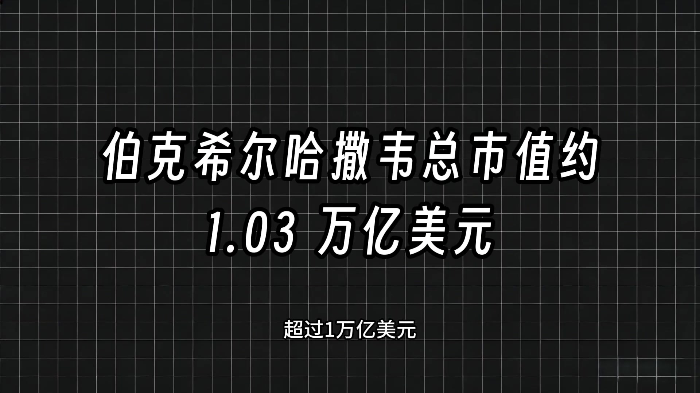
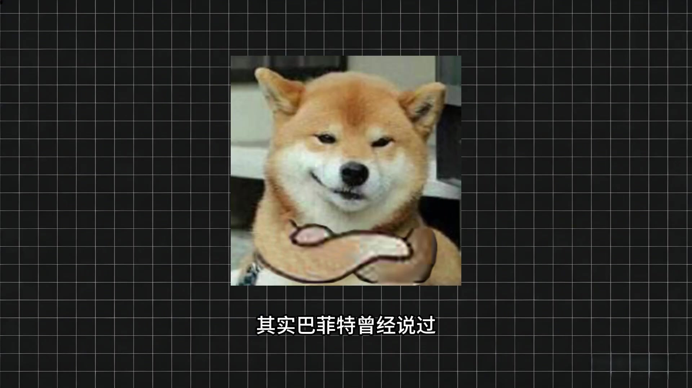
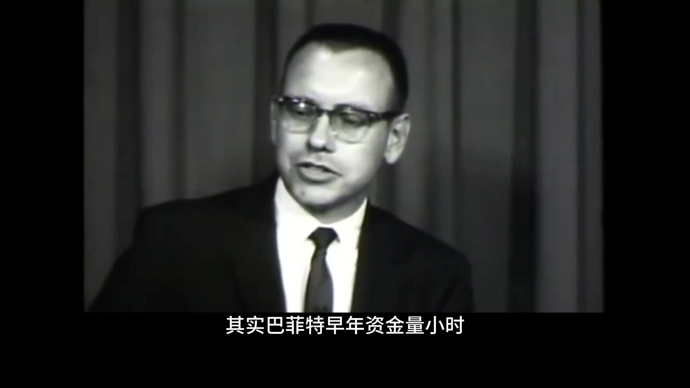
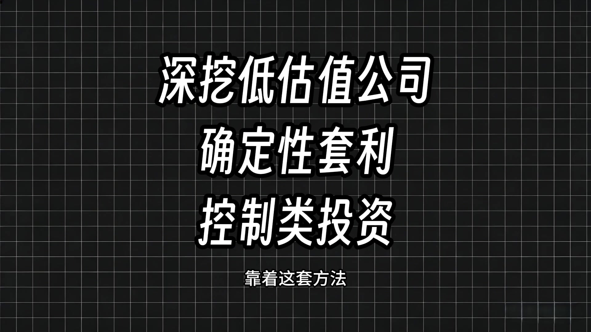
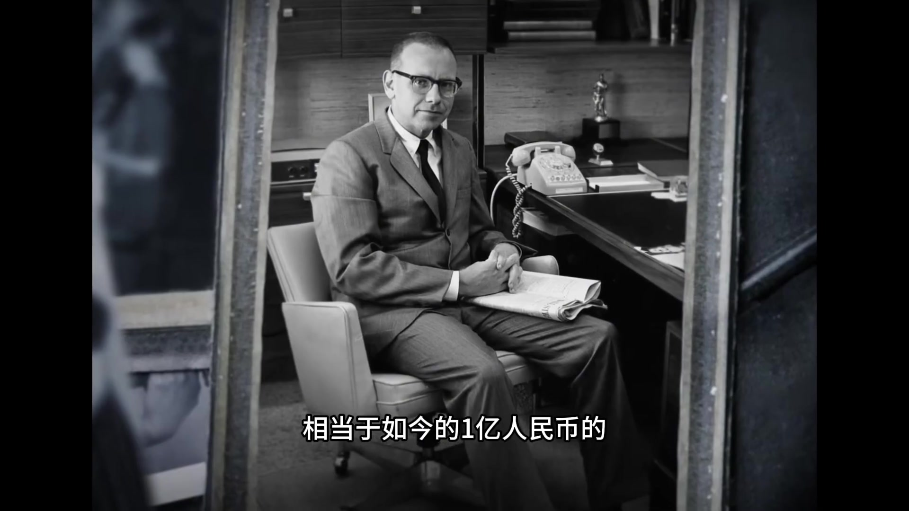

# x_vlDErtgEyFM — 關鍵畫面索引

- 來源逐字稿：[x_vlDErtgEyFM_FIN.srt](x_vlDErtgEyFM_FIN.srt)
- 影片：https://www.youtube.com/watch?v=vlDErtgEyFM
- 截圖數：12

## 00:00:00

**逐字稿片段：** 你有沒有想過，既然巴菲特的持股資訊公開，為什麼大家不直接照著買？就像學霸公布答案，照抄似乎就好；但很多人其實是嫌巴菲特的報酬率不夠高。

**話題推測：** 引入影片主題：為何巴菲特持倉不被照抄。

---

## 00:00:11

**逐字稿片段：** 伯克希爾近 10 年的年化報酬率是 13.7%，比標普 500 高出 1 個百分點。這聽起來不錯，但有些人仍嫌不夠，期待一年翻倍、三年財務自由，認為年化 10% 太慢。

**話題推測：** 呈現伯克希爾近10年年化收益率資料圖表。

---

## 00:00:24

**逐字稿片段：** 芒格曾說，沒有人喜歡慢慢變富。但事實是，能連續十年跑贏市場已經非常罕見；看看各類基金與私募，長期勝過指數的又有幾家？

**話題推測：** 顯示芒格關於慢慢致富的語錄。

---

## 00:00:35

**逐字稿片段：** 另一個問題是，你抄到的可能是過期資訊。巴菲特每季向美國證券交易委員會（SEC）申報持股，但公開時往往已晚了一、兩個月；股價可能已變動，而部分賣出也不會即時揭露。大型持股的變化或許較慢，但資訊仍有時間差。

**話題推測：** 提出第二個不照抄原因：持倉資訊可能過期。

---

## 00:00:52

**逐字稿片段：** 如今伯克希爾的市值已超過 1 兆美元。

**話題推測：** 展示伯克希爾的市值資料。

---

## 00:00:54

**逐字稿片段：** 伯克希爾持有超過 3,000 億美元的現金等價物，規模有如航空母艦。資金量太大，選股只能著眼於市值達兆美元級別的大型企業；再優質的小公司，對整體報酬的影響也有限。巴菲特也坦言，

**話題推測：** 展示伯克希爾的現金等價物資料。

---

## 00:01:05

**逐字稿片段：** 規模龐大是投資效率的主要限制。巴菲特也曾談過這一點：

**話題推測：** 引用巴菲特關於規模是投資阻礙的言論。

---

## 00:01:09

**逐字稿片段：** 巴菲特曾表示，如果只有 100 萬美元，他有機會創造 50% 的年化報酬率。這與他早年管理較小資金時的情況有關。

**話題推測：** 介紹巴菲特關於小資金年化收益率的假設。

---

## 00:01:14

**逐字稿片段：** 巴菲特曾有十年年化報酬率達 50% 的紀錄，這才是小額資金可以參考的範例。他早期的投資方式不只是長期持有大型企業，也包括尋找遭低估的公司、把握高確定性的套利機會，以及取得公司控制權並重塑價值。

**話題推測：** 展示巴菲特早年實際達到的高年化收益率。

---

## 00:01:30

**逐字稿片段：** 巴菲特 30 歲時累積的資產，相當於今天的：

**話題推測：** 提及巴菲特30歲時的成就。

---

## 00:01:33

**逐字稿片段：** 當時他的資產相當於現在的 1 億人民幣。你曾經買進比知名投資人更好的標的嗎？結果如何？歡迎在留言區分享。

**話題推測：** 顯示巴菲特30歲時累積的資產額。

---

## 00:01:37

**逐字稿片段：** 想進一步了解巴菲特長期採用的投資方法，記得追蹤頻道，我們下期再聊。

**話題推測：** 預告下期影片內容。

---
