# yutinghaofinance_1Tygxzj3E1M — 關鍵畫面索引

- 來源逐字稿：[yutinghaofinance_1Tygxzj3E1M_FIN.srt](yutinghaofinance_1Tygxzj3E1M_FIN.srt)
- 影片：https://www.youtube.com/watch?v=1Tygxzj3E1M
- 截圖數：28

## 00:00:37

**逐字稿片段：** 怎麼公園還這麼熱?這一次美國股市費半已經連五跌了, 砍到現在在半年線上下, 韓國股市都已經跌破年線了。 那臺北股市到目前的位階 雖然昨天跌的幅度算蠻大的 但畢竟是千點之內 千點之內都算是正常波動 臺股撐得住本輪全球股票市場的回跌嗎 今天來跟投資朋友多做一些觀察 其實在昨天我們看到市場上 同樣還是針對過去殺不交中的 記憶體股票繼續下壓 美光在昨天又中跌了3.6% 印財中出了7% 反而博通是上漲0.7% 那不知不覺我們看 肺瓣到現在又跌破了月線 又跌破了季線 又跌破了半年線 當然從整個底部來看 感覺也算是正常的回調 可是一連串的這一次連續五天的下跌 它已經把三條重要的均線給跌破了 不知不覺 不情不願 又到箱子口 現在離年線很遠 不過至少是迴歸到半年線左右了 又回到半年線了 那我們就要看一下 這一輪由硬體股的市場下殺 到底能否回到合理的估值區間 很多人說 Fibonacci這幾天到底在跌什麼 你沒有聽到新的利多 就是利空了 當然有網友會舉手 我知道 這一次一定是跌利率 因為殖利率太高了 不對 我們看最近十年期公債殖利率 反而從高點開始反轉 最近從大概5.3%左右 回到5.2%到5.1% 下一個關卡主要就是觀察 4.9%的50日均線

**話題推測：** 介紹美國股市費半指數連五跌的現況。

---

## 00:02:15

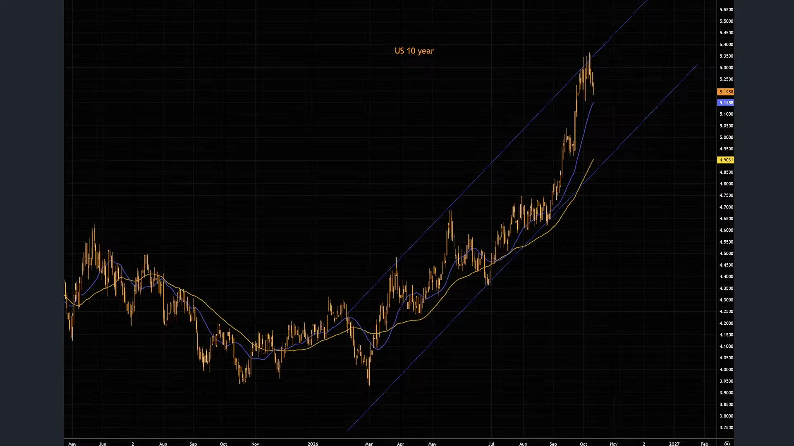

**逐字稿片段：** 那30年期殖利率的話 要觀察5.5%的20日均線 如果持續回落 那其實你就不能夠把本輪的市場賣壓 完全歸咎給利率高位 利率還是偏高啦 但至少在短線上的誘因 不再是由於殖利率的創高所造成的 這個是指的大家觀察的方向 其實利率預期已經沒有想象中這麼強勁了 那今天節目呢 我們就分成三個階段來做敘述 第一個階段我們先看全球股票市場 目前的回檔情況 來看一下臺北股市有多特殊 費半年跌5天之外 臺北股市昨天賣了1653億 韓國股市是重挫 跌破年限

**話題推測：** 提及30年期殖利率的觀察重點。

---

## 00:02:57

**逐字稿片段：** 那這一次美國大型銀行股 幾乎全數優於預期 財報公佈出來 股價還是下跌 而且跌得都蠻重的 那到底是漲多修正 還是高利率 雖然現在開始沒那麼高了 可是一樣在衝擊市場股市 第二個階段 我們要探討美國的經濟 是否越依賴於AI 這導致很多的企業獲利 資本支出到家庭的財富效應 都開始出現了顯著的分化 這個時候我們就要了解說 會不會由於內部實體經濟的弱化 僅僅靠財富效應 讓市場上形成第三層擔憂 第三個階段 就是我們看到的科技巨頭的最新發展 蘋果最近股價創高了 這就很生氣 雖然後來又壓回來了 但是從蘋果到Meta到阿里巴巴 最近都在大量的推向 手機眼鏡甚至是智慧家庭的新產品 那今天最重要的主軸 我們就要觀察 而這一些產品的推出 它能不能扭轉過去 大家對於融資循環的挑戰 或者預期它的一個市場的擔憂呢 畢竟當科技巨頭投入了上兆美元 那你推出幾個3C電子產品 能夠補救市場上 針對融資挑戰的擔憂嗎 今天來跟投資朋友做些觀察 其實還是有短線上的消息原因 不是沒債則利率 但是這一次的導火線

**話題推測：** 分析美國大型銀行股財報公佈後的股價表現。

---

## 00:04:16

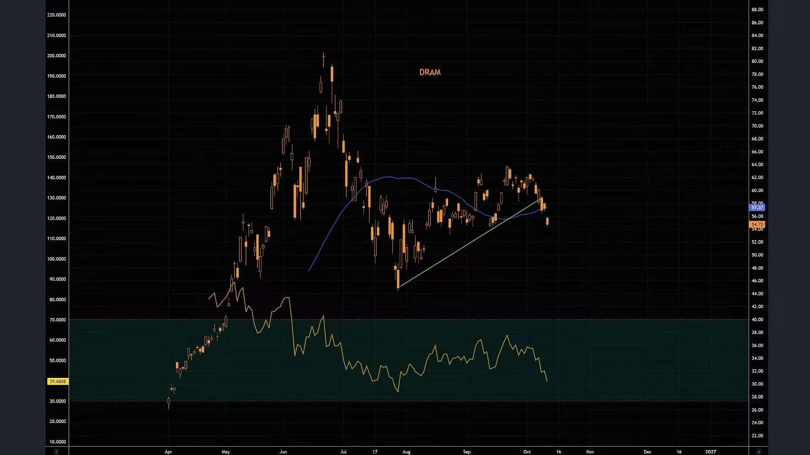

**逐字稿片段：** 是由博通的執行長陳福陽所警告 這一次許多投資人 他表示說根本不瞭解自己買進的AI企業 原因很簡單 他們對於這些企業抱持著極端的獲利預期 讓AI投資越來越像賭場 這是他所說的話 導致了市場的信心遭受到動搖 昨天韓國三星電子是下跌了7.4% SK海力是重挫了10% 兩家公司合計佔韓國股市綜合指數就佔了一半以上的權重 所以導致韓國股市的重挫 那麼現在更大的壓力 當然也有來自於中國記憶體產業的技術突破 但我覺得這還好啦 雖然長青在本週宣稱 在先進動態隨機存取記憶體的技術上取得了進展 未來有可能會大幅度的擴充產能 但未來是什麼 未來也是2028年到2029年以後的事情 這是已經是最近的時間線 所以即便到明年 股價很少通常直接反映 兩年到三年後的EPS 那正常來講 到反映27年 照理來講 這些韓國股市的記憶體企業 也不會受到太大影響 所以產能的問題 我認為不是主要原因 主要就是 因為這一輪的反彈幅度也蠻大的 隨便找一個理由休息一下 做一下獲利了結

**話題推測：** 提及博通執行長陳福陽對AI投資的警告。

---

## 00:05:32

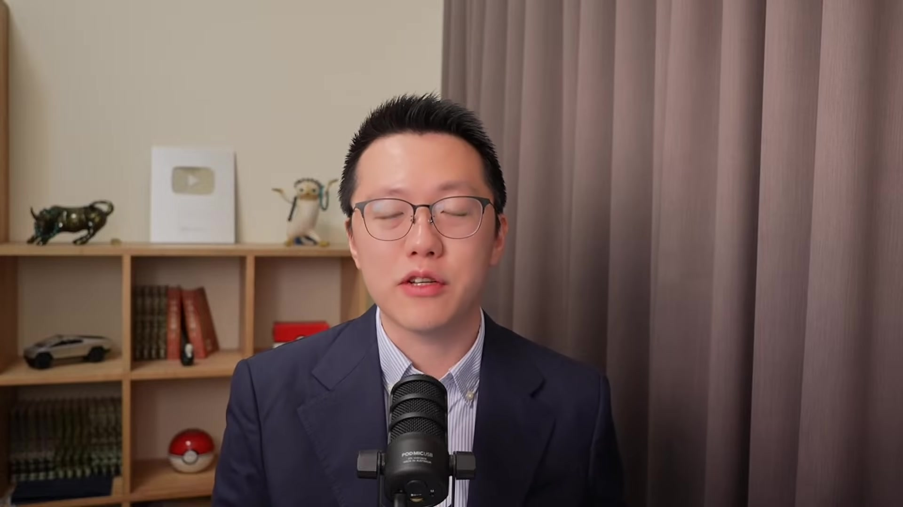

**逐字稿片段：** 如果我們細看 根據高盛的統計 在過去一週當中 記憶股的相關股票組合 大概總體下跌幅度是9.3% AI半導體類股下跌大概是6.7% 納斯達克指數大概也落後了 標普白指數1.7%左右 所以的確主要的重災區都來自於 由低潤所引發的硬體股 再外移到軟體股當中

**話題推測：** 引用高盛統計數據，說明記憶體和AI半導體類股的下跌幅度。

---

## 00:05:59

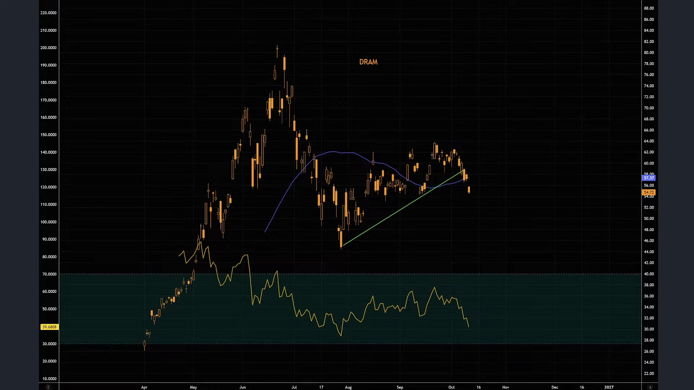

**逐字稿片段：** 美光的股價 它是跌破了1000美元的整數關卡 進一步失守了100日均線 和上升的趨勢線 那市場上當然會重新評估記憶體的價格 可是你從合約價來看 你根本就感覺不出任何 股價該鬆動的原因 原因很簡單 因為合約價根本就沒有鬆動

**話題推測：** 詳細分析美光股價跌破1000美元關卡及均線。

---

## 00:06:17

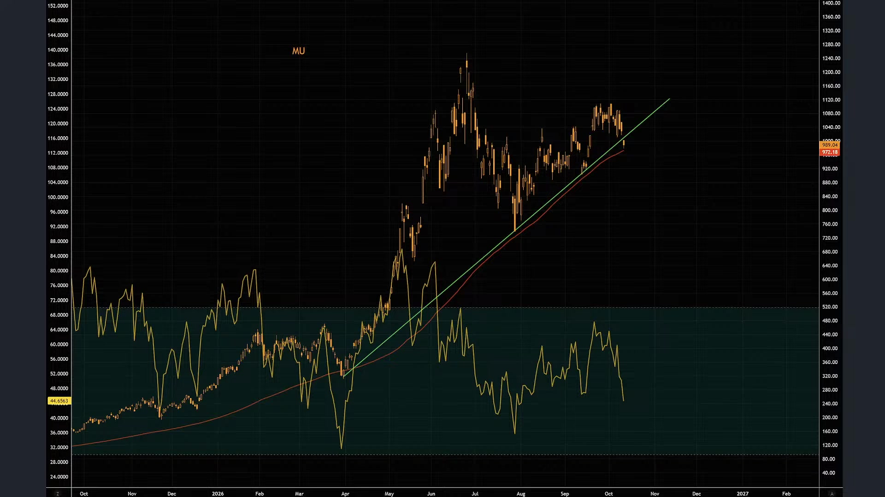

**逐字稿片段：** 記憶體價格即便到10月中旬 都還在創高 只是創高速度稍微放緩了一點 現在最大矛盾是什麼 就是記憶體類股按照這種賣壓 那的確從大部分的技術指標來看 它都已經處於極端超賣了 可是你看整個納斯達克整體 它根本就沒有反映相同程度的壓力 的確低潤股市跌很重 甚至有點擔憂破前提 因為韓國股市已經先破了

**話題推測：** 提及記憶體合約價格在10月中旬仍在創高。

---

## 00:06:43

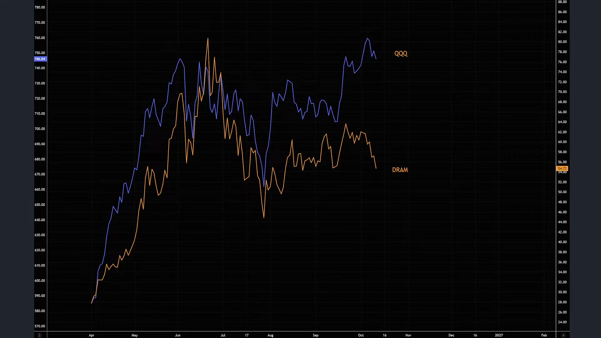

**逐字稿片段：** 可是你看QQQ還在高位震盪 就沒有反映相同的程度壓力 接下來就兩種主要可能 第一個就是那記憶體肯定是超跌了 它應該要率先出現反彈 或者是高科技股的高磁倉開始鬆動 迫使資金先把部分AI相關股票給賣出 所以真正要觀察的 也不說記憶體肋骨跌多少了 它可能之前也漲很多 那價格上本來波動就比較大 是整個修正 它會不會影響到QQQ 它會不會影響到整個納指 如果沒有單一肋骨的下殺 其實還可以接受 畢竟從6月份以來 我們看追蹤低潤的指標 大概從80美元的高點 回落到大概現在54.7塊 那跌幅就三成了 10月份以後 結果QQQ挑戰率就新高了 然後低潤還在下跌 所以我覺得這種情況 如果只是內部的輪動還可以接受 那再看一下臺股 臺股在10月13號 昨天是遭受到市場上的顯著賣壓 最終是下跌960點 不過老股民的心應該算是 沒有受到太大的影響 從關稅戰以來到烏二戰事 到我們看到以前的新冠疫情 或者以前的日元套利平倉賣壓 一系列的衝突 這個現在跌1000點以內都算是正常波動 昨天即便跌960點 跌幅也才1.95% 收在48341點 第一個驚訝的是跌960點 原來跌幅也不大 還不到2% 第二驚訝的是都跌了1000點了 結果還收在48000多點 這是說明著臺股的位階 其實本來就比較高 昨天成交金額是1.125兆

**話題推測：** 比較納斯達克100指數（QQQ）的走勢。

---

## 00:08:24

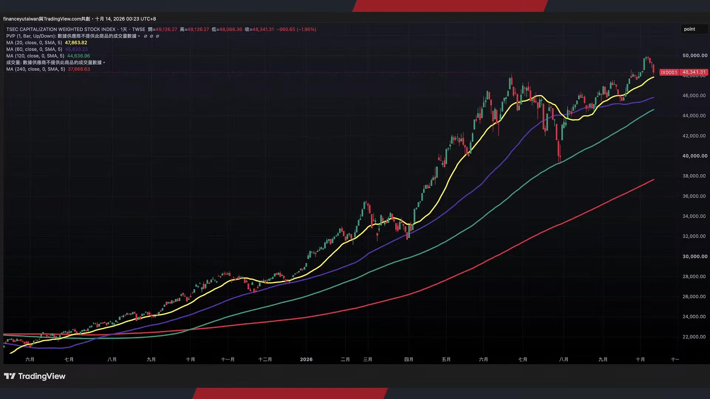

**逐字稿片段：** 外資單日賣超1653億 這是史上第三大的單日賣超紀錄 看起來外資是遲遲不肯回歸 可是你把臺股的現行圖 拿來跟海外股市來進行比較 尤其我們把它拿來跟韓股股市來進行比較 那就完全不同位階 所以臺股其實目前狀態非常非常滋良好了 那有些人說那是不是臺股位階很高 賣壓可能未來會比較沉重 這是一種角度 但從根本角度而言 就是臺韓股市本身走出了不同的位階 臺股股市其實在過去五六月的上漲過程當中 就沒有像韓國股市這麼極端 那金管會也沒有選擇提前讓國內的現貨的正額型ETF上架 它基本上我們在裡頭操盤的大部分就是大盤的 要不然就是屬於海外的大盤的ETF屬於正額的 那韓國股市當時的上槓杆情況 其實遠遠比臺北股市來得更為劇烈 加上金管會其實早從今年六七月開始就已經主動踩剎車了 所以韓國股市的下跌 也不能說它會一路的暴跌下去 但是的確兩方市場不太一樣 我們從韓國股市來做一些觀察

**話題推測：** 強調外資單日賣超1653億的歷史性紀錄。

---

## 00:09:33

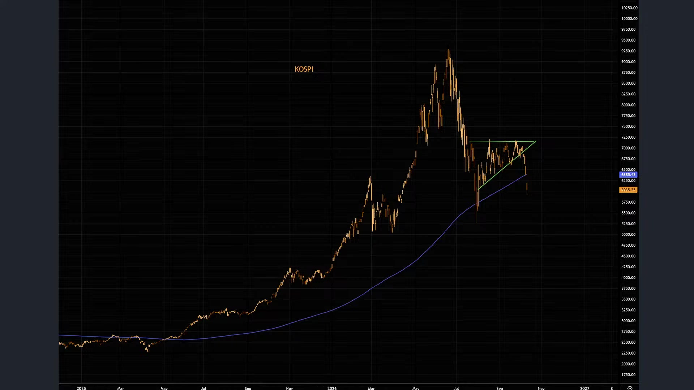

**逐字稿片段：** COSPI指數現在已經是跌破年限了 再跌個兩根 它就要跌破今年7月份的低點了 那就說明著本輪韓國股市的浪潮 即便今年績效 它還是在全球前三 但看起來越來越多的股民 可能很多股票 在未來兩年到三年都無法解套了 這種位階的高位下殺起來 很多中小型股應該是慘不忍睹 那當然背後修正的原因 跟剛才我們提到的 博通執行長的警告是有相關的 主要也是針對接下來 企業能否取得足夠的融資 主要還是從資金的稀缺 來導致未來的採購 如果資料中心根本就建不完 電力設備根本就沒辦法 準時的去安插 那我就不會需要這麼多的記憶體 因為不是我沒有需求 是我根本就沒有能力 蓋這麼多座的資料中心 那當然對於原本的供貨需求 強度就沒有這麼高了 另外一個不能夠忽略的 當然是油價了 南韓因為現在也是完全依賴進口原油 石油又佔初級能源消費 大概佔了三分之一 所以我們過去看到 其實標普白指數跟納斯達克指數 逐漸淡化油價上漲的衝擊之後 COSPI指數反而是跟油價 有比較明顯的反向關係 當然了 韓國股市跟臺灣一樣 都有采取適度的油價補貼 所以也不能夠一概而論 可是至少可以看得出來 韓國股市看起來已經變成全球 在風險資產當中的重要領頭羊指標 當它跌破寧線的時候 不會有人現在盯著臺股 看會不會創高 現在大家都盯著南韓股市看 它會不會再破低 它再破低 那當然費辦就會慌 臺股就會跟著鬆動 可是我們又回過頭來說 那韓國股市的基本面 難道有因此的鬆動嗎 其實沒有 合約價格仍然在上漲

**話題推測：** 再次關注韓國KOSPI指數跌破年線的現況。

---

## 00:11:18

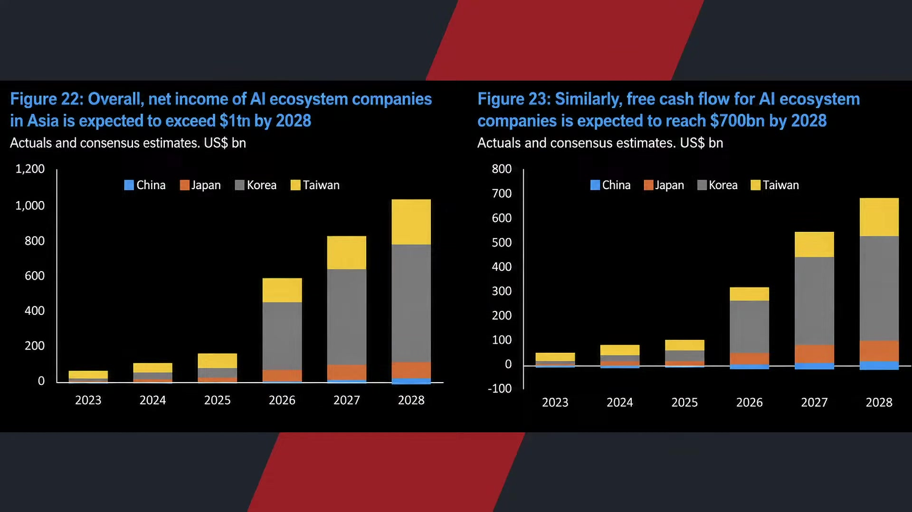

**逐字稿片段：** 我們根據摩根大通的推估 先進邏輯晶片 先進封裝 高平寬記憶體 半導體設備 還有高速光通訊的供應鏈 到目前的緊張 至少百分之百確認 到2028年之前是完全不會停止的 即便資料中心有可能建設延後都不會 所以現在的擔憂 包括博通現在的擔憂 都是28年到29年以後的事情 那股價要不要那麼早提前反應呢 也許它只是一個短線上的消息 好 所以我們看一下全球股票市場的迴盪 先看一下臺北股市有多堅挺 就跟我一樣 好

**話題推測：** 引用摩根大通的推估，說明先進晶片供應鏈的緊張狀況。

---

## 00:11:54

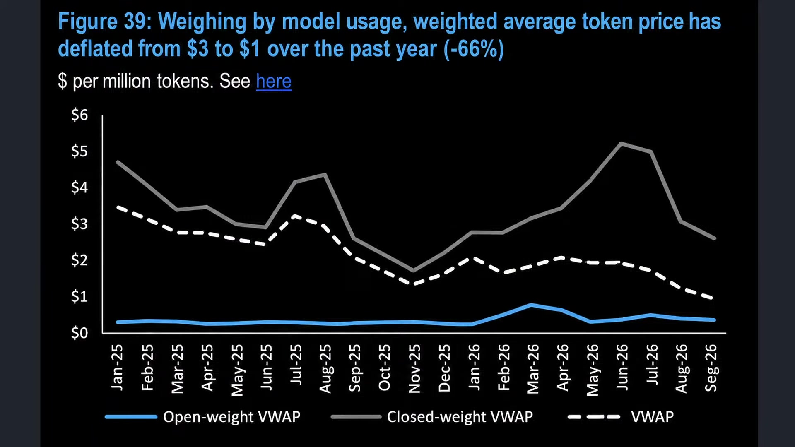

**逐字稿片段：** 那第二個層面 其實你從銀行股就看得出來 市場上其實主要的擔憂 還是在利率端 我們看大型銀行最近公佈了 26年的第三季財報 股票交易因為很強勁 然後包括債券業務轉弱的分歧

**話題推測：** 轉到節目第二個層面，從銀行股分析市場擔憂。

---

## 00:12:08

**逐字稿片段：** 整體而言高盛經歷是53億美元 年增幅有三成 而且其中我們看到股票交易 是大增了七成二 所以你說固定收益 現在債券市場不好 沒什麼人在交易 它也不過下滑1% 股票還是能夠沖銷 那摩根大通經歷153億 年增幅有6% 那其實整體而言 還算是比預期來得好 可是我們看在實體股價層面 壓力就很大了 我們看現在摩根士坦利 從高點這樣跌下來 大概也跌幅不輕了 如果是從近期高點 我們就不看說股價公佈之 應該講財報公佈之後的位置 我們就從絕對高點來看 大摩到現在為止 已經跌兩成了 從高點下來

**話題推測：** 報告高盛第三季度的淨利潤數據。

---

## 00:12:51

**逐字稿片段：** 美銀已經跌19%了 富國銀行 現在大概是跌18%左右

**話題推測：** 提及美國銀行股票已下跌19%。

---

## 00:12:57

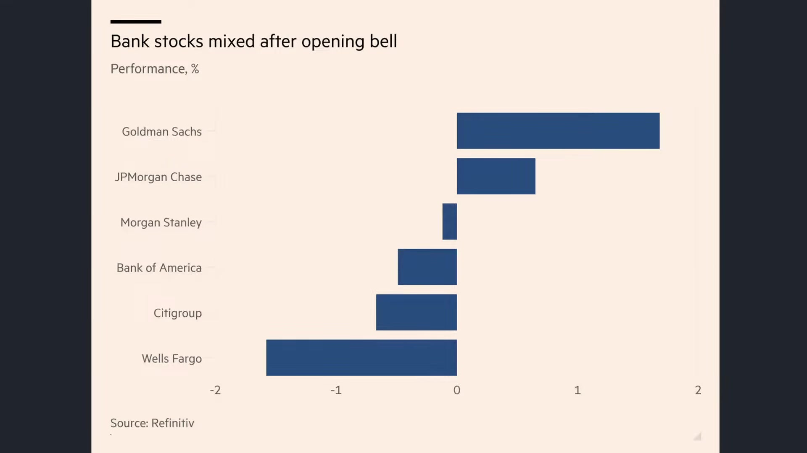

**逐字稿片段：** 花旗跌16% 這其實都意味著 銀行股好像已經快要 默默的都進入到熊市當中了 明明股票交易表現還不錯 其實主要就還是來自於 利率預期高漲以後 市場上會擔憂 對於未來這些放款的預期 能否有效的收回 所以其實本業大家都是不錯的 半導體本業也非常不錯 其實就連科技巨頭本業表現也不錯 可是大家都擔心那個融資循環 未來我們做了這麼多的投資 銀行借出去這麼多錢 到底收不收得回來 價格層面就是反而處於鬆動 所以現在絕對不能說 因為美國股市還處於高檔 臺股還處於高檔 現在是AI泡沫 現在是看起來 大家有點不太相信AI了 有點緊張了

**話題推測：** 提及花旗銀行股票已下跌16%。

---

## 00:13:41

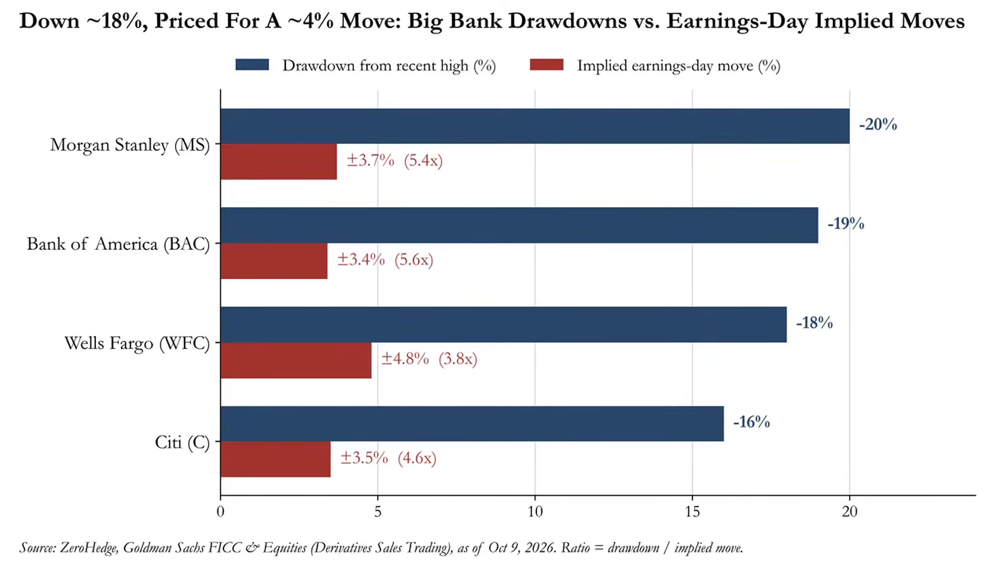

**逐字稿片段：** 我們看一下摩根大東和高盛 在本週最新所傳出的消息 原本他們是準備要協助 新創雲端公司 叫Volta基礎建設 籌資大概50億美元的放款 居然本週本來要50億 只願意成銷13億 就是原本的承諾 幾乎都在搜索當中 具有現金擔保的租賃相關貸款 大概只剩下37億美元的GPU貸款 而且不提供成銷的保證 整筆融資大概是來到預估6年 這些比較頂尖的新創的雲端企業 預估到期殖利率是多少 6年到期殖利率

**話題推測：** 提及摩根大通和高盛在本週傳出的新消息，關於雲端公司Volta的籌資。

---

## 00:14:21

**逐字稿片段：** 開11.21% 6年開11.21% 所以你可以瞭解說 這些企業搶錢真的搶風了 11%的殖利率你也敢去借 所以從這樣的一個角度來做思考 等同於銀行業也大概知道 這個風險在哪裡 他也知道自己不能夠承擔過多風險 所以如果要放款 我還是先放款給輝達 先放款科技巨頭 科技巨頭好像借錢也借到有點誇張了 那我就找他們背後的大boss 輝達來做履約保證 這就是現在的壓力 所以銀行業的壓力 其實看起來更多也是反映在 未來長天期的相關違約 其實投資市場也經常 發生類似的事情 就是主流風格改變 以前是錢借越多 股價漲越多 以前投資人喜歡AI 科技巨頭就不斷地 發佈新建資料中心的計劃 國家繼續漲 投資人喜歡企業成長 管理層就繼續擴大資本支出 當投資人喜歡漂亮的財報 那我就想辦法裁員 想辦法提高營收和獲利 如果有一天 現在市場主流相反改變了 我喜歡的是低資本支出 高回報的好生意呢 原本我以前 只是喜歡低利率的時候 找東西可以投 以前優質氾濫 現在高利率 我要開始重新審視了 當利率一變之後 原本喜歡的東西都改變了 以前不是讀詩歌嗎 你說你喜歡向日葵 我就每天陪你迎接太陽 你說你喜歡花 我就為你埋下種子 你說你喜歡他 我就把他埋在樹下 這邊最值得思考 就是不是愛一個人 願意付出多少 是付出逐漸變成執著以後 你還能不能保持理性 那以前利率一趴兩趴 像日本幾乎是零 那就儘量的舉債 那資本支出 你很龐大的資金需求 給你給你給你 我錢也很多 那利率從1%2%3%4%到5%到6% 現在隨隨便便發個6年期的投資等級債 對於這些中小型的新創企業來看 隨隨便便都11% 12%的殖利率 這個時候你就會發現 即便很優渥的殖利率 你都開始有點緊張了 那最後反映在銀行股的價格身上 這個就是一個新時代的一個改變 所以當利率一變 原本喜歡的東西也許都改變了 好那當然回過頭來說 現在對於整體美股銀行股而言 最大的壓力還是來自於 資金的一個輪動和吸取 因為現在這些巨頭 它不只是在美國本土 吸納大量的資金

**話題推測：** 揭示新創雲端企業6年期到期殖利率高達11.21%。

---

## 00:16:52

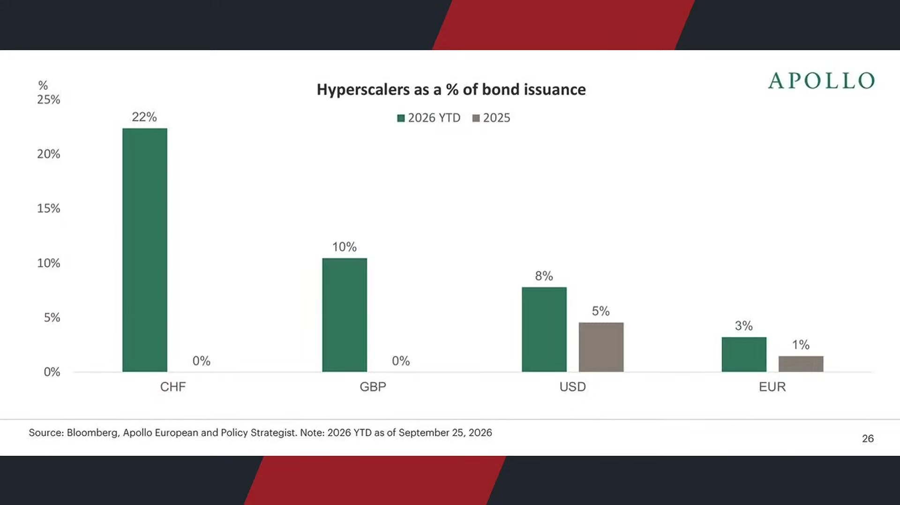

**逐字稿片段：** 我們根據阿波羅的數據 因為美國五大科技巨頭 在明年資本支出的底部 已經確認了 是1.13兆 這個比前一年預估的4950億 是增加了一整倍 那重點是什麼 因為美國快沒錢了 而且美國現在利率越來越高了 美國主導AI建設 現在最好的效果 就是向海外市場來大量借錢 我們看在9月底為止 美國大型科技巨頭 佔瑞士法郎的投資債券發行量 已經來到22% 就是以瑞士法郎作為投資單位 基本上就是瑞士人 瑞士本國市場 有22%的資金是提供給美國人 提供給美國的這些科技巨頭 英鎊債券佔了10% 其他我們看到在各國 有的是新市場貨幣 有的是歐元 大概是佔5%左右 總體而言 越來越多國家 再為美國的AI巨頭來續命 原因就是因為 美國內部的資金 已經越來越昂貴了 那搞到最後 就是不只是我們以前講了說 你買的股票都是AI 發債的單位 最後你買的債也是AI巨頭債 發行的國家 你以為只有美國 全世界都在搞AI 城堡的受險 你以為你把錢拿去買保險算了 受險去買什麼 一樣去買AI 所以你買進的股票 你發債的巨頭 發行的國家 城堡的受險 全部都是AI 那你不投AI還能投什麼 這就是現在的處境 那以前講的好賭的爸 生病的媽 上學的弟弟 破碎的他 我不幫他 誰幫他 你不投AI還能投什麼 這就是現在無可奈何的事情 無可奈何 沒辦法 所以這就是我們看到現實跡象 好的 當然當全球經濟 現在還處於高位以後 他就為本輪的AI融資 保持了一定的樂觀情緒 原因就是來自於 雖然內需市場變得不是特別好 可是AI所造成的財富效果 仍然在持續往上做推動 所以讓大家在財富上 仍然願意進行消費 這就拖動了目前的內需消費 所以AI難道就跟內需 處於兩種極端嗎 難道AI越差 我們內需就變好了嗎 從資金量來看好像是如此 你只要把投AI的錢 全部拿去做消費 那消費市場 零售市場就大好了嗎 這是理性假設 但是人到底能不能有 這麼龐大的消費量 或者說把投資轉為純粹消費 這是有挑戰的 也許藉由AI的財富增持 股市上漲了 那即便你沒賣股票 你大概也準備好 可能要準備訂今年年底 到明年年初過年的機票了 這就是財富效應 好那現在問題就來自於 美國財富效應的集中 其實還是來自於少部分人

**話題推測：** 引用阿波羅數據，說明美國五大科技巨頭的資本支出預估。

---

## 00:19:32

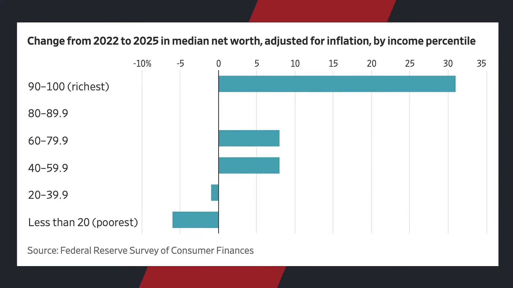

**逐字稿片段：** 我們從22年到25年 美國聯總會最新所公佈的 消費者財務調查 美國的家庭實質財富 中位數大概是成長2% 達到21.6萬美元 摺合新臺幣大概是600萬臺幣 那麼遠低於19年到2022年 高達37%的增幅 所以這幾年其實實質財富增長很慢 那不對啊 這幾年美國股市才是漲最兇的 怎麼會實質財富漲很慢呢 因為通膨漲很快嘛 其實主要我們看到財富成長放緩的背後 來自於世代和所得的分化 收入最高的10%家庭 財富中位數是增長了31% 收入最低的40%的家庭 反而是資產縮水的 那這種財富分化 它就反映在美國民眾 對於經濟的感受上 所以總體而言就是 有錢的人變少了 但是增速變快了 我們必須承認 就對於很多那種 可能高齡或者高所的家庭來看 因為他們持有很多股票和房地產

**話題推測：** 引用美國聯準會消費者財務調查數據，說明家庭財富增長和分化。

---

## 00:20:31

**逐字稿片段：** 標普白指數從22年底到2025年底 上漲幅度是78% 這說明著 以前我們的構想都是 退休老人你會隨著自己的年齡增長 逐漸消耗儲蓄嗎 以前有本書是什麼 叫什麼不要把你的錢留到死 就是你死前把最後一塊錢花光 那是最理想的事情 那以前退休老人都是這樣的 覺得年齡增長 消耗你的儲蓄 慢慢慢慢就消耗完了 這個趨勢反轉了 現在退休老人資產增值的速度 已經超過了退休之後的消費支出 消費支出就是通膨 那資產增值的速度78% 你有看過一個國家 三年通膨成長78%嗎 所以這一些我們看到的退休儲 反而造成了本輪 在退休財富史上 最驚人爆發式的一個增長 撐住了目前的適度消費 所以這也就是形成 我們看到的內部集團 我們過去跟投資朋友 稍微提過 我們當然知道物價是很嚴重 可是跟資產價格的上漲 比較起來 幾乎就是九牛一毛 如果你是全部的資產 可能有累積一定程度資產 都是股票 那其實這幾年報酬 你不要講說是跑贏通膨了 那跑贏通膨的10倍20倍都有可能

**話題推測：** 提及標普500指數從2022年底到2025年底的上漲幅度達78%。

---

## 00:21:47

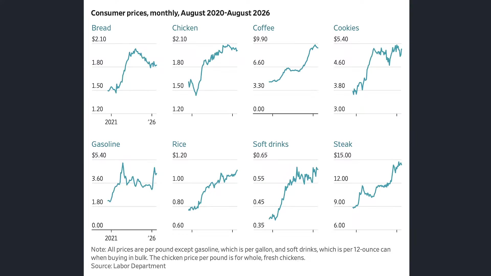

**逐字稿片段：** 我們看美國通膨的高峰 大概是從22年9%的高峰 到現在大概是3.4% 通膨率下滑不代表物價下跌 是上漲變慢 根據華爾街日報的分析 從20年到26年 美國整體的消費者物價指數 上漲幅度是2成9了 你看一下臺北股市 從20年到現在上漲幅都是多少 我們就設為48000點 8000點到48000 是漲6倍 600% 物價也漲2成9而已 所以意味著6年前花100美元 就能夠購買的東西 現在需要129塊 這6年來幾乎所有的生活領域 從牛肉 咖啡 汽車 托育服務到醫療費用 家庭支出是全面上漲 美國的郵票 從55美分上漲到82美分 漲幅49% 我們看到的Netflix無廣告的串流影音 從大概12美元上升到20美元以上 所以在服務業或者說零售的實體消費過程當中 服務價格上漲幅度其實比想象中還要來得更快 而這個轉折點在過去

**話題推測：** 說明美國通膨率從2022年高峰的9%降至3.4%。

---

## 00:22:51

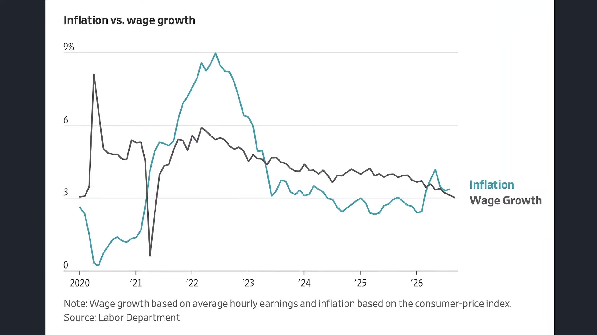

**逐字稿片段：** 其實時之新之從23年到25年 就是拜登時期後期 其實是有稍微轉正的 可是就在今年剛好轉負了 就是從美伊戰事開始以後 以前大家就是日子撐得很緊 有的靠資產通膨繼續的消費 有的就靠些微的實質薪資增長 稍微撐下去 現在死亡交叉了 所以目前川普所面臨的處境 我們把它拿來跟22年來做對照 幾乎是百分之百一模一樣的 那就是實質薪資翻覆的問題 這也可以連接到 川普政府在目前所面臨的挑戰為何 給投資朋友做些思考 當然我們回過頭來看一下 臺北股市 美國股市在這一輪下殺之後的 總體表現 其實仍然位居高位 就是來自於財富效應 還是把美國的經濟 稍微撐在這樣的一個位置 所以股票市場下跌 對於川普政府 對於實體經濟的影響 看起來比以往都還來得大 以前都是資本市場歸資本市場 漲跌那就是股民自己心痛不痛 現在看起來 因為AI已經把錢都吸走了 唯一的零售經濟 就靠這些財富效應來支撐 所以股市是不太能夠跌的 從零售角度來看的話 因為如果連這個唯一的支撐 都給拿掉 那退休老人 他就發現 好像退休金又不夠了 以前是覺得不夠 結果發現原來夠了 而且夠很多 現在如果又跌回去 那又不夠了 好 我們看看美股股市 四大指數表現

**話題推測：** 討論實質薪資增長從2023-2025年轉正，到今年又轉負的趨勢。

---

## 00:24:18

**逐字稿片段：** 標普白指數下跌1.7點 0.02% 收在7805點

**話題推測：** 報告標普500指數昨日下跌點數和幅度。

---

## 00:24:24

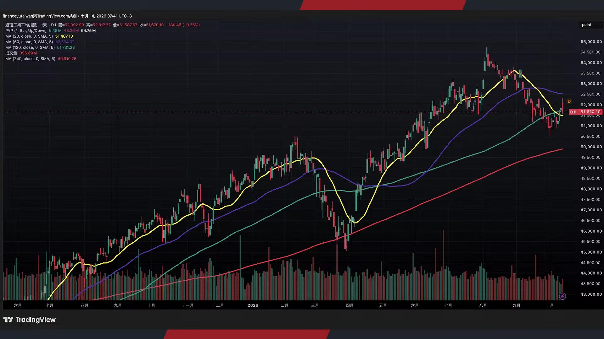

**逐字稿片段：** 納指下跌41點 0.15% 收在17204點 道瓊下跌180點 0.35% 算51670點

**話題推測：** 報告納斯達克指數昨日下跌點數和幅度。

---

## 00:24:33

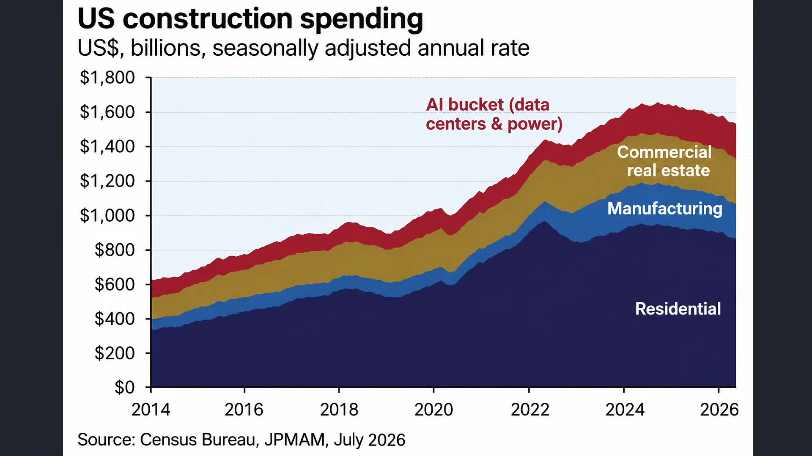

**逐字稿片段：** 那費辦剛才提到 下跌27點 0.23% 算1208點 其實全球股票市場 我們過去跟抖子沒有提過 從24年以來的大幅上漲 真正推動股價 主要的還是企業獲利 而並不是單純的本益比擴張 因為這兩年 你不要看說股價漲得很誇張 其實按照EPS上升的幅度來看 股價上漲的速度 其實是比本益比擴張的速度 應該講說EPS上漲的速度 其實比本益比擴張的速度 還要快非常多的 我們如果從截止到今年10月中旬 亞洲不含日本的科技股

**話題推測：** 報告費半指數昨日下跌點數和幅度。

---

## 00:25:16

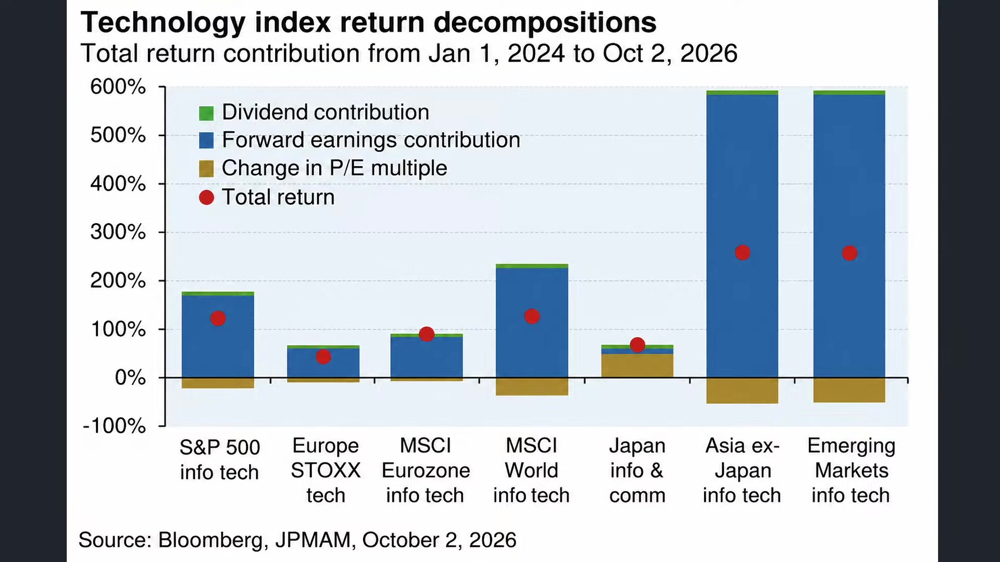

**逐字稿片段：** 和新興市場的科技股的累積報酬 大概是250%左右 但是預期的獲利成長是多少 是580個百分點 所以其實在過去三年的表現當中 我們的獲利是成長了5倍 我們的股價也不過成長2.5倍 所以這是當中比較顯著的落差 這解釋了為什麼 即便現在股價處於高位 我仍然認為 現在的便宜程度 其實不亞於去年的關稅戰 甚至跟2022年的烏二戰 是沒有差太多 所以這個時間點 大家選擇去推出自己的產品 比如說

**話題推測：** 報告亞洲（除日本外）及新興市場科技股累計報酬約250%。

---

## 00:25:51

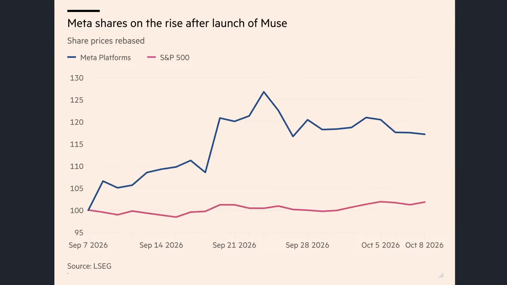

**逐字稿片段：** Meta最近也推出 進一步的AI眼鏡 阿里巴巴 各大產業陸續推出以後 是否能夠引起新一輪的奇彈 這是值得留意的 當然它就要靠總體的財富效應來做支撐 要不然剛才跟投資朋友提到 現在就是來自於物價逐步的被侵蝕 所以如果你連資產價格 在短期內它也跑出了通膨 簡單來講就沒有漲幅超過3.4% 那一樣它可能也會受到 零售銷售市場的顯著衝擊 像大家就講了 我的薪水可以鎖住我的購物慾 這叫隨心所欲 隨著我的薪水鎖住我的購物慾 那唯一增長我的慾望的條件是什麼 資產的增值 就不會有人因為現在的薪水 覺得自己可以多消費一點 大家知道薪水的情況就是那樣 可是股票多漲一點點 那我就願意多買一杯珍奶了 看起來市場的消費習性是如此 這也給投資朋友多做一些參考 那最後回過頭來說 那AI巨頭走到目前最大的挑戰是什麼呢 第一大家當然嘗試的推出更新一部的 AI 3C電子產品 你像蘋果股價在昨天創高 根本原因是什麼 其實就是它推出的新的家庭用具 雖然我覺得這算是自衛印象吧 而且長得怪怪的 但是它總得推出一些新形態的產品 來獲得市場上的新一輪青睞 阿里巴巴在本週也正式推出

**話題推測：** 提及Meta最近推出AI眼鏡新產品。

---

## 00:27:17

**逐字稿片段：** 新一代的千問AI智慧嚴禁 叫N1系列 售價是人民幣2999塊 大概是450美元起跳 它目的是什麼 挑戰Meta旗下的智慧眼鏡產品 當然阿里這次也沒有采取低價的措施 它強調的是硬體的規格 重點是什麼 其實阿里這幾年一直在嘗試著 把AI的佈局從雲端運算 晶片和大圓模型 它想要延伸到消費者 每天都使用得到的硬體設備 所以這一次 它推硬體設備的目的是什麼 就是想要爭奪和AI互動的入口 還有更多的數據 對於阿里來說 你現在都是電商的資訊 支付的資訊 還有云端服務的整合 如果未來可以隨時隨地 我不能講說100% 一定是從AI眼睛來收集數據 但是有各種個體消費端的體驗 數據的回傳 也許可以讓它更接近於 現在的AI物理世界 我講一下根本原因 股價我們當然不期待 未來幾年 每年都像今年上半年那樣上漲 原因很簡單 今年上半年上漲 又很大一部分因此 看起來不是因為AI的需求突然爆發的更多快 資本支出就是慢慢的墊高 其實更多是反映缺貨了 你不能反映每年都缺貨 缺貨缺到有一天 記憶體成本本來只佔20%的成本 到後來一座資料中心100億 有90億都是記憶體 那也不可能 遲早有一天這場遊戲玩不下去 真正原因是什麼 其實就是資本支出年增幅放緩的問題 不要漲這麼快而已

**話題推測：** 報告阿里巴巴本週推出新一代千問AI智慧眼鏡N1系列。

---
