# yutinghaofinance_3qS11YVouFQ — 關鍵畫面索引

- 來源逐字稿：[yutinghaofinance_3qS11YVouFQ_FIN.srt](yutinghaofinance_3qS11YVouFQ_FIN.srt)
- 影片：https://www.youtube.com/watch?v=3qS11YVouFQ
- 截圖數：28

## 00:00:46

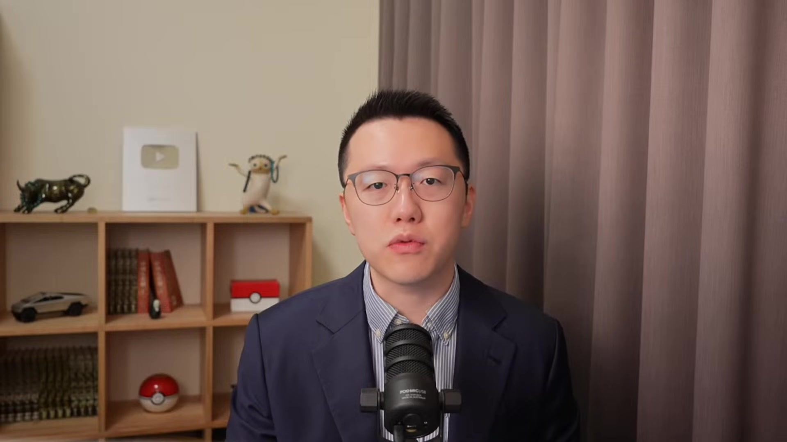

**逐字稿片段：** 這一次由SpaceX的強勁財報 尤其又潛在合併特斯拉的消息之後 帶動了資金開始回落到科技股當中 尤其對道瓊來說 已經連續上漲幾天了 納斯達克指數上漲了1% 標普白指數連續三個交易日收紅 不過現在夜盤好像市場賣又開始回來了 但是不管怎麼說 總會感覺到在本季度財報 其實它是有一股對於未來的期待 以及增加資本支出的 那不論他投了這些資本支出收不收的回來 不過呢至少可以看得出來 那費辦的訂單又會源源不絕的定來 現在你像是Meta 他這次也是上丟了資本支出的展望 持續加碼AI 所以總體趨勢還是確認的 那重點只在於市場要怎麼看待你的融資遊戲 我們先看四大指數的變化 道瓊指數上漲360點 0.69% 收在52856點 費辦就這樣子談上來了 標普白指數上漲44點 0.58% 收在7757點 納斯達克指數上漲278點 1.05% 收在26702點 費一半上漲221點 1.97% 收在11505點 三大指數看起來都還在高位震盪 那費一半也嘗試的做主體

**話題推測：** 介紹SpaceX強勁財報及潛在合併特斯拉消息。

---

## 00:02:03

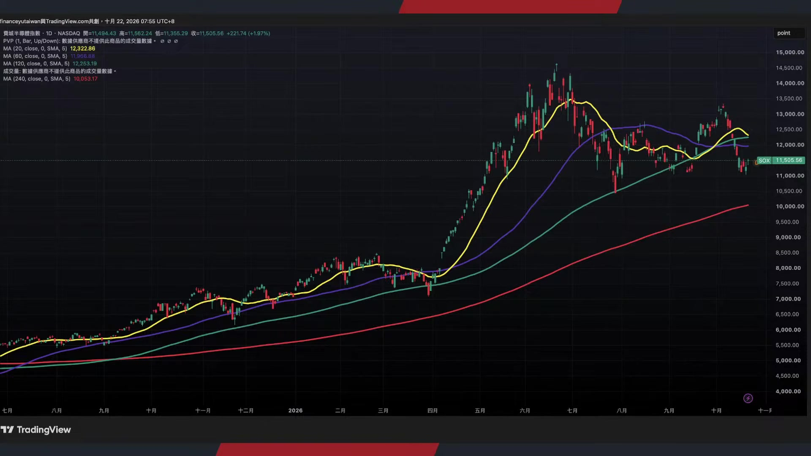

**逐字稿片段：** 其實如果是以大型科技股來看 我們過去跟投資朋友稍微提過 其實呢 現在市場上 現在好不容易一直強調其實 其實因為美國股市從現在的位階來看 根本也沒有真的在大跌 我們只能說從大型科技股來看 今年90%的股票都還收紅 可是你放大到標普500指數來看 那就有接近60%到70%的股票 已經下跌超過10%了 這個就是非常有趣的現象 內部股票開始不斷的激化

**話題推測：** 比較大型科技股與標普500指數內部股票的表現差異。

---

## 00:02:36

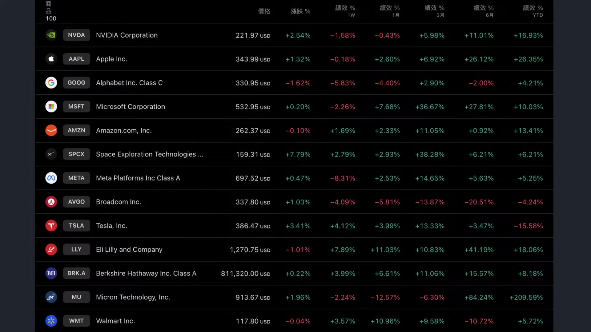

**逐字稿片段：** 我們如果以全球大型科技股來看的話 好,現在美光大概是以最驚人的漲幅領先的,209% 然後蘋果是上漲26%, 理來上漲是8%, 輝達上漲16%, 亞馬遜上漲13%, 微軟上漲10%, 波克夏上漲8%, SpaceX也上漲6%, 沃爾瑪上漲5.7%, Meta上漲5%, 阿發貝上漲4.2% 哎,今年我們看到其實大多數股票表現還算是非常不錯 跟過去我們看標普白指數內部的那種急速分化 比較起來看起來這些大型科技股都還在成盤當中 那小型科技股到底有沒有報復性反彈的可能性 這主要是看利率預期 因為羅素2000現在大概在挑戰 25年5月份以來的重要的長期的上升趨勢線 雖然指數還是位於200日曆動平均線 我們把它當成年線下放 但今年3月份也曾經出現這樣的類似情況 搞不好是一個重要的買點 隨後就隱瞞了強勁反彈 所以大型股看起來是完全撐住了 小型股的部分 之前高利率的沉壓出現以後 這一次看是否能夠藉由不升息 因為下禮拜就是FOMC了 不升息以後 能不能讓市場有一點 在小型股匹極泰來的味道 讓大家的融資成本壓力 不要來得這麼大

**話題推測：** 介紹全球大型科技股的年度漲幅列表。

---

## 00:03:55

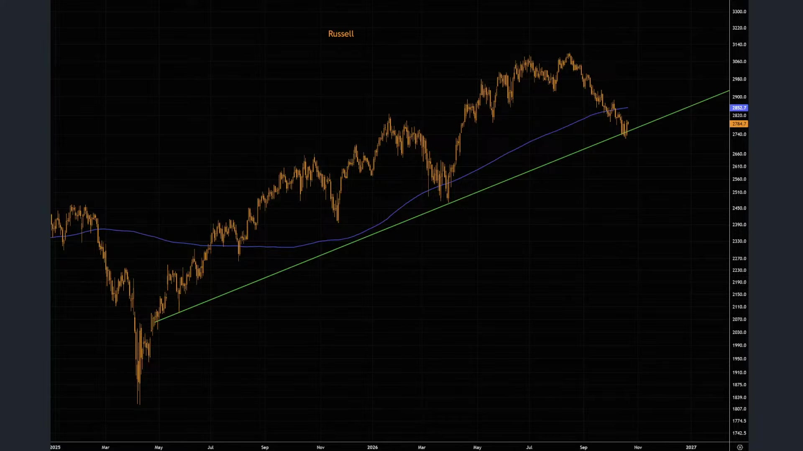

**逐字稿片段：** 事實上美國散戶的實質投資行為 它也呈現出不同的景象 之前我們提到像是Michael Burry 或者之前像卡拉曼 格拉罕 或者橋水基金的創辦人達裡 這些人他的確在過去一段時間 都曾經提到對於AI泡沫的擔憂

**話題推測：** 分析美國散戶的投資行為變化。

---

## 00:04:13

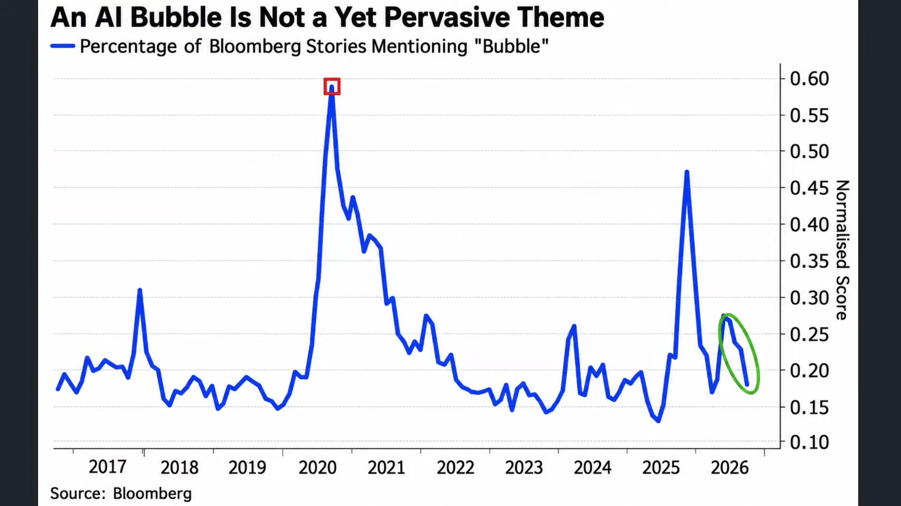

**逐字稿片段：** 散戶投資組合當中的股票配置比重 大概也攀升到了71.8% 這個大概是接近2000年科技泡沫破滅的水準 但是沒有一個指標可以重複完全套用的 重點其實來自於Bubble這個名詞 就是過去我們的確在25年當時10月份 大家還記得那個時候AI永動機的時候 很多人在提AI泡沫潤 泡沫潤 結果漲到現在 即便現在股價其實也在做適度回調 可是已經沒什麼人在提泡沫了 所以有些人認為這是一場警訊 隨著大家投入股市的部位越來越高以後 退休基金也進場了 主權基金也進場了 你以為你買債好像在做避險 後來發現你買的也是企業債 你買的也是AI債 所以不管怎麼說 大家都投入到AI的過程當中 開始討論AI泡沫的聲音 反而開始下滑了 因為都已經參與了 你也很難完全避開AI 所以這是市場上 擔憂的第一個方向 那就造成部分 我們看到知名投資人 還是採取相對比較謹慎的態度 那半信半疑中成長 這是我們的看法 那另外一方面 我們看美國經濟資商局的 消費者信心指數 它也出現這種類似的矛盾 超過半數的受訪者 都認為未來12個月的股價 還會再上漲 但是呢 有超過半數的人認為 經濟會越來越差 這個就是很極端的現象 大家認為日子過得越來越差了 可是股市會持續的上漲 好像愣命了一樣 覺得K型分化已經是未來趨勢 那就非常有趣的跡象 但是我們講說投資最可怕的 不是說股市就突然下跌 就是前面原本賺的太順 讓你誤以為能夠承受更大的風險 於是你開始提高曝險 放大槓桿 這一次買入也一樣 你只要不要提高過度的曝險 放大過度槓桿 你把原本預留的現金 分階段的進行投入 我認為針對怪力比較 指數大的一點回調來做投入 我認為沒有太大問題 那有時候你可能上槓杆 上的比較多一點 最後你還是會股價創高 但行情有時候一反轉 一不小心把你洗出場了 虧損所帶來的壓力 就會讓人急著想要翻本 那你越跌 你加碼速度越快 加碼的錢又是靠槓桿來的 最後就有時間成本壓力 時間一到被迫就要離場了 所以那句話怎麼講的 賭神的名言 贏要衝輸要縮 跟他拼了 那就是壯士斷腕 如果你上槓杆的時候 發現矛頭不對 方向不對 那就輸要縮 稍微縮一下 不是說哈的縮 這就是他給予的看法 今天是一個很重要很重要的日子 大家應該還記得 10月22號是一個很重要的日子 再過兩天 10月20 那就今天 今天所以10月22號是高進的太太33週年了 不管怎麼講 我們看現在對他今天要跟海棠小姐接一根頭髮 今天要變超級賽亞人了 不管怎麼說 我們看現在美國股市來到這樣的一個位階以後 其實就說明著大家一方面其實躍躍欲試 因為有很多股票的確回調非常多 但是贏要衝輸要輸 大家知道在這一次的操作邏輯當中 會以7月份戒慎恐懼作為代表 大家不要急著 一次就把你給洗出場 所以他在進場的過程當中 也許稍微抱持著比較和緩的心情 我認為來得更加適當

**話題推測：** 呈現散戶投資組合中股票配置比重數據。

---

## 00:07:49

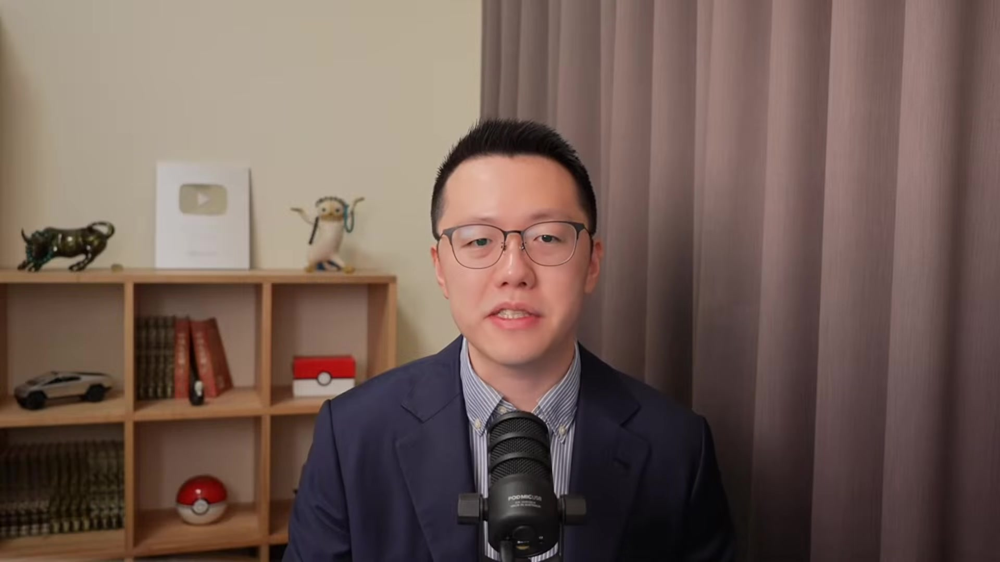

**逐字稿片段：** 好 那我們今天就主要把現在的公佈財報 來做一系列的梳理 來看待這些公司是如何看待未來 是否能夠成為賣產值的半導體的有效訂單 可是另外一方面 市場上也擔憂這些公司的融資風險 所以在評價上的調升 其實也沒有想象中 來的劇烈 首先我們看的是Meta Meta的部分在昨天上漲0.47% 每股收在697塊 那主要是它把全年資本支出的下限 從1300億美元調高到1350億美元 最少要投1350億 那上限就維持在1450億 而且它還宣佈董事會 已經批准設立不具投票權的C股 為了要籌資 員工講籌或者收購 提供更多的彈性 換句話說 繼續的搶錢 繼續的擴大大家對於AI資本投入的一個預期

**話題推測：** 總結並開始詳細梳理近期公佈的財報。

---

## 00:08:40

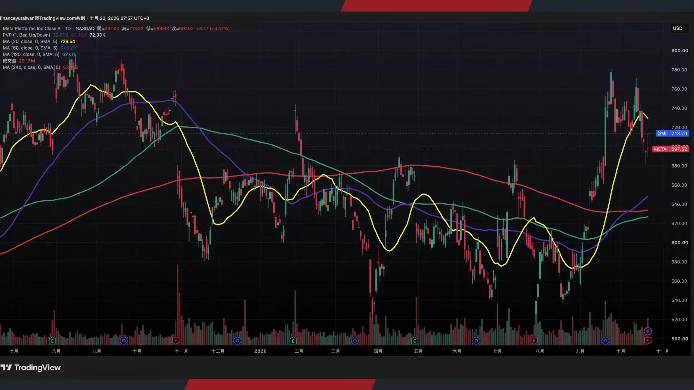

**逐字稿片段：** 那SpaceX的部分就是暴漲了7.7% 那很大程度一方面是取決於本身的獲利 尤其在新鏈的收入 看起來有點獨斷的市佔率味道 另外一方面現金流也不斷的進來 那更重要的事情是 SpaceX跟特斯拉已經各自成立了委員會 評估潛在的合併案 讓大家有更進一步的市場預期

**話題推測：** 開始分析SpaceX的財報表現。

---

## 00:09:02

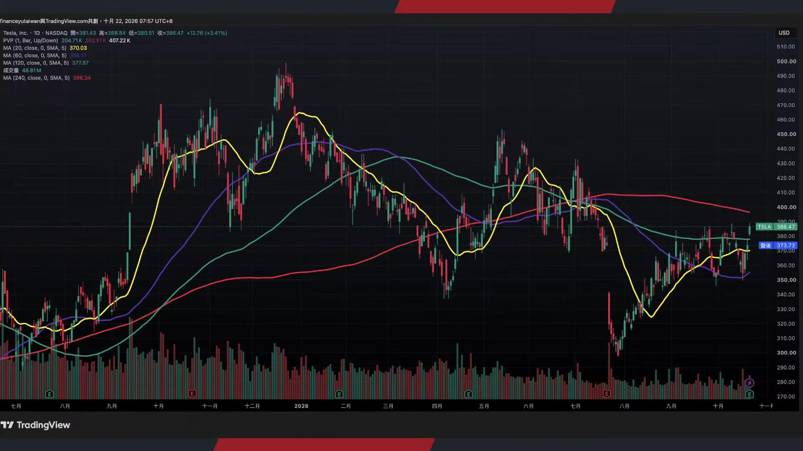

**逐字稿片段：** 好那我們先看Meta Meta在第三季的成長大概是26% 突破了646億美元 遠遠優於市場預期的633億 淨利來到98.6億 年增幅是264% 70之後的美股盈餘是3.83塊 那也比預期還要來得好了 所以其實Meta你不要看說 雖然好像詐騙業務 不是詐騙業務 廣告業務 好像這幾年已經來到比較飽和的區段了 不過總體而言 它還是能夠維持每個季度20%到30%左右的增速 這個表現已經算是非常不錯了 那當然它的獲利這次表現並沒有受到特別好 主要是受到去年同期一次性的稅務費用 所造成的低基期影響 實際運營其實並沒有受到多大的衝擊 那加上Meta這一次大家還記得嗎 是上個季度當時有任列接近100億美元來和解 當時很多學校去指控 Meta破壞了青少年的心理健康 還有社區媒體的相關費用 所以Meta決定採取和解 總費用率大概增長了68%左右 這個是對於額外比較多的開銷支出 營業利益率是從去年的40%下降到20% 如果排除和解費用 其他的美股盈餘大概還是7塊 這說明你就把它當成一次性事件 但是Meta目前的整體經營績效仍然相當不錯

**話題推測：** 詳細列出Meta第三季的營收、淨利與每股盈餘數據。

---

## 00:10:29

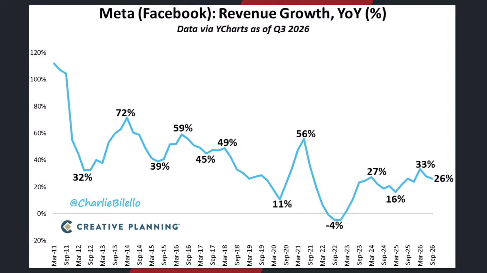

**逐字稿片段：** 現在Meta最大的轉變 就是從以前數位廣告最為核心的科技平臺 現在已經變成了要投入龐大資本的AI基礎建設 公司在今年剛才提到 低標已經從1300億提升到1350億 那高標是1450億 資料中心運算設備 AI人才還有模型研發 是Meta現在最重視的事情 其實你要知道Meta之前 大家還記得前兩年 那時候改名的原因就是因為為了要推原宇宙 當時所推出的擴增時金業務 Reality Labs 也成為了集團很長一段時間的虧損來源 但是Meta完全沒有停止下來的跡象 你虧越多我就投越多 現在即便尚未有那種足以去支撐成本的獲利模式 它還在繼續投下去 這個就是目前它發展未來的核心

**話題推測：** 說明Meta從數位廣告平台轉型為AI基礎建設的戰略轉變。

---

## 00:11:19

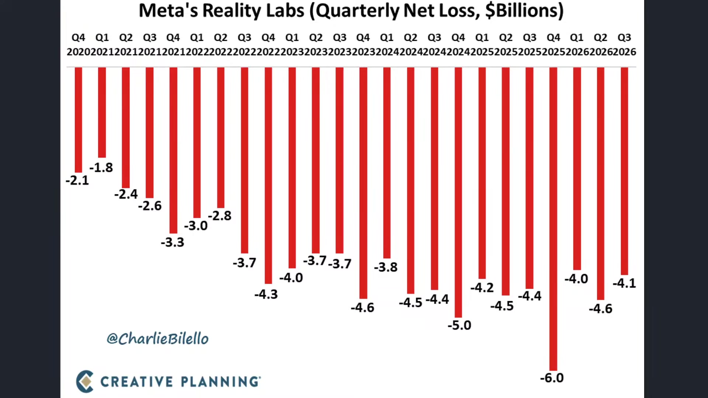

**逐字稿片段：** 所以為了要因應這種情況 這一次就設立了不具表決權的C股 C類的普通股 預估從27年開始交易 用於AI投資 企業賓供或者員工的薪酬 前陣子他也推出了MUSE 在美國和加拿大 大概吸引了1000萬名的賬戶使用者來做使用 累計下載量是1090萬次 算是扳回一城 不過市場針對未來的代理AI 還是有非常多的選擇 所以未來是不是能夠成功的拿下一定的市佔率 還很難說 但至少他完全沒有要停下來的跡象 那對於費辦而言就是好事 那市場上的擔憂又在哪裡呢 如果真的是目前看起來 未來前景非常好 那股價怎麼只漲那麼一丁點呢 一方面是前陣子它要拉高了 另外一方面 是Meta如果你仔細觀察財報 這一次藏在付諸裡面 有高達6281的美元承諾 那可能比投資人想象中 還要稍微貴了一些 我們要這樣想 因為科技巨頭 現在本來就有大量的 資產負債表當中的租賃 或者採購承諾 如果把這些未來的付款義務 納入到企業價值 就是我們講的EV Meta的估值 可能就會比傳統算法高出35% 這就代表著投資人看到的財務槓桿 反而低估了AI擴張所需要承擔的資金的壓力

**話題推測：** 介紹Meta為籌資設立不具表決權C股的計畫。

---

## 00:12:40

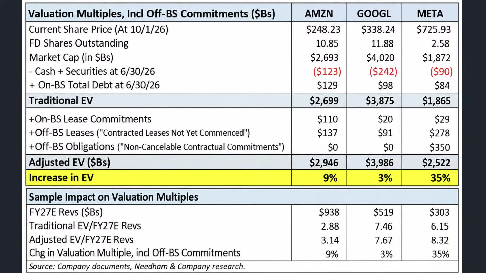

**逐字稿片段：** 我們以Meta來看 現在賬面債務的租賃的負債 大概是1,120億美元 那你看一下財報付諸當中 還有另外揭露有6,280億美元的未來承諾 就要付給別人的 相當於賬面債務和租賃的負債的5.6倍 其中2790億美元 是尚未開始的資料中心的租賃 這就代表著有很多他賺到的錢 他已經先納入到財報體系當中 可是還沒建好 如果沒建完 或者建好之後 沒有人跟他買算力 市場上會稍微有點擔心 這些承諾雖然沒有完全列在資產負債表上 但是未來他還是要付出非常多的現金 所以反映在企業估值當中 我們看到它就會產生適度的施政 簡單來講就是現在 其實大家都有非常多的表外資產 也不只是Meta的問題 但是大家的投入預期來得越來越多以後 市場總會擔心 財報面因為你的獲利還是很好看 從本益比大家都在下滑 可是對於未來是否能夠有效的回收 我個人的看法是 其實它是有能力回收的 大多數巨頭都有能力回收 唯一的問題是怕它蓋不出來 怕它蓋不出來 那就有違約的可能性了 因為現在有民意的壓力 有缺料的問題 所以如果無法準時蓋層 你那個時候承諾給這些AI雲端業者的算力 那要如何處理呢 我認為這個壓力是遠遠大於 蓋出來這種沒人用的壓力 所以我一樣認為 市場可能有中期回調的可能 但是泡沫破滅的風險仍然不高 泡沫破滅的風險的前提 一定是供給過剩 一定是到處都在發NFT的時候 NFT就泡沫破滅了 到處都是鬱金香 浴巾箱就泡沫破滅了 到處都是閒置的算力 沒有人要使用的算力 那就AI泡沫破滅了 那現在不一樣 現在每個人都在搶Token 工程師一下就用完 永遠不缺 應該講說永遠你給我Token 我都有辦法把它給燒完 所以從這樣的一個角度而言 我認為市場的需求還是存在的 完全取決於它該不該的出來而已

**話題推測：** 揭露Meta財報附註中高達6281億美元的未來承諾。

---

## 00:14:41

**逐字稿片段：** 好 那我們再回過頭來看一下特斯拉 特斯拉這一次在第三季的財報 它的確優於預期 但是成長的疲態也是非常明顯的 這一次在第三季財報當中 營收是高達280.5億美元 略高於市場預期的279億 調整之後的每股盈餘是0.48塊 也比市場預估的0.43塊 稍微好一些了 但整體營收 相對於去年同期的282億 基本上還是有小幅下滑 那其中我們看到汽車業務營收 還年減3% 好像看起來汽車賣的不是特別好了 所以大家只能靠它的自駕車 看是否有效突破了 特斯拉是這樣表示的 說電動車因為平均售價下降 加上現在電池供應受阻 限制了公司滿足訂單需求的能力 所以是我們製造不出來的問題 跟市場的需求匹配也沒有太大相關

**話題推測：** 開始分析特斯拉第三季財報與成長疲態。

---

## 00:15:34

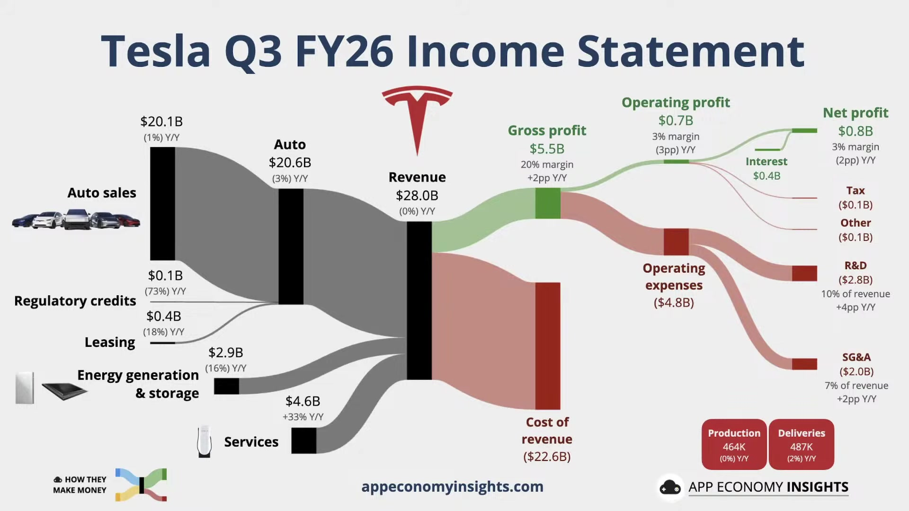

**逐字稿片段：** 第三季的交車量是48.6萬輛 比去年同期還少了2% 儘管現在加拿大 日本臺灣澳洲的銷量都創下新高了 但是由於在中國市場當中 比亞迪或者小米 持續透過價格優勢來擴大市佔率 加上美國現在電動車的稅額 低迷已經取消了 所以對於特斯拉的整體銷售 還是有相當大的壓力的 我們看來看 Meta還是保持20%到30%的營收成長 我們看一下特斯拉的部分 零啊 零啊 真的是零 完全沒成長 但是它的估值本益比 又是七巨頭當中表現來得最高的

**話題推測：** 提供特斯拉第三季的交車量數據。

---

## 00:16:11

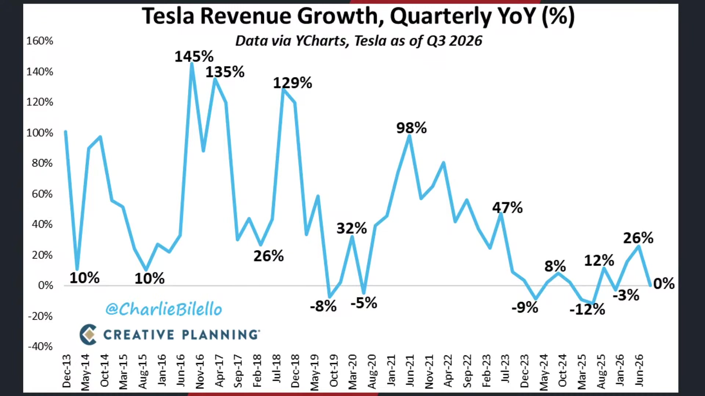

**逐字稿片段：** 所以唯一的解套方式 我們過去提過只有一個 就是AI 自動駕駛 機器人 進一步整合馬斯克旗下的資源 那如果要這樣做的話 那也只有一種方式 直接把它併入SpaceX 用SpaceX的方式擴大資源的整合 把特斯拉給救回來 那本益比就沒有那種失真的問題了 要不然有一家專門做車子的企業 然後本益比100多倍 那完全要靠自動化 或者我們講說汽車駕駛 以及Optimus機器人來做轉型 其實是有點壓力到 那這個市場上也被提入到10成 其實必須承認 現在就是即便轉為自動化 或者說純自駕車 看起來還有一段路要走 畢竟我們原本預估今年下半年 應該這個Robotex應該就要大爆發了 結果現在還控制在千輛以內 那個速度的確有比原本市場預期稍微慢一點 那另外一方面

**話題推測：** 討論特斯拉透過AI、自動駕駛、機器人整合馬斯克旗下資源的解套方式。

---

## 00:17:07

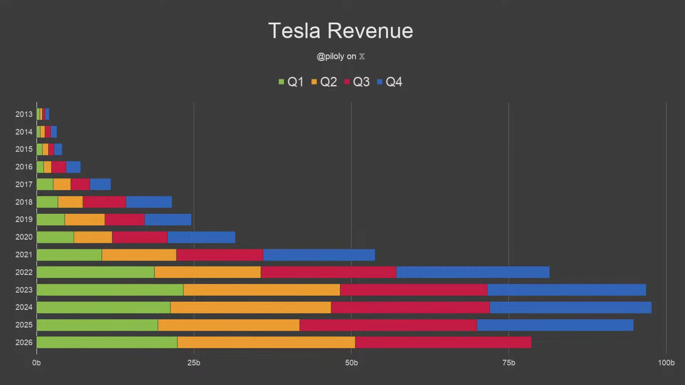

**逐字稿片段：** 如果是以純電動車來看 其實全球電動車 現在毛利率下滑速度跟過去的燃油車差不多 我們如果細看 現在在歐洲車廠當中 幾乎中國車是完全席捲 中國奇瑞汽車底下的JECO 7 上市僅僅一年多 就在英國市場已經超越了 同級的Range Rover 所以我們看得出來 現在市場上一系列的衝擊後 各大傳統車廠已經慘不忍睹了 特斯拉都沒這麼慘 所以特斯拉已經是沒那麼慘的 我們講說傳統電動車廠 那對於未來長期自駕車的發展前景來說 是它推動目前本益比的主要原因

**話題推測：** 探討全球電動車市場的毛利率下滑趨勢。

---

## 00:17:46

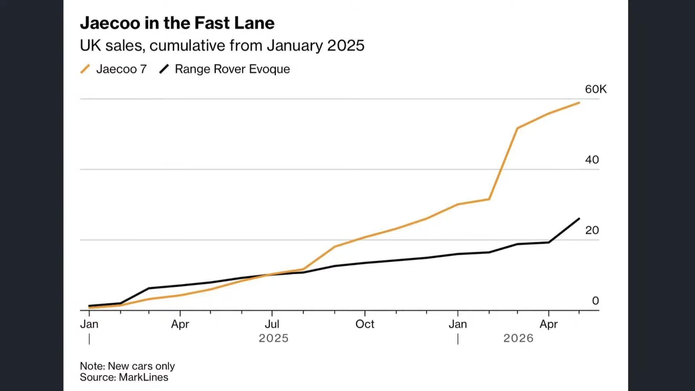

**逐字稿片段：** 看幾隻 一個是馬薩拉D 馬薩拉D現在也開始使用中國技術 歐洲豪車的護城河也正在崩潰當中 那我們看在過去幾年的總體銷售量 它應該已經創下過去十年來的新低了 這個是在電動化進展不順 加上中國市場需求大幅萎縮之後 所造成的品牌衝擊

**話題推測：** 提及Maserati採用中國技術及歐洲豪車護城河崩潰。

---

## 00:18:07

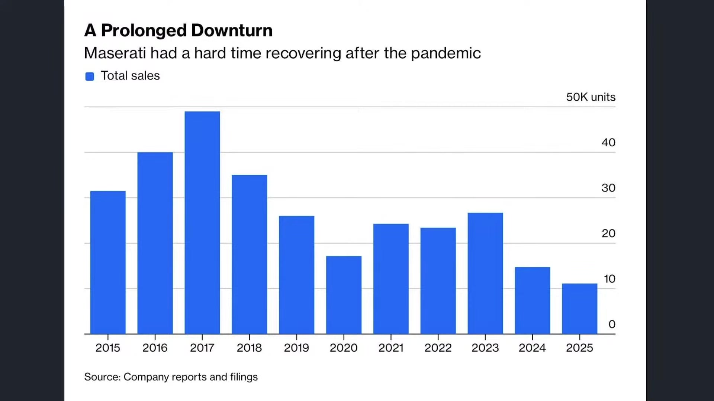

**逐字稿片段：** 保時捷的部分 今年看起來也沒有太多好轉 去年全球銷售下滑了10% 也創下了六年來的營收最低 這個股市都已經漲多少了 居然保時捷的銷量 居然只有2021年的五分之一左右 這個保時捷 我們過去也知道 在電動化的轉型當中 其實電動車的保時捷也不難開 但市場看起來 接收意願程度就是沒這麼高 營收持續的下滑當中

**話題推測：** 分析保時捷的全球銷量下滑狀況。

---

## 00:18:34

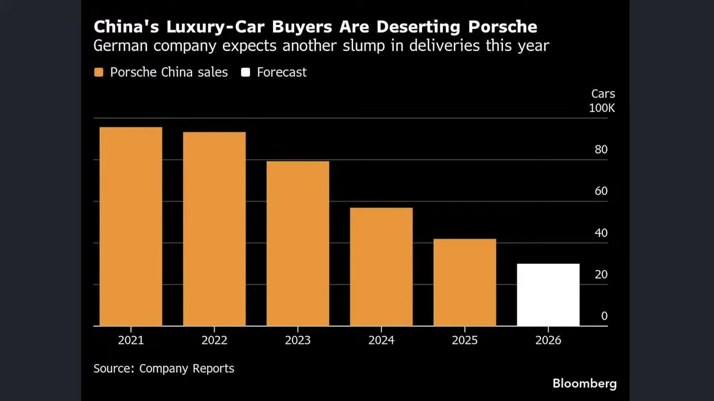

**逐字稿片段：** 那BMW的部分 今年是把26年的年底猜測全面下調 原本我們看到的稅前獲利 本來預估是年減10% 現在預估要來到15%以上了 整體而言 看起來今年的總體銷量 也會撞下五年來的新低

**話題推測：** 說明BMW下調獲利預期及銷量新低。

---

## 00:18:51

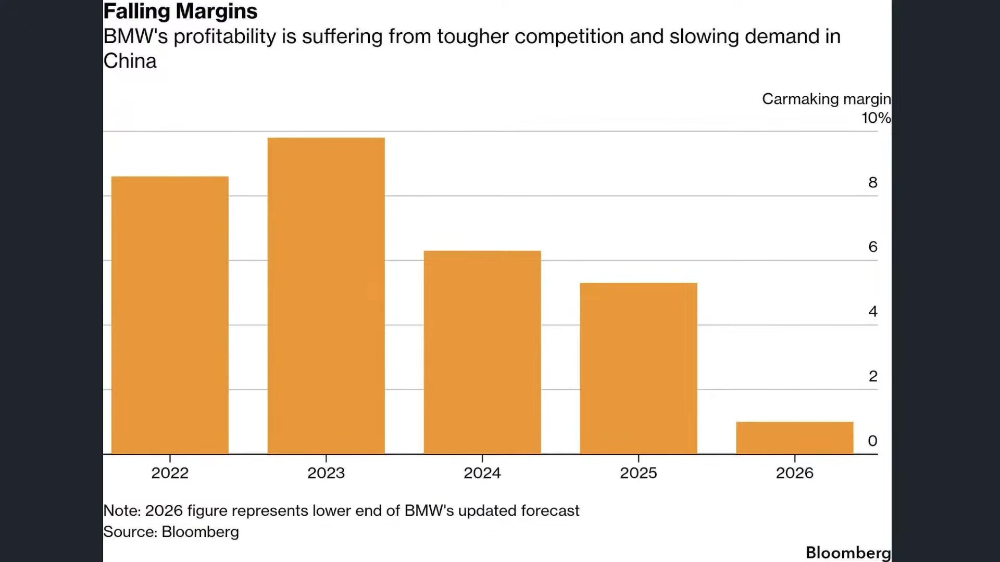

**逐字稿片段：** 再看一下Benz 其實大家差不多了 奧迪等等都在快速的下滑 我們過去跟投資朋友提過 現在以中國為首的降價潮 已經開始擴散到全世界 除了臺灣 大部分的車廠 其實都有鬆動的方向 之所以沒鬆動 可能頂多是缺料的問題撐住了 但本身其實我們看到全球的車市 都有開始陸續進入到降價潮

**話題推測：** 提及Mercedes-Benz等豪車品牌銷量快速下滑。

---

## 00:19:15

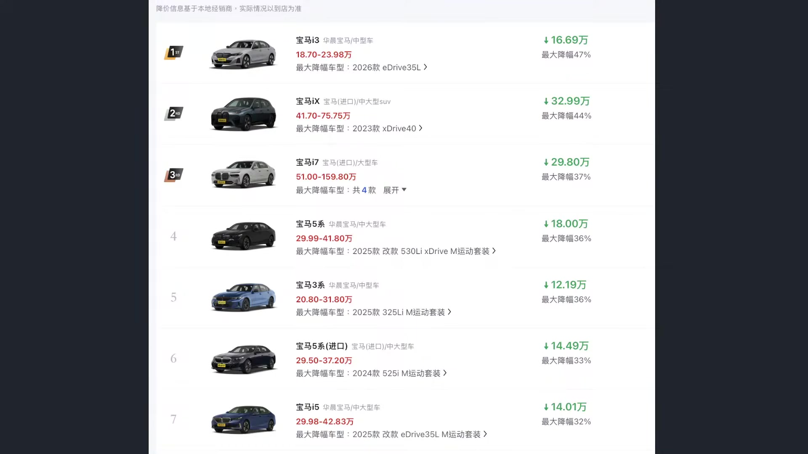

**逐字稿片段：** 我們以BMW來看 過去我們提過 你像BMW的i3 電動車的三系列 在中國市場價 現在優惠價來到73萬塊臺幣 降幅是多少 降4乘7 其他像是SUV的iX 最高降幅有降145萬 降了44% 7系列最高降幅是131萬臺幣 那其他像是BMW 5系列大概是降79萬 3系列降54萬 進口5系列也降64萬 所以不管是國產的BMW還是進口的 那個降幅大概都是五成到六成起跳 那賓士的部分電動車降幅是最大的 EQE的部分大概降了105萬 最大降幅是50% EQB的部分降了77萬 EQE的SUV降了105萬臺幣 其他像是EQB降了77萬臺幣 那你不要說只有海外的這些歐洲車廠正在降價 其實中國本土的車廠也在大幅的降價 只是它已經很便宜了 所以也降不了多少了 舉例來說 你看到之前像是原UP 大概降幅降了1.5萬人民幣 其他像是青帕斯 海歐 BRD 幾乎全面車款 降價幅度在今年是10%到20%左右 大家都在瘋狂降價 這個就是整體全球汽車市場的概況 所以必須承認 整個汽車市場 必須承認已經完全進入到 紅海市場當中了 完全無藥可救 跟手機市場 手機市場看起來都比汽車市場 還要稍微好一點點 但不管怎麼說 已經來到一個瓶頸期 只能在自駕車上面突破 要不然要採取新模式了 什麼新模式呢

**話題推測：** 詳細列舉BMW車款在中國市場的大幅降價幅度。

---

## 00:20:53

**逐字稿片段：** 合併吧 我們看這一次特斯拉跟SpaceX 預估準備要開始合併了 打造全球最大的人工智慧帝國 那這一次馬斯克是親自承認 雙方已經成立了獨立董事委員會 來評估相關交易 如果成功的話 合併的市值會來到3.6兆美元 那就直接躋升到全球的前五大企業了 那等同於馬斯克一方面做電動車 又搞火箭 還做衛星通訊 還做AI 又做機器人 現在還要做半導體 兩家公司的營收大概是1530億美元 員工到時候會來到15.5萬人 那自由現金流還是可能會淨流出540億 但不管怎麼說 現在這場史上最大規模的企業合併

**話題推測：** 宣布討論特斯拉與SpaceX預計合併的計畫。

---

## 00:21:38

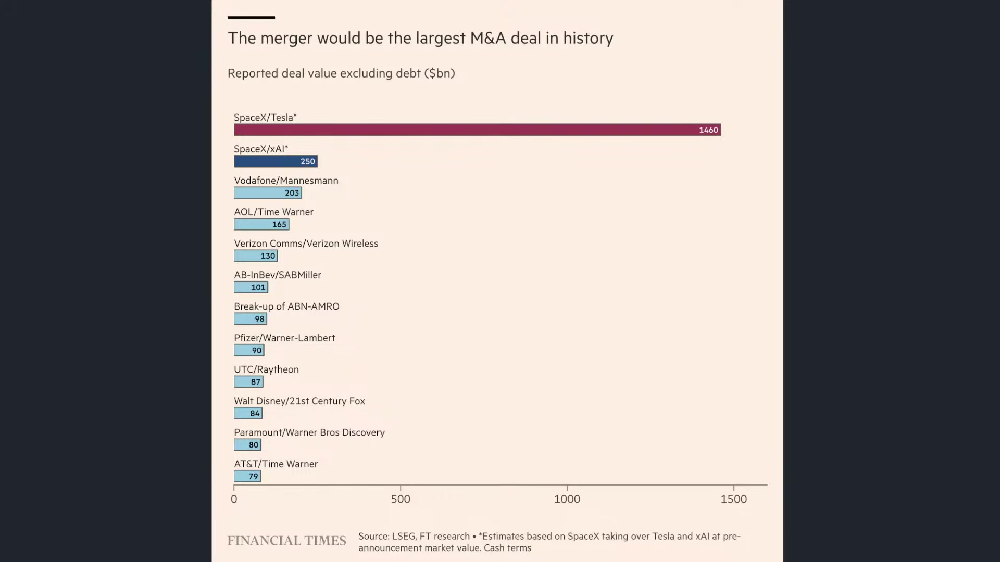

**逐字稿片段：** 還是有很多挑戰的 比如說股東的態度 比如說監管機構的雙重考驗 馬斯克目前掌握SpaceX有84%的投票權 可是特斯拉他只掌握20% 你要知道馬斯克並不是特斯拉的創辦人 其實特斯拉本身我們也知道 從股權角度來看也是比較分散一點的 相對於之前的SpaceX 而且可能進一步擴大他的控制力 也有利益衝突的疑慮 更棘手的是中國市場 特斯拉去年在中國營收是210億 佔了總營收22% 上海也是最大的生產基地 但是SpaceX它搞國防任務 你看它有18項的國家安全的發射計劃 如果兩家公司分別各自做各自的 還好說 現在是同一家公司 你又依賴中國的生產基地 你又不斷地接美國的國防訂單 那會不會有問題呢 所以不管怎麼說 如果能夠合併 那也許對於市場是一個提振效果 整體交易估值可能高達1.46兆美元 那如果順利完成的話 就會完成全球史上最大規模的併購超 那看起來短期內市場是反映這樣的一個角度 那對於現在市場上 對啊到底現在唸SpaceX還是SpaceXSci 因為之前那個大家還記得 那個時候川普不是推出新的科技用語嗎 就是不要再叫做Artificial Intelligence 要做Super Intelligence 叫SI嘛 人工智慧 川普在上個月聯合國大會的時候就說 以後我們美國都叫SI 馬斯克還呼應他 說我們不叫SpaceX AI了 我們叫做SpaceX Sight SI 說明馬斯克是有意願配合新的命名方式 市場這一次大家就在聚焦 說你到底是念SpaceX AI還是SpaceX Sight 後來看一下他的說法 以後我們就叫SpaceX好了 他好像也不知道該怎麼念 他可能那個時候覺得好玩 開了一個玩笑 現在真的要念 因為川普可能這樣子要求他 好 那不管怎麼說 對於馬斯克這一次合併特斯拉和SpaceX 市場上有各種解讀 有人認為他只是想要繼續玩 這場龐大的融資遊戲 那有些人認為 他是想要透過企業的合併 來掩蓋特斯拉目前的財務壓力 甚至有人認為 這只是一種 資本市場上的炒作 但我個人看法是 真正有智慧的人 他也不需要為自己 找那麼多借口 他也不必把每一個決策 都變成複雜的陰謀 馬斯克的戰略 一直以來都沒有太大轉變 就是不斷地去追求 新的垂直整合 從電動車到電池 到能源 儲能 晶片 AI 機器人到火箭 把原本分散在不同產業的技術 資源和供應鏈 都儘可能掌握在自己手裡 這當然是一場高風險的豪賭 但也不代表每項投資都能夠成功 我們與其猜它背後有多少的財務動機 不如看清楚它的核心邏輯 馬斯克他不只是單純想把公司做大了 他就是想要把所有的產業鏈 都變成自己的帝國 這很明顯吧 在過去幾年的做法 其實真正有智慧的人 往往不需要為自己的行為 找那麼多借口 他就是要打造自己的大帝國 所以其實沒有太多借口 之前不是講說 一對師徒的對話 少林寺 徒弟問 大師您這麼有智慧 為什麼要出家 因為一些俗事 大師您能夠舉一個例子嗎 不舉 所以真正有智慧的人 他通常不會為自己的行為 找那麼多借口 我個人的看法是 他之前的齒輪遊戲 本來就是他做電動車的目的 本來就是為了要上火星 只是我們需要更環保的能源 只是我們需要先有一些穩定的現金流 等差不多了我就成立SpaceX 那成立SpaceX以後 我當然會持續擴展自己的帝國 來打造我的火星夢 所有的目標都是同一個 我認為沒有太大改變

**話題推測：** 探討特斯拉與SpaceX合併案面臨的挑戰，如股東態度、監管與中國市場影響。

---

## 00:25:52

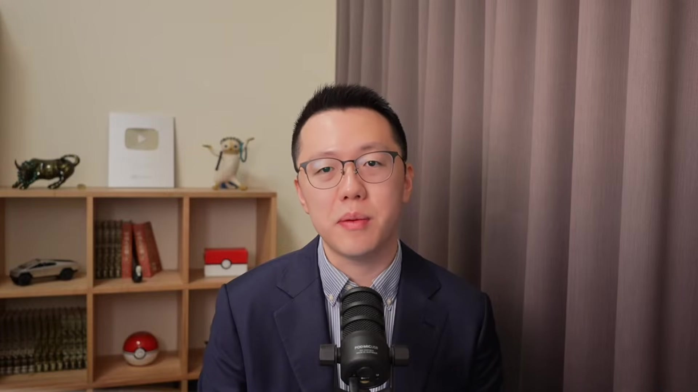

**逐字稿片段：** 好那當然回過頭說 現在SpaceX在本次的營收財報 我們昨天有講是1250億美元 AI的業務成長還是非常驚人 尤其現在電信業正在變天 不只是我們看到的星鏈 正在擴大在太空的市佔率 現在SpaceX預估要準備大量的去收購 我們看到14兆赫茲的頻譜段 準備要做進一步行動通訊市場的切入

**話題推測：** 回顧SpaceX營收財報並談及其進軍行動通訊市場。

---

## 00:26:19

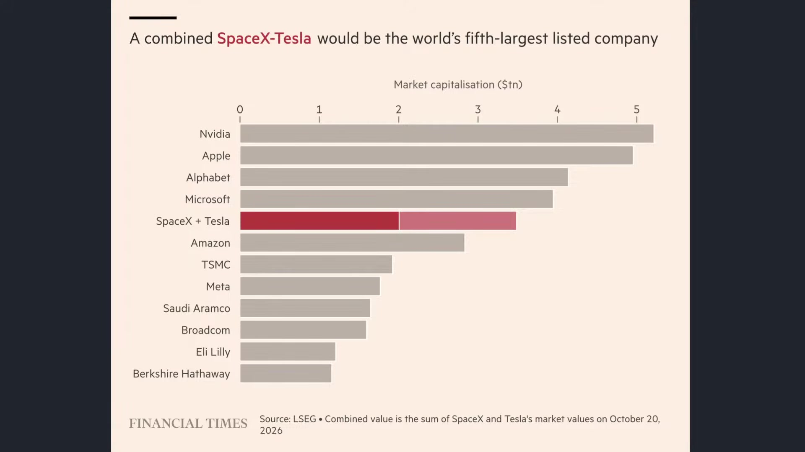

**逐字稿片段：** 那這個就直接威脅到 全美三大電信商的競爭地位了 你看之前不是那個T-Mobile 不是一天暴跌了一成山嗎 美國電話電報公司也下跌了 接近有10% 電信公司債的債券利差瞬間擴大7到10個基點 說明什麼 市場很擔心 馬斯克一旦達成了一定程度市佔率以後 全球電信業以後都要認他為新老大了 這就是一個新的轉捩點 當然馬斯克現在所推動的做法 會有很多法規上的挑戰 大部分都是法規問題 比如說在自動車層面 自駕車層面 在歐洲市場 在亞洲市場面臨落地的挑戰 另外一方面 那即便對於電信市場來說 它擁有足夠的市佔率 可是歐盟最近也在加強 數位主權的保衛戰 不願意把我們的數位網絡 交付給一個美國企業 這個都是未來 我們可能面臨到的挑戰 但至少可以承認

**話題推測：** 分析SpaceX對美國三大電信商競爭地位的威脅及市場反應。

---

## 00:27:15

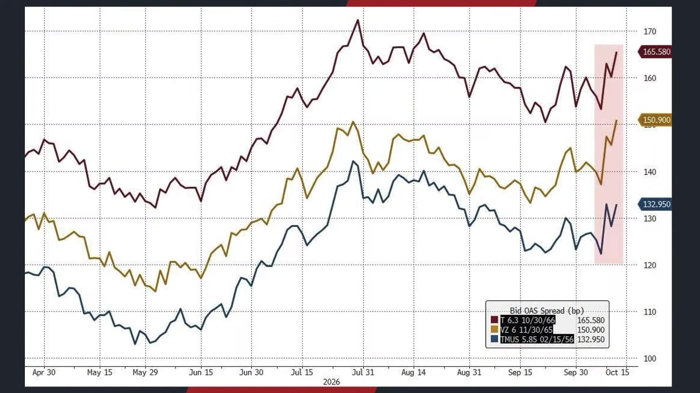

**逐字稿片段：** SpaceX在過去的營收結構 現在未來十年會大幅的轉向AI 我們看AI業務營收的佔比 26年大概是40%左右 我們預估到2035年會來到81% 相對而言 現在很多那個現金牛 比如說Starlink 這些連線服務的佔比 反而會逐步的下滑 太空發射業務 可能連5%都不到 說明沒有人在把SpaceX 當成一個Space太空企業 所有人都把它當成一家 全新的整合型的AI公司

**話題推測：** 預測SpaceX未來十年營收結構將大幅轉向AI業務。

---

## 00:27:47

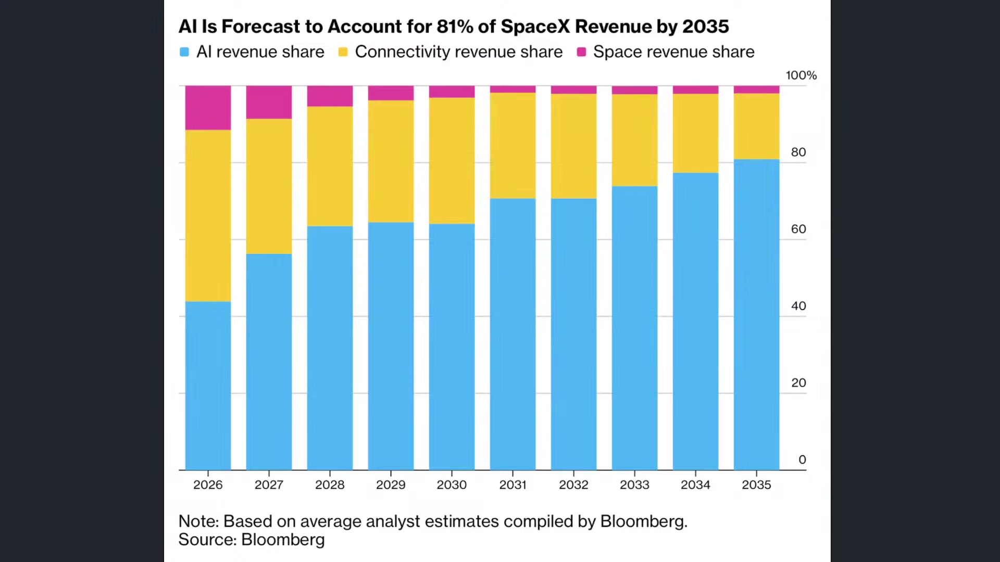

**逐字稿片段：** 那附加代價是什麼呢 就是它借的錢 也比其他企業來得更快 比Meta更快

**話題推測：** 探討市場對SpaceX融資能力及債務壓力的擔憂。

---

## 00:27:53

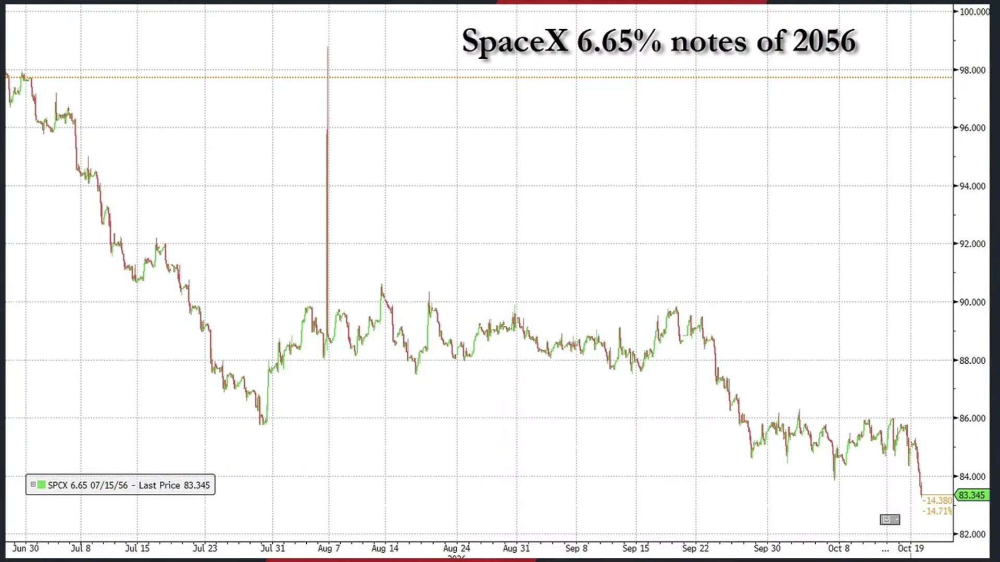

**逐字稿片段：** 我們看債券市場 對於SpaceX的融資能力 很明顯已經提出質疑了 今年6月份所發行的2056年到期 票面利率6.65%的公司債 債券價格當時發行是100美元 現在已經跌到83.3美元了 才兩個月而已 到期殖利率來到8.1% 你買一家全球偉大的企業的公司 它給你的殖利率是8.1% 你不覺得有點高嗎 你不覺得它好像真的很有信心嗎 一個就是它未來可以賺非常多錢 遠遠高於這個殖利率水準 另外一個就是 你好像真的很缺錢

**話題推測：** 揭露SpaceX公司債的殖利率與價格變動。

---

## 00:28:30

**逐字稿片段：** 這也導致SpaceX的CDS價格 在昨天持續的走高 所以它是股價一邊上彈 但是避險成本一邊上去 這等同於股價漲越多 大家買的保險越多 利差從6月份大概是110個基點 升到10月份已經來到200個基點了 這說明整個市場 看起來是要求非常高的風險補償 風險貼水 那很多人在問我 最近很多看到Cold Wave 15%的利率 很多人說要不我們就去買他們的投資等級債 買他們的公司債就算了 我們就靠他們的投資等級債 你就算是美債5% 6%也很不錯 我五年前十年前 這殷殷其判的就是每年可以5%的報酬率 現在這種無風險利率 那他公司又不一定會倒 或者說公司你買那種分散型的 這種保本型產品 或者你就買美國公債 它不可能倒的 那好像5%我也習慣了 所以這個時候就要搞清楚 因為很多人他會被 殖利率所吸引 來到6% 7% 8% 我講都是實債 都是能夠實質拿到的 第一個就是公司 還是有個別經營風險的部分 第二件事情 你要搞清楚是 You need 還是 You want 你需要這個報酬 還是你想要這個報酬 你覺得越來越吸引 如果你需要的是 一家殖利率極高的公司 那還是你每年只是想要領到高額股息的滿足感 如果你真的需要每天去追逐標股

**話題推測：** 說明SpaceX的CDS價格持續走高，反映市場風險補償要求。

---
