# yutinghaofinance_FDZ_qvI3qDU — 關鍵畫面索引

- 來源逐字稿：[yutinghaofinance_FDZ_qvI3qDU_FIN.srt](yutinghaofinance_FDZ_qvI3qDU_FIN.srt)
- 影片：https://www.youtube.com/watch?v=FDZ_qvI3qDU
- 截圖數：34

## 00:00:34

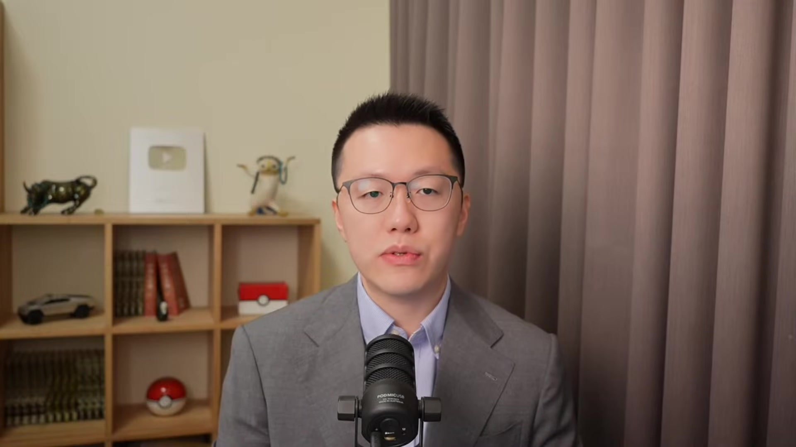

**逐字稿片段：** 那今天來跟投資朋友宣傳我們的雙十億優惠, 昨天聊得太盡興了, 都忘記宣傳了, 我們直播主要是跟投資朋友分享市場動態, 那有很多我們的實際觀點會在我們的訂閱系統當中來做分享, 短期波動都是這樣子變來變去, 但是長期一定依循著某些規律, 歡迎投資朋友可以來到我們的網站 訂閱系統當中來下去訂單 裡頭除了有未來一整年的 聽友會的收聽權 也會有我個人資產部位周知 一些專題影片 宏觀報告和相關課程 那雙11優惠 每年我們都會有一些折扣 如果大家有興趣的話 歡迎可以一起參加我們 不管是財務獨立上 或者財務自由上的道路 其實很多投資朋友 常經能夠收聽這麼 艱澀的財經知識 其實是有原因的 大多數人可能就是想要 在早餐時間通行時間 想想要吃什麼抖音 然後誰在跳舞或者聽歌上班 但是你已經習慣 每天這種高強度訊息的環境 新聞就算了 還是聽財經 這麼gay 因為大家都是對於這個世界 有好奇心的人 資產階級 當你體驗到這種瞬息萬變的社會 你就有系統的綁定能力 你的人生每一天都在向前 永遠都在學習薪資 我記得有一年是網品 還是哪一個餐飲集團 那裡面老闆演講有提到說 他非常注重後廚的清潔 就他把後廚管理到什麼程度 地上一滴水都不能夠有 那很奇怪 因為吃飯的人 通常只在乎你食物乾不乾淨 你後廚你不要不衛生就好了 地上的乾淨有那麼重要嗎 他說用處很大 就是為了防止大廚被挖走 你想想看 這習慣在乾淨環境裡頭工作的廚師 就算被對手高薪挖走 他很快就忍受不了其他家很髒亂 然後又會回來 那你的後廚如果夠乾淨的話 這個不是一個人的單純習慣能力 能夠決定的 它是一種系統的綁定能力 這個餐廳 它對於廚師有系統的綁定能力 這個就是塑造體驗的作用 那這個體驗東西 一上去之後你就不容易下來了 那我們節目也是如此 當你每天早上發現跟周遭的人不同 已經綁定一早就聽黃段 我說財經節目探索世界的習慣 哇你的人生每一天都在向前 永遠在學習新知 所以歡迎大家跟我們綁定個人生 有興趣的話 可以來參加我們雙11財經號角的訂閱制 當然我知道大家不缺這點優惠 有一個藉口可以讓你參加 跟上我們這一部有系統綁定能力的車 好不好 好那我們看美國股市在昨天的大幅收高 這次公元帳篷可以收一收了 的確道瓊指數是大漲了1100點 收復了美國期中選舉投票日的收盤水準 那我們就看後續費辦和納指能不能跟上 因為費辦昨天指數也大漲了6.86%

**話題推測：** 宣布「雙11優惠」活動宣傳。

---

## 00:03:26

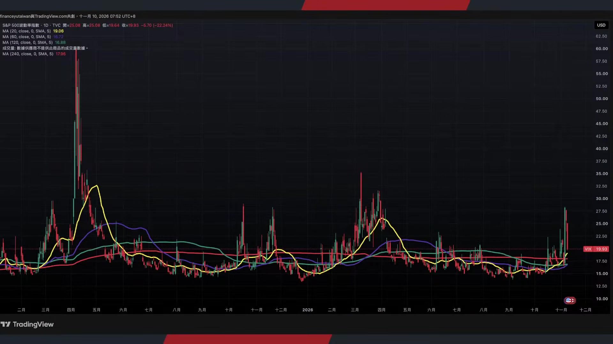

**逐字稿片段：** 輝達這一次雖然逆勢收跌 但是也沒有阻礙目前的硬體股的反彈 從VIC指數來做觀察 單日是暴跌了22% 最新收盤價是19.9塊 單日下跌5.7點 跌幅剛才聊到一次跌兩成 說明這一輪情緒反轉速度算是蠻快的 雖然美國股市行情到目前為止 還是有一點兩極化 贏家有的暴漲到762% 今年漲最強的是莫德納

**話題推測：** 轉向討論輝達逆勢收跌的情況。

---

## 00:03:53

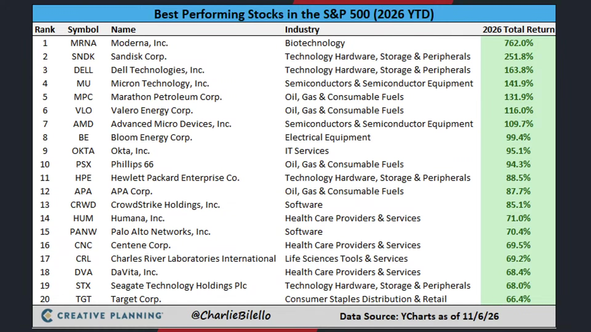

**逐字稿片段：** 那Cendex還是漲251% 戴爾漲了163% 美光都跌那麼重了 它還漲141% 超微漲了109% 相反的 有很多企業到目前為止 仍然在熊市 像Lululemon跌了46% Reddit今年跌了58% 金融科技業者FIS跌了55.4% 所以今年你也不能夠說 比如說科技股在年後遭受賣壓 那非科技股就表現特別好 今年還是有很多股票表現是慘不忍睹的 在整個標普白指數當中還是有點分化的跡象 那尤其在昨天費辦成分股當中 輝達又是唯一收結的個股 下跌4.27% 那半導體普遍是大漲的

**話題推測：** 點出莫德納是今年表現最強的股票。

---

## 00:04:34

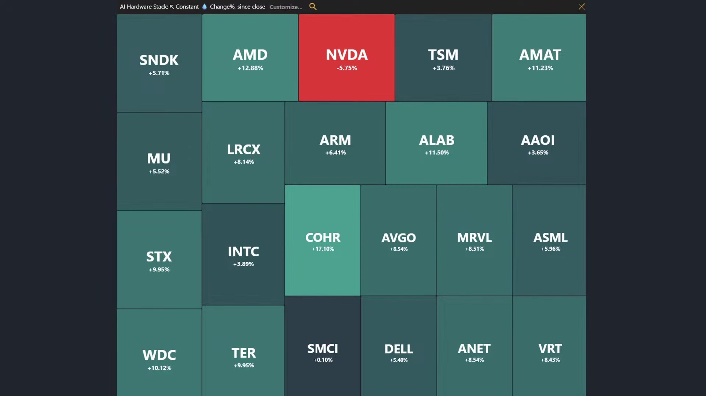

**逐字稿片段：** 超微漲了13% 博通漲了8.7% 輝達剛才講的跌4% 但是印財卻大漲了11% 高通上漲了3.6% 記憶體更是直接噴出 美光是大漲了6.2% 威騰上漲9.8% Cendex漲了6.16% SK海力是ADR漲了5.53% 所以這一次我們要從兩個角度來做思考 一方面是美國股市這一輪的反彈 它只是空單回補嗎 還是已經有開始阻止的味道了 那第二輪 輝達如果股價持續疲憊 那接下來又有它的財報要公佈 會不會由輝達所引發的疲憊情緒 把整個大盤又開始往下拉 畢竟它現在是全球市值 第一或者第二的企業

**話題推測：** 列舉超微、博通等半導體股票漲幅。

---

## 00:05:17

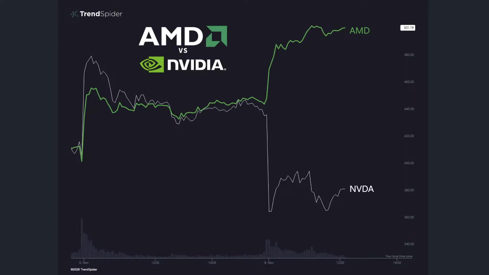

**逐字稿片段：** 那當然我們從AMD跟輝達 在過去幾天的股價變動幅度來做觀察 已經看得出來 你看AMD的股價超為是快速拉昇 一度接近到501塊美元 輝達則是從435塊 直接集結到365塊 這很說明著 黃泥雲基金這件事情 當然對於資本市場是有重大影響的 超為在AI加速器市場的競爭機會 有可能在輝達 深陷這種間諜陰霾的過程當中 獲取更多至少美國政府或者美國企業進一步的訂單 那這一次老黃出事以後 對不起嚴格來說是小黃 小黃出事以後 公司董事會也已經正式展開了調查

**話題推測：** 觀察AMD與輝達過去幾天的股價變動幅度。

---

## 00:05:56

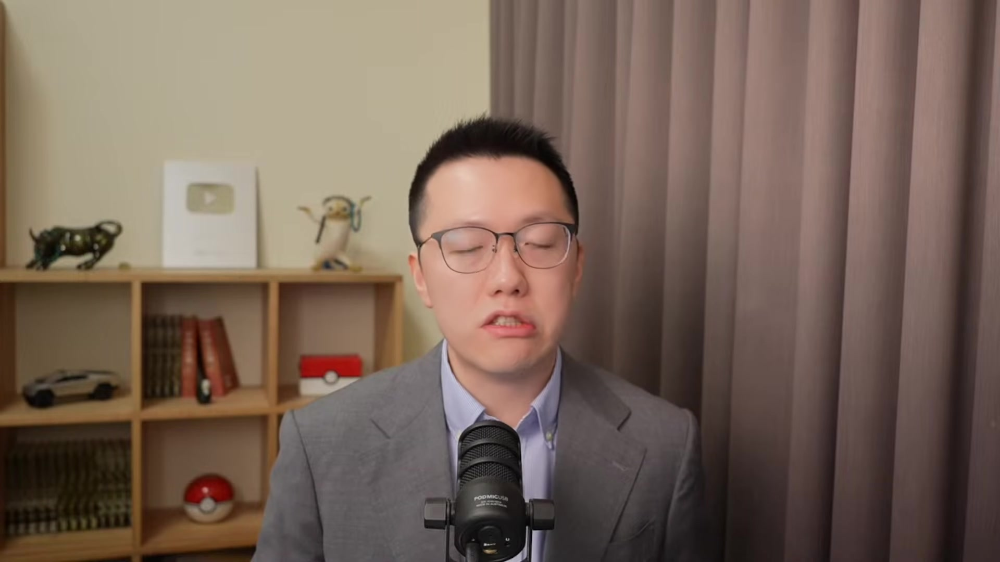

**逐字稿片段：** 市場主要是擔心 這位女性她被美國情報機關 有懷疑有中國間諜的活動 可能進一步衝擊公司治理和國家安全 回答股價從當時10月份的高點這樣子下跌 已經跌了快25% 那你要知道她是 美國算是最大的全職股之一

**話題推測：** 市場擔憂黃樂雲涉嫌中國間諜活動。

---

## 00:06:14

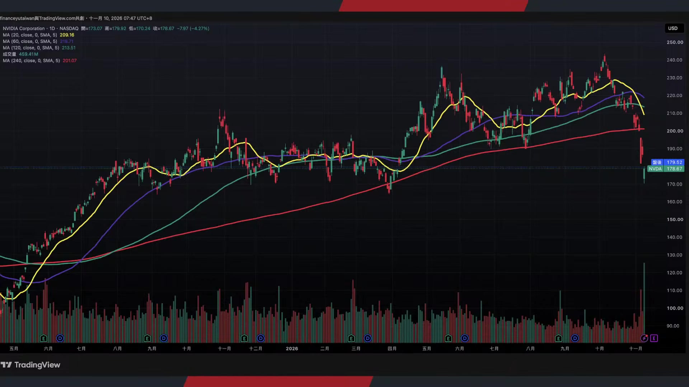

**逐字稿片段：** 美國期中選舉的選舉結果之後 現在又面臨高層領導的不確定性 以前都覺得 應該黃仁勳派他去跟民主黨談 應該能夠符合半導機產業的重要利益 那現在有間諜風雲 你要怎麼讓黃仁勳跟民主黨來談 尤其是在選後 國會新上任之後的格局呢 這其實凸顯著 如果某些企業高度依賴單一領導的風險 壓力是很大的 你要想想看 如果SpaceX特斯拉的執行長不是馬斯克 那你還會投這家企業嗎 假設其他都不變的情況底下 那現在一樣可以套用在輝達身上

**話題推測：** 將事件與美國期中選舉結果和高層領導不確定性連結。

---

## 00:06:48

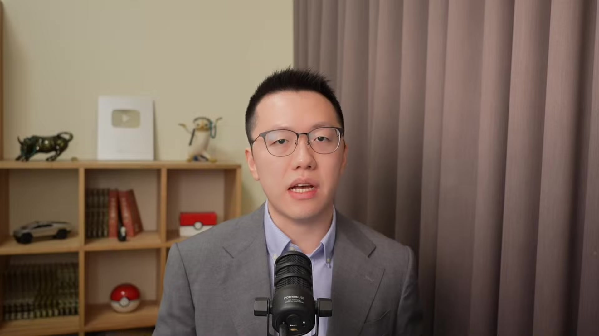

**逐字稿片段：** 輝達在最近本益比 其實下滑幅度也非常之快 因為股價算是經歷了比較大的修正 可是預估本季度的獲利 仍然會持續創下新高 整體本益比大概已經降到 接近12倍左右的水準了 如果以28財年來看 就明年年底來看的話 大概11到12倍 這波真的蠻低的 那這波下跌 本益比的大幅收縮 很明顯企業營收和獲利崩盤都沒有持續發酵 主要就是來自於股價的下跌而已 所以如果再持續本盈比往下跌 那有可能會來到本世紀以來的新低 那我們就看一下 輝達會如何面對這樣的一個市況 到底投資人的情緒是更為價值性買盤 還是說輝達反而股價一直跌 他搞不好就把整個大盤給帶下去了

**話題推測：** 分析輝達本益比下滑幅度。

---

## 00:07:35

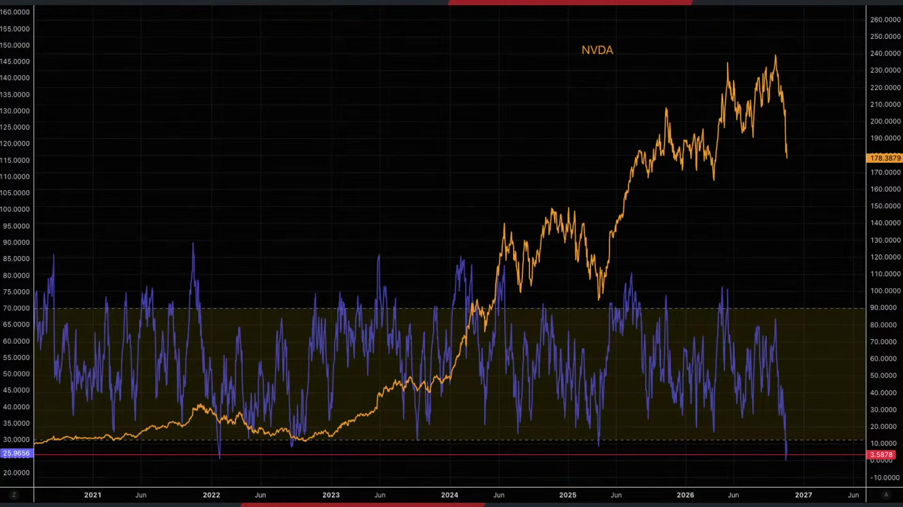

**逐字稿片段：** 因為從現行圖來看 這有點烏雲籠罩是沒錯的 這個捐神的小頭 到底會不會棒打AI多頭呢

**話題推測：** 描述輝達股價線圖呈現烏雲籠罩。

---

## 00:07:43

**逐字稿片段：** 其實黃文勳這起事件最受傷的 大概就兩個人 第一個就是惠達的股東 為了黃總的一炮 股價跌半天 另外一個就是受傷的是 通話夜市賣芭拉的歐巴桑 因為他以為黃文勳每次都為了他飛來臺灣 現在才知道原來是為了黃樂 談戀愛是主軸 逛夜市只是順便 真正讓AI泡沫破滅的不是記憶體 是海綿體

**話題推測：** 戲謔討論黃仁勳事件中「最受傷的兩個人」。

---

## 00:08:08

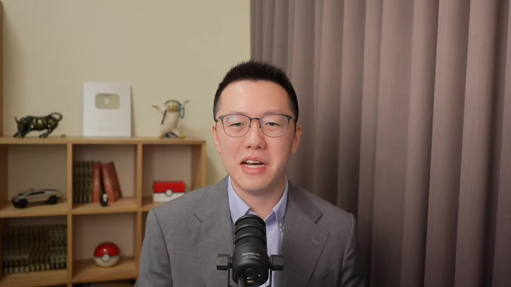

**逐字稿片段：** 但不管怎麼說 現在是換很聚焦的回答 就是因為他也有財報要公佈 那同時間國會的聽證 11月18號又在進行當中 那包括內部的調查也在持續 那一樣會影響到 未來民主黨對於他的實質評價 我們看在最近美國各大報 其實也逐步下了一些標題 這個是紐約郵報 下的標是 有點戲虐的意味 不過本來紐約郵報就是 就是比較偏向這種比較衝擊力被轉移的新聞

**話題推測：** 強調輝達即將公佈財報。

---

## 00:08:40

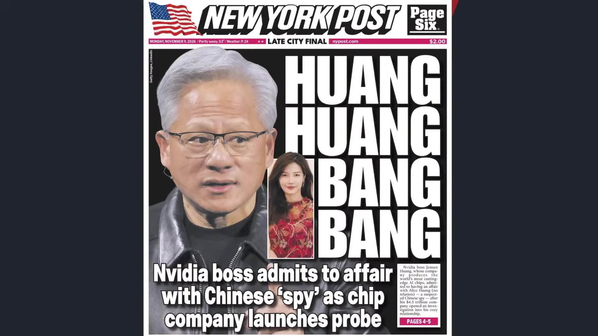

**逐字稿片段：** 我們看一下經濟學人的 經濟學人的報道 標題是Jensen Huang is caught with his pants now 黃仁勳的褲子都還沒穿好就被抓個陣子 這是經濟學人的標題 但不管怎麼說 英式幽默大家也不太懂

**話題推測：** 引用《經濟學人》關於黃仁勳事件的標題。

---

## 00:08:53

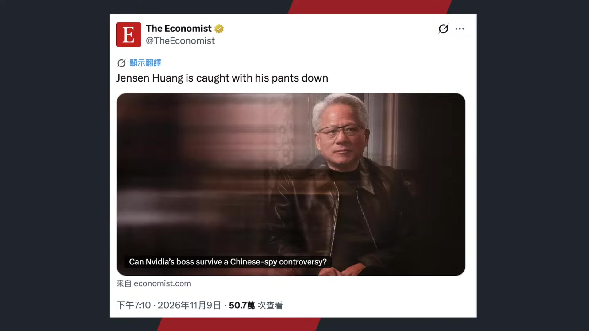

**逐字稿片段：** 重點是現在黃仁勳風波進入關鍵的時天了 因為11月8號當時Jensen承認的確存在婚外情以後 現在第一有獨立董事所主導的調查 他是無法介入的 重點在於是否涉及中國的情報滲透 來了解公司資料是否有外洩

**話題推測：** 指出黃仁勳風波進入關鍵十天。

---

## 00:09:09

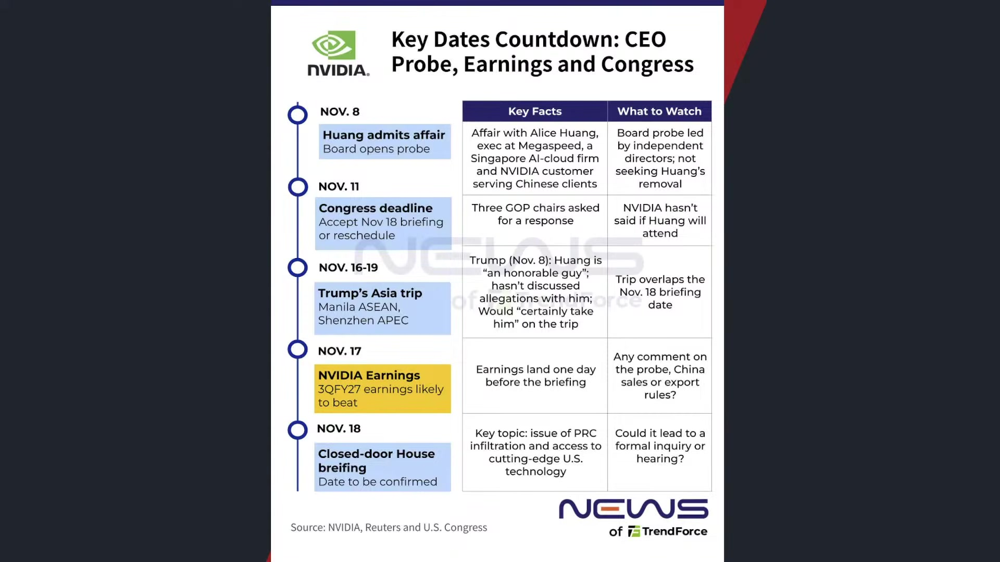

**逐字稿片段：** 那再來呢 美國國會三名共和黨的委員會主席 要求回答在11月11號 就明天之前要回復 是否會接受11月18號的閉門簡報安排 那現在預估應該會實質接受 但有可能改期 另外一方面 川普是11月16號到19號要訪問亞洲了 他本來是要帶黃仁勳去的 那黃仁勳之前經常陪伴著川普出行 川普現在在前一天 昨天還特別公開支持黃文勳 願意讓他通行 一個具有間諜國安風暴的人 現在要跟著川普一起搭空軍一號到亞洲 有沒有可能產生進一步壓力呢 10月17號 又是輝達第三期財報 隔天他馬上就要面對美國國會的閉門簡報 所以我在猜可能 這個閉門簡報的時間線會稍微往後延一點 那更重要的就是 管理層在這段時間要如何回應董事會的調查 輝達的這一次的財報公佈日 會由黃仁勳親自主持嗎 這個都是值得觀察的方向 那當然 不管是新聞的報道 還是情報單位所釋出的資料 看起來是越來越多

**話題推測：** 提及美國國會要求輝達在11月11日前回復。

---

## 00:10:15

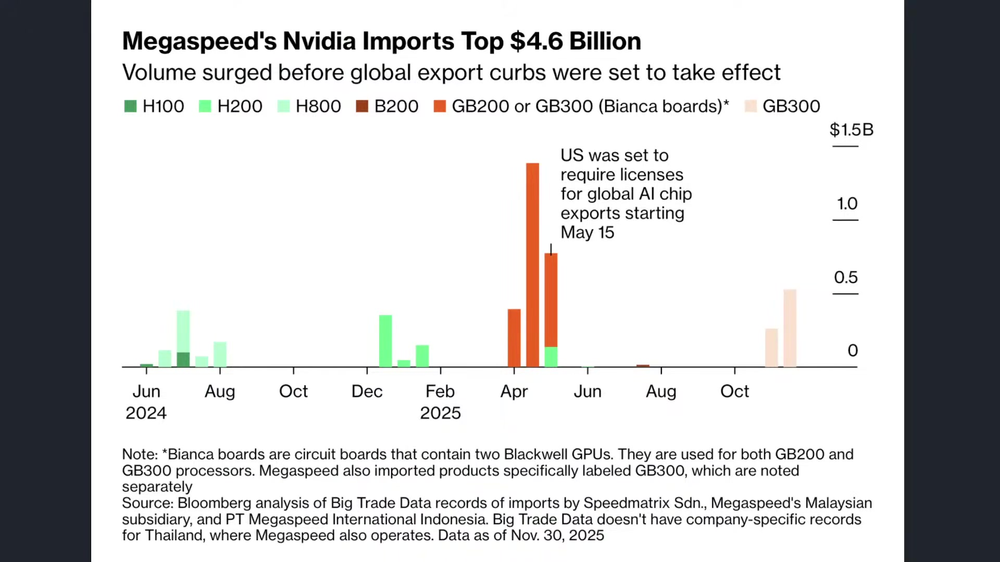

**逐字稿片段：** 尤其這一次主角黃樂 因為他本來是一名電視記者 後來往私募股權和投資領域 然後到2023年成立這一次 新加坡雲端運算公司Megaspeed 現在已經幾乎成為 輝達在東南亞的最大晶片買家 所以我們要這樣講 他不算是那種一個小企業 然後一個專門倒賣晶片的人 而是一個具有中國背景的人 他已經慢慢在東南亞成為了非常龐大的買家 那這種轉運的晶片 它到底是屬於間諜 或者說情報的問題比較多一點 還是就是涉嫌不管是稀產地

**話題推測：** 介紹黃樂雲的背景。

---

## 00:10:50

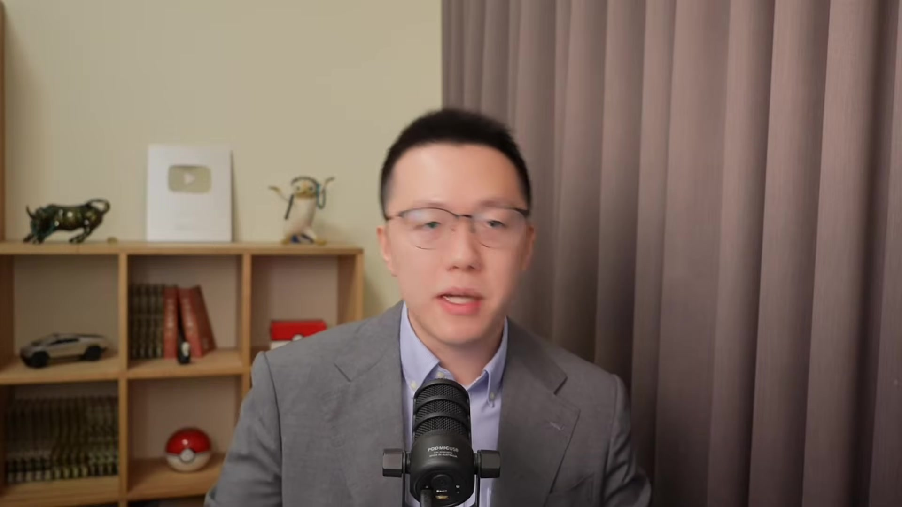

**逐字稿片段：** 你要這樣講 那很多臺商都處於灰色地帶 那現在市場上就要進一步去觀察 整體的出貨量到底有多少 這幾年到底已經出了多少貨出去

**話題推測：** 提出臺商處於灰色地帶的議題。

---

## 00:10:59

**逐字稿片段：** 如果我們仔細觀察 因為這一次從2023年 雙方就已經開始合作了 那美國情報官員 現在不斷地釋出訊息 這很明顯有美國建制派 要搞Jensen 他不斷地釋出訊息 懷疑黃樂可能已經受到 中國國家安全部的一個招募 目的就是為了接近黃仁勳 取得AI的相關晶片技術 那的確 如果現在仔細來做觀察 Megaspeed實際進口的 輝達的晶片量 比輝達在資料中心 清點到的數量 現在看起來多了5萬顆 總體而言 一年大概賣了 48億美元的晶片 哇 賣了48億美元的晶片 黃叔叔還要陪客戶睡覺 如果我的員工這麼賣命 為我工作賣晶片 那好像也值得讚美 這個年紀還有這個體力 公司交給他10年 我們也放心 對 牛郎借鋼把子 頭牌點我 然後還倒貼我48億 從股東角度而言 其實也沒有那麼離譜對不對 那當然有國安的問題 可是從實質角度來做觀察 因為Megaspeed在東南亞設置了大量的設施出租揮達的晶片 那主要的一個流露對象主要是阿里巴巴 那黃熱過去跟中國大型資料中心投資案存在的明顯的股權相關 相關的控股公司直到2025年的8月份 還是持有該專案的48%的股權 那當然Megaspeed到目前為止都否認違反法規 表示它只是作為新加坡商作為實質運算的作用而已 那到底是算給誰 以及算的數據要給誰 這件事情就沒辦法做確認了 但至少可以看得出來 輝達股價目前的一個下跌 看起來不是直接反映情報的一個流失 如果情報流失就不止會跌這樣子 我覺得更重要的是 擔心黃仁勳在輝達的地位有可能不保 形成市場個人風格轉移的不確定性

**話題推測：** 說明輝達與黃樂雲從2023年開始合作。

---

## 00:12:49

**逐字稿片段：** 從陰謀論的角度來看 很多人會覺得這是一種受控引爆 就認為可能真的有一些問題 有情報上的一個衝擊 這件事情會進一步放進到 川普政府內部的政策分歧 我們一直知道在過去一年當中 其實共和黨內部是 對於黃仁勳態度是分歧的

**話題推測：** 提出黃仁勳事件是「受控引爆」的陰謀論觀點。

---

## 00:13:06

**逐字稿片段：** 以國務卿盧比歐為代表的 對中的強硬派 長期就是一直很重視 先進晶片的出口管制和技術安全 那另外一方面 重視產業競爭力的政策人士 則會擔心說過度施壓揮打 反而會削弱美國在AI領域的優勢 這個是黃仁勳不斷向市場 所灌輸的一個訊息 你讓他們如果選擇完全自己做的話 那反而有可能 我們的領先會全面喪失 那按照這種假設 部分政府人士和揮達管理階層 可能存在著某種非正式的默契 透過主動的揭露和內部調查 避免事件進一步的失控 而且更具爭議的推測 可能涉及到婚外情的對象情報身份 用這樣的一個方式受控引爆 這個屬於比較偏陰謀論的角度 就是也許真的有一些問題發生了 那我們現在就犧牲小我 完整大我 那當然川普政府 在這一次事件爆發以後 川普昨天甚至還親自對記者說 他是相信這個黃仁勳 完全不知道他是間諜的 那他也體諒他 而且他會願意讓黃仁勳繼續跟著他 繼續出行 這是川普的態度 已經算是釋出蠻大的一個善意

**話題推測：** 提及國務卿盧比歐代表的對中強硬派。

---

## 00:14:33

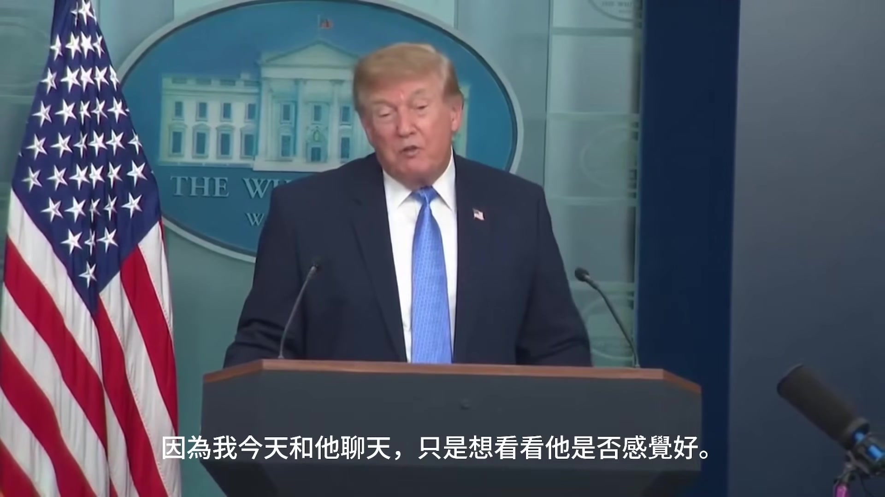

**逐字稿片段：** 你還好嗎 然後我問他 他說他完全沒有想到 那個人是騙子 我問他 你有沒有想到她是騙子 他說我沒有想到她是騙子 我真的相信他 其實我覺得 這有可能一開始真的就是 工作夥伴的關係 然後日久生情 但是你說是不是 真的是為了情報的問題 而去接觸他 不一定 也許他本來就是在做 這樣的一個生意 本來就有這樣的一個需求

**話題推測：** 講者模仿對話，揣測黃仁勳心境。

---

## 00:15:03

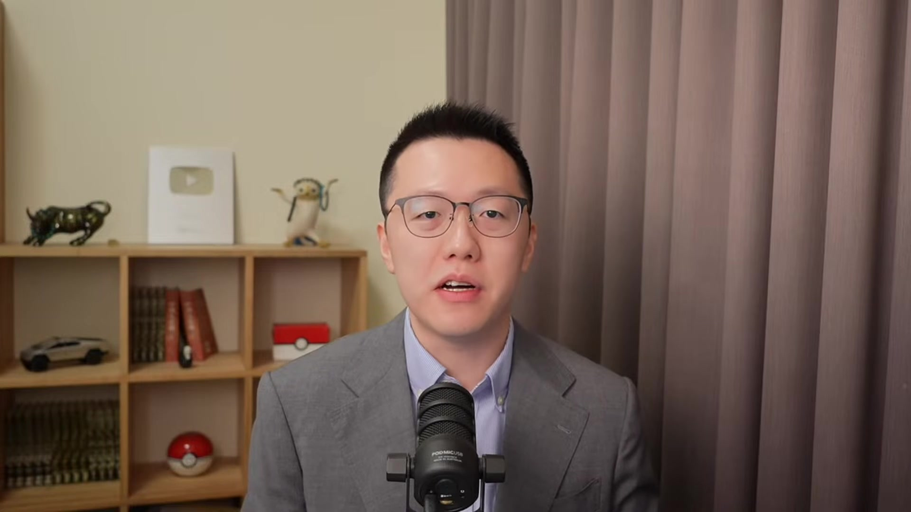

**逐字稿片段：** 因為我稍微看了幾支影片 正常人有誰會帶著情婦啪啪照 對不對 還讓女兒給你拍照 我覺得不太可能 我覺得這種大老闆 明明知道現在的美中關係 生活幾乎都是在美光燈之下 怎麼可能會認為 美國的情報單位 不知道你在跟誰談戀愛 他只是不覺得他是間諜 談談戀愛有什麼關係 這種人物 這種事件是越來越煩惱 就是大老闆有閒情逸致 這樣子談 其實你想想 那不如去大酒保公園洗個泡泡玉算 所以會這樣子 他其實應該一開始就已經知道 會有這樣的一個問題了 就是他在美光燈之下 遲早會被爆出來 他還選擇這樣做 說明可能真的是戀愛的 而且你想想看 那女孩子名字叫做黃樂 你怨念黃樂黃樂 臺語就黃樂黃樂 整天在那邊煩惱 怨念越煩 怎麼會有心繼續這段感情 這也很奇妙 你要找名字 你也找順口一點的 像遊婷後就不錯 挺好挺好挺好的挺好的 而且家庭好量又大 管保對不對 所以我還是無法理解 為什麼會做這樣的事情 這麼紅的人到處啪啪照 應該每個人都看得出來吧 好那不管怎麼說了 這場風暴的背後 至少存在四種值得觀察的力量 第一就是美國國家安全的鷹派 擔心輝達掌握的先進晶片技術 透過私人關係外洩 有可能率先出招 至少做內部爆破 第二是美國社會 可能存在的族裔偏見 這比較偏陰謀論一點 認為華裔企業的領袖 應該要受到政治忠誠度的質疑 憑什麼最關鍵的技術 在一個臺灣人手上 而且臺灣人還跟一箇中國人談戀愛 第三是企業內部的權力鬥爭 當執行長線落到新人危機的時候 董事會和管理團隊的權力結構 也有可能受到影響 不排除 因為黃龍春又不是全面掌握回答 他一樣會受到內部的一個競爭 最後就是商業競爭 就有沒有可能外部的企業 希望能夠削弱 揮達作為半導體領頭羊的穩定空間 以後也許就不用 一定要讓黃仁勳 作為整個半導體的業界代表 作為icon 可以換個人 這是一種方式 所以從更深一層的角度來做觀察 我覺得最有可能的方式就是 一開始真的是工作夥伴的關係 那後來可能女方 受到中國情事單位的一個吸收 要求提供更多情報 她本人也不是間諜出身的 所以才會有那種 大喇喇的親一口這樣子 也算是給他一個教訓 保密防跌 黃人之心不可無 好 那接下來市場上很明顯 價格反應從股價跌幅來看 不太可能是反映 有任何的情報外洩 要不然不會跌這麼少 主要還是來自於 接下來因為董事會 已經成立了獨立調查委員會 主要是觀察 有沒有可能影響 接下來輝達內部的接班

**話題推測：** 講者提出關於黃仁勳與黃樂雲關係的個人觀點。

---

## 00:17:53

**逐字稿片段：** 你要知道 那輝達內部接班 雖然黃人之心的子女 在公司裡頭 可是其實內部人選還是有非常多 包括人工智慧的主管 包括財務長 包括黃仁鑫的女兒 甚至黃仁鑫的女婿 現在都在任職當中 那黃仁鑫是否繼續留任 關鍵是取決於董事會的調查結果 如果沒有違規 沒有執行外協 就談談戀愛 我相信他是能夠繼續領導公司 因為他對於整個半導體的 挨抗作用實在是太大了 另外如果查出私人關係 可能影響到商業交易 那可能就會面臨職務的調整 那如果是技術外線 那當然就是有法律或者監管責任了 那我們就後續來觀察 這一次獨立調查的結果 但最重要的 還是這一次聽證會所釋出的氛圍 其實黃迅這一次所涉及的間諜疑雲 我個人是沒有這麼擔心 一個人能夠洩露多少關鍵的商業機密 因為大型科技公司 大家都知道 通常不是掌握在某一個人手上 手機裡面的幾份文件 它是分散在數千數十萬名工程師 研發團隊的組織能力 以前臺積電常常被競爭對手挖走一個高階主管 當然對方可能有技術上的提升 但是因為你像製程技術 有設備參數 有材料科學 良略管理 它也沒那麼容易把整套技術給偷走 所以我是不太相信黃仁勳能夠洩多少密的 但洩其他東西就有可能

**話題推測：** 列舉輝達內部潛在接班人選。

---

## 00:19:13

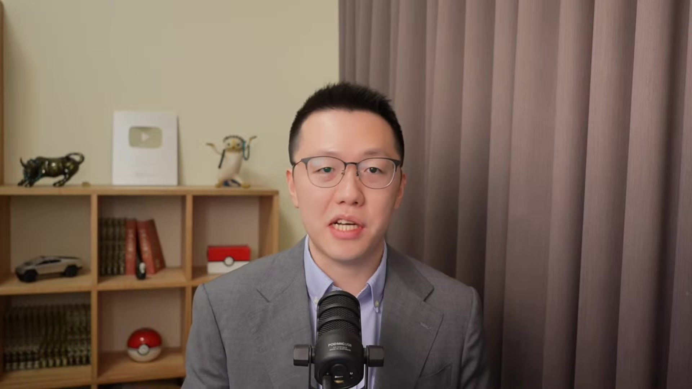

**逐字稿片段：** 而且按照過往經驗 從科技巨頭的私生活爭議曝光之後 我們看到企業市值的表現差距還是非常大的

**話題推測：** 分析科技巨頭私生活爭議曝光後企業市值的表現。

---

## 00:19:21

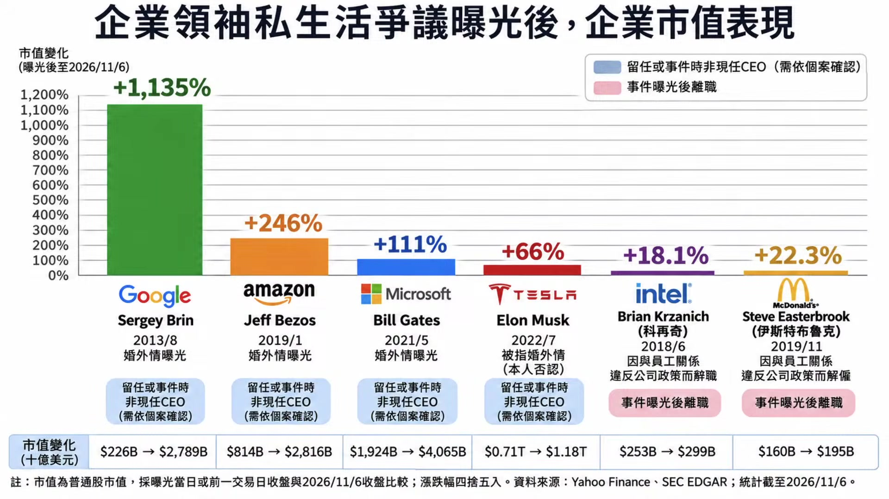

**逐字稿片段：** 當時Google共同創辦人布林所對應的市值 自從私生活曝光以後 是暴漲了1135% 亞馬遜的貝佐斯是246% 比爾蓋茨是111% 特斯拉馬斯克是66% 那其他我們看到像是 前麥當勞的執行長 伊斯特布魯克 或者前英特爾的執行長 科在奇 其實你發現市值增長 也大概有兩成左右 這說明企業領袖的私人生活爭議 它不一定會阻礙 企業的長期市值的發展 而且我聽到一種說法 他們說通常矽谷的強人 通常信譽都很強 為什麼 就是矽谷能夠引領全球AI的發展 就是因為那些科技公司 總是想要股價市值繼續上漲 搶佔更高的市佔率 那背後是什麼原因 就是那個不管是多巴胺 還是搞固同的一個持續分泌 信譽 為什麼要研發晶片 要建立大量的資料中心 那你越壓抑這個信譽 這個信譽就會壓抑成一種能量 然後精進自我的動力 以前是Terry講的還是誰講的 不是說什麼在美國西岸 可能辦一個party 十個裡面只有兩個女生 其中一個已經有男朋友 另外一個已經懷孕了 所以男性競爭壓力很大以後 你要壓抑這個慾望 最後就會轉化成一種 精進自己的動力 然後成就都非常大 所以現在我們看到 不管是自駕車 機器人 大語言模型 都是一次性的壓抑他的性慾以後 暴增之後的結果 所以你看我早上直播這麼有精神 你就知道我是壓住了 我聽說的

**話題推測：** 提及Google共同創辦人布林私生活曝光後市值暴漲1135%。

---

## 00:20:59

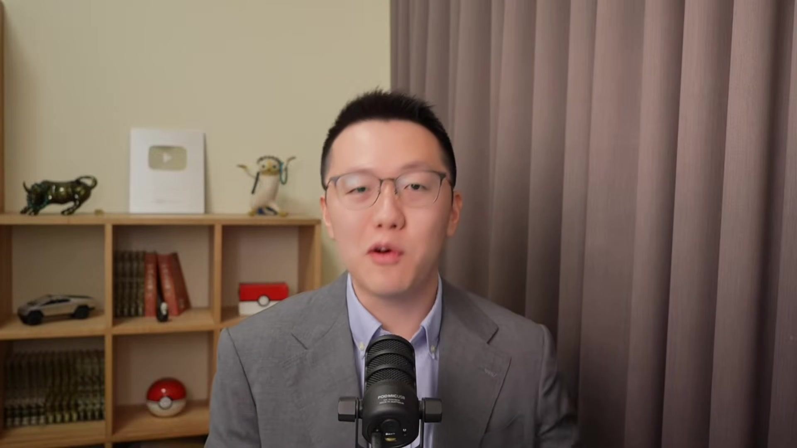

**逐字稿片段：** 好我們看美國股市四大指數表現 道瓊工業指數是上漲1104點 2.15% 衰了52389點

**話題推測：** 總結美國股市四大指數表現。

---

## 00:21:07

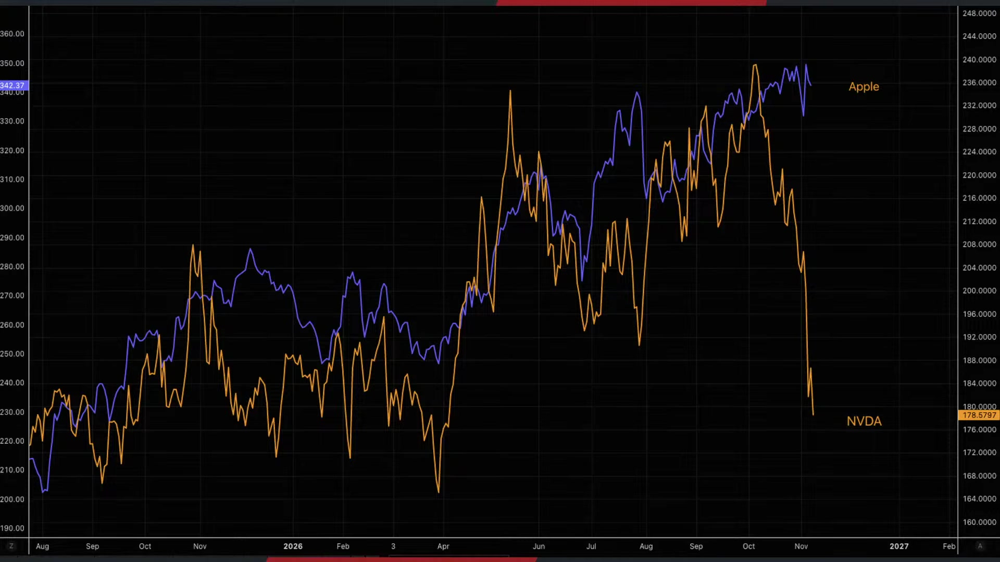

**逐字稿片段：** 標普上漲173點 上漲2.35% 衰了7549點

**話題推測：** 報告標普指數上漲數據。

---

## 00:21:12

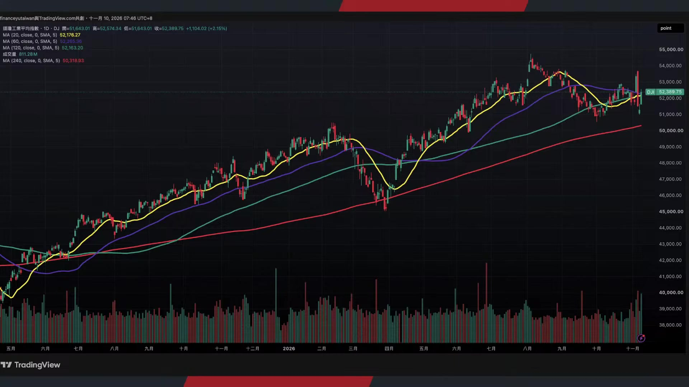

**逐字稿片段：** 納指上漲673點 2.74% 衰了25253點 哇 公園裡的帳篷真的可以收一收了 費辦大漲了643點 6.86% 所在10,033點 費辦快要站回到年限了 而且已經站回萬元關卡了 所以黃仁勳事件雖然這一出 雖然導致個股上有股價的波動 不過從現行圖來看 四大指數都有一點倒撞反轉的味道 對不起 我現在心中都是黃仁勳 有一點倒撞反轉的味道 股價如果能夠快速的站回 你可以甚至把它當成一種外部性的利空 那當然我們回過頭說 這一次AI科技股的暴跌 企業獲利根本就沒有任何的變動 連前瞻預期都沒有改變 正常都是股價跌一跌 那個獲利就跟著一起往下掉了

**話題推測：** 報告納斯達克指數上漲數據。

---

## 00:22:03

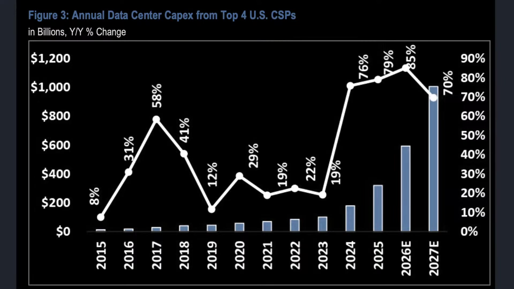

**逐字稿片段：** 結果目前摩根大通所 釋出最新的亞洲科技股的企業報告 也就是跌最重的這次非半 整體獲利預估會持續的成長 大概會成長40%到50%左右 往上調到60%到70%了

**話題推測：** 引用摩根大通最新亞洲科技股企業報告。

---

## 00:22:18

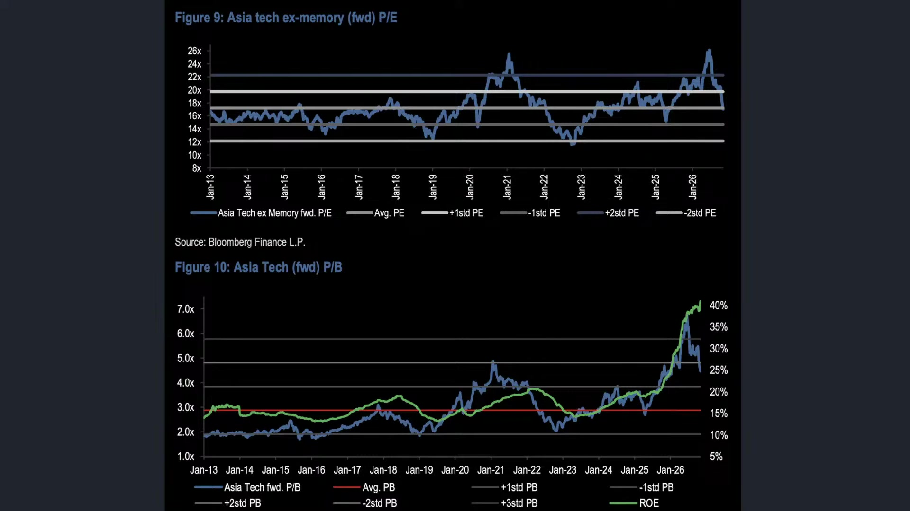

**逐字稿片段：** 而且預估在整個2027年 資料中心的資本支出還會在成長70% 代表年度的規模會接近1兆美元 那我們就靜待這一次回答所釋出的財報 我們過去提過 因為這次股票市場的沉重賣壓 它其實不完全來自於企業的基本面惡化 它其實就是市場預期和現實之間出現巨大落差 我們當然知道其中選舉 如果資料中心的堅持放緩 那可能會慢慢的影響到基本面 可是它始終是一種預判 你要想想看 2025年到2026年 難道沒有民主黨執政的州嗎 他們有采取大規模監管嗎 沒有嘛 這幾個月我們看到的 都是因為電力配不上 所以被迫可能要適度放緩 很少是由州長主動介入 要求所有資料中心暫停的 那你為什麼現在認為 民主黨的州都還沒有采取禁制力 明年他們就一定會採取禁制力呢 所以從這樣的一個角度來做觀察 並不是政權從零到一 全面性的轉移 現在也有民主黨執政的州 像維吉尼亞州 他就這次沒有改選了 那你覺得他有采取大規模的資料中心禁制力嗎 沒有嘛 所以我覺得從這樣的一個角度來做思考的話 基本面不至於資料中心有大幅延後 民主黨勝選 當然會有更多的監管限制 可是他是對於整個社會來做負責 那最終其實還是市場預期 跟現實之間的巨大落差 過去就是認為市場預期會一路的向上 那現實是你要有更多的配套措施 所以造成了國家的估值回調 那一樣嗎 我們把估值或者說把預期拉低以後 如果民主黨沒有采取這麼高強度的監管 市場的預期跟現實之間當中的落差 有沒有可能形成進一步的反彈呢 所以我們講說 其實股價至少在短期內 它漲或跌 它反映的不是基本面在短期內的財報公佈 那個基本面是其次 更重要的是現實公佈的數據 跟原本預期數據當中的落差 預期落差感還是很重要的 你想想看為什麼貝佐斯馬斯克就沒有事情 因為你對他們本來就沒什麼好感 所以他爆出來一個醜聞 言語一下就算了 股價不會真實反應 那你像黃仁勳 他可能就會受到比較大的一個衝擊 因為過度神聖化的人設 他往往一次失誤就變成全面的信任危機 你看像我們這種 我們形象也是非常正經 又有專業感 又不開黃腔 這樣很多人會給我過高的期待 所以我要儘量降低大家的期待 這個就是股票市場

**話題推測：** 預估2027年資料中心資本支出成長70%。

---

## 00:24:43

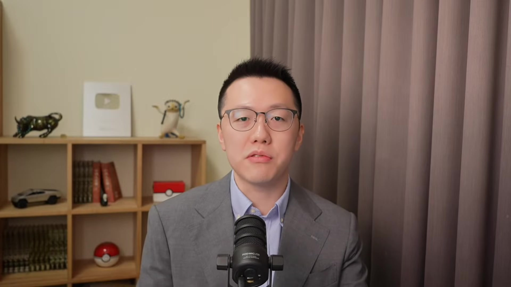

**逐字稿片段：** 好我們看一下從資產績效來做一些統整 今年其實各大資產績效

**話題推測：** 統整今年各大資產績效。

---

## 00:24:47

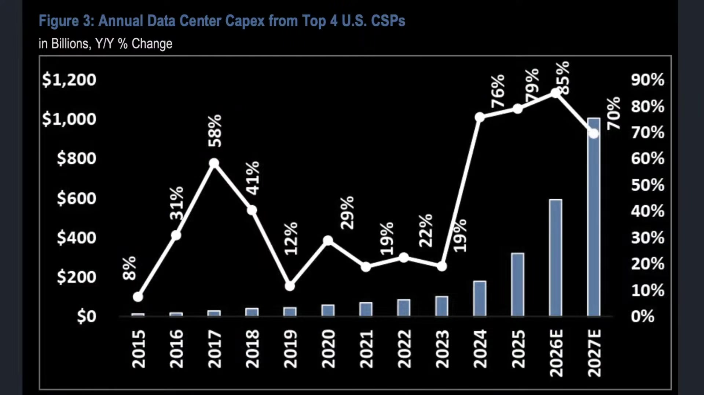

**逐字稿片段：** 表現最為亮麗的仍然是大宗資產 原物料上漲41.1% 年初至今報酬 還算是源源領先其他資產

**話題推測：** 提及大宗資產中原物料上漲41.1%。

---

## 00:24:55

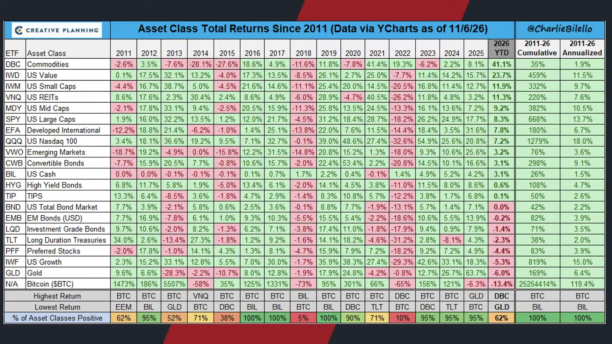

**逐字稿片段：** 因為第二名之後漲23% 是美國價值股 美國小型股漲了11% REITs漲了11.3% 中型股大型股分別漲9.2% 8.3% 納指漲7.2% 那相對之下 過去幾年比較強勢的成長股 今年反而跌了5.3% 其他我們看到 長天青煤在跌2.3% 比特幣還是跌最重的13.4% 那比特幣其實這一輪 有點脫離過往慣性 我們如果仔細觀察 比特幣在往年的實體績下 真的很標準三牛一熊 三年的連續上漲 搭配著一年下跌

**話題推測：** 提及美國價值股上漲23%。

---

## 00:25:28

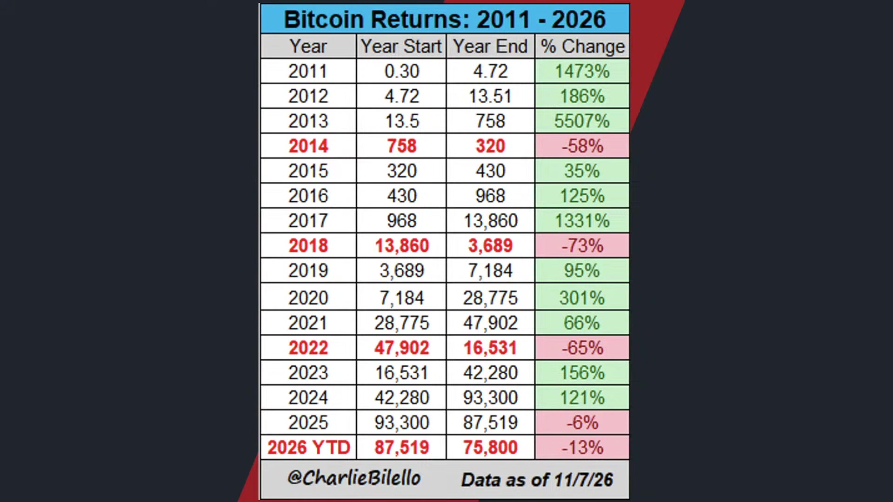

**逐字稿片段：** 比如說2011年上漲1473% 12年上漲186% 13年就上漲5500% 到14年就直接腰斬 然後15到17年又連漲三年 18年直接暴跌七成 19年到21年連續上漲三年 22年暴跌六成 結果23 24上漲之後 25就開始下跌了 到26年居然還在下跌 所以以前想說 可能只是週期稍微縮短 可能從三牛一熊變成兩牛 現在變兩熊了 其實也不算熊 因為去年是漲高之後拉回 所以最後只跌了6% 那2026年的持續下跌 讓市場上的慣性預期 開始出現了比較大的一個轉變 那我們要知道 投資最重要的事情 當然是要學會尊重週期 因為市場永遠不會按照 你認為最合理的方向來發展 這就跟大家 過去我們聊的方向一樣 就是你原本都以為 可能股票市場 它就永遠反映著某種週期 結果AI就大爆發了 我們過去也覺得 按照筆電循環 3C電子產品循環 那25年26年 通常股價不應該好看 去年手機賣那麼差 今年賣得也很差 明年大概也不會賣得太好 但是股價不會因此而下跌

**話題推測：** 列舉比特幣在2011年的驚人漲幅。

---

## 00:26:42

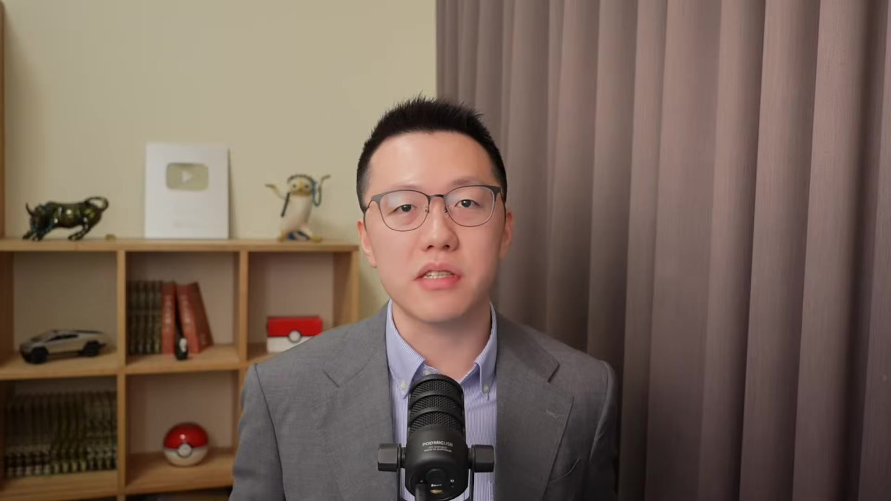

**逐字稿片段：** 為什麼 為什麼 因為股價不再反映三星電子循環 它開始反映一個新的AI生產力格局 有時候我們在面對比特幣行情 比特幣週期 三星庫存週期的時候 都要意識到 哎喲 這股價走出這樣的路 有沒有可能是它脫離循環了 我們當然要尊重這個循環 尊重這個週期 但是市場有時候 常常一個科技革命爆發之後 它不會按照你認為最合理的方向來發展 這跟我們以前提到渣男學很像 最近大家都在聊渣男 渣男是怎麼樣 渣男就是你第一眼就認不出來的那種人才是渣男 你第一眼就認出來他就不會是渣男了 你要認不出來才是 以前大家對於渣男的定義是怎麼樣 長得帥 為所欲為 後來女孩子就開始提防帥哥了 然後渣男就進化成有錢的比較類型 後來發現有錢的好像也有風險 有錢更愛搞怪 現在有錢人也必須要防備 後來變成學士渣 什麼是學士渣 學士渣就是那種長相普普通通 口條還不錯 身上有點小錢 也不知道特別富有 平時穿著一套西裝 戴著黑框眼鏡 偶爾講講幾個黃色笑話 看起來有點幽默 懂點姿勢 沒什麼攻擊性的男人 這種最渣 後來大家意識到 我不是講我 我想說這種人 看起來無害的時候 他原本以為他不渣 發現這種人也一堆渣的 就慢慢慢慢的變成工程師 算了 這個打扮雖然沒有說特別好看 我每次都穿著那件格子襯衫

**話題推測：** 強調股價反映新的AI生產力格局。

---
