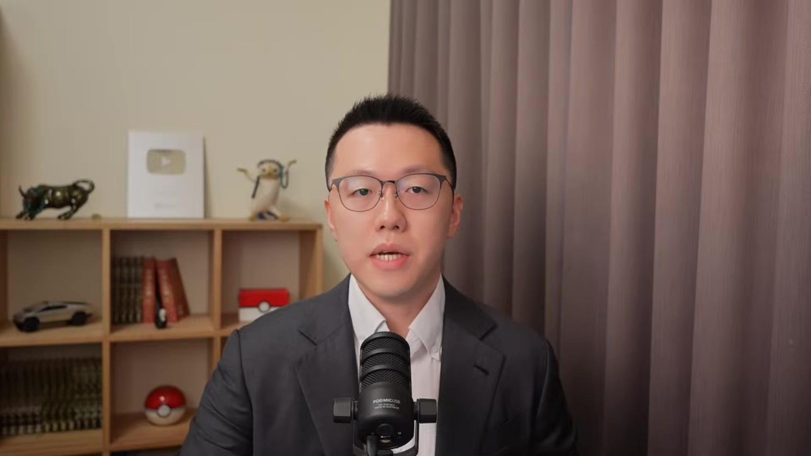
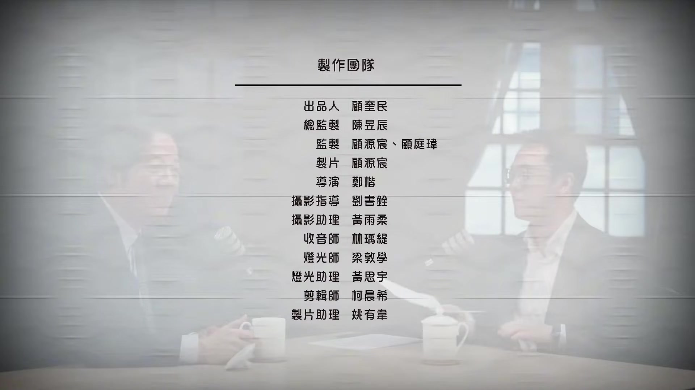
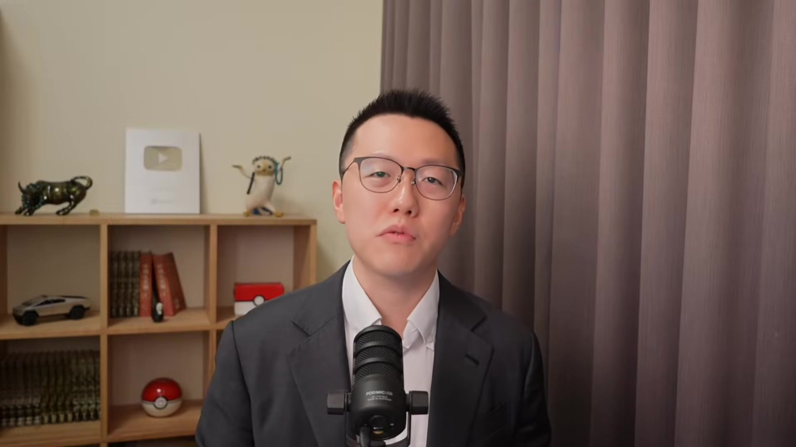

# yutinghaofinance_JiP3avKjocg — 關鍵畫面索引

- 來源逐字稿：[yutinghaofinance_JiP3avKjocg_FIN.srt](yutinghaofinance_JiP3avKjocg_FIN.srt)
- 影片：https://www.youtube.com/watch?v=JiP3avKjocg
- 截圖數：55

## 00:00:24

**逐字稿片段：** 現在是臺北時間2026年10月16號禮拜五, 早上8點21分, 今天如題我們節目比較特別是跟賴清德總統的完整的財經產經政策的專訪, 雖然現在市場上波動極大, 但是就是要在這種緊要關頭之際瞭解一下國家大事, 瞭解國家的財經政策方向, 這一次訪談我們是分為六大主題, 包含著AI政策, K型經濟, 產業政策, 臺美的經貿 金融政策 能源和人口政策相關 那這六大主題 其實都圍繞著同一個問題 就是不同政策的目標 發生衝突的時候 政府是如何做取捨的 那我們希望AI產業更強 但是一般勞工也能夠分享 相關的經濟成果 我們希望企業的獲利能夠提高 也希望能夠創造 更多的中產階級工作 所以這一次的訪談 我們希望從一般民眾 從企業主和 尤其是投資人的角度 讓總統談談 他真正相信的經濟發展模式 以及他希望把臺灣帶向什麼方向 好那因為時間緊湊的關係 總統沒辦法來我們直播 這段時間 所以我們是幾個小時之前 就已經錄好了專訪 因為直播時長的因素 那現在我們看的是精簡版 主要是把每個面向 挑出一兩小題來跟大家分享 如果大家有興趣 稍晚歡迎大家可以進一步的去收看 完整版的影片 把政策方向梳理的更加清楚 那今天呢就跟著大家一起來看這場專訪 待會我們也會陪伴著大家一起開盤 也來分享我對於本次專訪的一些感想 那接下來就讓我們一起完整的看這場財經專訪 總統好 廷浩以及各位觀眾朋友大家好 總統這兩天呢我才溫習了您之前上過的一些財經專訪 因為上過非凡嘛 然後有M平方啊 之前還有謝社長的節目啊 我稍微溫習了一下 後來我發現人家那個都是大陣仗 大團隊 電視臺 我們何德何能能夠邀請你來到我們節目 來分享一下這些產業的政策 是什麼原因讓你願意來到我們節目 是 廷浩我要坦白講 我能夠上你的節目是我的榮幸 不敢不敢 你是一個青年宅郡 然後你對總體經濟竟然那麼閒熟 而且非常生活化 而且你也很有心 每天八點半到九點股市開盤前 然後來說出你對整個產業經濟 還有金融的狀況 我都一直把你當作財神爺 真的嗎 是啊 你等於是 把你的那個財經知識 給所有的聽眾觀眾朋友知道 我覺得真的很棒 這是對我們頻道 我應該聽過最高的評價 網友也會給我們不錯的評價 但通常都不是你講的這一塊

**話題推測：** 顯示臺北時間2026年10月16號禮拜五早上8點21分

---

## 00:03:08

**逐字稿片段：** 第一大題 主要問的是 關於整個AI政策的部分 我們現在那個團隊

**話題推測：** 主持人介紹第一個大題：AI政策

---

## 00:03:13

**逐字稿片段：** 有AI十大建設 有AI內閣 我們AI總統 一系列的AI政策 開始發佈以後 也順應著本輪的 AI經濟成長的故事 那現在有一種說法

**話題推測：** 提到AI十大建設、AI內閣等相關政策

---

## 00:03:24

**逐字稿片段：** 講說1980年代的產業升級 當時是前沿角目 但是80%的人都受惠了 那2026年的AI大爆發 是前沿天靈蓋 可是隻有10%的ICT產業的人員受惠 那文明也知道 AI政策大量的去吸收 不管是水利電力的資源 人才也在快速的吸取 甚至連金融放款都快速的做拉抬 那這就導致大量的資源往AI做傾斜以後 你像美國很多民調都已經顯示 反對AI資料中心的人 他已經比支持資料中心的人還要來得多了 那您的政策還是推行AI政策方向是沒錯 但是我們怎麼知道 我們到底要是把AI當成一個繼續擴張的方向來走 還是偶爾我們要回過頭來進行AI的監管呢 兩者如何做權衡 是 謝謝廷浩這個問題

**話題推測：** 對比1980年代與2026年AI經濟成長的受惠程度

---

## 00:04:15

**逐字稿片段：** 我是意識到全球已經進入 人工智慧化的時代 所以我上任之初就積極推動

**話題推測：** 總統開始回答AI政策問題

---

## 00:04:21

**逐字稿片段：** 一個法律 叫做人工智慧基本法 那這個人工基本法

**話題推測：** 提到推動《人工智慧基本法》

---

## 00:04:27

**逐字稿片段：** 基本上有七個原則 七個原則 就是包括說 當我們在推動人工智慧發展的時候 第一個一定要注意到 社會的永續發展 第二個人類自主 不能夠到最後淪為AI所掌控 第三個我們要注意隱私權 因為人工智慧最重要的是資料 資料的取得跟擁有 要注意隱私權 第四個的話就是治安 治安非常重要 第五個的話就是公開 透明 可解釋 可說明 第五個就是 我們一定要公平 沒有歧視性 這是第六個 第七個的話就是可問者 所以你可以看得出來 我的答案是 政府要做一個負責任的推動者 那上面這七個原則 就是負責任的方式 那第二個就是說 我們政府當然要推動 人工智慧的發展 在這個七個原則的架構下 穩穩的去推動人工智慧的發展 所以你剛剛也提到 我們提出了AI新十大建設 就是說我們有四個基礎建設 四個基礎 就是人才培育 2040年之前 培養至少50萬個AI應用人才 第二個我們要打造 這個算力跟AI的主權中心 第三個就是穩定的電力供應 第四個就是 我們要臺灣均衡發展 當然AI新十大建設

**話題推測：** 列出人工智慧基本法的七個原則

---

## 00:06:01

**逐字稿片段：** 也focus在三個關鍵核心技術 就是細光子 量子運算 還有機器人 最終我們希望達到三個目標 第一個目標就是協助 2040年之前 至少有百萬家的中小微企業 可以導入人工智慧 能夠順利升級轉型 第二個目標是 我們希望打造一個 創新創業的生態系 然後在2040年之前 我們有一兆元產值的軟體平臺 第三個我們希望未來的臺灣 食衣住行 娛樂 私人工商 都可以運用人工智慧 讓臺灣成為一個 人工智慧的生活圈 這個生活圈的話 在世界的評比上面 我們希望能夠位居 世界前五大 AI應用 AI發展 最好的國家 當然你不會 你剛剛講的是真的 就是說會不會把 所有的資源吸走了 然後其他的產業 比較難發展 但是可能社會沒有注意到

**話題推測：** 說明AI新十大建設聚焦的三個關鍵核心技術

---

## 00:07:08

**逐字稿片段：** 政府近10年來的努力 不管是在水 電 土地 人力 人才等各個方面 基本上我們是均衡去發展的 比方說我就拿水的問題來講

**話題推測：** 討論政府在水、電、土地、人才等方面近10年的努力

---

## 00:07:23

**逐字稿片段：** 我們已經打造西部的珍珠串計劃 就是西部的水庫 水塘 水壩 我們都把它串聯起來了 用聯通管串聯起來 就像是一串珍珠一樣 一串珍珠項鍊一樣 然後從北部的水 可以到南部 南部的水可以到北部 那電的部分的話 大家也不用擔心 我們已經盤點過了 我們把經濟發展 未來預期更好的經濟發展 的電力需求 然後算力所電力需求 AI這個產業發展的電力需求 我們都把它算進去了

**話題推測：** 提到「西部珍珠串計劃」的水資源整合

---

## 00:07:58

**逐字稿片段：** 到2035年 穩定供電都沒有問題 那我的目標是希望什麼 就是希望半導體產業發展 然後其他的行業 他們也可以發展 這是政府要工作的目標 您個人對於AI是樂觀的 我基本上我是樂觀的 會使用一些AI嗎 比如說其他GBT或者Gemini 有啊 我要上你的節目 我就稍微Google一下 原來是這樣子 你應該沒用DeepSeek吧 沒有 那好險 政府禁止公家機構用DeepSeek OK好 那第一題沒有問題 那第二段我們就要聊整個AI 它在政策上框架當中 可能形成了一些副作用了 就是關於AI的財富分配問題 我們一直聊K型經濟 K型經濟 那現在總統是提出

**話題推測：** 提及2035年前穩定供電的預估

---

## 00:08:42

**逐字稿片段：** 加薪減稅增福利少負擔 這政策方向非常明確

**話題推測：** 提到總統提出的「加薪減稅增福利少負擔」政策方向

---

## 00:08:48

**逐字稿片段：** 可是有些人認為 也許第一次分配 和第二次分配當中 可以採取一些平衡 什麼意思呢 就我們現在政府做了很多福利 比如說租補社會福利 或者本國勞工加薪 換取額外移工相關的政策 那本質上好像都是 企業先賺了錢 然後政府拿到稅收 政府拿稅收之後再來做補貼 好像都是第二次分配的部分 有些人可能更為重視的是第一次分配

**話題推測：** 探討第一次分配與第二次分配的平衡問題

---

## 00:09:14

**逐字稿片段：** 像最近乖乖或者美光的爭議 其實都說明著 很多勞工是希望你企業在大賺錢 你都已經拿到租稅補貼了 你還拿到了AI補助 那你是不是應該在當年度 就要有一定比例分配給我的一個報酬呢 那您會覺得第一次分配 是不是現在更是政府要琢磨的一些方向 比如說在工會上的輔助 或者說很多企業 在領取補助的過程當中 是不是我們也應該相對性的要求 那你應該多發點錢給員工 您的看法 好 謝謝

**話題推測：** 提及最近乖乖或美光的勞資爭議

---

## 00:09:44

**逐字稿片段：** 我認為資方跟勞方是水幫魚幫水 那針對目前美光公司

**話題推測：** 總統開始回答K型經濟與財富分配問題

---

## 00:09:53

**逐字稿片段：** 勞方的一些訴求 我是希望用更長的時間 然後拿出更好的誠意 大家來談 然後談出一個雙方可以接受的方案 然後促成勞資雙方 都能夠雙贏 這樣的話對公司好 對勞工好 其實對臺灣整體的 勞動環境也好 第二個你一開始提到了

**話題推測：** 針對美光公司勞方訴求的回應

---

## 00:10:16

**逐字稿片段：** 就是說我們當發展 AI產業的時候 會不會造成K型經濟 這個就是我身為總統 所最關切的 這個也是我們AI基本法 七大原則裡面的第一項 永續發展當中所談到的 就是說你當發展 人工智慧的時候 不要貧富差距持續擴大 然後造成K型經濟 這不是我們所需要的 我們想要的是一個永續的社會發展 那我怎麼做呢

**話題推測：** 總統說明避免AI產業造成K型經濟的關切

---

## 00:10:44

**逐字稿片段：** 第一個就是我避免臺灣產業兩極化 就是隻存有科技產業 或只存有半導體 這個四五氣產業 那我們要避免這種兩極化 那我怎麼做呢 第一個就是我們要特別 我們除了協助科技產業持續發展 但是我們也提出了 這個中小為企業 升級轉型發展條例 用一套法律 那我在今年520 兩週年就職演說當中 也提出來我要提出1000億的基金 來協助中小企業升級轉型 那第三個是比較 我認為還比較重要的 就是大企業來帶小企業 我們看過去臺灣的產業史 農業支持工商業發展 後來工商業發展之後 回過頭來帶動農業發展 就農業現代化 從三十幾年前開始 工商業支持科技產業 那現在科技產業發展有成 他也應該要回來 帶動工商產業發展 特別是傳統產業 中小微企業 那怎麼做呢 就是中小微企業傳統產業 要融入科技產業的產業鏈裡面 所以我們現在 也感謝臺積電願意幫忙 那另外臺積電跟日月光 也在高雄的百浦 成立了一個封裝測試的產業鏈 在這個產業鏈裡面 你產業要進來 進入到封裝測試的產業鏈裡面 你在現場 現地你就可以測試 然後就成功了 就可以進入這個產業鏈 我們是希望大帶小來避免 避免大者很大小者很小 如果大帶小有辦法成功的話 我覺得對臺灣的產業發展 才是幸福的 就是說大公司有錢賺 小公司也賺得到錢 員工才拿到利潤 特別是中小微企業 171萬家 高達900萬的勞工 第二個就是說

**話題推測：** 說明避免臺灣產業兩極化的做法

---

## 00:12:47

**逐字稿片段：** 我們要持續 我的第二個做法就是 推動基礎建設 我有推出一個 兆元基礎建設 這包括什麼呢 包括交通 治水 社會住宅 醫療等等 政治觀光產業等等 包括綠能等等 為什麼要這樣做 就是說你有其他的產業秩序在推動 那才會有就業的人口 就是我們要維持住中產階級 中產階級是社會穩定的力量 那第三個就是要避免 那個貧富差距持續擴大 那個就是剛剛你提到了 我們擴大社會投資 從蔡總統到我任內十年的期間 我們不斷的推動四個方向 就是加薪減稅 征服力少負擔 那加薪的話 這十年 連續十一年 我們基本工資都有調增 馬總統交給蔡總統 就是兩萬零八塊 我們現在已經是三萬零九百塊錢 另外這十年來

**話題推測：** 說明推動兆元基礎建設作為第二個做法

---

## 00:13:51

**逐字稿片段：** 我們幫軍工叫加薪五次 十年加薪五次 大概如果包括專業津貼 專業家籍跟主管家籍 加進去的話 大概有二十percent 另外我還特別關心治安

**話題推測：** 提及軍公教加薪五次，專業津貼調整

---

## 00:14:04

**逐字稿片段：** 所以我幫刑警加薪 刑警的勤務加重津貼 或是危險津貼 我們把它提高 然後軍人我也把它提高它的加急 因為軍人是要保護國家 警察是維護社會治安 所以我們不斷的在加急

**話題推測：** 提到刑警、軍人加薪以維護治安和國防

---

## 00:14:21

**逐字稿片段：** 那我們也減稅 我想你總體經濟你比我少 就如果相對於這個GDP的話 我們大概13點多而已 就是臺灣的這個負稅 負擔率沒有那麼高 就是13點多而已 美國是19點多 日本也20 那G7其他國家大概也是30到35 那歐洲很多國家是35到45左右 所以臺灣不斷的減稅 那個人的話就是你剛剛說的 大概有百分之四五十的 民眾不用繳所得稅 但所得前一個percent的人 繳了所得稅的四五十趴 就是說我們讓取有餘補不足 所以我們加薪減稅是這樣做 征服力的話跟少負擔的話 我們大概從蔡總統開始 就零到六歲國家一起 就第一胎五千塊 第二胎六千塊 第三胎七千塊 每個月零 然後我上任之後又增加 高中高職 不管公立私立免學費 私立大專校院 我們給他學費補助 一年三萬五千 如果低收入再加兩萬 中低收入再加一萬五 然後長照已經進入到3.0 現在全臺灣 有一萬五千多個長照據點 超過10萬個長照服務員 在臺灣各地在照顧 需要照顧的長輩跟身心障礙者 今年我們又提出了一個 0到18歲成長津貼 所以每一個小朋友 0到18歲之間

**話題推測：** 說明減稅政策及臺灣稅負擔率與國際比較

---

## 00:15:49

**逐字稿片段：** 每個月可以零5000塊錢 因為這個是全世界 第一個國家這樣做 我相信這對未來我們的小朋友 不管他出生在什麼樣的家庭 他只要想念書 他就有得到政府的支持 有書可以念 那透過教育改變他個人的生活 那他個人生活好 國家社會自然而然會跟著好 這個是我們所做的這些事情 目的何在 您剛才提到中產階級 那當然有些中產階級 他可能會有不同的想法 我覺得你的確做很多社會福利 是很不錯的 可是你看最近幾年都在普發現金 那普發現金 很多中產可能會想說 這為什麼不是按照繳的稅收的多寡來進行返還呢 那有些人可能會想 我還要養育子女 我還要繳稅 我還有車貸 我還有房貸 那些AI巨頭 他們拿到這麼多的租稅上的補貼 那可能低收入戶拿到了相對應的社會福利 結果我中軸稅很多都是我在繳的 結果你還拿我的錢拿來進行普發現金 那會不會反而中產階級 在K型經濟的福利政策當中 反而變成受害的一方呢 你會怎麼看待這個問題 這個是這樣 我們剛剛有談論到 其實我們四五十個%的所得稅 是收入前一趴的人 他繳的 如果說我們AI紅利 再分回給 按比例分回給繳稅多寡的人 那這樣就 變企業拿到了 對 又拿回去了 第二個就是說 因為我們必須要講 經濟的進步 是每一個人都有貢獻 不一定是以負稅多寡來做評量 比如說計程車司機 他對臺灣也很有貢獻 一個清潔人員 他讓整個公司或整個醫院 可以順利運作 這貢獻也很大 所以當我們分花AI紅利的時候 是應該以個人 是不宜再用收入多寡 繳稅多少來做評斷 要用總體來看 而且特別是中小 你剛講的這個中產階級 我們有其他的社會福利制度在支持他們 比我們剛講的零到六歲國家也是一樣 或是零到十八歲的成長津貼 高中子公立私立免學費 私立大專校院學會補助 甚至長照三點點 這個其實都對三明治家庭 上有父母親要撫養 下有小孩要撫養的 這三明治家庭有很大的幫助

**話題推測：** 說明0到18歲小朋友每個月可領5000元津貼

---

## 00:18:23

**逐字稿片段：** 我們講K型經濟 有時候都會聊到一些世代上的對立 總覺得好像K型經濟的下端 年輕人是過得比較辛苦 那政府其實推動很多政策

**話題推測：** 主持人提出K型經濟下的世代對立與年輕人「無三代」現象

---

## 00:18:32

**逐字稿片段：** 尤其在住房層面 有租金補貼 有清安的貸款等等 可是現在有很多年輕人的價值觀 可能會觀察到一些風向 有型一個詞叫無三代 沒房貸 沒車貸 沒後貸 那有一種說法是說 是因為整個外部的環境 實在是太惡劣了 惡劣到他根本沒辦法想要 去成家立業賣房 追求自己的事業 那可能乾脆躺平 每天 可能不是說結婚的問題 可能連談戀愛的 這個構想都沒有 每天可能就假猜 每天玩玩皮克敏這樣子 稍微放輕鬆 可是對於個體而言 我覺得這沒什麼問題 年輕人本來都有自己的想法 自己的價值觀 但是如果有很多年輕人 這樣想的話 那上升到您的層次 總統等級的話 你會不會覺得這是一個問題呢 你有什麼話 想要對這些年輕人說

**話題推測：** 提到政府在住房層面提供的租金補貼、青安貸款

---

## 00:19:23

**逐字稿片段：** 是啊 這的確是個分離 如果社會的氛圍到這種程度 這的確是一個 很值得重視的社會問題 那我要特別跟這個年輕人 大家共同分享的經驗是說 當然你人生是屬於自己的 但是人生不是隻有分階段 那是一場從出生到過世 可能幾十年甚至上百年的階段 所以當你用年輕的時候的看法 當然會有一種想法 但是你如果想的比較長遠 也許你的想法又會不一樣 那我也希望 大家都能夠有一個 很美好美滿的人生 符合自己的需求 但是我身為總統 就是希望能夠打造更好的條件 因為我如果鼓勵養兒育女的話 那我應該打造一個養兒育女的更好的環境 讓年輕人可以願意無後顧之憂進來 所以我剛剛有提到 0到18歲成長經歷 這只是其中一環 我們基本上 最近我們有發表

**話題推測：** 總統回應年輕人躺平現象，並強調創造更好的育兒環境

---

## 00:20:37

**逐字稿片段：** 就是國家人口戰略家庭知識篇 除了0到18歲成長經歷以外 我們特別是從生育養育教育三個階段 我們也提出生意補助 然後評價的托育 我們也給他教育方面的補助 然後婚育宅 然後友善的職場 也就是說讓年輕的父母親 他不必在家庭跟工作之間 做一個選擇 就是說政府 當然我講那樣的話 這是一種概念 但是到底我不是一個學者 那我也不是單純一個長輩 因為我是總統 所以我還有責任 打造一個更好的環境 讓年輕人當他希望成家立業 結婚生子的時候 他們有很好的環境

**話題推測：** 提及「國家人口戰略家庭知識篇」及生育、養育、教育三階段支持

---

## 00:21:35

**逐字稿片段：** 好那第四題我們來聊一下 對外貿易的政策 這個投資人其實最為擔憂的 就是目前的對美關係的貿易狀態 情況 其實我們知道關稅戰 現在打了快要接近一年多的時間 其實到現在為止 當時川普開啟關稅戰的一個重要理由 是屬於貿易逆差的問題 那現在過了一年 你有沒有發現

**話題推測：** 主持人介紹第四個大題：對外貿易政策，特別是臺美關係

---

## 00:21:57

**逐字稿片段：** 臺灣對美的貿易順差又創高了 那我們會擔心 就是說的確 過去我們已經給予了足夠的投資承諾 又很擔心你會不會抓住一個數據 又跟我們繼續的提要求 目前臺灣政府跟美方的關稅談判 還在進行當中嗎 我們目前有什麼樣一個確保的底線呢 那有些國家會這樣想 說他任期也就剩下兩年了 也許中期選舉 也許就變跛腳總統了 那我們就能拖則拖 過兩年搞不好什麼事情都沒有了 我們要怎麼看待 最符合臺灣政府利益的談判方式 是 好 謝謝廷浩提這個 非常重要的問題

**話題推測：** 指出臺灣對美貿易順差創高

---

## 00:22:36

**逐字稿片段：** 我們對美國的關稅談判 的確是噪音於 臺灣對美的順差太大了 那今年大概已經有預估

**話題推測：** 總統回應臺美關稅談判問題，指出順差過大是癥結

---

## 00:22:49

**逐字稿片段：** 大概臺灣的外銷金額 大概會有9000億美金 其中最大的外銷的標題國 大概就是美國 所以可以預期 今年的臺灣對美國的貿易順差 會比去年 他提出對等關稅的時候還要高 但是我們是秉持雙方互惠的立場 我們並沒有去揣測說 他任期才多久 我們是不是拖過就算了 我認為這固然對臺灣 美國對等關稅 固然對臺灣是一個挑戰 但霧林也是臺灣 增進跟美國產業結構 更進一步結合的機會 我們是抱持這個心理 很多人認為這可能是一種危機 但你認為這反而是機會 我認為這是一個機會

**話題推測：** 預估臺灣外銷金額與對美貿易順差

---

## 00:23:45

**逐字稿片段：** 因為你要知道 看到臺灣產業的發展 過去我們是西進 然後南向 後來北河 北邊跟日本合作 現在應該是要東拓 跨過太平洋 跟美國進一步結合的時候 產業的歷史上 往這方面時間也到了 剛好他提供了這個機會 我們這次的談判 的確是秉持了雙方互惠的立場 就是說我們去美國投資 他們也會來美國臺灣投資

**話題推測：** 闡述臺灣產業發展方向應從西進、南向、北和轉向「東拓」

---

## 00:24:15

**逐字稿片段：** 就是臺灣有投資美國的國家隊 美國有投資臺灣的國家隊 科技產業是如此 國防工業也是如此 其他產業也是 所以在雙方互為的狀況之下 美國也看到臺灣的實力 還有看到臺灣產業 對美國發展的必要性跟重要性 也看得出臺灣政府提出來的 種種的政策是確實可行的 所以因此我們好不容易 我們談到了關稅15%是不疊加 這個不疊加是跟日本韓國的條件 是一樣的 那如果相較過往 我們對美國的貿易 跟日本韓國對美國的貿易 其實臺灣是比較不利的 那現在已經拉平了 所以反而有優勢 反而有優勢 所以我是說 這個狀況是好的 但實在是因為 美國聯邦法院 撤銷了川普總統 對等關稅的法律基礎 對 他撤銷以後 那你之前給予的承諾 還有必要履行嗎 是我就算了 至少 至少對 就是它被撤銷之後 它對臺灣的關稅 並沒有因此而增加 還是維持原來的 特別是半導體 科技產 還是維持連關稅 所以我們大概等它跑完了 它所有的法律過程 包括301 兩個301 目前還在跑 都還在跑 當跑完之後 我相信 我們會爭取 我們會竭力爭取 原來的雙方同意的談判條件

**話題推測：** 說明臺美互惠立場，強調雙邊投資國家隊

---

## 00:25:47

**逐字稿片段：** 廖萬金管會 我們聊一下中央銀行的部分

**話題推測：** 主持人介紹第五個大題：金融政策與中央銀行

---

## 00:25:50

**逐字稿片段：** 央行上一季的裡監事會議 基本上是採取動漲利率 而且同時放鬆了適度的信用管制 那有很多人會擔憂

**話題推測：** 指出央行上一季採取動漲利率並放鬆信用管制

---

## 00:25:59

**逐字稿片段：** 因為其實臺灣通膨 現在已經2.7%了 那我們知道現在政府 其實在郵電層面都有做補貼 也許通膨是遠遠被低估的 那全球日本央行也升息了 韓國央行也升息了 美國聯準會也升息了 歐洲央行也升息了 就只有臺灣央行沒有跟著升息 在信用管制層面 不升息算了 他還嘗試的進行第二戶的信用管制 我們在房貸陳述上的放鬆 所以有些人會覺得 這個央行現在所採取的政策 跟國際上好像不同 我們當然知道央行是具有獨立性的 但也不代表你不能有態度 我們當然知道聯準會是獨立的 川普也會表達態度 您有沒有像央行 或者您對央行目前的做法 有什麼樣的一個評價 或者你希望臺灣有更低的利率嗎 你希望房地產市場的信用管制 可以再寬鬆一點嗎 好 謝謝 挺好

**話題推測：** 說明臺灣通膨已達2.7%，與國際央行升息政策不同步

---

## 00:26:45

**逐字稿片段：** 你剛剛講的一個重點 就是臺灣央行是獨立性的 即便是總統 對央行的政策 也沒有智慧的一地 這是 我覺得這是一個很好的傳統 因為你要知道 對總體經濟 我固然是總統 我的專業知識 一定比不上 央行所有的幕僚 他們共同做的結果 你說川普總統權力之大 他到最後 他也沒有影響到Fed 美國的Fed 也沒有 我是事後看央行他們有來說明 為什麼我們利息沒有提升 大概有幾個原因

**話題推測：** 總統開始回應央行政策，強調央行獨立性

---

## 00:27:26

**逐字稿片段：** 第一個就是說 其實我們的CPI 基本上都維持的還算穩定 都大概在1.8 1.9甚至1.7

**話題推測：** 說明央行維持利率不動的原因：CPI穩定

---

## 00:27:36

**逐字稿片段：** 上個月是2.73 就只有這個月 他們預期明年的CPI 大概也會在2%以下 換句話說 不管是日本或者是美國 他們升息 基本上都是因為 他們的通膨指數上升的結果 臺灣基本上央行認為 還可以穩定 第二個就是說

**話題推測：** 提及上個月CPI為2.73%，以及對明年CPI的預期

---

## 00:28:01

**逐字稿片段：** 固然臺灣的CPI 是因為我們油電動漲的結果 所以才沒有上漲 被低估這個是事實 但是我們如果持續維持這個狀況 明年還是一樣有機會控制住 那如果說 這是為什麼我們非常希望 立法院可以通過我們的最佳預算 讓對中國石油公司 跟臺灣電力公司的補助能夠 經費能夠順利通過 所以您的政治方向是明確的 您儘量能夠延長補貼就延長補貼 不是就是因為 它是基於要穩定物價所做的配合 那這個不是從我開始的 從蔡英文總統時代開始 就是COVID-19期間 我們負負稅很多負負稅取消 我們油電也取消 這個漲價就是動漲 那這個有得到一個很好的成果 就是日本韓國美國歐洲 他們的CPI大概都9點多 臺灣那時候才3點多 所以當我們面對中東的 這個戰爭油品的緊縮 價格高漲的時候 那我們就沿用過去成功的方式 來採取油跟電 動漲除了要油源要夠 我們也採取動漲的方式 由政府來補貼 我認為政府的補貼是有限的 但是它所創造的 整體的無形的價值跟效果 是遠大於政府的補貼 所以我們繼續採取這個方式 所以即便有納稅人會覺得 那不是就是 把它寄到臺電的賬上 寄到中油賬上 的確最後還是納稅人要付錢 可是從宏觀角度而言 總體角度來看 你認為還是利大於弊 它是受惠 全民都受惠 我們今天舉個例子來講 如果我們因為利息調升 那接下去可能會匯率也會 臺幣也會升值 房貸利率也受到影響 臺幣也會升值 房貸利率也會受到影響 企業投資的成本也會增加 那民眾的消費的支出也會增加 因為臺灣的總體經濟你比我熟 但是我認為這個是牽一髮而動全身 那必須要整體考量 這樣子的話 說起來您算是支持央行這次的決定了 我尊重他的決定 我剛剛有講過 因為央行有他的獨立性 那他在跟我說明的時候 我認為道理講得通 道理講得通 好那最後我們用第六題來做一個總結

**話題推測：** 解釋臺灣CPI受油電動漲補貼影響，並強調延長補貼的必要性

---

## 00:30:29

**逐字稿片段：** 主要講資源稀缺的問題 分別講缺電缺能力的問題 在電力的問題 其實您態度已經很明確了 發展再生能源 電燃氣的供應 電信任王 2050淨零碳排為長期目標

**話題推測：** 主持人介紹第六個大題：資源稀缺問題，包括缺電與缺工

---

## 00:30:44

**逐字稿片段：** 現在大家比較關注的是核能問題 您的立場一直都很明確 核安無虞 核廢有解 社會有共識 三項原則 確認以後就可以繼續推行 可是我知道您是抱持開放性態度 開放也有分兩種 分為積極開放 又分為消極開放 一個是我就是很缺電 所以我一定要用力的推動核電 一種是我沒有那麼支持 不過你們如果有要求 那我也配合 我也不阻攔 你們有需求我就來做 您對於目前核電的態度 是比較積極的態度 積極開放還是消極開放呢 我到底是積極或是消極 可能要聽好 跟社會大眾來說才說得準 不過我的態度是很明確的 就是說我們不要意識形態 排除任何一種人員 那也不要因為短期的利益 就不顧這個環境的永續 所以只要符合安全無虞 合會有解 然後社會有共識 我們就來推動 第二個大家應該也看得到 就是核電重啟的程序 因為立法院法律已經通過

**話題推測：** 探討核能問題，總統抱持核安無虞、核廢有解、社會共識的三原則

---

## 00:31:54

**逐字稿片段：** 臺灣電力公司 也已經開始在進行重啟的程序 我們是一個民主的國家 法治的社會 我們也必須尊重民意 我們就讓程序去走 看到最後就交給專業來做決定 到底核安有沒有達到標準 核廢是不是確實能夠解決 大家沒有疑慮 社會大家有沒有共識 有共識那我們就重啟 沒有的話 當然我們就要靜待 靜待先進的核能

**話題推測：** 提及台電已啟動核電重啟程序，尊重專業與民意

---

## 00:32:25

**逐字稿片段：** 那我們來到最後一個 是缺工的問題 缺工那就是真的了 因為各行各業都有直觀的感受到 那現在有一種說法 說某些產業長期缺工 所以其實政府有相對性的 移工的配套措施 可是很多人會這樣想 說這個缺的工 到底你只是缺低薪的工 還是你是真的人力有所不足 所以才必須要引進外勞 或者引進移工 從這樣的一個角度來看的話

**話題推測：** 討論第二個缺稀資源問題：缺工

---

## 00:32:51

**逐字稿片段：** 大家會擔憂 如果移工開放政策過快的話 會不會反而喪失了 我們AI轉型化的空間 會不會反而喪失了 我們本地勞工加薪的空間 您怎麼看這個問題 這個我們現在人力的確不足

**話題推測：** 主持人提出移工政策可能影響AI轉型與本地勞工加薪空間的擔憂

---

## 00:33:05

**逐字稿片段：** 這個人力不足 我很擔心 也會影響到產業的發展 所以我上任之後 我們做了幾個事情 第一個持續開放 藍領的外籍移工 不是隻有製造業有 蔡總統所以開放到農業 我們現在開放到服務業 然後甚至於 你家裡有一個小朋友 12歲以下 你也可以請來幫忙 家庭的一些事情 讓父女 或是家庭主夫夫婦 有更多的時間 可以從事他的工作 其實我們都陸續在開放

**話題推測：** 總統說明持續開放藍領外籍移工的政策

---

## 00:33:42

**逐字稿片段：** 那最近我們又提出一個 任何一個企業 你只要幫你員工 加薪一個月兩千塊錢 那我們也多一個名額給你 不過貴公司的 外籍移工的人數 不可以超過你公司的一半 所以他一邊有利於本土勞工 一方面可以幫企業解決問題 對 另外一個就是

**話題推測：** 提到企業替員工加薪可多一個移工名額的政策

---

## 00:34:02

**逐字稿片段：** 我在當行政院長的時候 我們有推一個法律 就是外國專業人才 延攬及任用辦法 我們去年12月又開放 更進一步的開放 這個法律就是提供 外籍白領階級來到臺灣 我們所謂的就業金卡 就是根據這個法律來的 我們現在又進一步的開放 開放到什麼程度

**話題推測：** 提及推動《外國專業人才延攬及任用辦法》與就業金卡

---

## 00:34:24

**逐字稿片段：** 就是說你外籍的學生 你只要赴學士以上 你畢業了 你就可以留在臺灣 以前就是要離開 我們可以留在臺灣 至少兩年 可以讓你去找工作 你如果有找到工作坐下來 你當然有工作簽證 可以繼續留下來 未來我們考慮 就是說你到某一個程度之後 是不是要給他定居的許可 這邊最後補問一個問題 就很多人其實對於移工 是抱持開放 很多民眾其實也抱持開放 也需要看護 可是現在有一個副作用 就是失聯移工的問題

**話題推測：** 說明外籍學生畢業後可留台尋職的政策

---

## 00:34:54

**逐字稿片段：** 我們知道臺灣的移工人數 大概是90萬人 失聯的移工人數 是大概9萬人左右 大概十分之一 看了一份數據 臺灣的警察人數是7萬人 每個警察都抓到一個義工 失聯義工 都還有2萬人抓不到 會不會這是一個 政策上的配套措施 必須要考慮的問題呢 的確 因為我們最擔心的是 衍生社會問題 包括治安 或者是因為他是外籍義工 留在臺灣工作 被人所控制 然後影響到他們生命安全 或者是他們的自由等等

**話題推測：** 提及臺灣移工人數與失聯移工人數的具體數字

---

## 00:35:30

**逐字稿片段：** 的確行政院有提出一個計劃 就是不間斷的 在協議這些外籍移工 包括他們如果出現 政府可以提供怎麼樣的協助 我們也先漸漸的 也要去解決 他們的一些聯絡的方式 一些細節不方便講 但是我們的確是有把這個 當作是一個政策在推動 我們今天其實把六大面向的政策

**話題推測：** 總統回應行政院有計劃處理失聯移工問題

---

## 00:36:00

**逐字稿片段：** 講得很完善 我覺得都可以組合成一套 賴清德經濟學了 互相呼應 你要幫我寫訊 沒問題 我這邊最後做一個小結 也是剛才我跟幾個幕僚 談論的問題 他們說股市很熱 我就問他們有沒有買股票 他說有買 幕僚講有個問題 就是他2萬點就覺得有點貴了 所以沒有買很多 3萬也覺得不適合買太多 4萬也是 現在準備要挑戰5萬點了 那我們到股市跟經濟 長期是掛鉤的 那您的預估 兩年後 您的第一任任期 來到尾聲的時候 您相不相信 到時候的經濟會比現在更好 或者換句話說 到時候的股市點位 會比現在來得更高呢 有沒有信心鼓勵你的幕僚 勇敢的買進 不要再等了 這個是這樣 就是說股市會幾點 可能廷浩來講比較準 那我的工作就是把經濟做好

**話題推測：** 主持人提出「賴清德經濟學」的總結

---

## 00:36:54

**逐字稿片段：** 我們預估 明年的經濟成長率也不錯 雖然我們已經有 我們去年是8.76 今年大概11.05 明年主計總數的預估也出來了 也不錯 所以我的責任就是把經濟做好 股市自然會水漲船高 至於到幾點 由你來說才會準 我會建議他買 謝謝總統 謝謝 好 謝謝 時間稍微超一下 不好意思 好 我又回來了

**話題推測：** 總統預估明年經濟成長率，並強調做好經濟，股市自然水漲船高

---

## 00:37:21

**逐字稿片段：** 這個臺北股市還沒有開盤 現在才8.58分 對啊 這網友開玩笑 這個才剛錄完 結果外資就賣了3000億 浩哥要跟幕僚去睡公園 不要這樣 你看這幾年行情 這個漲了你又不敢追 跌了你又不敢買 那不是行情註定與你無關嗎

**話題推測：** 主持人回到直播現場，繼續談論股市行情

---

## 00:37:41

**逐字稿片段：** 所以我們剛才所看到的 不管是出口 還是經濟成長的數據 都是實打實我們看到 在資產價格上的繁榮 所以當你打算持有一項資產 到退休 它好不容易就下跌的機會 你覺得它是一個機會 還是一場危機呢 我們一直以來都表達我們的態度 當然了 因為直播是因為時間因素的關係 我們這邊看的是精簡版 每個面向 我們都只挑一兩小題 來跟大家分享 如果大家有興趣的話 稍晚我們會上架 歡迎大家可以進一步去收看完整版 雖然完整版其實也很緊湊 因為我的訪綱有十萬個為什麼 但人家時間也有限 我們也不能耽誤太多 我們主要聚焦在政策的方向 細節的部分 maybe我們以後可以繼續訪問 不會收賬 其實賴總統是我們 大家有沒有發現 是我們財經號角頻道成立以來 第一個專訪來賓 老實說這個起點 好像有點比較高 因為第一次邀請來賓就是總統 搞得以後要邀其他人來 好像都有一點壓力 所以不過大家放心 未來我們應該還會再持續安排專訪 所以我現在已經正式寄出 第二封的邀請信了 我就等川普回信了 希望他不要先 寄一張關稅通知書過來 剛才網友有提到 那個訪綱背景 其實這一次 總統府對於訪綱 沒有提出太多的限制 訪綱基本上都是 我跟小編自行做規劃 唯一的限制大概就是 那幕僚有提醒我 不要講一些怪怪的笑話 因為他怕總統接著講

**話題推測：** 提及出口和經濟成長數據反映資產價格繁榮

---
