# yutinghaofinance_Q4THm8kBXSI — 關鍵畫面索引

- 來源逐字稿：[yutinghaofinance_Q4THm8kBXSI_FIN.srt](yutinghaofinance_Q4THm8kBXSI_FIN.srt)
- 影片：https://www.youtube.com/watch?v=Q4THm8kBXSI
- 截圖數：18

## 00:00:35

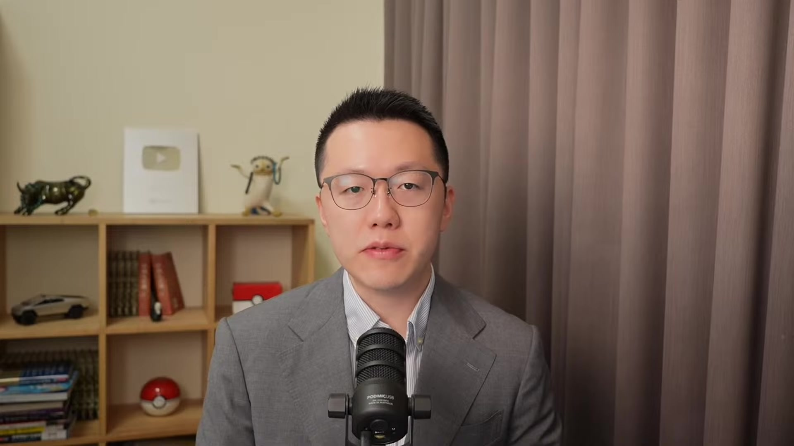

**逐字稿片段：** 美國股市週一算漲跌互見 不過之前跌比較重的都開始做反彈了 反而是道瓊稍微有點賣壓 納斯達克是彈了接近有1% 那我們看到在昨天費半 其實也有彈 不過總覺得這個市場的反彈力度 空單回補力度並不是想象中來的大 原因很簡單 本來可能一開始開盤漲3%的 結果尾盤只漲1%到2% 所以不管怎麼說 可以看得出來 美國股市跌到這樣的一個位階 也嘗試的在下方來做阻底 那重點是大股票沒跌 我們看到的標普或者納指 其實還在高位震盪 真的跌的其實就是廢辦而已 那現在隨著整個第三季財報 已經陸續的拉開序幕 之前銀行股打頭陣 看起來不太理想 明明財報也不差 結果股價都跌的拖拉股 那這一次藉由科技巨頭 陸續公佈財報之後 是否有機會能夠拉動市場信心呢 其實美歐股市 雖然現在面臨比較大的一個壓力 不過你看得出來市場上相對於7月份 其實也沒什麼真的在恐慌的

**話題推測：** 預期顯示美國股市主要指數的漲跌情況

---

## 00:01:38

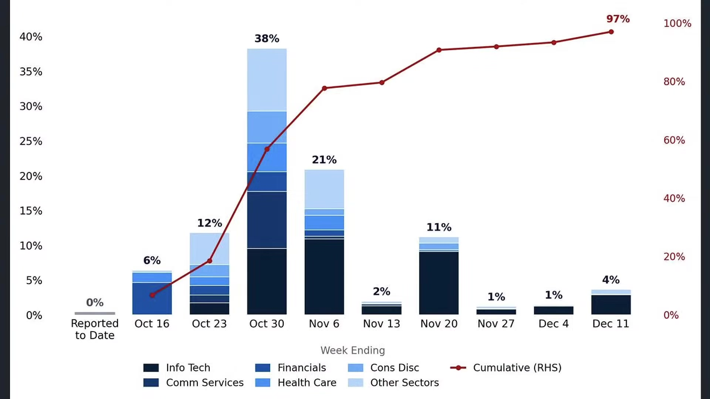

**逐字稿片段：** 為什麼 因為第四季來了 每年的第四季都是具有基本面的拉貨潮 資金行情 還有本來年底的旺季銷售市場預期 就會來得比較強烈一點 而且是一路延伸到明年的過年 所以市場現在普遍針對標普白指數 第三季的每股盈餘 預估大概是成長27%左右 這個應該是2010年以來 第三高的財報季前的預期 其中預估輝達和美光 這兩家公司可能就會貢獻 36%的預期獲利成長 前十大企業大概已經佔了三分之二 這也顯示 現在其實成長高度集中的產業 就在廢板 然後廢板現在是跌最重的 這說明的事情是 現在市場上 似乎在上半年給予這些企業 過高的預期和投射 以為他們會這樣子賺錢賺一輩子

**話題推測：** 預期顯示歷年第四季股市表現的圖表或相關數據

---

## 00:02:29

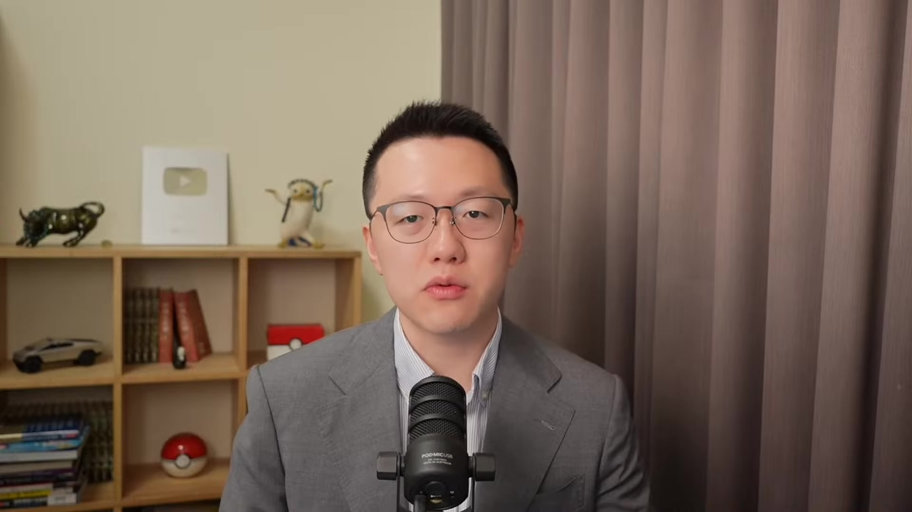

**逐字稿片段：** 那現在我們預估資本支出 應該也會在本季度的年增幅 見到絕對高點 我們講的不是下個季度 明年就不資本支出 而是資本支出的增速 115%應該會出現在本季度 那是否代表著 市場對於未來的估值投射 已經過度預期 我們還是要繼續漲 但是不能夠再 照上半年的速度上漲了呢 今天來跟投資朋友多多一些觀察 如果從年底資金面來做改善 另外一個好處是 其實企業財報公佈出來一定是不錯 財策能夠爛到哪裡去 真正我覺得值得觀察的效果 是股票回購的限制陸續解除 因為股票財報公佈前 你是不能做股票回購的 通常都要等財報公佈之後 一旦公佈之後

**話題推測：** 預期顯示資本支出年增幅的預估數據，可能為趨勢圖

---

## 00:03:15

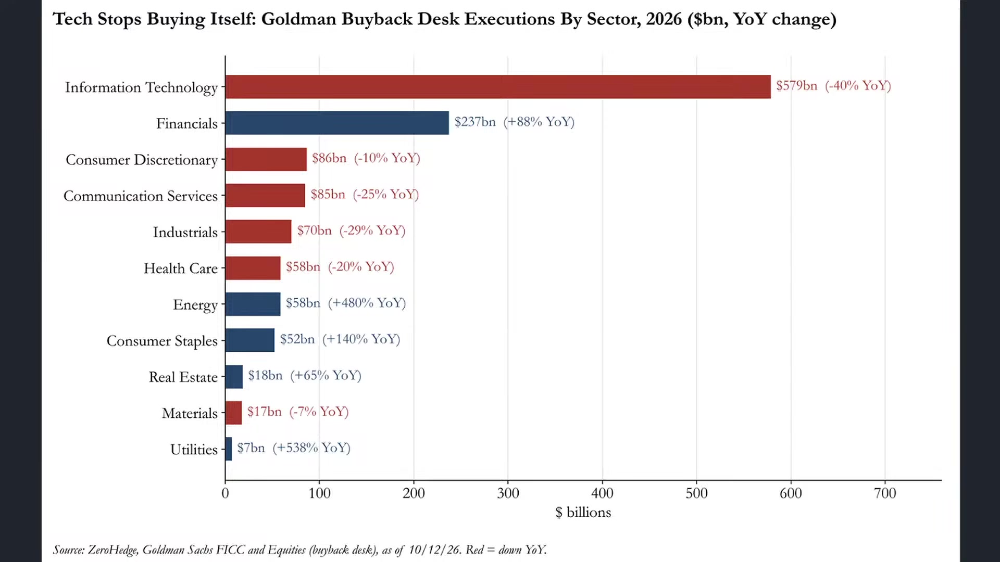

**逐字稿片段：** 現在預估10月底會有48%的標普500企業 恢復回購資格 11月通常都是第二大的回購月份 佔年度的回購金額大概是18左右 另外一方面10月31號也是大量的共同基金的會計年度的結束日 所以一旦越接近10月底到11月初 也許公司派的買盤就能夠有效的迴歸 當然你不能說股票回購股市就能夠一路上漲 因為目前市場上還是有非常明顯在利率預期上的變動 我們在短期內有一種叫勤勒式下跌 就是跌給你看跌到你下禮拜保證不升息再說 那你先不升息 所以先撐到下禮拜 從市場跌幅的心態來看是如此 等到下禮拜FOMC過之後 也許重新的反應基本面 或者股票回購 再來做適度拉抬 這個是可以值得大家觀察的重點

**話題推測：** 預期顯示標普500企業恢復回購資格的比例

---

## 00:04:10

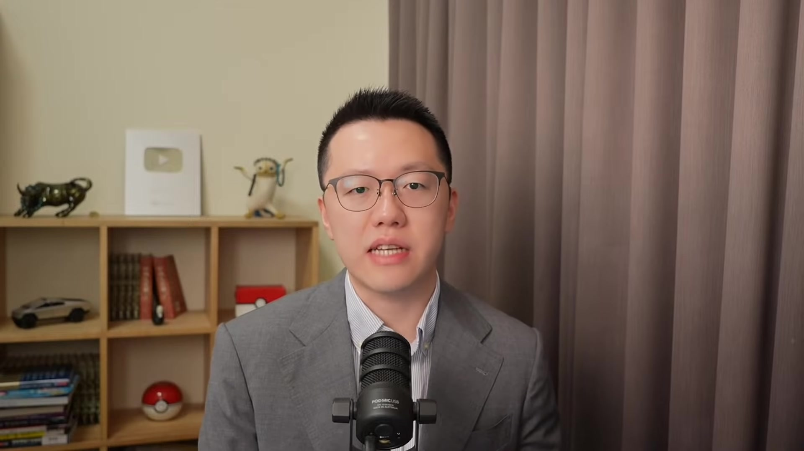

**逐字稿片段：** 每年股票市場通常10月份 都會面臨一波的季節性慢壓 所以大家也不是說 現在慢壓馬上要結束 撐到下禮拜 下下禮拜也許就結束了 主因就是因為大量的共同基金 剛才提到 在10月份會結束會計年度 他就必須要進行持股的調整 稅務規劃或者投資組合的再平衡 所以這個時候稍微持有多一點現金是可以理解的

**話題推測：** 預期顯示股市10月份季節性賣壓的歷史數據圖

---

## 00:04:35

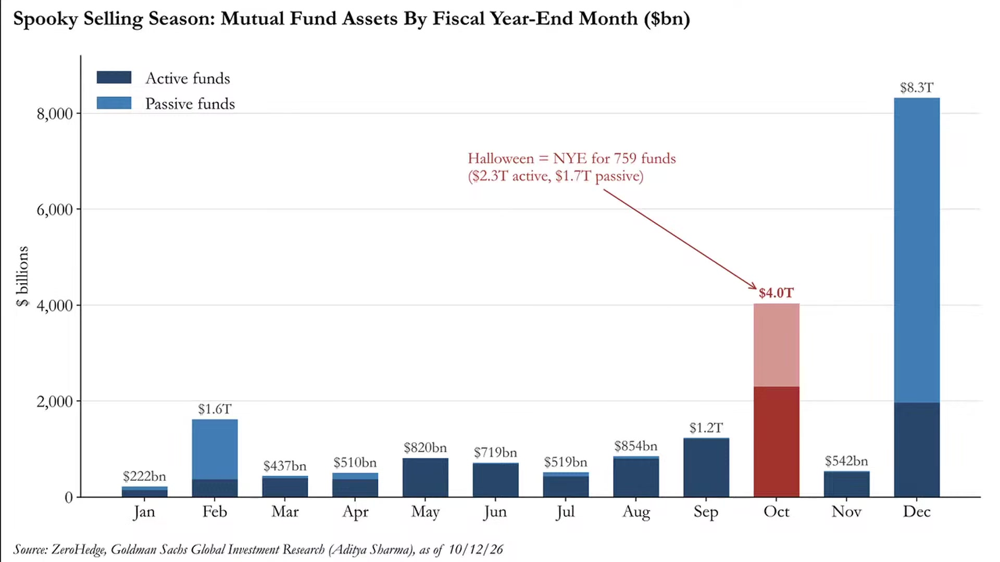

**逐字稿片段：** 目前在美國有759檔基金會在10月份結算 管理的資產規模大概是4兆美元 其中主動型是2.3兆 被動型是1.7兆 那規模就僅次於12月份的8.3兆 所以很多主動型基金必須承認 你不要看今天美國股市還是表現得很漂亮 我猜大概很多是虧損的情況 你只要買到美光 買到一些記憶體股 買到被動元件 或者說我們看到在今年上半年 動盪很大的一些硬體股 其實是很容易虧損的 那這些主動型基金可能為了要實現虧損 抵消資本利得 提前賣出表現不佳的股票 所以有沒有可能10月份 跌深的股票持續加劇下跌 支持大家多做一些觀察 那另外一方面 德意志銀行的看法比較不一樣 他認為目前沒有股市 其實並沒有太大的一個變化 還在一個正常的波動區間 那重點在於 這一次的AI有可能會讓企業兩極化 股價下跌就不一定是買點 因為新的商業模式似乎在重新定價

**話題推測：** 預期顯示10月份結算基金數量及管理資產規模的數據圖

---

## 00:05:38

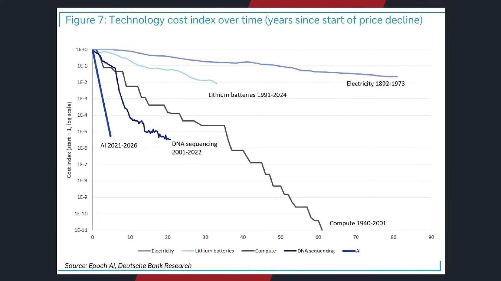

**逐字稿片段：** 我們必須承認 這波下跌到底跟美債殖利率有沒有關係 感覺好像那個因並不是美債殖利率 因為在下跌的過程當中 美債殖利率是一起快速下滑的 以前都是那個殖利率一創高 完了借錢好貴 融資成本完不下去了 股市暴跌 現在不一樣 現在是股市一邊下跌 沒再支利的也在跟著跌 所以也許市場一方面 在做這種季節性的調節 或者勤樂式下跌 另外一方面 其實也說明著 部分個股 尤其是大型科技股 幾乎沒跌 所以大企業兩極分化熬得過去 可是對於部分企業來說 可能會進入競爭或者淘汰的企業 我們舉例來說 你像過去四年 標普百半導體和設備類股 漲幅大概是接近有7倍左右 軟體類股漲幅就比較小了 大概80% 所以必須承認 即便軟體股下半年又開始痞疾泰來 因為資安股的原因 可是雙方是否會造成績效持續拉大 這個持有股票到底算不算賺錢 很多人說是掙報酬就算賺錢了 你這樣講保單也算賺錢 美元保單也算賺錢

**話題推測：** 預期顯示美債殖利率與股市走勢的比較圖

---

## 00:06:47

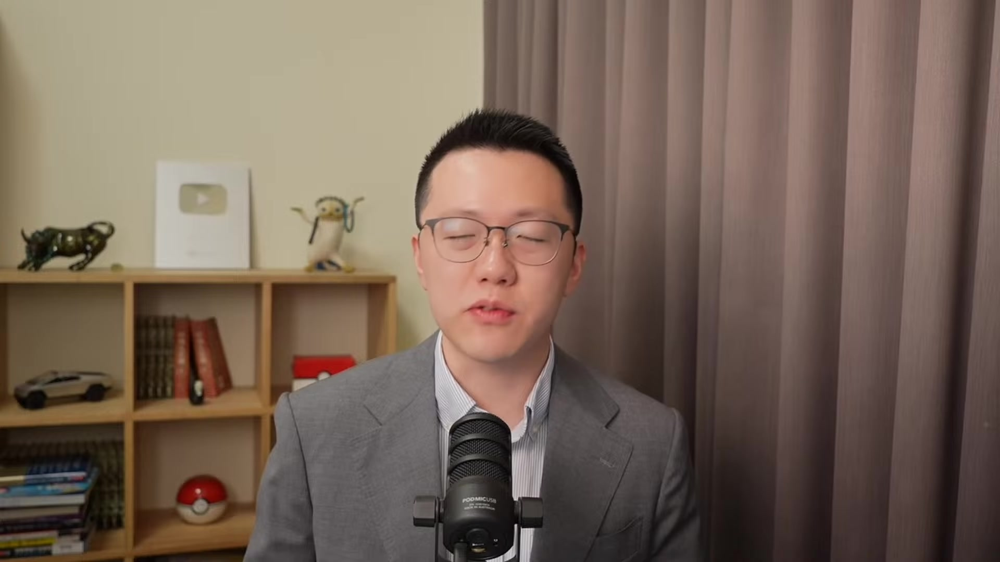

**逐字稿片段：** 那有一種判斷標準是 跑贏大盤才叫賺錢 你跑贏0050那就賺錢了 你跑贏SPY那就算你賺錢了 所以從這樣的一個邏輯來看 你沒有買到科技巨頭 在臺灣你沒買到臺積電 你大概就跑出大盤了 這是這幾年常見的一個情況 也給投資朋友多做一些思考了 那未來的這種極化 有可能會持續發酵 這個極化不是說一定一個漲一個跌 是一個大漲一個小漲 那就是極化了 給投資朋友多做一些思考 那當然了 另外一大因子 主要針對10月份的賣壓 是來自於先蹲後跳 所以這一次為什麼下跌過程當中 好像比較多人有承接的意願 相對於7月份的去槓桿 因為覺得年底會漲 我們從1974年以來的 其中選舉標普派走勢的趨勢 會發現市場通常在7到10月份 它會因為選舉的不確定性 表現的稍微偏弱 然而11月的選舉結束 出爐之後不確定性就消除了 所以股票市場往往容易迎來 比較明顯的一波反彈 包括平均數包括中位數 其實報酬都很容易因此而走高 隔年2到3月份累積漲幅大概都是5到7%左右 好那現在問題來了 現在有沒有不確定性 其實現在不確定性還是很大 為什麼 因為真的有可能會翻盤 我們看整個26年的期中選舉的整體風向

**話題推測：** 預期顯示不同投資報酬率定義的說明，或與0050/SPY等指數的績效比較

---

## 00:08:06

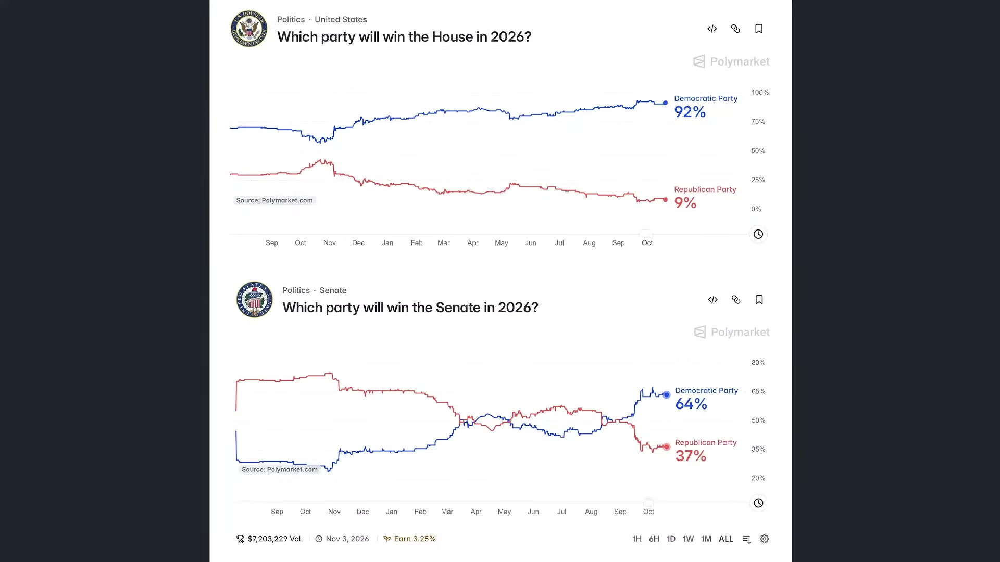

**逐字稿片段：** 從預測市場Polymarket來看 民主黨奪回眾議院控制率的幾率 大概是92% 共和黨現在賭盤只剩下9% 雙方差距到現在還在拉大 那更值得注意的是 原本被認為共和黨 比較有優勢的參議院 民主黨的勝選幾率 已經從去年底的30% 一路飆升到現在的64% 那反觀共和黨現在只有37% 這代表市場不只是預估 共和黨有可能丟掉眾議院 甚至連參議院有可能丟掉 那如果美夢成真 那川普未來兩年的立法 財政政策推動 就會面臨非常大的阻力 幾乎就可以認定 他是一個跛腳總統 到時候就要看是不是要來臺灣取經 對不對 這一樣 國會力量越來越大的時候 對於你形成鉗制 那我們接下來要如何觀察 它的政策實施效果呢 那這個是什麼 這就是非常大的不確定性 不確定是什麼 不確定性就是賣壓 可是你說那等到11月份結束以後 還是不確定 川普政治就無法施展 我講的不確定性不是這個 我講的是市場不知道會發生什麼事的不確定 在11月投票之前 大家都還是充滿著不確定性 投完票的那一刻 就確定他是跛腳總統了 確定了 利空就消失了 所以這個是市場上 為什麼有先蹲後跳的預期 當然我們回過頭看

**話題推測：** 預期顯示Polymarket上民主黨和共和黨在眾議院及參議院勝選機率的數據

---

## 00:09:30

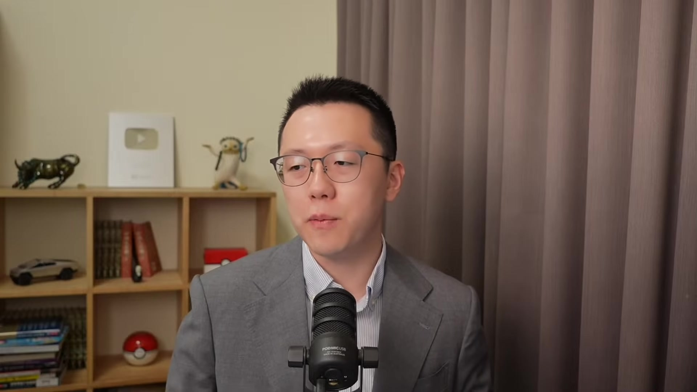

**逐字稿片段：** 川普的總體民調 當然還是要看各參眾議員自己的能力 可是對於川普本體民調來看

**話題推測：** 預期顯示川普總統的總體民調趨勢圖

---

## 00:09:38

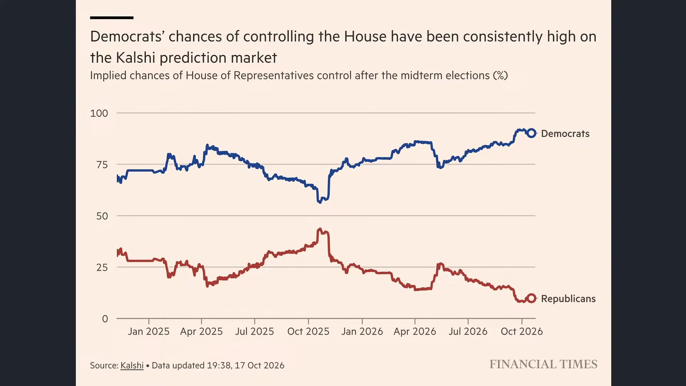

**逐字稿片段：** 最近我們看到金融史報所公論民調 又破底了 支持率只剩下38% 那最近當然受到的衝擊有哪一些 因為行動情緒很快 11月3號就要登場了 那不就兩三週的時間嗎 川普最近是連續爆發了 人事和政治的爭議 之前是那個白宮新聞秘書 很漂亮那位 那上任五天就遭到撤職 然後駐希臘的特使 因為貪汙被解職 國防部因為公開直播處決計劃 現在引發爭議 這個短短一兩週 好像發生很多事情 是不是有人在搞他 川普民調現在降到38% 選民一方面對於伊朗戰事 對於汽油價格 對於政府的貪腐計劃 基本上我們過去一直講過 最後一個月一定要把油價給壓下來 還沒壓下來 居然還破高了 這也就說明著川普的民調 大概到選前也不會有太大改變 我們根據最新民調 從10月16到19號 包括從路透社到EPSO 川普的施政滿意度大概是31到32% 不滿意度大概是66% 負面評價大概領先了35個百分點 那值得注意的事情是 不同民調雖然有比較大的一個差異 有偏左偏右 但是方向是一致的 你像Morning Consult 調查川普的滿意度 最高也不過42% 經濟學人和UGov的調查是38% 目前列出的十份民調 川普的不滿意度全部都過半 滿意度大概就31 最高較43 那來不及改變了 那就剩下兩三週的時間而已 其實真正最大的衝擊是什麼 其實就是油價 如果油價沒漲 一切都還好說 那就看一下市場的聚焦話題在哪裡 看到時候大家可能對槍支問題 對於墮胎問題等等 每一次都有不同的議題 但這一次就是把它鎖定在油價了 因為9月份的消費者物價指數 3.7%公佈出來以後 大家的內心已經清楚知道 汽油價格比去年漲了三成是 藍油價格漲了七成四 這好不容易把拜登給攆走了 結果來了一個炸彈 這個藍油價格居然一年可以漲74% 所以每一戰是今年最大的衝擊 如果我們細看 現在選民最關注的幾大問題 川普幾乎都是束手無策 第一個就剛才提到的 通膨就是食品價格的問題 按照美國農業部的估算 一個採取中等食品預算的四口之家 每週的食品支出 二五年一月是306塊 到現在是320塊 漲幅是4.6% 其中不同食品的價格差異變化非常大 牛角肉從每磅5.5美元 上漲到現在是6.7美元 漲了兩成 雞胸肉漲了5.9% 現在要漲雞肉都變貴了 牛奶漲了2%一年 雞蛋價格好不容易 因為供應鏈趨緩稍微下跌 但是整體而言 我們看到食品價格 還是比川普上任時高出了4.4% 這是第一個衝擊 第二個衝擊 當然川普一定有一些好效果 那就是金融投資 川普政府最亮麗的經濟成果 我們看到標普白指數 從川普就職第一個交易日以來 大概上漲了30% 帶動了美國家庭退休資產的一個增加 這是好事情 川普之前還推出新生兒的投資賬戶政策 針對2025到2028 出生條件符合的這些兒童來做開戶 提供1000美元的初始的投資資金 但是你真的有人會 因為這件事情投給他 這個股民都這樣 那股市上漲跟政府有什麼關 那是我的英明 不是英明 是我的精明 是我的投資技巧 堪比巴菲特所造成的 你真的會因為股市上漲 特別感謝政府 你當然是相信自己的能力 所以這個政策的效果 沒有想象中來得大 那第三是住房成本 住房成本最大沖擊是什麼 當然就是現在的利率預期 不斷的上修 現在川普從上任時 每月房貸的付款的中位數 2112塊 到現在是2196塊 增幅大概是4% 不過拉長到2020年 房貸負擔大概已經增長了 111% 所以沒人敢買房 因為採取固定利率的話 現在就給你鎖死了 這就是最大壓力 再來就是汽油價格 汽油價格 我們根據美國的新車 平均售價 二五年一月是 50,111美元 到現在是52,014塊 漲幅3.8 還可以接受了 重點是汽油價格 已經漲了快五成了 所以總體而言 對於能源衝擊 是目前川普民調下滑最為直觀的原因 我講說以前美國人很多就是這樣子 就是這種物價上的持續吞噬 對於資產階級當然凹得過去 但對於很多中產階級 過得這比很多臺灣的中產還要來得慘

**話題推測：** 預期顯示金融時報公布的川普民調支持率

---

## 00:14:28

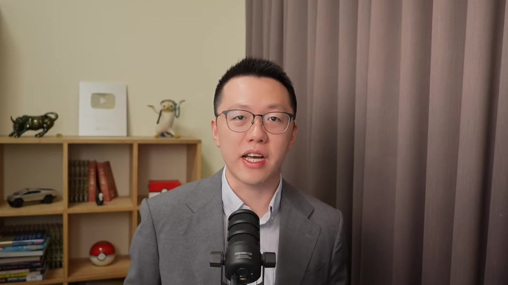

**逐字稿片段：** 即便我們的人均GDP 當然是比美國低很多 可是臺灣人的購買力 其實是比美國大多數人還要來得好的 就活得好 生活品質也相對比較方便等等 除了那個居住環境感覺好像稍微比較惡劣一點 可能鐵皮屋有點醜以外 其實大部分的臺灣人的購買力 還是比美國人還來得好的 這個對很多美國人來講 那句話怎麼講 想死又沒有勇氣 想活又不爭氣 就這年頭我們當然財富提升你要開源節流 因為薪資所得跟房地產的金融增值空間 差距實在太大 那個極化程度 臺灣這兩年已經蠻嚴重了 那美國的嚴重情況 比想象中還要來得更為劇烈 大家到美國逛一趟就知道了 那個Downtown 你一路走到郊區 那完全不同世界 隔一條街就不同世界 那在臺北其實也一樣 臺北你薪水4萬跟5萬 本質也沒什麼區別 多買兩個紅豆餅而已 那如果4萬塊家裡有房 5萬的沒有 那5萬的生活品質搞不好比較差 所以節流好像很重要 但是也沒有那麼重要 所以我們才講說 我們做這個節目 就是大家要投資自己 儘量開源 把薪資先提升到6萬7萬10萬 你很快就有理財需求了 選對的標記來參與市場 瞭解金融世界 那以前不是人家講嗎 有算過嗎 如果你早上忍住 不喝星巴克的冰美式 一天就省下115塊大杯的 那一年一個月就是4000塊 一年就是5萬塊 20年就100萬了 你看還是付不起房貸投期款 所以還是安心喝你的咖啡 就是這麼慘 你省不省錢 其實也沒什麼區別了 這個就是目前大多數中產 所面臨的巨大沖擊 當然我們往下看 更進一步的衝擊來自於 對於AI立場的一個區別 川普其實已經多次表態 是支持本人的AI擴張 他當然採取了適度的監管 但是這更類似於這種共同聲明 而並不是實質的法律監管 那現在AI尤其是矽谷的科技符號 幾乎已經全面轉向川普了 就變成了這次的投票選舉 有那種影子出現 就是支持AI的你就投給川普 你認為AI擴張速度過快的 你就不要投給川普 或者說共和黨 有這樣的一個聲勢開始出現了 我們據來說 之前矽谷最具影響力的創投人物 也是A16C的共同創辦人 Anderson 他在科技巨頭 轉變成華府的重要政治金主之際 現在因為他現在管理的資產規模 有1000億美元以上 大量的把資金投入到川普團隊 所以之前很多美國的科技巨頭 基本上都是支持民主黨的

**話題推測：** 預期顯示美國與台灣人均GDP及購買力比較圖

---

## 00:17:11

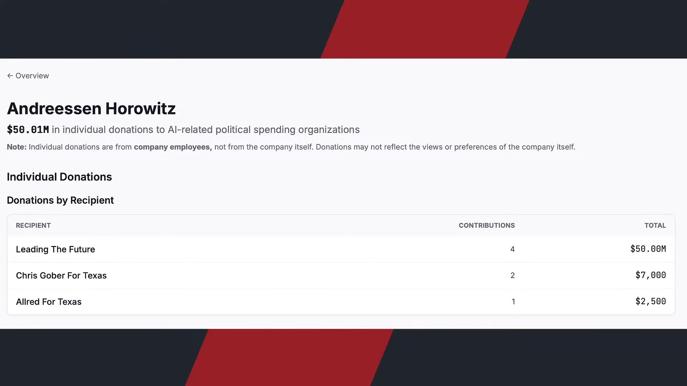

**逐字稿片段：** 包括希拉蕊和歐巴馬 現在他的政黨的相關捐款 有94%都流向共和黨 在各大科技巨頭層面 都有不同人物向川普來進行 不管是政治獻金的提供等等 這說明大家是相信AI的立場 川普跟這些科技巨頭是表現一致的 可是我們過去有提過 因為從去年11月份以來

**話題推測：** 預期顯示科技巨頭政治捐款流向共和黨的比例

---

## 00:17:34

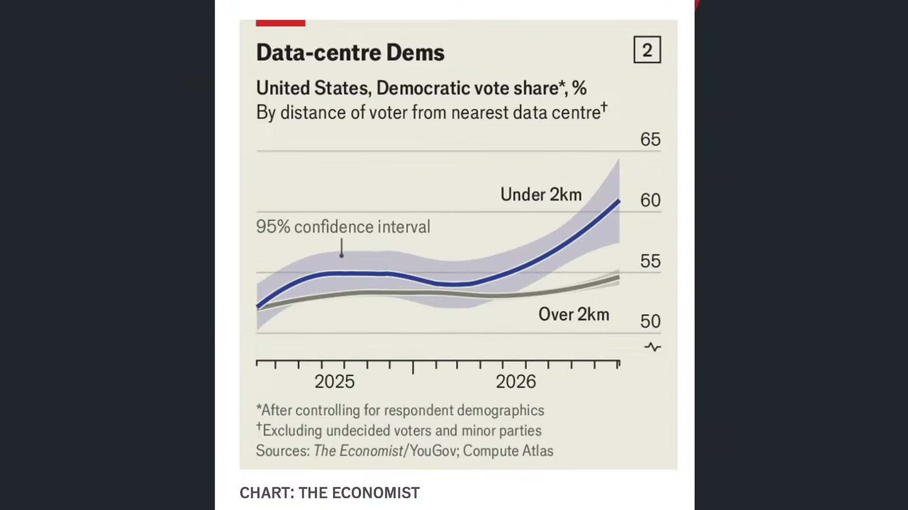

**逐字稿片段：** 美國的資料中心的建設支出 已經超過了目前新的辦公大樓 甚至還不包含昂貴的AI晶片 這說明的事情是 在美國AI正在把大量的資源 完全的吸取光 你像OpenAI和甲骨文 現在在密西根州 新建的新資料中心 完工之後 用電量會超過一座中型城市 當地居民就很擔心電價上漲 美國又沒有什麼電價補貼 油價補貼 又怕水源汙染 又怕房價會下跌 怕農地會流失 而且資料中心你不要看 好像乾乾淨淨的 它其實是有一些噪音存在的 所以我們根據經濟學人 所做的民調發現 住在資料中心兩公里內的居民 支持民主黨的比例 比較遠的人 高出平均接近6個百分點 你蓋越多資料中心的地方 越反對你 越投給民主黨 這形成悖論 川普最希望的就是 到處都是資料中心 到處都是AI建設 到處都是晶圓廠 大家就會投給我 現在看起來 建越多資料中心 越反對你 這就是最有趣的跡象 當然反對資料中心 多半還並不是因為 AI取代工作的問題 是對於生活成本 和地方環境的直接衝擊 部分原本支持共和黨的選民 也因為地方政治人物 沒有回應抗議的訴求 開始重新考量投票的選舉 很多參眾議院的共和黨議員 基本上也不太敢 把AI當成一個重要政績 這一座AI資料中心是我爭取的 那電價就怪到你頭上了 有這樣的一個想法開始出現了 所以必須承認 現在受到實質建設命令的影響 美國各地區 尤其是左派州 受到建築經歷的影響規模 來得越來越大 我們看到在2026年 美國位於地方資料中心建設暫停令 大概已經來到20.9GW了 扣除掉已取得建築許可之後 大概有接近11%左右 目前已經停止了 就本來規劃100座 有10座目前已經停止新建 原因是因為必須要受到 更多的監管環平 獲得更多的溝通 所以多數的AI資料中心 還是有機會能夠繼續的推進 可是你已經發覺到 供給快要跟不上了 那當然了 原因就是因為它產生的副作用 已經讓大家不太能夠 接受它的新建 甚至不是因為AI 已經開始使用之後 產生的副作用 是蓋AI 使用AI之前的初期資本 初期的建設 已經形成了副作用

**話題推測：** 預期顯示美國資料中心建設支出與辦公大樓建設支出的比較圖

---

## 00:20:00

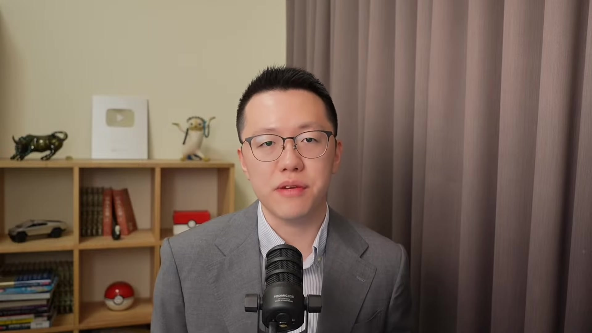

**逐字稿片段：** 這是形成悖論 以前我們用AI 是為了要提升效率的 結果現在很常發現 AI搜尋 AI做一個短影音 用的電比Google搜尋 還要來得多 感覺好像是用更多的電 然後整體而言 我們使用的品質沒變 你可能寫一個 或者寫一篇文案 你就在那邊好好寫 結果你本身也沒耗什麼電 你下班吃個便當就好了 結果你用AI寫 發現耗的電量對於社會 對於資源的壓力反而越來越大 就跟以前很多人買電動車 是為了要省電減碳的 這很好 後來發現坐在車裡吹冷氣多好 我就不用去咖啡廳了 反而要燒更多的煤來發電 洗衣機是為了要減少洗衣服的時間 現在愛乾淨 天天都要洗 加起來比一個禮拜一個月洗一次 時間還要來得更多 有時候科技的進步 並沒有帶來更環保的社會 而且還把電力水利價格給推高 這以前人家不是常講一個段子 買冰箱是為了吃新鮮的 買了冰箱以後 天天都吃剩菜 結婚是為了過上好日子 結婚之後日子更難過 用蝦皮是為了省錢 結果使用了蝦皮 發現錢越花越多 買手機是拿來通話的 結果現在拿手機都拿來玩 基本上沒有再溝通 所以很多時候你會發現 不斷的衝擊 科技的革新 好像也沒有我們想象中這麼線性 直接是效率上的提升 買房子是為了有地方遮風擋雨的 結果買了房子四處漂泊 打工 還要起早貪黑付房貸 我們看到一系列的衝擊 都說明著這個AI的進程 並沒有想象中還要來得順利 當然這就說明著 現在共和黨的立場越來越轉變 AI資料中心 必須要為所有所造成的外部成本來買單 包括水資源的消耗 電力價格的上漲 只能漲你的 不能夠漲我的 當企業如果不必完全負擔 自己造成的成本 就容易產生過度擴張 所以很多人認為 是時候做一些監管 讓AI企業為自己買單 其實他也買很多單 PPI升佔的物價只是漲成這樣 他也沒有完全漲價給我們 為什麼他還在搶市佔 所以要設定好的規則 經濟學很重要的道理就是 好的制度不一定是規定越多越好 它是要讓享受利益的人 也需要去承擔相對應的成本 一開始如果把責任說清楚 我認為也不是壞事 你說治療中心稍微放慢一點點 那也不會泡沫破滅 那就是供給反而還跟不上 重點是大家先協調好 這跟我們以前小時候不是 下課之後不是有上足球課 還是什麼棒球課 球如果有時候踢很遠 誰去撿 以前都常常在討論這個問題 有一個很白目 球給他踢超遠的 後來就有新規定 就是誰離球近 禁誰去撿 但是馬上可以回來比賽 到底很簡單 都是在玩嗎 斤斤計較什麼呢 禁的人去撿那效率最高 你想想看有人故意給他踢飛 逼對方去撿球 你就損耗對方的體力 那就加一條規則 誰故意踢飛就得自己去撿球 而且還要做福利挺身 那好了 那現在麻煩又來了 那要怎麼確定 他是不是故意去踢飛的呢 那隻能再加上更複雜的規則 比如說他的表情 他有沒有漸漸的 由裁判來做最後判定 那其實最早的你發現 還是那個誰踢飛 誰去撿的規則最簡單 有效 所以你看 即便是在一個遊戲規則裡頭 我們也要保持這個規則的簡單性 誰產生了AI 誰就負責AI所有的副作用 就這麼簡單 我認為其實是合理的 好 所以這個就是目前 川普在各項民調當中受到的衝擊 好 那我們回過頭來看 現在這些衝擊 就是造成不確定性上升的原因 我們知道 這個很有可能 在期中選舉之後 川普就真的變成一個跛腳總統了 我們看看美國股市四大指數表現 道瓊下跌36點 0.07% 在51966點 標普上漲31點 0.41% 在7690點 而且標普根本沒跌 納指上漲290點 1.11% 收在26430點 其實這一波跌的就只有廢半 那我們看這一波能不能守住平臺區 守不住也沒關係了 因為今年年初本來已經漲很多了 上漲179點 1.61% 收在11,316點 其實投資到現在這個區間 不同指數的感覺不太一樣

**話題推測：** 預期顯示科技進步帶來非預期副作用的列表或概念圖

---

## 00:24:31

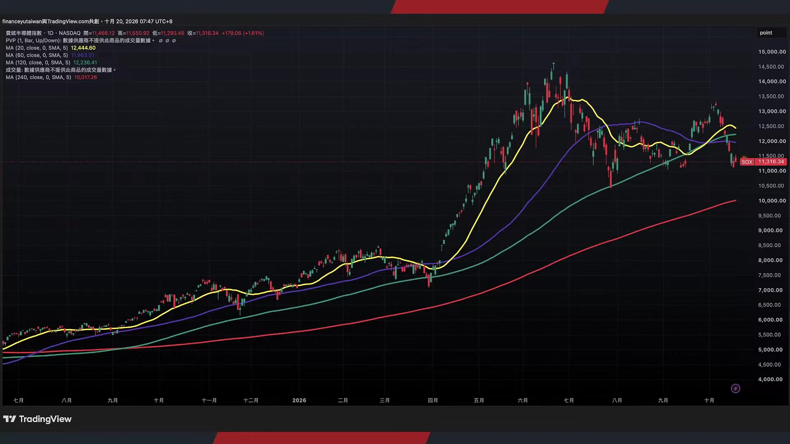

**逐字稿片段：** 從一個季度來看 很多人會覺得後悔 為什麼不買標普 不買納指 不買大型股就好了 為什麼買廢半 一切轉頭空 有些人會從年初來看 不會 我從年初到現在 漲最多的還是廢半 即便在第三季 它拉了比較大的回調 所以這個時候 大家整體績效落差 到下半年 因為年初到現在 會越來越大 沒股票的時候 有持股最好了 沒現金的時候 現金最好了 股票市場上漲的時候 空手最痛苦 股票市場下跌的時候 滿倉最痛苦 所以有時候講說 空手的人都覺得 買在低點就是幸福 套牢的人會想說 能夠解套就是幸福 滿倉的人覺得 還有現金就是幸福 所以不管怎麼說 你像退休的人 每年有錢花就是幸福 每個人對於投資尺度的 心理感受程度不一樣 你也不要去特別去羨慕別人 也不要去嫌別人績效怎麼樣 大家都選擇當下投資指數的時候 就在負擔現在的代價 我們投資廢辦的最大代價是什麼 那波動有夠大的 今年有夠劇烈的 上半年還很開心 下半年就怎麼這樣 但是總體來看 好像績效也不差 真正績效真的殘不忍睹是誰 是大指數多上漲 是看對趨勢實在波動離場的人 所以給投資朋友做一些思考 的確你沒房的時候 有房最好了 沒錢的時候有錢最好了 離別的時候相聚最好了 生病的時候健康最好了 窮人會覺得有錢就是幸福 盲人認為能看見就是幸福 乞丐覺得有飯吃就是幸福 病人認為能活著就是幸福 幸福是一種心態 是一種知足 所以生活不在別處 當下即是全部 好不好 給多支片有多些請示 對我們也是有一些 暖心的提醒的好不好 不是每一個都是屋裡頭的 我們是一個很正經的財經節目 我們財神爺 那當然現在市場上 認可這個角度的也不是說很多 這是好事 市場還在懷疑中成長

**話題推測：** 預期顯示不同指數（標普、納指、費半）在不同時間尺度下的績效比較圖

---

## 00:26:32

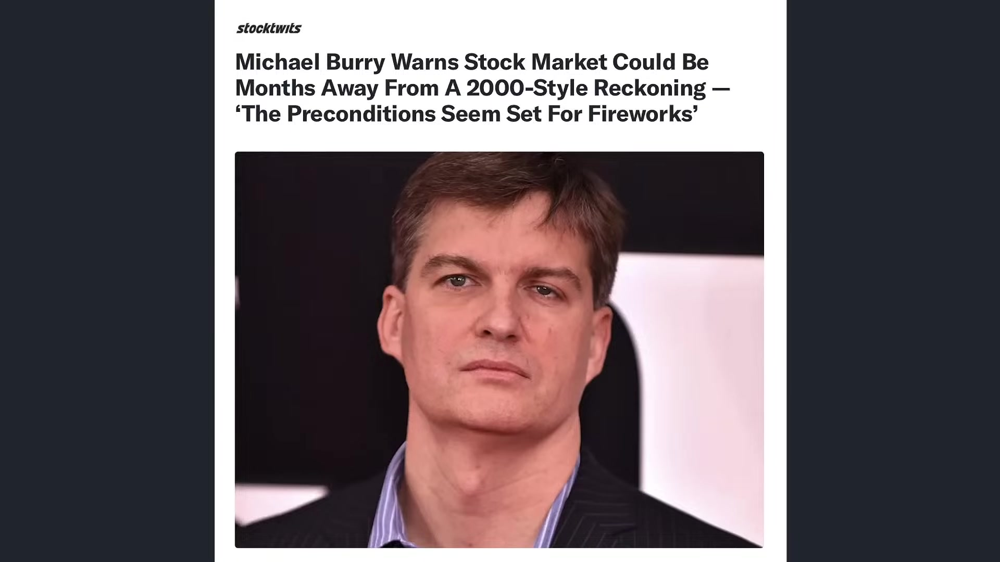

**逐字稿片段：** 我們看Michael Burry最近又發話了 他告訴大家 第一 如同我們過去所講到 他認為他現在其實已經算是勝利了 因為55%在標普500指數的股票 已經進入熊市了 我只要不做空這七巨頭 我做空其他小巨頭 應該都有機會能夠大賺錢 這是Michael Berry的第一個說法 現在有55%的成分股 相對於過去的最高價 已經下跌至少兩成 高於8月13號的47% 所以跌勢是在加劇的 第二件事情他不斷的提到 現在亞馬遜 微軟 Meta 阿發貝和加股 目前投資還沒有上位履行的 租賃承諾高達1.2兆 他認為資料中心建設要3到5年 租約可能長達13到20年 所以人工智慧晶片和散熱架構 可能在每12個月到18個月出現重大變化 就會形成投資設備的更新速度 跟長期投資承諾不匹配的問題 他講這是有道理的 一方面當然就是時間錯配的問題 另外一方面就是蓋不完誰負責 假設Meta投資一個資料中心 看似好像是硬體的建設商要負責 但Meta對於它的雲端商所給予的承諾算力 Meta要不要負責呢 如果我承諾我要蓋好的算力 沒有展現 誰要負責呢 那會不會形成時間錯配的問題 所以他目前策略是這樣

**話題推測：** 預期顯示Michael Burry的肖像或其投資觀點簡報

---

## 00:27:53

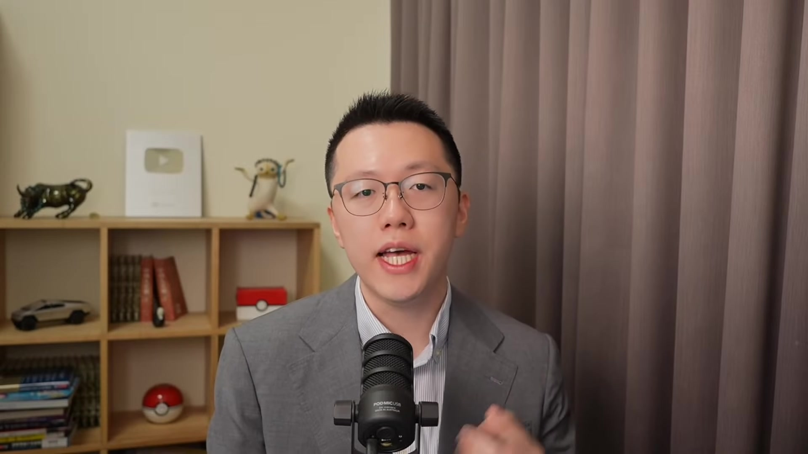

**逐字稿片段：** 他繼續放空納斯達克100指數 目前他的放空焦點 的確他還有半導體ETF的賣權 可是現在更為集中在 納斯達克100指數的大型科技巨頭 為什麼 就剩下你還沒點的 就剩下你這些大型科技股還撐在高位 我看你怎麼玩下去這場遊戲 他的心態大概是這樣子 他的策略也並不是全面退出股票 按照他的說法 他還持有京東 Adobe等個股部位 他主要的看空的 都是那種估值極高 交易非常擁擠的市場的部分企業 而並不是所有的企業 其實這張照片 我聽說他本人 不是在大麥空裡面 穿得很邋遢 其實穿那麼邋遢 按照我的理解 早就會被趕出去了 他應該平時都是穿西裝的 我以前剛畢業 我也不是很懂穿的 基本就是愛情舔狗 生活懶狗 穿搭土狗 我全都有 就是 對 我現在是稍微鎮靜一下 稍微穿一件襯衫 要不然我平時 其實也不是這樣穿的 也就穿一件T恤而已 我連領帶都不會搭 上次那個專訪 我是打算打領帶了 我打了30分鐘都打不好 後來還是算了 這也很神奇 那不管怎麼說 我剛才跟投資朋友提到 不同的想法 不同的思維 都會影響到股票市場的現況 時間因素 我們本來要把後續 這個Michael Berry所擔憂的細項 來做一些細節分析 他到底擔憂的

**話題推測：** 預期顯示Michael Burry放空納斯達克100指數的策略說明

---
