# yutinghaofinance_Q9jWUV1F2WE — 關鍵畫面索引

- 來源逐字稿：[yutinghaofinance_Q9jWUV1F2WE_FIN.srt](yutinghaofinance_Q9jWUV1F2WE_FIN.srt)
- 影片：https://www.youtube.com/watch?v=Q9jWUV1F2WE
- 截圖數：27

## 00:00:50

**逐字稿片段：** 納指是跌了1.8% 標普跌了1.1% 好像也還好 畢竟他們都在歷史高位附近這樣跌下來 可是費半是重挫了524.3% 那會不會原本的WD 硬是要被它給凹成M頭 那就有點壓力了 所以到底費半本輪的賣壓 會不會外溢到其他板塊 值得大家來多做一些留意 昨天AI的雲端業者CoreWave 也狂洩了接近有15% 終於登道 在7月份反彈以來 美國股市也是斤斤漲格局 這一次你仍然敢勇敢的看好AI嗎 這段時間我們都說 投資股票要分散風險 現在真的分散了 禮拜一睡大安森林公園 禮拜二睡228公園 禮拜三睡青年公園 有一陣子沒有睡公園了 可是大家有沒有發現 我們還是一樣 作為長期的週期投資者 每兩三個月就是會有周期乖離的回調 每隔一陣子就是要睡公園的 我們已經從當年的青年公園 已經睡到228了 現在睡到大安森林公園 現在已經逐步睡到大酒保公園了 睡公園也是體體高 一間睡得比一間好 好不好 這就是人生的週期 人生也會有高潮和低潮 沒有人總是一直高潮的 那我們能不能讓每一次的低潮 比前一次的低潮還要來得高 這技術分析的體體高 其實就OK了 對對對 股市暴跌之後 終於理解什麼叫被動收入了 被動接受路人投下的零錢 好 那我們這次要觀察 從通膨所引發的預期拉伸 到底對於股市是不是一場災難 我們首先看這一次 在9月份所公佈的消費者物價指數 這一次的確 消費者物價指數月增幅0.6% 年增幅3.7% 哇 那都比市場預期來得高 市場原本預期是3.6% 比較令人擔憂的

**話題推測：** 說明納指與標普下跌數字

---

## 00:02:43

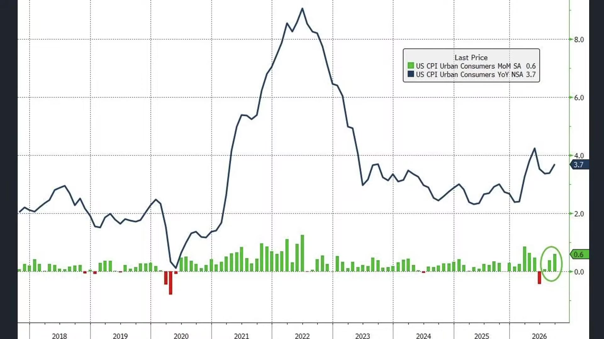

**逐字稿片段：** 其實還是來自於扣除食品和能源的核心通膨 也高於預期 那就說明外溢出去了 就現在不是能源食品的原物料價格上漲的問題 是整個服務業都開始被迫穿到了 核心消費者物價指數的月增幅是0.3% 高於市場預期的0.2% 年增幅也同樣達到2.6% 也比原本預期的2.5%還要來得高 那當然回到源頭 本輪通膨的最大來源 還是能源價格 因為9月份的美國汽油價格 單月是上漲了9.1% 貢獻了整體消費者的物價指數 月增幅大概有一半左右 能源價格的月增幅是5.2% 也比8月份的2.1%還要高非常多 如果拉長到過去一整年

**話題推測：** 分析扣除食品和能源的核心通膨數據

---

## 00:03:30

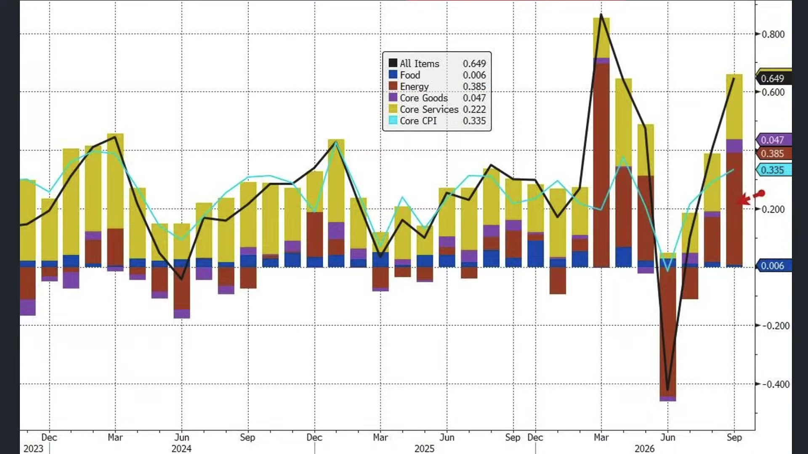

**逐字稿片段：** 能源價格累計上漲已經超過20% 其中汽油價格的年增幅 更是高達34% 天然氣價格年增幅5% 電價4.4% 所以不能說只有在加油站感受到通膨了 它已經擴散到家庭日常生活的各個環節 那當然如果我們細節往下分析 除了能源之外 美國的住房成本 它並沒有跟著降溫來衝消掉能源通膨成本的上升 9月份的住房價格指數 月增幅是0.4% 也比原本預估的0.3%來的高 其中我們看到的業主等權租金是上漲0.3% 業主等權租金就是 就是你是自己的房子 可是你自己房子 你不是靠房價的上漲來看通膨 而是你認為你住在自己家的房子 你要付給自己多少租金來做看待 這也比預期來的高 實際租金上漲0.2 包括旅館外宿價格全部都在上漲 這就使得服務通膨看起來僵固性 又重新產生了

**話題推測：** 展示能源價格的年累計漲幅

---

## 00:04:29

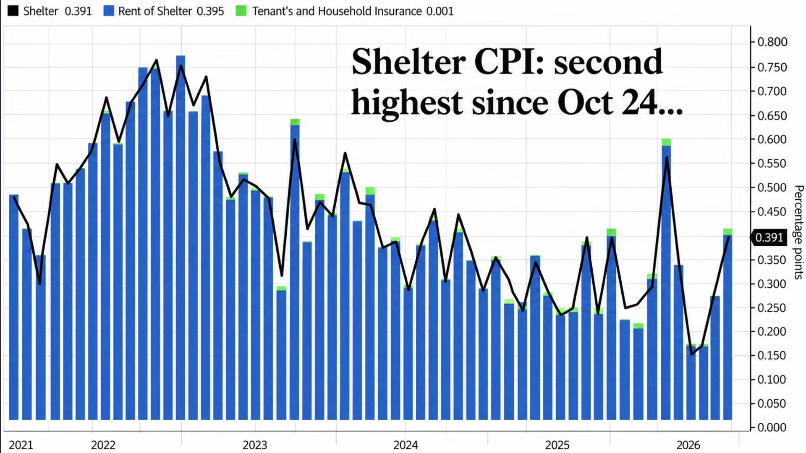

**逐字稿片段：** 在整個9月份的休閒娛樂價格 月增幅是0.5% 中古車卡車價格月增幅0.7 教育價格上漲0.6 機票上漲1.2 服飾價格上漲0.3 醫療服務價格上漲0.1 這個都是我們看到的月增幅 有沒有稍微下跌的 有啦 比如說一些食品價格 因為川普採取了很多的直接性介入 肉類加勤魚類雞蛋大概下跌0.5 但是就是這方面稍微有一點鬆動 大部分的物價仍然具有高強度的僵固性 它直接形成了最終的效果

**話題推測：** 列舉9月份休閒娛樂、中古車等服務和商品價格漲幅

---

## 00:05:04

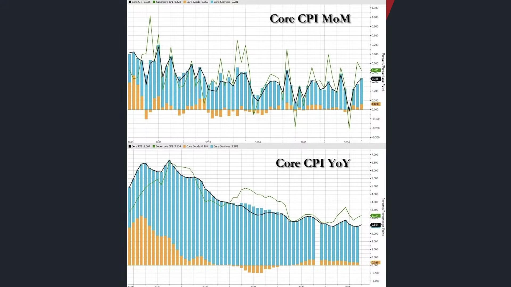

**逐字稿片段：** 就是實質購買力衰退 其實大家真正有感的 並不是說不能夠有通膨 通膨是一個國家發展的常態 但是你的薪資能不能跑贏通膨 這個就跟我們的實質購買力有關 我們看美國的實質薪資 就是把你的薪資通膨也算進去 到底有沒有成長 已經連續六個月下降了 而且最近一個月的降幅非常之明顯 好不容易在2023年以後 美國實質薪資終於已經翻證了 接近有三年之久

**話題推測：** 討論美國實質購買力衰退和薪資成長情況

---

## 00:05:34

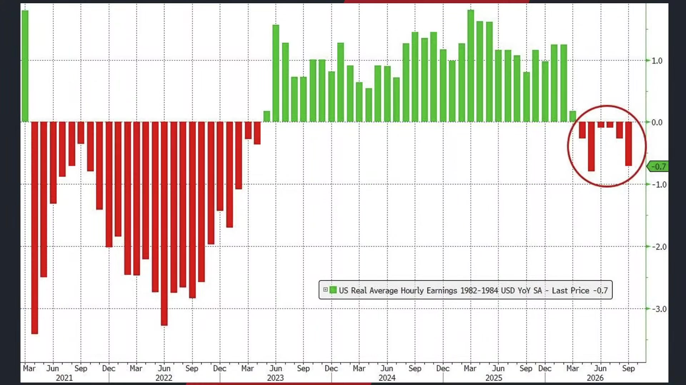

**逐字稿片段：** 結果一場美伊戰事 六個月美國人的薪資 開始跑不贏通膨了 這就是川普給予的壓力 當然如果觀察更長期的利率預期 就代表著市場上 被迫要為本次的通膨來做表態 9月份的通膨數據 不只是整體物價高於預期 核心通膨降估性也產生了 聯準會是否要採取一定的立場 向投資人喊話 不要囤貨 我不要再看到2022年的事件重演 這個時候你看聯準會 有沒有可能在10月份採取動作 這就可能會影響到接下來的利率預期 而利率預期影響到了接下來的AI融資循環 所以我們才會昨天講 前天都跟投資朋友分享到 當投資巨頭明明對這些大巨頭言 7% 8%的投資等級在 要還人家的報酬 殖利率已經很高了 你為什麼還搶著發行呢 那就是他認為會來到8%到9%的 殖利率的發行高位 當一些中小型的AI新創企業 他動不動發行 可能6年債7年債 都是11%12%的殖利率 他還瘋狂發行 為什麼呢 因為他可能預估未來 可能要來到13 14% 所以這次美國的9月份的通膨數據 並不是講說通膨年增幅3.6到3.7 所以失控了 並不是這樣 3.7也還好了 是什麼 是原本期待 我們可以沖銷掉能源價格上漲的 那個因子 核心物價 服務價格 現在看起來也高於市場的預期 所以能源是主要推手 但是住房服務多項商品 現在僵固性開始產生了 這就連準會目前要干預的情況了 當然外在的環境也不利於目前的通膨氛圍 我們看在昨天伊朗支持的胡塞武裝 葉門的青年運動 持續針對沙爾地阿拉伯採取攻擊 這跟北韓有點像 誰得罪我不管是日本得罪我 美國得罪我 反正我就打南韓 有這樣的感覺 他專門挑沙烏地阿拉伯 最新的目標就是直指全球最大石油公司 沙烏地阿美位於達蘭的總公司 那供給已經造成了行動大樓 多個樓層受損 所以現在就很尷尬 一方面又擔心你偷襲機場 一方面只要任何美國企業 在中東的總部都有可能遭受到衝擊 之前利亞的機場是有13個人死亡 最終所形成的效果 就中東油價再度的做顯著拉抬 不然這個原油價格

**話題推測：** 提及美伊戰事對薪資通膨的影響

---

## 00:08:01

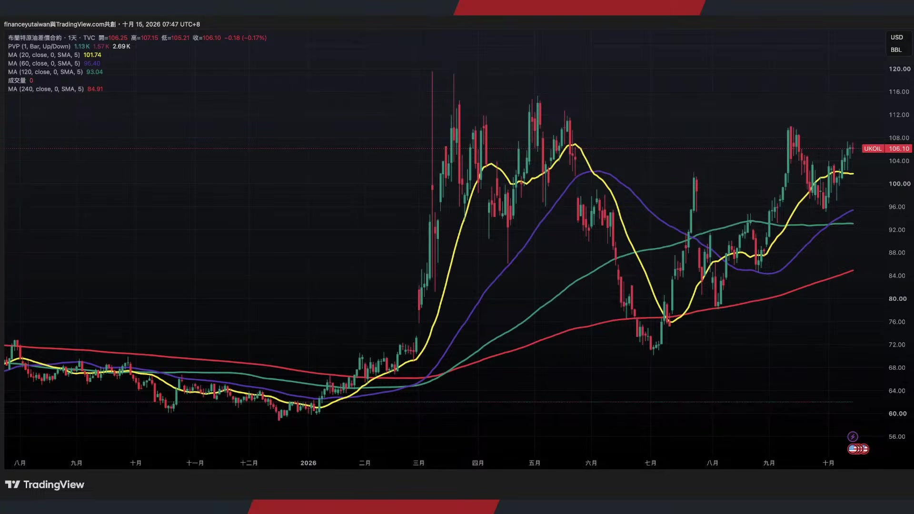

**逐字稿片段：** 現在大概在106塊每桶左右 默默的又上去了 雖然距離歷史高位有一段時間 可是從整條機器來看 從二三月份的伊朗戰事 它仍然在整個戰爭風險的上緣左右 我們看美國這一次的通膨預期 這樣子一路外溢出去以後 第一個就汽油價格 看起來短時間內是下不來了 汽油價格來看 現在大概每桶是4.36塊左右 應該講沒加輪4.36塊 這個位階雖然還是沒有比2022年 當時6月份的最高點5美元來得貴 可是它也比去年比前年比大前年的 10月份都還來得貴了 將過性已經產生

**話題推測：** 顯示中東原油價格最新數字

---

## 00:08:42

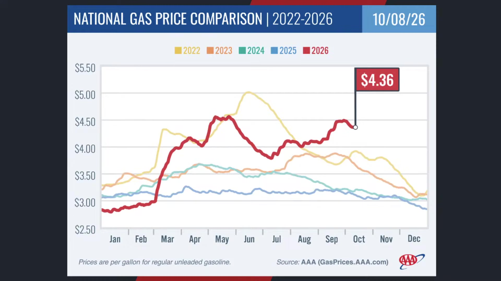

**逐字稿片段：** 再看一下原物料價格目前的反應情況 我們根據數據 現在漲幅比較高的幾個 歐洲天然氣價格從228到現在是漲了172% 取暖油是91% 航空燃油是88% 硫磺上漲85% 柴油上漲6成7 其汽油46% 布蘭特漢希勒德州原油大概上漲47%和42%

**話題推測：** 展示多種原物料價格的漲幅情況

---

## 00:09:04

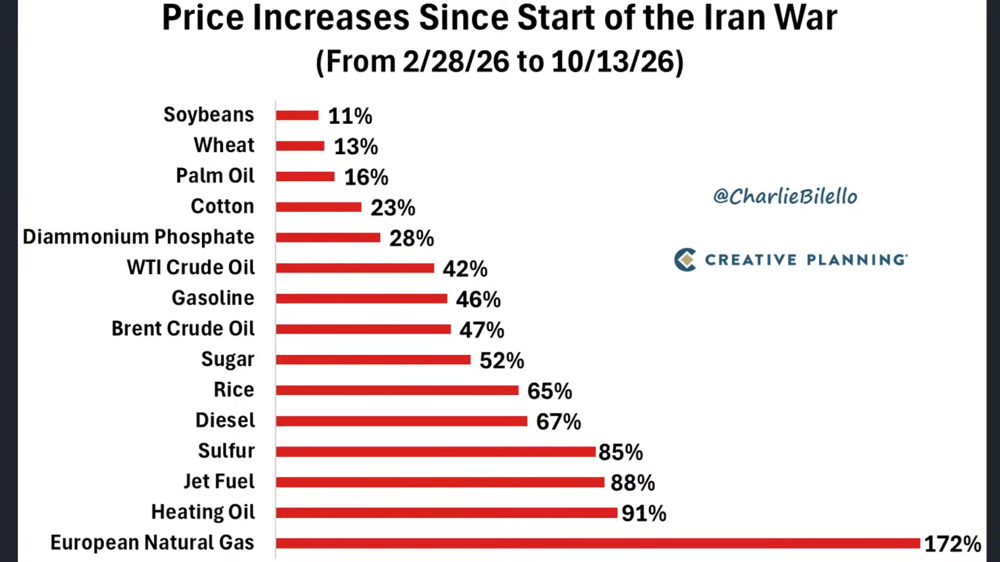

**逐字稿片段：** 其中我們看到農業的上漲 也因為能源漲價而被迫開始跟著走高 像是稻米價格 今年上漲65%了 不要吃米了 糖價上漲52% 那也不要吃糖了 肥料價格上漲28% 那不要吃農作物了 棉花價格上漲23% 那不要穿衣服了 棕櫚油上漲16% 小麥上漲13% 黃豆上漲11% 我們今年的薪資 對於國際即便是發達經濟體 頂多也不過4%到5%的上漲速度 隨隨便便挑出一個原物料 都是目前薪資上漲的 5倍到6倍起跳 你要知道川普在2024年競選時的承諾是什麼 是上任後12到18個月內 把能源和電價降低一半 他可能記錯了 他是增加一倍 不是降低一半 是現在增加一倍 甚至他強調也不會發動戰爭 而是要結束戰爭 結果現在汽油價格 當時它的目標是 每加侖兩美元 現在是多少 現在是4.36塊 所以可能真的是 判斷是對的 只是講錯方向了 本來是要增加一倍的 後來應該講說 本來是要砍一半的 後來發現講錯 是要增加一倍 其實從AI目前資料中心的用電量 它也導致另外一層通膨的外溢效果 我們剛才上面講的 其實都是從能源價格 作為引發的外溢通膨 可是現在有一個外部性因子 就是川普肯定也沒料到今年AI會發展的這麼順利 導致全美的用電需求快速暴增 其實到目前年底來看就有機會 美國的商業用電量將會歷史上第一次超越住宅用電 你在臺灣無感 因為臺灣一直以來工業用電都是佔主流 所以都一直都覺得我們憑什麼漲我們價格 那個都是臺積電都是半導體在用電 所以半導體的用電漲幅是一定要大於住宅用電漲幅的 這可以理解 可是在美國 長年期其實都是住宅用電量保持第一 那預估在今年年底到明年年初 AI資料中心的用電量 短短的這兩年 就要超越全美的住宅用電量了 看起來像是科技革命 其實背後已經慢慢變成能源革命了 那現在形成更大的一個壓力 就是來自於

**話題推測：** 分析稻米、糖等農業產品價格的漲幅

---

## 00:11:16

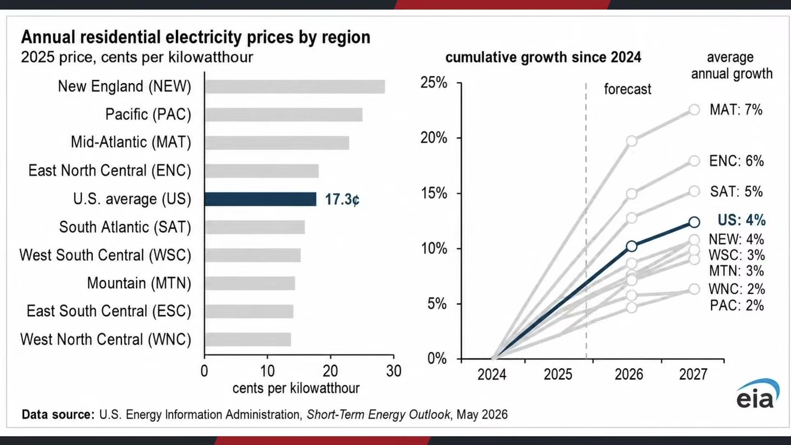

**逐字稿片段：** 今年美國的住宅電價 年增幅平均大概在10.2% 你覺得美國人今年的薪資 有漲到10%左右嗎 不可能的 電價上漲10.2 華盛頓電價是上漲22% New Hampshire 馬里蘭州上漲幅度都是17% 原因是什麼 就是背後一方面老舊電網被迫要大規模升級 另外一方面AI資料中心 電動車 電氣化的設備 都在大幅度的增加現在的用電需求 所以總體來說 目前整個市況在於AI的推波助瀾底下 反而讓通膨預期來得更加高

**話題推測：** 展示美國住宅電價年增幅及各州漲幅

---

## 00:11:52

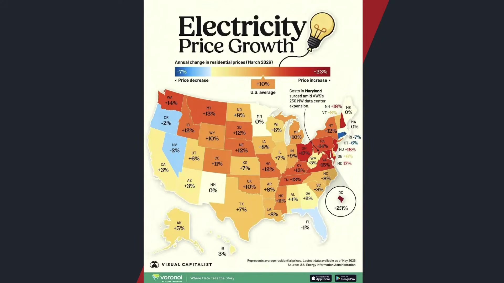

**逐字稿片段：** 現在全球就迎來大用電時代 你看同期時期 我們看2023年 當時其實就已經開始有點往上拉抬了 到2024年 2025年 然後到26年 那幾乎是屬於指數型上升 預估到2030年峰值的時候 我們預估會從800幾瓦 躍升到950幾瓦 所以從這樣的一個角度來看 我們已經正式結束了 過去長達10年的低用電時代 全球在整個24年25年 就已經迎來大用電時代了 北極熊看到這張圖表 都要哭了 所以不管怎麼說

**話題推測：** 說明全球進入大用電時代的趨勢圖

---

## 00:12:26

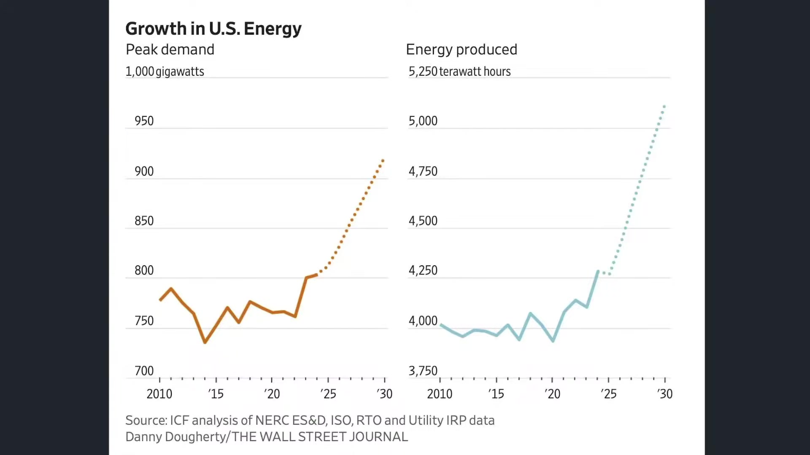

**逐字稿片段：** 現在就形成一些社會的副作用 我們之前就跟投資朋友提到 現在反對AI資料中心新建的人 其實已經大於支持資料中心新建的人 因為電價的副作用 就業也沒有大幅度的貢獻 已經影響到我對於AI的長期信心 現在最主流的一個名詞

**話題推測：** 討論AI資料中心在社會層面造成的副作用

---

## 00:12:44

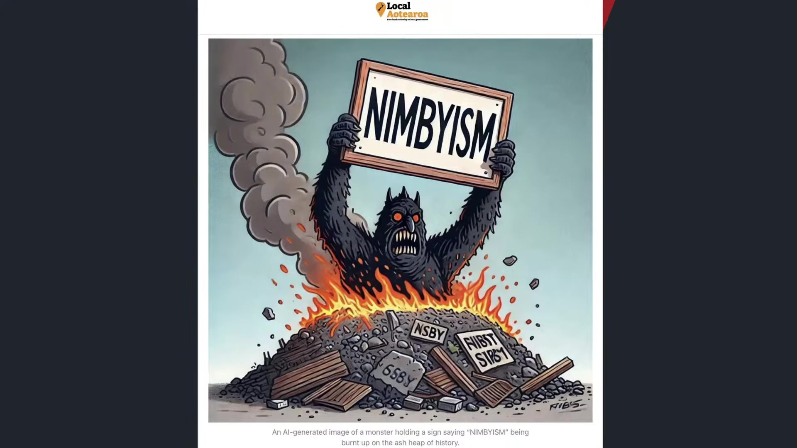

**逐字稿片段：** 叫做NIMBYISM 叫Not in my backyard主義 不要走我後門 不要在我家後院 拒絕AI和資料中心 蓋在自己家附近 所以現在很有趣 一個候選人 一個議員 不管參議中議員 只要宣佈自己的政策 是AI投資資料中心的建制 你馬上就 它是AI派 選民就不投給他了 誰敢說自己支持AI 選民就不投給你 這就很有趣的一個局面 所以我們必須承認 它造成的就業貢獻還不夠多 它造成的投資金額看起來很大 可是背後是用電量的寄生 這個投資朋友多去思考 那第三層講的就是 這一次的AI爆發 除了從能源革命以外

**話題推測：** 解釋NIMBYISM概念及其對AI資料中心建設的影響

---

## 00:13:29

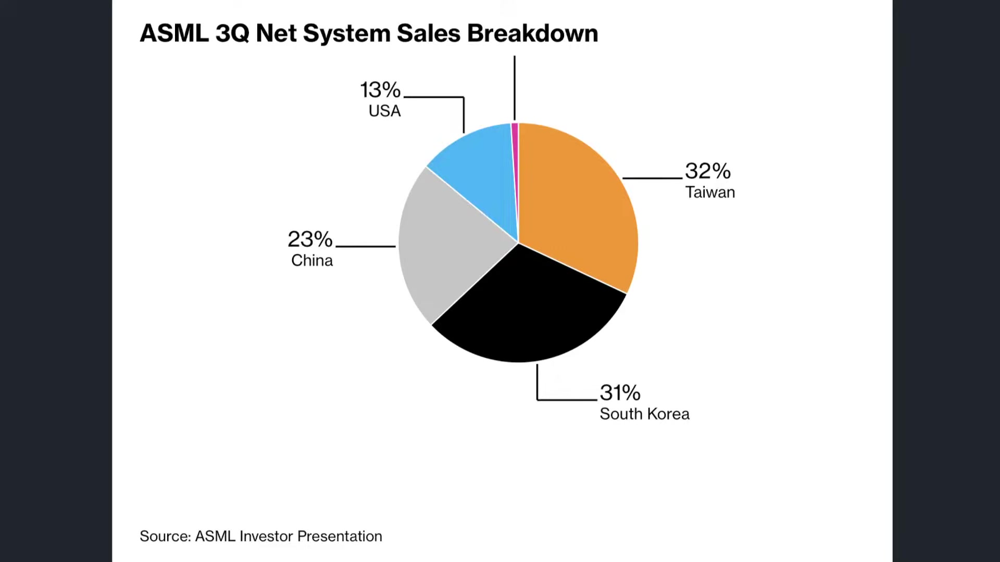

**逐字稿片段：** 它已經外溢到各類型的電子通膨 我們上次看美國的整體 消費性電子當中 電腦價格的PPI 上漲幅度是多少

**話題推測：** 分析AI爆發導致的電子產品生產者物價指數（PPI）上漲

---

## 00:13:38

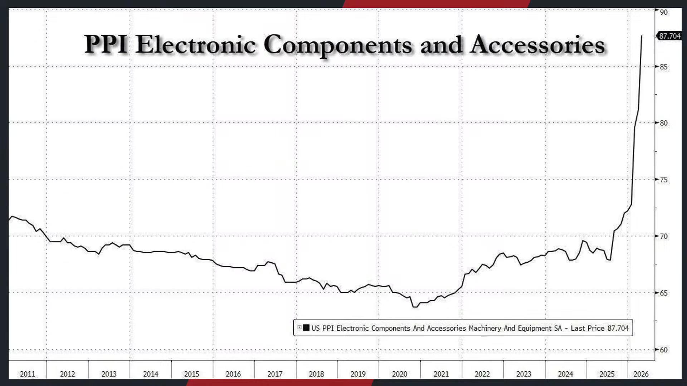

**逐字稿片段：** 整體而言是87% 從3C價格也沒有漲到8成這麼多 漲18%差不多 所以可以觀察得出來 現在有很多其實真實的通膨 是由企業先行吸收 這吸收了 科技巨頭 先吸收了本輪的通膨 我先蓋資料中心 但是我不會因為這些PPI 電腦價格 伺服器產品這麼貴 我就馬上轉嫁給你 所以你看到訂閱費 你用確切BT用GYM 你覺得這兩年有快速的價格調升嗎 也沒有 因為他還在搶市佔率 所以上游端的壓力其實也不小 我們過去跟投資朋友稍微提過 你像現在DRAM價格 整個26年 因為現在接近年底了 從1月份上漲150%到上漲250%到208%到300% 快閃記憶體 NED的部分原本預估上漲100% 現在預估上漲250% ABF載板 今年預估上漲30%到55% 同博基板上漲40% 其他我們看到 像是高階同博上漲5%到10% MLCC就被動上漲5% 一系列的價格全部上漲以後 其實上游端的通膨 它一轉價就完了 他只是現在為了要市佔率 還不敢轉價 但這就是目前在美國 外部性通膨所形成的市場壓力 實體民間其實也是如此 我們看到的都是原物料價格的上漲 農糧價格的上漲 傳到你手上 那個通膨的壓力 轉價效果就很大了 菜價上漲5% 那便當價格往往就漲10%了 那房東也是一樣 明明他的那個電費 或者說可能其他一些修繕成本 就增加5% 可能休散成本增加2000塊而已 它給你漲4000 房東都這樣乾的

**話題推測：** 顯示電腦價格PPI的漲幅數字

---

## 00:15:23

**逐字稿片段：** 所以我們看你像麵包的部分 每磅價格從20年到現在 從1.45美元上漲到1.78美元 漲幅有23% 肌肉價格每磅從1.55塊上漲到2.02塊 上漲三成 咖啡從每磅3.6美元上漲到9.3美元 漲幅是160% 餅乾從3.6美元上漲到5美元 39% 汽油價格上漲126% 從原本的2美元到4.3美元每加侖 所有價格全部都在上漲的情況底下 形成市場的通膨預期持續升溫 那是否代表聯準會必須要被迫表達策略呢

**話題推測：** 展示麵包、雞肉、咖啡等民生消費品價格漲幅

---

## 00:16:01

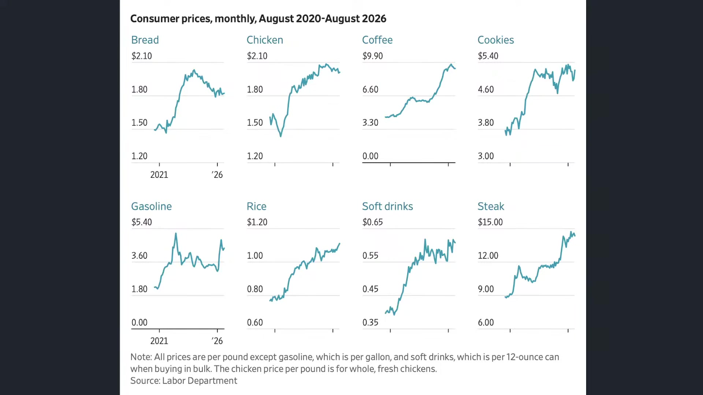

**逐字稿片段：** 如果我們細看聯準會在10月份升息幾率 基本上在陸續提高當中 但是從賭盤來看 看起來有一大批的投資人士對賭 聯準會可能被迫要在10月份提前升息 進行市場表態了 這個就是整個大環境的變遷 當然了 連總會升息 利率升個億 有這麼嚴重 股市要跌成這樣嗎 我們都已經升了這麼多個月 一路的升上來了 其實重點 還是來自於背後的融資循環部分 我們當然知道 現在殖利率越開越高以後 有些企業 它的殖利率 你不開高 你開高好像照理來講 投資人是越來越爽 哇 無風險利率 現在是5%多 我躺著10年20年 就可以賺到這5% 如果買值債的話 就5%已經變成了基本報酬 可是如果告訴你來到6% 有一天現在躺著 你1000萬 每年就領50萬60萬 變成70萬 變成80萬 變成100萬 那你會不會對於這個市場 開始認為有部分企業 肯定還不出這麼高的一個利率 最後使得市場上 針對可能資產負債表 相對而言沒這麼好看的企業 被迫形成高估值賣壓 這個就是現在市場賣壓的主流原因

**話題推測：** 分析聯準會10月份升息機率的變化

---

## 00:17:14

**逐字稿片段：** 好我們看一下 看一下四大指數的賣壓情況 其實三大指數還好 現在真的賣壓最重就在廢半了 道瓊下跌48點 0.09% 說在51621點 標普上漲86點 1.11% 說在7718點 納指下跌511點 1.88% 說在26692點 其實都在高位震盪 你看一下廢半

**話題推測：** 更新美國四大指數的盤勢與賣壓情況

---

## 00:17:36

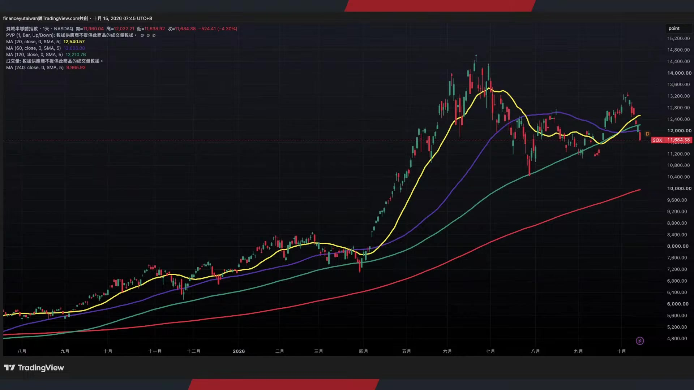

**逐字稿片段：** 廢半這個就有點難了 之前我們講說成功的打第一隻腳 然後又成功的打第二隻腳 現在傳說中第三隻腳要出現了 每個男人都自豪自己有第三隻腳 希望不要出現了 因為這樣子的話 那就有點快要end頭的味道了 可是從肺瓣來看 它的本益比估值也不是特別高 總共下跌了4.3% 報在11,684點左右 從這樣的一個角度來做思考 你就有兩種邏輯 一種就是線形是不好看 因為突然之間它又跌破月線 極限半年線了 可是另外一方面 三大指數表現還可以 說明沒有系統性的踩踏 那重點來自於 那你要回過頭看 那它的本益比 我剛才稍微看了一下 應該已經差不多 跟新冠疫情爆發時 差不多的位階了 所以要麼就是 對於AI真的有非常極大的不信任 要不然從週期角度而言 看起來會對於很多人來說 有吸引力 那臺北股市都是一堆純股主 你大概可以料想得到 對於臺股如果形成 這種劇烈性賣壓 大家會怎麼做 唯一的問題就是 臺股沒有像費辦跌那麼深 這個是唯一的問題而已

**話題推測：** 詳細解讀費半指數走勢與技術線型

---

## 00:18:46

**逐字稿片段：** 昨天我們看半導體 AMD跌了5.7% 博通跌了3.1% 輝達3.16% 印財跌了3.7% 臺積電ADR是重挫3.4% 可是它還是從高位讓下來 所以我們後續要觀察 因為股票市場的波動 它往往有時候都是一些 情緒化的數據或者決策 真正穩健的投資人 你還是要保持冷靜 本來這兩週就是高乖離 我們都已經反彈這麼多了 那當市場大跌 如果你盲目的只是學會拋售 你只是在恐慌當中去鎖定虧損而已 相反的如果市場大漲時 你永遠都是加槓桿買進 也容易在高位追價 忽略了風險和估值 上一次股價津津漲 四代五代六代同堂時 我們告訴大家 槓桿是拿來超車用的 不是拿來飆車用的 那現在要回過頭來看 當市場上極度悲觀 認為這場風暴即將展現之前 以前我覺得對於未來還是要有信心 針對估值的高低來採取行動 其實就可以了 這個股票市場暴跌時 你不會亂賣股票 那股票暴漲時 你也不要一窩蜂的只願意買股票 你要有自己的投資中心邏輯 投資不是每一刻都要出手 市場也不是所有機會都值得追逐 你要有自己的投資的中心思維 如果你現在知道 早就知道該怎麼做了 那就是對的 如果你現在還不知道該怎麼做 那說明這幾個月 你好像也沒有建立起 自己的一套投資擇選 你要懂得篩選 懂得等待 在必要時懂得拒絕 才能夠讓資產長期增值 有它的關鍵性 那句話怎麼講 別在愛時找不愛的證據 在不愛時找愛過的痕跡 投資最忌諱就是你擔心 漲了你擔心買不夠 別人你又擔心 你又不敢買 對我對感情也是略懂 平時我也是看很多 一些愛情片 動作類型的 好那不管怎麼說 我們回過頭說 為什麼這樣講 因為費辦它背後所隱含的獲利動能 它比三大指數都還來得強 所以當它股價重挫 它的本益比的回調幅度 其實是比納指和標普 比道瓊還要大得非常多的 我們把費辦的好兄弟臺股拿過來看 INF在昨天公佈了全球世界經濟展望 2026年在整個臺灣的經濟成長 預估已經上修到10.7% 這不僅是高於全球平均 也是整個亞太市場成長最快的經濟體 從這樣的一個角度來看 代表著臺灣的出口外匯真的很強 財政部最近也公佈了

**話題推測：** 列舉AMD、博通、輝達、台積電ADR等半導體個股跌幅

---

## 00:21:17

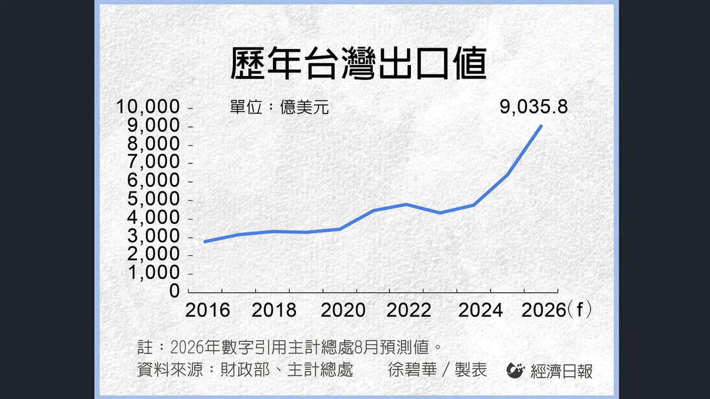

**逐字稿片段：** 在9月份的出口是872億 歷史單月新高 累計前三季的出口是6615億 財政部這次還特別表態 的確過去的經驗限制了我們的想象力 財政部今年也沒有預估到會這麼高 全年出口突破9000億美元 原本預估是難度很高了 那現在看起來突破變成了 原本的保守預估值了 我們看看有沒有機會挑戰 9100億 9200億 整體來說這一波出口爆發的核心 就是來自於AI的基建潮 那我們當然知道 利率越高會影響到 這些基建潮的投資速度 可是它也有傳導時間的 從科技巨頭 是否決定要放緩 27年的投資步調 到整個非半的接單量 那現在非半的接單量 並不是說你拿到訂單 就要生產 因為中間有一段時間 因為產能是蠻窄的 所以總體而言 對EPS的飽和程度 應該還是可以維持 幾個季度的時間 除此之外 臺灣在9月份 從南韓進口了116億 年增幅82% 這個事情都說明著 這個附加價值 漲價槽的拉高 對於本身廢辦的價格 有多大拉伸 所以背後的基本面 我個人認為 它其實是相當之堅挺的 就跟我一樣 那當然 當然投資最忌諱的就是這樣子 你不要因為一個消息 可是通膨很危險 可是臺股獲利很好 那該怎麼辦 你就是要掌握住 你最在乎的那幾個指標 對我們來講 這個通膨的拉昇 利率的升高 它都是孤磁回調的理由 但它不是泡沫破滅的風險 那你對於長線 你就有了一個 一定程度的樂觀情緒了 那在短線上的時候 難道我也要追高嗎 也不是 那你可以根據乖離回調 根據不同指標來參考借鑑 投資最忌諱的那幾件事 不畏反而翻來覆去 空手觀望也不敢進場 不熟的股票天天追高 熟悉的股票又下不了手 原來那句話怎麼講呢 窮的沒辦法做壞事 熟的沒辦法做情侶 餓的不知道吃什麼 困的就是睡不著 大的放不太進去 小的又沒有什麼感覺 想死又沒有勇氣 想活又很不爭氣 就你總不能說什麼都想要 但是都不敢下手 如果你真的覺得 AI其實充滿著極大泡沫 其實現在從職債角度而言 給你保本5%的利率預期 其實也不錯了 這個投資朋友做一些參考 你說那臺灣這個數據這麼好 那是不是完全沒有利空 我個人的看法是 真的短期內從互利層面 沒有任何的利空 唯一市場上的壓力 可能來自於哪裡 來自於外部性的一些 外資型的賣壓 就臺灣的ETF買盤 它是確認的 外資可不可能 因為臺海的局勢做一些調節 有沒有可能因為臺灣的情況 從外部角度而言 要做一些適度的資金輪替 這是有可能的 我們看在昨天

**話題推測：** 公布台灣9月份出口金額及歷史新高數據

---

## 00:24:06

**逐字稿片段：** 市場上最為關注的一條新聞 就是川普在阿拉斯加的造勢宣稱 臺灣已經同意投資1415億美元 參加阿拉斯加的天然氣開發計劃 而且承諾未來20年 會購買天然氣管線產量的30% 認為這是一個重大的突破 那這就說明著 因為我們知道 去年川普為什麼發動 對於臺灣的貿易戰 其實他對全球都發動了 但臺灣當時稅率特別高 為什麼 因為臺灣的順差特別高 那你仔細想一想 現在出口900億 今年順差肯定是比去年高 所以必須承認 美方對於臺灣 要求更多的投資和施壓 它肯定是在檯面上的 雖然還有兩年時間 也許川普就走人了 那到時候 也不一定是共和黨繼續執政 但這個就是未來 臺美持續談判過程當中 重要的課題 我們看一下稍早之前的談話 這就是一擇一洗 一擇一憂 為什麼他要對臺灣客觀水 為什麼要求更多的投資額 為什麼談判仍然在秩序當中 就臺灣賺太多錢 如果臺灣賺不多錢 貿易順差就降低了 它也可能不會有相對性的要求 它就會找其他順差高的 這些沒辦法的事情 不過它回過頭來說 其實也說明著 臺灣的通膨壓力 在經濟成長率10%的情況底下 也不可能太低 最新臺灣在9月份的通膨 跟美國一樣 都有開始高於預期的空間 這次年增幅是2.73 比8月份大幅增加了0.68個百分點 連續5個月超過2% 所以你也知道 我們過去對於央行 總感覺有一點借鏡 或者說對於央行 在本次理監事會議所採取的做法 有點意外的原因是什麼 那個通膨很明顯就是在狂飆 在今年年初才0.71 現在2.73 按照目前電價油價的補貼 如果未來放鬆 再加上市場的價格轉移 輸入性通膨 包括我們也知道 在第三季 好雨造成的蔬菜價格大漲 你要說採取預防性升息 都不為過

**話題推測：** 提及川普關於台灣在阿拉斯加天然氣投資的言論

---

## 00:27:01

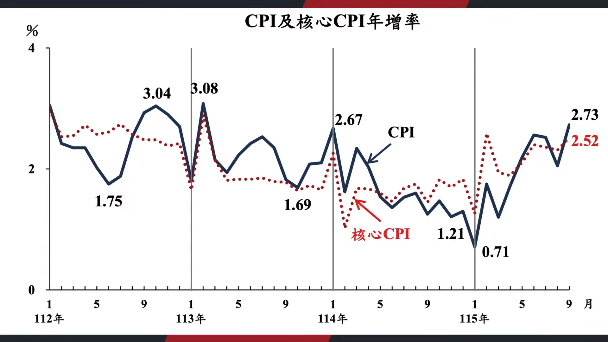

**逐字稿片段：** 結果歐洲央行、日本央行、全球央行都在升息 結果現在臺灣通膨已經2.73%了 外食費漲幅現在也在快速的做拉昇當中 當然從公允角度而言 因為排在臺灣CPI前面 像美國、歐元區、南韓都升了 即便通膨比臺灣低的日本 其實目前進入到升息環節 所以是否意味著在第四季 也許央行就要採取被迫的一些表態 這個是很重要的

**話題推測：** 比較全球主要央行的升息狀況

---

## 00:27:28

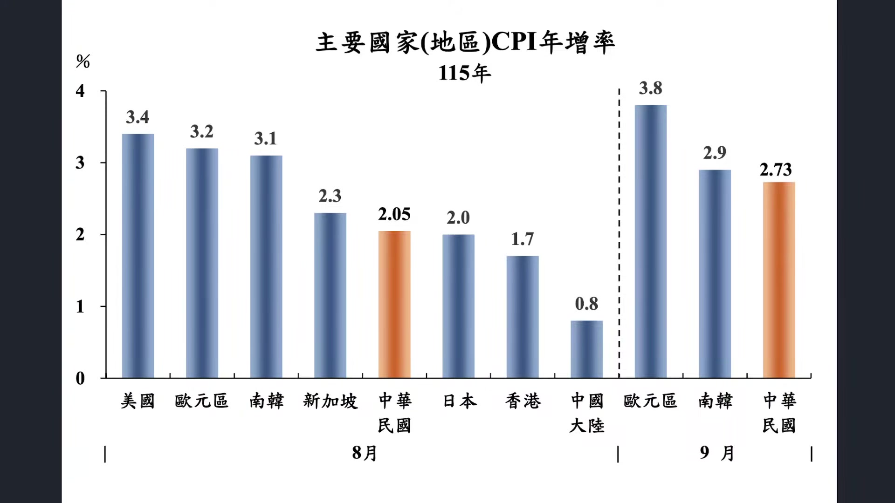

**逐字稿片段：** 其實臺灣的PPI更恐怖了 我們看整個9月份的臺灣和南韓電腦伺服器整體價格 年增幅現在CPI在電腦價格層面 大概是來到20%到24%左右 這跟過去20年電腦價格越來越便宜的長期趨勢 已經形成了重大的反差 09年到11年電腦價格甚至一度下跌15% 那我們為什麼講說通膨在臺灣也許有可能被嚴重的低估 我們看這禮拜 原油價格

**話題推測：** 討論台灣電腦伺服器相關的生產者物價指數（PPI）漲幅

---

## 00:27:57

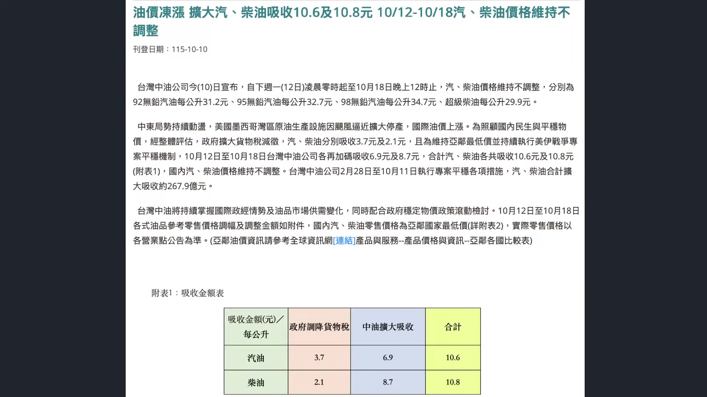

**逐字稿片段：** 現在中油宣佈 當時在4月份的油價平穩措施之後 到現在還在補貼 3到6月份成本是暴增了1760億 中油現在每公升 汽油是吸收6.8塊 柴油吸收8.8塊 相當於可能95汽油原本達到40.7塊 柴油價格應該像39塊 中油大概都犧牲了 至少有一成五到兩成以上的價格漲幅 所以這個吸收幅度是很大的 為的是什麼 就是為了要意志通膨 臺灣現在原油價格的確很明顯

**話題推測：** 說明中油的油價平穩措施與補貼成本

---

## 00:28:33

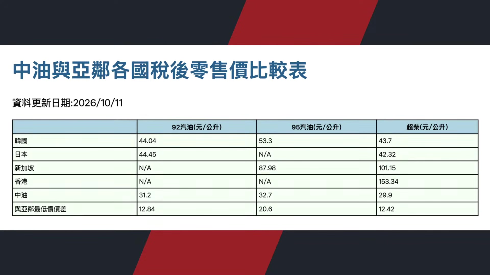

**逐字稿片段：** 比亞洲鄰近國家還要低非常多 925千汽油每公升31.2塊 這比韓國便宜了12塊 比日本便宜了13塊 95千汽油 現在臺灣每公升大概32塊左右 比韓國便宜了20塊 比新加坡便宜了55塊 柴油層面臺灣每公升29.9塊 比日本便宜了12塊 比韓國便宜了13塊 跟香港高達153塊相比 價差已經超過120塊了 這高強度補貼 第一個是油價補貼 第二個是電價 我們知道在上一次 10月份的電價審議委員會 宣佈繼續動漲 本來預估如果要反映損益量品 臺電至少電價要漲12%了 但這一次決定 那12月再說 所以第三次的電議審議委員會 到時候連同輸配電費率 到時候再做一起討論 目的是什麼 就是體恤民間壓力 能不漲就不要漲 那這不是很變相性的壓低通膨 那也其實也沒有說不好 重點是 那如果你一次轉嫁 那通膨上升就很恐怖了 我們總要有點預防性升息的空間 很多人當然會想說 那選後轉嫁那很恐怖 不過必須承認 我對中央政府的瞭解 這個動長 它似乎也不是因為單純一場選舉 你選完之後 你後面還有大選 選不完的 我感覺態度是這樣 只要我還活著的一天 我能夠補貼就儘量補貼 那如果偶爾沒有戰爭的話 那適度轉嫁可以考慮 只要戰爭沒結束 我就儘量能補就補 其實從蔡政府的論調到現在 大概就是能不漲就不漲 如果全球東膨壓力不大的時候 還可以考慮轉嫁 那現在每一問題 打到天荒地老 我猜中東問題不結束 他搞不好就一直補下去 這幾年中央政府護盤的決心 其實都蠻強 你看國安基金護盤 它是因為關稅戰爆發 他護到什麼時候 他真的護到關稅談判結束 他不是用股價的創高來決定 是否要退場 他是真的護到你談判結束 確認了再說 那每次大家都以為清安政策 這次應該差不多要退場了吧 沒有他做個調整繼續 只要有年輕人想買房 你永遠都可以找到你的補貼 這的確就比較偏向 大政府的態度 那臺灣政府一直以來的論調也是如此 因為我跟總統也很熟 你看這兩年 從AI十大建設到國家隊 產業補助減稅 到租補新清安 育嬰宅 兒童補貼 那看起來臺灣人就是很傾向 由政府來承擔更多責任 那我就儘量採取更多的介入 這個市場派跟那種介入派 雖然我們好像是海耶克 但是要不要轉嫁 真的很難說 也許從投資人的角度而言 適度轉嫁是有其必要的 讓購買力提升 你只要薪資漲盈通 我們就沒問題 可是對於一般人而言 也許真的是能不漲就不漲 對我跟川普也很熟了 好那903分

**話題推測：** 比較台灣與亞洲鄰近國家汽柴油價格差異

---

## 00:31:20

**逐字稿片段：** 臺股是下跌1161點 是在47647點左右 那就2000點下來了 所以某種程度而言 乖離的下球看起來也逐步產生 雖然未接臺股還是很高 相對於廢半 不過我們今天從美國通膨數據 從臺灣通膨數據都看得出來 那個輸入型通膨是非常強烈的 那原本擔憂的能源通膨 它的確已經外溢到食品通膨 等所有的原物料價格 那原物料價格上漲以後 現在最困難是什麼 也還有原物料價格 很多時候是上半年上漲 下半年就跌回去了 現在怕的是服務價格 已經跌不下去了 甚至開始往上拐頭了 服務價格是誰 就是我們的薪資 看起來形成僵固性 就是企業看起來 不得不開始反映更多的成本 在實體的終端下游產業鏈 這個是市場上最大壓力的部分 那唯一能夠抵抗得過 這樣的一個方式 一種就聯準會採取動作 讓你停止有囤貨心態 讓市場的投資預期能夠因此下滑 不投資就不買記憶體了 這是一種方式 第二種 AI賺更快一點 生產力提升 或者像臺灣專攻半導體 我的股價漲幅是遠遠超過我通膨的 我的體感相對壓力就不會這麼大了 臺灣現在實質薪資是翻證的 可是美國已經連續六個月翻付了 這給投資朋友做些思考 如果喜歡我們節目 記得幫我們訂閱按贊加分享 我們就明天早上半點半 早晨財經速寫讀 再相見 祝各位投資朋友 看完順利 操盤愉快

**話題推測：** 報告台灣股市最新點位和下跌幅度

---
