# yutinghaofinance_WScGZDz5Kno — 關鍵畫面索引

- 來源逐字稿：[yutinghaofinance_WScGZDz5Kno_GT.srt](yutinghaofinance_WScGZDz5Kno_GT.srt)
- 影片：https://www.youtube.com/watch?v=WScGZDz5Kno
- 截圖數：24

## 00:00:24

**逐字稿片段：** 現在是臺北時間2026年10月28號禮拜三 早上8:31 大家早 我是游庭皓 每天早上開盤前半小時 我們在這邊陪伴著各位一起 解讀國際財經新聞時事變化 這一次國際油價開始下跌了 美國股市在Anthropic IPO行情熱燒底下 費半算是大漲了3.6% 不過呢反而是因為波音 好這一次我們看到受到十分大的承壓 道瓊又壓回去了 資金還在不斷的輪動 我們真正要觀察的重點呢 其實是因為重點都在明天後天 一個是FOMC利率決策會議已經召開 另外一方面 我們也清楚知道 在微軟Google亞馬遜 財報公佈之後 市場會針對當前的資本 支出採取新一輪的定價 所以現在這兩天沒什麼事情呢 可是禮拜三禮拜四才是重要的決戰 市場的反應倒是蠻提前的

**話題推測：** 顯示今日日期與時間

---

## 00:01:14

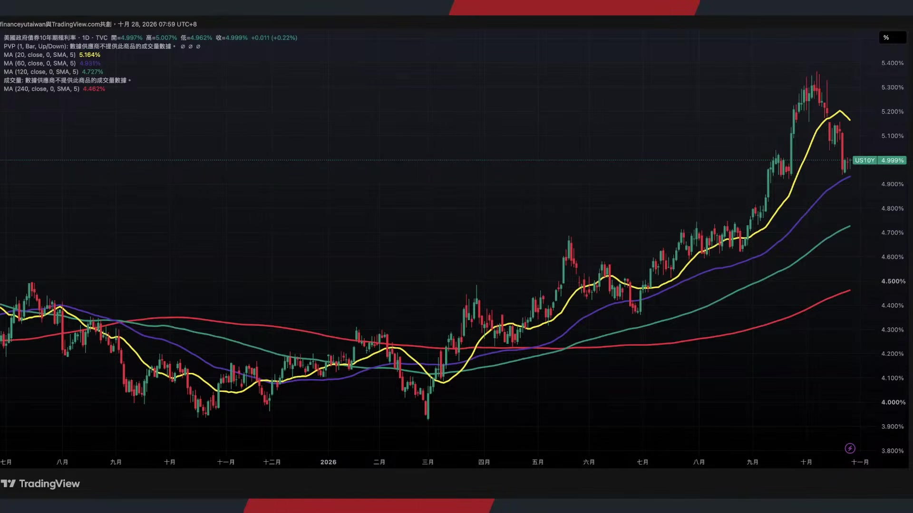

**逐字稿片段：** 我們從美國10年期公債殖利率來看 這一次回漲速度也很快 一度碰到4.99% 算是跌破了5% 如果一路的向下 那幾乎可以說明 接下來FOMC不太可能會有升息的可能性 現在按照fed watch的預估 保持在當前基準利率3.75- 4%的可能性是高達93.4% 也就代表著 如果這一次熬過了10月份不升息 你要知道兩個月前 應該講說兩個禮拜之前 大家還認為升息是板上釘釘呢 現在不升息以後 能否為市場帶來更多的流動性預期 這要做做一些觀察 因為現在只是實際利率回檔 不代表通膨問題 不代表市場要求的風險 貼水已經徹底消失 感謝碧蓮的300塊 對 我們是直播 很多人一直懷疑我們是錄播 其實我們都是直播 那有時候因為我們要 講的題材內容比較多 來不及跟網友互動 我是左眼盯著聊天室 右眼看一下簡報 然後偶爾還要看一下 現在講話的速度夠不夠 追得上目前今天要講的內容了 所以很感謝大家 但是你有抖內我就 馬上停下來好不好 哎不行不行 這樣子會打亂我的步調 好我們先把該聊的聊完了 剛才聊到說現在市場上 大概就只有兩個焦點 一個是FOMC 另外一個是財報

**話題推測：** 討論美國10年期公債殖利率，顯示殖利率走勢圖

---

## 00:02:36

**逐字稿片段：** 另外一個中期因素 以一個禮拜為時長來看的 就是中期選舉的 倒數衝刺了 我們知道川普在前陣子哦 為了讓10年 期公債殖利率能夠有效的回檔 降低大家的升息預期 在10月9號就已經跟俄羅斯 總統普京達成了協定

**話題推測：** 轉向美國中期選舉議題，顯示選舉相關圖表

---

## 00:02:54

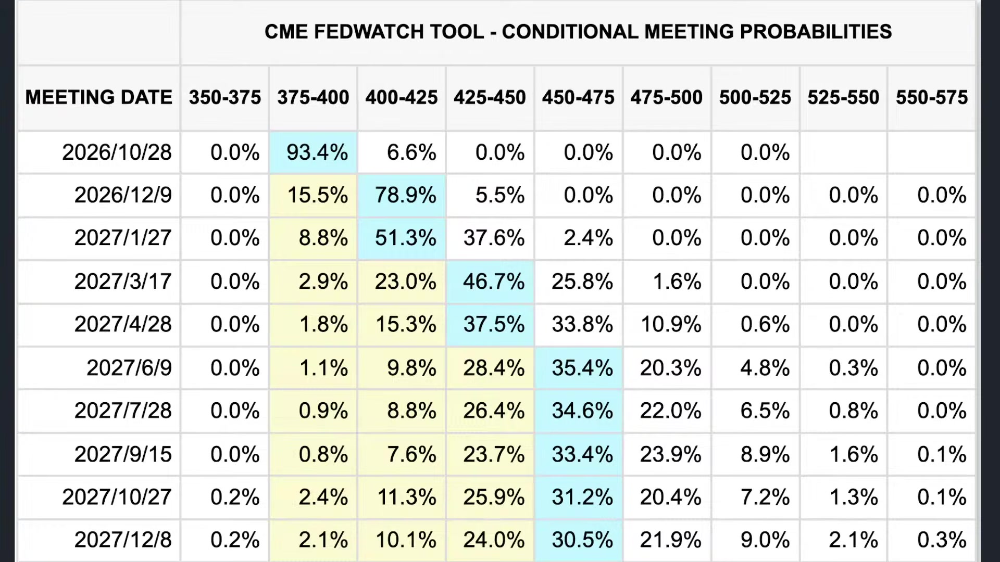

**逐字稿片段：** 暫時豁免部分俄羅斯柴油的進口限制 讓美國從22年烏俄戰事爆發之後 第一次讓俄羅斯的柴油進入到市場 這其實是國會有很多共和黨 議員是抱持著相當反對的 共和黨也有很多的建制派 對於俄羅斯是採取鷹派態度的 那川普做這樣的一個決定很明顯 是為了對於中期選舉能夠 採取有效的通膨一致 通膨是來不及回來的了 但是至少在油價 能不能嘗試的做一些壓制 或者在升息預期 或者讓股票市場在財富 效應能夠進一步的升高

**話題推測：** 討論俄羅斯柴油進口，顯示地圖或油輪相關畫面

---

## 00:03:28

**逐字稿片段：** 現在已經有3艘載運俄羅斯 柴油的油輪正在駛向美國 總運量大概是14萬噸左右 預估在11月初左右會陸續抵達 當然了川普的政策這一次引發的 國會反彈力量越來越大了 很多共和黨人士都警告 進口俄羅斯柴油可能 直接涉及了違反制裁法律 協助交易的銀行港口 或者燃料的經銷商 很有可能在事後會遭到國會的調查 甚至有民事和刑事的責任呢 那總統雖然現在有權 可以發放臨時的豁免許可 可是呢部分油輪呢 英國的制裁還在 歐盟的制裁 加拿大的制裁都還有可能存在 這代表著跨國金融和航運業者 很有可能到時候會陷入到法律風險 你只是把這一些航運商推向虎口而已 這是很多共和黨議員的喊話 但至少可以看得出來 川普對於中期選舉 還是有最後一絲希望 盡可能的讓市場的通膨預期 原油價格能夠嘗試的壓低哦可是呢 美國10年期公債殖利率這一次的滑落 是否代表著會一路向下 我認為這就不一定了 因為剛才從非農數據來看 它其實升息預期沒消失 它只是從10月28號那一次的 升息預期延到了12月9號 還是有升息一碼的空間 這其實就說明著 現在我們對於利率預期的看法 一大部分當然來自於通膨的變化 可是另外一部分呢 感覺市場針對 公債殖利率要求的風險貼水 一直以來都還是很偏高的

**話題推測：** 提及俄羅斯柴油油輪駛向美國的數量與運量，顯示油輪照片或運輸路線圖

---

## 00:04:57

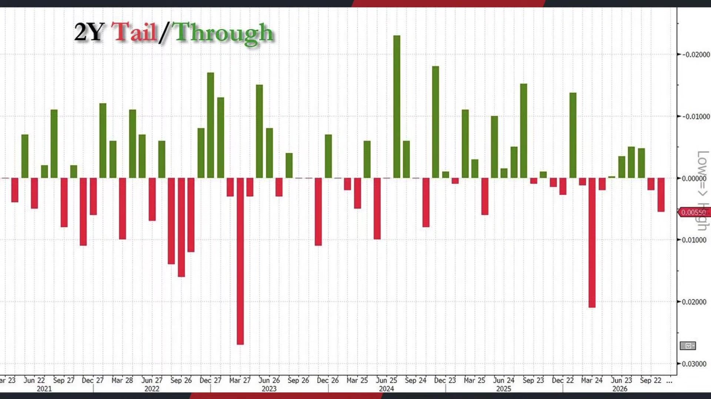

**逐字稿片段：** 舉例來說 昨天美國財政部標售了 690億美元的2年期公債 想說短天期的公債應該蠻好標的吧 畢竟2年就到期啦 你不用承擔過多的時間風險 最終得標殖利率是4.708% 好雖然比9月份的4.787來得低一點點 不過呢還是比標售前市場預期的 4.705%高出了0.3個基點 什麼意思 賣的比想像中還要來得差了 最值得注意的事情是 間接投標者的比重 從9月份的57.8 大幅下滑到45.7% 單月減少了12個百分點 這是2011年以來的最低 我們講的間接投標者 講的就是比如說海外的一些大央行啦 日本央行臺灣央行有時候會去標售嘛 那國際機構或者一些透過 仲介機構參與的投資人 這說明的是什麼 海外的人現在不是很想接美債 即便是央行 好所以現在如果在發行端 那個承接美債意願的也不是特別高 在科技端又還在瘋狂 的發行投資等級債 在通膨端 現在原油價格只是回檔 也沒有真正的暴跌 那其實三大壓力 都把整個利率預期 維持在緊繃 那最後形成的效果就是 錢還是非常昂貴的最後呢 大家在不斷的推波助瀾底下 被迫形成利率 回檔是回檔 但回檔幅度其實是有限的

**話題推測：** 討論美國財政部標售公債結果，顯示公債標售數據表

---

## 00:06:21

**逐字稿片段：** 好這也讓美國的其中選舉 其實在過去半年陷入真正的苦戰 一個就是在實質購買力的衰退 由於利率預期提升速度太快 直接把市場很多的 車貸信貸陷入到急凍 那另外一方面 通膨預期的確因為美 疫戰事正在升溫嘛 購買力衰退壓力就來得更大了 我們從26年期中選舉 現在最後一周嘛 在過去一段時間 24年 當時川普在德州 或者說在部分區域 都是以雙位元數字 贏得選舉的

**話題推測：** 深入分析美國中期選舉形勢，顯示眾議院與參議院席次分布圖

---

## 00:06:53

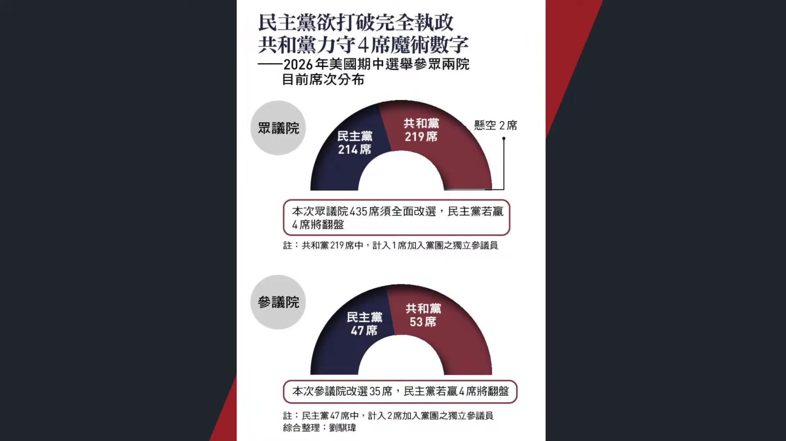

**逐字稿片段：** 不過這一次在各大民調當中 即便是德州 大概總體支持率也不過37-38%而已 共和黨目前在眾議院有219席 民主黨有214席 其中有兩席是懸缺 那參議院是53席對47席 如果民主黨能夠在眾議院增加個4席 就有機會完全的翻多 那參議院則需要淨增加4席 那看起來眾議院有非常高的機率 民主黨是會拿下來 參議院如果也順勢拿下來 那的確川普接下來 進入到普角總統可能性就特別高了 其中最大的一個轉淚點呢 市場正在進行民調研究分析 主要還是來自於年輕男性的選民呢 而如果是細看 在板塊挪移當中 從9月底到10月中旬所公佈的民調 18歲到30歲確定會投票的男性當中 有5%7的 男孩子傾向支持民主黨國會候選人 40%支持共和黨 只有1/3的受訪者表示 自己具有極高投票意願 說明也是有救的就是 不出來投票就好了 因為現在年輕男生呢 以前都是投川普投川普嘛 女生不用講 女生大部分偏民主黨比較多 這比較明顯一點 那男生以前投川普 對make America great again這樣子 但是這一次過了兩年 那發現荷包好像沒漲 而且好像過得更痛苦了 可是 因為男生都很自大嘛 他覺得我之前做的決定 我也不想要否認 我是做錯的 那算了 我不投票了 所以也許低投票率 也能夠挽救川普的一些情勢 但至少年輕男性選民的喪失是 目前川普民調大幅 鬆動的一個重要原因

**話題推測：** 展示中期選舉民調數據，顯示德州等區域支持率

---

## 00:08:32

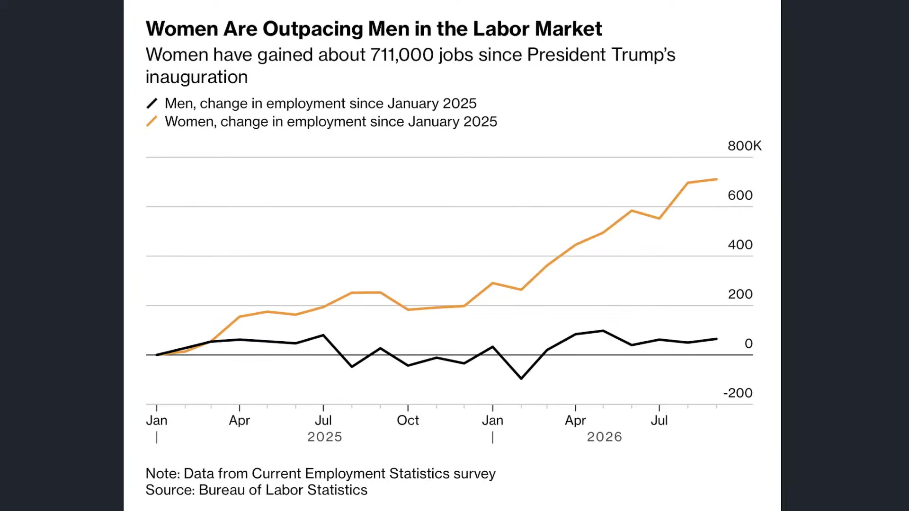

**逐字稿片段：** 其實從川普第二任任期以來 我們知道川普對於藍領工人 所採取的刺激政策非常多 可是第二任任期以來 美國女性就業人口是增加了70萬人 男性呢 6萬人 哦這個差了接近有10倍左右 所以那些製造業 採礦業 運輸倉儲 一些男性就業比重比較高的產業 還在繼續流失工作 而我們看到女性 一方面當然是以前是基期低嘛 所以增長比較快 另外一方面 美國的女性現在的經濟獨立自主權 其實也比男性增長速度還要快 非常多好 所以最後就形成這種僵化的一個效果 那之前還有那個Maga還有 dei政策的問題 讓很多年輕男性呢 會支持川普 但現在口袋沒錢了 你還會不會繼續支持下去呢 值得多做一些觀察 好所以這一次市場上 很多我們講叫做黑藥文化 這個黑藥文化就是很多年輕男性呢 他不再相信政治制度能夠解決問題 選擇不投票 不參與公共事務 那過去曾經支持川普的 一些男性的社群主持人 比如說之前的塔克卡爾森 之前他就因為那個伊朗戰爭 外交政策嘛 逐漸跟川普產生分歧 那共和黨雖然會透過 男性族群喜愛的Podcast 體育運動來爭取支持不過呢 看起來市場上更在乎 的是房屋負擔的問題 生活費的問題 那回過頭說 另外一部分形成擴散的 是金融時報所做的專題 是關於市場的利益衝突問題 這個是金融時報所做的 在10月中旬的最新民調 有69%的登記選民 憂心川普政府可能有貪腐問題好 他是主要針對川普的 廉政問題來做追蹤 包括圖利自身或者利益衝突 基本上91%的民主黨的 支持者認為川普肯定有貪污 只是還沒抓到 只有6%不擔心 共和黨呢 即便是內部支持者 也有44%是表達憂心的 50%表達不擔心的 說明就算是共和黨支持者 都有一半都知道 你肯定有做了什麼事情 就不管是股票的操作 訊息的釋放 但是呢 我還是願意投給你 大概是這樣子 所以從這樣的一個角度來看 對於川普所面對的信任危機 的確已經慢慢擴散到無 黨派選民或者不同的族群了 那另外一方面 當然現在最大的政治壓力 還是屬於經濟層面 現在36%的選民呢 是認可川普的經濟政策表現 其中最不滿意的當然 是通膨和生活成本 64%的選民是表達不反意 不不滿意 只有24%是表達支持 就業和經濟政策也高達57%是不滿意的 所以從不同角度來做觀察 都可以說明著 不管是在就業形勢 不管是在實質工作層面呢 能夠提供對於選民的 拉抬都是非常有限的 那川本能夠做什麼事情呢 第一個嘛 那盡可能讓購買力提升嘛 那進口俄羅斯柴油 壓低一下通膨 壓低一下油價嘛 那再來呢 雖然 口號上就業並沒有造成顯著拉台 可是投資額的增長是真的 爭取一下經濟選民 那經濟選民最在乎的是什麼 股票要繼續上漲嘛 當然了 股票上漲大多數人都 歸咎于自己的精明的投資能力 也不一定會把他視為政府的政績嘛 要不然的話 那全球股市漲最多的 好像大家都投票給他 好像也不說不通嘛

**話題推測：** 比較川普任期內美國男女就業人口變化，顯示相關統計圖

---

## 00:11:55

**逐字稿片段：** 主要還是有k型分化的問題 因為這幾周是選前倒數 我們會聊比較多民調的數據了 很多人經常問我支持誰 這還用說嗎 我一定是支持2026最強的候選人 支持值得信賴 還有可以承擔重任的人 好不好 我一定是會做好做滿 因為我們都坐著直播嘛 那不管怎麼說 現在市場上更進一步觀察到是 市場上對於利率預期的擴散 能不能在全球市場稍微緩下來 為什麼這樣講呢 因為就算是美國公債殖利率不創高了 那法國的問題呢 有沒有緩解的跡象 其實法國也有哦 過呢它也不過回到4.9%左右 整體10年期公債殖利率 還是屬於偏高水位

**話題推測：** 提及K型分化現象，顯示K型經濟復甦圖示

---

## 00:12:42

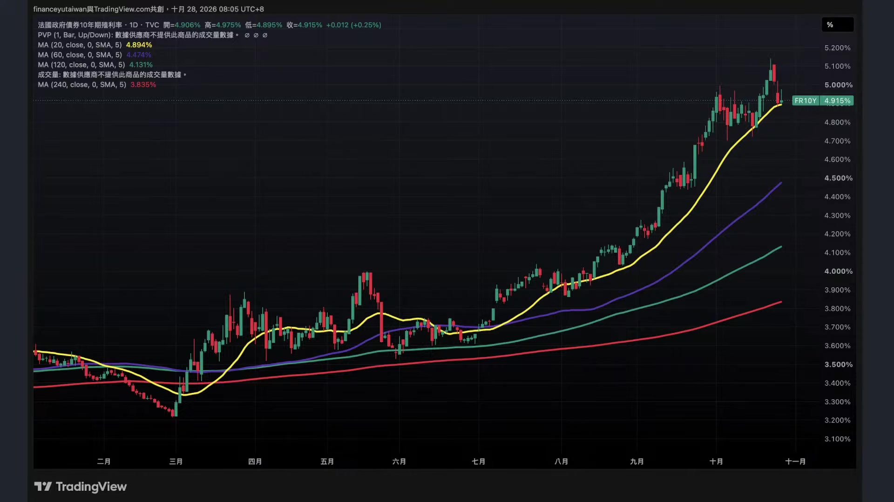

**逐字稿片段：** 整個25年法國財政赤字占 國內生產毛額大概是5.1% 已經變成歐洲第二高嘍 26年明年預估要增長到5.4%了 好說明呢好 這個已經不是單純市場的拋售問題了 更進一步影響的 其實是針對國債的償還能力 法國政府最近已經 提出了27年的預算案 計畫會透過削減支出和增加 稅收來改善財政430億歐元 不過現在執政黨在 國會是缺乏多數席次 明年搞不好勒龐就會上臺 可能會採取更進一步劇烈的改革 那造成在法國財政層面呢 進一步的衝擊 這個改革是好的 改革過快 難道公債殖利率就會快速下滑嗎 好像也不一定的 畢竟名義上的反應有 可能會造成更多的政治動盪 我們從法國國家經濟研究月最新 所公佈的10月份消費者信心指數 單月是重挫了5點 這個是2013年歐債危機以來的最低哦 法國目前的消費情緒 差不多就是歐債危機左右的水準 那更大的問題是法國政府

**話題推測：** 說明法國財政赤字佔GDP比重，顯示財政赤字趨勢圖

---

## 00:13:46

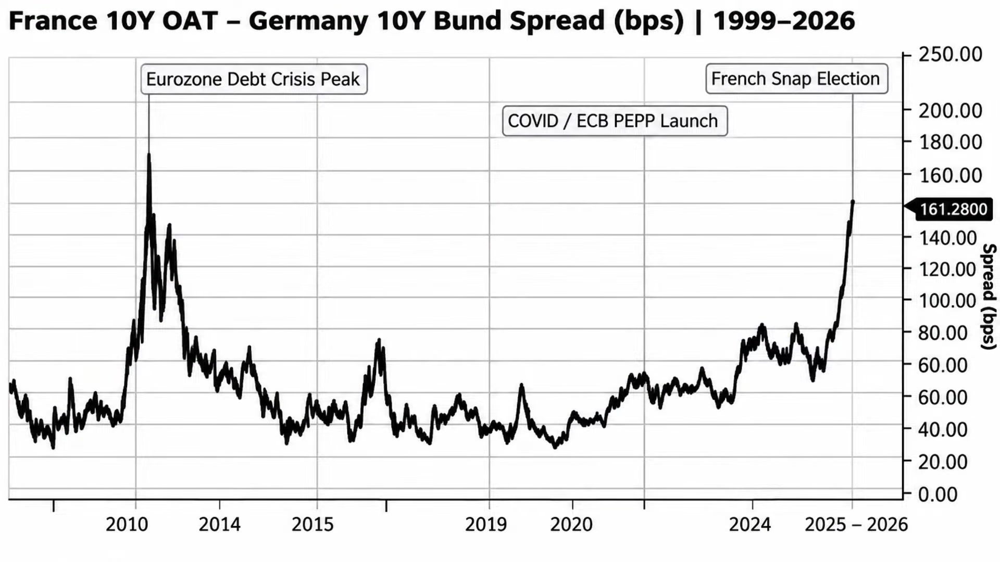

**逐字稿片段：** 債務的負擔率還在沖高當中 即便公債殖利率又回檔了 可是呢市場上 還是有非常明顯的認知 法國的財政情況 基本上應該是歐洲國家當中 在今年表現最為差勁的 這個時候必須要承認了 我們必須看說以前大家都認為 這個很多歐洲的財政問題 它是靠以前的低利率來做支撐的 那後來慢慢利率走高了 其實感覺大家也逐步 的走出了歐債危機哦 可是各國個別政府 很明顯還是受到那種 福利政策的影響 26年財政赤字預估要到5.4那 正常人都知道 即便做改革 那你改革越深哦 那也是一個新政府上來 馬上要被掃下去嘛 你大概都知道未來 幾年他也只能繼續執 債舉債才能夠維持龐大的公共債務嘛 但是你打毒藥哦 就跟那個以前日本央行一樣 藥物可以讓你暫時撐下去哦 但是不能夠真正的 改變你的身體健康嘛 你舉債也只是讓政府維持運作 美國就算每年有遇到那個債務上限 它那個比例還是控制得非常好 主要是用數值來做限制嘛 所以即便美國經常 大家會擔憂舉債問題 可是美國的問題遠遠沒有 比法國還要來的嚴重 那借款利率越來越高的時候 就代表那個續命的藥哦 他最後就反而成為了 財政上最大的負擔 所以有時候好像現在全球經濟都一樣 你不吃藥 你有這麼大的國防支出 你有這麼大的AI的投資建設 你好像只能繼續舉債 玩下去這個遊戲 期待生產力有一天突破 那沒辦法 大家吃藥已經吃上癮了嘛 以前是日本 有一陣子是美國 現在輪到法國了嘛 那之前不是看了三國演義 講述為什麼趙雲 趙子龍能夠七進七出 吃藥嘛 吃藥 那不管怎麼說 現在回過頭說

**話題推測：** 討論法國政府債務負擔率，顯示債務負擔趨勢圖

---

## 00:15:37

**逐字稿片段：** 整體美國的AI概況 勉強把全球的經濟 撐在這樣的一個位階 即便內部有點分化 但至少在高利率的情況底下 還能夠走出如此3% 到4%的經濟成長 已經算不錯了

**話題推測：** 轉向美國AI發展概況，顯示AI產業相關圖表或新聞

---

## 00:15:51

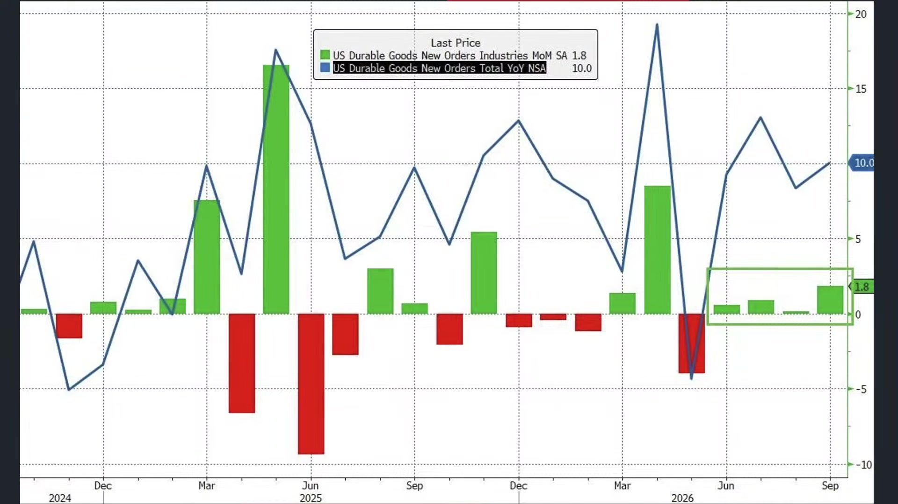

**逐字稿片段：** 昨天最新所公佈的美國耐久財訂單呢 是出現了連續性的成長 月增幅1.8% 雖然比預期1.9稍微低一點 但至少過去7個月有6個月都在成長 尤其在AI相關設備 雖然出現了降溫 可是你把26年拿來跟2025年來做對比 包括網路交換器 路由器光纖傳輸設備 那個是指數型暴增 你基本上就維持在這個位階 整體年增幅都是非常漂亮的 這其實就形成了這種兩極化的發展

**話題推測：** 公布美國耐久財訂單數據，顯示耐久財訂單走勢圖

---

## 00:16:24

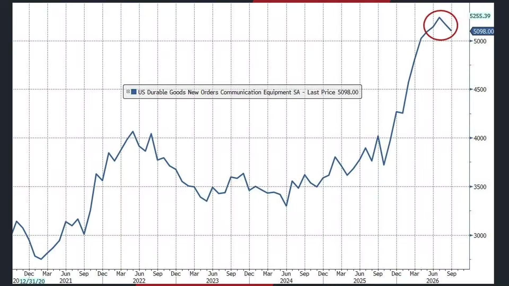

**逐字稿片段：** 我們把在全美的建築 來做對照 你就可以發現 為什麼美國的男性 年輕男性做的那些 可能算是粗工 或者是我們講的建築工 為什麼成長這麼緩慢呢 那明明到處都在蓋廠

**話題推測：** 分析美國建築業的兩極化發展，顯示不同建築類型的支出變化圖

---

## 00:16:40

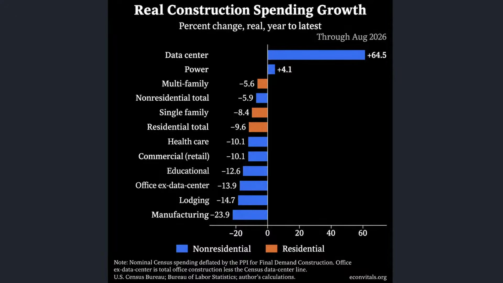

**逐字稿片段：** 因為真的只有蓋資料中心 除了資料中心 什麼都沒蓋 我們舉例來說 這是美國人口普查局 最新所公佈下半年數據 經過通膨調整之後的資料中心 的營建支出年增幅是64.5% 這遠遠高於電力設施的4.1% 所以應該不能講說只有資料中心 電力設施的擴張速度也算有了 不過兩個 年增幅還是差很多 那你把其他的看起來 比如說製造業的建廠年檢23.9% 旅館業衰退14.7% 一般白領辦公室衰退13.9% 教育設施衰退12.6% 住宅建築下滑9.6% 除了AI還有相關的電力建設 所有的建築業全部都在衰退 沒有人建得下去 好這件事情其實都意味著 現在在美國的就業市場當中 你會蓋資料中心的 那你就賺很多 你不會蓋的 你蓋拉比的蓋 飯店案的誒 其實都表現並不是特別好 然後這壓力比較大 好那它形成的另外一層效果就是 第一內部的極化 你會覺得經濟極差無比但是呢硬是把 硬硬是被這個data center給撐起來 那第二大方面就是它 會導致資金的缺口仍然緊繃 那很多我們講的中下游的承包商哦 這些中下游承包商我們不只要 理解成單一的科技廠電子零元件的 我們還要講傳產 還要靠08年低利率以來 苟延殘喘的中下游承包商 他們要先借錢嘛 借了錢才有材料去興建嘛 然後借到錢之後發現找不到生意 表現更為差勁的 它會持續有進一步的資金排擠的缺口 為什麼因為錢被AI企業給借走了 代表的是這些大型科技巨頭 它可以取得更優渥的 利率還有更優渥的貸款額度 而中下游的 它就必須要拿到更高的利率 而且呢較少的貸款額度 它最後形成的效果就是內部的極化 那第二層極化是 可是現在連這些科技巨頭 錢都已經不太夠了 我們過去跟投資朋友提過 現在AI資料中心其實已經大幅地

**話題推測：** 特別指出資料中心建設的獨強現象，顯示資料中心外觀圖或建設對比圖

---

## 00:18:42

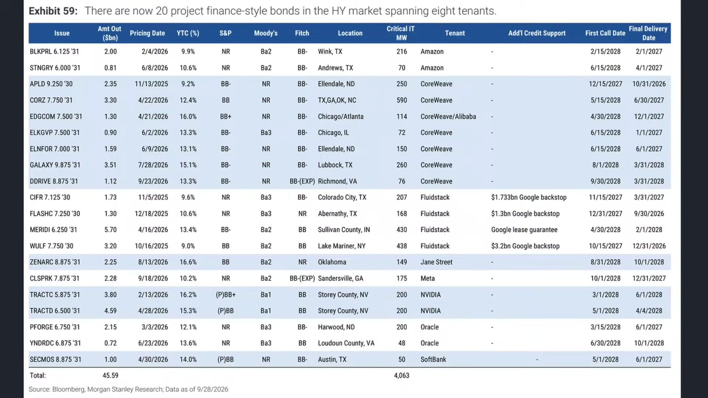

**逐字稿片段：** 依賴高收益的債券來融資 完全合理地解釋 為什麼美債沒有人要買 因為他們開的殖利率 越來越離譜了 一直到現在10月底為止 市場大概有20檔的專案的融資型債券 總發行量今年下半年大概是455億左右 其中它背後很多租戶都是大咖的 像亞馬遜 輝達Meta甲骨文Corning 那支撐大概有4,063兆瓦的 資訊設備用電需求 好那這些債券到期收益率 我們仔細觀察 中間那個YTC 比如說有的Amazon作為最後 承包商的有開到9.9% 10.6%的 作為最後承包商的 這些中間的資料中心呢 有開到16%的 那其他像是junestreet 或者像是meta輝達 也有開到10%到16%左右 所以這件事情都說明的一件事情 我們好像有點高估巨頭的能力 這叫做資訊落差容易製造的權威感 我們以為 他是巨頭哦 那利率就多低 除非他自己發行的債券了 要不然是人家所建好的 資料中心租給輝達的 租給Meta的 那看起來蓋那個資料中心所獲得的 貸款利率其實也比想像中高很多 我以為我的客戶是台積電 哦那我的貸款條件一定非常好沒有 除非你是台積電 這是區別 你知道嗎 所以從這樣的一個角度來看的話 除非他是自己所發行的投資等級債 要不然看起來也沒多低呀 這其實在金融市場蠻常見的 很多我們看到越接近AI

**話題推測：** 討論AI資料中心依賴高收益債券融資，顯示相關債券發行圖表

---

## 00:20:15

**逐字稿片段：** 資料中心的信用風險呢 開始升高 一般人可能就認為 你資料中心背後有Google 有亞馬遜來跟你買 跟你承租 債券應該就很安全了 那現在根據大摩的數據已經發現了 相關的高收益債和科技 巨頭自身的公司債之間呢 那有的到300個基點的信用利差 明明你就知道我客戶是誰 結果你還給我這麼貴的貸款條件呢 明明 Jensen都已經幫我做履約保證了 結果我殖利率還是這麼高 這叫做資訊落差所形成的權威感 當別人說出我們難以判斷的事情呢 我們就容易高估他的能力 但是忽略到了誒 也許我們掌握 或者說我們 缺乏了我們沒有注意到的一些資訊 那這些數據都告訴我們說誒 也許債券市場的確沒有如 我們想像中還要來的樂觀 但的確這叫做資訊落差 容易所形成的權威感 以前的當兵學長 最常講的一個段子嘛 講說去醫院健康檢查嘛 那阿兵哥那脫下褲子 檢查下體 醫生常常看一眼呢 都會冷笑 唉你沒有女朋友吧 那阿兵哥都會大驚失色嘛 醫生這你也看得出來 太厲害了吧 那醫生就會淡淡的講 因為 你上面有衛生紙 來轉過去 讓我看看你有沒有男朋友 就是資訊落差 它容易製造權威感 那別人說出我們認為 很難判斷的事情的時候 我們都會高估別人的能力 他專業能力好強哦 也許我們只是忽略了我們 沒有掌握到的一些資訊 對於債券市場而言 就是如此 我們都覺得 你怎麼可以知道 原來市場的信用風險 如想像中來的這麼大 因為從股票市場看不出來 所以有時候我們觀察債市哦 其實也不一定是買債券 因為大家也知道 從科技樂觀論者的角度而言呢 股價的上漲幅度一定遠遠大於債市 但為什麼一直觀察信用市場 你要瞭解 你到底在擔心什麼 你在擔擔心什麼 有什麼好擔心的 他不都幫你掛保證了嗎 這些巨頭都下海幫你做擔保 簽本票了誒 簽了本票 他殖利率還開15% 這個就是真實的概況 這也提醒我們了 事實上 市場對於信用風險的壓力依舊存在 往好處講就是人人都在買保險 人人都知道 現在其實是有點壓力的 那往壞處想的狀態其實就是 這個信用市場它會抑制住AI的發展 錢太貴會導致AI的發展 可能會有嚴重落後的情況 好我們回過頭說 現在第一波要檢視的方向 其實就是AI算力引爆的 算力強什麼叫算力強 就是當大量的資料中心即將交貨以後 我們預估需求應該是很多的 可是錢能不能順勢的跟得上 中間會不會有一些流動性問題呢 這個流動性問題 有可能是比如說部分企業 部分雲端的承租商 他突然玩不下去這個遊戲了 可能因為融資成本的問題 也有可能是因為沒蓋完 那你就要賠錢給這些巨頭 這些巨頭已經跟你說好 我這個時間點就要 拿到足夠多的算力 那我們細節來看 從26年到27年來看

**話題推測：** 討論越接近AI資料中心的信用風險升高，顯示信用利差圖表

---

## 00:23:14

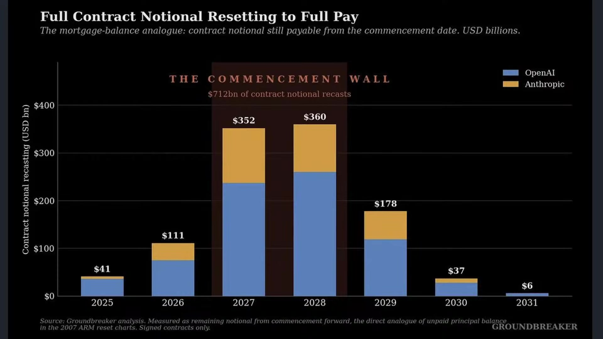

**逐字稿片段：** 我們從Openai和Anthropic作為主要簽署算力 正式交付之後的剩餘合約的名目金額 26年是1,110億美元 到27年就瞬間暴增到3,520億 28年到3,600億 所以你不要覺得說誒 今年其實你感覺用的算力已經蠻多了 明年預估要增長4倍到5倍 後年也差不多 所以第一波資料中心的交付期 就是明年和後年 那我們就看 我覺得如果能夠度過這兩年呢 哦那就說明著這個AI第一 波蓋的大規模的資料中心 它是可靠的 它是有其道理的 而且這場遊戲看起來是玩得下去的 我認為這是第一波我們 可以觀察的一個方向了 那當然我本人還是 抱持著相當大的信心的為什麼 因為這些巨頭哦 雖然開的資金利率是有點高沒錯了 可是呢 他只要稍微調高一下訂閱費 這些科技巨頭 你覺得會因為一場AI 投資競賽完全拖垮嗎 他們的現金流其實還是 源源不斷的不絕進來哦 主要還是來自於市場上 為了籌集這些錢 的確絞盡了腦汁

**話題推測：** 顯示OpenAI與Anthropic的算力合約名目金額，顯示相關數據圖

---

## 00:24:19

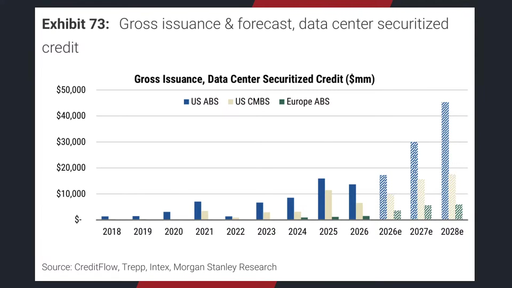

**逐字稿片段：** 國有不動產資產證劵化嘛 在08年嘛 現在呢叫做資料中心的證劵化 2026年現在 我們看到ABS的發行規模是170億 ABS就是我們講的 美國資料中心資產抵押證劵的 簡單來講就是我把 資料中心抵押給銀行嘛 我我自己還運營呢 但假設我還不起錢 你就把我資料中心收走 以前是那個GPU晶片化嘛 用英偉達的貨拿去當鋪當錢嘛 現在呢把整座資料中心當給你 那2026年是170億哦 明年預估直接會增長到300億美元 28年會上看450億哦 好這其實就說明著AI基礎建設 誒其實跟當年不動產 抵押證券越來越像了 以前是抵押房子給你 組合成一個商品 現在呢把整座治療中心都抵押給你 那形成的效果是什麼呢 我覺得你很缺錢 可是我又怕你可能會成功 最後就是買的保險越來越多

**話題推測：** 類比國有不動產證券化，引出資料中心證券化議題，顯示ABS發行規模圖

---

## 00:25:15

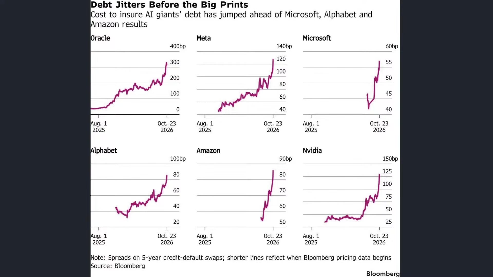

**逐字稿片段：** 我們從5年期的信用 違約交換CDS利差來看 現在正在全面走高 到10月底 其中甲骨文已經上升到300個基點 Meta突破了120個基點 其他輝達也從原本先前的 30個基點飆升到120個基點 微軟升到55個基點 阿發貝和亞馬遜分別是80和85個基點 所以從這些角度來做觀察 都說明著 我們現在投資AI 其實是不同的角度來做互相交錯 有高利率的影響 有投資等級債對於美債的壓迫 有美債受到壓迫以後 公債殖利率的被迫提高有內部 外部通膨以及消費極化的問題呢 那這些訊息 摻在一起以後 都會發現呢 我們其實最後就是期待 那到底AI賺的錢 能不能讓本場風暴能夠 順應一個新世界呢 我們不期待高利率 有一天會變低利率了 現在看起來是這樣子嘛 但是我們期不期待AI賺的 錢會比現在在定存裡面 在高利率時代買投資等級債 買美國公債的錢還要多好幾倍呢 你有這個信心 這場遊戲就玩得下去了 當然另外一種角度是 你沒有這個信心 哦那一堆債劵都給你開十幾% 你保險一點 你買美國公債 30年起的 你也有5%左右的保本利率 所以你就自己選擇吧 這就是不同價值觀的影響 最終就是你相不相信AI賺的錢 可以遠遠超過目前的利率水準 這本來就是這樣子 我們一開始以為在研究金融發現 研究金融背後其實是瞭解經濟 研究了經濟哎 發現其實它背後更多隱含的是政治 哎政治研究之後發現 背後隱含的是歷史 研究了歷史 發現原來是哲學 研究了哲學 發現原來研究的是人性的 研究了人性 結果發現了規律 規律發現了因果 因果發現了輪回 輪回發現了無常 無常發現一切皆空 最後就阿彌陀佛 那不管怎麼說

**話題推測：** 分析科技巨頭的5年期信用違約交換(CDS)利差，顯示CDS利差走勢圖

---

## 00:27:11

**逐字稿片段：** 美國股市 至少在現在這個時間點呢 還是給這些科技財報相當大的面子 道瓊指數上漲15點 0.03% 收在52,377點 標普上漲45點 0.6% 收在7,722點 那其實看不出來有任何下跌 納斯達克指數下跌三百零八點 1.18% 收在26,477點了 那費半昨天彈幅是最猛的 上漲3.6% 399點 收在11,482點 不過非搬運這一波本來就殺比較低 所以波動本來就比較劇烈一點點的

**話題推測：** 總結美國股市表現，顯示主要股指報價表

---

## 00:27:46

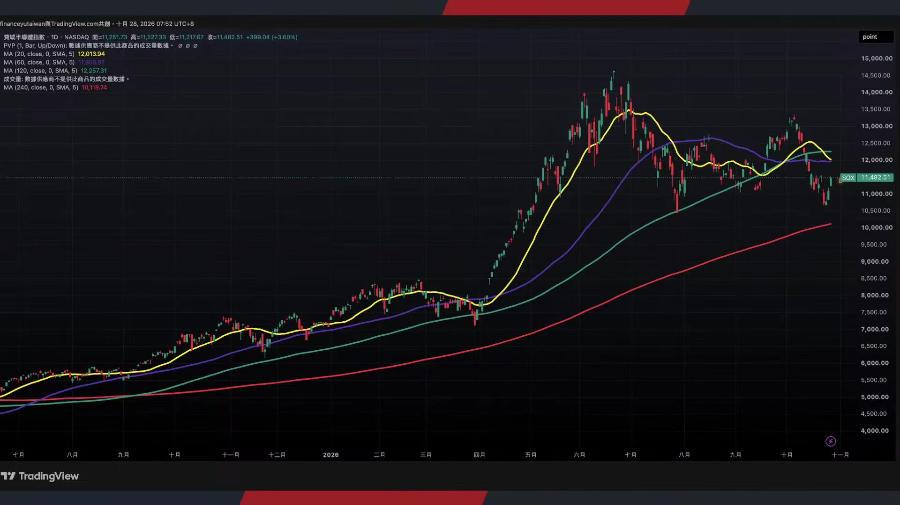

**逐字稿片段：** 那昨天SK海力士 公佈了整個26年第三季財報 營業利益 83.3兆元較去年同期暴增了接近有7倍 超越市場預估的77.5兆韓元 營收來到104.6兆韓元 也比市場預估的99兆高非常多 那SK海力士我們知道不只是 輝達高頻寬記憶體的重要供應商 它也受惠於過去兩年當中 不管是傳統動態隨機存儲 我們講記憶體或者快閃 記憶體內的價格的大漲 所以讓營業利益率還 維持在相對高檔 哦這些事情其實都說明著有時候 我們遠一點當然是看AI賺多少錢 AI的前景 AI的資料中心 融資成本能不能玩得下去那你 從短線一點角度來看 你就看你投資企業 有沒有繼續在賺錢嘛 看臺場其實也是如此嘛 市場每天都在討論這AI是不是泡沫 所以大家的預測科技股什麼時候崩盤 那投資人一直在尋找下一個 能夠證明AI能夠成功的指標 那有時候必須承認 你每天在找答案呢 那答案就在眼前吧 你就看那個財報 營業利益是去年同期的7倍

**話題推測：** 公布SK海力士第三季財報，顯示公司Logo或財報摘要

---

## 00:28:53

**逐字稿片段：** anthropic去年賺12億上半年 今年上半年賺136億 那有時候你到處找答案 你就不如就盯著那個財報 那它到底是不是越賺越多 生產力是不是顯著拉升 機體價格的上漲 預期這個供應的吃緊 至少到2030年 股價是一回事了 但從財報上升幅度和增幅來看的話 你大概已經瞭解這個AI 究竟是真是假 上游供應商 已經賺進了大把的鈔票 不代表AI股票就完全沒有泡沫 但提醒我們呢 這與其每天一直預估那很長遠 30年後的AI未來 你不如先看你的企業到底賺了多少錢 先觀察自己 眼前就能夠觀察到的一些數據嘛 那一個男的去看醫生 醫生我全身好像都有問題 我按胸口也會痛 我按肚子也會痛 按肝臟也會痛 我到底得了什麼病 醫生一看 你的手指頭好像骨折了 你有時候 把眼光放太遠了 就失去了我們投資的意義 有時候投資意義就是回過頭看 它是不是低估值 它是不是低本益比 它是不是一個好的入手點呢 更重要的事情是它的 獲利是否正在上升了 就林義夫 臺北股市上漲670點 收在46,808點呢 盤整一陣子了 這個就是磨嘛下甩磨 也許磨了這半年 除了這一年 有些人 慢慢的成交量就離開了 慢慢的就離開市場了 但是行情總在半信半疑中創高 本來都是在這樣的一個效果底下 有一天他一定以前五六百塊

**話題推測：** 提及Anthropic的盈利數據，顯示Anthropic財務數據

---
