# yutinghaofinance_aI_-iYx_-Hk — 關鍵畫面索引

- 來源逐字稿：[yutinghaofinance_aI_-iYx_-Hk_GT.srt](yutinghaofinance_aI_-iYx_-Hk_GT.srt)
- 影片：https://www.youtube.com/watch?v=aI_-iYx_-Hk
- 截圖數：29

## 00:00:34

**逐字稿片段：** 美股股市雖然三大指數昨天是走高 但是硬體股費半在跌了 跌了3% 這一次民主黨在期中選舉 奪下了參眾兩院的控制權呢 的確它緩解了那種選後政策 或者政治不確定性的疑慮 它就是要監管嘛 某種程度來看呢 好像對於這些科技巨頭來說 它有一個理由讓自己 自由現金流能夠因此而優化 畢竟呢現在這些AI投資的確是過去 讓市場上比較謹慎的關鍵 結果呢我們看到在這一次選後 亞馬遜的股價盤中一度大漲了8.3% 微軟上漲了有7% 阿發貝5.9% Meta3.6% 蘋果漲幅是超過6% 昨天蘋果股價是創下歷史新高了 可是對於費半 對於這些硬體股來說 卻是承受了相當大的賣壓 那我們要用什麼樣的角度來理解呢 是由於科技的監管會導致AI繼續發展 但是呢可能這些科技巨頭 發展的速度比較慢 自由現金流的惡化速度就會放緩 所以變成 AI還在發展 但是變慢 所以硬體股能夠分配到的訂單減少嗎 市場是否正在反映這樣的一個敘事呢 如果是那就不用特別擔心了 那就是單純的估值回檔 那只是建的慢一點 而並不是AI受到了重創 所以我們要從不同 邏輯來跟投資朋友思考 首先道瓊是重新站上了53,000點 單日漲幅是25年4月9號川普 宣佈對等關稅以來的最大所以呢 就要來觀察到底這一波針對資料中心 在選後的建制的阻力到底會有多大 今天來跟投資朋友多 做一些觀察和留意 那首先我們來瞭解 因為這一次的確集中選舉 民調還是失真了 但是 失真的並不是低估了共和黨的選票 而是遠遠高估了民主黨 的投票率到底有多高 好這一次的確 我們看到結束了 共和黨全面掌權的局面 最令人意外的就是大多數的傳統 共和黨的票倉居然接連失守了 包括德州 包括堪薩斯州陸續失守以後 代表的是共和黨不只是 失去國會的控制權 未來2年美國的經濟政策 以及AI政策的發展 民主黨掌握國會之後 應該就有能力去阻擋 川普的新減稅和立法計畫 當然呢川普有否決權 所以也有可能是進入到政治僵局 那就可以來臺灣來觀摩 來學習那也是一種方式 可是至少就目前來看呢 一個新的政治格局已經逐步展開 我們就一一來細聊 首先我們看的是在這一次關鍵戰場 藍潮深入到傳統紅州之後的表現呢

**話題推測：** 美股三大指數走高圖表

---

## 00:03:05

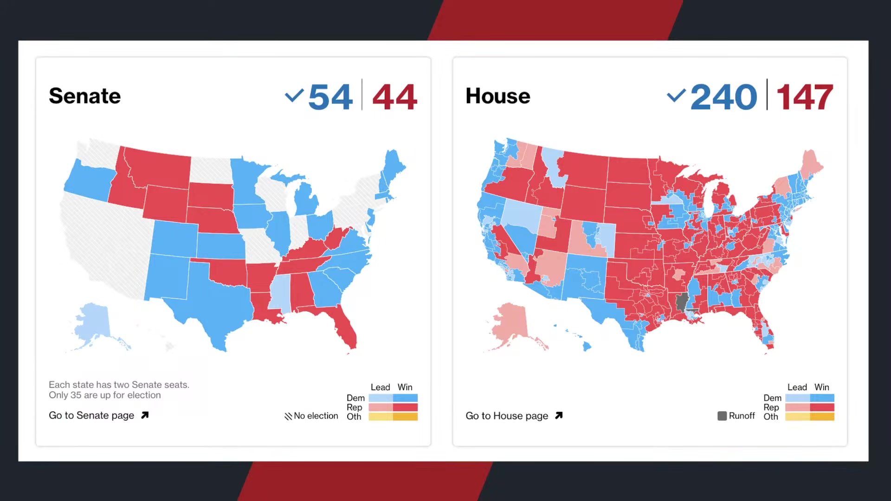

**逐字稿片段：** 其實如果細看 因為這一次民主黨不只是奪回眾議院 也在原本較難翻轉的 參議院取得了至少54席 共和黨原本53:47的優勢就遭到逆轉了 7席參議員是直接轉入 到民主黨的手中 包括北卡俄亥俄 還有緬因等主要的攻防戰場接連失守 那其他以前像是德州南卡或者堪薩斯 這些共和黨長期佔優勢的州 也出現了重大的一個翻盤 那細節觀察 如果我們以普選角度來做思維 就是不看各州的最後投票結果 我們看各州各個郡它的投票的趨向 幾乎99%都是往民主黨 的方向來做移動

**話題推測：** 民主黨在參議院取得席次數據圖表

---

## 00:03:45

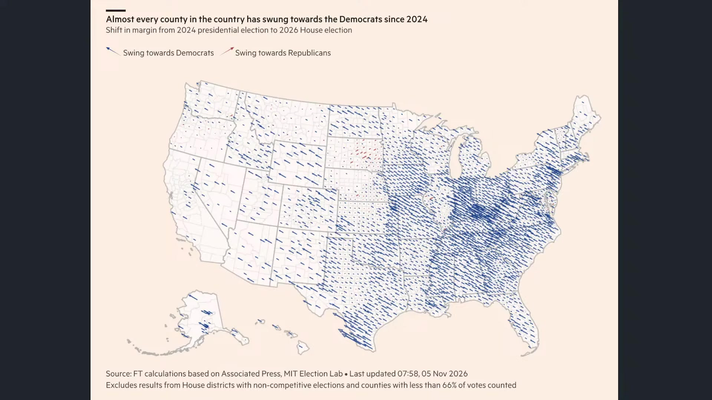

**逐字稿片段：** 我們把24年的總統大選拿來跟 26年眾議院選舉的普選方向來看 從東北部到五大湖到中西部農業州 所有的搖擺州 甚至連南方的共和黨的傳統票倉 基本上都完全出現了相同的方向 所以這是民心的全數的轉 換或者說市場上 不管是從最左到最右 都對於川普的評價做 了一次性的顯著表態 那當然從之前NBC所公佈的出口民調 這一次選民最為在乎的議題 其實很明顯主導了投票的方向 比如說將民主視為首要議題的選民 有78%都投給了民主黨 關心醫療健保的選民 66%投給了民主黨 那即便是過去共和黨 比較具有優勢的經濟議題 民主黨都拿下51%的支持 比共和黨還來得高 那至於之前我們看共和黨 非常重視的移民問題 有90%是支持了共和黨 治安和外交也偏向共和黨 說明川普並不是所有政策全部失敗哦 其實在非法移民還有內部的內政問題 其實還是有比較高 共和黨給予他的一個高評價 但是沒辦法說說明物價 或者醫療負擔的問題之後 這個很明顯 選票就跑了

**話題推測：** 2024年總統大選與2026年眾議院普選方向對比圖

---

## 00:04:58

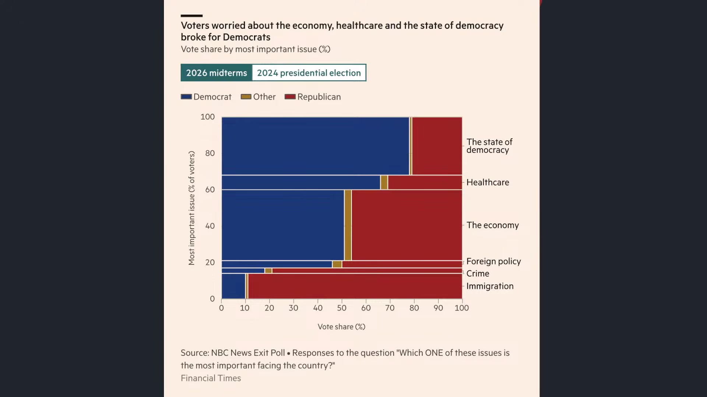

**逐字稿片段：** 我們先看一下眾議院 眾議院這一次完全翻轉了 因為眾議院435席 取得218席就可以掌握多數嘛 那現在民主黨已經獲得了228席以上 共和黨139席 好這說明已經完全越過門檻 那眾議院 最為直接的衝擊是失去 了共和黨單獨安排議程 還有推動減稅或者擴張支出的能力 因為都是眾議院先提出 然後最後皆由參議院表決 然後由國會 由總統來做簽署

**話題推測：** 眾議院席次分布圖表

---

## 00:05:26

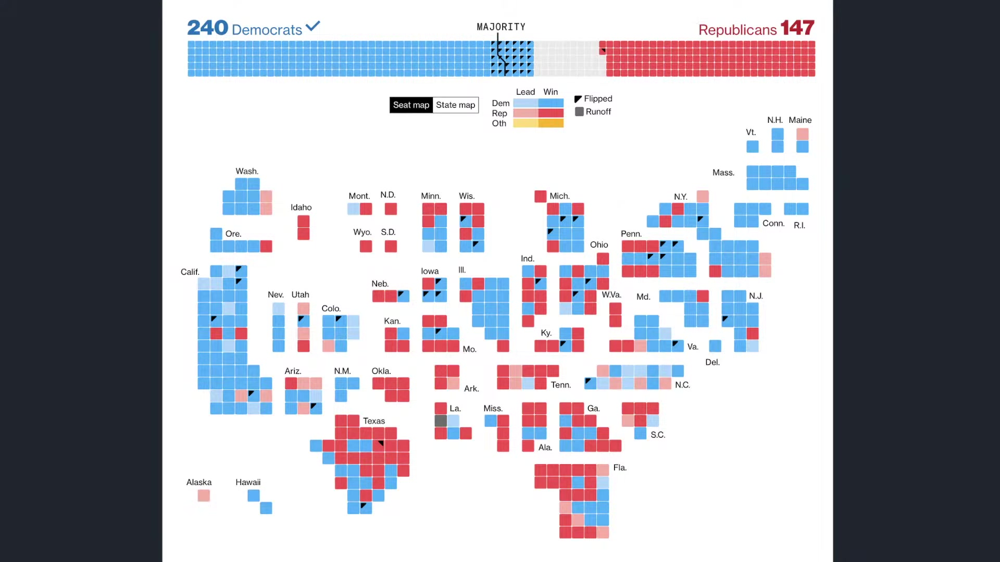

**逐字稿片段：** 民主黨領袖這一次 傑弗瑞斯有望可以出任議長 但是還是需要 新的一屆的眾議院的正式選舉了 那到時候 因為聽證會或者 委員會主席或者調查方向 通常都是由眾議院來做主導 就代表著未來會有大量的聽證會召開 我猜了兩個月內 我們愛潑斯坦案肯定是重啟調查了

**話題推測：** 民主黨領袖傑弗瑞斯有望出任議長的人物照片或簡介

---

## 00:05:48

**逐字稿片段：** 那第二個就是看赫格塞斯的彈劾案 因為聽說他是最大戰犯嘛哦 沒有打美伊戰事 這場選舉可能會完全不一樣 因為後續的通膨問題 購買力衰退都是從美伊戰事開始的 在打關稅戰 美國經濟都沒那麼嚴重 都是從美伊戰事開始的 所以有沒有可能找他開刀 彈劾案這是第二件事情了 那第三件事情呢我猜就 隨時準備找軍神要來聽政哦 好那黃仁勳就要看一下 你們發現最近跟川普一起 露臉的次數好像減少了 好我們再看一下參議院呢 參院的部分呢 這一次7席全部翻藍 民主黨陣營54席 共和黨44席 那後續我們要觀察的效果是 參議院變天對於川普的約束 它是比眾議院還要來得深的 眾議院大家本來就已經心有預估 因為內閣官員聯邦法官 還有其他需要經過參議院同意的人士 都必須要經過民主黨的多數審查 白宮如果未來要換那些重要的官員呢 他就必須要提出跨黨派支持的人選 之前川普不用 川普直接看哪個電視臺長得比較漂亮 或者說 哪一個電視臺 像赫克塞斯 覺得表現非常不錯 直接就任命他了 反正參眾議員都是我掌握 現在你必須要獲得民主黨的同意哦 尤其之前我們講參院最常 經歷的就是那個Filibuster 就是冗長辯論 常常有那個 市場上的門檻 就算是如此 它也不足以單靠 民主黨推翻總統的否決 所以 民主黨現在取得的是比較 強大的主力審查和談判能力 那也不能說 民主黨想要通過的法案 川普就一定會通過 因為他還是有否決權 但至少可以看得出來 雙方的角力 已經跟2年的環境不太一樣

**話題推測：** 赫格塞斯彈劾案的新聞畫面

---

## 00:07:25

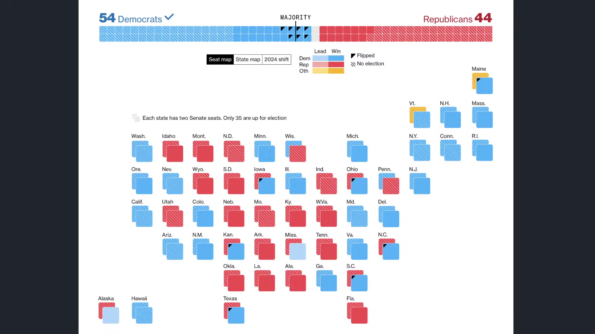

**逐字稿片段：** 再看一下是州長的部分 州長一樣出現了比較重大的輪替

**話題推測：** 美國州長選舉結果地圖

---

## 00:07:29

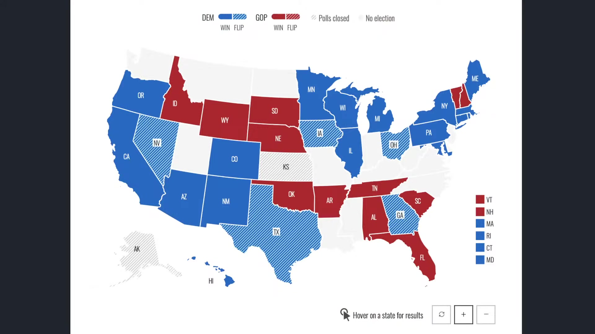

**逐字稿片段：** 民主黨的希諾拿下了德州 那前亞特蘭大市長 波頓斯也拿下了喬治亞州 其他像是俄亥俄州或者愛荷華州 4個原本由共和黨掌握的州長 全部是由紅轉藍 好那美聯社當時統計 民主黨在27年至少現在 拿到27個州長的席位 這些勝利除了改變地方施政以外 也擴大民主黨在州政府層級 對於聯邦政府制衡的空間 尤其是接下來的非法移民的執行呢 如果州政府全部都是民主黨的 那你要怎麼進去抓人呢 共和黨雖然保住了部分的重要州哦 但是還是可以看得出來 這一次此消彼長底下 從參眾議院到州長是全面的潰敗 那我認為大概有兩個影響了 第一個和眾議院不一樣 因為參議院的任期是6年 由於民主黨 已經拿下了接近有10個搖擺州 加上紅州 未來6年 那參議院都是民主黨的 那這些靠著 這一波上臺的紅州的民主黨的 參議員也許很難在2032年連任 因為到時候還有市場的這個區分嘛 市場的風格 或者說到時候會有 政局上的一個變動 可在這個時間點上 有一部分的政治力量 他就會左傾 在參議院而言呢 他是一個重大的一個 對於共和黨的衝擊 第二個就是民主黨 這一次是橫掃德州嘛 民主黨之所以每兩年呢 都花鉅資在這個共和黨的大本營呢 就是它看起來很紅 但是政治規則其實並不是特別穩定嘛 共和黨這幾次選舉 很多是靠那個劃選區嘛 設置選舉的規則或者 用不同的方式讓那個 得票率稍微好看一點 那民主黨現在上臺以後 搞不好會用同樣的方法 一樣改選選舉規則 或者把那個選區劃得更好看一點 到時候民主黨可能得票率更好 哇那新移民對不對 從加州慢慢搬到德州 也許一個新的轉類點陸續出現了 這都是兩個值得觀察的重點了 因為這一次的政治搖擺的 鐘擺效應的確是非常大

**話題推測：** 民主黨新州長（希諾、波頓斯等）人物照片或所在州地圖

---

## 00:09:25

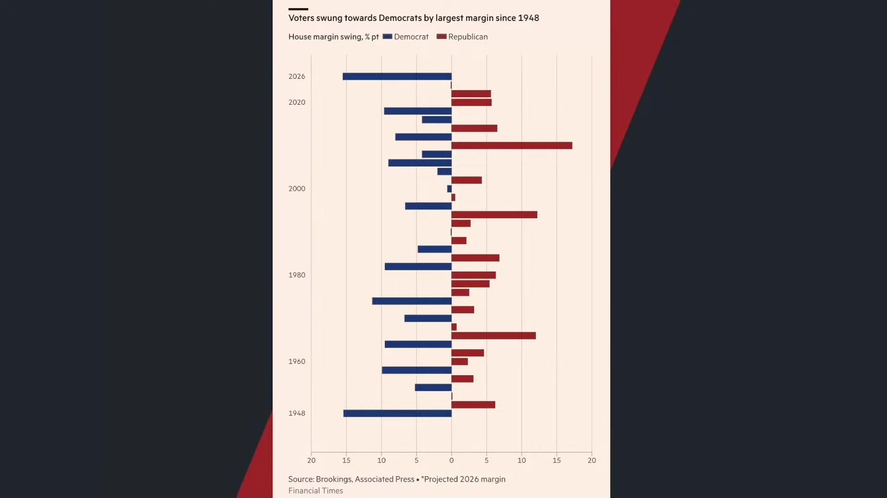

**逐字稿片段：** 我們根據目前26年眾議院 選舉的全國得票率哦 把它拿來跟24年來做對比 那個波動幅度哦 朝民主黨直接多了 15個百分點的普選票 甚至比2006年共和黨在小布希執政 時間所遭遇的慘敗還要來的慘 哦上一次這麼慘已經是1948年的時候了 哦接近半個世紀以前 好所以這個是蠻有趣的跡象 尤其是德州 德州這一次變天了 也不只是州長 從聯邦參議員到我們看到 州檢察長 全部都翻藍了 川普兩年前才以14%的優勢拿下德州 這一次共和黨投入了3億美元 都還沒辦法保住 這一次的參院的席次 那甚至我們看在州長部分呢 西諾霍這一次是 擊敗了尋求連任的亞伯特 成為德州首位的拉丁裔的女性州長 副檢察長州檢察長都出現 了民主黨的顯著突破哦 那當然了 現在 德州另外一位未改選的 聯邦參議員還是共和黨籍哦 就是之前我們常在 電視上看到那克魯茲嘛 但是呢至少可以看得出來 共和黨常年壟斷全州的那種 權力結構已經遭到顯著的突破 尤其這一次特別值得注意 的事情就是所有拉丁裔 都投給了民主黨 前一年總統大選 很多拉丁裔覺得 的確非法移民這個問題 影響很大 我雖然是歡迎我的家人 但我也不希望他們用這種 方式不斷地湧入到美國 所以其實很多拉丁裔是投給川普的 這是不一樣 這是所有拉丁裔90%以上全部都投給了 民主黨 那很明顯就是非法 移民所造成的滯後效果 它的衝擊副作用已經讓大家 擔心會不會影響到我未來的生計 好這個就是不同的表現 到到底德州翻藍 有什麼特殊的意義哦 其實德州翻藍呢 你大概可以理解 加州突然選出了共和黨籍的州長 這樣子 這種翻轉已經不能說是 什麼臺北市變民進黨執政 高雄市變國民黨執政這樣子 差不多是台南變國民黨執政的地步 因為是我記得是35年來第一次嘛 差不多苗栗民進黨贏了 還贏10% 金門人選了民進黨的縣長 習近平支持台獨 就是這麼離譜好不好

**話題推測：** 2026年眾議院選舉全國得票率與2024年對比圖

---

## 00:11:38

**逐字稿片段：** 就好OK 那不管怎麼說 的確我們看到 這一次馬斯克 之前不是從加州 舉家遷移到德州 然後大量的企業轉移 原本是想找一個少點監管 方便發展的地方 結果這次藍潮連德州 都完全翻盤之後 從剛才聊到的參議員 到副州長到州長 州檢察長主計長 全部都是民主黨拿下來哦 還不能夠說全部翻藍嘛 有部分還是紅州嘛 還紅的郡 但是接下來 如果馬斯克要推FSD 或者擴建資料中心 哦那麼恐怕就要摸索新的政治風向

**話題推測：** 馬斯克人物照片或相關新聞畫面

---

## 00:12:11

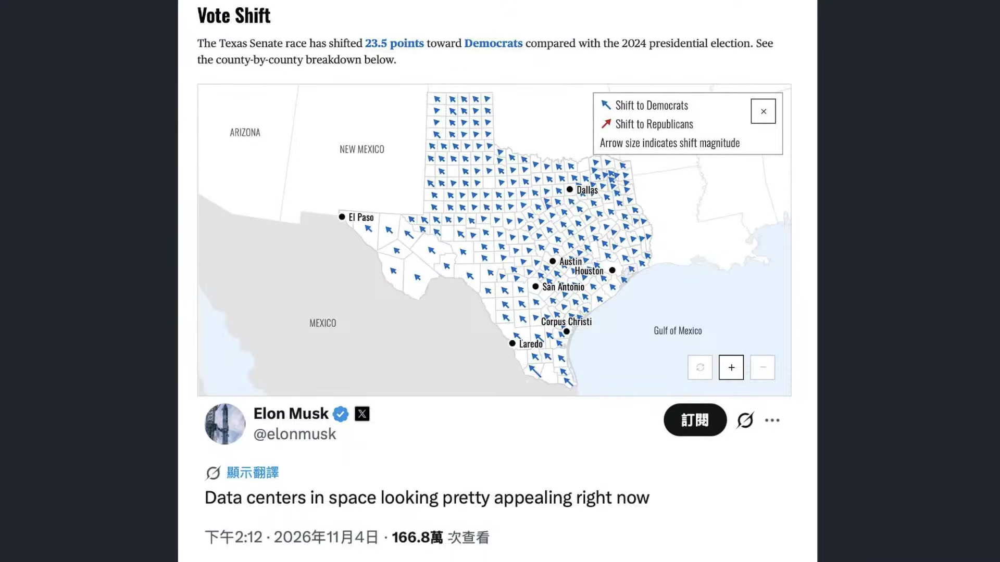

**逐字稿片段：** 馬斯克昨天也在x上發文了 他說現在看起來 把資料中心蓋到外太空 的確還是比較有吸引力呢 因為地球上的選區哦 你躲來躲去哦 還是外太空沒有選舉最好 你還是去 對回火星吧馬斯克 或者你可以考慮再往東邊再跑 搬到佛州 如果佛州也被拿下來 下一次選舉 你就搬搬回臺灣 搬回瀘州好了 好的不管怎麼說 現在我們看到整個市場的概況 會聚焦在民主黨大勝之後 讓整個 德州AI資料中心建制速度的放緩 我們知道德州現在 大概有50GW的資料中心呢 其實已經面臨延宕風險了 早在這一次正式選舉之前 其實德州州長就已經 讓很多計畫稍微延宕為什麼 因為蓋得越快哦 對自己民調其實來得越傷 現在德州的資料中心 大概占全美正在建制的 資料中心當中的接近20%哦 所以目前是全球的資料中心的重鎮 那現在壓力就比較大 好第一個是民主黨州長很明顯表態 必須要暫緩目前的資料中心的發展 不是不允許你發展 但是你必須要提出穩定的配套措施 包括用電申請開發許可 那未來有可能呢 的確會放緩它的速度 但是總件數量而言呢 只是時間線的一個拉長而已 這的確會形成部分 硬體股在訂單的一個稀缺性 不過呢 本來訂單就已經很緊繃了 就算是這樣子 只是稍微沒那麼緊繃 也沒有到因此 供過於求的一個地步

**話題推測：** 馬斯克在X（Twitter）上發文的截圖

---

## 00:13:37

**逐字稿片段：** 那當然呢 這一次馬斯克砸了非常多錢呢 140億台幣助選呢 還是慘敗 那特斯拉和太空探索 我們講Spacex哦 接下來的重挫 是不是代表著市場有新一輪的轉類呢 我覺得也沒有這麼離譜了 民主黨哦 應該很清楚知道 這一次藍潮的崛起 也不是大家突然欣賞dei 或者欣賞民主黨的政策吧 只是對於川普的經濟 政策非常失望而已 如果我們細節觀察 整場選戰 馬斯克大概投了4.46億元哦 更嚴重的事情是 政治獻金的損失只是開始哦 對於馬斯克財富的估值 旗下企業如果繼續在 德州Spacex或者FSD的上路 它肯定會受到更多的監管 那雖然 眾議院目前還是共和黨的 不過至少幾個參議員 已經針對馬斯克這個人呢 來做直接性的一個表態 我們過去跟投資朋友提過

**話題推測：** 馬斯克政治獻金投入與選舉結果對比圖

---

## 00:14:30

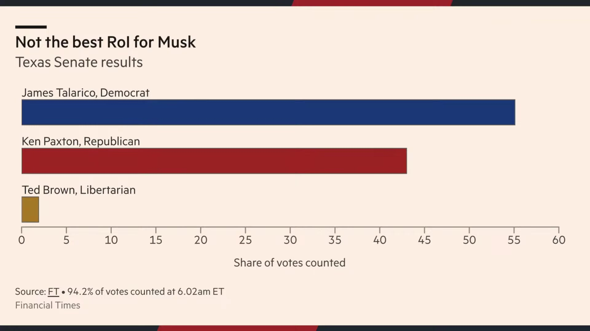

**逐字稿片段：** 這次最受矚目的就是 37歲的德州民主黨人 哈裡斯科 他擊敗川普支持共和黨 的候選人帕克斯頓 也成為1988年以來首位當選的 德州聯邦參議院的民主黨人他的 主張是什麼 第一提高富人稅負 第二增加醫療和住房的扣持額 第三限制政治獻金的交易 以及國會股票的交易哦那他 用這樣的一個說法 在昨天演說當中 其實直接向這次馬斯克來做喊話 他說你投了這麼多錢 你還是被我們給打敗了 我告訴你 你身為身為一個造源富翁 你休想影響到我們的經濟 你休想收買德州 我們看一下先前他的談話 聽到都好緊張 好但不管怎麼說 的確馬斯克在這一次選舉 當中所投入的政治現金呢 是高達4億美元以上 這是所有大型政治捐款人之冠 結果德州居然還是慘敗 這件事情也就意味著

**話題推測：** 德州民主黨人哈裡斯科人物照片或簡介

---

## 00:16:10

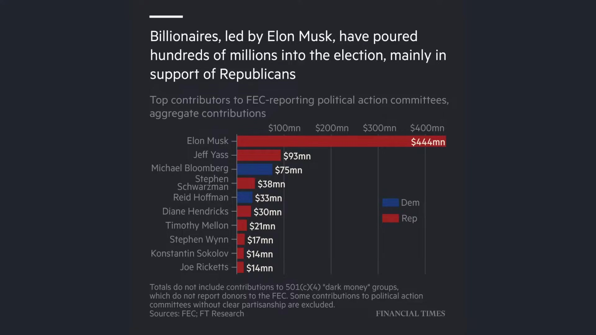

**逐字稿片段：** 這一次的期中選舉民調 的確還算是失準蠻多的 原本的確追的已經很接近了 結果想不到民主黨是全部被大贏了 以前都是共和黨被低估 這一次民主黨至少被 低估了7個百分點以上 在德州 我們看選前民調不管是 路透還是EPSO 民主黨大概哦是46對38 領先共和黨8個百分點 那在關鍵州 尤其是德州的部分 大概是50:47 尤其是塔拉裡克 就是剛才講話的那位 大概就是贏大概1-3個百分點 其實在誤差範圍之內結果 這個票開出來變多少 票開出來贏了快要8個百分點以上 那值得注意的事情是 德州單一選區的比較哦 才不能夠直接推論全國的 民調都低估民主黨5-10 % 但是至少可以確認了 以前都是低估共和黨的選票 現在是遠遠低估民主黨的選票 所以小馬這件事情告訴我們 做人留一線 大腸加麵線 左右逢源才會長久 老馬你還是回火星吧 要不然你搬到佛羅里達 到時候佛羅里達也變天就完了

**話題推測：** 期中選舉民調失準幅度圖表

---

## 00:17:13

**逐字稿片段：** 那為什麼會出現這種反向的誤差 我認為有兩個值得檢驗的原因呢 第一個就是過去民調 的確多次低估共和黨 所以在部分的歷史投票 記錄模型當中會先低估 就跟可能跟現在國民黨有一點像就是 認為會投川普的人會比較低調一點 很丟臉吧 或之類的 我就覺得 這樣子投 人家知道我是川粉 我覺得我好像 有損我的名譽 但是我會投給他 所以以前是低估 好所以呢 過去很多在進行加權模型的過程當中 都去覺得共和黨的 那個表態率是比較低的 好所以可能形成誤差 那第二就這一次兩黨的投票 熱情出現明顯的一個落差 艾普索和路透 現在的調查是49%的民主黨 人對於投票非常熱衷 共和黨居然只有33哦 哦這個差了16個百分點 就知道會有誤差 但也不知道會差到這麼多了 從這樣的一個表現 也可以看得出來 這個民調跟 統計的表態率其實有 比較大的一個相關了 那不管怎麼說 現在我們回過頭看這一次 在選後的一個格局 幾乎就說明著選民會 要求在部分議題當中 反映選民遇到的困難 那第一個是什麼 當然就通膨問題 所以我們才講說 如果沒有美伊戰事哦 這場選舉還真的不好說 我們看根據 金融時報的調查 68%的美國選民呢 是非常不滿川普政府處理物價的表現 相對於今年5月份的58% 足足多了10個百分點呢 那至於由美伊戰事所 形成的能源價格上升呢 更是引發市場上造成反感的原因

**話題推測：** 民調反向誤差的兩大原因說明畫面

---

## 00:18:41

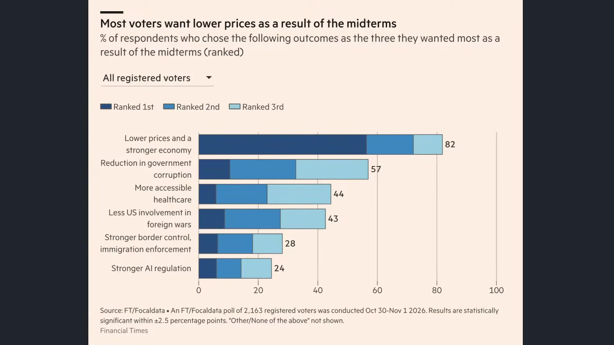

**逐字稿片段：** 那你說川普難道在政策上 都沒有獲得民意的青睞 有 50%的選民都認為共和黨的確 在邊境政策上處理得更好 可是移民問題 已經變成幾乎是最後 一項大家關注的問題 相對于移民 他的待遇好不好 他有沒有 合理的去做遣返了 我更在乎的是我購買 的物價有沒有回跌 或者有沒有穩住 我們從NBC的出口民調 你大概就已經看得出來 到底是誰投給了民主黨 這一次民主黨最大優勢 第一個就是整合了女性 年輕人和少數族裔的選票 女性占整體選民是53% 其中有接近60%都支持民主黨哦 女孩子都是支持進步派的 只有40%支持共和黨 雙方差距高達18個百分點 男生呢是49:49 平手哦所以共和黨 那種男性選民沒辦法 抵消女性選票的劣勢 年齡差距就更明顯了 18到29歲的年輕人有72%都支持民主黨 年輕人都是左派 只有25%的年輕人是支持共和黨的 差距有47個百分點 30歲到44歲的選民是60對36支持民主黨 族裔層面呢 非白人選民占大概28% 其中這28%當中有71%都支持民主黨 非裔選民89% 拉丁裔62% 亞裔70% 所以共和黨雖然的確 穩住了部分的傳統支持者 可是女性不投給你 年輕人不投給你 少數族裔也不願意投給你 好這個就是我們看到市場 上比較大的一個衝擊 那移民政策 我們剛才跟投資朋友提到 雖然有所幫助 可是在選民的這種支持 管理移民的過程當中 即便是我們看到對於移民而言呢 他也不一定支持 政府採取所有強硬的手段所以 對於反映在選票上 其幅度並沒有特別大 我們剛才提到嘛 拉丁裔有62%支持民主黨 35%支持共和黨 亞裔有70%是支持民主黨的 過去很多已經取得合法身份的移民 確實可能會支持去加強邊境控管 因為他們認為自己已經 透過合法的程式進入到美國 他不希望非法移民破壞制度的公平 也會擔心大量的新移民會增加就業 會增加公共資源的競爭嘛 但是川普的移非移民政策 它不只是涉及邊境管控 它還有大量的大規模的境內逮捕 所以在形象上 大家可能覺得表現的 並不是特別好看 那最後就變成選民了 他可能會同時支持遣返 有犯罪記錄的非法移民 可是呢他又反對那種

**話題推測：** 川普邊境政策民意支持度圖表

---

## 00:21:09

**逐字稿片段：** 缺乏區分的大規模的執法 最後呢決定不針對這項議題來做表態 誒市場上壓力就越來越大了 那等同於這種 又不希望人家來 但是希望遣返的過程當中 你又稍微體面一點呢 這種感覺嗎 那之前不是 誒講了一個段子 講說川普在俄亥俄還是 哪裡發表了慷慨激昂的演說 我們一定會驅除一切非法移民 那底下就有人質疑 你真的能夠做到嗎 川普就很生氣誰說的 為什麼你要在這邊打臉我 底下說我是印第安人這樣 就你瞭解 這政治人物在臺上喊口號很容易 但政策真的執行下去哦 他往往針對的就不 只是原本想針對的對象 川普強調打擊非法移民他 獲得部分的選民支援 好但是已經透過合法 管道取得身份的移民 他們也希望維護制度的公平 一開始給你高評價 但是等你影響到誒我身邊的人的 移民家庭生活社區生活的時候 又轉換了 他也不一定反對你 但表態率會因此而減弱 好那另外一方面呢 這次共和黨輸掉的不 只是年輕人和少數族裔 傳統票倉其實也沒有足夠的優勢 我們如果細節觀察 白人選民大概占全體選民的70% 共和黨只有51:48小幅領先哦 就算白人也不是大部分投給 共和黨的 大概就領先3%而已 65%以上選民占35% 共和黨也只有51對48 即便是老白人 那基本上也不是全部 大部分都投給共和黨的 好所以這就是我們看到人口 結構和投票傾向的大轉換了

**話題推測：** 共和黨傳統票倉（白人、老年選民）支持度變化圖表

---

## 00:22:39

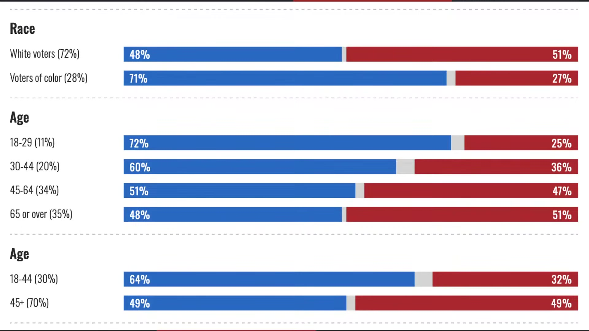

**逐字稿片段：** 那當然民主黨政府這一次 正式即將接管國會之後 已經向外宣告 準備隨時全面調查川普政府 因為27年1月份才會正式的就職嘛 那到時候呢 民主黨已經發表談話 會要求企業提供內部檔 電子郵件白宮官員的往來記錄 第一重啟愛潑斯坦案 第二來調查川普家族在過去兩年是否 用了政治權力來獲取私人的利益 政府是否給予特定企業不當的優惠 以及 高物價和民生負擔背後的政策責任 基本上他就是直指赫格塞斯 認為你發動這場戰事是 造成現在高物價的主要原因 那對於企業而言呢 就算你沒有違法 你也因為跟川普關係過於 密切而被要求出席聽證會 甚至交出商業往來記錄 這個時候壓力就非常大了 那我們就要看一下到時候 這一些過去2年跟川普 每天一起露臉的企業家 到時候會採取什麼樣的一個應對方式 還是說風往哪吹就往哪倒 那就改支持民主黨就好了嘛 給投資朋友做另一種角度的觀察

**話題推測：** 民主黨政府全面調查川普政府的議題清單或新聞畫面

---

## 00:23:42

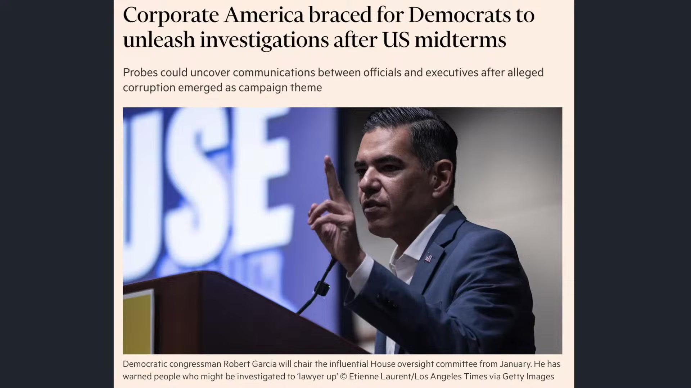

**逐字稿片段：** 那對於經濟的影響 我們要從兩層角度來看 第一層呢 當然是要 呼應民意的部分呢 川普政府現在最大的挑戰 還是要把通膨給壓下去嘛 尤其這一次油價的承諾全面跳票 是目前川普大敗的主要原因

**話題推測：** 選舉對經濟影響的總結圖表

---

## 00:23:56

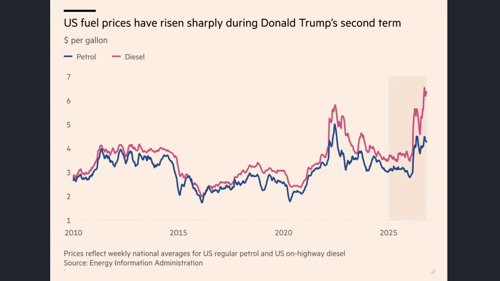

**逐字稿片段：** 我們看在11月中旬呢 現在每加侖大概 汽油來到3.46塊 已經超越拜登任內的平均記錄 川普當時競選的時候是承諾要 把汽油價格壓在每加侖兩美元 現在已經漲到4.17塊了 比25年元月份又上漲了超過1/3 柴油價格是上漲70% 油價的回跌是目前共和黨能夠 在2028年奪回選票的重要關鍵 這第一件事情 第二件事情呢 是關於減稅和財政政策 很多人說 哇那民主黨掌握國會 過去川普推動的企業減稅就會被取消 其實不會的為什麼因為 川普有否決權 你如果提出那種撤銷減稅的方案 川普只要實施否決權 你參眾議院你還要取得2/3 的多數才能夠推翻否決 不太可能嘛 所以最有可能的是什麼 是雙方互相角力企業呢 可能或者民主黨會採取新一波的監管 或者取消部分的減稅政策 來換取 過去已經形成的減稅政策 能夠順勢的來做刺激 而且真正改變的是未來追加減稅 或者擴大財政的刺激的可能性因為 我們並不能說民主黨上任以後 他就一定要減少政府的開銷 他有可能是想要增加 自己想要增加的開銷 可能是醫療 可能是部分的社會福利支出 那共和黨可能也想要增加的 支出是國防或者利息支出嘛 那雙方有可能為了要保住 各自的利益 最後就是支出一起增長了 只是增長不會像是川普 時期增長得這麼快而已 所以對於公債價格 不能說一定是一個大利多但是呢 至少是一個穩定性的一個作用

**話題推測：** 美國汽油價格走勢圖

---

## 00:25:29

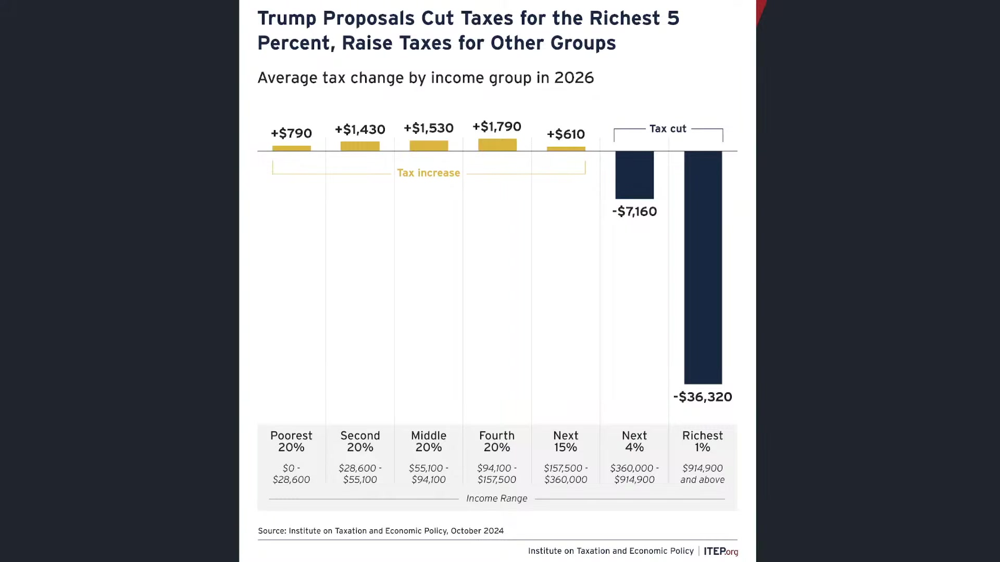

**逐字稿片段：** 其實美國債務問題 我覺得嗯應該不會 很多人說期中選舉之後 應該債券利率就往下掉了 因為民主黨會讓你的預算都過不了 那你就沒辦法花錢 沒辦法花錢 那美債供給就不會大增 這是一種邏輯 但我覺得民主黨掌握國會之後 真正的問題就是川普想要減稅嘛 他想要增加國防和邊境安全的支出 民主黨有很多要增加 民主黨花錢才叫猛的人 擴大醫療 社會福利教育 綠能補貼 雙方政治立場不同 但是都有自己想要花的錢 想要自己通過的一個法案 好所以從這樣角度來看 誒你看歷屆的總統也是如此 都是在各取所需的政治交換底下 最後達成了一個新的支出 我選前我都罵批評你 選後我花的錢比你更多 那在野黨又繼續批評那個選上的人 那結果呢 等他執政的時候又花的更多了就是 一棒接一棒 結果越花越多了 所以錢這種事情呢 美國公債赤字的問題的確 長期來看只會越來越嚴重 之前不是講一個笑話 講說川普死後到了地獄 那地獄有一條規則 凡是那個生前 對於國家有重大影響 重大損害 甚至之前做過壞事 比如說調戲過小女孩的人呢 地牢就會被大水給淹滿 哇那眾人都看到那個川普誒 被淹了可是只淹到腳踝處 表示憤恨不平 為什麼他只淹到腳踝處 那川普很尷尬 又老老實實的只好解釋沒有啦 我現在站在拜登頭上 所以雙方都是這樣子 一棒接一棒 不管是過去的醜聞 不管是過去的這種政績上的衝突 還是在於通膨上的傷害哦 大家其實不斷的交疊底下 其實美國政府的財政赤字 它只能越來越高 好這個就是無法改變的方向 所以也不要對於美債說因此 而有非常劇烈的那種幻想 殖利率大幅下滑的空間呢 你解決美疫戰事再說嘛OK

**話題推測：** 美國債務問題相關圖表

---

## 00:27:19

**逐字稿片段：** 好再來我們講的是能源和綠能政策 川普的傳統能源政策的確會受到制衡 那電力的需求它是不分黨派的我們 不管你要發展什麼樣 的一個能源政策方向 都是缺電的 好所以我覺得實質影響沒有這麼大 那真正大家比較關注的 可能是對於關稅的影響 民主黨這一次的選舉大勝呢 第一個我們想的 那會不會影響到接下來 對海外的關稅 川普會採取更為極端的態度嗎 還是說也許關稅戰 就會逐步的來做落幕 畢竟呢從這次出口民調來做觀察 關稅戰我們從臺灣人角度而言呢 我們很清楚多少台商在美國設廠 川普這個是重要的政基 而威脅我們過去嘛可是 對於美國人而言呢 他似乎也不認為關稅戰對 他們有多大的一個幫助 高達65%的選民 從這次出口民調來看 認為關稅是傷害美國整體經濟的 有22%認為有幫助 我們當然知道關稅會影響物價的成長 可是真正物價的暴衝都是 美伊戰事之後才開始的 說明其實部分關稅的減讓 它是可以沖銷掉通膨的衝擊 但是具體的投資人 數千億美元的投資人 這個其實是我們從宏觀 從公營角度上 川普獲得的政績 可是有65%的選民都認為這是傷害的 負面評價比正面評價高非常多

**話題推測：** 能源和綠能政策議題圖表

---

## 00:28:37

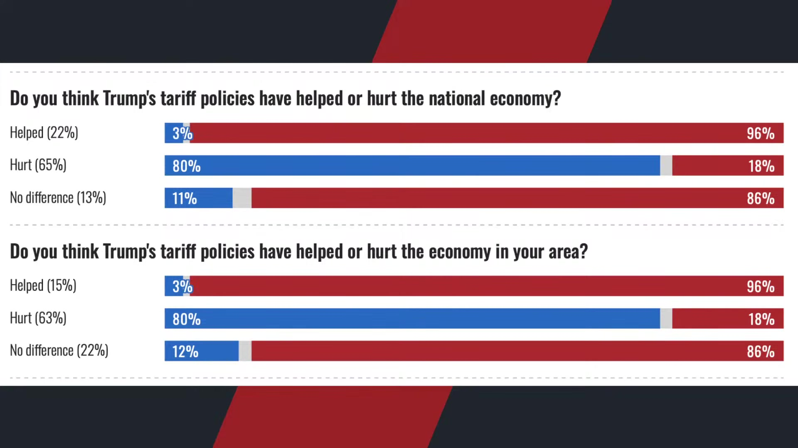

**逐字稿片段：** 卡尼在這一次 選後其實也表態了 不急著跟美國政府簽貿易協定 哈哈你是跛腳總統 跛腳總統有什麼資格來跟 我提相關的貿易協定呢 所以 有些國家看起來已經在拖時間了 不過這個問題我們之前跟總統聊過嘛 總統態度認為 他會繼續的依約來履行的 畢竟兩岸或者我們講說台美 之間的交易量已經太大了 大到經不起任何的風險了 那尤其 台商現在的確海外 佈局的需求也在增強 好但我們可以看一下 到時候韓國政府的態度 以前李在民一直在拖嘛 或者日本政府的態度 在這一次選後關稅 談判是否會加強進行 還是說能拖則拖 這不同國家所採取的態度 其實並不太一樣 但我們跟投資者分享 其實市場上針對這些 政治事件的反應呢 在股價上都並不是特別大 深圳唯一的反應就一個嘛 其實就是德州資料中心 是否會導致大規模的延後 那我們從昨天這種科技巨頭的大漲 搭配著記憶體股硬體股的大跌 其實已經稍微看得出來了 市場認為 總體從硬體的需求帶貨潮 似乎沒有來得這麼強了

**話題推測：** 卡尼人物照片或相關新聞畫面

---

## 00:29:44

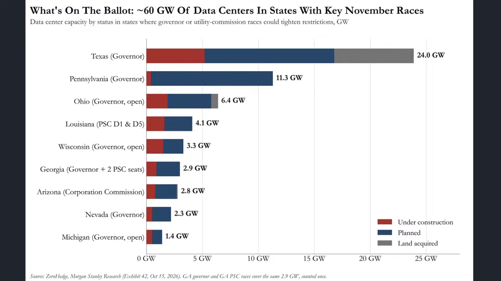

**逐字稿片段：** 我們從四大指數來做 觀察就可以瞭解了 道瓊指數上漲1,569點 哇大漲了三% 收在萬3,356點呢 直接拉回到所有均線之上了 標普上漲110九點 1.58% 收在7,688點 納指上漲3百六十四點 1.44% 收在25,736點 費半哇重挫三百三十一點 3.13% 收在 10,268點呢

**話題推測：** 道瓊、標普、納指、費半四大指數走勢圖

---

## 00:30:08

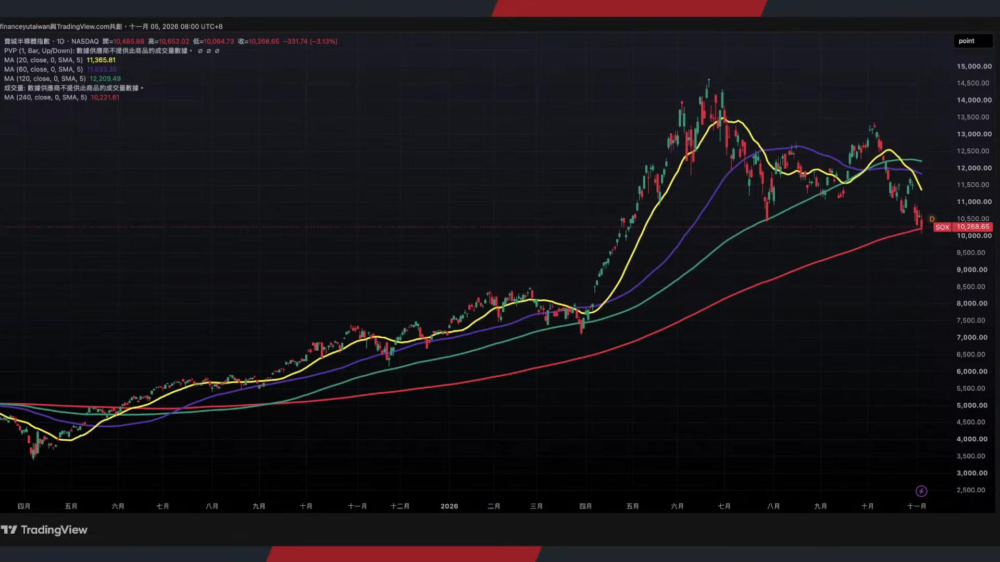

**逐字稿片段：** 昨天是記憶體股在殺 美光跌7% 威騰跌6.7% Sandisk跌7.9% 希捷跌8.13% 我剛才看韓國股市也跌蠻慘的 昨天SK海力士ADR跌了5%呢 哦這個對於費半投資者而言 的確壓力比較大 但今年它還是四大指數 表現最為亮麗的報酬 所以差別只在於 你今年買股票買在下半年 你就很痛苦 你買在去年年底 你就很開心 就這樣的一個區別而已 好對對 要準備又要睡公園了 其實現在就這樣漲最多 跌最多嘛 所以硬體股現在就是寒冬 網路上看到 本來想賺個買春的錢 現在已經有了賣淫的心 本來只是為了避開3%的通膨 現在已經賠3成了 不對 通膨因為3%要照算 就是賠33了 33趴了 本來是為了買奶粉的錢 現在連賣白粉的心都有了 這個沒辦法

**話題推測：** 美光、威騰、Sandisk、希捷等記憶體股股價跌幅列表或圖表

---

## 00:31:02

**逐字稿片段：** 好那我們看一下其中 選舉之後的幾張圖表 來看一下後續趨勢 至少整個大盤是在反彈的啦 首先我們看 本來執政黨集中選舉通常就會慘敗了 那只是這一次慘敗的幅度是 過去70年來的最大而已 再來過去二三次的期中選舉 只有3次執政黨會 增加眾議院的席次 所以本來眾議院的失去是符合預期的 參議院的失去的確才 有稍微有點意外 那共和黨總統 搭配著民主黨國會 的確歷史報酬是相對比較差一點的 可是重點是 他還是正報酬 分裂國會 其實不管怎麼說 股價都會上漲 只是有的時候漲得多 有時候漲得少 基本上由參眾兩院不同政黨 掌握的分裂國會其實更好的 那現在是白宮跟參眾議院 兩個分屬不同的政黨 基本上 它至少可以表現未來的 政策變化不會過快嘛 就是未來2年不會有像前兩年 川普這種瞬間行政命令 然後國會全部贊成的這種高強度的 立即有效的財政刺激政策向外輸出 某種程度它是另外一種穩定性的

**話題推測：** 期中選舉後股市趨勢預測圖表

---

## 00:32:04

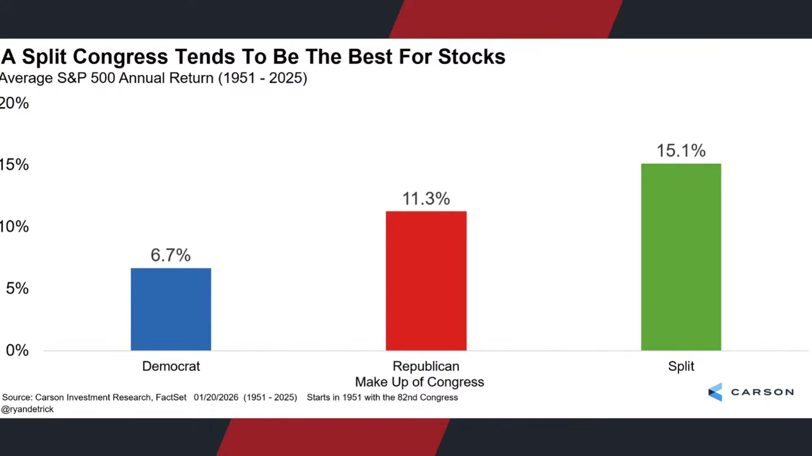

**逐字稿片段：** 過去13次的分裂國會 我們來做統計哦 標普500沒有一次在 未來一年是負報酬哦 哦所以其實 前前人已經先奠定了基礎 平均報酬大概是接近有17%左右 好其實就意味著 即分裂國會更有利於 政局或者政策的穩定性 這也給投資朋友做一些參考了

**話題推測：** 分裂國會下標普500指數歷史報酬率圖表

---

## 00:32:23

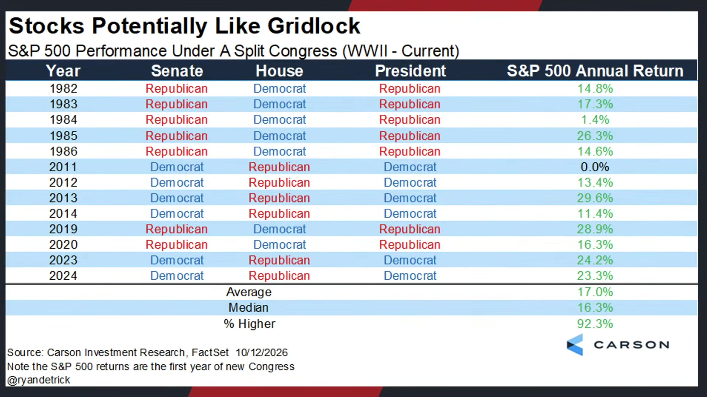

**逐字稿片段：** 當然了我們剛才聊了很多了 其實這一次 我們也看到川普在 期中選舉失利的時候 也發表了自己的談話來解釋 這場期中選舉的一個挫敗 他在裡頭的談話寫道 他說我的名字根本就不在選票上 如果我有參選 我們肯定會取得壓倒性的勝利 好川普也算對這次的期中選舉 做出了一些表態 原來大敗的原因是因為 這次不是總統大選的 如果是總統大選 貼上我的名字 那就完全不一樣了 好這是川普對於本場期中選舉的 終局解釋

**話題推測：** 川普人物照片或相關新聞畫面

---

## 00:32:57

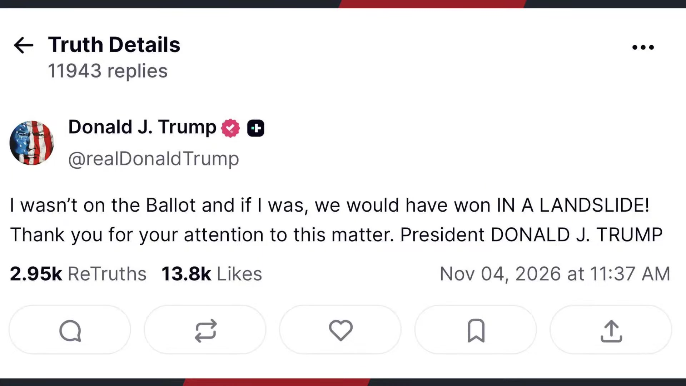

**逐字稿片段：** 白宮在昨天呢也善意的提醒 發了一篇貼文 來告訴大家 這個Trump is still your president 川普還是你的總統哦 我還是有否決權的 其實 這段話讓我不禁想起當年 川普在關稅戰的過程當中 那個意氣風發 那個永遠充滿自信的川普 即便面對選舉的挫敗 他依然能夠找到一個角度 來證明自己是那個贏家 好其實人生最重要的道理 就是輸贏不一定取決於別人的評價 它是取決於你怎麼定義自己的成功 選票可以決定誰當選 但不一定能夠改變 一個人對於自己的看法 希望川普也不要萬念俱灰 有你在 新聞才比較好聊畢竟呢 只要相信自己沒有輸 就永遠會有下一場的勝利 人生最大的自由 就是連輸贏的標準都可以自己定義 那川普 你贏了好不好你贏了

**話題推測：** 白宮發布『Trump is still your president』的貼文截圖

---
