# yutinghaofinance_b6e_2a_A5Is — 關鍵畫面索引

- 來源逐字稿：[yutinghaofinance_b6e_2a_A5Is_FIN.srt](yutinghaofinance_b6e_2a_A5Is_FIN.srt)
- 影片：https://www.youtube.com/watch?v=b6e_2a_A5Is
- 截圖數：35

## 00:00:40

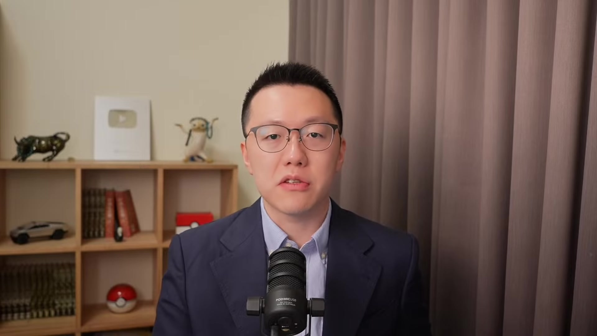

**逐字稿片段：** 上禮拜標不白指數大概跌2%, 納指跌4.5%, 好像越科技的跌越重, 尤其是費班, 一個禮拜跌了11.4%, 直接回到了 在今年7月份修正的底部位階 所以這算是25年4月初以來的最大單週跌幅了 上一次一週內跌個一成 這麼重就是關稅戰的時候了 尤其這一次針對記憶體股的賣壓 我們看美光全周跌了14.6%

**話題推測：** 開始分析標普500指數跌幅

---

## 00:01:09

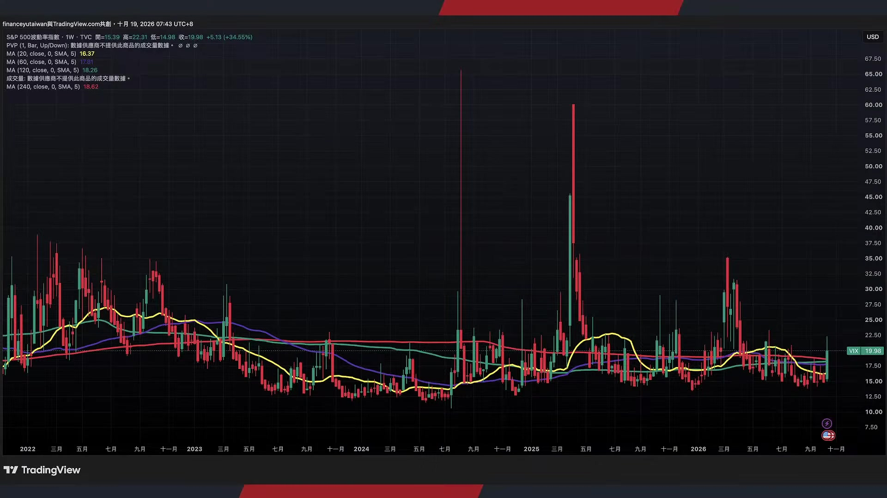

**逐字稿片段：** SK海力是一週ADR跌了16% VIC指數雖然有上行 不過好像剛剛開始 大概在19到21左右 也沒有受到極度恐慌 所以才剛剛開始疊 市場的情緒還沒有完全發酵 就已經疊得這麼離譜 難道臺北股市今天黑色星期要來了嗎 大師說我今年會為情所困 我不禁仰天長嘆 到底是親情愛情還是友情 沒想到是行情 我們頻道這麼多年 從七年前開始直播 大家陪伴我們看過高峰 睡過公園 見過總統 進過警局 我們什麼大風大浪沒見過 跟關稅佔比其實也還好啦 重點我們要觀察 到底本場是一個危機 還是一場機會呢

**話題推測：** 提及SK海力士ADR跌幅

---

## 00:01:57

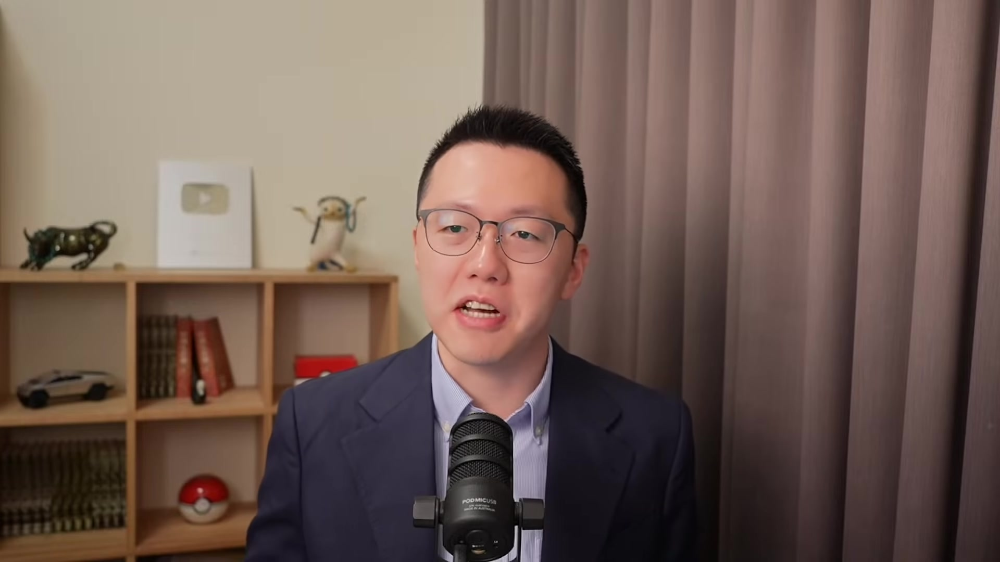

**逐字稿片段：** 今天我們要從不同角度來看 美國股市各國股市的回檔情況 先來判定其實到底回檔幅度 是集中在單一指數 還是全面性的系統性賣壓 那第二件事情 當然我們要清楚知道 有一件事情可以拯救 美國股市當前的位階 而恰恰也是美國股市下跌的原因 就是美債殖利率 瞬間十年期從當時的5.3% 已經回到5%了 所以現在唯一的好消息是什麼呢 股市這種跌法 跌到這禮拜 也許每天這樣跌 那聯準會就根本沒有升息條件了 有沒有可能正由於FOMC會議即將召開 股市才採取了一定的態度 逼你不升息呢 我們原本都預估的很滿嘛 完了十月要升息了 十月要升息了 跌成這樣怎麼升啊 這就很有趣的一個觀察重點了 也許藉由適度的估值回調來換取利率的平穩 是值得觀察的重點 好我們先回過頭說 其實全球股市都在回檔 但是回檔的程度其實並不太一樣

**話題推測：** 宣布接下來將從不同角度分析各國股市回檔情況

---

## 00:02:58

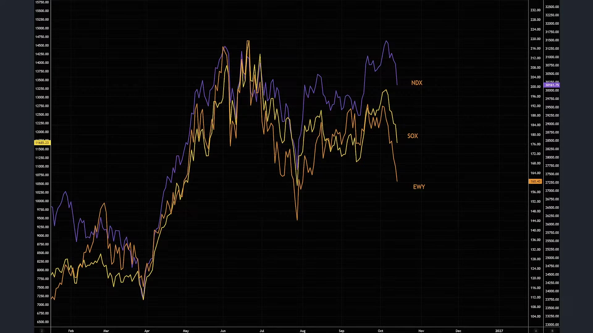

**逐字稿片段：** 我們以納斯達克100指數來看 現在的確也是面臨重要的技術關卡 我們從期貨價格來看 基本上4月份以來仍然保持顯著的上升趨勢線 那顯示低檔還是有買盤成績 那現在就在這樣的一個關鍵位階 其實上禮拜五算是跌破了 只是說下方的買盤 還是有一定程度在做支撐 儘管AI的融資成本上升 不過這些科技巨頭 他的本業收入 其實還是相對來的強的 所以我們之前 曾經在今年7到8月份 做了第一波測試 然後在9月份 也做了第二波測試 現在第三波 如果能夠成功站穩的話 說明市場的信心還是足夠的

**話題推測：** 分析納斯達克100指數技術關卡

---

## 00:03:41

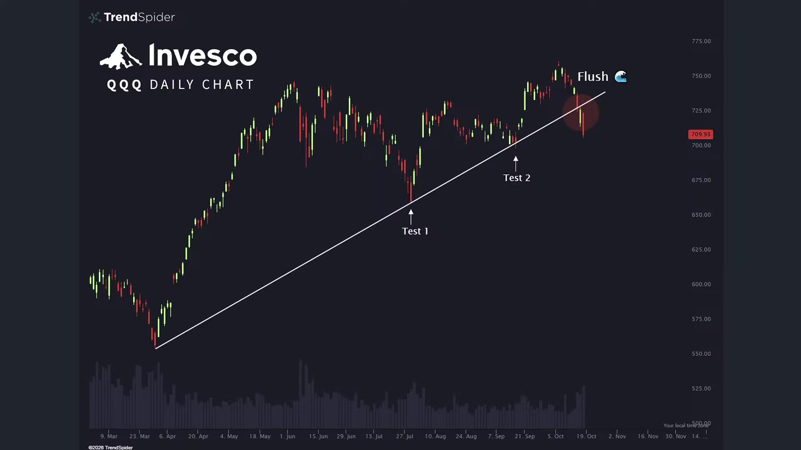

**逐字稿片段：** 真正的重災區 其實並不是在納指 是在廢辦 肺瓣從10月6號高點以來 累計下跌大概是12% 但是如果是從最高點來看的話 跌幅已經差不多進入到兩層了 算是進入到技術型熊市 不過因為肺瓣本來波動就比較大了 也不能說跌兩層就多恐怖 它經常漲兩層 所以跌兩層也很正常 你看今年從2月3月4月 那一波的漲幅其實也非常漂亮 所以即便它現在已經進入熊市 它從年初來看還是牛市 這個就是不同角度的觀察 但是至少已經回到7月份左右的低位了

**話題推測：** 將焦點轉向費城半導體指數

---

## 00:04:18

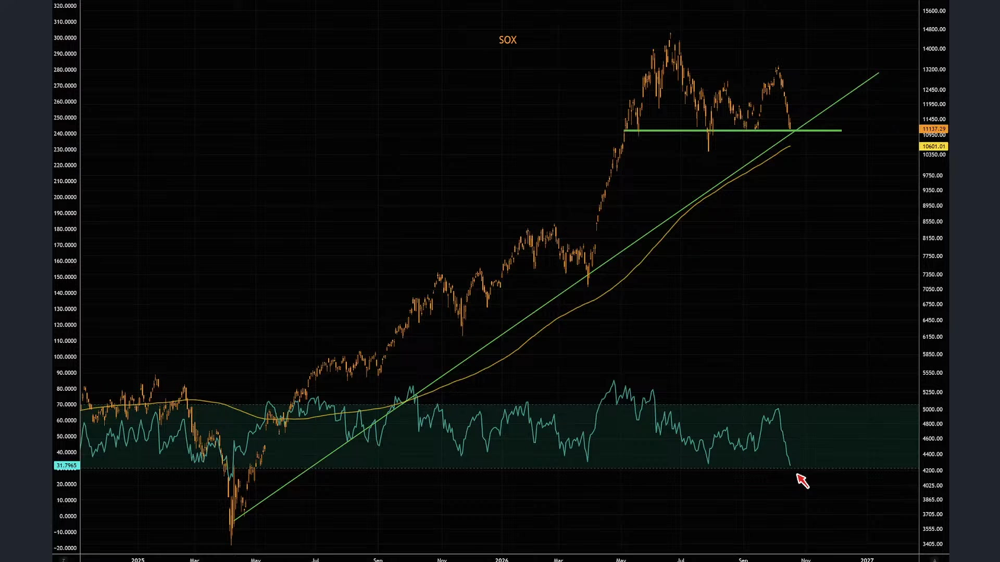

**逐字稿片段：** 那美國小型股的部分 其實這一波也比較慘痛一點 因為羅素2000它的指數是正式全面跌破了年限 背叛是真的把整個基期推得很高了 所以距離中長期均線都有一定的位階 讓它慢慢的來做中期回調 那這一次我們看到在小型股層面

**話題推測：** 分析美國小型股（羅素2000）表現

---

## 00:04:36

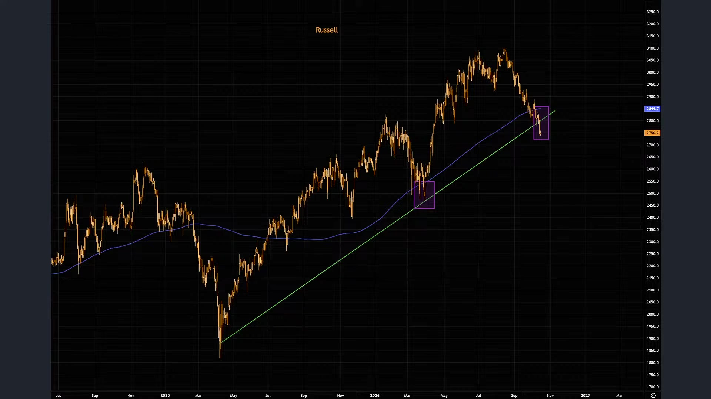

**逐字稿片段：** 尤其是五年期高收益債券的信用力差 已經擴大到六個月的新高 你像Core Wave 這些CDS價格 還有它發行的支利率 全部都在衝高 所以小型股 由於是更依賴於外部的融資 來活下去 那你借貸成本快速上升 信用利差快速擴大的時候 那股價通常下壓的力量來得越大 你要仔細想想 假設某一檔費辦的 大型科技全職股 它的跌幅是兩成 跟美國小型股跌幅是兩成 從同樣角度來看的話 費辦它至少還在不斷地賺錢 有本業支撐嗎 那小型股的部分 其實很多是靠融資循環 或者借貸成本持續活著的 所以整體而言 10月15號到16號 當時我們看到市場的跌幅 快速的進行下壓以後 我們就要看這一波直立率回來了 那小型股有沒有機會 能夠稍微喘一口氣 那看標普 標普的話那就真的還好了 幾乎沒跌 你還會覺得 有點在高檔震盪的位階 只能說市場的恐慌情緒慢慢升高 標普500現在大概在7700點左右 大概也回落到100日的均線附近 還是處於過去幾個月的橫向整理區 距離年限有一段距離 所以就代表著 其實整個大盤的衝擊 沒有想象中來得大 恐慌性情緒看起來就是針對 一個是小型股的部分 另外一方面就是屬於以硬體股費辦 今年二三月漲幅特別高的

**話題推測：** 提及五年期高收益債券信用利差擴大

---

## 00:06:08

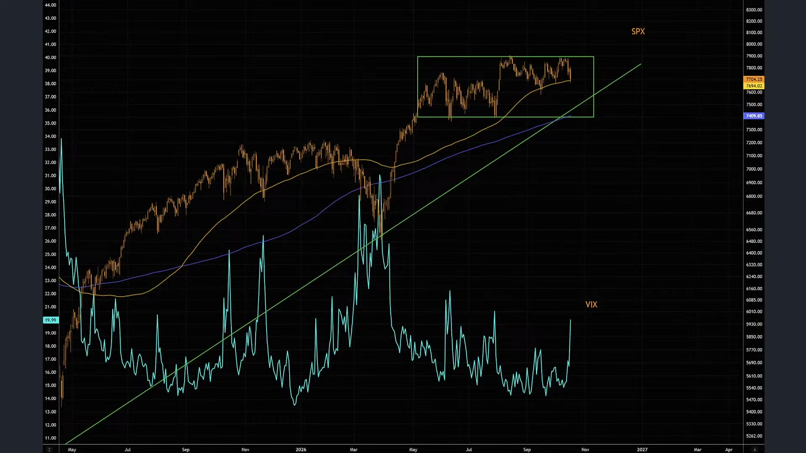

**逐字稿片段：** 再來看看韓國股市 韓國股市的ETF EWY 現在差不多就準備要測試年限了 那COSPI指數 因為今年以來漲幅就很漂亮 所以它跌兩層 今年在全球股市的漲幅當中 仍然位居前列 即便它已經跌這麼多了 如果現在從10月初高點6970點 南韓的綜合股價指數 COSPI指數來看 現在大概跌到了5550點左右 一週跌兩層 這太離譜了 大盤居然一週可以跌兩層 那值得注意的事情是

**話題推測：** 轉向分析韓國股市表現

---

## 00:06:40

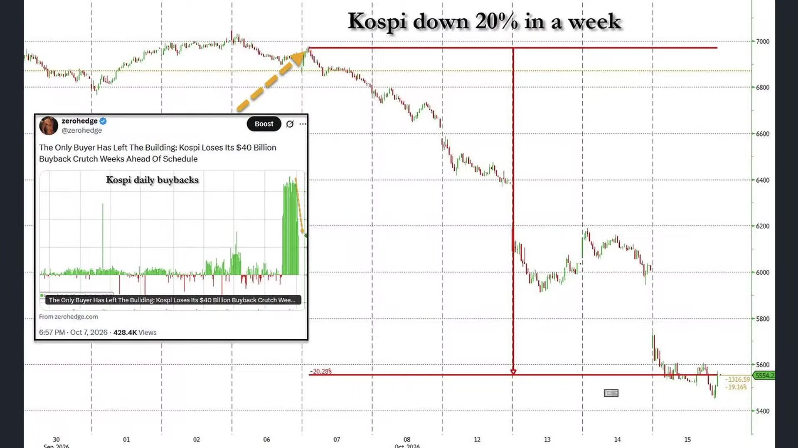

**逐字稿片段：** 這一波的下跌 其實跟南韓本土的內資買賣也有關 南韓的處境跟臺灣差不多 那外資都是在賣 隨隨便便都賣幾千億的 重點是臺北股市仍很有錢 你敢賣我敢接 所以你總覺得 每一次開低好像都走高 大家忍不住要進場 韓國股市其實之前也是如此 那為什麼這一次接盤力道這麼弱 原因就來自於 韓國股市先前有三星和SK海力士的 高強度的企業的積極回購 可是上禮拜它的回購幅度只有一半 我們看累積規模的部分 大概已經55兆韓元了 現在回購計劃來到尾聲 原本支撐股價的資金突然對長了 這就代表著公司派大股東的資金 上禮拜沒接價格就崩了 這就是一個值得觀察的重點 也就代表著臺韓股市其實都是靠內資在撐的 如果有人鬆動 價格就有可能會受到比較大的一個顯著回調

**話題推測：** 分析南韓內資買賣對股市下跌的影響

---

## 00:07:35

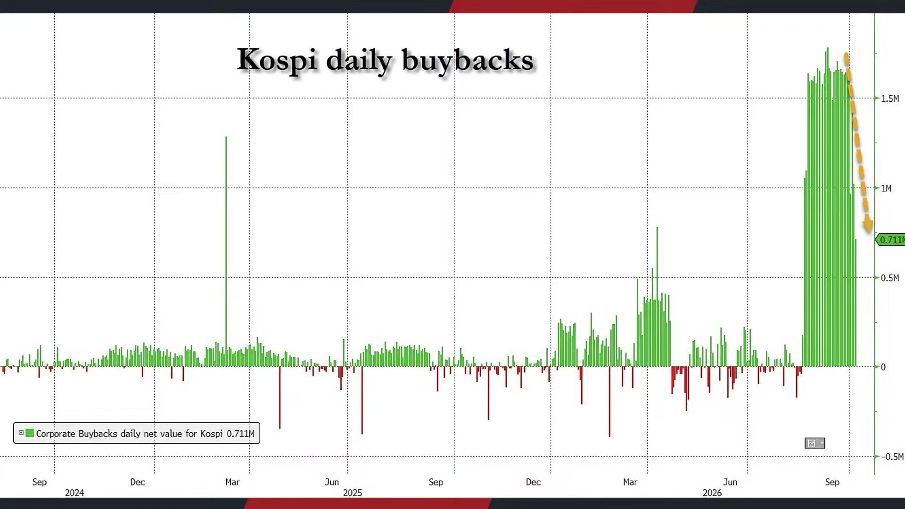

**逐字稿片段：** 那臺股的部分 第四法人什麼時候會卻步呢 我覺得現在市場行情波動比較大 但是這幾年 你好像也沒有看過臺北股市散戶 真的卻步過 我們只能儘可能去觀察 大股東層面是否會有一所鬆動 不過看起來 整體而言臺北股市 還是相對韓國股市比較健康一點 因為記憶體股本來就是重災區 所以它的賣壓比單純臺灣的先進製程 針對臺積電賣壓還來得重

**話題推測：** 轉向分析臺股表現

---

## 00:08:03

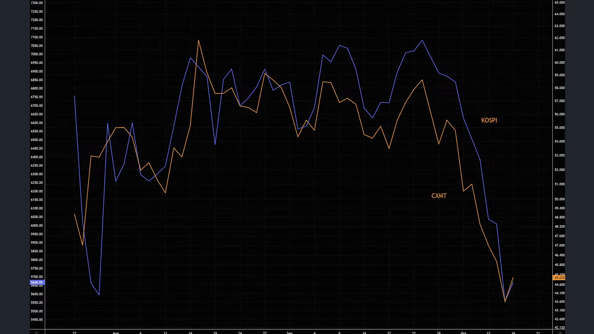

**逐字稿片段：** 我們看在過去一段時間 三星和SK海力士一週大概就分別疊了兩成和兩成六 外資連續八個交易日 賣超韓國股市科技股大概高達116億美元 那避險資金也在高強度的進行資金上的退去 尤其市場上擔心另外一個小型利空因子 就是長期存儲 目前全球第一輪的營收市佔率大概來到10%左右 那經過這波修正市場上會擔憂 即便可能28年29年 才會有那種市場的供給 逐步產能開出來 可是市場上也會擔憂 是不是提前估值預判過多 但我覺得也還好 因為三星股價淨值比 現在才1.2倍

**話題推測：** 提及三星和SK海力士的單週跌幅

---

## 00:08:45

**逐字稿片段：** SK海力士股價淨值比 只有0.9倍 所以你也不能講 他們的估值高到很離譜 但是就是漲多的賺錢的 看起來變成了市場回調的理由 而且回調的過程當中 還一方面透露出 只要殖利率下滑的差不多 也許我的賣壓就不用這麼大了 因為之前的賣壓就來自於高殖利率

**話題推測：** 提及SK海力士股價淨值比

---

## 00:09:06

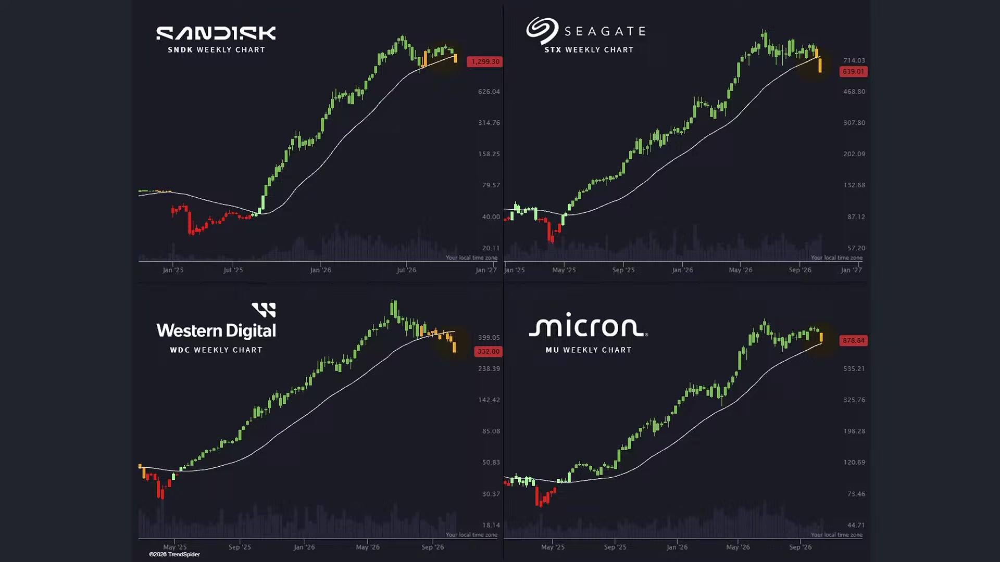

**逐字稿片段：** 我們從周線來看 記憶體和儲存設備類股 你像Sandisk 像希傑 像威騰 像美光 這一波都是經歷長時間的大漲之後 出現高檔回落 短期你都覺得快跌死人了 那隨隨便便都跌兩成的 可是從二月看到現在 你不覺得好像就是休息一下嗎 所以這是不同尺度來做觀察 所以我們一樣 在網友在聊天室留言 我們的名言是什麼 你不要看對趨勢 死在波動 個股當然 可能看對趨勢 或者看錯趨勢的可能性很大 但是對於長期而言 我們相信趨勢是 就在白蛋那邊 45度右上角前進 可是你不要死在波動 不要每一次一洗 你就被洗出場了 明明今年 你從年初到現在 其實還是一個大牛 怎麼一堆人都賠錢 這個就是今年 波動率加大 看對趨勢實在波動的主要原因 所以不要實在波動

**話題推測：** 分析記憶體和儲存設備類股（如Sandisk, 希捷, 威騰, 美光）周線走勢

---

## 00:10:02

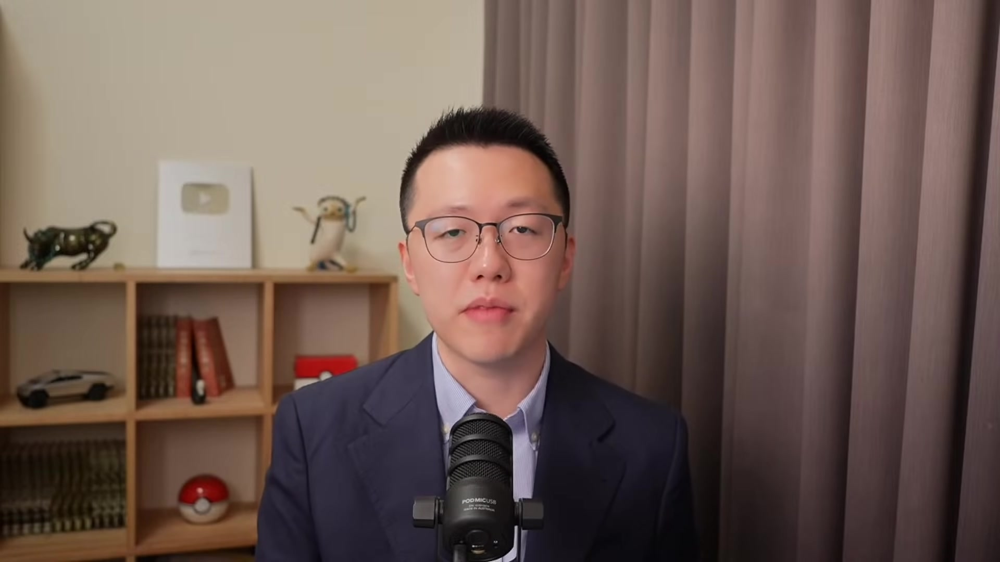

**逐字稿片段：** 好臺北股市的部分 其實AI股面臨很多人說是補貼壓力 我倒覺得是臺北股市是否處於 非常顯著的資金買盤動能 你把臺股拿來跟韓國股市

**話題推測：** 重新聚焦臺北股市AI股的補貼壓力

---

## 00:10:13

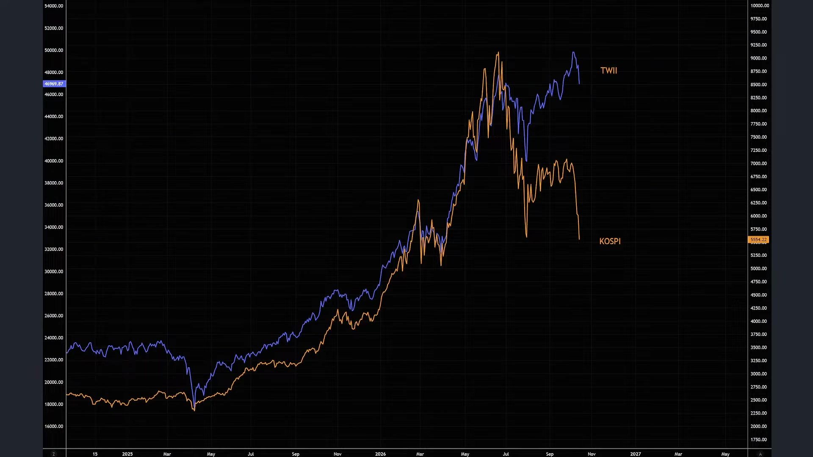

**逐字稿片段：** 從現行進行比較 你會發現臺股上漲的時候 就跟韓國股市一起動 那韓國股市下解 臺股就不動 所以其實從臺股的內資買盤 看起來比想象中還來得更為強勁 你說有沒有可能是韓國股市太討人厭了 因為那股市積極漲太多 又是景氣循環股 所以外資賣得特別重 這是一種角度 可是如果從外匯市場來看 外資是不分南韓臺灣的 賣壓其實都非常非常沉重

**話題推測：** 比較臺股與韓國股市的走勢

---

## 00:10:40

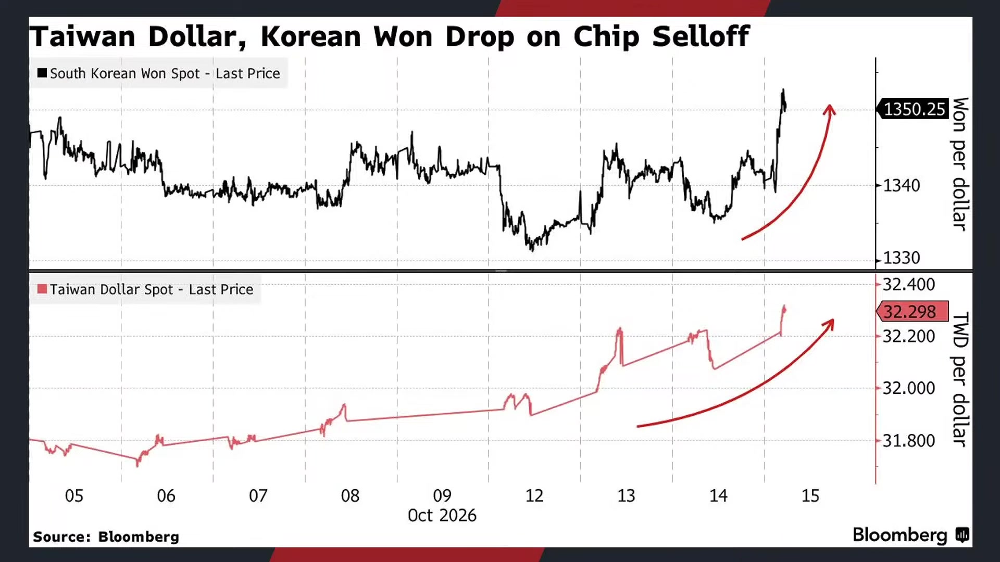

**逐字稿片段：** 我們看當時南韓股市盤中一度暴跌了8% 臺北股市是下跌3% 外資單日賣超臺股 離敗是當時93億 也創下歷史記錄 所以韓元和新臺幣其實都是同步貶值的 重點其實還是來自於 我們看到在內資的買盤層面 主要是南韓股市 大股東或者我們講說 股票回購的力度稍微有所減弱 那待會因為美國股市 週五真的是重挫 那臺北股市週一開盤 大概也難逃震盪 但投資朋友 市場本來就不可能永遠持漲不跌 你沒有蹲下去 下一次怎麼可能跳得更高呢 下跌的時候沒有小賣 上漲的時候你也不會有小賣 市場不會因為我們害怕就停止下跌 也不會因為我們猶豫 就等著我們上車 真正決定長期報酬的 都不是行情好賺了多少 都是你行情差的時候 你能不能保持自己的紀律 守住自己的部位 甚至把握別人恐慌時出現的機會 你只要基本面沒有改變 那股價修正不一定是壞事 所以你要問的事情是 你有沒有發現基本面改變了 所以當然了 投資本來就是有風險的 我們一直跟投資朋友分享 世界上最重要的兩個賭博 一個就股市 另外一個燙頭法 股市其實就是賭場 那網絡上看到一句話 從不賭博的人才是最大的賭徒 因為他all in了餘生的平庸 你不賭不就是在賭自己會輸嗎 這也是一種角度 你沒有跟上大盤 本身也是一種輸家 你的資產 你所累積的現金戶頭 跑輸給了通膨 本身也是輸家 所以這有不同角度來做思維 你還在賴總統專訪 今天都要崩盤了 你還在賴總統 都要睡公園了 我覺得問題問得還不錯 答不答得好 大家自有公平 而且我覺得我態度很和善 因為後面站兩個隨乎 我怕我亂講話 把我壓住 沒有啦 大家聽了有收穫 那就有收穫 沒收穫也是一種收穫 不要戀戰 搞清楚現在該關注什麼事情 股市 禮拜五賣壓這麼沉重 你反而要掌握住機會 搞不好今天開低走高 這很有可能 臺北股市散戶的慣性都是如此 對我管你是做 網絡比特權還是現實小綿羊 我們都是股市大野狼 股市不是在上漲時創造的 財富不是在上漲時創造的 是在下跌時佈局的 牛市不是用追的 是在熊市裡等來的 買股票不是用喊的 是用買的 長期投資不能用講的 你要用報的 愛不是用說的 愛是用做的 交易不需要感情 交配才需要 給投資人做一些思考 所以我們接下來回過頭看 好那回到原點 那股市跌是跌了 可是好處是什麼 股市跌怎麼會有好處 一個好處就是 股市跌回調才有買點 第二個好處是什麼 第二個好處正向思維

**話題推測：** 提及南韓股市與臺北股市盤中跌幅

---

## 00:13:36

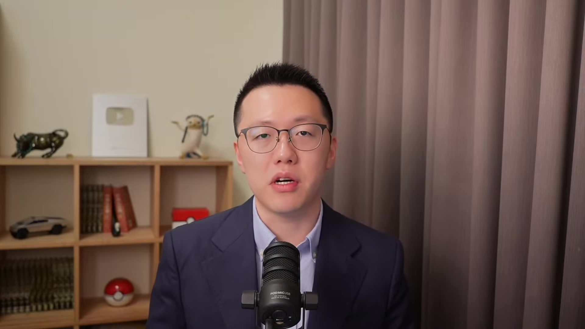

**逐字稿片段：** 升息幾率暴跌了 我們如果仔細觀察 這一輪美國股市的快速下挫以後 市場針對10月份的利率預期 正在快速的一個收縮 原本以為PPI CPI的數據開成這樣 聯準會可能被迫真的要升了 結果我們看到這一輪美國股市的暴跌之後

**話題推測：** 討論升息機率因股市下跌而暴跌

---

## 00:13:56

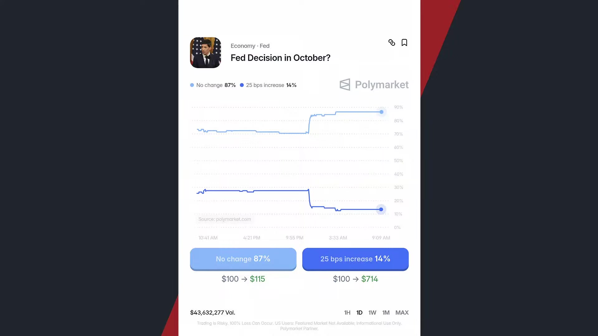

**逐字稿片段：** 往往照Polymarket市場的賭盤 認為保持當前利率的賭盤幾率已經來到87% 認為會持續升息一碼的幾率只剩下14%了 那你說那是以後都不升了嗎 也沒有 時間延後了 延到12月 12月到時候升息一碼幾率還是高達78% 這說明著股票市場的跌幅 是足以影響到市場的通膨 習性和慣性和預期的 用這樣的一個角度 來換取利率不上升的空間 股價給你做一點回調 來換一些利率空間 到底劃不划算呢 我個人認為是很划算的 你讓利率一路的飆上去 總有一天 這些投資等級在發行量

**話題推測：** 提及Polymarket市場對10月份利率預期的賭盤機率

---

## 00:14:35

**逐字稿片段：** 會出一點事情 所以我們看10月初以來 當時美國十年級公債殖利率 是一度突破5.3% 創下2006年以來的新高 現在回到5% 是不是一件好事呢 這是第一個角度 那第二個角度說 可是好像它的通膨疫情也沒有全面消失 它晚一點升而已 沒錯 因為的確現在通膨問題還是比較嚴重的 我們上禮拜跟投資朋友提過 在9月份的消費者物價指數 年增幅是來到了3.7% 高於市場預期的3.6%

**話題推測：** 回顧美國十年期公債殖利率突破5.3%的歷史高點

---

## 00:15:05

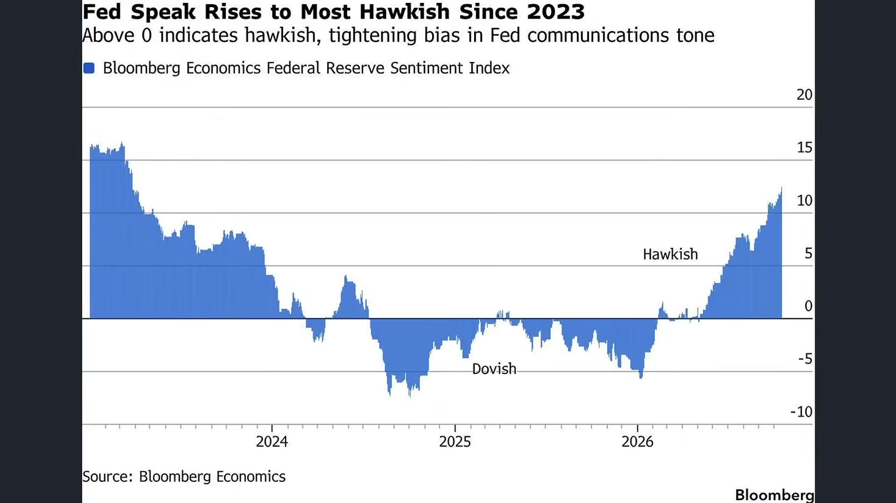

**逐字稿片段：** 核心通膨的年增幅也來到2.6% 超乎預期的2.5% 這個是已經公開的訊息 但重點在於什麼

**話題推測：** 提及核心通膨年增幅

---

## 00:15:13

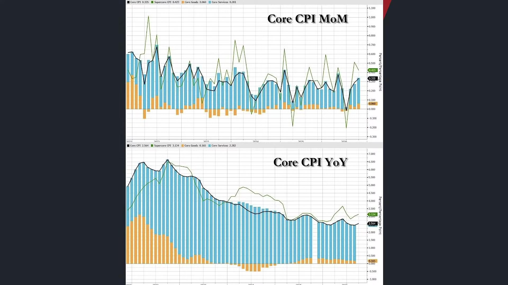

**逐字稿片段：** 重點在於PPI 由於汽油柴油價格還在衝高

**話題推測：** 將重點轉向生產者物價指數（PPI）

---

## 00:15:18

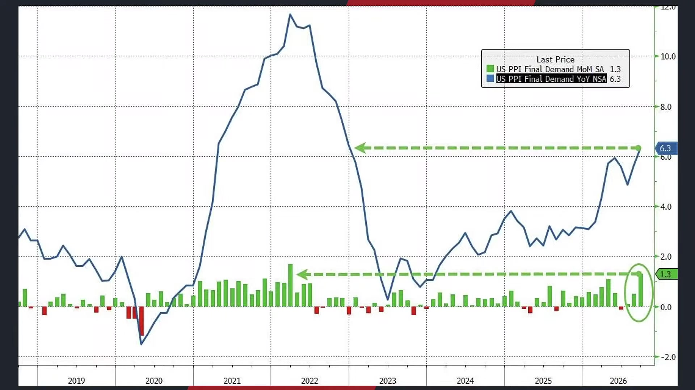

**逐字稿片段：** 9月份的生產者物價指數 月增幅來到1.3% 這個就不僅超過原本預估的0.6 超過了接近一倍 而且是2022年3月份以來的 最大單月漲幅 這每一戰事都多久了 怎麼生產者物價指數 現在開始暴衝呢 原因就來自於外溢出去了 這也是我們最擔憂的情況 真的發生了 年增幅現在生產者物價指數 大概是6.3% 也比市場預期的5.4%還來得高 是2022年12月份以來的最高 那這一波通膨 當然是由能源價格作為主要的帶動方向 最終需求商品單月價格是上漲了2.6% 更值得警惕的事情 就是剛才提到的外溢效果 如果我們把能源項目給它剔除掉 假設以後每一戰事就結束了 企業還是面臨廣泛的成本上升

**話題推測：** 提及9月份PPI月增幅與歷史新高

---

## 00:16:08

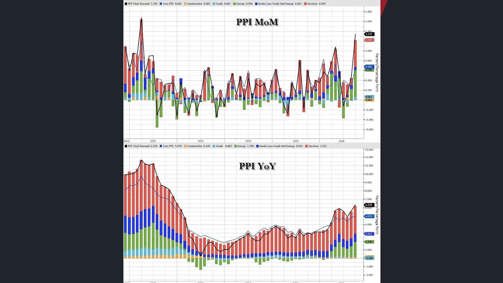

**逐字稿片段：** 我們看中間財的部分 生產者物價的漲幅 現在是遠遠高於消費的物價 這說明什麼 說明企業面臨利潤率 遭到壓縮的風險 如果中下游企業 不快速的轉進到CPI 那這些中小企業就要虧錢了 那你說那中上游的這些公司 那怎麼還不轉價呢 因為他還在搶市佔率

**話題推測：** 比較中間財生產者物價與消費物價漲幅

---

## 00:16:29

**逐字稿片段：** 我舉例來說 你像OpenAI 像Google Amazon 這幾個月他真的有調漲 我們訂閱AI的內容的訂閱費嗎 其實並沒有 因為他還在搶市佔率 可是他新建AI的成本 是變高了還變低了 記憶體價格漲成那樣 當然是變高了 所以這是我們觀察到 很多企業現在還在自行吸收成本 就是因為AI的爆發期 大家還不敢貿然的去漲價 這個就值得大家觀察的幾大重點 當然我們看到川普政府 也採取一定的手段 想要嘗試的降低大家的通膨預期 這也是美債殖利率下滑的一個原因 我認為美債殖利率下滑的原因就兩個 一個就是川普出招壓通膨 擴大供給 另外一個就是股市下跌 川普這一次正式宣佈豁免俄羅斯新一輪的制裁 主要是壓低能源價格放鬆限制 這在10月16號晚間正式簽署了行政命令 正式豁免上個月國會通過的 格蘭姆制裁俄羅斯和伊朗法案 決定暫時不對俄羅斯實施新一輪的經濟制裁 那這項法案上個月通過的時候 原本是要求美國加強制裁俄羅斯的國防 能源產業還有規避制裁的影子游輪船隊 那其實早在拜登時期 就已經開始制裁俄羅斯原油了 那這一份是把訊息包羅得更密 或者說採取更為嚴重的監管的措施 甚至授權總統對於購買俄羅斯石油 或者天然氣的國家 時間課程百分之百的關稅 搞得大家不願意去買俄羅斯原油 這是當時這項法案所採取的一個目的 可是法律通過之後 第一川普不啟動措施 他也不根據這項法律來採取行動 甚至第二 川普直接豁免了俄羅斯 在新一輪制裁當中 可能遭受到的衝擊 所以這就導致很明顯

**話題推測：** 以OpenAI, Google, Amazon為例說明企業吸收成本

---

## 00:18:16

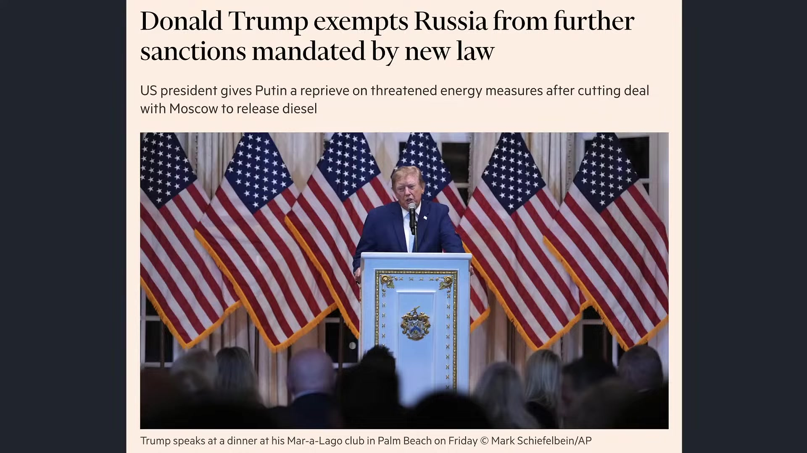

**逐字稿片段：** 共和黨內部已經開始內訌了 因為這個是兩黨的共識 已經通過的法案 現在至少有八名共和黨參議員 公開反對 認為川普無視 已經獲得幾乎是 這個共和黨和民主黨 雙方都已經同意的 對俄的制裁法案 當時是86比11 說明很多民主黨和共和黨黨員 是站在同一個立場的 那他們很擔心 會讓俄羅斯瞬間多了更多的能源收入 繼續支撐對於烏克蘭的戰爭 但是川普很明顯知道 相對於美國人 美國人到底在乎的是 我們對於俄羅斯 對於烏克蘭的支持 還是美國人更在乎目前的油價呢 川普選擇了油價 先就油價 先把俄羅斯的制裁予以鬆綁 把供給先開出來再說 而且也要求烏克蘭不要再供給 俄羅斯的煉油設備 網友問川普回信了嗎 對 回關稅信了 我還在等他 好不好

**話題推測：** 提及共和黨內部對川普行為的反對聲浪

---

## 00:19:11

**逐字稿片段：** 當然 澤林斯基也警告 因為這一輪的確川普所採取的一系列措施 看似又有利於俄羅斯 澤林斯基在歐盟峰會當中警告 如果俄羅斯贏得戰爭 最多可能會有2000萬名烏克蘭人 被迫逃亡歐洲 規模會遠遠超過2015年的歐洲難民危機 他特別強調 只要俄羅斯攻擊沒有停止 那很有可能到時候出現龐大的人口遷移 那歐洲到時候的住房 醫療教育社會福利公共財政 都會遭受到巨大的毀滅 他就暗示說你讓我打輸了 那到時候我們的難民就會逃往你們歐洲 那你們這幾年見到的慘狀 有可能就再度的重演 或者情況會來得更加惡劣 有種情樂 要求歐盟儘可能提供更多的資源 為什麼 因為美方似乎在川普最近的態度 已經做了一些表態了 所以這其實就暗示著 美國公債殖利率過去的上升 一方面當然要通膨的因此 一方面是AI的資本支出 導致投資等級債的發行 壓縮了美債的買盤空間 最後推升美債殖利率 第三點就是我們最近講這件事情 就是這其實世界的局勢 我們看起來好像大家已經習慣了 從烏二戰事以後 好像就亂亂的 亂亂的大家也接受了 股市也越漲越高 可是衝突數其實是不斷的上升的 這就代表著市場某種層面 對於這些大機構來說 它會慢慢的增加自己要求的風險益籌 風險貼水

**話題推測：** 引入澤林斯基在歐盟峰會中的警告

---

## 00:20:42

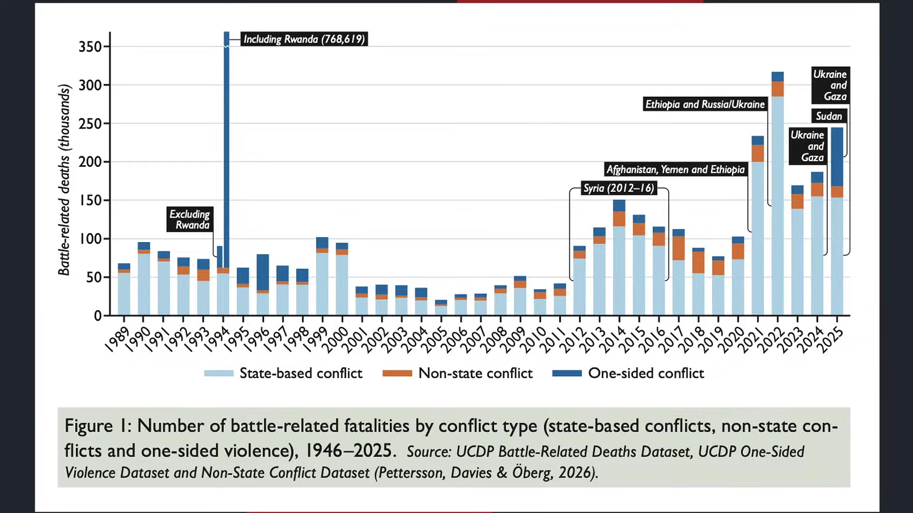

**逐字稿片段：** 我們如果仔細觀察 如果你把全球國際危機組織所統計的武裝衝突 現在全球大概有65場戰爭正在開打 這個是第二次世界大戰以來的最高記錄 英國政府的統計 俄羅斯入侵烏克蘭大概是150名俄軍傷亡 加薩戰爭大概是7萬名巴勒斯坦人死亡 蘇丹的內戰 其實有1400萬人流離失所 那這些衝突的背後 其實都隱含著 目前如果是單純從絕對數量來看 差不多就跟二戰一樣 就是目前全球死亡人數 死傷人數 軍事的攻擊程度 大概就僅次於二戰 那是不是要求市場 有更多的風險提水呢 所以這是給投資朋友 做的另外一層思考 我們從不同角度來做思維 其實都可以理解到 現在的美債殖利率的高升 它是多因子的變相而組成的 那你要讓這個因子變相稍微緩解 光靠股市的下跌 也沒有太大幫助 你要打造的消息是什麼 就是生產力要一方面提升 就是AI在搶錢 可是AI又賺很多錢 那大家就會相信 那也許未來可以創造更多的財富 那我市場的買盤就有信心了 對於美債買盤也有信心了 對於通膨也是如此 不只是戰爭要結束 而且你最好能夠擴大適度的供給 才能夠讓原油價格 不要具有它的僵固性 另外一方面我們也清楚知道 現在市場上其實最為關注的 就是利率的高升 對於AI的科技巨頭的投資等級債 產生了衝擊 但是對於股票市場還沒有完全的發酵 除非這些投資等級債的威脅情況 開始慢慢解除 要不然股票市場下跌 好像只是剛開始反應而已

**話題推測：** 分析全球國際危機組織統計的武裝衝突數量

---

## 00:22:27

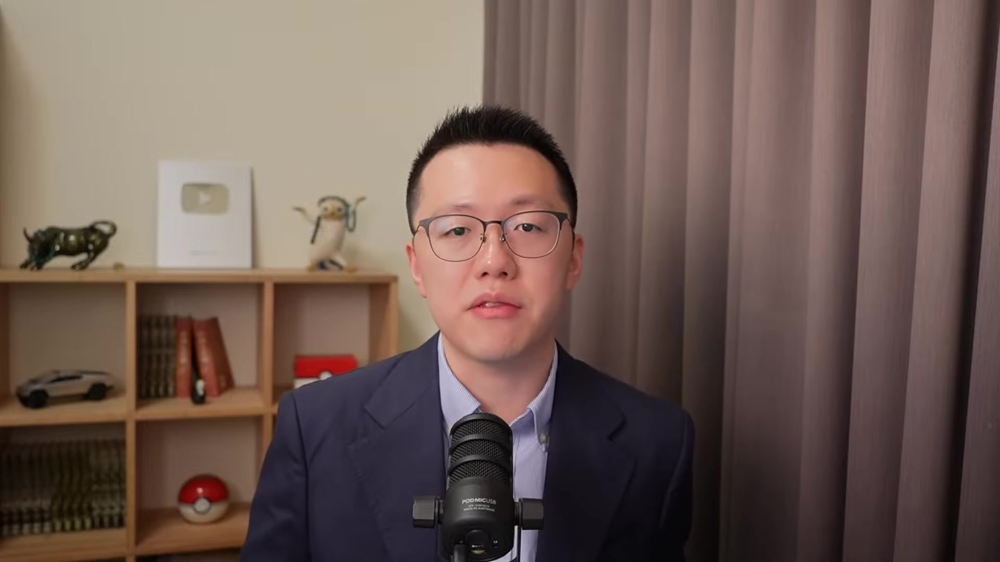

**逐字稿片段：** 我們舉例來說 賬圖表示我們看到Core Wave 垃圾債券殖利率 本週大概已經飆到了 接近15%左右 通常已經達到被視為 具有財務困境的水準 這個是黃仁勳的手上的愛將 儘管Core Wave是不斷地強調 財務狀況是足以去支撐債務的 黃仁勳甚至在上禮拜 還出面力挺 說大家不用擔心 這些AI公司的信用風險

**話題推測：** 以Core Wave垃圾債券殖利率飆升為例

---

## 00:22:52

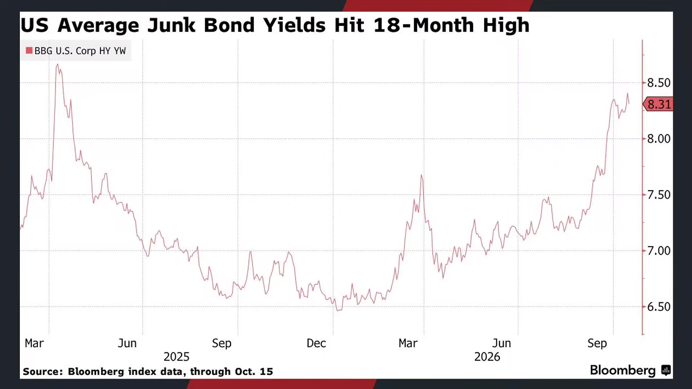

**逐字稿片段：** 像美國的垃圾債平均殖利率 大概來到8.41左右 去年年底也不過6% 現在殖利率已經超過到8% 那創下18個月以來的新高 這也讓市場上開始意識到 很多AI的雲端樂者 像Volta一系列 大概都開11到12%了 Core Wave已經算是很不錯了 但是現在也要開15% 黃龍遜的愛將都必須要開15%的 債券殖利率給人家來做使用 另外一方面我們看到甲骨的部分 目前所發行的短天期融資殖利率 也在瘋狂的上升 大概10到12年期的債券殖利率 8.5% 甲骨文這麼大間 他都開8.5%了

**話題推測：** 提及美國垃圾債平均殖利率

---

## 00:23:34

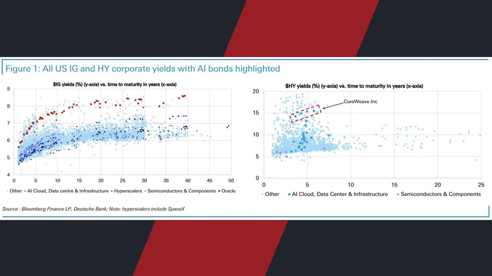

**逐字稿片段：** 我們看Meta Google回答 上禮拜在短天期的融資利率 大概是5到5.5% 反正就是高於目前的 10年期美債殖利率 所以一系列的衝擊 會讓大家開始 採取更多的保險情緒 那我們只能說股票回跌 它是一個估值回調的理由 它可以有一點喘息的空間 它至少可以讓大家意識到 中期回調不見得是一件壞事 可是從中長期角度而言 如何讓市場針對債券市場的擔憂 能夠緩解 才是拖動美國股市 接下來創高的理由

**話題推測：** 提及Meta, Google, Nvidia短天期融資利率

---

## 00:24:06

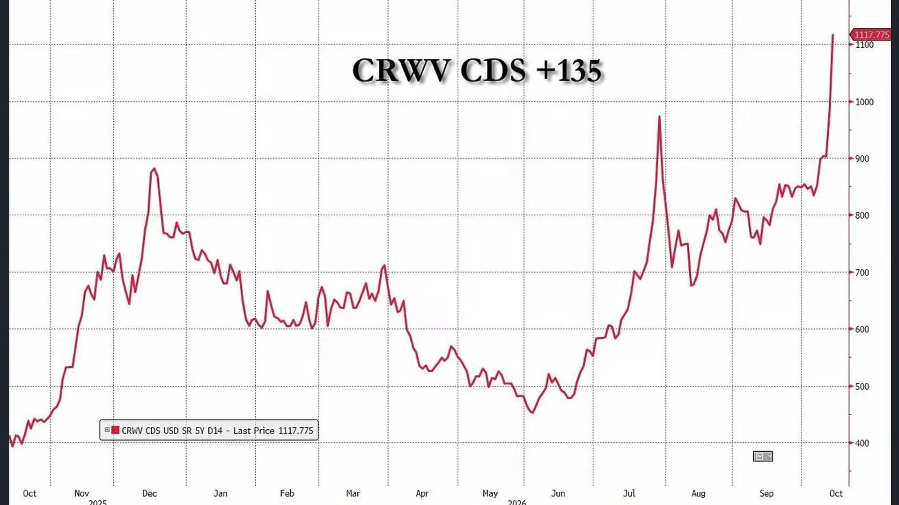

**逐字稿片段：** 我們以Core Wave來看 目前它的五年期的信用違約交換利差 大概是1117個基點 市場代表價格隱含 未來五年大概63%左右的違約幾率 63%的違約幾率 這家公司看起來也是完全賭上了自己的未來 OK我們這邊訊息 主要是跟投資朋友稍微梳理一下 現在這些高值利率的因子 它背後有不同的因素所組成 可是股票市場的下跌 它只能換取一些空間 做一些中期回調 未來到底能否順勢的站上 一方面先看財報 第三季財報 那另外一方面 當然就看到時候的AI 能否有進一步的生產力提升 這個市場上 某種程度就意味著 我們還在懷疑成長 這市場總是在悲觀中 應該講說樂觀中 行情總在悲觀中 樂觀中破滅 在半信半疑中成長 那不管怎麼說 現在美國股市低 至少不是極度樂觀 那第二呢 這一輪中期回調的理由 並不來自於供給過剩 因為根本就蓋不完 主要原因還是來自於高利率的原因 好那第三件事情 股市下跌 讓利率稍微下滑 它只能解決掉短期內的擔憂 但長時間我們還是要看 那再次的情況是否能夠有效的好轉

**話題推測：** 分析Core Wave五年期信用違約交換利差與違約機率

---

## 00:25:25

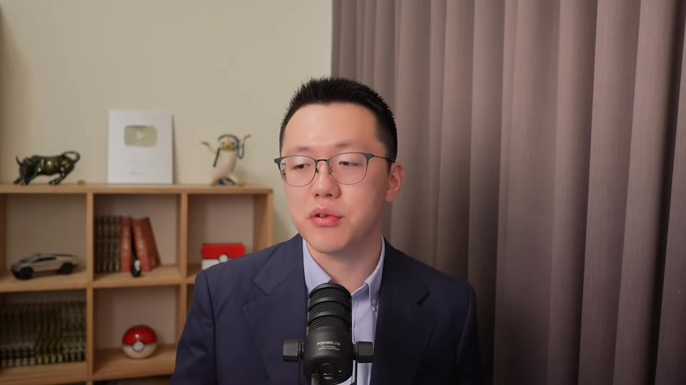

**逐字稿片段：** 看一下道瓊指數變化 下跌175點 0.34% 是在5202點 其實道瓊還不錯 還佔上記線

**話題推測：** 報告道瓊指數最新變化

---

## 00:25:33

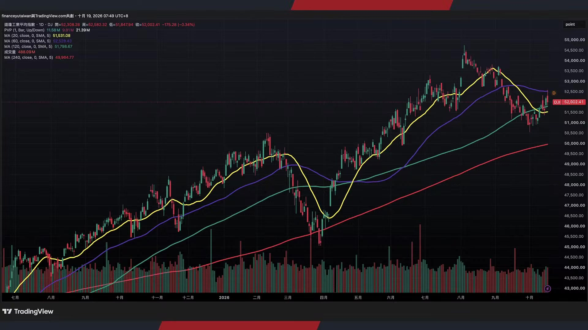

**逐字稿片段：** 標普白指數下跌84點 1.09% 是在7659點 納指下跌572點 2.15% 是在26140點 肺斑下跌443點 3.83% 是在11137點 肺斑就真的長得比較難看一點 希望能夠守住 守不住也還好 其實今年年初長到現在也很多 那就放寬心的好好擁抱本次的下跌 沒有下跌哪來機會 其實放大到股市下跌都差不多 我們過去幾個月行情好的時候 人人都是股神 四代同堂 六代同堂 我們一直跟大家分享 槓桿是拿來超車 不是拿來飆車的 買什麼漲什麼 隨便追高好像都能賺錢 那開始懷疑自己是不是有投資天賦 原來我就是臺灣巴菲特 結果這幾天 股票市場開始調查大家的投資實力 原本以為自己獲利能力太強的 那股市跌幾天發現 這個原來我能力也不過是如此 所以以大盤作為主軸 來看待每年的績效 是否能夠跑贏大盤 跑不贏 加入大盤也是一種方式 其實放大到投資市場都是這樣子 每個人都覺得自己是股神 只有市場開始調查 你才發現原來過去的超額報仇 根本沒有足夠的證據 自己具有實力 發現原來從頭到尾都是運氣 昨天看一個段子 講太太穿上女警制服 cosplay 一臉嚴肅的對丈夫說 先生你涉嫌床上表現太好 我現在要逮捕你 先生很興奮 沒想到他喜歡這種角色扮演 過兩分鐘 太太宣佈撤銷所有指控 理由是證據不足 就人生最殘酷的事情 不是被人誤會 而是原本以為自己罪證確鑿 最後因為證據不足 當庭釋放 放到投資市場 每一個人都覺得自己是股神 在今年年初的那種行情當中 結果市場認真一調查 原來超額報酬 也不過就是 Beta的波動放大而已 你根本就沒有足夠的證據 去證明自己的實力 發現從頭到尾 原來都是運氣而已 這個就是檢視 自己投資能力的時刻了

**話題推測：** 報告標普500指數最新變化

---

## 00:27:48

**逐字稿片段：** 好 那不管怎麼說 今年其實全球各大資產價格的表現 還算是一半漲一半跌

**話題推測：** 分析今年全球各大資產價格表現

---

## 00:27:56

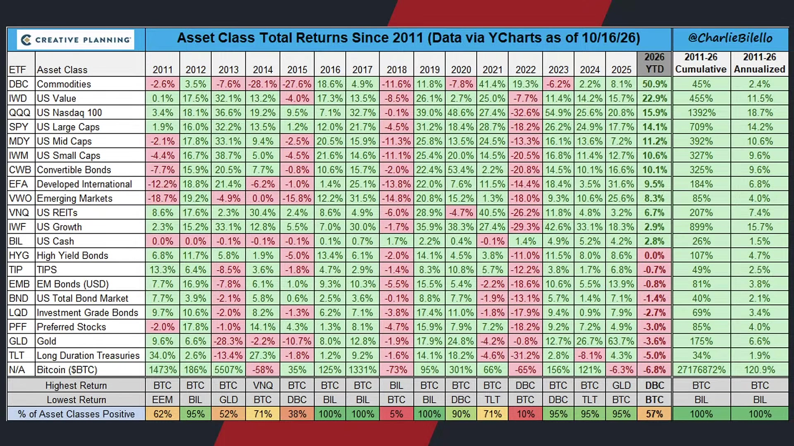

**逐字稿片段：** 截至到上禮拜五為止 原物料價格還是漲了50.9% 所以今年是一個通膨年 這個沒話說 能源價格正漲太多了 美股的部分 大部分還是維持正報酬 不過內部分化很明顯 價值股漲了兩成二 超越納斯達克一般指數的15.9% 標普500今年還漲了14% 成長股2.9% 當然債券和避險資產價格表現比較弱 這個就來自於高值利率的影響 長天期美債是下跌5% 投資等級在2.7 美國整體債券大概下跌1.4 黃金今年也跌了3.6 比特幣已經算不錯了 我們來跌幅還有來到兩層三層 現在大概跌6.8%左右而已 今年21類資產當中 大概是57% 在今年算是取得了正報酬 明顯低於2024年和2025年的95% 所以今年必須承認 你看臺股的漲幅 韓國股市還是很誇張 可是今年其實從資產的配置來看 也許大家會有一點痛感是真的 雖然總體跌幅下跌的資產 跌幅跟上漲的資產也差很多 但是還是可以感受到那種購買力的衝擊 為什麼 因為漲最多的不是大宗資產 應該講說前兩年漲最多的不是大宗資產 今年是大宗資產 所以今年即便股市漲那麼多 你都有那麼依稀的感覺 那個通膨有點太誇張了 我們講的通膨都還不是消費型的通膨 我們講的是原物料的通膨 生產者成本也上升的太誇張了 這個就是實質購買力衰退 可能產生擔憂 好臺股持續下跌670點

**話題推測：** 提及原物料價格漲幅

---
