# yutinghaofinance_eet_LPUY8Q0 — 關鍵畫面索引

- 來源逐字稿：[yutinghaofinance_eet_LPUY8Q0_GT.srt](yutinghaofinance_eet_LPUY8Q0_GT.srt)
- 影片：https://www.youtube.com/watch?v=eet_LPUY8Q0
- 截圖數：21

## 00:00:35

**逐字稿片段：** 今天美股股市 我們要看在禮拜五 稍微做一些反彈之後 能不能帶動 在禮拜五 隨著國安基金還有限空令等進場 帶動臺北股市的拉高 不過拉高之後會不會下壓呢 我們就要看一下這一次 輝達的間諜案越演越烈以後 對於股票市場的承壓 我們知道在短期內 利空是真的蠻多的 一個接一個 利空斷不了 外遇已經夠慘了 更慘的是外遇物件有可能是間諜 我們要如何來做一些總體衡量呢 今天我們從臺北股市美國 股市的市場面以及從消息面看看 那能不能今天是最後一天的利空呢 我們根據在金融時報的報導 黃仁勳在這一次兩個 小時之前的內部信件呢 已經承認了婚外情 並且向妻子子女和 公司的員工公開道歉 他也表示自己的不忠 行為的確傷害了家人 沒有任何的藉口 未來會努力重新贏得信任的 那我們當然很清楚知道 這一次最大的問題哦 那當然跟外遇案沒關係 要不然大家都去關注馬斯克就好了 重點來自於我 我們知道在過去兩周 不管是金融時報還是華爾街日報都 不斷地披露黃仁勳和一名涉及中國 情報活動的女性有親密的關係

**話題推測：** 開始討論美國股市的整體表現。

---

## 00:01:47

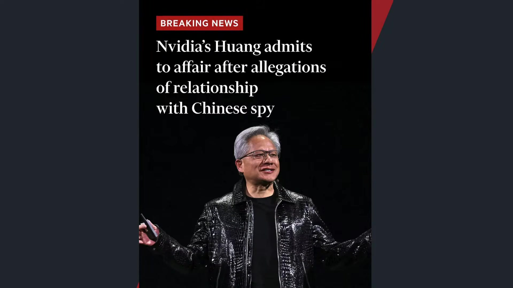

**逐字稿片段：** 而目前呢 她是處於新加坡的企業Megaspeed 那這家企業購買了大量的GPU 美國情報機構也懷疑它可能 已經被中國國家安全部所吸收 所以這一次我們要真實瞭解的方向是 黃仁勳雖然承認了婚外情 不過到底能否確認輝達 的商業機密已經外泄 好根據目前他所釋出 的最新的內部信件呢 他主要其實集中在道歉的部分 那至於輝達董事會在 稍早所發佈的訊息 表示調查已經正式啟動 會由獨立董事會所組成 的委員會來負責監督 由外部獨立法律顧問 來提供相關的協助 那董事會呢 目前是把美國的國家安全 和經濟安全列為優先事項 不是調查 他什麼時候外遇 外遇的對象 還有是不是除了肉體 外遇有精神外遇 調查的是國安問題 到底有多少機密資訊可能已經外泄 跟郭董一樣 好像都不找年輕的 唉不是不是 難怪 Jensen這麼常來亞洲 我還以為你愛臺灣呢 你穿太太買的衣服去約會真的是 好那重點來自於

**話題推測：** 提及與輝達間諜案相關的Megaspeed公司。

---

## 00:02:56

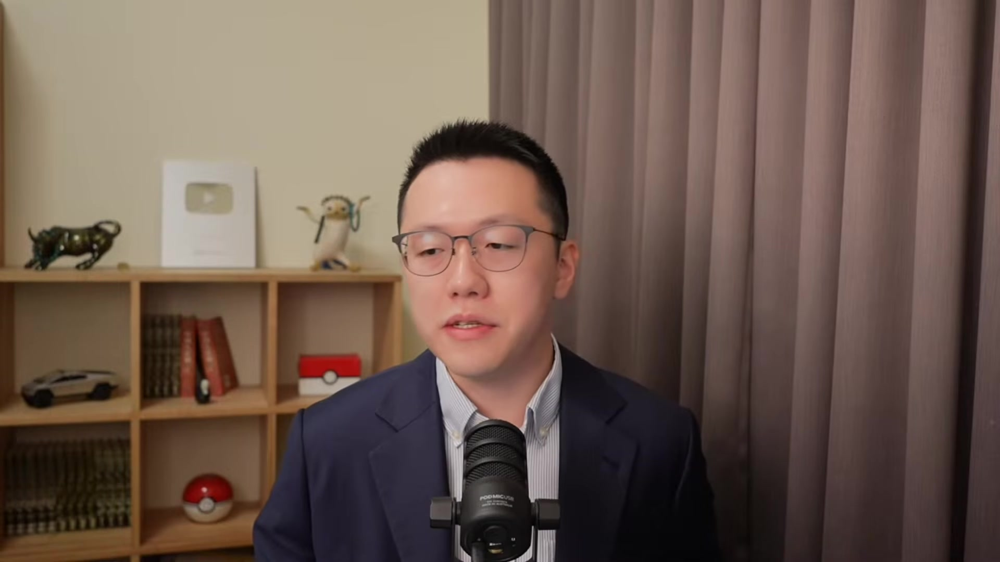

**逐字稿片段：** 我們知道這一次國會的出招 不是來自於民主黨 民主黨明年1月才要就任 共和黨早在兩天之前 已經開始採取行動 針對輝達間諜案來調查 這個是在外遇案 黃仁勳承認之前呢 三名共和黨籍的眾議員 包括眾議院的外交委員會主席馬斯特 和對中委員會的主席穆勒納爾 以及情報委員會主席克勞福 已經要求11月8號 黃仁勳要赴國會進行閉門說明 來搞清楚他跟這位女士黃樂的往來 到底有多少英偉達的GPU可能涉及 中國情報活動和敏感技術的外流 那當然黃仁勳過去是不斷強調 英偉達已經仔細追蹤 相關的GPU的部署情況 目前看起來是沒有外泄的 但市場上會聚焦 這件事情呢 爆出來以後 是否意味著在轉移適度焦點呢 民主黨還沒有出招哦 共和黨現在就已經出招了 你更可以想像在明年1月份之後 國會聽證會的慘狀 如果從市場消息反應來看 剛才是有比較大的 一個波動的一個振幅 但是總體股價其實利空衝擊沒這麼大 我們看一下 要看稍晚利空的實質反應 對呀 我的乾爹怎麼了 對馬斯克幹過這麼多事情 也沒有人抵制過他 因為他是馬斯克嘛 形象的一個差別而已 AI有沒有題材不確定呢 好的黃段總是有題材的 那一個獨大的公司哦 現在最大的風險就是 航空母艦會不會被巨浪給翻掉 因為它是以一個輝達的 就算是有可能短期內 必須要受到職位上的一個輪調 都會對於市場形成重大衝擊哦 這一次要從幾個角度來做觀察 因為黃仁勳他不只是輝達執行長 他是推動過去AI投資 熱潮的重要人物 對於AI的需求 對資料建設 看美國晶片 還有臺灣夜市的業績 都有重大的影響 但是一旦涉及個人誠信 看國家安全的疑慮 即便最終發現那個商業機密 沒有外泄 假設啦就最好的情境了 一點外泄都沒有 黃仁勳分很開的話 那他的角色和政策立場 以後一定會受到更嚴格的檢檢視嘛 有一句話這樣講的 會背叛太太的人 還有什麼不會背叛呢 哎這句話講的好重 這會背叛太太的人 好像背叛國家也沒有 什麼太意外的事情 這會讓市場上針對個人 誠信和國家安全的疑慮 有重大影響 尤其美國的政治環境 現在正在大幅改變 地方政府的表態 居民的表態 民主黨的表態 用水用電 AI產業現在必須要有一個很有 公信力的領導者向社會來做說明 來說明它的投資效益 其實對於人類是更好的 那難道你現在要派馬斯克去嗎 所以如果黃仁勳的個人信任度下滑 未來在華府相關的政策支持 還有你要說服大家有更多的資本支出 當然會因此影響 當然這個都是次要影響 最根本影響還是美國把AI 晶片視為國家戰略資源的 政策方向是否出了明顯的紕漏 這個是川普任期當中非常重要的方向 如果呢真的有部分機密已經外泄哦 那對於未來民主黨是否會 要求更為極度嚴格的審查 那過去黃仁勳一直希望能夠把 H200推向中國市場這件事情呢 當然會被市場拿來做更進一步的聚焦 鶼鰈情深 間諜情深 俗稱Jensen Jensen 當然了 這個最後還是要看 這個國安國安單位的一個調查了 因為國會的調查應該只是做適度庭審 那可能也問不出什麼來 我們要看的是美國情報 單位是否會予以介入 那輝達至於內部的調查 我覺得你也不要 抱太大的一個期待了 一切都是小頭的錯 大頭繼續領導AI 怎麼可能呢 這一定會受到影響的 如果股市真的受到影響的話 待會我們就來做定調了 本次叫做仁勳股災 還是小頭危機 皮衣海嘯 對AI泡沫總不可能 被黃仁勳給戳破吧 好那不管怎麼說 我們今天跟投資者稍微梳理一下 但這件新聞呢 還不算是一個真實的利空 真實利空還是要等蔚來的 調查出爐之後所造成的影響 那我們真正要觀察的是 可是在這一次利空之前 美國股市就已經開始做適度修正了 這是11月5號 當時美國股市單日 市值蒸發了3.2兆美元 納斯達克100指數暴跌超過6% 好那隔天當然反彈了1.4% 可是全周還是下跌了4.9% 這波賣壓跟基本面的 市出也沒有太大相關 因為沒什麼好消息嘛 重點是散戶和避險基金的同步撤離哦 那有沒有可能 借由一次性的利空來奠定了 假設利空最多就到這邊了 能不能一次給釋放完 是值得觀察的一個方向

**話題推測：** 分析美國國會對輝達間諜案的政治行動。

---

## 00:07:39

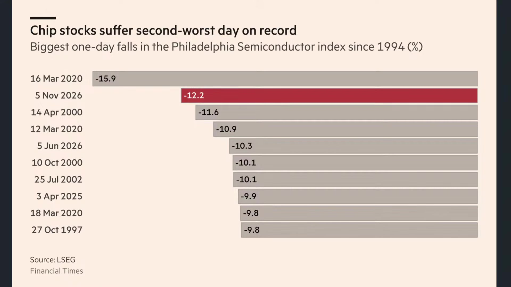

**逐字稿片段：** 因為美國股市這一次所 創下的記錄的確是非常多 代表著機械式的賣壓在ETF過去的買盤 現在形成的副作用 如果我們仔細觀察 當天的波動率指數 期貨單日是飆升了45點 這是歷史第二大漲幅 僅次於18年波動率風暴 選擇權的交易量創下歷史新高 賣權交易同步創下歷史記錄 ETF成交量占整體股票 交易額大概32% 也創下6月份以來新高 當日股票成交量來到270億股 所以整個在禮拜四到禮拜五 這一波的買盤和賣壓 它是一個重要的分水嶺 太多人在這個時間點進場了 創下非常多的記錄 那也不只是散戶受傷

**話題推測：** 列舉美國股市這次修正所創下的多項歷史記錄，如VIX指數飆升。

---

## 00:08:19

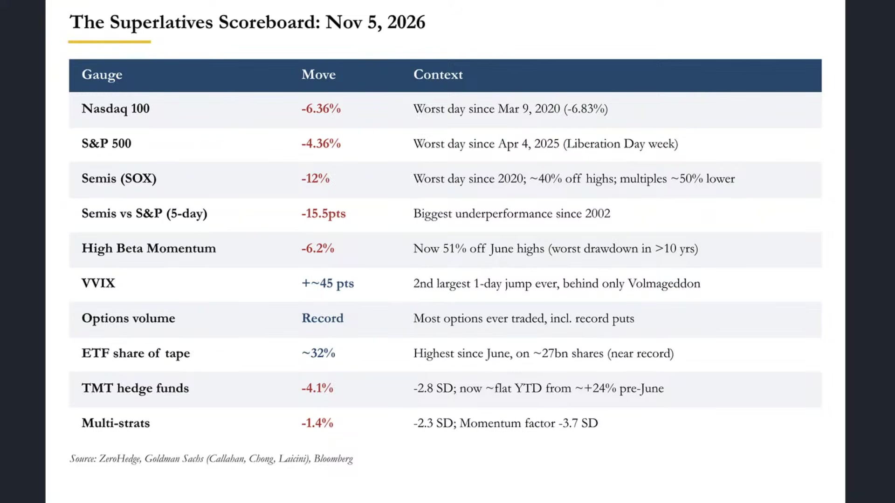

**逐字稿片段：** 我們看對沖基金的部分 其實也受到相當大的承壓 這一次我們根據高盛 主要經紀部門的統計 從上個禮拜來做觀察 原本在6月至7月科技股 很多避險基金已經在陸續撤資了 全年報酬一度來到20% 可是9月10月他又買回來 結果呢一次歸零 雖然標普百指數今年還是掙報酬 可是以對沖基金的平均績效來看 居然已經歸零了 再往下跌 它就負報酬了 所以這件事情呢 基本上可以把它瞭解成系統性短期 的流動性踩踏所形成的股價回檔 但本質上 其實YTD年初到現在為止 大家居然還是掙報酬的 所以我們回過頭說 這一次AI泡沫疑慮 所引爆的5.7兆美元的市值蒸發股災 最受沖洗的其實並不是散戶 散戶你就好好存股 你搞不好今年就是獲利稍微回吐一點 還是掙報酬 但是對沖基金呢 在今年下半年 尤其9月10月快速放大杠杆以後一 一次把年初到現在的錢全部給賠光了 那未來他們有沒有回補的誘因呢 值得跟投資朋友多做一些留意

**話題推測：** 討論對沖基金在此波市場回檔中的績效表現。

---

## 00:09:27

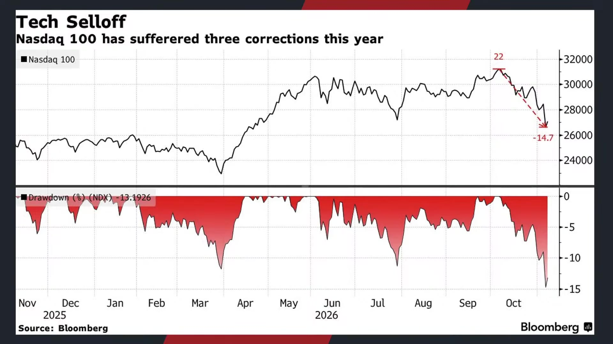

**逐字稿片段：** 因為如果是從SPY QQQ或者DIA道瓊RSP 陸續來做觀察 基本上都已經碰到了從 2025年關稅戰以來的上升趨勢線的下緣 換句話說 現在似乎要採取適度支撐 從反彈角度來看 就算是空頭都應該要彈了 重點來自於 這次反彈能夠收復的了在 禮拜四當時的顯著跌幅嗎

**話題推測：** 分析SPY、QQQ、DIA等ETF的技術線圖走勢。

---

## 00:09:50

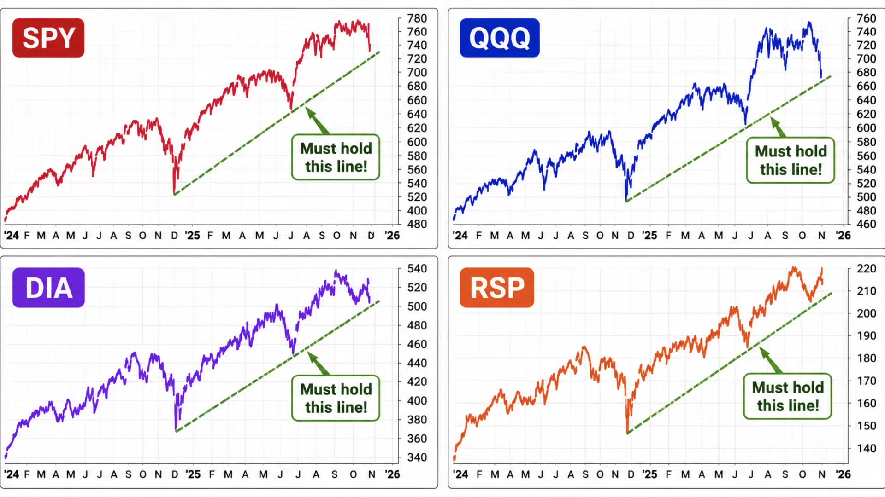

**逐字稿片段：** 從韓國股市來看 韓國股市從高點這樣跌下來 誒大盤呢 大盤已經跌44%了 臺北股市也不過才跌兩成 韓國股市哦 在禮拜五是隨即宣佈 從11月9號開始 暫時放寬融資貸款140 %的擔保維持率規定 為期3個月 直接不擔保了啦 讓券商可以延後或者減少 對於融資投資人的強制賣出哦 在韓國股市自從 當時7月份去杠杆之後 那政府端越來越害怕 你知道嗎 就發現你就算賺很多 來一場波動 大多數股民也不喜歡我 現在呢直接把擔保維持率規定取消了 那等同於市場上不會有是 立即性的融資斷頭壓力當然了 實際執行你還是要 借由券商來自行決定的 只是說中央來看說你 沒有那個140%的規 你還是可以規定的 可能來到 130 120 或者再更低一點點 但是可以顯示得出來 南韓市場目前的護盤 情緒是非常緊張的 我們根據目前整體在韓國 股市AI散戶的交易風格 其實相對於7月份而言 市場的總體賣壓已經沒這麼重了 因為7月份已經死一波了 但是呢從7月到10月份而言呢 由於外資的賣壓仍然依舊存在 導致了全亞洲市場 韓國股市仍然是匯出 速度相對來的比較快的

**話題推測：** 轉換話題至韓國股市的跌幅與政府護盤措施。

---

## 00:11:10

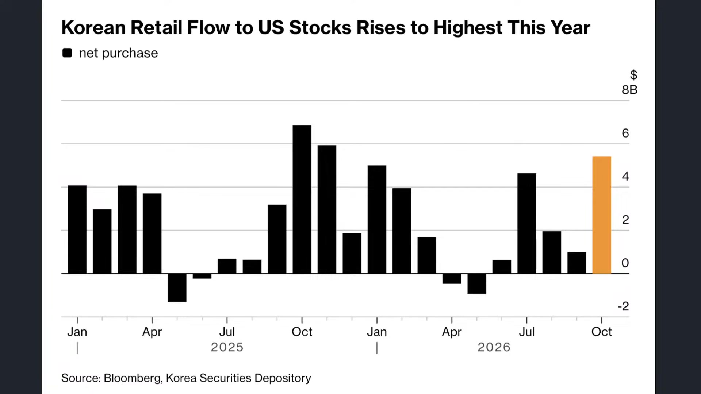

**逐字稿片段：** 我們如果看臺灣股市的部分 其實總體賣超大概也只有韓 韓國股市的一半哦誒 韓國股市市值是比臺灣 股市還要來的大的哦 我們看整個26年外資大舉 撤出台韓股市的部分 臺北股市大概是被外資淨賣超680 八十誒 867億美元左右 大概是新臺幣快接近3兆了 那如果是針對韓國股市的部分呢 大概是接近有到4兆左右 好所以我們可以觀察到 其實韓國股市的處境還是比臺北股市 來得更加艱辛一點 那看一下臺股的部分 台股這一波回檔的確幅度是很大了 但有一點類似于韓國 股市比較起來補跌的味道 當時盤中是狂瀉了3,738點 創下歷史記錄可是呢 我們看到下方收了一點下影線以後 隨著國安基金的進場 是否有利於行情的轉變呢 因為整個禮拜五哦 其實外資根本沒怎麼賣台股 賣911億 這個跟過去幾天比較起來算小的 禮拜五跌成那個樣子 然後他跌九 他才賣900億 我覺得整體幅度並沒有 想像中還要來的大啦 真實還是看到內資人踩人 的意願以及融資去杠杆

**話題推測：** 討論台灣股市的近期回檔與外資賣超情況。

---

## 00:12:17

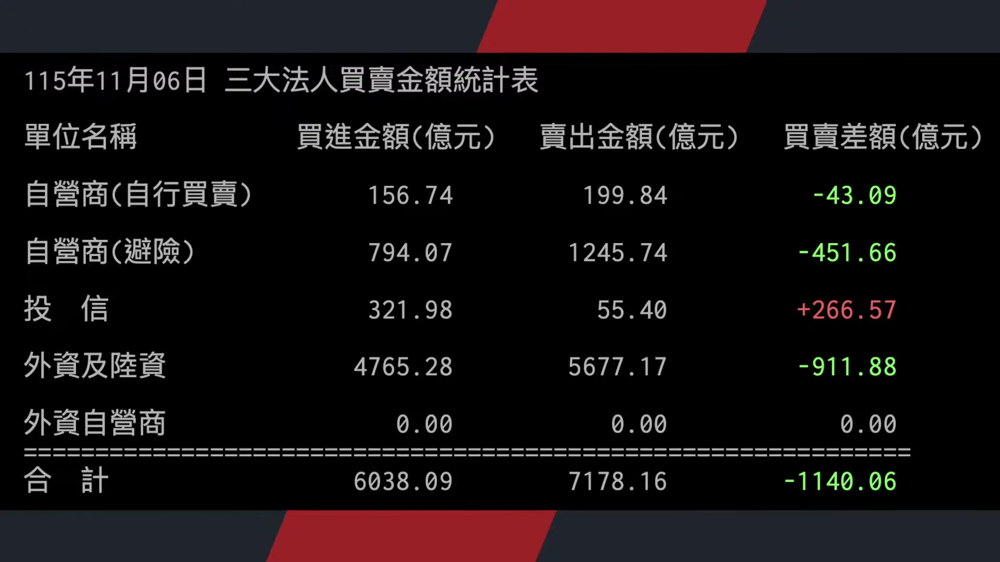

**逐字稿片段：** 如果我們細看 目前整體融資的一個下滑情況 基本而言呢 因為股價下跌速度算快嘛 所以正常講融資是一定減少的 那重點在於哦 減少速度是否有因此而加快 從整個6號來做觀察 10月30號的融資餘額是6,234億 到11月6號已經降到5,340億 當天是減少了400億左右 短短5個交易日大概也減少了894億 所以從降幅來看是10四% 那如果我們看整體來說 股票市場因為跌幅 已經跌兩層了 說明其實股價跌幅的速度 還是比融資下跌速度來得快 可是好處在於現在的維持率 如果我們把ETF的資卷 行情進行扣除的話 已經來到129樓 那說明有人斷頭了 因為我們講說一般融資餘額現在 政府鼓勵的是看總體維持率 整戶維持率 那為什麼要把ETF予以扣除呢 因為ETF有的不止臺灣 有的日本 有美國公債 甚至有很多反向型ETF 那跟融資做台股完全不同 所以你把ETF完全給扣除掉之後 只看個股的話 那基本上 其實已經差不多達標了 好這一波洗盤已經洗的蠻重的 也許黃仁勳就是最後一個利空了 那看一下接下來的反彈 能不能順勢的來做拉抬 或者往底部行情來做鋪墊呢

**話題推測：** 深入分析台灣股市融資餘額的下滑情況。

---

## 00:13:32

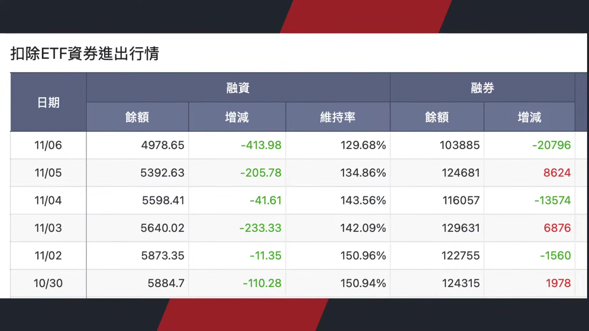

**逐字稿片段：** 從總體的違約交割來看也是如此 在過去一周 我們看到違約交割的 金額已經暴增了15倍哦 雖然你覺得好像 並不是特別多 違約人數是48人 但是它增長了8.6倍 相對於前一周 違約買賣的總金額已經來到1億9千萬 這大概是前一周增加了14倍左右 所以總體來說 上禮拜違約的人其實還算是蠻多的 那我們就來具體觀察 這禮拜能不能借由指標的 惡化來做適度的反彈呢 當然了 這個只是我們講說 整個大盤的一個狀態哦

**話題推測：** 關注台灣股市違約交割金額和人數的暴增狀況。

---

## 00:14:04

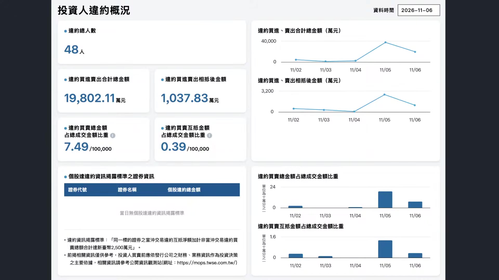

**逐字稿片段：** 但是從部分個股來看 我們剛才講說為什麼要剔除ETF嘛 因為從 把ETF加進去哦 它會有點數據上的一個混亂哦 比如說你把正娥加進去 00631L元大臺灣50正二 它就完全相反 那個融資我們看到在過去幾天 整個大盤從10月30號幾乎天天都在下滑 只是去杠杆的速度多快而已 可是看一下正娥 哇它從本輪的股價下跌以來 過去一整周 它沒有質檢過 我們看00631有的融資 餘額已經攀升到37.7萬張 單日是增加了2.8萬張 禮拜五沒人在怕的了 人人都在加杠杆 好所以從這樣的一個角度來看 市場上有不同的一個 思維啦針對整個大盤而言 個股大家在降溫了 可是部分對於指數投資 他可能就是認為 反正我買0050也是買0050 不如就買正2 反正就持有現貨 也沒有斷頭的問題 所以就選擇去買了 那融資買的也不是多數了 用這樣的一個方式 適度的開大自己的杠杆 有些人是這樣幹的 基本上會投資正額的 就是認為自己有實力吃瀉藥的屁股嘛 就相信因為買正額其實很安全的嘛 從現貨角度來看的話 但你融資買的話 他就認為台股不會跌到那個地步嘛 所以基本上因為券證也很多了 那我們就看本周會不會攤牌 到底是做空的被嘎爆 還是做多的人 已經超過一個禮拜了 會今年迎來 應該講說這個禮拜迎來第一次的質檢 看一下後續情況

**話題推測：** 討論特定ETF（如00631L元大臺灣50正二）在市場下跌中的融資逆勢增加現象。

---

## 00:15:32

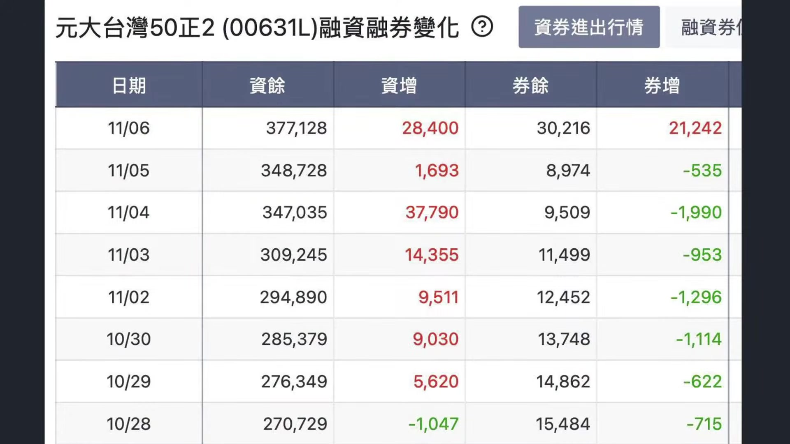

**逐字稿片段：** 因為我們都很清楚知道 現在國家隊也漸漸入場了 本來覺得國安基金 大概至少碰到3年線吧沒有 哦現在很快就出來了 那當然跟月底的選舉是否有相關 這個就每個人有自己的一個臆測 但至少可以承認的現在 財經府院部會已經進行了總動員 我們看到對於府院高層在 禮拜五召開會議之後的談話 基本上都表達了對於臺北股市 提供進一步流動性的態度 舉例來說 我們看到在具體的穩定措施層面 國安基金在11月6號當時是 收盤召開了臨時委員會 決定視情況進行資金的動用 金管會是宣佈 從11月9號開始 五項股市穩定措施 包括調降每日盤中 借券還賣出的委託數量 以及提高最低融券保證金的乘數 希望可以透過限制部分的放空交易 以及提高我們講說融資的資金門檻 來減緩市場的短期賣壓 當然國安基金是可以理解 國安基金它的目的 應該是緩解流動性的 你想賣永遠賣的掉 這個是國安基金的用意 但是我們會提過 我們對於限空令的態度一直都是 哦那你可能讓市場上有人想賣的人 或者想要做空的人 他缺少了一點市場的 機制或者潤滑劑 這個就每個人看法不同 不過府院現在對於整體臺灣 股票市場的一個介入程度 是非常非常之高的 而且是非常非常之臨時 原本都以為可能要 等到本周再陸續召開 想不到禮拜五稍微聊一聊以後 下午就已經採取行動了 我們看一下早先他們的一個談話 所以其實台股這一段時間的劇烈震盪 我覺得真正值得關注的不 單單是股價到底跌多少了 或者說市場的角力不讓你跌 其實現在國家隊最重要的 目的就是提供市場的流動性 嗯主權基金最重要的事情呢 它當然不是為了那5,000 億能夠買多少股票 重點是在恐慌的時候提供一個 買賣雙方都能夠成交的機會 想要賣的人呢 當他意識到 哦原來不管我想要用多低的價格賣 我都還賣的掉 他就不會有那個流動性量縮下跌 買盤全面消失的恐慌 因為大家可能一開始會 覺得股票無法順利成交 他會被迫承受風險的 那那個緊張感就會進一步的發酵 引發融資追繳 跌停鎖死或者多殺多 那關鍵進場就是讓大家知道 你想賣永遠賣的掉 不一定馬上漲 你想賣我永遠讓你有機會賣 好這個是流 提供流動性的重要關鍵 我認為其實是稍微可以理解的啦 請問浩哥今天會開高走低嗎 再洗一次 哎呦不要問我啦

**話題推測：** 轉向討論台灣國家隊（國安基金、金管會等）的入場護盤行動。

---

## 00:18:55

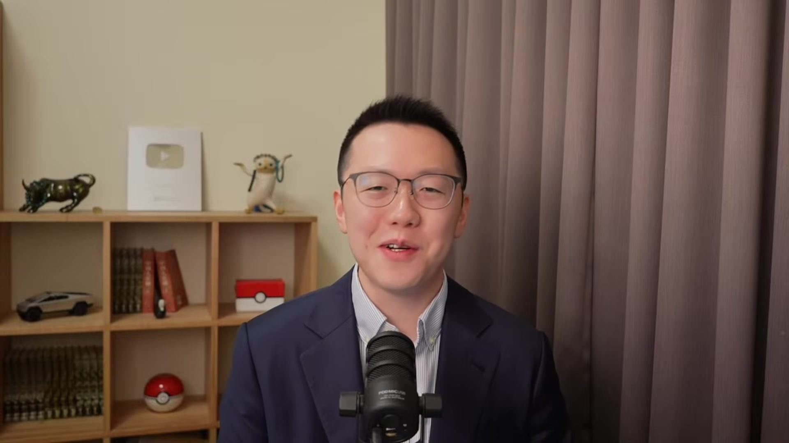

**逐字稿片段：** 好那我們具體觀察 這一次因為國安基金呢 已經算是史上第10次啟動護盤 那外資因為兩個月已 賣了差不多1.5兆元哦 賣的幅度也相對來的大了 我們就看一下外資在 今天的實質態度 因為回顧2,000年到2025年 國安基金的9次進場記錄 進場之後有5個交易日 應該講 進場之後的5個交易日有8次是上漲的 上漲幾率是88.9% 所以通常在國安基金介入的時候 的確相對而言容易出現一些反彈 平均報酬大概4.39% 可是拉長到20個交易日 就是整個11月 上漲次數就降到6次了 幾率剩下66% 平均報酬3.36 說明的事情是 國安基金雖然可以 提振短期的市場信心 但不代表股票市場已經落底 08年最經典 國安基金進場之後 台股又暴跌了17% 所以它是無法阻止外資的實體賣壓 好但是呢 國安基金這樣的一個進場作用 它就是保持一種流動性的概念 08年金融海嘯 台股是進場180天才重新轉強 22年當時受到通膨和快速升息的影響 市場一樣是經歷了好久的震盪

**話題推測：** 回顧國安基金過往護盤記錄，評估其對市場的短期及長期影響。

---

## 00:20:02

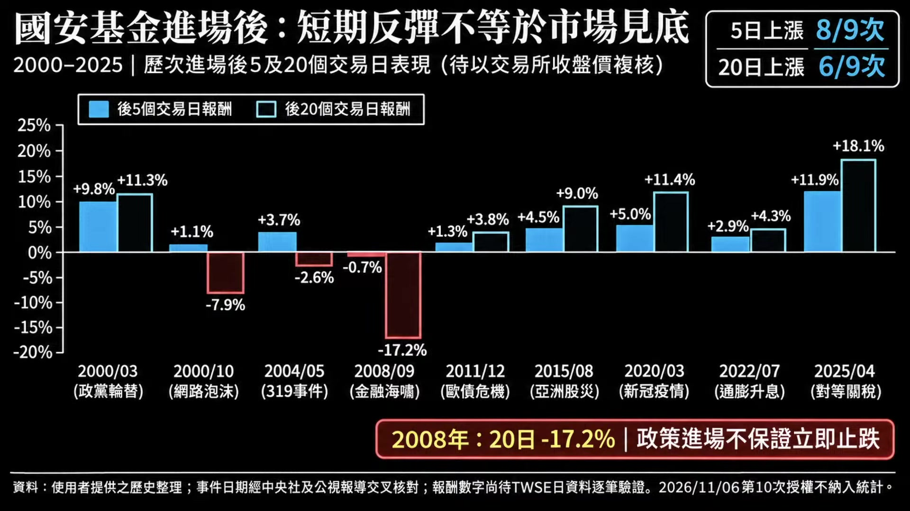

**逐字稿片段：** 另外一方面 歷史6次的限空措施當中 因為金管會所採取的態度 實施60天之後 誒大概只有5次上漲 那08年甚至還超過20%的跌幅 這也顯示你阻止放空也無法 阻止基本面驅動的熊市 現在國家隊最重要的目的 就是要提供市場的流動性 這給投資朋友做些思考 你還記得國安基金上一次 因為2025年 那一次是護盤有點久了 你還記得2022年那個時候是萬八 差不多就護盤了嘛 結果一直跌 跌到萬5才真的大買 所以其實時間線是很難說的 我們從時間複盤的天數來做觀察 會發現誒 你有時候哦 2,000年複盤5天了 然後到44天 然後到91天 尤其在20一五年以後變231天 當時是上證股災嘛 然後2020年207天 2022年275天 2025年2709天 你會發現從蔡政府以後 大家的複盤時間越來越長了 以後複盤超過1年 超過2年 我相信也遲早要到尤其 對月月底要選舉哦 你完全可以理解 當然金管會目前所給予 市場的評價整體而言 就是呼籲市場投資理性一點了 那重點還是來自於 國家對這次的介入是否 有助於流動性的拉升 我們講說限空令 其實它就比較類似於 那個細菌型的腸胃炎 但是你用一個 止瀉藥你壓著 讓它不拉出來 想做空的 當天有波動的 你還是要讓它有流動性的發酵 重點是讓大家意識到 不管上漲的下跌的 市場上都會有足夠的流動性的 基本上給投資朋友做一些思維了

**話題推測：** 分析歷史上金管會實施限空措施後的市場表現。

---

## 00:21:37

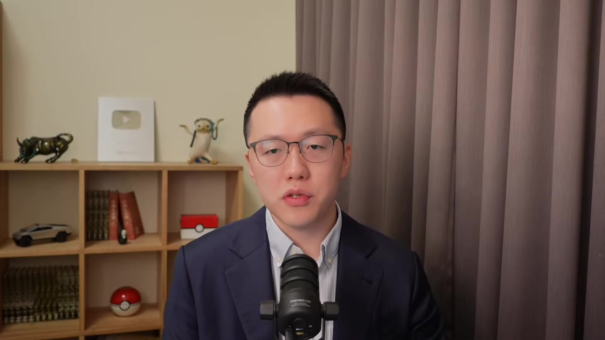

**逐字稿片段：** 那當然雖然楊總裁好像 對於這次股債沒有什麼太多評價 但其實央行已經出手了 還默默出手的 我們看到在過去一整周 其實央行已經透過減少發行 定期的存單來釋放銀行體系資金 緩解市場流動性的壓力 央行也是在在乎流動性的 央行這一次未到期的定存 單 因為我們應該我們講說 定存單餘額了 相對於年初大概也減少 了有一兆5,000億左右 誒其實已經降到6兆以下了 而且9月10月也分別 減少了4,400億和2,165億哦 那資金調節效果已經反映在利率上 我們看10月份金融業的 隔夜拆款加權平均利率是0.811% 哎這是2026年以來的新低哦 誒你很難想像哈 好現在全球都在升息 資金都在緊繃哦 然後金融業的 加權平均存款利率卻卻在下滑 說明什麼 央行其實在默默地增加流動性 以前我們講說 28.5叫做彭淮南防線嘛 那現在4萬點有沒有 可能是賴清德防線呢 好至少你看到從央行從金管會 從財政部國安基金的動作 都看得出來市場現在 政府當前的決心為何 那回過頭說 因為臺北股市 雖然我們知道這一波的融資的 清洗的確幅度相對已經來得大 那很多個股重挫幅度也相對來得大 可是如果我們把從過去一個月的跌幅 拿來跟YTD今年以來的漲幅來做比較 其實真的就完全取決於 你的投資尺度而已 我們看在過去一個月當中 台積電是下跌了16.7% 聯發科跌了31% 鴻海跌了11% 台達電是暴跌了四成七 基本腰斬了 其他科技股同樣慘烈 欣興跌了四四% 聯電跌了38% 台光電跌了36% 南亞科跌了34% 日月光跌了28% 可是你把時間呢 從年初到現在 誒除了鴻海 大家居然都還是正報酬 台積電都已經跌那麼重了 今年還上漲37% 聯發科今年還上漲133% 日月光108% 台光電130% 欣興今年還漲了226% 南亞科上漲78% 聯電上漲86% 南亞甚至上漲297% 所以其實看得出來 這完全就是你的投資尺度 如果你人生都沒有做過投資 只有今年剛開始投資 或者今年投入的本金相對來得大 那受到的衝擊會當然比較明顯一點了 這拉長尺度來看 你就拉長到今年年初 績效都不錯 更何況是已經持有好 幾年部位的投資人呢 好所以我們才講說 你把尺度稍微放得遠一點點呢 今年這種比較劇烈的回檔和跌幅 在未來幾年當中 它也不過是 票市場當中的一個點而已 你甚至都會忘記2026年到底在跌什麼 你可能只記得那個黃仁勳的外遇 其他你都不記得 很有可能 好那當然這一次對於台廠的影響 即便德州變天了 我們看到台廠也陸續表態 目前2,300億的擴廠計畫也 會照常來做推行的 臺灣業者的最新回應 從鴻海和碩仁寶緯創回應 都預估在德州目前的進度 不會受到 德州變天的影響 因為已經正式簽約了

**話題推測：** 揭示中央銀行如何透過減少定存單發行，默默增加市場流動性。

---

## 00:24:51

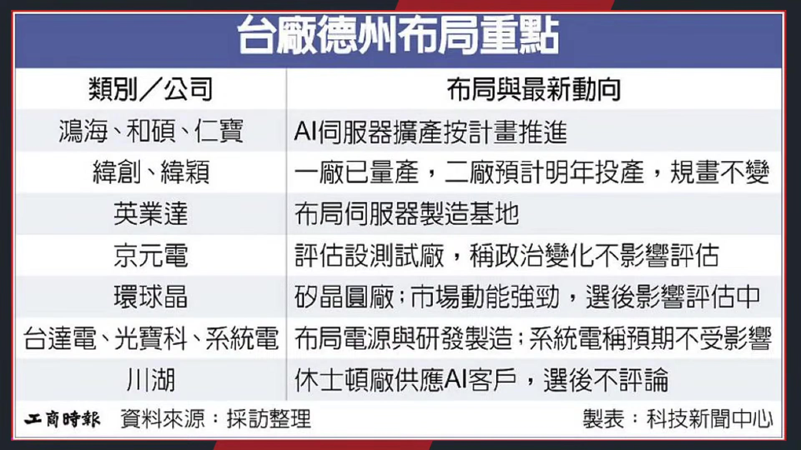

**逐字稿片段：** 我們看一下美國股市四大指數的變化 道鐘斯指數下跌237點 0.46% 收在51,285點 標普上漲23點 0.31% 收在7,376點 這有點反彈無力 納茲達克上漲260四點 1.09% 收在24,579點 費半上漲三百七十九點 四點二% 收在9,390點 就看費半 多快可以占回年線呢 感覺有一段距離要跑 AI泡沫總不可能被一根老二戳破吧 哎呀好難聽 這段要剪掉 重點來自於哦 從美國股市現在漲到 現在這樣的一個位置 它經歷了一個非常大 的一個系統性的回檔 可它報的那個利空哦 那個正常來講都不 覺得在選前之前是利空 你覺得期中選舉之後的選舉變化 AI的建制延後 它是一個重大利空嗎你覺得 黃仁勳這件事情是 也有可能這是一個重大利空 假設機密有外泄的話 這會讓整體美國國會被迫要表態 對於中國採取更嚴格 的科技的禁制令 這沒辦法 但是從這兩件事情呢 來做一些比較 都會發現 他好像跟我們想像中那種 什麼融資循環的泡沫破滅 對於AI的算力過剩引發的AI泡沫破滅 那好像有一段距離所以 這些利空 好像也不是什麼多大的利空 我我自己個人感覺 它就是一個正常的估值回檔的理由 你可以找100種理由讓 股票市場得到這樣的慰藉 因為這些利空 感覺可以互相交換的 那當然我們回過頭說 現在對於科技股的實體賣壓 的確主要還是集中在晶片股 或者我們講的記憶體股 其實對於納指和標普而言呢 甚至都還沒有進入到熊市當中 所以才會覺得體感上 大家的落差差非常多

**話題推測：** 報告美國股市四大指數的最新收盤表現。

---

## 00:26:32

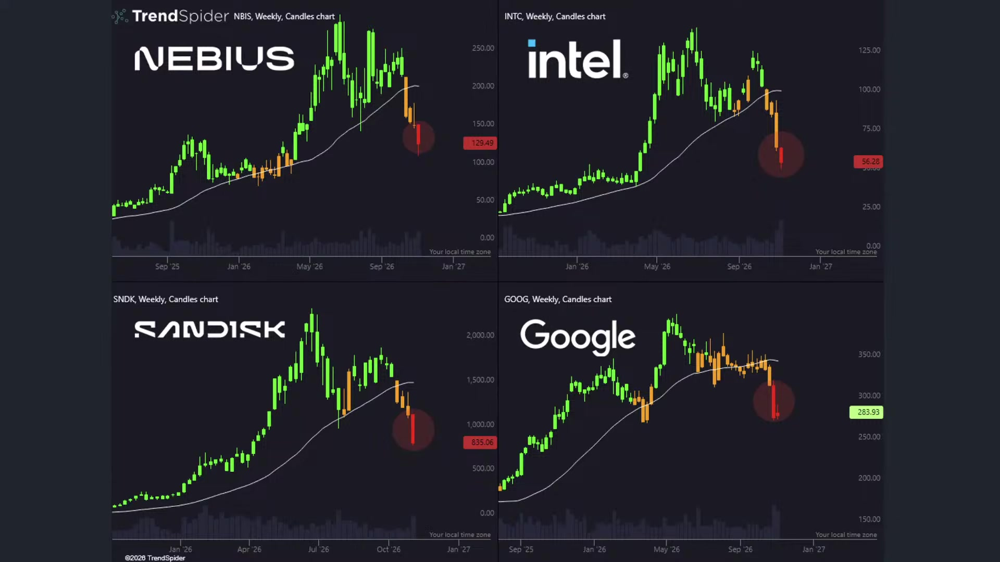

**逐字稿片段：** 我們從部分科技股從周線圖來做觀察 英特爾已經跌破56塊 Sandis跌破835塊Google 阿法貝來到800283塊 四檔股票都已經跌破 長期的移動平均線了 尤其看甲骨文 哈這個 完全就是聖誕樹 這個也對稱的太完美了吧 我們如果從甲骨文的周線圖 現在是116塊左右 逼近115塊長期成交密集的區的下沿 那總體來說 因為甲骨文呢 這一波是最早回吐的可是 當它回吐這麼多 居然股價沒有嘗試的止穩在下方足底 還在往下破 那其實 真正的擔憂很清楚嘛 就是市場上針對接下來的融資壓力 循環是否有可能產生極大的擔憂 那甲骨文的部分呢 也許是這些科技股的先行指標 因為剛才幾隻記憶體股 即便跌這麼重 今年都還是掙報酬了 那我個人的看法也很簡單了 的確有部分企業可能熬 不過本輪的融資循環 熬不過本輪的利空衝擊 光是估值的回檔 他們就被洗出場了 尤其是一些新興雲端廠商這些 租賃算力的這些公司 它有可能光是利率一高 或者呢投資稍微延後 他們就被洗掉了 可是從整個大盤來看 我相信仍然對於長期未來有信心 因為他們都沒有達到 真正泡沫破滅的條件

**話題推測：** 分析部分美國科技股（如英特爾、甲骨文）的周線圖與技術指標走勢。

---

## 00:27:48

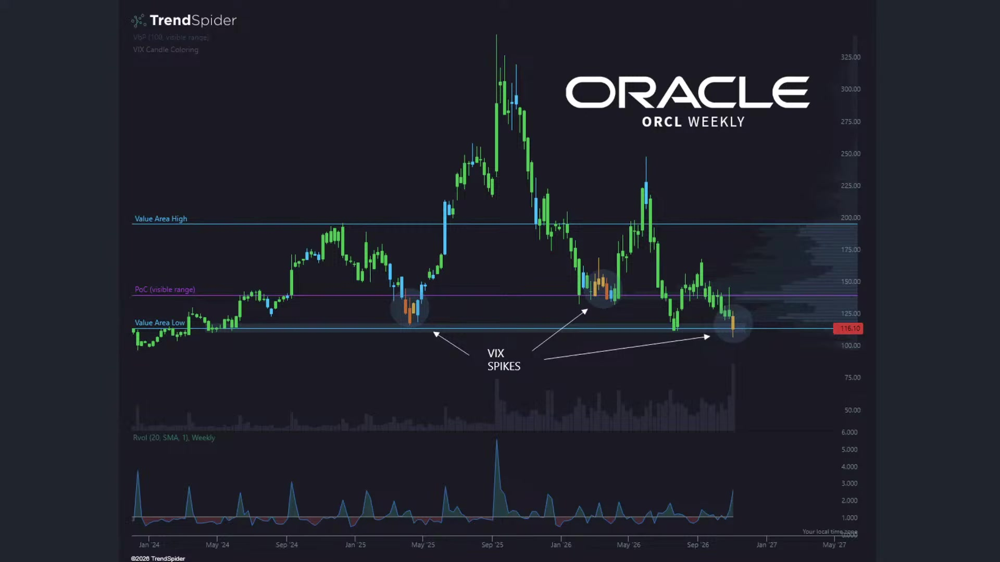

**逐字稿片段：** 什麼是泡沫破滅的條件 就是一定要算力過剩 網路泡沫的本質是光纖過剩 是生產了太多光纖 但沒有造成進一步的生產力提升 鬱金香泡沫破滅的本質是鬱金香過剩 所以什麼時候算力過剩呢 就是工程師連TOKEN都不想再用 沒有急著想要去申請TOKEN的時候 跟公司申請成本的時候 那才會距離泡沫鋪面有一點距離嘛

**話題推測：** 闡述判斷AI泡沫破滅的關鍵條件，並與歷史泡沫對比。

---

## 00:28:13

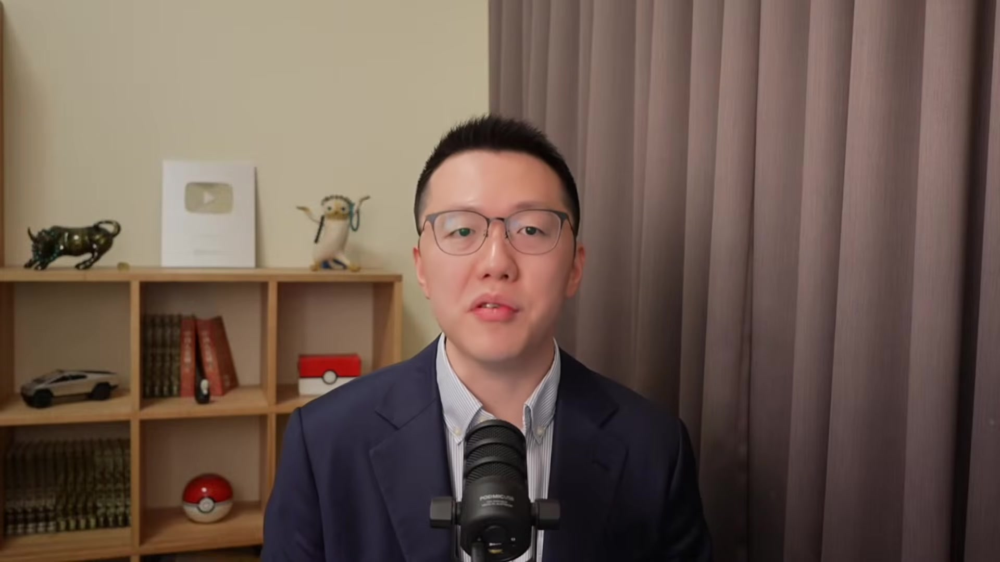

**逐字稿片段：** 其實我們從拉長距離來做思維 股票市場 它也不是很在乎你到底最後投給誰呢 從1926年到2026年 美國是歷經共和黨民主黨的輪番執政 那中期選舉也經常會有慘敗 這次只是民主黨稍微 勝利的幅度是20年來的新高 那投資人最容易犯的錯誤 就是把政治偏好當成你的投資策略 所以股票市場是不會在乎你投給誰的 美國股市的三大牛就是如此投給誰 你在有生之年 你都會看到美國股市繼續創高 25年上漲16% 26年即便跌那麼重了 標普居然都還漲7.8% 適度的估值回檔而已 川普在之前也發了一條貼文 說這一次的選舉 結果讓美國退選 應該講說倒退 退了一大步 但是對於川普執政時期 一路飆漲的股票 一天內也蒸發了3兆美元的市值 可川普最後留了一句話 不過大家不用擔心 美國一定會東山再起的 而且會比以往更強大 好開川普開始看多了 好所以這也給投資票做一些新思維

**話題推測：** 從歷史角度探討股市的長期趨勢，不受政治偏好影響。

---

## 00:29:15

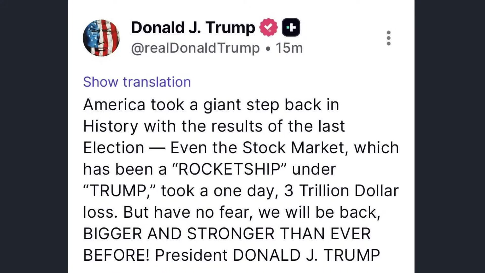

**逐字稿片段：** 臺北股市是反彈879點 收在40,609點了 我們就看4萬關卡是否能夠守住 這反彈波是很明顯的了 因為空單要回補嘛 那加上國家隊的一個進場佈局 但是我們剛才跟投資朋友聊到了 國家隊進場佈局 一周內是顯著的 一個月內 就fifty fifty 就一半一半嘍 所以真實的效果 大部分都是半年到一年之後的表現 甚至要取決於國安 基金護盤時間的尺度

**話題推測：** 報告臺北股市的最新反彈點位，並重申國家隊入場後的預期效果。

---

## 00:29:43

**逐字稿片段：** 我們今天大概聊3個重點 第一部分 就是來自於 利空斷不了 可是那個利空都不是一個史詩級 不管是融資循環出現問題的利空 還是對於算力過剩引發的擔憂 都是一些 那雞皮小事 都是外遇案啦 資料中心會被延後啦 民主黨人會被做進一步的調查啦 那個利空是利空 但是都不是那個史詩級的大利空 那第二件事情是臺北股市 隨著國家隊陸續進場以後 對於台股而言呢 至少在選前你是有一定 程度的心理預期的嘛 那這段時間有沒有可能 醞釀成新一波的反彈 但在選後要反映實體民間呢 最後跟隨著國際股市 那第三部分呢 是也許我們在短期內 這種訊息上的不斷的沖銷 也許在短期內是很難 去判定它的多空的 可是你根據原本自己 所設定好的機期位階 設定好自己的投資指標 依循著自己的指標 陸續的進場 或者有些人認為現在該停損了 隨著反彈坡開始拉升 但這都是取決於你本身是否已經 達到了在本次股災之前的心理預期 投資中心邏輯 用這樣的一個方式 來度過危機 那如果真的 怎麼想都想不通哦 把時間稍微拉長於一點點 也許今年只不過是美國股市長期三 大牛循環當中的一個小點而已 給投資朋友做一些思考 如果喜歡我們節目 記得訂閱按讚加分享 我們就明天早上8點半 早晨財經速解讀再相見 祝各位投資朋友看盤順利 操盤愉快

**話題推測：** 總結本日分析的三個主要重點，包括利空性質、台股走勢與投資策略。

---
