# yutinghaofinance_fXo4kKJjQ5E — 關鍵畫面索引

- 來源逐字稿：[yutinghaofinance_fXo4kKJjQ5E_GT.srt](yutinghaofinance_fXo4kKJjQ5E_GT.srt)
- 影片：https://www.youtube.com/watch?v=fXo4kKJjQ5E
- 截圖數：28

## 00:00:46

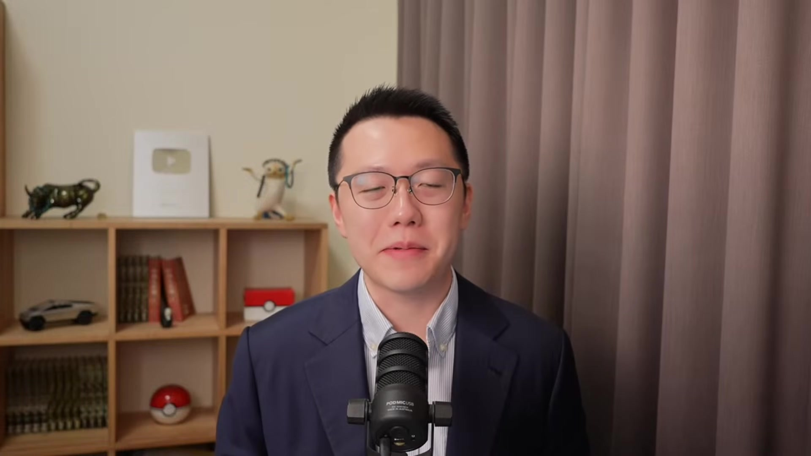

**逐字稿片段：** 在昨天美國股市 費半又彈了3% 那現在Anthropic提交了首次 公開發行IPO的申請之後 到底能否在本周重新點燃 市場針對AI的投資熱情呢 F O M C 現在看起來本周升息 機率也不是特別高 會不會接下來市場 能夠一路的否極泰來呢 加上下禮拜就是美國期中選舉了 如果期中選舉能夠順暢的度過 不把不確定性轉化為確定性 看起來也是一個力度 我們要如何來觀察 從11月中旬開始 市場上原本 習以為常的慣性行情 到底聖誕行情是否能夠歸來呢 今天來跟投資朋友多做一些觀察 因為這一次申報檔也顯示 上半年Anthropic上半年 的營收是162.9億美元 唉這比去年同期增長了13倍 所以 不管我們對於未來 對於融資循環有什麼樣的擔憂 至少他們是真的很賺錢的 對於這些大語言模型來說 本來週五還瑟瑟發抖 今天也 不見得一定要睡公園 好那我們就要回過頭說 因為上禮拜的確美國 股市的賣壓還是蠻沉重的 賣出規模從高盛的統計來看 上周的資訊科技業應該是全球 在短短一周內賣超最重的產業 上禮拜費半還有上上 禮拜都跌蠻重的嘛那 更涉及大型機構主動降低的部位 那如果你把標普五百指數扣除AI之後 其實上禮拜表現也 沒有想像中來的差 反而領先AI族群大概5個百分點左右 這代表著科技股的內部 第一在出現分化第二 科技股和非科技股 其實這段時間也在分化當中

**話題推測：** 討論美國股市昨日表現

---

## 00:02:27

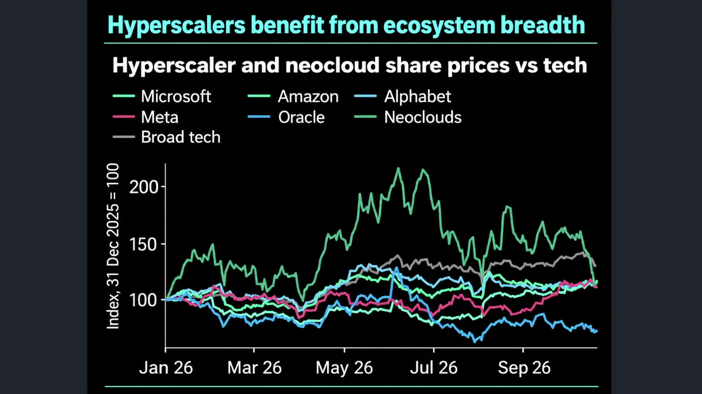

**逐字稿片段：** 我們從整個二季底以來 甲骨文股價大概跌12趴嘛 可是新興 雲端的運算業者是平均跌幅41%哦 然後成熟的雲端平臺 反而上漲了19% 哦這也說明看起來市場上也 沒有說全攔的去否定AI 大家開始去區分 哪些依賴借錢擴張的基礎建設業者 你借的越多的 你風險越大 但是如果你有穩定的現金流 你有穩健的財務結構 反而可以受到市場的評價

**話題推測：** 比較甲骨文與新舊雲端業者股價跌幅

---

## 00:02:58

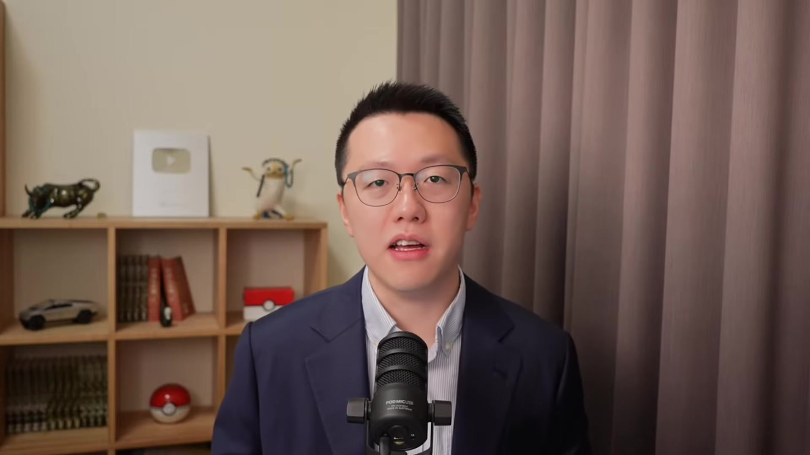

**逐字稿片段：** 甚至連過去唉沉寂一段時間的蘋果 最近股價表現也非常不錯 所以科技股雖然遭受到大量拋售 不過呢大家是根據自己的企業獲利 給予相對應的評呀 我認為這種表現算是不錯的 那現在科技巨頭在本周也 剛好迎來關鍵的財報周 像阿發貝微軟亞馬遜呢 因為這幾家公司加 起來市值是10兆美元呢 不要出什麼大錯 其實就可以了 大家預估帶三季度的公司季度營收 成長大概還能夠維持雙位元數位

**話題推測：** 顯示蘋果股價近期表現

---

## 00:03:28

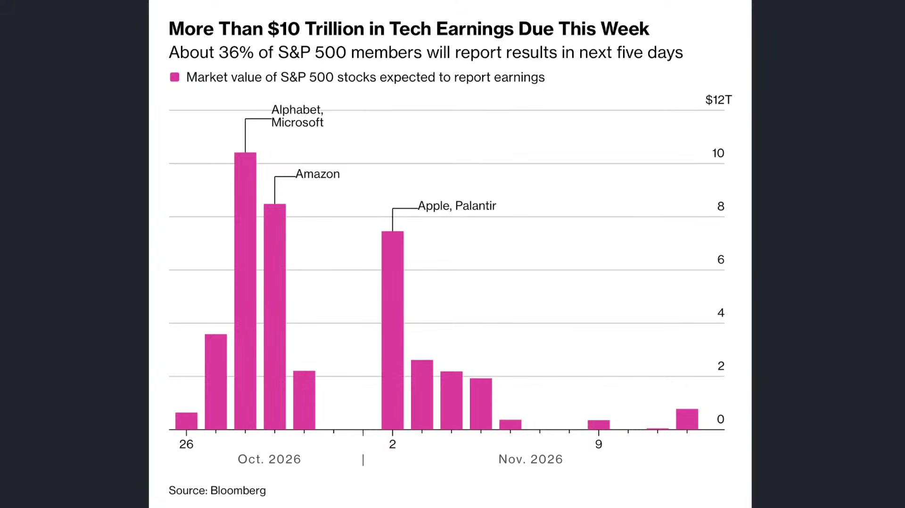

**逐字稿片段：** 當然了投資人也很關注 因為Meta之前是調高資本支出了嘛 它的現自由現金流也轉負了 那市場上一度是看好運營結果呢 股價反而受到市場上壓回 然後又反彈 那這一次如果 幾支巨頭 都透露出同樣的氛圍 就是財報表現不錯 可是撒的錢更多 會不會有同樣的表現呢 好值得大家來做一些慣性的留意 不過呢 至少從科技股的估值和獲利來看 趨勢已經很明顯了 獲利還在往上走 估值還在往下掉 因為從26年到現在 彭博科技七雄指數 大概平均也不過上漲6.5% 其實還比標普五百指數的 11%還要來的落後 納斯達克100指數更是上漲了15% 七雄當中 勉強明顯超於大盤的 大概就只剩下蘋果和輝達了 那即便如此哦 其實七雄在今年的獲利還是有成長34% 2027年更是成長了2%七 這高於兩個月前市場預估大概19倍線 這是高非常多的一個距離 更重要的事情是 7檔股票平均本益比 已經來到24倍以下 比過去10年平均的29倍還要來的低呀 一年前是33倍 亞馬遜本益比甚至跌到20倍了 這個是2008年以來的最低 所以呢我們姑且不論實利率對於 本益比估值壓縮的影響 至少從單純錢賺本益比來看呢 哦這個是10年來最便宜的科技七熊 即便它的股價很貴 因為它的獲利在暴升嘛

**話題推測：** 探討Meta資本支出與自由現金流情況

---

## 00:04:59

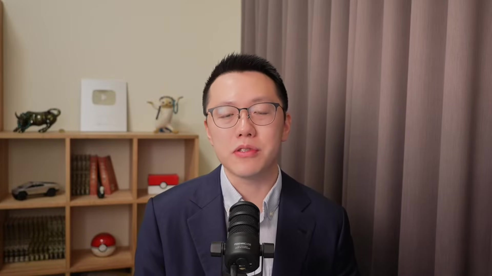

**逐字稿片段：** 當然在本輪的浪潮當中 美國股市尤其是費半受到蠻大的承壓 那包括韓國股市也是如此 現在呢今年呢 按照這種速度 臺北股市大概又是全球 表現最為亮麗的發達市場了 如果我們從今年表現來看 臺灣加權指數 目前還是上漲61.5% 那韓國股市 本來跟臺北股市差不多漲幅 現在只漲3成 還是很漂亮 問題是它原本漲7成呢

**話題推測：** 分析各國股市，特別是美國、韓國和台灣

---

## 00:05:26

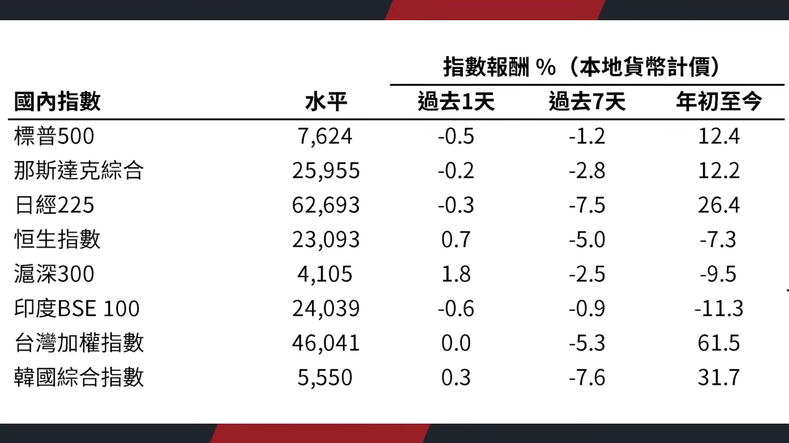

**逐字稿片段：** 日本日經25指數上漲26.4% 所以亞洲受到半導體和AI 浪潮還是明顯優於全球市場 標普大概上漲12.4% 納指12.2% 比較溫和 誒中國股市滬深300已經進入熊市了 印度股市也比較明顯落後 恒生指數今年是跌7.3% 滬深跌9.5% 印度100指數跌了11.3% 當然了從這些科技巨頭來看 我們也不期待本周有多大的突破 能夠穩住盤勢就不錯了畢竟呢 讓這些股票 上漲一% 已經可以讓很多中小型股漲停板了

**話題推測：** 顯示日本日經225指數漲幅

---

## 00:06:03

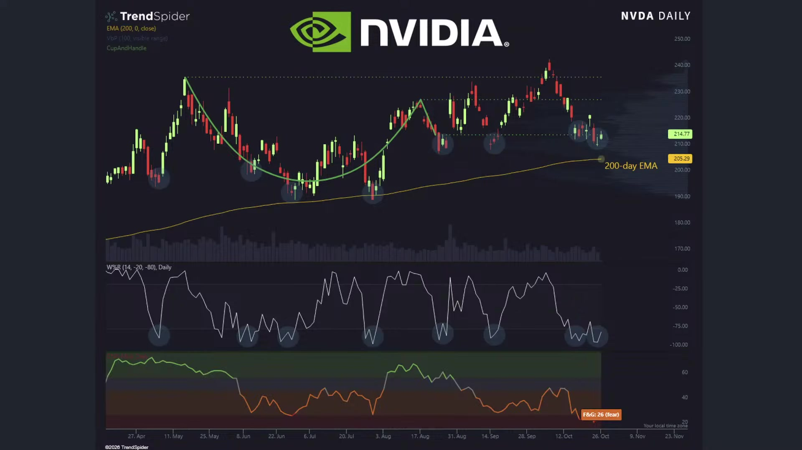

**逐字稿片段：** 從輝達角度來做觀察 從高點跌下來 大概也不過跌10% 算是正常的中期回檔 那尤其現在逼近到年線 那下方的量價圖買盤也比較雄厚哦 所以看一下能不能順勢的在 年線左右能夠成功的點火 當然全球資產角度 今年還是比較分化一點的 如果是以商品類的DBC來看 大宗商品平均漲幅是52.5% 遙遙領先

**話題推測：** 觀察輝達股價走勢

---

## 00:06:29

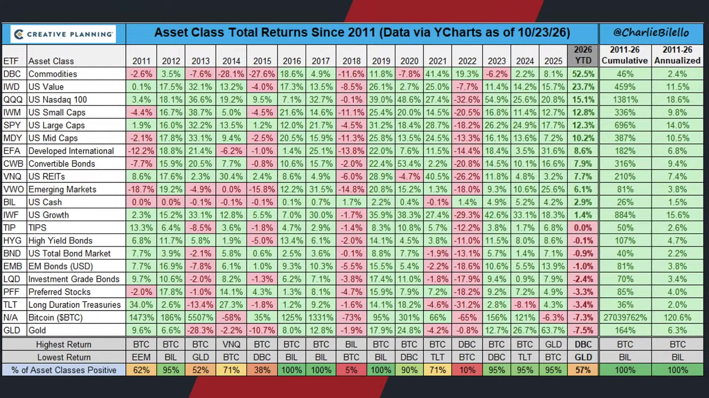

**逐字稿片段：** 美國價值股漲了23% 納指15% 小型股12.8 這個美國的價值股居然 跑贏了納指和小型股 那其實就說明著 高值利率還是對於這些本益 比比較高的股票有所抑制 那價值股居然漲這麼多 其實也意味著 那今年你也很難說它是 一個極度樂觀吹捧之年呢 那畢竟價值股漲得比科技股還來得多 標普百指數也不過漲12.3% 成長股指漲1.4 那其他像債券市場的部分 美國整體債券大概下跌0.9% 投資等級債下跌2.4 長天期下跌3.4 那按照上禮拜這種殖利率的回檔情況 看起來本周升息機率也 不是想像中來得高了 市場上其實更為關注在未來 美國股市科技財報公佈之後 能否成功點火的關鍵 其實還是來自于市場的營收 來源以及AI的投資角度 我們必須承認AI產業 現在的確出現了比較 明顯的算力成本下滑 但是呢企業的支出還在增長 信用風險也正在攀升

**話題推測：** 比較美國價值股、納指與小型股漲幅

---

## 00:07:33

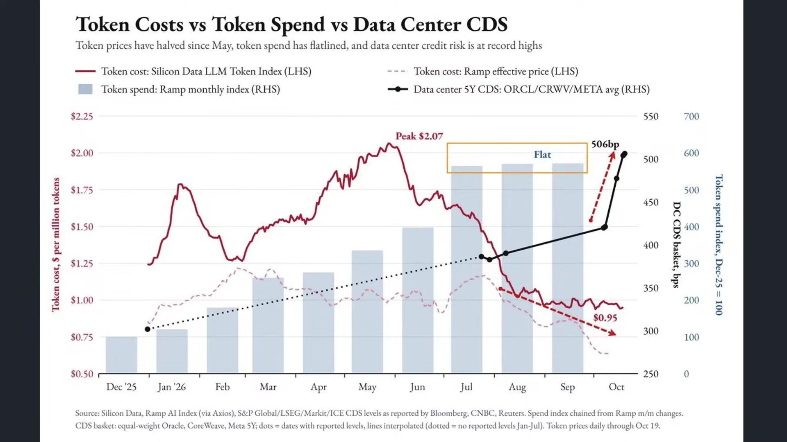

**逐字稿片段：** 舉例來說 每百萬個AI詞元 我們講的TOKEN的成本 26年的5月份大概是高峰 大概是2.07塊 那到10月份呢 大概是0.95塊 誒那跌幅有54%呢 好這說明的事情是 其實我們用的AI模型是越來越便宜的 就如果你覺得沒變便宜 那你的使用的使用量可以變多 好大家在相對應 便宜的意思 可是問題在於 這一些企業 它們本身的資本支出所消耗的成本 其實還是偏高的 機體價格沒跌嘛 被動元件合約價沒有跌嘛 所以就形成了 其實企業的成本還在上升 可是AI整體而言 對外的輸出TOKEN價格還在下跌 好這就說明著 其實市場上有一股 默默的認知 就為了這一批市占率的搶進 大家已經消耗非常多自己 常年的現金流和資本優勢 那最後所造成的結果就是美國 高收益債形成了信用風險的分化 我們知道AI還是趨勢 可是也許有些人燒不到最後那一刻 我們從信用評級最低 的Triple c的債券呢 相對於整體垃圾債市場 此利率的差距 26年初大概是差3個百分點 哇現在已經來到7個百分點了 上一次這麼高就是2020年新冠疫情了 再就是15年16年的上證股災 所以這說明的是整體信用市場 還沒有到危機爆發 不過看起來大家已經重新做定價了 那市場上本來就是會對於 現在的融資循環有點擔憂嘛 至少說明現在也不是極度的樂觀 現在就是賭俠裡面演的嘛 你投資我 我再投資你 我的錢就是你的錢 你的錢就是我的錢哎發財了 哎不能這樣子玩下去了 以前是想那就發財了嘛 現在看起來大家是很 清楚這件事情的加上

**話題推測：** 展示每百萬個AI詞元成本變化圖

---

## 00:09:18

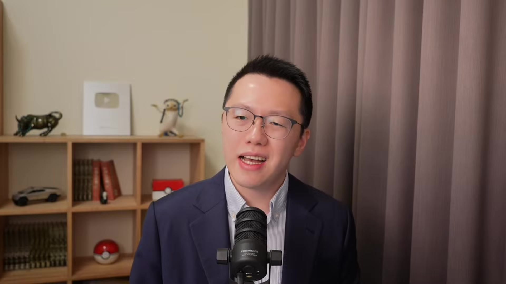

**逐字稿片段：** 科技財報公佈之後 很快的在11月份呢 Anthropic預估就會啟動上市倒數了 現在估值大概挑戰1.75兆美元 半年營收現在也增長了接近有13倍 所以很難來做一個 均衡的定價 因為獲利的確成長太快了 整個26年上半年營收是163億 比去年同期的12億暴增了13.6倍 估值一年前是1,830億現在呢 9,600億好 所以市場對於AI的估值 提升了非常多 可是呢又要被迫做一些打折扣來 擔憂是否有信用風險的壓力 但至少對於這些大語言模型來說 它的確市占率還有營收進來 的速度比想像中還要來得快 這是Anthropic上市之後 對於市場 尤其是次級市場 資金的一個吸取 這是第一波

**話題推測：** 探討Anthropic上市倒數與其估值

---

## 00:10:05

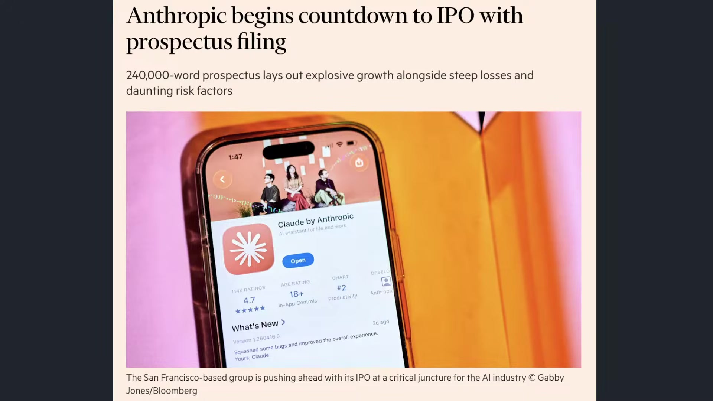

**逐字稿片段：** 那第二波呢 是傳統的科技巨頭 誒上禮拜我們也知道 Meta已經正式公佈 又要透過股票市場再籌集950億美元 來支應目前持續膨脹的AI基礎設施 這個規模有可能也是史上 最大規模的股票募資案 其中950億當中 350億美元是透過公開承銷發行 600億從明年第一季開始 透過市場逐步的去出售新股

**話題推測：** 揭示Meta透過股票市場籌集資金

---

## 00:10:31

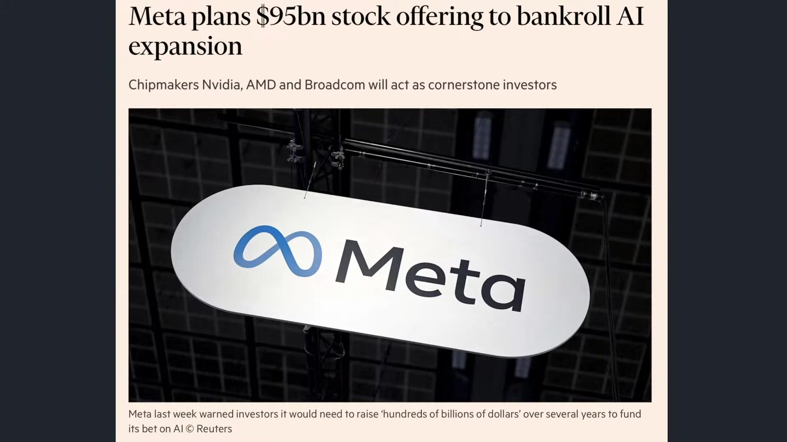

**逐字稿片段：** 那現在連輝達超 為博通也表達參與的意願就是 幫你做晶片的人 他都想要入股你了 三家晶片供應商大概會有提供 50億到100億美元左右的資金 那當然這也說明著因為 Meta它的現金流 上個季度還勉強保持在正值 第三季已經正式轉為負值了 這是真的沒錢了 那如果Google微軟亞馬遜 陸續傳出這樣的消息 那我們就必須要有一個醒思 殖利率已經這麼高的情況底下 到底這些巨頭還能夠 吸取多少市場的資金Google

**話題推測：** 指出輝達、超微、博通參與Meta募資意願

---

## 00:11:06

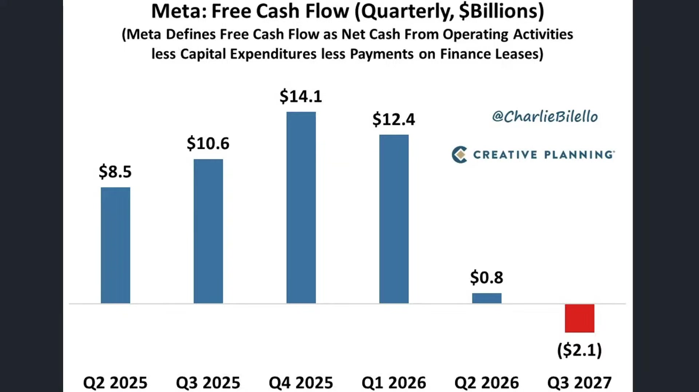

**逐字稿片段：** 上半年才打造2,000 億美元的AI金融系統 當時是跟摩根士丹利 還有黑石阿波羅博通合作嘛 2,000億美元的AI融資架構 來協助Anthropic取得大量的TPU 那整個架構 它不只是Google單方面的投入資本 它把晶片資料中心私募信貸和 租賃市場全部串聯起來 變成由華爾街共同出資的資產 所以上半年其實就這樣子玩的 就是Google自己主動去提供這個TPU 作為最後的 我們講說租約的擔保 來取得低成本廉價 Anthropic其實 它也可以自己去借錢 但是為什麼希望Google 能夠出DPU來做保證呢 原因很簡單嘛 就是如果我依照擔保機制 直接支付租金給專戶 那麼債權人呢 他可受到的安全感就來得更多 那最後呢 我就可以拿到相對比較 優渥的實際利率條件 貸款條件 就Anthropic主動去借錢 跟借由Google的幫忙做履約擔保去借錢 拿到的利率是不一樣的哦

**話題推測：** 介紹Google打造2000億美元AI金融系統

---

## 00:12:06

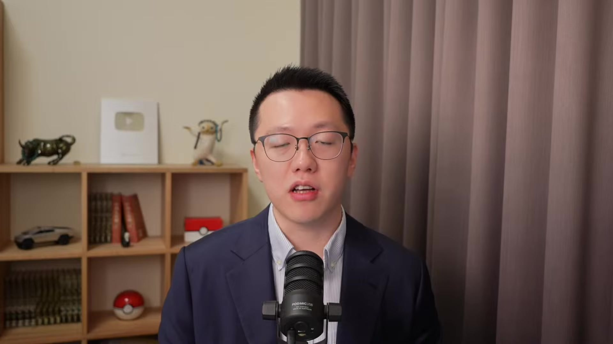

**逐字稿片段：** 我們根據Jefferies的統計哦 Google上半年幫那個 Anthropic擔保的資料中心呢 平均借款利率是多少 是7.1% 說7.1 那也很多 這又不是他自己的投資等級在 他幫anthropic擔保的 但是哦整體新興雲端服務商的 融資成本現在大概是多少 是9.3-10% 所以Google已經幫他過保 過保證已經低蠻多的 更何況現在什麼Coreweave 隨便借個錢都要15%的殖利率 所以整體而言 上半年是拿到不錯的利率 也不能說現在市場上完全沒有錢 但是呢你只要能夠讓輝達 讓黃粑粑幫你做擔保 你基本上呢 都可以拿到還可以不錯的利率 相對於平均水準的 但是如果你拿不到的 自己去借 哇 那看起來動不動就是雙位元數字起跳了 這也說明著整個AI資料中心呢 我們按照目前態勢 基本上你問很多工程師都知道 現TOKEN是 一用就燒完的 基本上TOKEN是永遠不夠的 重點其實來自於兩點第一 錢還夠不夠玩這場遊戲 我能不能在AI生產力爆發之前 先消耗這麼多的資金 但是還沒有立即的回饋第二 建不完怎麼辦 建不完就有人違約 那麼延宕的風險就 必須要有人來做承擔 現在市場上最大壓力就來自於 因為正在新建的資料 中心真的非常非常多

**話題推測：** 展示Jefferies統計的Google擔保借款利率

---

## 00:13:23

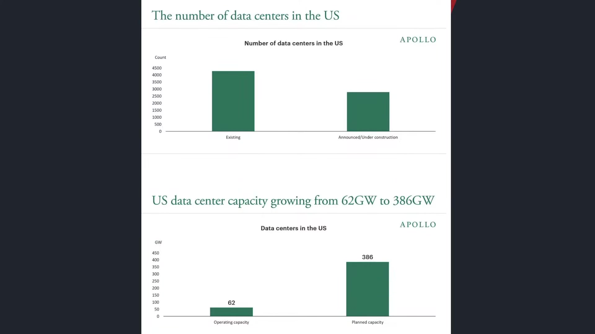

**逐字稿片段：** 如果細節觀察 美國大概總體有4,300座的 資料中心正在運營當中 正在蓋的呢 有2,800座 哎這真的很誇張 相當於現有數量的65% 更驚人的是電力的容量 美國資料中心的運營容量大概是62GW 但規劃中的是三 百八十六吉瓦 是現有規模的6.2倍 你說短短5年內 因為五年內這些資料 中心就會全部蓋成嘛 你的電力要成長6倍哦 哪來這麼多電 會不會蓋好沒電可用 以前是怕蓋好 伺服器進不來就是 建築五金蓋好 因為晶片太貴 機體太貴進不來 現在好不容易機體壓力沒這麼大了 誒就告訴我沒電 那是更大的壓力 所以我們才講說 現在AI資料中心的擔憂 我認為都不是市場的需求不足 市場需求還是很旺盛的 怕的是第一 融資遊戲玩不下去 錢不夠了 第二怕你沒蓋完 唉結果租約到期 要有人承擔 像美國現在AI資料中心依賴 的高收益債的融資債 整體大概有20檔的專案融資型債券 總體發行規模接近455.9億美元 好其中像Meta甲骨文core weave 好這些債券的到期殖利率 最低的大概有8-9% 最高的呢 在本季度 有16.6% 好所以有Google 有輝達來做信用支持的都比較低一點 沒有的哦 那個動不動1516% 搞不好到年底就變20%的 你就知道這一些人他所需要 負擔的融資成本壓力會有多大

**話題推測：** 展示美國資料中心數量及建設中項目統計

---

## 00:14:56

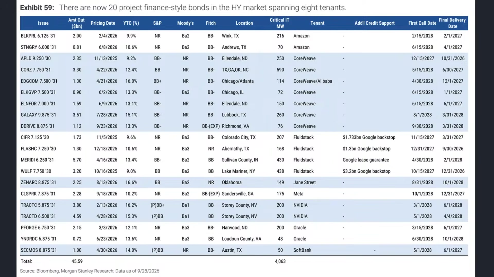

**逐字稿片段：** 更何況 現在在短短的一個月度 美國和芬蘭大概已經出現了7起 融資電力監管相關的事件延後

**話題推測：** 列舉近期資料中心融資電力監管事件延後

---

## 00:15:05

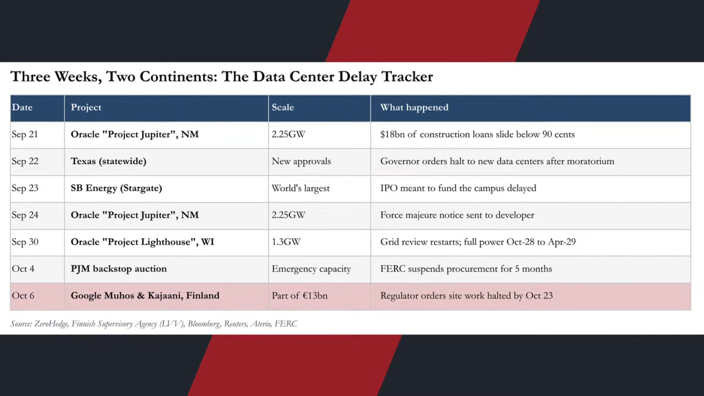

**逐字稿片段：** 甲骨文之前在新墨西哥州的木星計畫 2.25GW 180億美元的建設貸款價格 跌破面額的90% 開發商也收到不可抗力的通知 延後了 Wisconsin有1.3吉瓦的燈塔計畫 因為電網的審查被迫要重新啟動 現在大概原本完工時間是明年10月 現在已經延到後年的4月了 大概延長了6個月左右 一個月就有6起資料中心 看起來有延檔的壓力 好這個就足以彰顯的市場上的壓力 大概是建不完 而並不是需求不夠 那現在呢 AI最大的隱憂 就變成了一方面 沒有足夠的算力準時履約 那第二方面呢 就是那如果真的履約了 問題結束了嗎 也沒有完全結束 這就是市場擔憂為什麼 因為怕你使用量還在增加 但是營收沒增長 這不可能呢 如果使用量還在增長 至少這場遊戲應該還玩得下去 的確 但是第一 錢不一定夠 第二現在的營收結構其實有開始分化

**話題推測：** 說明甲骨文新墨西哥州木星計畫延宕

---

## 00:16:04

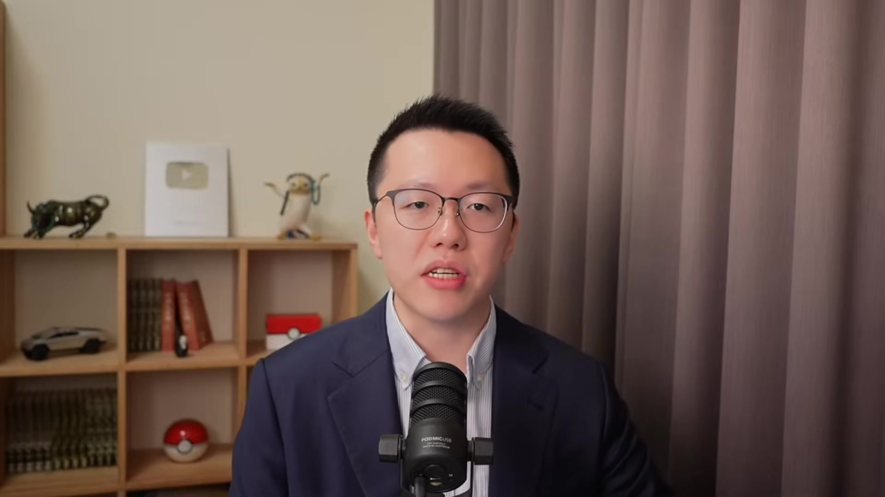

**逐字稿片段：** 我們根據YAPI data的資料 現在Anthropic的營收哦 你看它IPO了嗎 它一開始透露自己的內部營收條件了 其實他越來越依賴少數幾個熟客 大型企業客戶 26年支出排名前1%的客戶 每個月平均支付金額從30萬美元 現在到今年8月份 每個月付285萬 成長9倍 中位數從25萬美元攀升到220萬 說明頂級的AI客戶 正在瘋狂的花錢可是 這一群頂級客戶占客戶 支出的比重從25年初25% 現在已經上升到接近50%了 這說明Anthropic的營收成長 已經越來越依賴少數高 用量的企業持續擴大AI預算了 那一般的小型公司 沒有錢沒有那麼多錢 每天燒這麼多TOKEN 你稍微用chatgpt 你一天可能上傳一支影片 或者上傳幾百張照片 你發現那個使用量 即便是plus 可能一下也就滿了 這說明現在客戶大幅度 集中的風險正在升高 那有些大客戶 他可能是科技巨頭裡面的員工哦 那一旦他們 也做自己的模型 使用自己的AI 那也許就會對於單一 企業產生重大衝擊 好所以現在概念就是風險 有一點過度集中的味道 就是你好像也不是看 全世界的使用量一起攀升的 它是越來越集中到少數幾隻寡頭身上 這個現象有點類似那個 以前那個日本泡泡浴女郎 通常都是熟客經營模式 因為你做久之後哦 生意通常都會集中在固定客人 因為你比如說服務過程當中 你難免會遇到那種很奇怪的要求 或者難以相處的客人呢 這個時候通常女郎就會 跟店家的公關來協調 避免再次接待 那反過來說 如果一個客人他不喜歡某位女郎 通常消費一次就會換人了嘛 那雙方自然就形成了篩選機制 所以根據我的理解 最後這個泡泡浴 的小姐 通常留下來的跟她的客人 都是那種彼此比較熟悉 然後願意持續消費的熟客 基本上最後都是搞訂閱制 就是大家就是互相熟 都是做熟客而已 所以現在Anthropic目前的行銷模式 它的運營模式 感覺就有越來越像 它已經不靠那種純增量民間的使用了 越來越集中在少數幾隻大型企業當中 對 我怎麼知道 不是我 不是我 我是聽說的 我有一個日本朋友跟我分享的 哪個朋友 賴桑 哎不要亂開玩笑 不要亂開玩笑 這段直播可能要剪掉 好險我們現在線上人數不多 1.9萬人 還來得及剪呢 現在 哎現在選舉時間 一萬多人直播都算少的 我聽說現在早上去公園直播 就兩三萬人的 那我明天改去公園直播好了 一方面有很多政治人物在那邊拜票嘛 另外一方面今年波動那麼大 可能也會有很多股民在那邊一起直播 第一次直播冒冷汗 待會要剪掉 好那我們回過頭說 企業現在投入AI的預算已經增長 但是不同規模的使用者的確 出現了比較明顯的分歧 我們再看幾個細一點的資料 從整個9月份來看 AI支出最高的一%的企業 每位員工的平均投入大概是9,900美元 比8月份稍微回升一點 但是比7月份的高點還來得低 相對之下 前10%的企業每名員工的支出 大概來到840美元 一般企業的中位數來到18美元 其實都還在創高 說明其實還是有增量的了 可是呢由於營收結構越來越 來自於少數大型那些 手上成本或者說融資 或者說整場遊戲它能夠消耗 得起更多TOKEN的這些企業 所以感覺會有一點過度集中的跡象 可是我們反過來說

**話題推測：** 展示Anthropic營收日益集中於少數大客戶

---

## 00:19:58

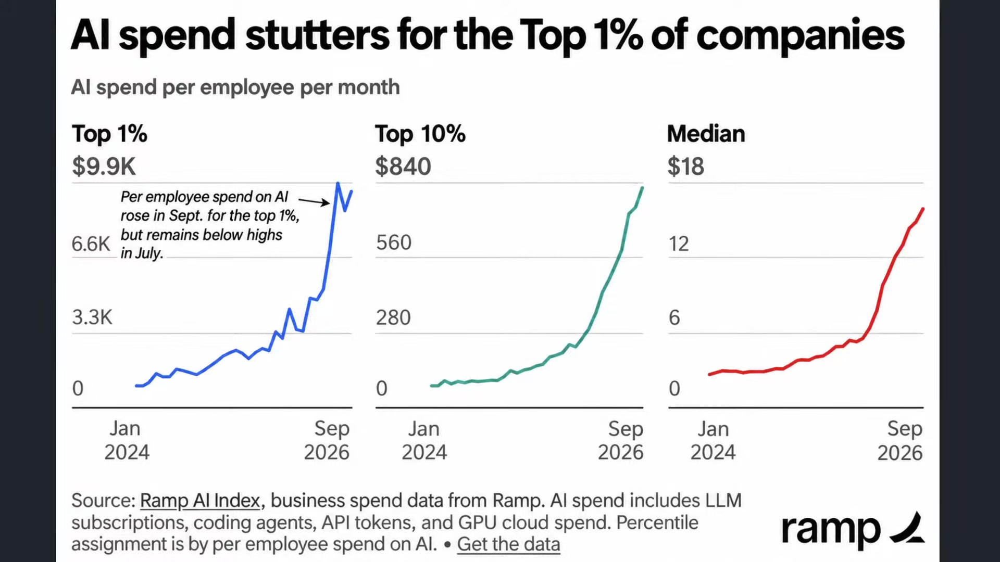

**逐字稿片段：** 它等同於AI TOKEN的數量還在暴增 年初不到100的指數的水準哦 現在大概是到1,000個 如果我們從倍數來看的話 成長到個10倍左右 可是問題在於哦 同期的AI支出 大概只上升到600 什麼意思呢 就是大家花的錢沒這麼多 可是使用的TOKEN量非常非常之多 那大部分的AI巨頭 尤其是做語言模型的 又沒有在今年有大漲價的情況底下 那最後就變成 這個使用量的增加 跟我們看到TOKEN成本當中的落差 就必須要由自己來做承擔 好這個是我們遇到比較大的壓力

**話題推測：** 比較AI TOKEN使用量與AI支出增長

---

## 00:20:35

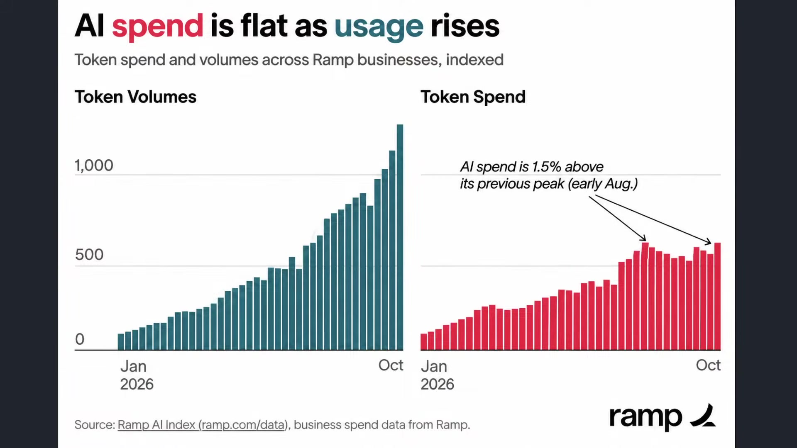

**逐字稿片段：** 所以馬斯克為什麼才在兩天前呢 他發了一條Twitter 特別警告說 債務市場幾乎不願意再借錢給那些 高度依賴AI資料中心營收的公司哦

**話題推測：** 引用馬斯克對AI融資風險的警告

---

## 00:20:45

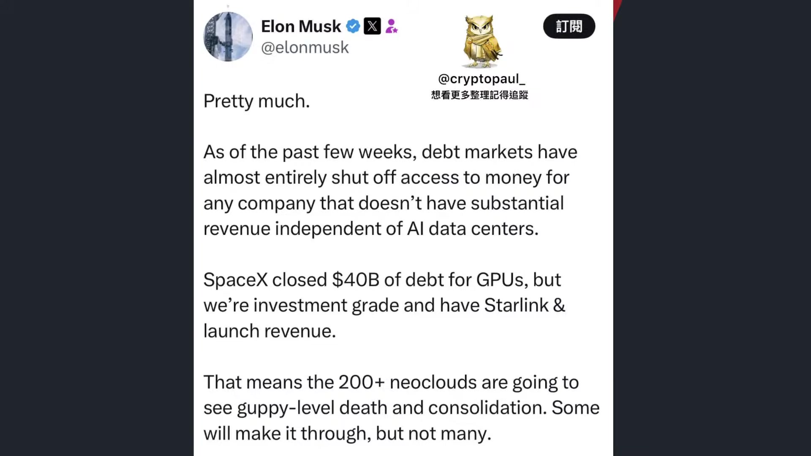

**逐字稿片段：** Spacex現在完成了 400億美元的GPU的債務融資 那是因為他們還有Starlink有火箭 那馬斯克也預告 說接下來 可能有超過200家的AI雲端 公司沒辦法成功的活下來因為 現在市場上只願意借錢給那些 已經有本業穩定現金流的業者 沒有穩定現金流的業者 你只想要靠這個AI的 租賃循環玩下去的業者 尤其是新興雲端業者 那可能受到的壓力就很大了哦 好這是馬斯克給予市場的一個預告 好我們看一下美國股市四大指數表現 道瓊上漲100四十六點 0.28% 收在52,361點 標普上漲50三點 0.7% 收在7,676點 納指上漲214點 0.83%收在26,169點

**話題推測：** 提及SpaceX完成GPU債務融資

---

## 00:21:30

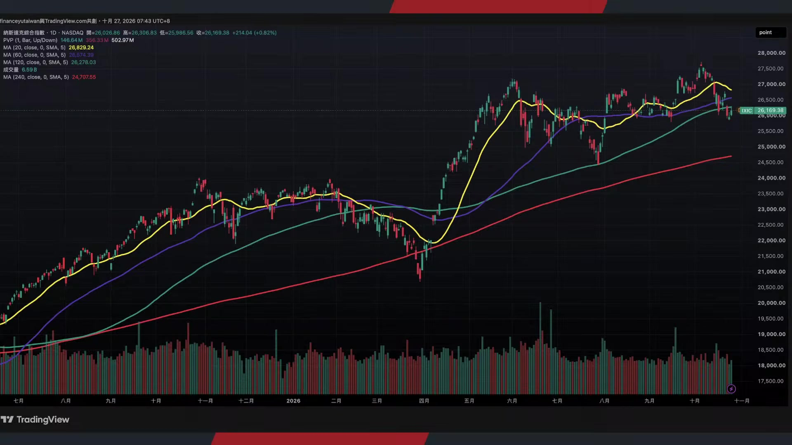

**逐字稿片段：** 標普上漲304點 2.82% 收在11,083點 我們其實就是想跟投資朋友分享 市場上 並沒有想像中這麼樂觀 市場當中是很精明的 我們講的概念呢 其實大多數的投資人也大概 清楚知道現在的困境在哪裡 所以只有兩種方式可以解決 第一個就生產力的大突破 用了這些AI 反而創造更多的產值 那另外一個呢 很簡單嘛 要有些企業無法熬到最後 有些企業可以熬到最後 那當然呢 從投資角度而言呢 你只要永遠依循著頭部的那幾家企業 你會發現常年報酬還是很漂亮的啦

**話題推測：** 展示另一個指數（可能是費半或期貨）的收盤表現

---

## 00:22:08

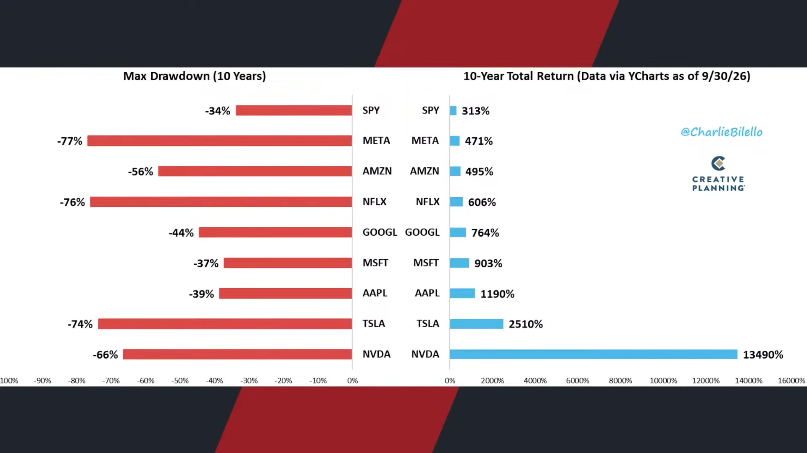

**逐字稿片段：** 以過去10年呢 你不要用過去10個月 過去10年來看 輝達累計報酬是13,490% 特斯拉是2,510% 蘋果是1,190% 微軟是903%那當然 不可能單壓某只個股 可是我們要瞭解的事情是 個股當中的回檔有時候是很大的 比如說我們看最大回撤 輝達曾經跌6成六 特斯拉曾經跌74% Meta曾經跌過77% 這就說明著 有時候你看對趨勢 你也不一定能夠熬到最後 因為你死在波動了嘛 借由分散風險的方式 投資這些巨頭 我相信熬到最後的可能性還是很大的 你看 這就是一點一滴哦 那10個月內 你感覺好像今年 科技股根本就沒波動嘛 你放大到10年呢 我相信它還是能夠 給予你足夠的報酬 投資就像是 無數的小水滴一樣 你匯聚而成 最後就變成一場海嘯了 因為複利力量每天都在上漲嘛 你每一次退潮的時候 它就檢視你還能否待在場上 小水滴最後就彙聚成海嘯 那你需要漫長的時間等待嘛 那投資人要累積的就是財富 是海嘯 不是洋流哦 完了完了 這段也要剪掉這段 好在我們現在線上人不多 哎那首歌怎麼唱的 男子漢行動快速像 那江河湍急 行動快速 像那江河湍急 就是你要行動果斷加速 但是呢你要長期留在河流當中 最後就變成海嘯好不好 那我們回過頭說

**話題推測：** 展示過去十年輝達、特斯拉、蘋果、微軟累計報酬率

---

## 00:23:38

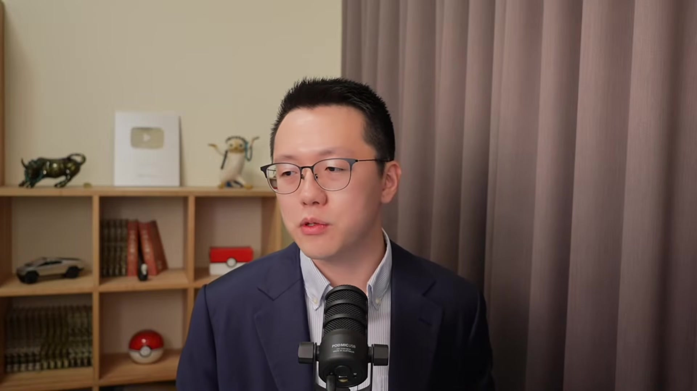

**逐字稿片段：** 第二層風險呢 是下禮拜二就即將 舉辦的美國期中選舉了 美國有57%的民眾 現在還是認為對於AI社會是有害的 你看到共和黨行最近也不再強調AI 資料中心的建制當成本土的政績 我們看到EPSO最新在10月底所根據 市場的最新民調會發現57%的人呢 居然認為AI對社會是有害的 只有42%的人認為是有益的 其中在年輕族群呢 有65%報持的負面看法 越年輕越覺得AI對他是有害的 反而是比較年長的 覺得AI可以幫助我們生產力有所突破 機器人 對於福利設施 有更進一步的幫助當然 現在美國集中選舉造成這樣的結果 其實就說明了有一股擔憂慢慢出現 那就是民主黨如果全面勝利 資料中心的擴建潮是否 會面臨強大的阻力呢 民主黨現在其實已經預估了 美國當然不會因為民主黨勝 選而立刻停止新建資料中心 但民主黨的看法認為 必須第一要採取更多的國會聽證 企業調查州政府以及地方政府 對於土地電力建設許可的限制 必須由國家統一機關 避免AI的副作用 AI正面作用還沒到來 負作用已經先展現了 這個是民主黨目前給予的態度 有可能會導致剛才我們提到的AI 數據專政社的這個實施時間線呢 可能會進一步的往後 那當然從目前的選舉角度來看 這個的確民主黨看起來已經占上風 非常明顯了

**話題推測：** 討論美國期中選舉的第二層風險

---

## 00:25:09

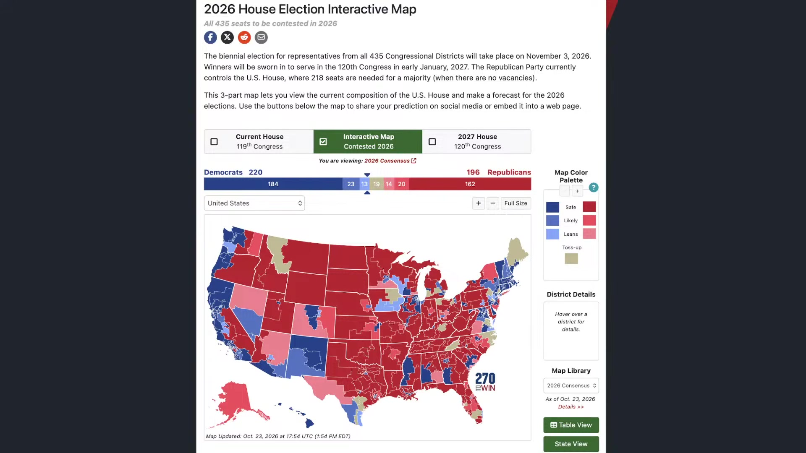

**逐字稿片段：** 現在從 435席的眾議院的全面改選呢 共和黨現在還是有眾議院的多數 但是根據最新的選情來做預估 民主黨預估可以取得220席 共和黨是196席 雙方大概已經拉開了 奧瑞從Polymarket賭盤來看 基本上一定 幾乎了眾議院一定是民主黨拿下來 現在重點在參議院 如果參議院能夠順勢拿下 那麼民主黨就在國會 形成絕對多數 民主黨在參議院的勝 選機率大概是65% 那共和黨是36% 如果是從席次來進行推算 目前來看的話 民主黨大概預估拿下 如果是從參議院來看的話 大概是49席左右 那眾議院 應該講這個民主黨 大概在參議院是49席 共和黨大概46席左右 還有一點誤差範圍哦 不過看起來民主黨在短期內 的聲勢的確相對比較高哦 民主黨現在也做了很多放話 第一步放話是針對 這個我們過去提到 在華爾街跟川普之間 我們過去提到的愛潑斯坦案 愛潑斯坦其實以前本來 想說已經告一個段落了 但民主黨的態度很明顯 之前川普政府所公開的檔 以及他跟川普家族的商業來往 可能涉及更多不當行為 尤其很多數據還沒有完全的公佈 民主黨呢已經準備好 全面調查川普和華爾街 那會不會成為共和黨未來的政治包袱 值得留意 這看起來大清算時代已經到來了 尤其這一次眾議院的監督委員會 民主黨領袖賈西亞也特別表示 接下來 他不只會要求川普 或者相關人士 盡可能到國會來做聽證以外 也會要求大量的華爾街高層來做聽證 來瞭解這件事情發生的經過 那第二大方面呢 是來自于國防部長赫格塞斯 因為我們都很清楚知道 民主黨對於這一次伊朗戰事 是抱持非常大的反對態度的 民主黨批評他對於 伊朗的行動人事調整 還有去年大家還知道有那個 機密軍事資料資料的外泄事件嘛他也 之一他的領導能力和適任性呢 所以呢預估準備針對 國防部長赫格塞斯發動彈劾 不過因為彈劾的標準還是很高了 所以無法立即有效的達成 可是這些事情呢 似乎都說明著當前呢 民主黨有點勝券在握的樣子 都不再拉票了 開始放話說 勝選之後他要做什麼事情 也許說勝選之後他要做這些事情 更有利於名義上或者選票的一個集中 這也是有可能的 好但至少我們都很清楚知道 目前看起來 由於短期內通膨問題和經濟問題 沒辦法在一周內改變 所以選民也許 投票的傾向已經大勢底定 我們就看一下 到時候跟民調之間的差距 這樣一看 誒時間還過真快 下禮拜三就美國中期選舉了

**話題推測：** 展示眾議院與參議院席次預估

---

## 00:27:57

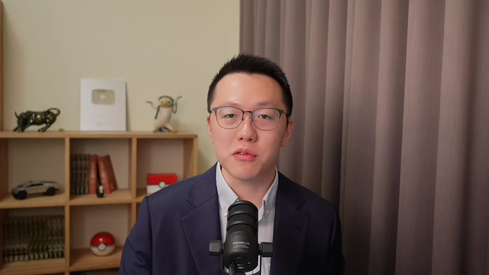

**逐字稿片段：** 川普現在面臨的政治困境呢 其實跟當年拜登面對高通脹 民眾不滿經濟現況的處境非常相似 甚至更加棘手嘛 那講起來也很諷刺 當年川普是重新崛起 靠的是告訴選民 美國已經被拜登政府搞得一團亂 通脹 然後中東問題必須讓他重新上臺 把過去累積的污泥 全部清掉 就像一條堵塞已久的水管 要把它徹底的疏通嘛 那問題是 川普現在執政也快兩年了嘛 通膨消失了嗎 中東局勢和緩了嗎 你不能再把所有的問題又推給拜登嘛 更尷尬的事情是 你還得說服選民呢 再給我們共和黨一次機會 要繼續支持他的政策 這就形成很有趣的矛盾 川普當年他的口號是要改變嘛 現在變成again 就過去他告訴大家 只要把拜登留下的污泥清乾淨 美國就能夠重新運轉 現在他要讓大家相信呢 過去兩年的關稅戰 政策的反復 市場震盪 經濟不確定性 再來一次again 一個是臺北順起來 一個是臺北安可 一個是要把那個淤泥打通 但是另外一個是再來一次安可 再唱一首 所以我要重複過去兩年的經驗 你選哪一個 所以這場期中選舉 我覺得真正最大的挑戰是 那美國選民究竟認為 川普在疏通選水管 還是要再來一次 這段可能還是要剪掉 今天要剪的很多 這幾年直播做下來 我發現一個很有趣的事情就是 因為每個人難免有自己的立場嘛 有時候今天可能開了一個玩笑 那網友說 沒想到浩哥是這種人 太令我失望了 那另外一邊的網友很開心 果然跟我是同道中人 還過兩天 換一個角度 換一個玩笑 他本來很失望 唉原來浩哥是站在我們這一邊的 果然棄暗投明了 那前兩天把我當自己人的網友 覺得我是叛徒 所以這麼多年來 我們直播一直堅持一件事情 你用不同的角度 不斷地去解釋一項政策 一個政治人物 或者一種社會現象 你先不用決定自己立場嘛 每個人都有立場嘛 那你先不用立即的做決定 你不要找了立場之後來 尋求支持自己的證據 你每天用不同的角度來重新的解釋 也許你看這件事情的角度 可以更加的立體 我們講 我們直播其實講到最終的目的是什麼 就是 把所有人搞到精神分裂嘛 這是我們最後的目的 好沒事 0902 臺北股市上漲491點 收在46,532點呢 由於時間因素了 我沒辦法把後面的 新聞給一系列做同審的 只能稍微提點一下了 因為明天 應該是今天吧 基本上就是以色列的國會改選了好 那

**話題推測：** 分析川普當前政治困境

---

## 00:30:42

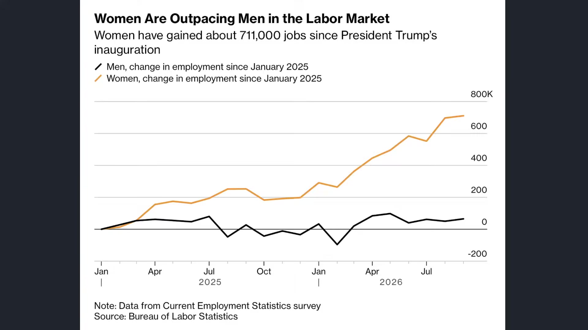

**逐字稿片段：** 川普有沒有借選行為呢 看起來有一點 我們看一下在最新的川普談話當中 這一次呢 川普是很明顯的 公開支持內塔尼亞胡 他在最新的出售球上寫道 就連我們的敵人也很清楚 我跟內塔尼亞胡一直 保持非常好的關係 我們多次攜手獲得成功 我們過去 發動的午夜之錘行動 阻止了全球頭號的支持 恐怖主義的國家獲得核武 大家去投票的時候 一定要記得內塔亞胡是一位非常傑出 驍勇善戰的總理呀 所以大家要投給他 哦這算不算公開介選呢 不重要反正投票結果很快就知道 到底川普的喊話是有 正面作用還是有負面作用

**話題推測：** 探討川普介入以色列選舉的行為

---

## 00:31:24

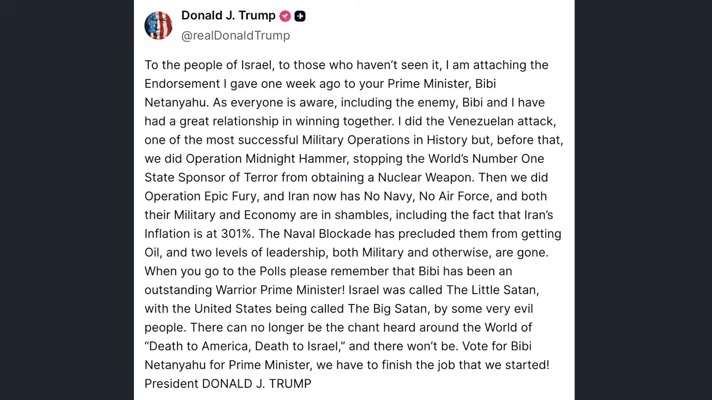

**逐字稿片段：** 那另外一方面呢 之前他支持的現在巴西總統的對手 之前我們所聊到的右翼的候選人 前總統博索納羅之子 弗拉維奧 現在呢哎 現在很明顯 這一次也落選了 就是之前川普所支持 的巴西的右派人士 好這一次 驚險地輸給了盧拉 當然了 我們要後續看一下這次選舉的判定 不過這跟當年死亡之霧好像有點像哈 好像川普現在幫 國際某位領導人月臺 好像那個後果都不是特別好 但這件事情也就說明著 其中選舉 對他本身也許會有相當大的壓力 我們稍晚再來跟投資朋友把 國際局勢做一系列的同整 我們這邊主要講的概念呢 其實大概分為兩個方向 一方面呢 第一部分是來聊說整個AI市場上顯 面臨的風險 看市場的質疑 它是有其道理的 說明了第一 市場並不是特別樂觀第二 我們當然是靜待它的生產力的提升 或者在融資循環當中會洗掉一些企業 這第一種結論呢 那第二種結論是來自於其中選舉 大家會擔心呢 民主黨如果獲得在國會上的全面優勢 是否會導致 原本資料中心就已經 延宕的情況來得更為加重 這是有可能的 可是一樣 它不是泡沫破滅的開始 它是中期回檔的可能 為什麼這麼講呢 因為泡沫破滅一定要算力過剩 一定要讓大家意識到 原來我建了這麼多的AI 只是生成出一些 毫無使用

**話題推測：** 提及川普支持的巴西候選人落選

---
