# yutinghaofinance_gtxpFAVDySE — 關鍵畫面索引

- 來源逐字稿：[yutinghaofinance_gtxpFAVDySE_GT.srt](yutinghaofinance_gtxpFAVDySE_GT.srt)
- 影片：https://www.youtube.com/watch?v=gtxpFAVDySE
- 截圖數：25

## 00:00:35

**逐字稿片段：** 我們看在上禮拜 川普跟普丁同意向 全球來進行柴油的投放 標普五百指數仍然在高位進行震盪 那費半也上漲了420點 不過應該講說 道瓊上漲420點 不過這一輪費半的下壓就比較沉重了 所以會不會在內部產生 進一步的資金輪替 從在上半年的硬體股持續往軟體股 或者往已經疲憊已久的道瓊來做 移動這值得觀察 因為現在最大的挑戰就是 即便投放柴油 讓原油價格壓在90美元每桶左右 10年期公債殖利率和30年 期公債殖利率並沒有因此而緩下來 換句話說 到底現在殖利率的上升 是不是完全在反映能源通膨呢 這就不一定了 很有可能反映的是背後AI的 投資需求的排擠壓力

**話題推測：** 介紹川普與普丁達成柴油投放協議的國際新聞

---

## 00:01:24

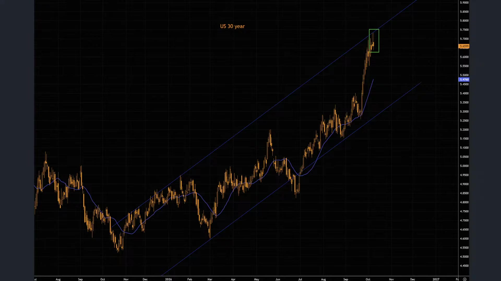

**逐字稿片段：** 我們看這一次美國10年期公債殖利率 週五是上升兩個基點 來到5.25% 美元指數已經連續4周上漲了 這是2025年5月份以來的最長連漲周數 那現貨黃金上漲了1.5% 好所以從消息面來看的話 只能說現在看起來是穩住油價了 可是能不能穩住 長天期殖利率 這是未來觀察的重點了 畢竟美國股市雖然還在上漲 但上漲的基礎在過去幾周 一直以來都是比較脆弱的 我們過去提過嘛 現在殖利率在高點 然後油價在100美元上下震盪 美元又在持續走強 連儲會看起來還是屬於比較偏鷹的 那隨著整個金融環境的不斷收縮那 那現在又有這麼強大的AI的算力需求 來讓科技巨頭的 自由現金流受到資本支出的侵蝕 最後所導致的效果 那就是 漲幅越來越集中在少數科技巨頭

**話題推測：** 具體說明美國10年期公債殖利率的最新數據

---

## 00:02:19

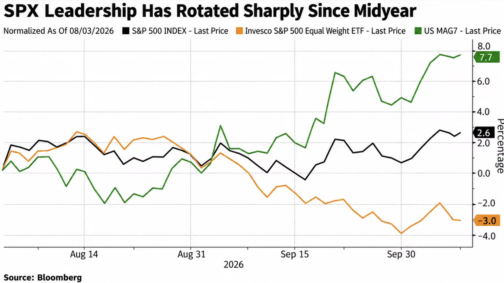

**逐字稿片段：** 以及在Triple c的債券利差 已經飆到1,000個基點以上

**話題推測：** 提及Triple C債券利差的飆升

---

## 00:02:25

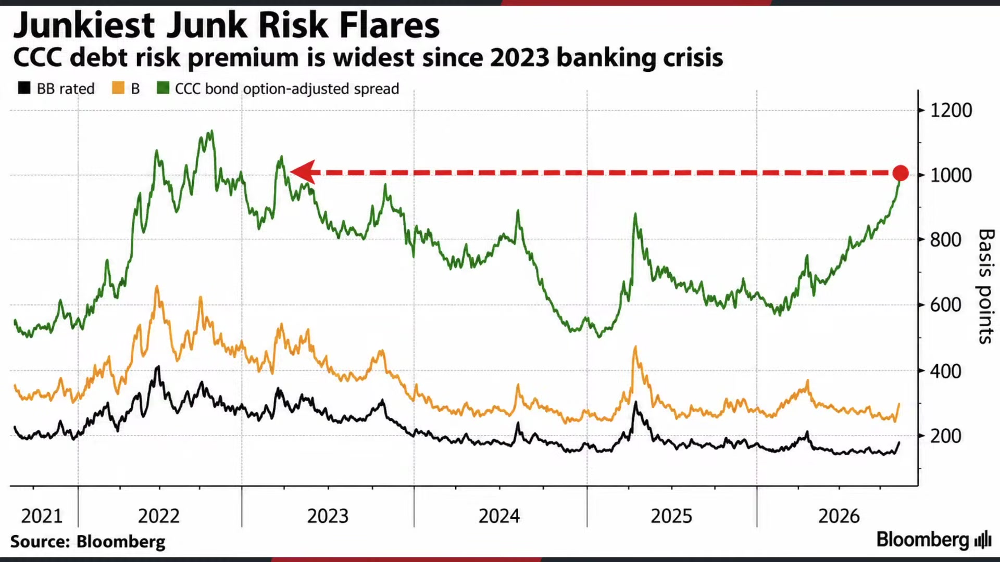

**逐字稿片段：** 現在有39%在納斯達克指數當中 處於困境貸款中的科技股好 這也就說明了錢越來越稀缺了 股市的漲幅相對而言 廣度並沒有想像中還要來的健康 好這都值得留意的 其實從整個26年來看 你會覺得成交金額還不錯哦 市場上其實流動性還不差

**話題推測：** 說明納斯達克指數中處於困境貸款的科技股比例

---

## 00:02:45

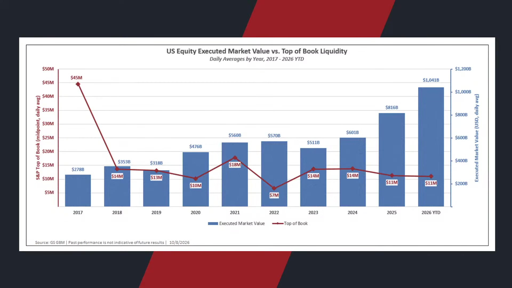

**逐字稿片段：** 的確現在每天的成交金額在 美國股市大概是1.04兆左右 相對於2023年的5,110億美元 相對而言看起來是翻倍了 但標普五百指數最佳 買賣報價的掛單深度 卻從1,400萬美元降到1,100萬美元 減少了21% 如果拉長到2017年來看 市場每股成交股數從 65億股增加到187億股 掛單深度反而收縮了76% 什麼意思呢 這就代表著現在 成交量是的確正在增加 但是不代表市場真正 能夠承接大量的賣單 也就是現在市場流動性呢 其實並沒有想像中這麼好了 交易是熱絡 可是崩跌的風險反而越來越高 那最大的矛盾就是什麼 就是市場看起來好像很熱鬧 可是真正願意接盤的資金 其實沒有想像中來的多了 現在就靠ETF 靠選擇權 靠杠杆交易來推升交易量 但是當市場遇到突發利空的時候 也許造市商會瞬間的撤單 所以這個時候就會發現 真正的流動性 並不是每天交易量不夠而是 也許那個掛單的 買盤量沒有想像中來得大 大家都靠ETF 也就是可能最後大家都是根據 關鍵點位來進行資金的撤回或者加碼 那這也代表著 如果內部的輪動在科技巨頭有所鬆動 對於股市的影響就很大了 現在就是小股票 跌慘跌到地獄的很多 大股票大多數都撐住了 但是呢這些大股票如果未來鬆動 也許就會大幅度的 影響到ETF的資金買盤

**話題推測：** 美國股市每日成交金額的具體數據

---

## 00:04:17

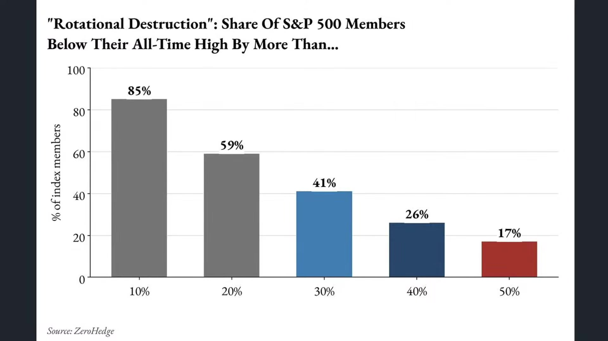

**逐字稿片段：** 我們從標普五百指數成分股當中 高達85%的股票 現在已經從自身的歷史 高點下跌超過10%了 那你要知道標普現在還在創新高哦 有59%下跌超過兩成嘍 41%的股票下跌超過3成嘍 甚至有26%的股票下跌超過4成嘍 這在標普500指數當中 有17%的股票居然在標普500指數當中 跌幅已經超過5成了 這說明著 即便大盤看起來真的還算是蠻強勢的 可是很多個股早就已經 經歷相當嚴重的修正 市場就是靠這幾隻 少數權值股來支撐指數 那很多投資朋友跟我們跟我們一樣 屬於偏向被動擇股 主動擇時 你有的都是大股票 都是指數型ETF 你覺得沒受傷 其實呢 從個體而言 我相信很多人體感 溫度好像越來越差了

**話題推測：** 分析標普五百指數成分股從歷史高點下跌的比例

---

## 00:05:09

**逐字稿片段：** 從8月27號一路到上禮拜五 10月8號 標普五百指數累計漲幅大概是1.28% 可是呢如果我們把AI股票予以剔除 叫做SPX的XAI 好就反而是下跌5.19% 所以其實上個禮拜跌幅是很重的哦 尤其在非AI類股當中兩者報 差別已經大概差了有6.47個百分點 好所以即便美國股市現在還在上漲 但是就靠幾隻AI巨頭 而且還不是靠所有的AI巨頭 就靠少數的AI巨頭在往上撐 那如果我們細看

**話題推測：** 比較標普五百指數含/不含AI股票的漲幅

---

## 00:05:43

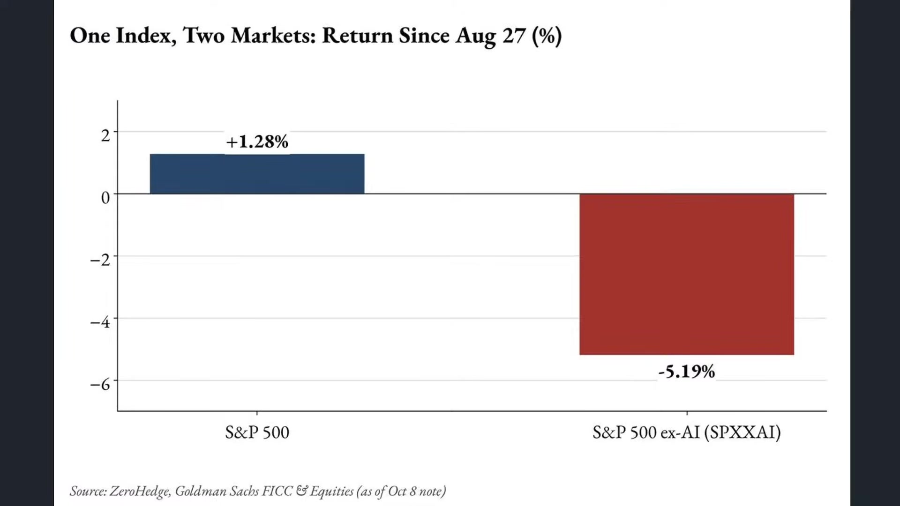

**逐字稿片段：** 在整體獲利層面層方面來做觀察 科技類股大概整 體第三季的年增幅 預估大概會64%哦 帶動標普五百指數的整體 預期獲利成長28%

**話題推測：** 分析科技類股第三季的獲利年增幅預估

---

## 00:05:54

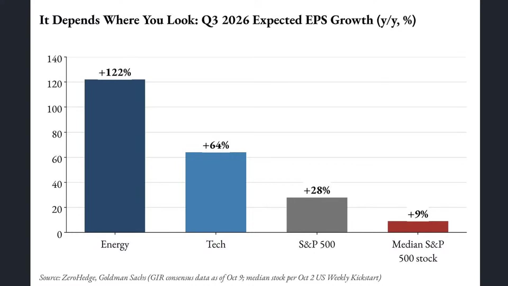

**逐字稿片段：** 可是如果我們觀察標普500 成分股的獲利成長中位數 就不看平均值 獲利中位數只有9% 這就差別很多了 一個是平均會成長兩成8 一個是中位數只有成長9% 就跟我們薪資的體感一樣 它跟整體指數是相差了19個百分點了 那所以它不是說股票的極化而已 在企業獲利上也是一樣 它並非全面的爆發 是高度集中在能源和 科技等少數的產業 所以呢它就造成一個現象 那就是這些科技巨頭 是唯一推動股市的力量 那這些科技巨頭推動 股市的力量是追漲嗎也不是 這麼大的股票怎麼可能推得動呢

**話題推測：** 對比標普500成分股的平均獲利成長與中位數獲利成長

---

## 00:06:33

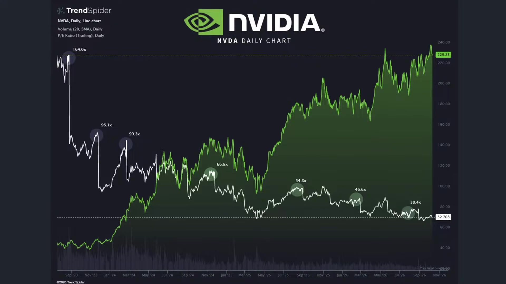

**逐字稿片段：** 我們看輝達的部分 輝達股價是創高了 可是創高的背後 其實更多依賴的是獲利上升的買盤 也就是本益比下調 你看當時的整體本益比 從三年前四年前一百幾十倍一 百六十四倍 到後來九十倍八十倍七十倍六十倍 到現在3十二倍 甚至看前瞻本益比 它只剩下18倍了 所以輝達已經迎來了新冠 疫情以來最便宜的時刻了 如果從基期來看是如此 那這個就是現在 推動指數走高的理由 並不是大家急著要追漲 也沒有那麼多的追漲情緒 主要就是哇 那本益比再低下去 不買可惜呀 好這是造成的推升 好那這是我們觀察到 在美國股市內部的分化 還有獲利的分化 那回過頭說 現在能不能借由一些在政治上的動作 讓市場上的利率資金得以 沖銷呢現在中小型股跌那麼慘哦 很肯定有很大一部分 就是由於利率的稀缺 利率的升高所導致資金 稀缺以後排擠到中小型股 能夠獲得的貸款空間 如果現在你有錢 你是銀行業 你當然優先貸給輝達 誰要貸給中小型企業 尤其現在資金又這麼貴 我怕他還不起 所以如果借錢成本能夠因此而鬆動 那也許就有 讓中小型股能夠復活的空間了 如果我們仔細觀察 現在主要受到的市場情緒影響

**話題推測：** 轉為討論輝達（Nvidia）的股價與本益比

---

## 00:07:52

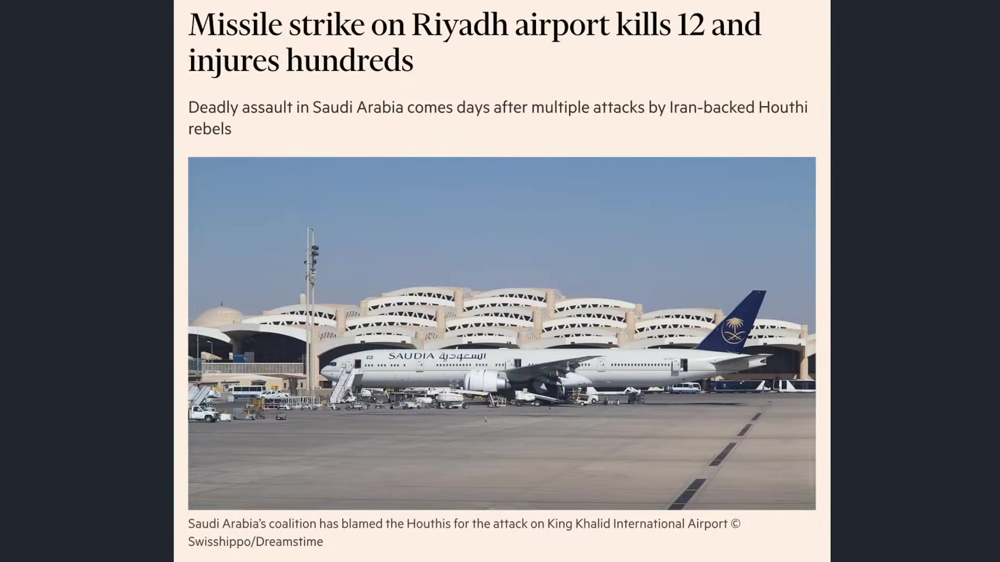

**逐字稿片段：** 一方面當然是中東問題 因為沙烏地阿拉伯的首都 利雅德的國王國際機場 禮拜六是遭到飛彈的攻擊 有12個人死亡 超過300人受傷 機場是全面暫停運營 大量航班取消或者轉降 這已經是一個禮拜當中三次遇襲了 哦那這一次死的人很多 死了12個人 那這也說明著 中東戰爭呢 原本大家都是擔心海上航道的問題 結果搞到現在 民用航空 重要的商業活動都受到影響了 本來沙烏地阿拉伯要 舉辦世界石油大會 還有未來投資者倡議峰會 現在呢哎 你到機場你是有可能遇襲的所以呢 當然會影響到接下來沙國的情勢 那這次是誰攻擊的呢 並不是由伊朗主動攻擊 而是由青年運動或者 我們講說胡塞武裝 來採取進一步的中東能源的新威脅 其實你們發現 對 青年運動 青年人實在太衝動了 有沒有發現 那個中東戰爭都有一個特性都是 週末才有鬼故事 平日好像都休戰 所以我覺得還蠻特別了 胡塞武裝 現在掌握了葉門大概70%的人口 紅海的航運和全球能源市場 就變成了單點的伊朗問題 轉向紅海的胡塞武裝問題 那它最值得關注的地方就是 它已經不算是單純伊朗 所支持的地方叛軍了 現在已經成為了有自主 戰略目標的區域力量 過去呢伊朗是透過黎巴嫩的真主党來 提供胡塞武裝來訓練武器或者技術 但隨著哈馬斯和真主党這幾年 在戰爭當中受到以色列的重創 胡塞武裝反而提高了在 伊朗抵抗軸心當中的地位 現在呢胡塞跟伊朗未必需要 一個直接上下的指令關係 因為雙方本來就有共同利益嘛 但是至少讓整個中東的局勢更加複雜 而且川普看起來並沒有 要由於這一次的空襲 對於葉門採取進一步的軍事行動 那看得出來 也許在期中選舉之前 川普都不會再有軍事行動 那整個中東的地緣政治衝擊 就開始產生外溢效果 先場內部問題好了 內部其實阿拉伯經濟已經算不錯了 真正衝擊大家都是波斯灣裡面的國家

**話題推測：** 切換至中東問題的討論

---

## 00:10:02

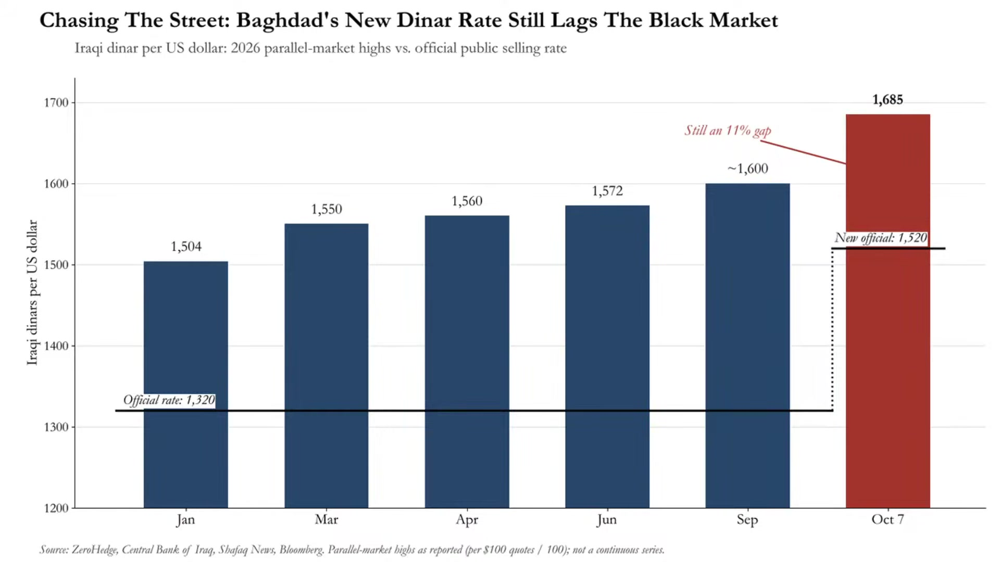

**逐字稿片段：** 像卡達像伊拉克 伊拉克上禮拜哦 把官方美元的售價從一 美元兌1,320塊第納爾 直接調整到1,520塊 等於是官方直接貶值13% 為什麼要貶值 因為經濟撐不住了 去年原油出口每天是350萬桶 今年3月份以來只剩下125萬桶 等於以前一年賺300萬的 現在只能賺100萬了目前 伊拉克公司石油行銷衝擊 比想像中要大非常多 獲利大概都是衰減六成到七成以上 那在這樣效果底下 政府採取什麼樣的做法 就是當時外匯存底 戰爭爆發的時候 大概從1,000億美元降 到8月的800億美元了 但是政府光是每個月 的薪資就要支付50億 所以呢伊拉克政府是採取 貨幣高強度的貶值 可以讓整體國家成本 能夠進一步的下滑 那進一步衝擊的是什麼 就是通膨的壓力嘛好 就伊拉克經濟好不容易這 幾年好不容易好起來了 3月份一切全部打回原點了 那美國對於伊朗的 經濟其實還在封鎖當中 是否有取得適度效果呢 誒其實是有的哦

**話題推測：** 將焦點轉向伊拉克經濟情勢

---

## 00:11:08

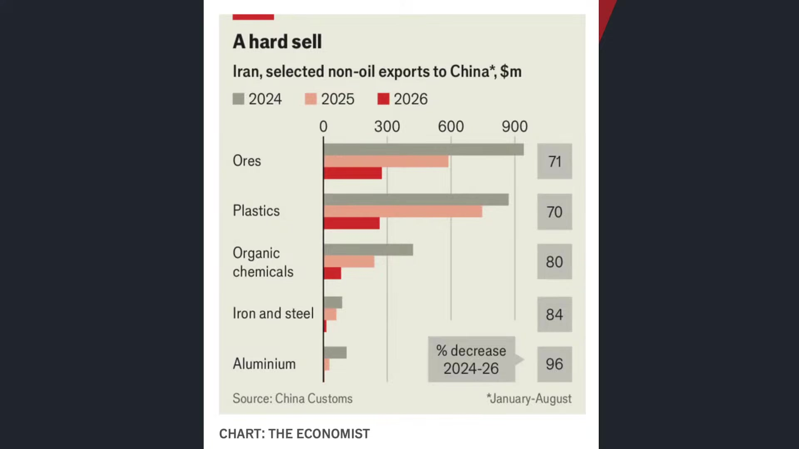

**逐字稿片段：** 伊朗的裡亞爾 今年貨幣 暴貶了5成 匯率跌到270萬里亞爾對一美元 9月份通膨是90% 食品交通通膨是115% 其實美國軍艦現在基本上 是完全封鎖了伊朗港口 就是沒有任何一毫 伊朗的油是可以運出來的 9月整體原油裝船量 出貨量是0 這是1979年來首次 兩個月前美國都沒有封鎖這麼嚴重 現在美國真的是完全堵死了 所以經濟 當然是崩潰了 但是政權是否會投降呢 美國的制裁正在奏效 但是也許至少在其中選舉之前呢 他很難達成結束戰爭的政治目標 看起來是如此 所以對於伊朗而言呢有衝擊 但是它就是活著嘛 那對於全球而言呢 大家又會好奇 伊朗戰爭誒 現在已經打8個月了 全球經濟怎麼還沒有崩潰呢 其實我們可以從不同角度來做思考 戰爭爆發初期 市場是一度擔心 霍爾木茲海峽遭到封鎖以後 油價就一路飆 然後飆到200美元 然後全球的停滯性通膨再度產生 誒當時最高 4月份油價是126塊嘛 其實後了面後面就沒有再創高了 所以如果我們考慮考慮到 通膨調整之後的實值售價 目前原油價格 其實還是偏高了但是呢 並沒有到全面失控的地步

**話題推測：** 將焦點轉向伊朗經濟情勢，提及裡亞爾貨幣貶值

---

## 00:12:30

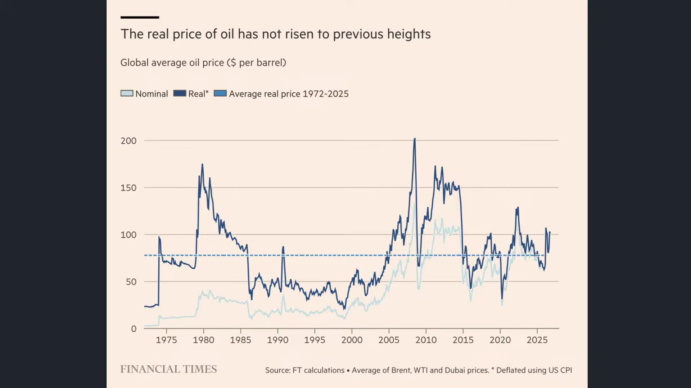

**逐字稿片段：** 為什麼這次能源衝擊 沒有造成全球經濟崩潰 大概有4個原因 第一個就是能源轉型 其實已經降低了全球 經濟對於石油的依賴 我們過去幾年對於能源比例 從石油發電的比例 對於煤炭發電的比例 其實一直在下滑 那第二就是供應鏈其實比 想像中還要來得更有彈性 這從2021年22年以後就是如此了 企業其實更能夠重新 調整運輸和採購方式 第三是中東以外的產油國正在 迅速的擴增石油和天然氣的供給 美國的葉岩油商也是賺的盆滿缽滿 最後呢就是我覺得最大因數了 因為各國最近都在 進行石油庫存的釋放 尤其是戰略石油儲備 所以把短期的供給缺口給補上了 戰爭的確造成了供應鏈的中斷 可是全球能源體系 並沒有因此而完全失去運作能力 我們講一個直觀數據 從波斯灣目前石油 出口的恢復能力來看 2月份波斯灣的原油出口量是1,950萬桶 到現在9月呢 很多人說下滑很多是沒錯 可是還是有1,630萬桶 哎你說減少幅度好像還好 但是其實有很大一部分 開始由紅海往外做運輸也就是 的確霍爾木茲海峽那邊是非常嚴重 可是中東國家還是能夠靠 延布港往西邊來做運送 或者借由陸運的方式把原油給運出去 這就是一個新的能源成本的挑戰 大家其實在2021年22年 航海王時代就已經經歷了這種 高強度的這種供應鏈的衝擊 所以目前全球經濟其實還是 處於一個比較脆弱的平衡 但沒有到崩潰的地步 能源供應鏈還是能夠成功的調整 讓原油價格還沒有失控 那AI資本支出現在還在成長 甚至把那個經濟上的疲憊給沖銷掉 就大家也知道實體經濟其實 零售銷售沒有那麼好嘛 可是AI資本增速太好了 硬是把經濟給往上拉了 就好像AI非常好 出口好那即便臺灣經濟內部 你覺得實質購買力唉 通膨壓力好像蠢蠢欲動哦 可是數據就給你擺給你看 經濟成長10%你很難 很難有人說今年臺灣經濟很差勁嘛 因為你經濟都已經保10了 那即便內需稍微疲憊一點 沒有跟上 你都不得不承認經濟 成長仍然在加速 那這兩股力量都存在對於 全球經濟的影響 石油庫存呢不可能 無條件的不斷的釋放 所以川普 待會我們會聊 進行柴油原油的敲定 跟俄羅斯 也許是緩和油價的一種方式 那另外一方面AI投資 雖然正在暴增 但也不可能永遠以同樣的速度成長嘛 所以這是未來要做調整和觀察的方向 而反過來說 川普也有可能宣佈勝利了 那油價也沒有失控 然後逐步退出這場難以明確 成果的戰爭 畢竟伊朗受到政治重創 但是政權看起來也不會因此而垮臺 對於波斯灣的影響力 也沒有完全消失嘛 那現在呢 我們反而要觀察的是短線上的消息 因為中東疆區哦 其對原油的影響越來越小了 反而是在短線上

**話題推測：** 分析此次能源衝擊未造成全球經濟崩潰的四個原因

---

## 00:15:29

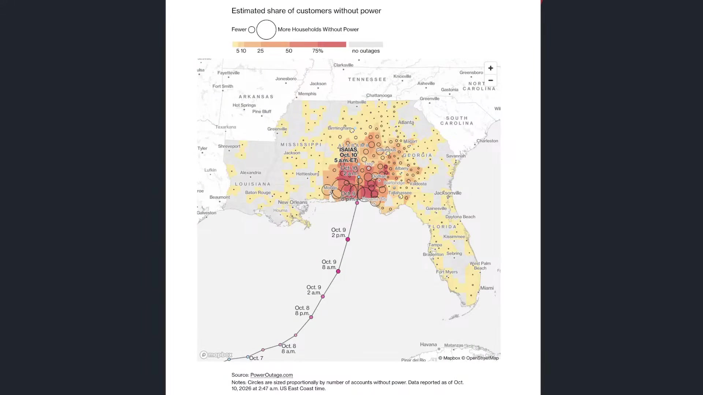

**逐字稿片段：** 包括美國颶風這一次 重創了墨西哥的能源生產 接近72%的石油產能已經停擺 那對於全球供應呢 產生極大衝擊 在種種效果底下 中國呢在上個禮拜突然宣佈 禁止燃油出口 你說那中國又不產油 應該講說產油量又 不是說有到出口的地步 禁止燃油出口的目的什麼 其實很多中國是借由成品油的出口哦 也就是加工油 在過往賺取龐大的利潤呢 但是中國現在 本身呢在內部重新開放燃油出口以後 很多國營石油企業 為了要賺出口利潤呢 開始大量的囤積成品油 反而推升了國際油價 好所以中國 採取了一定程度的市場監管措施 導致現在原油價格稍微比較緊繃一點 在種種措施底下最後呢 逼的川普跟普京呢 最近宣佈達成了新協定 柴油供應協議 那原油價格當然短期內下跌 俄羅斯立即宣佈 在未來一周會向全球 供應超過30萬噸的柴油 11月再提供50萬噸 後續再追加100萬噸 助川普的期中選舉一臂之力後續呢 到年底之前也許可以來到300萬噸以上 那美國財政部 馬上在上禮拜就發了臨時許可 你要知道 在拜登時期 美國是第一個制裁俄羅斯原油的 好那現在烏俄戰事還在打的情況底下 川普跟普京已經達成 了柴油的供應協議 所以在這樣的一個效果底下 全球短期內原油價格 可能受到持續性的抑制哦 當然澤連斯基也會因此而受到承壓 好川普呢 這一次不斷的去指控 這個澤倫斯基不願意配合 雙方的能源停火協議 雖然在一天以前 川普在初搜球上又發文說 他已經宣佈俄羅斯和 烏克蘭之間的軍事衝突 即日起已經實施能源停火 還可以繼續打 但是不能夠 打對方的能源設施 已經獲得烏俄雙方的同意哦 不過烏方這邊的表態 好像並沒有這麼的肯定哦 基本上就你以前給武器你就叫得動了 現在你不給武器你就叫不動了 大概是這樣子 那諾貝爾和平獎 今年川普已經沒拿到了嘛 我們就看明年了 好但不管怎麼說 至少可以看得出來 川普對於其中選舉和通俄門的意志 重視程度是非常高 有人問說 我們現在到底是直播還是錄播 場景換回來了 但是直播 好不好是直播 如果是直播的話 下面會寫直播 如果是錄播 下面會寫正在首播 如果是傳播 那會在KTV 好所以我們現在是直播OK 好那不管怎麼說 剛才所講到的種種措施 等同於 川普在國際政治立場當中 最大最大的一個目標 就是在期中選舉之前呢 嘗試著讓通膨效果能夠成功的抑制 很多人現在開玩笑說 現在這種國際局勢 已經回到17世紀了 你看俄羅斯現在在鬧鼠疫嘛 法國在大革命呢 東歐還在混戰 那美國國防部還要公開處決罪犯 那就像回到17世紀對不對 很恐怖 好那當然呢 我們講說川普 對於能源價格的抑制作用存在 但是川普 所採取的措施會不會 影響到原油價格的緊張呢 對於通膨的緊張感而言呢

**話題推測：** 討論美國颶風對墨西哥能源生產的影響

---

## 00:18:42

**逐字稿片段：** 其實我們根據彭博調查 國際油價對於政治 喊話也越來越麻木了 其實大家就在走自己的供需關係 所以我們雖然講了這麼多新聞 但是國際油價你有沒有發現呢 這個下跌也是有限的 對於它的利多 現在川普的抑制通膨 上漲其實也是有限的 也沒有再挑戰4月份的高點了 主要就是來自於 目前市場針對政治喊話 其實是越來越麻木了 我們看彭博做不斷的統計 從4月2號在電視演說當中 持續威脅要轟炸伊朗 導致布蘭特原油在 短短31分鐘暴漲了7% 到10月1號川普再次警告 如果不接受公平協議 就可能不復存在 結果原油原油價格上漲 大概0.08吧 1%都不到 不是不是1% 0.1%都沒有到 這說明著其實 整個市場對於川普的政治威脅 已經產生免疫力 那一樣的 對於川普的原油政策利多 看起來效果也沒這麼大了 其實這一段時間呢 從今年大概3月份以後

**話題推測：** 分析國際油價對政治喊話的麻木程度

---

## 00:19:44

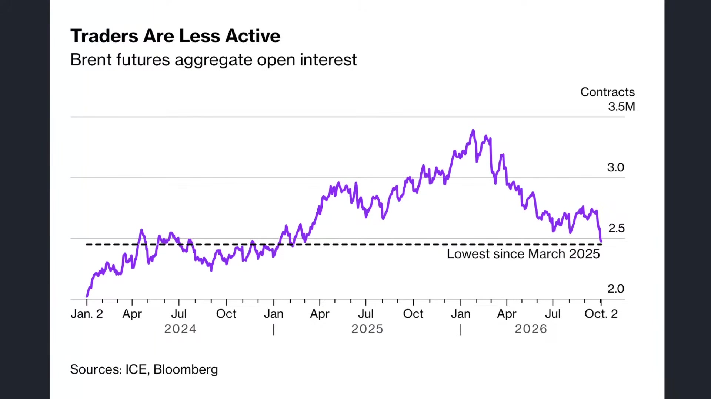

**逐字稿片段：** 布蘭特原油期貨的未平倉的合約數量 26年年初大概有330萬口 現在10月初 只剩下245萬口 減少超過25% 這說明著未平倉量的下滑 代表尚未結清的期貨部位正在減縮嘛 投資人對原油部位的配置 已經趨於保守 那結合最近原油價格 日內的波動又很小 這就代表著 其實川普即便在中東 戰事不斷的有喊話 可是對於市場的影響力 其實在不斷的減弱當中 那就說明的原油價格 最後就要回到供需面了 川普的影響也許沒有 想像中還要來的大了 大家更多的是根據真實的 供應產量的關係來做觀察 好這也就反映著 接下來也許在政治衝擊層面呢 效果大家可能會越來越無感了 當然了這也就說明著能源 對於實質利率的影響 它其實慢慢變成次要因數了

**話題推測：** 提及布蘭特原油期貨未平倉合約數量的變化

---

## 00:20:38

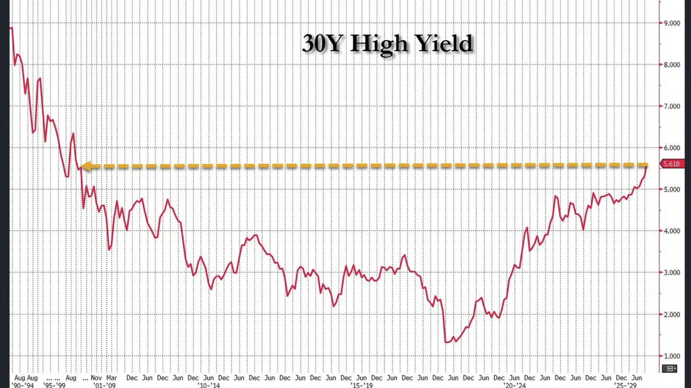

**逐字稿片段：** 現在30年期國債實質利率 公債實質利率又創下26年來的新高 整體而言已經來到5.3% 甚至往上沖 在10月8號當時標售的 220億美元的30年期公債實質利率 現在大概到 5.6 %左右 10年期大概在5.35.2左右 好這也就說明著 其實現在公債殖利率 還在往上飆 但是原油價格還沒有完全失控 其實更多是反映AI投資 所形成的排擠效果 正由於AI太缺錢了 所以把市場的錢給借走了 排擠掉了美國公債原本的實質買盤 所以現在高利率進入到新時代 不能夠再完全怪給通膨了 其更多還是來自於資金本身更貴了 資金更貴也就代表在AI經濟越好 吸取資金的需求越強 那麼利率就要被迫走升 好所以就不是變成利率越高 股市就得跌得拖拉股 更多是AI經濟太好了 好到大家在瘋狂搶錢所以 資金變貴了 可能要倒過來來看這種因果關係 當然也不代表說利率一路的往上走 經濟就一路好 它是背後還是會有互相的抑制效果 你利率高到一定程度 經濟就漲不動了嘛 因為借錢成本實在太貴了 那現在呢 重大的一個條件也不 單純是債務問題了 其債務以前的問題都是靠通膨 沖銷嘛好 通膨只要上升得夠快 我欠你的錢 20年30年以後 那就不是什麼大錢了嘛 現在比較大的壓力就是利率 開始默默地超過了經濟增長率 美國雖然負債很龐大 但是經濟成長還算是很強勁的 還是有能力能夠來承受高利率 可是你像歐洲

**話題推測：** 說明30年期國債實質利率創下新高

---

## 00:22:13

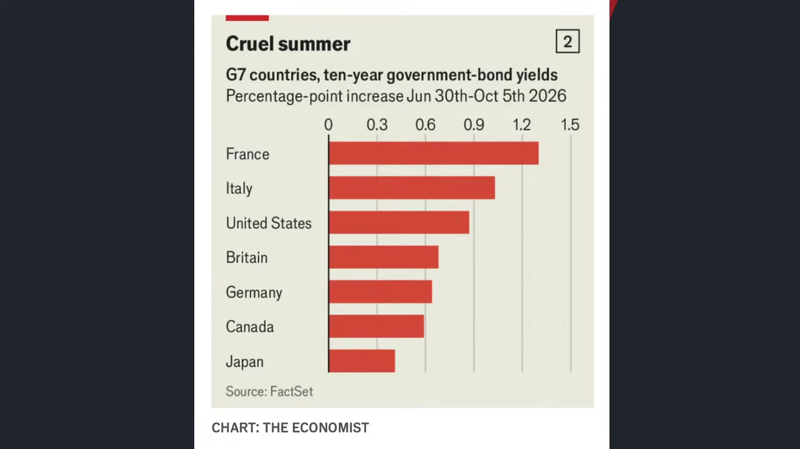

**逐字稿片段：** 現在法國義大利同時 面臨高債務低成長和政治 不不確定性 好像美法國在大革命嘛 法國債務占GDP的比值是120% 10年期公債殖利率已經 超過義大利和希臘了 如果以目前利率重新融資 那等於政府必須要創造一個 相當於GDP1.8%的基本財政盈餘 才能夠阻止債務比例繼續上升 那根本不可能嘛 法國現在這種政治現況 所以從這樣的一個角度來說 最後就導致了市場上 針對利率預期的不斷走升 那背後呢 也導致了美元指數的不斷走強 其實今年年初 因為有降息預期嘛 市場還是普遍看空美元的 就到現在為止 美元大概上漲4% 其實這已創下了4月份 去年川普貿易戰發動以來的新高 背後就三股力量嘛 一個就是歐洲的財政危機升溫 所以歐元的暴貶 導致了美元的走升 這是第一個 那第二個是美元現在 是能源的進出口國 伊朗戰爭推高了油價 反而是有利於美元的 第三就美國經濟真的在 全球當中表現算好的了 雖然沒有像單一國家 臺灣韓國日本這麼好 應該講日本不算了 沒有像台韓這麼好 可是相對於歐洲 美國經濟已經算是不錯了

**話題推測：** 轉為討論歐洲國家（法國、義大利）面臨的債務問題

---

## 00:23:25

**逐字稿片段：** 第一季2.5% 第二季2.2 第三季預估到3.7 哦所以為什麼聯準會可能在升息 預期感相對於歐洲央行更強一點呢 就是因為背後的經濟支撐好 這個就是我們觀察到全球資金的現況 當然了川普的種種措施 其實這就變成了相當尷尬的窘境 就是川普也許在能源成果 能夠產生適度的抑制效果 不要讓它漲太快 甚至原油價格也許 高點就在今年4月了 可是它能不能阻止實際利率創高 這就很困難了 那實際利率的創高 對於美國財政部的影響 對於內部的利率條件 或者對於房地產 對於車貸的影響 就很大了 那這對於實值購買力的沖起 市場上當然會有更為緊繃的影響 這原因就來自於 其實背後經濟的成長也 會帶動適度的通膨嘛 能源通膨因此也沒有完全的消除 所以川普雖然現在好像更為強調的是 我們要看看我們在 期中選舉之前的成果 美國的製造業有回流多少

**話題推測：** 提及美國各季度GDP成長數據

---

## 00:24:25

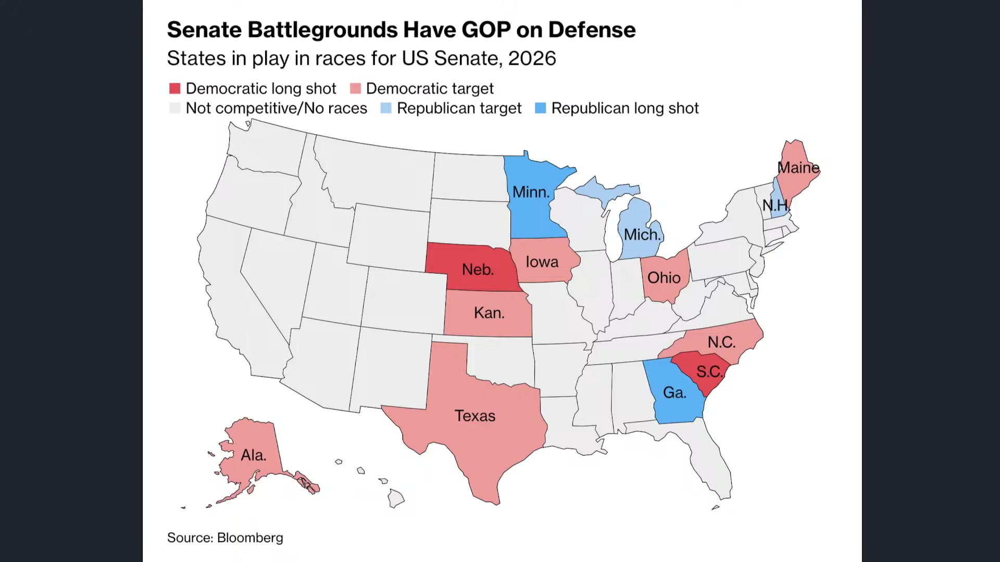

**逐字稿片段：** 現在愛荷華州有 150億美元的鋼鐵廠的回流 奧克拉荷馬州有大型的鋁的冶煉廠 阿拉斯加現在有臺灣 有韓國承諾高達上 百億美元的液化天然氣計畫 但是現在最大的問題是什麼 就這些大型建設還是 面臨的資金問題 AI資料中心都還沒有蓋完 就業貢獻的也不夠多 但是通膨的影響已經開始了

**話題推測：** 列舉美國製造業回流的投資案例

---

## 00:24:49

**逐字稿片段：** 所以我們看整個參議院改選的部分呢 共和黨現在已經進入 了顯著的防守戰了 我們根據彭博的整理 民主黨把德州阿拉斯加堪薩斯俄亥俄 還有貝卡羅來納州設 為主要的挑戰方向 那相對之下 整體而言 共和黨預估了至少會失掉一院 那是否會在參議院也跟著喪失 這值得觀察 因為川普現在雖然比較 聚焦在製造業的回流 可是很明顯嘛 現在選民在乎的跟川普 當時能夠順勢的擊敗賀錦麗 當時的根本原因一模一樣 就是大家相對於製造業回流 看起來更在乎的是生活成本 好川普的關稅 他當然能夠帶來數百億美元的投資 工廠回流到美國 哦這是實打實他的成果了 哦臺灣設了多少資金 那肯定是川普的功勞嘛 對於美國人而言呢 但這些投資計畫雖然存在 可是長期效果比較起來 選民更在乎的是汽油價格嘛 是食品通膨 是房貸利率 政府不斷的強調投資會有回來多少 但是民眾可能更想要的是 生活能不能輕鬆一點呢 所以 本身來看呢 很多時候無論是政治 還是經濟還是投資 有時候都是你有沒有回答真正的答案 有時候你可能 在實質上好像做對了什麼可是呢 選民最在乎的事情你沒有解決 影響還是很大嘛 所以有時候你可能是看對了問題 但回答錯了答案 這就是最後呈現的效果 最近看到一個笑話嘛 那太太那裸體站在鏡子前呢 跟先生聊天嘛 那越看越難過 唉我覺得我的皮膚開始皺了 胸部感覺越來越垂了 屁股越來越大 頭髮還少了一點呢 她講著講著就有點生氣 開始問老公哎 你難道不能夠講一點好話來鼓勵我嗎 老公很認真的看了幾秒 嗯至少你的視力還是非常好 哎對對對 所以我們看到川普面對選民 也有類似的困境 就是你也許問對了問題 你也許也瞭解問題的核心 但是你回答錯了答案 就產屍街頭 不管怎麼說 政府不斷的拿未來的投資 承諾來證明政策成功 這看起來是川普正在做的事情 也答對了 而且其實政策的回流效果非常好哦 可是哦 看起來選民只在乎一件事情 實質購買力 通膨壓不下來哦 即便你有再多的 製造業投資回流也不夠 我們根據密西根大學10月初最新 所公佈的消費者信心指數來到46.3 這個比原本已經很低的 預期47.6還要低非常多了這是 應該是歷史新低了 因為這項數據有統計 以來也沒有這麼低過 所以也不確定1970年代是不是更低 但至少可以看得出來 股市創新高 民眾現在的經濟信心 比金融海嘯還慘 這說明這高通膨是比 經濟衝擊還要來得大 比金融崩潰還要來得大了 那這一份調查最大的矛盾就是 在美國股市竟然是歷經歷史高點了 但是一般家庭對於經濟的感受 程度居然跌到了歷史的低谷 尤其是低收入以及股票 資產比較少的家庭呢 它是完全無法充分受惠股市的上漲 那個購買力衰退的幅度就來得更快了 中產階級好歹說 好歹我的資產在增值嘛 所以也許能夠互相沖銷 沒有買股票的人影響就很大了

**話題推測：** 分析美國參議院改選的選情預估

---

## 00:28:09

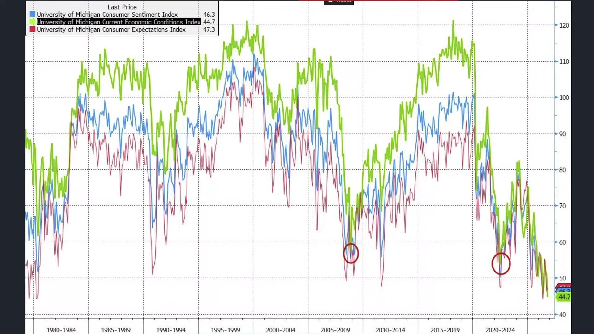

**逐字稿片段：** 好我們看下美國股市四大指數表現 道瓊指數上漲423點 0.83% 在51,654點 嘗試的站穩半年線 標普上漲46點 0.59 %收在7,811點 納指上漲172點 0.64 % 收在27,366點 費半下跌51點 0.41 % 收在12,572點

**話題推測：** 總結美國股市四大指數的當日表現

---

## 00:28:30

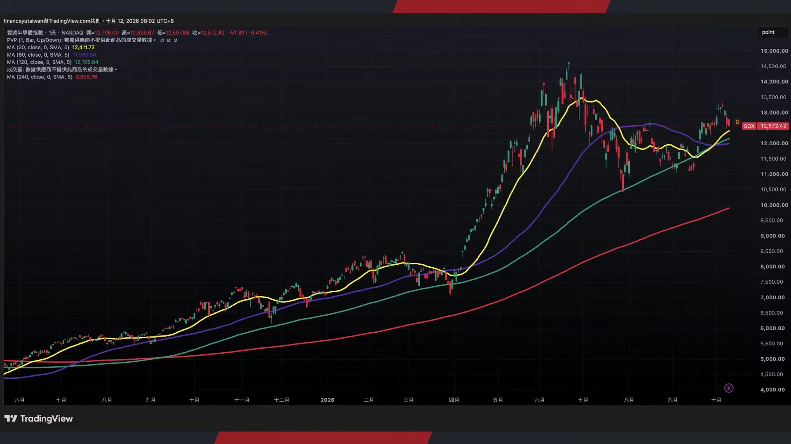

**逐字稿片段：** 台股開盤現在下跌500點 收在48,799點 其實台股即便這樣跌 今年還是跑贏了美國股市四大指數啦 其實從大型權值股來看呢 現在大概有 3只到4只左右 算是跑贏了大盤

**話題推測：** 提及台股開盤下跌點數

---

## 00:28:47

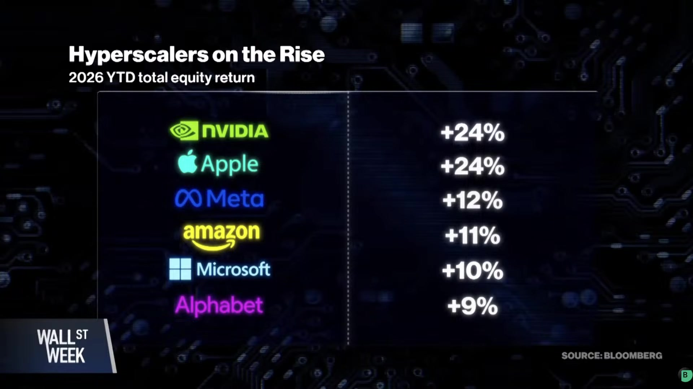

**逐字稿片段：** 輝達今年是漲了24% 蘋果24% Meta12% Amazon11% 微軟11% 大概阿發貝大概上漲9% 總體而言 其大型科技權值股慢慢慢慢 的變成了一個穩盤的作用了 那對於台股而言 現在的 受壓 因為費半最近跌幅比較沉重一點嘛 好但是也頂多就是在 高位進行震盪而已 現在隨著第三季財報 陸續的要即將開出 我們是不能夠期待大家在 下半年的追漲情緒跟上半年一樣 上半年有那個借貸呀 四代同堂的情緒不斷地推演吧 可是第三季為什麼講說 到第四季 時間是站在多頭這邊的 為什麼一直不斷地強調這一點呢 它本益比就一路下滑嘛 輝達146倍本益比 你覺得嫌貴 到80倍到70倍到60倍 到現在30倍 現在前瞻本益比 到明年這個時候大概就是八倍了 那八倍你買不買呢 所以用這樣的一個效果就可以呈現的 你只要知道未來幾個季度 它的獲利還在不斷的走升 它的本益比 會低到你被迫買進 我們當然知道高利率 本益比肯定要低一點 可是當它下行的速度太快的時候 有時候去買它也不是什麼追漲情緒了 就是 你已經極其便宜到極致了 你又是全世界的寡頭壟斷企業 被迫就要買進你了 好這給投資朋友做些思考 那隨著臺北股市美國股市 如果最近又開始產生了 新一輪的硬體股的回檔 好那我們一樣 到底是危機還是機會呢 我們始終相信是後者

**話題推測：** 列舉今年大型科技權值股（如輝達、蘋果）的漲幅

---
